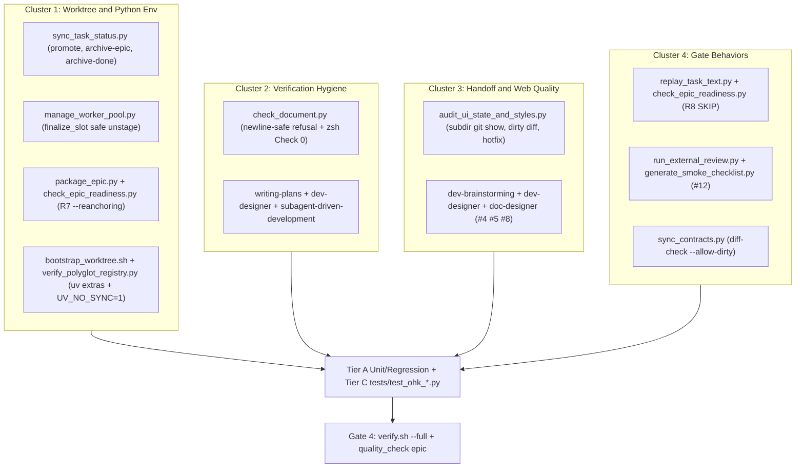

# Observer Hardening 2026-11 High-Level Design

## Table of Contents

- [Meta Data](#meta-data)
- [Background](#background)
- [Goals and Non-Goals](#goals-and-non-goals)
- [Architecture and Feature Maintenance Map](#architecture-and-feature-maintenance-map)
- [Integration Test Plan](#integration-test-plan)
- [Verification Environment](#verification-environment)
- [Shared Contract Impact](#shared-contract-impact)
- [BDD Suite Reference](#bdd-suite-reference)
- [Rollout Strategy and Mitigation](#rollout-strategy-and-mitigation)
- [Kanban Tasks Breakdown](#kanban-tasks-breakdown)
- [Spec Errata](#spec-errata)

## Meta Data

- **Epic**: `observer-hardening-2026-11`
- **Status**: Draft (Stage 2)
- **PIC**: duvthinh403
- **Target Release**: 1.36.0 (local branch — release deferred until active sibling epics finish)
- **Platform**: Python / Shell / Markdown Agent Kit
- **Depends on epic**: none
- **Source Spec**: [2026-11-26-observer-hardening-design.md](2026-11-26-observer-hardening-design.md)

## Background

Concurrent epic execution in `lyrics-sync` revealed 14 recurring defects and workflow gaps logged by `task-observer` across worktree status synchronization, worker pool git staging, post-rebase handoff re-anchoring, Python `uv` optional-extras preservation, shared `.venv` isolation, zsh newline handling in `check_document.py`, bare `npx` hangs in headless subagents, Visual Companion asset persistence, Step 1 task link premature validation, subdirectory `audit_ui_state_and_styles.py` git lookups, `R8 --replay` on contract-based tasks, immutable `.devtool/epic/` Minor findings in Cross-Model Review delta rounds, and `sync_contracts.py diff-check` inside uncommitted `review_tier: "full"` worker slots.

Additionally, an uncommitted live hotfix in the installed `d3nexus` plugin's `audit_ui_state_and_styles.py` (excluding `dist`/`.astro`/`.devtool`/`docs`/`target`/`tests`, scoping Invariants 2–4 to `ui_modified`, and filtering pre-existing base-ref findings) relies directly on `_get_base_file_content()` and would be lost on the next `scripts/release.sh` unless folded cleanly with regression tests.

## Goals and Non-Goals

### Goals

- Isolate multi-worktree status commands (`promote`, `archive-epic`, `archive-done`) so sibling `epic/*` worktrees are never mutated during concurrent Gate 4 runs (`#7`, `#14` Part 1).
- Harden worker slot staging (`finalize_slot`), post-rebase handoff re-anchoring (`package_epic.py --revise` + `R7 --reanchoring`), Python `uv` optional-extras bootstrap/preservation (`#11` kit), and shared `.venv` isolation docs (`#1`, `#10`, `#11`, `#15`).
- Harden verification hygiene: newline-safe `check_document.py refusal()` + zsh-safe Check 0 (`#9`), quality-manifest commands + ban bare `npx` + non-overlapping 180s `invoke_subagent` timer (`#16`).
- Harden handoff and web UI checks: Visual Companion persistence into `.devtool/epic/<epic>/assets/` (`#4`), deferred Step 1 task code spans (`#5`), subdirectory-safe `audit_ui_state_and_styles.py` + uncommitted diff merge + folded live hotfix + multi-template `Allowed files` (`#8`).
- Harden gate behaviors: `R8 --replay` self-skip on zero test-creation directives (`#6`), `deferred: out-of-scope epic doc (§4.4)` + browser smoke target inference (`#12`), and scoped `sync_contracts.py diff-check --allow-dirty` (`#13`).
- Deliver full unit, regression, and Tier C BDD integration coverage passing `bash scripts/verify.sh --full` and `@quality_check --profile epic` with zero impact on `main`, running daemons, live plugins, or external repositories.

### Non-Goals

- Modifying `lyrics-sync` observations `#2` or `#3` (`generate-flashcard-images`).
- Editing `lyrics-sync/.agents/quality/python-quality.json` (repo-local half of `#11`) or `lyrics-sync/tests/conftest.py` (repo-local half of `#14`).
- Modifying `ai-agent-tools` `main` checkout, sibling repositories (`D3Nexus`, `nexus`, `lyrics-sync`), or installed plugin directories (`~/.gemini/config/plugins/d3nexus`, `~/.claude/plugins/`, `~/.codex/`).
- Running `scripts/release.sh`, `git push`, or `git pull` into live plugin directories.
- Expanding scope into `ai-agent-tools` observations `#43`, `#46`, or `#53`'s Vietnamese reduplicative allowlist.

## Architecture and Feature Maintenance Map

### Canonical Source Paths and Entry Points

| Domain | Canonical Script or Skill Path | Key Symbols and CLI Entry Points |
|---|---|---|
| Multi-worktree task sync | `skills/dev-implementation/resources/scripts/sync_task_status.py` | `epic_checkout_roots()`, `promote_epic_tasks()`, `archive_epic_tasks()`, `archive_all_done_epics()`, `main()` (`promote`, `archive-epic`, `archive-done`) |
| Worker pool staging | `skills/dev-implementation/resources/scripts/manage_worker_pool.py` | `finalize_slot()`, `capture_slot_tree_sha()`, `CACHE_DIR_CANDIDATES` |
| Packaging and readiness | `skills/dev-implementation/resources/scripts/package_epic.py`, `check_epic_readiness.py`, `replay_task_text.py` | `package_epic()`, `check_metadata()`, `check_baseline()`, `replay_epic_in_worktree()`, `--reanchoring`, `--replay` |
| Python worktree and Gate 4 | `skills/dev-implementation/resources/scripts/bootstrap_worktree.sh`, `skills/quality_check/resources/scripts/verify_polyglot_registry.py` | default `uv sync` block, `_run_capability_subprocess()` |
| Document refusal gate | `skills/doc_quality_check/resources/scripts/check_document.py` | `_flatten_changed()`, `refusal()`, `main()` |
| Web UI static auditor | `skills/web-quality-check/resources/scripts/audit_ui_state_and_styles.py` | `_get_base_file_content()`, `get_git_diff_files()`, `_is_excluded()`, `run_all_ui_reviews()` |
| Cross-Model Review and smoke | `skills/dev-implementation/resources/scripts/run_external_review.py`, `generate_smoke_checklist.py`, `skills/dev-implementation/references/external-review-prompt.md` | `DEFERRED_EPIC_DOC_DECISION`, `_is_immutable_epic_doc_location()`, `delta_round_context()`, `auto_triage_section()`, `triage()`, `extract_target_from_text()` |
| Shared contract diff gate | `skills/sync-shared-contracts/resources/scripts/sync_contracts.py` | `cmd_diff_check()`, `--allow-dirty` |
| Skill docs and references | `skills/dev-brainstorming/`, `skills/dev-designer/`, `skills/doc-designer/`, `skills/doc_quality_check/`, `skills/using-git-worktrees/`, `skills/subagent-driven-development/`, `skills/dev-implementation/`, `skills/python-quality-check/`, `skills/cross-model-review/`, `skills/dev-lifecycle/references/orchestration-roles.md`, `skills/sync-shared-contracts/`, `skills/writing-plans/` | `SKILL.md` frontmatter (`name` + `description` only), `d3nexus:` cross-refs |

### Core Invariants and Config Knobs

1. **Worktree Boundary Invariant**: `sync_task_status.py` commands scoped to an epic (`epic`, `promote`, `archive-epic`, `archive-done`) filter every candidate checkout (including `current_root`) by slot exclusion and branch ownership, never mutating sibling `.worktrees/<other_epic>` checkouts checked out on unrelated `refs/heads/epic/*` branches even when those branches inherited the target epic directory from `develop`.
2. **Staging Non-Destruction Invariant**: `manage_worker_pool.py finalize_slot` never passes gitignored cache paths as negative `:!` pathspecs to `git add`, never deletes symlinks on disk, and never unstages tracked symlinks such as `shared-contracts`.
3. **Python Extras Preservation Invariant**: `bootstrap_worktree.sh` installs `[project.optional-dependencies]` (`--all-extras`) and `[dependency-groups].dev` (`--group dev`) when present; `verify_polyglot_registry.py` sets `UV_NO_SYNC=1` (via `setdefault`) on `uv run` capability subprocesses.
4. **Defensive Shell Parsing Invariant**: `check_document.py refusal()` flattens embedded `\r\n`/`\n` inside every `--changed-files` argument regardless of shell word-splitting settings.
5. **Subdirectory Git Resolution and CSS Regression Invariant**: `audit_ui_state_and_styles.py` strips only exact `./` prefixes (preserving dot-prefixed components like `.well-known/` and rejecting `..`), invokes `git show {base_ref}:./{norm_rel}` relative to `cwd=repo_root`, unions committed plus working-tree/staged/untracked diffs, scans all non-excluded templates (`target_files=None`) for Invariant 2 whenever any `.css` stylesheet changes (covering layout-inherited pages), and evaluates baseline stylesheet definitions from `base_ref` before suppressing pre-existing orphaned classes.
6. **Non-Weakening Gate Invariants**:
   - `check_epic_readiness.py` skips `R7` ancestor checks only under explicit `--reanchoring` (invoked by `package_epic.py --revise`).
   - `replay_task_text.py` skips `R8` only when zero literal test-creation directives exist for `(new)` test files; directive-bearing tasks remain strictly replayed.
   - `run_external_review.py` permits `deferred: out-of-scope epic doc (§4.4)` strictly for `Minor` findings whose location satisfies `_is_immutable_epic_doc_location()` in code reviews (ordinary source findings with arbitrary `deferred:` markers stay actionable); `Critical`/`Important` blockers in `check()` still require `fixed in ` or `dismissed: `.
   - `sync_contracts.py diff-check` keeps strict clean-tree `BLOCKED (2)` as the default; `--allow-dirty` still returns `BLOCKED (2)` whenever `shared-contracts`, `.agents/contract_map.json`, or `.agents/contract_sync.json` (tracked or untracked) is dirty.

### Extension and Troubleshooting Guide

- **Troubleshooting `promote` or `archive-done` in worktrees**: Run `git worktree list --porcelain` and verify branch ref matches `refs/heads/epic/<epic_slug>` (underscores and hyphens are normalized automatically).
- **Troubleshooting `audit_ui_state_and_styles.py`**: Pass `--json` to inspect `modified_files_count`, `ui_modified_files_count`, and per-finding categories (`cache_bust`, `orphaned_class`, `unstyled_default`, `duplicate_text`, `sse_leak`).
- **Troubleshooting `R8 --replay`**: Verify whether task files embed literal `Create`/`Replace in`/`Insert in` fenced blocks; contract-based tasks without test-creation directives self-skip `R8` cleanly.

## Integration Test Plan

Integration test roots: tests/
Protected paths: .agents/quality/**, .devtool/epic/observer_hardening_2026_11/bdd_scenarios.md
Integration results: python3 -m pytest -q --tb=short --maxfail=3 tests/test_ohk_worktree_and_pool.py tests/test_ohk_revise_and_replay.py tests/test_ohk_python_env_and_doc_refusal.py tests/test_ohk_web_ui_audit.py tests/test_ohk_cmr_and_contracts.py tests/test_ohk_docs_and_acceptance.py --junitxml=build/test-results/ohk_acceptance.xml -> build/test-results/ohk_acceptance.xml

## Verification Environment

- **Isolation Boundary**: Every test creates temporary git repositories and linked worktrees under `pytest`'s `tmp_path` (`tempfile.TemporaryDirectory`) and executes against scripts inside `.worktrees/observer_hardening_2026_11`.
- **Forbidden Live Stores**: Tests MUST NEVER write to `/Users/danhdueexoictif/AllProjects/ai-agent-tools` (`main` checkout), `lyrics-sync`, `D3Nexus`, `nexus`, `~/.gemini/config/plugins/d3nexus`, `~/.claude/plugins/`, or `~/.codex/`.
- **Runtime Tooling**: Local `python3`, `pytest`, `ruff`, `mypy`, `git`, and `bash` (no network calls, no external LLM CLI calls, no `Needs` environment secrets required).

## Shared Contract Impact

None — self-contained kit repository (no `shared-contracts/` directory).

## BDD Suite Reference

Canonical adversarial BDD specification (20 scenarios across `HP`, `EC`, `ST`, `AR`, `FR` with unique prefix `OHK`): [bdd_scenarios.md](bdd_scenarios.md).

## Rollout Strategy and Mitigation

1. Execute Tasks 1–6 inside `.worktrees/observer_hardening_2026_11` on branch `epic/observer-hardening-2026-11` using the 2-slot ephemeral worker pool (Tasks 1+2 parallel in Wave 1, Tasks 3+4 parallel in Wave 2, Task 5 in Wave 3, Task 6 final Tier C + docs in Wave 4).
2. Run Gate 4 (`audit_epic.py`, `check_bdd_traceability.py tests --results`, `@quality_check --profile epic`, `bash scripts/verify.sh --full`) and Cross-Model Review convergence inside the worktree.
3. Stop cleanly at **Gate 5** with the unified executive report and the **Post-Release `lyrics-sync/skill-observations/` Checklist**.
4. **Rollback**: Because all work stays on a local worktree branch without merging to `main`, pushing, or running `scripts/release.sh`, rollback is simply removing `.worktrees/observer_hardening_2026_11` and deleting branch `epic/observer-hardening-2026-11`.

## Kanban Tasks Breakdown

| # | Task File | Cluster / Obs IDs | Wave | Review Tier | Assigned Covers IDs |
|---|---|---|---|---|---|
| 1 | [Task 01: Worktree Status & Pool Isolation](task_01_ohk_worktree_status_and_pool_isolation.md) | Cluster 1 (`#7`, `#14` P1, `#1`) | Wave 1 (parallel) | `full` | `OHK-HP-01`, `OHK-EC-01`, `OHK-ST-01`, `OHK-FR-01` |
| 2 | [Task 02: Revise Re-Anchoring & Replay Skip](task_02_ohk_revise_reanchor_and_replay_skip.md) | Cluster 1 (`#10`), Cluster 4 (`#6`) | Wave 1 (parallel) | `full` | `OHK-HP-02`, `OHK-EC-02`, `OHK-ST-02` |
| 3 | [Task 03: Python uv Bootstrap & Doc Refusal](task_03_ohk_python_uv_bootstrap_and_doc_refusal.md) | Cluster 1 (`#11` kit), Cluster 2 (`#9`) | Wave 2 (parallel) | `full` | `OHK-HP-03`, `OHK-EC-03`, `OHK-FR-02` |
| 4 | [Task 04: Web UI Audit Subdir & Live Hotfix](task_04_ohk_web_ui_audit_subdir_and_hotfix.md) | Cluster 3 (`#8` + live hotfix) | Wave 2 (parallel) | `full` | `OHK-HP-04`, `OHK-EC-04`, `OHK-AR-01` |
| 5 | [Task 05: CMR Deferred Token, Smoke & Contracts Dirty](task_05_ohk_cmr_deferred_smoke_and_contracts_dirty.md) | Cluster 4 (`#12`, `#13`) | Wave 3 | `full` | `OHK-HP-05`, `OHK-EC-05`, `OHK-ST-03`, `OHK-FR-03` |
| 6 | [Task 06: Skill Docs & Full Acceptance Suite](task_06_ohk_skill_docs_and_acceptance_suite.md) | All skill docs (`#4`, `#5`, `#6`, `#8`, `#9`, `#11`, `#12`, `#13`, `#15`, `#16`) + `verify.sh` + Tier C sweep | Wave 4 (final) | `full` | `OHK-HP-06`, `OHK-AR-02`, `OHK-AR-03` |

## Spec Errata

- **[SE-01] Core Invariants §1 and Task 01**: Filter EVERY checkout candidate including `current_root` by branch ownership (`refs/heads/epic/<other>` excluded even when inheriting `.devtool/epic/<epic_dir>/`) and slot exclusion inside `epic_checkout_roots()`.
- **[SE-02] Core Invariants §5 and Task 04**: Whenever any `.css` stylesheet changes in `ui_modified`, run Invariant 2 (`audit_orphaned_classes_and_styles`) across all non-excluded templates (`target_files=None`) so both directly linked and layout-inherited templates (`layout.html` -> `page.html`) are audited, and verify baseline stylesheet class definitions from `base_ref` before suppressing pre-existing `orphaned_class` findings.
- **[SE-03] Core Invariants §5 and Task 04**: Strip only exact leading `./` segments in `_get_base_file_content()` (never `.lstrip("./")`), preserving dot-prefixed directories like `.well-known/` and rejecting `..` parent traversal.
- **[SE-04] Core Invariants §6, Spec §4.3, Task 05, and Task 06**: Include `.agents/contract_sync.json` (both tracked and untracked) alongside `shared-contracts` and `.agents/contract_map.json` in `sync_contracts.py diff-check --allow-dirty`'s protected dirty-path guard.
- **[SE-05] Core Invariants §6 and Task 05**: Require `_is_immutable_epic_doc_location()` (and exact canonical `DEFERRED_EPIC_DOC_DECISION` when a decision cell is present) before auto-deferring Minor findings into `AUTO_PASS_CLEAN`; ordinary source findings carrying `deferred: arbitrary` stay actionable (`AUTO_PASS_FINAL_MINOR_SWEEP`).
