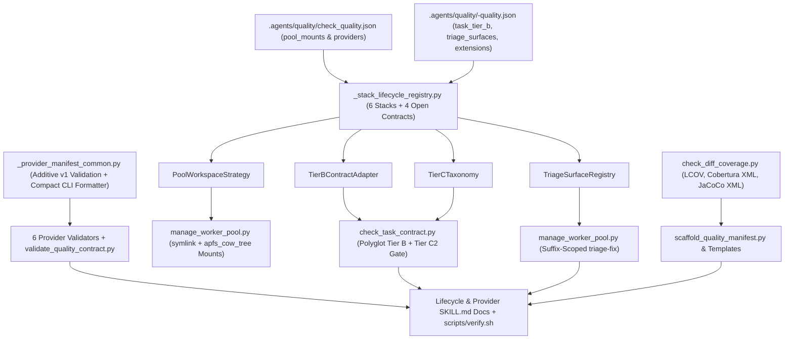
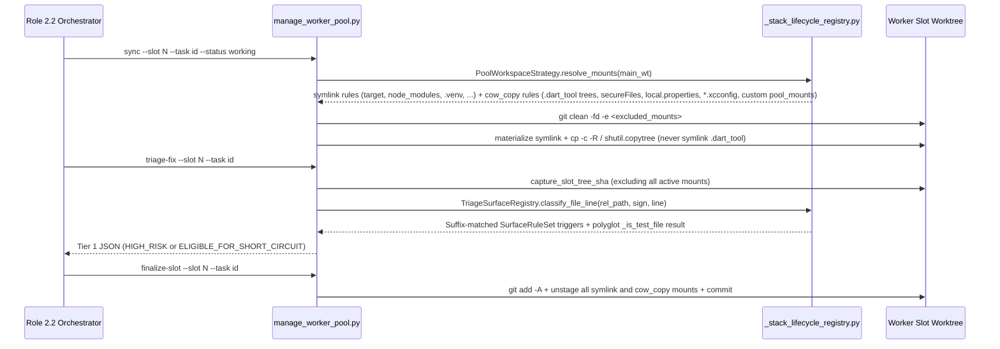

# Open-Closed Polyglot Lifecycle and Quality Architecture High-Level Design

## Table of Contents

- [Meta Data](#meta-data)
- [Background](#background)
- [Goals and Non-Goals](#goals-and-non-goals)
- [Architecture and Technical Design](#architecture-and-technical-design)
- [Feature Maintenance Map](#feature-maintenance-map)
- [Module Contracts and CLI Interfaces](#module-contracts-and-cli-interfaces)
- [Impact Analysis](#impact-analysis)
- [Shared Contract Impact](#shared-contract-impact)
- [Integration Test Plan and Boundary Matrix](#integration-test-plan-and-boundary-matrix)
- [Verification Environment](#verification-environment)
- [Comprehensive BDD Scenario Coverage](#comprehensive-bdd-scenario-coverage)
- [Rollout Strategy and Mitigation](#rollout-strategy-and-mitigation)
- [Kanban Tasks Breakdown](#kanban-tasks-breakdown)
- [Spec Errata](#spec-errata)

## Meta Data

- **Epic name**: `polyglot_lifecycle_and_quality_architecture`
- **Status**: Packaged (2026-11-27)
- **PIC**: `duvthinh403`
- **Target release**: Next `d3nexus` plugin release
- **Platform**: Python 3 stdlib CLI tooling, JSON Schema contracts, and Markdown skills (`ai-agent-tools`)
- **Depends on epic**: none
- **Source Spec**: [Open-Closed Polyglot Lifecycle and Quality Architecture Design](2026-11-27-polyglot-lifecycle-and-quality-architecture-design.md)

## Background

Production quality hardening on the `nexus` repository (`49a6ee7a`, documented in read-only reference `polyglot-quality-lifecycle-handoff.md` and `scripts/check_lcov_threshold.py`) revealed five structural gaps in `ai-agent-tools` that prevent clean, fast, cross-stack governance across `python`, `flutter`, `rust`, `web`, `android`, and `ios` repositories:

1. **Python-only Tier B verification**: `skills/dev-implementation/resources/scripts/check_task_contract.py` (`L1237-L1238`) only executes `check_python_tier_b`, leaving Flutter/Dart, Rust, Web, Android, and iOS tasks — as well as polyglot single tasks (`.rs` + `.ts`, `.py` + `.js`, `.dart` + `.rs`/`.kt`/`.swift`) — without declarative static-gate enforcement.
2. **Symlink-only pool cache mounting**: `skills/dev-implementation/resources/scripts/manage_worker_pool.py` (`CACHE_DIR_CANDIDATES` `L49`, `link_shared_caches` `L193`) symlinks `.dart_tool` at slot root, breaking `.gitignore` directory rules (`.dart_tool/`) in Flutter/Melos workspaces while failing to copy nested package `.dart_tool/` trees and gitignored local secret configs (`secureFiles/`, `local.properties`, `*.xcconfig`).
3. **Flat Python-centric Tier 1 risk triage**: `manage_worker_pool.py` (`_PUBLIC_SIGNATURE_RES`..`_TEST_SKIP_RE` `L79-L108`, `_is_test_file` `L1050-L1057`, `_classify_tier1_diff` `L1079-L1197`) applies one global regex list to every file regardless of extension, causing cross-stack blind spots and false positives.
4. **Uneven quality provider contracts, verbose CLI output, and repo-local diff-coverage**: Hunk-level diff-coverage only exists in `nexus`; `validate_quality_contract.py` and the 6 `validate_*_quality.py` CLIs emit multi-line pretty JSON even on `PASS`; `web-quality-check` has no formal JSON schema; strict `additionalProperties: false` schemas reject `pool_mounts`, `task_tier_b`, `triage_surfaces`, `standards_catalog`, dual-floor `coverage`, and unified `anti_stub`/`security`/`security_deps`/`pr_diff_audit`/`workspace_audit`/`pr_impact`/`workspace_impact`/`license` capabilities; and `scaffold_quality_manifest.py` still scaffolds Android `"cleanup": ["pkill", "-9", "java"]`.
5. **Python-hardcoded lifecycle docs and unenforced Tier C1 vs Tier C2 separation**: `dev-designer` and `dev-implementation` docs default to `uv run pytest` and lack a lightweight `TierCTaxonomy` contract enforcing `Needs:` gating on explicit `Tier C2` rows and validating HLD `Integration test roots:`.

## Goals and Non-Goals

### Goals

- Introduce `skills/dev-implementation/resources/scripts/_stack_lifecycle_registry.py` (Python 3 stdlib only) implementing four strict Open-Closed contracts (`TierBContractAdapter`, `PoolWorkspaceStrategy`, `TriageSurfaceRegistry`, `TierCTaxonomy`) for all 6 built-in stack families plus manifest overrides (`task_tier_b`, `triage_surfaces`, `extensions`, `pool_mounts`).
- Wire `check_task_contract.py` so `check_python_tier_b` always runs for Python tasks (`is_python_task`), active non-Python stacks dispatch through `TierBContractAdapter` (0% invocation on untouched stacks), `TierCTaxonomy` enforces `# tier: C2` `Needs:` gating and `Integration test roots:`, and default stdout emits compact 1-line `PASS` (`--verbose` / `--json` opt-in).
- Wire `manage_worker_pool.py` to `PoolWorkspaceStrategy` (`symlink` vs `apfs_cow_tree` / `cp -c -R` with `shutil.copytree` fallback, protected from `git clean -fd`, tree snapshots, `triage-fix`, and `finalize_slot` staging) and suffix-scoped `TriageSurfaceRegistry`.
- Port a portable multi-format hunk-level diff-coverage verifier to `skills/quality_check/resources/scripts/check_diff_coverage.py` supporting **LCOV**, **Cobertura XML**, and **JaCoCo XML** with dual-floor coverage, untested new-file fallback, and compact 1-line `PASS` stdout.
- Upgrade `check-quality.schema.json`, `validate_quality_contract.py`, all 6 provider schemas (adding `web-quality.schema.json`), all 6 `validate_*_quality.py` validators (via shared `_provider_manifest_common.py`), and `setup_quality_check` (`scaffold_quality_manifest.py` + templates) with strict additive v1 compatibility, 4 profiles, unified capabilities, `standards_catalog`, compact 1-line `PASS` stdout, and removal of Android `pkill -9 java`.
- Standardize 6-stack commands and `Tier C1` (`< 5s` host/VM subcutaneous integration) vs `Tier C2` (`Needs:`-gated device/simulator/browser E2E) across `dev-designer`, `dev-implementation`, `quality_check`, `setup_quality_check`, and all 6 `*-quality-check` skills while honoring existing word/byte caps (`dev-implementation/SKILL.md <= 4500` words, `dev-designer/SKILL.md <= 22528` bytes).

### Non-Goals

- Modifying any external consumer repository (`nexus`, `D3Nexus`, `lyrics-sync`, `android_digital_wallet`, `ios_digital_wallet`).
- Adding third-party Python dependencies (`jsonschema` or external parsers).
- Running `git push` or `scripts/release.sh` automatically (handoff provides the exact local sync command for `~/.gemini/config/plugins/d3nexus`).
- Mutating unrelated uncommitted workspace files on `main` (`.vscode/settings.json`, `skills/check-quota/resources/dashboard/quota_dashboard.html`) or sibling worktree `.worktrees/bg_task_watchdog_and_stall_detection`.

## Architecture and Technical Design

### High-Level Component Architecture

### Polyglot Pool Mount and Suffix-Scoped Triage Flow

## Feature Maintenance Map

| Capability | Canonical Entry Point | Paired Verification Suite |
| :--- | :--- | :--- |
| 6-stack registry & 4 open contracts | `skills/dev-implementation/resources/scripts/_stack_lifecycle_registry.py` | `tests/test_stack_lifecycle_registry.py` |
| Portable LCOV / Cobertura / JaCoCo diff-coverage | `skills/quality_check/resources/scripts/check_diff_coverage.py` | `tests/test_check_diff_coverage.py` |
| Shared additive v1 validation & compact CLI output | `skills/quality_check/resources/scripts/_provider_manifest_common.py` | `tests/test_plq_quality_contracts_and_scaffolder.py` |
| Registry & 6 provider schemas + validators + scaffolder | `validate_quality_contract.py`, `validate_*_quality.py`, `scaffold_quality_manifest.py` | `tests/test_plq_quality_contracts_and_scaffolder.py`, `skills/*/resources/scripts/test_validate_*_quality.py`, `test_scaffold_quality_manifest.py` |
| Polyglot Tier B & Tier C2 task contract gate | `skills/dev-implementation/resources/scripts/check_task_contract.py` | `tests/test_plq_task_contract_polyglot.py`, `skills/dev-implementation/resources/scripts/test_check_task_contract.py` |
| Pool `apfs_cow_tree` mounts & suffix-scoped `triage-fix` | `skills/dev-implementation/resources/scripts/manage_worker_pool.py` | `tests/test_plq_worker_pool_polyglot.py`, `skills/dev-implementation/resources/scripts/test_manage_worker_pool.py` |
| Lifecycle docs, provider skills & `verify.sh` registration | `skills/dev-designer/*`, `skills/dev-implementation/*`, `skills/*-quality-check/SKILL.md`, `scripts/verify.sh` | `tests/test_plq_end_to_end_acceptance.py` |

## Module Contracts and CLI Interfaces

1. **`skills/dev-implementation/resources/scripts/_stack_lifecycle_registry.py`** (Python 3 stdlib only; zero imports from `check_task_contract.py` to prevent circular imports):
   - Exports frozen dataclasses `TierBPolicy`, `SurfaceRuleSet`, `TierCPolicy`, `PoolMountRule`, `StackDescriptor`, a private stdlib `_split_sequential_subcommands(command: str) -> list[list[str]]` helper, and the four public adapter classes:
     - `TierBContractAdapter`: `has_provider_manifests(repo_root: Path) -> bool`, `resolve_active_stacks(repo_root, allowed_paths) -> list[StackDescriptor]`, `validate_tier_b(repo_root, stem, allowed_entries, rows, *, allow_historical_prefix=False) -> list[tuple[str, str]]` (returning `(where, message)` tuples for non-Python active stacks plus custom manifests declaring `"extensions"`, while Python validation stays inside `check_task_contract.py::check_python_tier_b`). Honors optional `"task_tier_b"` overrides.
     - `PoolWorkspaceStrategy`: `resolve_mounts(main_wt) -> list[PoolMountRule]`, `materialize_mounts(main_wt, slot_path) -> dict[str, list[str]]`, `get_excluded_relpaths(main_wt, slot_path) -> list[str]`. Uses `symlink` for `target`, `node_modules`, `.astro`, `.venv`, `.gradle`, `.build`, `Pods`; uses `apfs_cow_tree` (`cp -c -R` on `sys.platform == "darwin"` with automatic `shutil.copytree`/`shutil.copy2` fallback on Linux or cross-volume error) strictly for **untracked AND gitignored** (absent from `git ls-files` AND passing `git check-ignore -q`) `.dart_tool`, `packages/*/.dart_tool`, `features/*/.dart_tool`, `bricks/*/hooks/.dart_tool`, `secureFiles`, `local.properties`, `android/local.properties`, `*.xcconfig`, `ios/Flutter/*.xcconfig`, `macos/Flutter/*.xcconfig`; merges validated `"pool_mounts"` from `.agents/quality/check_quality.json` while rejecting `..` or absolute paths escaping `main_wt`. `get_excluded_relpaths(main_wt, slot_path)` returns ONLY materialized symlink or ignored `cow_copy` paths (never tracked files such as `ios/Flutter/Debug.xcconfig`).
     - `TriageSurfaceRegistry`: `default() -> TriageSurfaceRegistry`, `from_repo(repo_root) -> TriageSurfaceRegistry`, `is_test_file(rel_path) -> bool`, `rules_for_path(rel_path) -> SurfaceRuleSet | None`, `match_line(rel_path, sign, line) -> set[str]`, `match_test_line(rel_path, sign, line) -> tuple[bool, bool]`. Applies a **language-neutral baseline** to every suffix (including unknown ones like `.sql`): SQL DDL/DML (`SELECT|INSERT\s+INTO|UPDATE\s+\w+\s+SET|DELETE\s+FROM|CREATE\s+TABLE|ALTER\s+TABLE|DROP\s+TABLE`), class declarations (`^\s*(?:abstract\s+|final\s+|sealed\s+|open\s+|data\s+)?class\s+[A-Za-z]`), and lock constructors (`\b(?:Lock|RLock|Semaphore|Condition|Event)\s*\(`); layers suffix-scoped `SurfaceRuleSet` rules strictly by `Path(rel_path).suffix.lower()` across `.dart`, `.rs`, `.ts/.tsx/.js/.mjs/.astro`, `.kt/.kts` (excluding `private`/`protected` Kotlin `fun`/`interface`), `.swift`, `.py`, merging optional `"triage_surfaces"` category-keyed objects (`signature`, `api_wire`, `persistence`, `concurrency`, `test_weakening`) from `.agents/quality/<stack>-quality.json`.
     - `TierCTaxonomy`: `check_tier_c_rows(stem, rows, active_stacks) -> tuple[list[tuple[str, str]], list[str]]` (returns `(problems, warnings)`), `validate_integration_test_roots(repo_root, roots, tracked_files, created_files) -> list[str]`. Hard-fails `TIER-C` rows carrying the canonical `# tier: C2` command comment (`#\s*tier:\s*C2\b`, case-insensitive) without `Needs:`, and unsafe or zero-match HLD `Integration test roots:` (where a bare directory root matches when any tracked or created path equals `root.rstrip("/")` or starts with `root.rstrip("/") + "/"`). Emits non-blocking warnings for heuristic ungated heavy-runtime commands (`integration_test/`, `connected*AndroidTest`, `xcodebuild test`, `playwright test`).

2. **`skills/quality_check/resources/scripts/check_diff_coverage.py`** (Python 3 stdlib + `git`):
   - CLI flags: `report_files...`, `--format {auto,lcov,cobertura,jacoco}`, `--repo-root`, `--source-root` (repeatable), `--min-coverage`, `--min-package-coverage`, `--exclude-package-floor` (repeatable), `--package-group` (repeatable), `--diff-base`, `--diff-files` (repeatable), `--min-diff-coverage`, `--source-ext` (repeatable), `--exclude-suffix` (repeatable), `--verbose`, `--json`.
   - Normalizes threshold arguments cleanly (`0.80` or `80.0` both supported when `<= 1.0` vs `> 1.0` with explicit documentation and deterministic percentage formatting).
   - Output contract: default stdout on `PASS` is a single concise line (`PASS: ...`); on `FAIL` (`exit 1`) or `BLOCKED` (`exit 2`), expands per-package / per-file / uncovered diff line diagnostics; `--verbose` expands full tables on `PASS`; `--json` emits machine-readable JSON.

3. **`skills/quality_check/resources/scripts/_provider_manifest_common.py` + Validators + Schemas + Scaffolder**:
   - `_provider_manifest_common.py` validates optional additive v1 fields (`standards_catalog`, `extensions`, `task_tier_b`, `triage_surfaces` object with regex compile checks, dual-floor `coverage` fields `min_package_coverage`, `exclude_package_floor`, `min_diff_coverage`, `diff_base`) and exports `format_validator_cli_output(label, profile, result, *, verbose=False, as_json=False, item_count=None) -> str`.
   - `validate_quality_contract.py` validates optional `"pool_mounts"` in `check_quality.json` (rejecting path traversal / invalid mode), keeps full JSON default stdout on payload-producing subcommands `registry`, `invocation`, and `reconcile` (adding opt-in `--compact` for 1-line `PASS` summaries), and defaults to compact 1-line `PASS` stdout (with opt-in `--verbose` / `--json`) on boolean validation subcommands `capability` and `result`.
   - All 6 provider schemas (`flutter`, `rust`, `web` [new], `python`, `android`, `ios`) and `validate_*_quality.py` accept 4 profiles (`pr`, `epic`, `scheduled`, `release`, keeping only `pr` and `epic` required for backwards compatibility), unified capabilities (`anti_stub`, `security`, `security_deps`, `pr_diff_audit`, `workspace_audit`, `pr_impact`, `workspace_impact`, `license`), and additive top-level/coverage keys.
   - `scaffold_quality_manifest.py` scaffolds all 4 profiles, unified capabilities, `{skills_dir}/quality_check/resources/scripts/check_diff_coverage.py` diff-coverage/coverage hooks, starter `.agents/quality/standards_catalog.json` when absent, stack-appropriate `"pool_mounts"`, and omits Android `"cleanup": ["pkill", "-9", "java"]`.

4. **`skills/dev-implementation/resources/scripts/check_task_contract.py` & `task_contract.py`**:
   - Adds `parse_integration_test_roots(text: str) -> list[str]` to `task_contract.py`.
   - Always runs `check_python_tier_b(...)` whenever `is_python_task(text, rows)` is `True` (so `.py` tasks and `pyproject.toml`/ruff-row tasks keep full Python enforcement even in repos that only define non-Python manifests such as `flutter-quality.json`), and independently dispatches all active non-Python stacks via `TierBContractAdapter.validate_tier_b(...)`.
   - Adds `TierCTaxonomy` checks for `TIER-C` rows (`# tier: C2` hard-fail without `Needs:`; heuristic heavy-runtime warning) and HLD `Integration test roots:` (directory prefix matching `path == root or path.startswith(root + "/")`).
   - CLI adds `--verbose` and `--json`: default `PASS` emits exactly one line (`Result: 0 problems — PASS`); `--verbose` prints `Implicit protected paths: ...`; `FAIL` emits all problems + `Implicit protected paths:` + `Result: <n> problems — FAIL`.

5. **`skills/dev-implementation/resources/scripts/manage_worker_pool.py`**:
   - Delegates `link_shared_caches` and mount exclusions across `sync_slot`, `capture_slot_tree_sha`, `triage_fix_slot`, and `finalize_slot` to `PoolWorkspaceStrategy`.
   - Delegates `_is_test_file` and `_classify_tier1_diff` surface matching to `TriageSurfaceRegistry` (strictly suffix-scoped with manifest override support).

## Impact Analysis

Shift-left `check_code_impact.py --base-ref main` returned **CLEAN** (zero upstream merge conflicts against `main`) and identified all downstream callers and test safety nets:

- **Downstream runtime callers**:
  - `skills/quality_check/resources/scripts/verify_polyglot_registry.py` (`L721`, `L1012`, `L1248`) imports `validate_quality_contract.validate_registry` and `validate_<platform>_quality` functions directly (never parsing CLI stdout); library dict signatures stay 100% backwards-compatible.
  - `skills/dev-implementation/resources/scripts/check_epic_readiness.py` invokes `check_task_contract.py` and inspects exit code + problem lines (compatible with default 1-line `PASS` stdout).
- **Existing test & size/text contract guards**:
  - `skills/dev-implementation/resources/scripts/test_check_task_contract.py` (`L113`, `L122`, `L618`) asserts `Implicit protected paths:` on `PASS`; Task 04 updates those 3 assertions to pass `--verbose` and adds dedicated default 1-line `PASS` regression tests.
  - `skills/dev-implementation/resources/scripts/test_manage_worker_pool.py`, `tests/test_trc_worker_pool_triage.py`, and `tests/test_ohk_worktree_and_pool.py` test pool mounts and Tier 1 triage; Task 05 keeps all Python triage and symlink behavior green while extending for `apfs_cow_tree` and 6-stack suffix isolation.
  - `tests/test_tto_docs_and_slimming.py` pins `skills/dev-designer/SKILL.md <= 22528` bytes, `skills/dev-implementation/SKILL.md <= 4500` words (currently `4123` words -> `< 375` words budget; bulk 6-stack tables belong in `references/worker-execution-rules.md` and `references/verification-rows.md`), and `"-q --tb=short --maxfail=3"` in `verification-rows.md`.
  - `scripts/verify.sh` §5 forbids `superpowers:` in `skills/`/`rules/`, §8 requires every new file under `skills/` to be referenced by a tracked text file, and §11/§13 register all unit/integration suites.

## Shared Contract Impact

None — self-contained feature inside `ai-agent-tools` (`shared-contracts/` does not exist in this repository).

## Integration Test Plan and Boundary Matrix

Integration test roots: tests
Protected paths: .agents/quality/**, .devtool/epic/polyglot_lifecycle_and_quality_architecture/bdd_scenarios.md
Integration results: python3 -m pytest -q --tb=short --maxfail=3 --junitxml=build/test-results/polyglot-lifecycle-and-quality-architecture.xml tests/test_stack_lifecycle_registry.py tests/test_check_diff_coverage.py tests/test_plq_quality_contracts_and_scaffolder.py tests/test_plq_task_contract_polyglot.py tests/test_plq_worker_pool_polyglot.py tests/test_plq_end_to_end_acceptance.py -> build/test-results/polyglot-lifecycle-and-quality-architecture.xml

| Boundary | Producer | Consumer | Verification Tier |
| :--- | :--- | :--- | :--- |
| 6-stack registry & manifest overlays (`task_tier_b`, `triage_surfaces`, `extensions`, `pool_mounts`) | `_stack_lifecycle_registry.py` | `check_task_contract.py`, `manage_worker_pool.py` | Tier A Unit, Tier C Subcutaneous |
| Multi-format coverage reports (LCOV, Cobertura XML, JaCoCo XML) & git hunks | `check_diff_coverage.py` | `setup_quality_check` templates, Gate 4 providers | Tier A Unit, Tier C Git Subcutaneous |
| Additive v1 schemas, `_provider_manifest_common.py`, and compact CLI stdout | `validate_quality_contract.py`, 6 `validate_*_quality.py`, `scaffold_quality_manifest.py` | `verify_polyglot_registry.py`, consumer repos | Tier A Unit, Tier C CLI Subcutaneous |
| Polyglot `TIER-B` dispatch & `TierCTaxonomy` (`Tier C2` `Needs:` + `Integration test roots:`) | `check_task_contract.py`, `task_contract.py` | `check_epic_readiness.py`, Gate 2 designers | Tier A Unit, Tier C CLI Subcutaneous |
| `apfs_cow_tree` pool mounts & suffix-scoped `triage-fix` | `manage_worker_pool.py` | Role 2.2 Orchestrator, worker slots | Tier A Unit, Tier C Git Worktree |
| Lifecycle & provider `SKILL.md` docs + `scripts/verify.sh` suite registry | `skills/dev-designer/*`, `skills/dev-implementation/*`, `skills/*-quality-check/SKILL.md`, `scripts/verify.sh` | `test_tto_docs_and_slimming.py`, `check_document.py`, Gate 4 | Tier A Contract, Tier C Acceptance |

## Verification Environment

- **Data Isolation**: All unit and integration tests execute inside `pytest` `tmp_path` directories and temporary Git repositories with synthetic coverage reports, manifests, task markdown files, and stubbed platform binaries.
- **Forbidden Live Stores**: Tests never touch host `~/.gemini/`, `~/.claude/`, `~/.codex/`, `~/antigravity_homes/`, `/Users/danhdueexoictif/AllProjects/nexus`, `D3Nexus`, `lyrics-sync`, or live `dart`/`cargo`/`gradle`/`xcodebuild`/`playwright` installations.
- **Needs Variables**: None (`Needs: none`).

## Comprehensive BDD Scenario Coverage

All 27 scenarios (`PLQ-HP-01`..`PLQ-HP-06`, `PLQ-EC-01`..`PLQ-EC-06`, `PLQ-ST-01`..`PLQ-ST-05`, `PLQ-AR-01`..`PLQ-AR-05`, `PLQ-FR-01`..`PLQ-FR-05`) are specified across Happy Path (`HP`), Edge Cases (`EC`), State Transitions (`ST`), Architecture and Concurrency (`AR`), and Fault Resilience (`FR`) in [bdd_scenarios.md](bdd_scenarios.md).

## Rollout Strategy and Mitigation

- **Wave Plan (3 Waves, up to 3 parallel workers with 100% disjoint `Allowed files`)**:
  - **Wave 1 (Parallel)**: `Task 01` (Stack Lifecycle Registry) + `Task 02` (Portable Diff-Coverage Engine) + `Task 03` (Schemas, Validators & Scaffolder).
  - **Wave 2 (Parallel, after Wave 1)**: `Task 04` (`check_task_contract.py` polyglot Tier B + Tier C2 gate) + `Task 05` (`manage_worker_pool.py` `apfs_cow_tree` + suffix triage).
  - **Wave 3 (Final, after Wave 2)**: `Task 06` (Lifecycle docs, provider `SKILL.md` updates, `scripts/verify.sh` registration, and end-to-end acceptance suite).
- **Dirty File Isolation**: Stage 3 runs in a clean isolated worktree `.worktrees/polyglot_lifecycle_and_quality_architecture` branched from `main` `HEAD`, leaving uncommitted files on `main` untouched.
- **Rollback**: Every new contract key in schemas and validators is strictly additive (`schema_version: 1`); reverting the epic branch restores legacy behavior with zero consumer repo breakage.

## Kanban Tasks Breakdown

1. **[Task 01: Declarative 6-Stack Lifecycle Registry and Four Open Contracts](task_01_stack_lifecycle_registry.md)** (`review_tier: "full"`) — Build `_stack_lifecycle_registry.py` with all 6 built-in stacks and 4 open contracts (`TierBContractAdapter`, `PoolWorkspaceStrategy`, `TriageSurfaceRegistry`, `TierCTaxonomy`) plus manifest overlay loader — Covers: `PLQ-HP-01`, `PLQ-EC-01`, `PLQ-EC-02`, `PLQ-AR-01`, `PLQ-FR-01`
2. **[Task 02: Portable Multi-Format Hunk-Level Diff-Coverage Engine](task_02_portable_diff_coverage_engine.md)** (`review_tier: "full"`) — Port stdlib multi-format hunk-level diff-coverage engine (`check_diff_coverage.py`) supporting LCOV, Cobertura XML, JaCoCo XML, dual-floor checks, and compact 1-line `PASS` stdout — Covers: `PLQ-HP-02`, `PLQ-EC-03`, `PLQ-EC-04`, `PLQ-FR-02`
3. **[Task 03: Unified Quality Schemas, Shared Validator Helper, Compact CLI Output, and Scaffolder Upgrade](task_03_quality_schemas_validators_and_scaffolder.md)** (`review_tier: "full"`) — Add `_provider_manifest_common.py` and `web-quality.schema.json`; upgrade `check-quality.schema.json`, all 6 provider schemas/validators, compact 1-line `PASS` CLI output, and `scaffold_quality_manifest.py` (4 profiles, unified capabilities, remove Android `pkill -9 java`) — Covers: `PLQ-HP-03`, `PLQ-EC-05`, `PLQ-ST-01`, `PLQ-AR-02`, `PLQ-FR-03`
4. **[Task 04: Wire Polyglot Tier B Adapter, Tier C2 Gate, and Compact Output into `check_task_contract.py`](task_04_polyglot_task_contract_and_tier_c_gate.md)** (`review_tier: "full"`, Blocked by Task 01) — Wire `check_task_contract.py` and `task_contract.py` to `TierBContractAdapter`, `TierCTaxonomy`, and default 1-line `PASS` stdout (`--verbose`/`--json` opt-in) — Covers: `PLQ-HP-04`, `PLQ-EC-06`, `PLQ-ST-02`, `PLQ-AR-03`, `PLQ-FR-04`
5. **[Task 05: Wire Worker Pool `apfs_cow_tree` Mounts and Suffix-Scoped `triage-fix` into `manage_worker_pool.py`](task_05_worker_pool_cow_mounts_and_suffix_triage.md)** (`review_tier: "full"`, Blocked by Task 01) — Wire `manage_worker_pool.py` to `PoolWorkspaceStrategy` (`symlink` vs `apfs_cow_tree` + clean/staging protection) and suffix-scoped `TriageSurfaceRegistry` — Covers: `PLQ-HP-05`, `PLQ-ST-03`, `PLQ-ST-04`, `PLQ-AR-04`, `PLQ-FR-05`
6. **[Task 06: Lifecycle & Provider Skill Documentation, `verify.sh` Registration, and End-to-End Acceptance Suite](task_06_lifecycle_docs_provider_skills_and_acceptance.md)** (`review_tier: "full"`, Blocked by Tasks 01, 02, 03, 04, 05) — Update lifecycle/provider docs for 6-stack commands and `Tier C1`/`Tier C2`, register all new suites in `scripts/verify.sh`, and run end-to-end polyglot acceptance suite — Covers: `PLQ-HP-06`, `PLQ-ST-05`, `PLQ-AR-05`

## Spec Errata

- **[SE-01] `triage_surfaces` Schema Refinement (`array` -> `object`)**: `polyglot-quality-lifecycle-handoff.md` Section 2 mentions `"triage_surfaces"` informally as an array; reconciled at Gate 1 (`ac6f972`) into a category-keyed object (`signature | api_wire | persistence | concurrency | test_weakening -> string[]`) across all 6 provider schemas, `_provider_manifest_common.py`, and `_stack_lifecycle_registry.py` for 1:1 `SurfaceRuleSet` mapping and deterministic merging.
- **[SE-02] `dev-implementation/SKILL.md` 4500-Word Cap**: `tests/test_tto_docs_and_slimming.py::test_tto_hp_05_lifecycle_word_caps` enforces `dev-implementation/SKILL.md <= 4500` words (currently `4123`). Detailed 6-stack command tables and `Tier C1`/`Tier C2` reference examples live in `skills/dev-implementation/references/worker-execution-rules.md` and `skills/dev-designer/references/verification-rows.md`, keeping `SKILL.md` concise and strictly under cap.
- **[SE-03] Preserving `test_check_task_contract.py` Implicit Protected Paths Coverage Under Compact `PASS` Output**: Under the Token-Budget Invariant, `check_task_contract.py` emits exactly `Result: 0 problems — PASS` by default on success and prints `Implicit protected paths: ...` under `--verbose` or `FAIL`; the 3 existing implicit-protected-path assertions in `skills/dev-implementation/resources/scripts/test_check_task_contract.py` (`L113`, `L122`, `L618`) pass `--verbose`, while new tests lock default 1-line `PASS` stdout.
