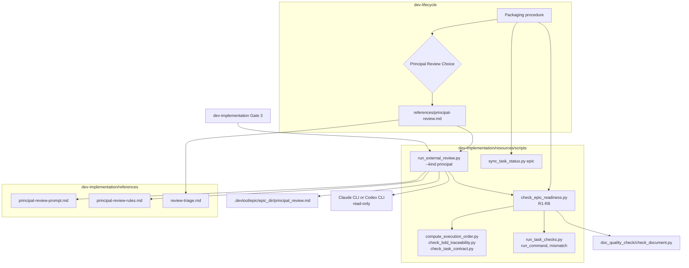
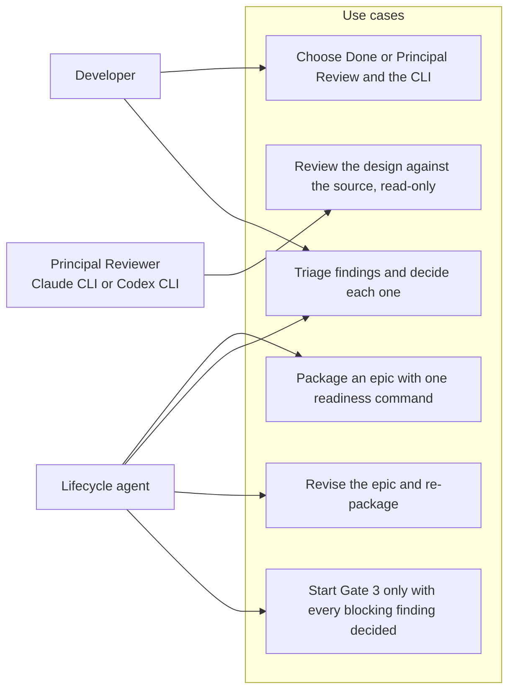
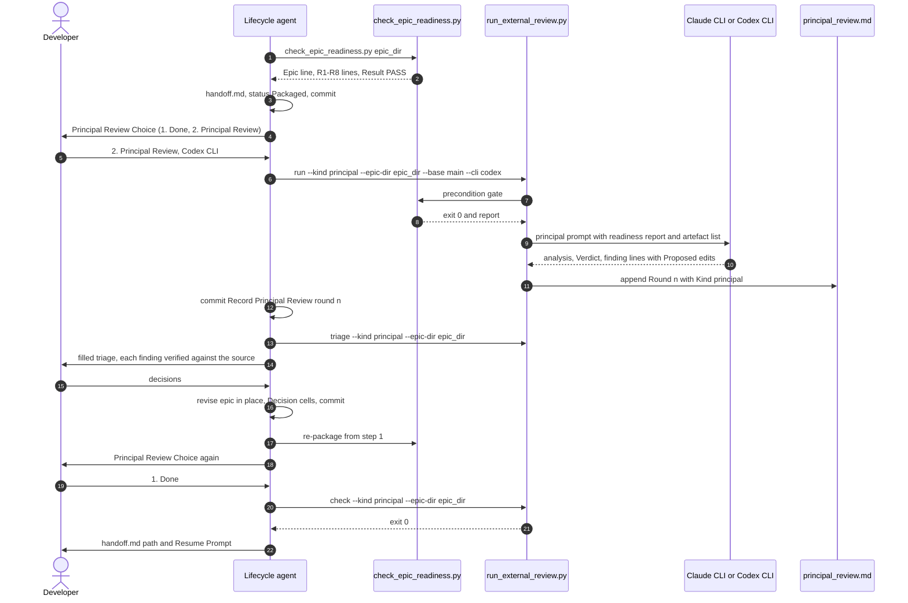

# Principal Review High-Level Design

## Table of Contents

- [Meta Data](#meta-data)
- [Background](#background)
- [Goals and Non-Goals](#goals-and-non-goals)
- [Architecture and Technical Design](#architecture-and-technical-design)
- [Integration Test Plan and Boundary Matrix](#integration-test-plan-and-boundary-matrix)
- [Verification Environment](#verification-environment)
- [Comprehensive BDD Scenario Coverage](#comprehensive-bdd-scenario-coverage)
- [Rollout Strategy and Mitigation](#rollout-strategy-and-mitigation)
- [Kanban Tasks Breakdown](#kanban-tasks-breakdown)

## Meta Data

- **Epic name**: `principal_review`
- **Status**: Packaged
- **Target release**: Next plugin release
- **Platform**: Python tooling / agent skill kit
- **Source Spec**: [Approved Principal Review design](2026-10-22-principal-review-design.en.md)

## Background

The packaging preflight proves an epic's documents are well formed, not that they are right. A
manual review of a packaged epic in `lyrics-sync` found these, all after the preflight had passed:
- symbols and routes that do not exist;
- a wrong model of a class;
- a contract that contradicted a pinned test;
- a writer no task owned;
- a design that broke word anchoring;
- `Integration results:` lines that made Gate 4 unpassable;
- Gherkin drift between task copies and the canonical BDD file;
- baseline failures.

The kit can already ask Claude CLI or Codex CLI for a read-only second opinion, but only on
finished code after Gate 4. This epic adds a mechanical readiness check and an optional
cross-model **Principal Review** of the design, offered after Package and looping until the
developer chooses Done. The approved spec holds the full motivation and decisions D1–D13.

## Goals and Non-Goals

### Goals

- `check_epic_readiness.py`, a single command running checks R1–R8. It replaces the four
  packaging preflight commands.
- `run_external_review.py --kind principal`, which records rounds in `principal_review.md` and has
  `check` and `triage` support.
- A Principal Reviewer prompt and rules with checklist P1–P8.
- A Principal Review Choice after Package in `dev-lifecycle`, documented in
  `references/principal-review.md`, and a Gate 3 check in `dev-implementation`.
- `sync_task_status.py epic` limited to the current checkout and the epic's own worktrees.

### Non-Goals

- Code review: Gate 4's Review Choice is unchanged.
- Automatic application of proposed edits.
- A mandatory Principal Review.
- Parallel reviewers.
- Ollama Principal Reviewers.
- Principal Review on the Continue path or in `doc-lifecycle`.

## Architecture and Technical Design

### High-Level Architecture



### Use Cases



### Sequence Diagram



### Module Contracts

#### `check_epic_readiness.py` (new)

Located in `skills/dev-implementation/resources/scripts/`.

```python
@dataclass(frozen=True)
class Finding:
    check: str     # "R1" ... "R8", "R5b", "R7b"
    severity: str  # "FAIL" or "WARN"
    message: str

CHECKS: tuple[tuple[str, Callable[[Context], list[Finding]]], ...]  # R1..R8 in order

def load_context(root: Path, epic_dir: str) -> Context
def run_checks(ctx: Context, *, baseline: bool = False, row_timeout: int = 600) -> list[Finding]
def render_report(ctx: Context, findings: list[Finding]) -> str
def main(argv: list[str] | None = None) -> int
```

- **CLI**: `check_epic_readiness.py <epic_dir> [--baseline] [--row-timeout 600]`, run from anywhere inside the repository; the root comes from `git rev-parse --show-toplevel`.
- **`Context`** holds:
  - `root`, `epic_dir` and `epic_slug` (from the epic tasks' `epic:` frontmatter);
  - the HLD text;
  - every `task_*.md` path and text in the epic directory;
  - the parsed `Integration results:` commands and `Integration test roots:` directories.
- **Report**:
  - the first line is `Epic: <epic_dir> (<epic_slug>), <N> tasks`. This is the task count the packaging procedure's `<N>` refers to;
  - then, in check order, `<check> PASS` for each of R1–R7 with no FAIL finding and one line per finding, `<check> <severity> <message>`. R5b and R7b only ever print WARN lines. R8 prints `R8 SKIP` without `--baseline`, and `R8 PASS` with it when no row warns;
  - the last line is `Result: <f> FAIL, <w> WARN — PASS` or `— FAIL`.
- **Exit codes**: 0 with no FAIL, 1 with any FAIL, 2 when the directory or the HLD is missing.
- **R1** runs, through `subprocess` with `sys.executable`:
  - `compute_execution_order.py <epic_slug>`. Its `Scanned … ; M matched` count must equal the epic directory's task count;
  - `check_bdd_traceability.py plan` and `check_task_contract.py --design` with the packaging preflight's arguments;
  - `check_document.py` (`SCRIPTS.parents[2] / "doc_quality_check/resources/scripts/check_document.py"`) with `--require-toc --require-bilingual` on the spec, HLD and BDD pairs, with `--require-toc` on `handoff.md` when present, and plainly on every task file.

  Each failing sub-check is its own `R1 FAIL <command>: <last output line>` finding.
- **R2** compares each epic task file with `.devtool/features/<name>`, or `.devtool/features/done/<name>`. The mirror is read with `](../epic/<epic_dir>/` replaced by `](`. A missing mirror or any other difference is a FAIL naming the file and the first differing line.
- **R3**: a scenario block is a `Scenario:` or `Scenario Outline:` line inside a `gherkin` fence, plus every following line up to the next scenario line, a blank line or the closing fence, all right-stripped. Each task block must equal the canonical block with the same identifier. `scenario_ids()` of `bdd_scenarios.en.md` and `bdd_scenarios.vi.md` must be equal sets.
- **R4**: the bracketed tag after the identifier on every scenario line of `bdd_scenarios.en.md` is exactly `Tier A - Unit` or `Tier C - Integration`. A missing tag fails too.
- **R5** reads the sub-bullets of each task's `Target Files & Symbols` (or `Target files and symbols`) bullet that have the form ``- `<path>`: <rest>``.
  - It checks only paths that exist and are not marked `(new)` in that task's Allowed files.
  - For each backticked identifier in `<rest>`, trailing `()` removed and the last dotted segment kept, the identifier must occur in the file's text. An identifier written as ``new `name` `` is skipped.
- **R5b** collects `/api/` routes from the task files and the HLD, cut at the first `{` and stripped of a trailing `/`. Each must occur in a file listed by `git ls-files` outside `.devtool/` and `docs/`, excluding `*.md`; otherwise WARN.
- **R6**: every task with a `Covers:` line has at least one `TIER-C` row.
  - For every `TIER-C` row, each `shlex` token that lies under an `Integration test roots` directory must also occur in an `Integration results:` command, either as the same token or under a directory token of that command.
- **R7** fails when:
  - the HLD Status starts with `Packaged` and `handoff.md` is missing;
  - `handoff.md` exists and the Status starts with none of `Packaged`, `In Progress` or `Done`;
  - the handoff's `Design commit` neither reads `uncommitted` nor resolves to a commit that is an ancestor of `HEAD`;
  - a task's `epic:` differs from `epic_slug`, or its `status` is not in `TASK_STATUSES`.
- **R7b** warns when the spec's Status line matches `draft|awaiting|under .*review|bản nháp|chờ duyệt` (case-insensitive). The spec is the `*-design.en.md` file in the epic directory.
- **R8** runs only with `--baseline`.
  - A dirty tree produces a single `R8 WARN baseline skipped: dirty tree`.
  - Otherwise every `GREEN` and `TIER-B` row whose command names no path marked `(new)` in any epic task runs with `run_task_checks.run_command(command, root, row_timeout)`.
  - A row that times out, or where `run_task_checks.mismatch(row, code, text)` is not `None`, is a WARN `<task>:<row id> <reason>`.

#### `run_external_review.py` (changed)

```python
KINDS = ("code", "principal")
PRINCIPAL_PROMPT = SCRIPTS.parent.parent / "references" / "principal-review-prompt.md"
PRINCIPAL_RULES = SCRIPTS.parent.parent / "references" / "principal-review-rules.md"

def review_file(kind: str) -> tuple[str, str]
    # "code" -> ("review_results.md", "Cross-Model Review"); "principal" -> ("principal_review.md", "Principal Review")
def principal_artefact_lines(root: Path, epic_dir: str) -> str
def run_principal(root: Path, args: argparse.Namespace, sha: str) -> int
```

- **`--kind`** (choices `KINDS`, default `code`) is added to the `run`, `check` and `triage` parsers.
- **Shared selector**: `record_round`, `check` and `triage` take the file name and the title of a new file from `review_file(getattr(args, "kind", "code"))`. With `code`, every byte they read or write is unchanged.
- **`run` with `--kind principal`**:
  1. `--cli ollama` prints `--kind principal supports --cli claude or codex` and exits 2.
  2. The PATH check and the clean-tree check run as today.
  3. `run_principal` runs `run_gate("check_epic_readiness.py", [sys.executable, SCRIPTS / "check_epic_readiness.py", args.epic_dir], root, args.facts_timeout)`. A `PreconditionFailedError` goes through `print_gate_banner` and exits 2.
  4. The prompt is filled with `Template(PRINCIPAL_PROMPT.read_text()).safe_substitute(rules=…, sha=sha, base=args.base, base_sha=<git rev-parse args.base>, epic_dir=f".devtool/epic/{args.epic_dir}", artefacts=principal_artefact_lines(...), readiness_output=<gate stdout>)`.
  5. `execute(cli_command(args.cli, args.model), root, args.timeout, prompt)` runs the reviewer, and `tree_changes` is computed around it as today.
  6. `record_round(root, args, sha, [Pass("principal", code, out, err, prompt)], changed, {"Kind": "principal"})` records the round.
- **`principal_artefact_lines`** lists the spec pair, the HLD pair, the BDD pair, every `task_*.md` and `handoff.md` when present. It never lists `review_results.md` or `principal_review.md`.
- **Unchanged**: `audit_epic.py` and the integration commands never run for `--kind principal`, and no diff is built.

#### Principal Review prompt and rules (new)

- **`principal-review-prompt.md`** casts the reader as the Principal Reviewer who signs off the epic before implementation.
  - It is strictly read-only, and must read the source at `$sha`.
  - It carries `$rules`, `$sha`, `$base`, `$base_sha`, `$epic_dir`, `$artefacts`, `$readiness_output` and checklist P1–P8 from the spec.
  - It ends with the code review's output contract: no severity tags above the verdict block, then `Verdict: PASS` or `Verdict: CHANGES REQUIRED`, then `[Critical|Important|Minor] <artefact>:<location> — <problem>. Proposed: <edit>`.
- **`principal-review-rules.md`** states the severity meanings:
  - Critical: the goal or Gate 4 is unreachable as designed;
  - Important: Stop-and-Report, or wrong behaviour;
  - Minor: wording.

  It also says the readiness report is already proven, so the review spends its effort on judgement and source grounding, and that a claim about the source must name the file and line it read.

#### `sync_task_status.py` (changed)

```python
def parse_worktree_branches(output: str) -> list[tuple[Path, str | None]]
def epic_checkout_roots(epic_dir: str) -> list[Path]
```

- **`parse_worktree_branches`** reads `git worktree list --porcelain`. Each entry yields its `worktree` path and `branch` ref, or `None` when the worktree is detached.
- **`epic_checkout_roots`**:
  - returns the current `git rev-parse --show-toplevel`, plus every worktree whose branch is `refs/heads/epic/<epic_slug>`;
  - takes `epic_slug` from `find_epic_slug(current_root, epic_dir)`, falling back to `epic_dir`;
  - deduplicates, keeping order.
- **`main`**: only the `epic` subcommand uses it. `task`, `archive-epic` and `archive-done` keep `checkout_roots()`.

#### Workflow text (changed)

- **`dev-lifecycle/SKILL.md`**:
  - packaging step 1 becomes one command, `python3 "$SCRIPTS"/check_epic_readiness.py <epic_dir>`, which must exit 0;
  - step 7 prints the handoff path and Resume Prompt;
  - a new step 8 presents **Principal Review Choice** and follows `references/principal-review.md`;
  - Red Flags gains "Picking the Principal Review CLI for the developer" and "Acting on a Principal Review finding before triage";
  - every pinned token stays, and the file stays at or under 2500 words.
- **`dev-lifecycle/references/principal-review.md`** (new): the procedure of spec §6, the choice wording, the D2 recommendation, the commit titles and the Done rule (see the clarifications).
- **`dev-implementation/SKILL.md`**:
  - Entry-Point Detection gains `test -f .devtool/epic/<epic_dir>/principal_review.md && python3 "$SKILL_DIR"/resources/scripts/run_external_review.py check --kind principal --epic-dir <epic_dir>`;
  - Phase 1 step 3 and Resume Gate 3 both state the Principal Review status (`not run`, `round <n>: PASS` or `round <n>: decided`), and stop on exit 1.
- **`handoff-template.md`**: Read First gains `4. .devtool/epic/<epic_dir>/principal_review.md, when present — Principal Review rounds and decisions.`
- **`docs/lifecycles.en.md` and `docs/lifecycles.vi.md`**: the Stage 2 diagram gains `PRC{"Principal Review Choice"}`, `PKG --> PRC`, `PRC -->|"1. Done"| …`, `PRC -->|"2. Principal Review"| PR` and `PR -->|"revised and re-packaged"| PKG`, plus one paragraph.

### Clarifications of the Spec

These formalize gaps the spec left open; none changes an approved decision.

| # | Clarification | Why |
|---|---|---|
| C1 | R7's reverse direction accepts `In Progress` and `Done`: a resumed epic keeps its `handoff.md` | The spec's "and the reverse" would fail every resumed epic |
| C2 | Each recorded round is committed as `[EPIC_NAME] Record Principal Review round <n>`, and its decisions as `[EPIC_NAME] Record Principal Review decisions for round <n>` | `run` refuses a dirty tree, so a round must be committed before the next one |
| C3 | Done re-runs the packaging procedure when `git log -1 --format=%s -- .devtool/epic/<epic_dir>` is not `[<EPIC_NAME>] Package epic for handoff` | Keeps the handoff staleness command pinned by `test_lf_st_02` exact without changing it |
| C4 | The readiness report's first line carries the task count | The packaging step 2 token "`<N>` is the task count the preflight printed" is pinned |
| C5 | R8 evaluates rows with `run_task_checks.run_command` and `mismatch` | One definition of a row's Expect |

### Shift-Left Impact Analysis

`check_code_impact.py` ran on the planned files against `main`; its coverage table reports 0% for
files that have paired suites, which is the known false alarm, so callers were confirmed by `grep`.

- `run_external_review.py`: called by `dev-implementation/SKILL.md` (Review Choice),
  `review-triage.md`, `local-review-setup.md`, `local_review.py`, `rules/CRITICAL_RULES.md`, and
  tested by `test_run_external_review.py`, `test_local_review.py`, `scripts/test_lifecycle_document_contract.py`,
  `scripts/test_verifiable_handoff_text.py`. Every new path sits behind `--kind principal`.
- `sync_task_status.py`: called by `dev-lifecycle`, `dev-implementation`, `dev-designer`, `doc-implementation`,
  `finishing-a-development-branch`, `subagent-driven-development`, and tested by
  `test_sync_task_status.py`, `scripts/test_lifecycle_signals.py`, `scripts/test_verifiable_handoff.py`.
  Only the `epic` subcommand's roots change.
- `dev-lifecycle/SKILL.md`: 2454 words of a 2500 ceiling; tokens pinned by
  `test_lifecycle_document_contract.py`, `test_lifecycle_signals.py` and `test_verifiable_handoff_text.py`.
- `scripts/verify.sh` lists test files explicitly; the new suite must be added.
- No cross-platform bridges.

## Integration Test Plan and Boundary Matrix

Integration test roots: skills/dev-implementation/resources/scripts/, scripts/

Protected paths: .agents/quality/**, .devtool/epic/principal_review/bdd_scenarios.en.md, .devtool/epic/principal_review/bdd_scenarios.vi.md, skills/dev-implementation/resources/scripts/test_run_external_review.py, skills/dev-implementation/resources/scripts/test_sync_task_status.py, scripts/test_lifecycle_document_contract.py, scripts/test_lifecycle_signals.py, scripts/test_verifiable_handoff_text.py

Integration results: python3 scripts/run_unittest_junit.py --junitxml build/test-results/principal-review.xml skills/dev-implementation/resources/scripts/test_check_epic_readiness.py skills/dev-implementation/resources/scripts/test_run_external_review.py skills/dev-implementation/resources/scripts/test_sync_task_status.py scripts/test_lifecycle_document_contract.py scripts/test_lifecycle_signals.py scripts/test_verifiable_handoff_text.py -> build/test-results/principal-review.xml

| Boundary | Real components | Isolation or fixture | Required assertions |
|---|---|---|---|
| Readiness, structural | `check_epic_readiness.main`, R1–R4, R7 | Throwaway Git repository with a fixture epic; the real `compute_execution_order.py`, `check_bdd_traceability.py`, `check_task_contract.py`, `check_document.py` | Report lines, the `Epic:` line, exit codes, each failure named |
| Readiness, grounding and Gate 4 | R5, R5b, R6, R8 | Same fixture with source files, `Integration results:` lines and Verification rows | Missing symbol FAIL, route WARN, uncovered path FAIL, baseline WARN and timeout |
| Principal round | `run --kind principal`, `record_round`, `check`, `triage` | Throwaway epic repository, fake `claude` and `codex` scripts on `PATH` that record their stdin | Prompt content, `principal_review.md` round, `review_results.md` untouched, exit codes, banner on readiness FAIL |
| Code review guard | Existing runner suite | As today | Passes unchanged |
| Epic status scope | `sync_task_status.py epic`, `task` | Throwaway repository with two worktrees on `epic/<slug>` and `epic/<other>` | Own worktree updated, other worktree byte-identical, task sync still everywhere |
| Workflow text | Skills, reference, template, lifecycle documents | Repository documents | Choice wording, pointer, Gate 3 check, Read First line, diagram edges in both languages, word ceiling |
| Full acceptance | All suites above | Current repository checkout | Integration results command, `scripts/verify.sh`, document checks |

No test reaches a real model or the network: every reviewer is a fake script on `PATH`.

## Verification Environment

- Tests use `tempfile` directories and throwaway Git repositories and worktrees; they never mutate
  this repository, a remote, a real worktree or user configuration.
- Fake `claude` and `codex` executables are written into a temporary directory prepended to `PATH`
  for the test's duration only. No real CLI, credential, model or network access is permitted.
- R8 tests run fixture commands such as `python3 -c 'raise SystemExit(1)'` and `sleep`, never project
  suites.
- Test commands require no environment variables; every `Needs` cell is `—`.
- JUnit reports live under the ignored `build/test-results/`.
- The project has no live data store, so no sentinel row is needed.

## Comprehensive BDD Scenario Coverage

The canonical Gherkin definitions are in [BDD scenarios](bdd_scenarios.en.md), with the synchronized
[Vietnamese translation](bdd_scenarios.vi.md).

| Dimension | Scenario IDs | Coverage intent |
|---|---|---|
| Happy Paths | PRV-HP-01 through PRV-HP-05 | A ready epic passes, a principal round is recorded, proposed edits are parsed, the lifecycle offers the choice, the epic's own worktree is synced |
| Edge Cases and Boundaries | PRV-EC-01 through PRV-EC-07 | Missing symbol, tier drift, uncovered Gate 4 path, mirror drift against link-only differences, metadata and draft spec, missing route, the handoff Read First line |
| State Transitions | PRV-ST-01 through PRV-ST-04 | Decisions gate `check`, `triage` reads the selected file, the loop returns to Package and Done re-packages, Gate 3 stops on undecided findings |
| Async and Race Conditions | PRV-AR-01 | A second round before the first is committed is refused, and rounds number in order |
| Failures and Resilience | PRV-FR-01 through PRV-FR-05 | Baseline failure and timeout, a failing preflight sub-check, readiness FAIL blocks the CLI, Ollama rejected, another epic's worktree untouched |

## Rollout Strategy and Mitigation

1. Land `check_epic_readiness.py` first (Tasks 1–2). It has no caller yet, so nothing changes.
2. Narrow `sync_task_status.py epic` (Task 4), independent of the rest, with its existing suite as
   the guard.
3. Add `--kind principal` (Task 3), with the existing runner suite as the guard for `--kind code`.
4. Change the skills, the reference, the template and the lifecycle documents last (Task 5), then
   run the Integration results command, `scripts/verify.sh` and the document checks on the
   candidate SHA.
5. At Gate 5, run `check_epic_readiness.py` against a packaged epic the developer chooses, and use
   Principal Review Choice on the first epic packaged after release.

No feature flag is needed: Principal Review is opt-in at every Package, and `--kind` defaults to
`code`. Each task reverts on its own. If the new path misbehaves after release, packaging can fall
back to the four commands R1 runs, and Gate 4's Review Choice is unaffected.

## Kanban Tasks Breakdown

1. [Task 1: Readiness Check Core](task_1_readiness_check_core.md)
2. [Task 2: Readiness Grounding, Gate 4 Coverage and Baseline](task_2_readiness_grounding_and_baseline.md)
3. [Task 3: Principal Review Mode in the Runner](task_3_principal_review_runner_mode.md)
4. [Task 4: Scope Epic Status Sync to Its Own Worktrees](task_4_epic_status_sync_scope.md)
5. [Task 5: Principal Review Choice in the Lifecycle, and Acceptance](task_5_principal_review_choice_and_acceptance.md)
