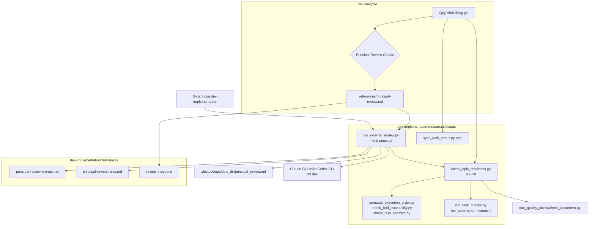
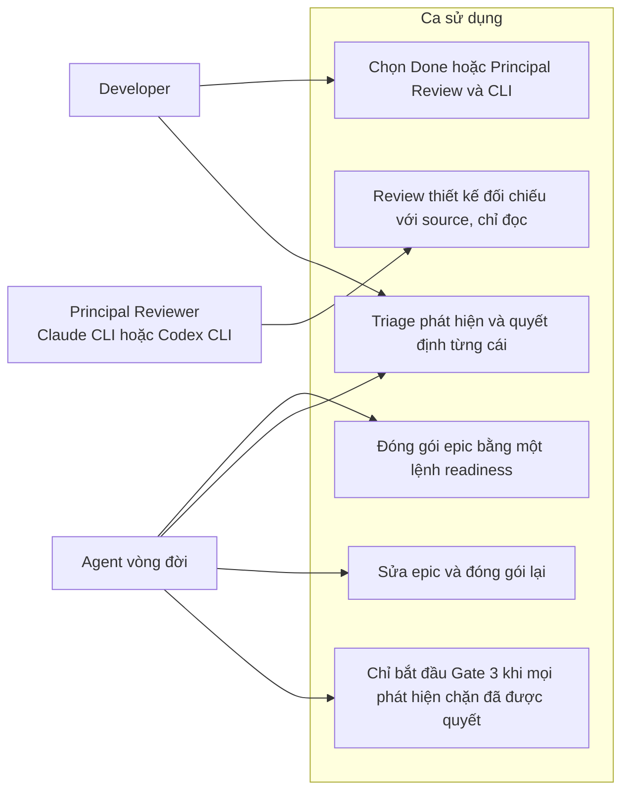
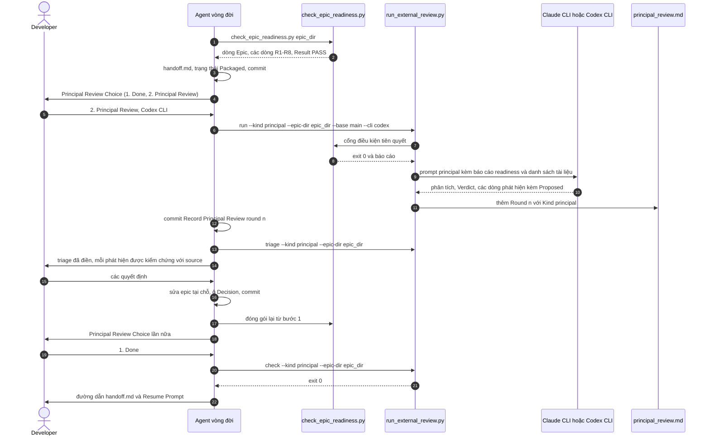

# Thiết kế cấp cao Principal Review

## Mục lục

- [Siêu dữ liệu](#siêu-dữ-liệu)
- [Bối cảnh](#bối-cảnh)
- [Mục tiêu và ngoài phạm vi](#mục-tiêu-và-ngoài-phạm-vi)
- [Kiến trúc và thiết kế kỹ thuật](#kiến-trúc-và-thiết-kế-kỹ-thuật)
- [Kế hoạch kiểm thử tích hợp và ma trận biên](#kế-hoạch-kiểm-thử-tích-hợp-và-ma-trận-biên)
- [Môi trường xác minh](#môi-trường-xác-minh)
- [Phạm vi kịch bản BDD toàn diện](#phạm-vi-kịch-bản-bdd-toàn-diện)
- [Chiến lược triển khai và giảm thiểu rủi ro](#chiến-lược-triển-khai-và-giảm-thiểu-rủi-ro)
- [Danh sách task Kanban](#danh-sách-task-kanban)

## Siêu dữ liệu

- **Tên epic**: `principal_review`
- **Trạng thái**: Ready (Gate 2 passed)
- **Bản phát hành mục tiêu**: Bản phát hành plugin kế tiếp
- **Nền tảng**: Công cụ Python / bộ kit skill cho agent
- **Spec nguồn**: [Thiết kế Principal Review đã duyệt](2026-10-22-principal-review-design.vi.md)

## Bối cảnh

Preflight đóng gói chứng minh tài liệu của epic đúng định dạng, không chứng minh chúng đúng. Một
đợt review thủ công một epic đã đóng gói trong `lyrics-sync` tìm ra những lỗi sau, tất cả đều xuất
hiện sau khi preflight đã qua:
- symbol và route không tồn tại;
- hiểu sai bản chất một class;
- hợp đồng mâu thuẫn với một test đang ghim;
- một chỗ ghi dữ liệu không task nào sở hữu;
- một thiết kế làm hỏng việc gắn vào từ;
- các dòng `Integration results:` khiến Gate 4 không thể pass;
- Gherkin trong bản copy của task lệch với file BDD gốc;
- lỗi có sẵn ở baseline.

Kit đã có thể nhờ Claude CLI hoặc Codex CLI cho ý kiến thứ hai ở chế độ chỉ đọc, nhưng chỉ cho code
đã xong sau Gate 4. Epic này thêm một kiểm tra readiness cơ học và một **Principal Review**
cross-model tùy chọn cho thiết kế, được đề xuất sau bước Package và lặp lại cho đến khi developer
chọn Done. Spec đã duyệt chứa đầy đủ động cơ và các quyết định D1–D13.

## Mục tiêu và ngoài phạm vi

### Mục tiêu

- `check_epic_readiness.py`, một lệnh duy nhất chạy các kiểm tra R1–R8. Nó thay cho bốn lệnh
  preflight đóng gói.
- `run_external_review.py --kind principal`, ghi các round vào `principal_review.md` và hỗ trợ
  `check` và `triage`.
- Prompt và quy tắc cho Principal Reviewer với checklist P1–P8.
- Principal Review Choice sau bước Package trong `dev-lifecycle`, mô tả trong
  `references/principal-review.md`, và một kiểm tra ở Gate 3 trong `dev-implementation`.
- `sync_task_status.py epic` giới hạn ở checkout hiện tại và các worktree của chính epic đó.

### Ngoài phạm vi

- Review code: Review Choice của Gate 4 giữ nguyên.
- Tự động áp dụng chỉnh sửa được đề xuất.
- Bắt buộc Principal Review.
- Chạy nhiều reviewer song song.
- Dùng Ollama làm Principal Reviewer.
- Principal Review trên nhánh Continue hoặc trong `doc-lifecycle`.

## Kiến trúc và thiết kế kỹ thuật

### Kiến trúc cấp cao



### Ca sử dụng



### Sơ đồ trình tự



### Hợp đồng module

#### `check_epic_readiness.py` (mới)

Nằm trong `skills/dev-implementation/resources/scripts/`.

```python
@dataclass(frozen=True)
class Finding:
    check: str     # "R1" ... "R8", "R5b", "R7b"
    severity: str  # "FAIL" or "WARN"
    message: str

CHECKS: tuple[tuple[str, Callable[[Context], list[Finding]]], ...]  # R1..R8 in order

def load_context(root: Path, epic_dir: str) -> Context
def run_checks(ctx: Context, *, baseline: bool = False, row_timeout: int = 600) -> list[Finding]
def render_report(ctx: Context, findings: list[Finding]) -> str
def main(argv: list[str] | None = None) -> int
```

- **CLI**: `check_epic_readiness.py <epic_dir> [--baseline] [--row-timeout 600]`, chạy từ bất kỳ đâu trong repository; root lấy từ `git rev-parse --show-toplevel`.
- **`Context`** chứa:
  - `root`, `epic_dir` và `epic_slug` (lấy từ frontmatter `epic:` của các task trong epic);
  - nội dung HLD;
  - đường dẫn và nội dung mọi `task_*.md` trong thư mục epic;
  - các lệnh `Integration results:` và thư mục `Integration test roots:` đã phân tích.
- **Báo cáo**:
  - dòng đầu là `Epic: <epic_dir> (<epic_slug>), <N> tasks`. Đây là số task mà `<N>` trong quy trình đóng gói nói tới;
  - sau đó, theo thứ tự kiểm tra, mỗi kiểm tra R1–R7 không có FAIL in một dòng `<check> PASS`, và mỗi phát hiện in một dòng `<check> <severity> <message>`. R5b và R7b chỉ in dòng WARN. R8 in `R8 SKIP` khi không có `--baseline`, và `R8 PASS` khi có mà không dòng nào cảnh báo;
  - dòng cuối là `Result: <f> FAIL, <w> WARN — PASS` hoặc `— FAIL`.
- **Mã thoát**: 0 khi không có FAIL, 1 khi có FAIL, 2 khi thiếu thư mục hoặc thiếu HLD.
- **R1** chạy qua `subprocess` với `sys.executable`:
  - `compute_execution_order.py <epic_slug>`. Số đếm `Scanned … ; M matched` phải bằng số task trong thư mục epic;
  - `check_bdd_traceability.py plan` và `check_task_contract.py --design` với đúng tham số của preflight đóng gói;
  - `check_document.py` (`SCRIPTS.parents[2] / "doc_quality_check/resources/scripts/check_document.py"`) với `--require-toc --require-bilingual` trên các cặp spec, HLD và BDD, với `--require-toc` trên `handoff.md` khi có, và không cờ trên mọi file task.

  Mỗi kiểm tra con thất bại là một phát hiện `R1 FAIL <command>: <last output line>` riêng.
- **R2** so sánh mỗi file task của epic với `.devtool/features/<name>`, hoặc `.devtool/features/done/<name>`. Bản mirror được đọc sau khi thay `](../epic/<epic_dir>/` bằng `](`. Thiếu mirror hoặc có khác biệt nào khác là FAIL, nêu tên file và dòng khác đầu tiên.
- **R3**: một khối scenario là một dòng `Scenario:` hoặc `Scenario Outline:` trong fence `gherkin`, cộng mọi dòng theo sau cho tới dòng scenario kế tiếp, một dòng trống hoặc fence đóng, đều được cắt khoảng trắng cuối dòng. Mỗi khối trong task phải bằng khối gốc có cùng mã. `scenario_ids()` của `bdd_scenarios.en.md` và `bdd_scenarios.vi.md` phải là hai tập bằng nhau.
- **R4**: tag trong ngoặc vuông sau mã trên mọi dòng scenario của `bdd_scenarios.en.md` phải đúng là `Tier A - Unit` hoặc `Tier C - Integration`. Thiếu tag cũng là FAIL.
- **R5** đọc các dòng con dạng ``- `<path>`: <rest>`` của mục `Target Files & Symbols` (hoặc `Target files and symbols`) trong mỗi task.
  - Nó chỉ kiểm các đường dẫn đã tồn tại và không được đánh dấu `(new)` trong Allowed files của task đó.
  - Với mỗi định danh trong dấu backtick ở `<rest>`, sau khi bỏ `()` ở cuối và chỉ giữ đoạn sau dấu chấm cuối cùng, định danh đó phải xuất hiện trong nội dung file. Định danh viết dạng ``new `name` `` được bỏ qua.
- **R5b** gom các route `/api/` từ file task và HLD, cắt tại `{` đầu tiên và bỏ `/` ở cuối. Mỗi route phải xuất hiện trong một file do `git ls-files` liệt kê, ngoài `.devtool/` và `docs/`, không tính `*.md`; nếu không thì WARN.
- **R6**: mọi task có dòng `Covers:` đều có ít nhất một dòng `TIER-C`.
  - Với mọi dòng `TIER-C`, mỗi token `shlex` nằm dưới một thư mục `Integration test roots` cũng phải xuất hiện trong một lệnh `Integration results:`, hoặc là chính token đó, hoặc nằm dưới một token thư mục của lệnh đó.
- **R7** FAIL khi:
  - Status của HLD bắt đầu bằng `Packaged` mà thiếu `handoff.md`;
  - có `handoff.md` mà Status không bắt đầu bằng `Packaged`, `In Progress` hay `Done`;
  - `Design commit` trong handoff không ghi `uncommitted` và cũng không trỏ tới một commit là tổ tiên của `HEAD`;
  - `epic:` của một task khác `epic_slug`, hoặc `status` của nó không thuộc `TASK_STATUSES`.
- **R7b** cảnh báo khi dòng Status của spec khớp `draft|awaiting|under .*review|bản nháp|chờ duyệt` (không phân biệt hoa thường). Spec là file `*-design.en.md` trong thư mục epic.
- **R8** chỉ chạy khi có `--baseline`.
  - Cây không sạch sinh đúng một dòng `R8 WARN baseline skipped: dirty tree`.
  - Ngược lại, mọi dòng `GREEN` và `TIER-B` có lệnh không nhắc đường dẫn nào được đánh dấu `(new)` trong bất kỳ task nào của epic được chạy bằng `run_task_checks.run_command(command, root, row_timeout)`.
  - Dòng nào hết giờ, hoặc có `run_task_checks.mismatch(row, code, text)` khác `None`, là một WARN `<task>:<row id> <reason>`.

#### `run_external_review.py` (thay đổi)

```python
KINDS = ("code", "principal")
PRINCIPAL_PROMPT = SCRIPTS.parent.parent / "references" / "principal-review-prompt.md"
PRINCIPAL_RULES = SCRIPTS.parent.parent / "references" / "principal-review-rules.md"

def review_file(kind: str) -> tuple[str, str]
    # "code" -> ("review_results.md", "Cross-Model Review"); "principal" -> ("principal_review.md", "Principal Review")
def principal_artefact_lines(root: Path, epic_dir: str) -> str
def run_principal(root: Path, args: argparse.Namespace, sha: str) -> int
```

- **`--kind`** (lựa chọn `KINDS`, mặc định `code`) được thêm vào các parser `run`, `check` và `triage`.
- **Bộ chọn dùng chung**: `record_round`, `check` và `triage` lấy tên file và tiêu đề của file mới từ `review_file(getattr(args, "kind", "code"))`. Với `code`, mọi byte chúng đọc hay ghi đều không đổi.
- **`run` với `--kind principal`**:
  1. `--cli ollama` in `--kind principal supports --cli claude or codex` và thoát với mã 2.
  2. Kiểm tra PATH và kiểm tra cây sạch chạy như hiện nay.
  3. `run_principal` chạy `run_gate("check_epic_readiness.py", [sys.executable, SCRIPTS / "check_epic_readiness.py", args.epic_dir], root, args.facts_timeout)`. Một `PreconditionFailedError` đi qua `print_gate_banner` và thoát với mã 2.
  4. Prompt được điền bằng `Template(PRINCIPAL_PROMPT.read_text()).safe_substitute(rules=…, sha=sha, base=args.base, base_sha=<git rev-parse args.base>, epic_dir=f".devtool/epic/{args.epic_dir}", artefacts=principal_artefact_lines(...), readiness_output=<gate stdout>)`.
  5. `execute(cli_command(args.cli, args.model), root, args.timeout, prompt)` chạy reviewer, và `tree_changes` được tính quanh nó như hiện nay.
  6. `record_round(root, args, sha, [Pass("principal", code, out, err, prompt)], changed, {"Kind": "principal"})` ghi round.
- **`principal_artefact_lines`** liệt kê cặp spec, cặp HLD, cặp BDD, mọi `task_*.md` và `handoff.md` khi có. Nó không bao giờ liệt kê `review_results.md` hay `principal_review.md`.
- **Giữ nguyên**: `audit_epic.py` và các lệnh tích hợp không bao giờ chạy với `--kind principal`, và không dựng diff nào.

#### Prompt và quy tắc Principal Review (mới)

- **`principal-review-prompt.md`** đặt người đọc vào vai Principal Reviewer ký duyệt epic trước khi implement.
  - Nó tuyệt đối chỉ đọc, và phải đọc source tại `$sha`.
  - Nó chứa `$rules`, `$sha`, `$base`, `$base_sha`, `$epic_dir`, `$artefacts`, `$readiness_output` và checklist P1–P8 của spec.
  - Nó kết thúc bằng hợp đồng đầu ra của review code: không dùng tag mức độ phía trên khối verdict, sau đó là `Verdict: PASS` hoặc `Verdict: CHANGES REQUIRED`, rồi `[Critical|Important|Minor] <artefact>:<location> — <problem>. Proposed: <edit>`.
- **`principal-review-rules.md`** nêu ý nghĩa các mức độ:
  - Critical: không thể đạt mục tiêu hoặc Gate 4 như đã thiết kế;
  - Important: Stop-and-Report, hoặc hành vi sai;
  - Minor: câu chữ.

  Nó cũng nói rằng báo cáo readiness đã được chứng minh, nên review dồn công sức vào phán đoán và grounding với source, và mọi nhận định về source phải nêu file và dòng đã đọc.

#### `sync_task_status.py` (thay đổi)

```python
def parse_worktree_branches(output: str) -> list[tuple[Path, str | None]]
def epic_checkout_roots(epic_dir: str) -> list[Path]
```

- **`parse_worktree_branches`** đọc `git worktree list --porcelain`. Mỗi mục trả về đường dẫn `worktree` và ref `branch` của nó, hoặc `None` khi worktree ở trạng thái detached.
- **`epic_checkout_roots`**:
  - trả về `git rev-parse --show-toplevel` hiện tại, cộng mọi worktree có nhánh `refs/heads/epic/<epic_slug>`;
  - lấy `epic_slug` từ `find_epic_slug(current_root, epic_dir)`, nếu không có thì dùng `epic_dir`;
  - loại trùng, giữ thứ tự.
- **`main`**: chỉ lệnh con `epic` dùng nó. `task`, `archive-epic` và `archive-done` vẫn dùng `checkout_roots()`.

#### Văn bản quy trình (thay đổi)

- **`dev-lifecycle/SKILL.md`**:
  - bước 1 đóng gói thành một lệnh, `python3 "$SCRIPTS"/check_epic_readiness.py <epic_dir>`, phải trả exit 0;
  - bước 7 in đường dẫn handoff và Resume Prompt;
  - một bước 8 mới trình bày **Principal Review Choice** và làm theo `references/principal-review.md`;
  - Red Flags có thêm "Picking the Principal Review CLI for the developer" và "Acting on a Principal Review finding before triage";
  - mọi token đã ghim được giữ, và file vẫn không quá 2500 từ.
- **`dev-lifecycle/references/principal-review.md`** (mới): quy trình ở §6 của spec, câu chữ của lựa chọn, khuyến nghị D2, tiêu đề commit và quy tắc Done (xem phần làm rõ).
- **`dev-implementation/SKILL.md`**:
  - Entry-Point Detection có thêm `test -f .devtool/epic/<epic_dir>/principal_review.md && python3 "$SKILL_DIR"/resources/scripts/run_external_review.py check --kind principal --epic-dir <epic_dir>`;
  - Phase 1 bước 3 và Gate 3 khi resume đều ghi trạng thái Principal Review (`not run`, `round <n>: PASS` hoặc `round <n>: decided`), và dừng khi exit 1.
- **`handoff-template.md`**: Read First có thêm `4. .devtool/epic/<epic_dir>/principal_review.md, when present — Principal Review rounds and decisions.`
- **`docs/lifecycles.en.md` và `docs/lifecycles.vi.md`**: sơ đồ Stage 2 có thêm `PRC{"Principal Review Choice"}`, `PKG --> PRC`, `PRC -->|"1. Done"| …`, `PRC -->|"2. Principal Review"| PR` và `PR -->|"revised and re-packaged"| PKG`, cùng một đoạn văn.

### Làm rõ spec

Các điểm sau chính thức hóa những khoảng trống spec để ngỏ; không điểm nào đổi một quyết định đã duyệt.

| # | Làm rõ | Lý do |
|---|---|---|
| C1 | Chiều ngược lại của R7 chấp nhận `In Progress` và `Done`: một epic đã resume vẫn giữ `handoff.md` | Cụm "và ngược lại" của spec sẽ làm mọi epic đã resume bị FAIL |
| C2 | Mỗi round đã ghi được commit là `[EPIC_NAME] Record Principal Review round <n>`, và các quyết định của nó là `[EPIC_NAME] Record Principal Review decisions for round <n>` | `run` từ chối cây không sạch, nên một round phải được commit trước round kế tiếp |
| C3 | Done chạy lại quy trình đóng gói khi `git log -1 --format=%s -- .devtool/epic/<epic_dir>` không phải `[<EPIC_NAME>] Package epic for handoff` | Giữ lệnh kiểm tra độ cũ của handoff mà `test_lf_st_02` ghim luôn chính xác mà không phải sửa nó |
| C4 | Dòng đầu của báo cáo readiness mang số task | Token "`<N>` is the task count the preflight printed" ở bước 2 đóng gói đang bị ghim |
| C5 | R8 đánh giá các dòng bằng `run_task_checks.run_command` và `mismatch` | Chỉ một định nghĩa cho Expect của một dòng |

### Phân tích ảnh hưởng

`check_code_impact.py` đã chạy trên các file dự kiến so với `main`; bảng coverage của nó báo 0% cho
những file có bộ test đi kèm, đó là cảnh báo sai đã biết, nên các caller được xác nhận bằng `grep`.

- `run_external_review.py`: được gọi bởi `dev-implementation/SKILL.md` (Review Choice),
  `review-triage.md`, `local-review-setup.md`, `local_review.py`, `rules/CRITICAL_RULES.md`, và được test bởi
  `test_run_external_review.py`, `test_local_review.py`, `scripts/test_lifecycle_document_contract.py`,
  `scripts/test_verifiable_handoff_text.py`. Mọi đường mới nằm sau `--kind principal`.
- `sync_task_status.py`: được gọi bởi `dev-lifecycle`, `dev-implementation`, `dev-designer`, `doc-implementation`,
  `finishing-a-development-branch`, `subagent-driven-development`, và được test bởi
  `test_sync_task_status.py`, `scripts/test_lifecycle_signals.py`, `scripts/test_verifiable_handoff.py`.
  Chỉ root của lệnh con `epic` thay đổi.
- `dev-lifecycle/SKILL.md`: 2454 từ trên trần 2500; các token bị ghim bởi
  `test_lifecycle_document_contract.py`, `test_lifecycle_signals.py` và `test_verifiable_handoff_text.py`.
- `scripts/verify.sh` liệt kê từng file test; bộ test mới phải được thêm vào.
- Không có cầu nối đa nền tảng.

## Kế hoạch kiểm thử tích hợp và ma trận biên

Integration test roots: skills/dev-implementation/resources/scripts/, scripts/

Protected paths: .agents/quality/**, .devtool/epic/principal_review/bdd_scenarios.en.md, .devtool/epic/principal_review/bdd_scenarios.vi.md, skills/dev-implementation/resources/scripts/test_run_external_review.py, skills/dev-implementation/resources/scripts/test_sync_task_status.py, scripts/test_lifecycle_document_contract.py, scripts/test_lifecycle_signals.py, scripts/test_verifiable_handoff_text.py

Integration results: python3 scripts/run_unittest_junit.py --junitxml build/test-results/principal-review.xml skills/dev-implementation/resources/scripts/test_check_epic_readiness.py skills/dev-implementation/resources/scripts/test_run_external_review.py skills/dev-implementation/resources/scripts/test_sync_task_status.py scripts/test_lifecycle_document_contract.py scripts/test_lifecycle_signals.py scripts/test_verifiable_handoff_text.py -> build/test-results/principal-review.xml

| Ranh giới | Thành phần thật | Cô lập hoặc fixture | Assertion bắt buộc |
|---|---|---|---|
| Readiness, cấu trúc | `check_epic_readiness.main`, R1–R4, R7 | Repo Git tạm với một epic fixture; `compute_execution_order.py`, `check_bdd_traceability.py`, `check_task_contract.py`, `check_document.py` thật | Các dòng báo cáo, dòng `Epic:`, mã thoát, mỗi lỗi được nêu tên |
| Readiness, grounding và Gate 4 | R5, R5b, R6, R8 | Cùng fixture với file source, dòng `Integration results:` và dòng Verification | FAIL khi thiếu symbol, WARN cho route, FAIL cho đường dẫn không được phủ, WARN và timeout cho baseline |
| Round principal | `run --kind principal`, `record_round`, `check`, `triage` | Repo epic tạm, script giả `claude` và `codex` trên `PATH` ghi lại stdin của chúng | Nội dung prompt, round trong `principal_review.md`, `review_results.md` không bị đụng, mã thoát, banner khi readiness FAIL |
| Bảo vệ review code | Bộ test runner hiện có | Như hiện nay | Pass không đổi |
| Phạm vi trạng thái epic | `sync_task_status.py epic`, `task` | Repo tạm với hai worktree trên `epic/<slug>` và `epic/<other>` | Worktree của chính epic được cập nhật, worktree kia giống hệt từng byte, đồng bộ task vẫn ở mọi nơi |
| Văn bản quy trình | Skill, reference, template, tài liệu vòng đời | Tài liệu trong repo | Câu chữ lựa chọn, con trỏ, kiểm tra Gate 3, dòng Read First, các cạnh sơ đồ ở cả hai ngôn ngữ, trần số từ |
| Nghiệm thu đầy đủ | Mọi bộ test ở trên | Checkout hiện tại của repo | Lệnh Integration results, `scripts/verify.sh`, kiểm tra tài liệu |

Không test nào chạm tới model thật hay mạng: mọi reviewer đều là script giả trên `PATH`.

## Môi trường xác minh

- Test dùng thư mục `tempfile` và repo cùng worktree Git tạm; chúng không bao giờ thay đổi repo này,
  remote, một worktree thật hay cấu hình người dùng.
- Các file thực thi giả `claude` và `codex` được ghi vào một thư mục tạm đặt ở đầu `PATH`, chỉ trong
  thời gian của test. Không cho phép CLI thật, credential, model hay truy cập mạng.
- Test R8 chạy các lệnh fixture như `python3 -c 'raise SystemExit(1)'` và `sleep`, không bao giờ chạy
  bộ test của dự án.
- Các lệnh test không cần biến môi trường nào; mọi ô `Needs` đều là `—`.
- Báo cáo JUnit nằm dưới `build/test-results/` đã được ignore.
- Dự án không có kho dữ liệu live, nên không cần dòng sentinel.

## Phạm vi kịch bản BDD toàn diện

Định nghĩa Gherkin gốc nằm trong [kịch bản BDD](bdd_scenarios.en.md), với
[bản dịch tiếng Việt](bdd_scenarios.vi.md) được đồng bộ.

| Chiều kiểm thử | Mã kịch bản | Mục đích bao phủ |
|---|---|---|
| Luồng thành công | PRV-HP-01 đến PRV-HP-05 | Epic sẵn sàng thì qua, một round principal được ghi, chỉnh sửa đề xuất được phân tích, vòng đời đưa ra lựa chọn, worktree của chính epic được đồng bộ |
| Ca biên và ranh giới | PRV-EC-01 đến PRV-EC-07 | Thiếu symbol, lệch tier, đường dẫn Gate 4 không được phủ, mirror lệch so với khác biệt chỉ ở link, metadata và spec nháp, route không tồn tại, dòng Read First của handoff |
| Chuyển trạng thái | PRV-ST-01 đến PRV-ST-04 | Quyết định mở khóa `check`, `triage` đọc file được chọn, vòng lặp quay về Package và Done đóng gói lại, Gate 3 dừng khi còn phát hiện chưa quyết |
| Bất đồng bộ và tranh chấp | PRV-AR-01 | Round thứ hai trước khi round đầu được commit bị từ chối, và các round được đánh số theo thứ tự |
| Lỗi và khả năng chịu lỗi | PRV-FR-01 đến PRV-FR-05 | Lỗi và timeout ở baseline, một kiểm tra con của preflight thất bại, readiness FAIL chặn CLI, Ollama bị từ chối, worktree của epic khác không bị đụng |

## Chiến lược triển khai và giảm thiểu rủi ro

1. Đưa `check_epic_readiness.py` vào trước (Task 1–2). Nó chưa có caller nào, nên không gì thay đổi.
2. Thu hẹp `sync_task_status.py epic` (Task 4), độc lập với phần còn lại, với bộ test hiện có làm
   lớp bảo vệ.
3. Thêm `--kind principal` (Task 3), với bộ test runner hiện có làm lớp bảo vệ cho `--kind code`.
4. Sửa skill, reference, template và tài liệu vòng đời sau cùng (Task 5), rồi chạy lệnh Integration
   results, `scripts/verify.sh` và kiểm tra tài liệu trên SHA ứng viên.
5. Ở Gate 5, chạy `check_epic_readiness.py` với một epic đã đóng gói do developer chọn, và dùng
   Principal Review Choice cho epic đầu tiên được đóng gói sau khi phát hành.

Không cần feature flag: Principal Review là tùy chọn ở mỗi lần Package, và `--kind` mặc định là
`code`. Mỗi task có thể được revert độc lập. Nếu đường mới chạy sai sau khi phát hành, việc đóng gói
có thể quay về bốn lệnh mà R1 chạy, và Review Choice của Gate 4 không bị ảnh hưởng.

## Danh sách task Kanban

1. [Task 1: Readiness Check Core](task_1_readiness_check_core.md)
2. [Task 2: Readiness Grounding, Gate 4 Coverage and Baseline](task_2_readiness_grounding_and_baseline.md)
3. [Task 3: Principal Review Mode in the Runner](task_3_principal_review_runner_mode.md)
4. [Task 4: Scope Epic Status Sync to Its Own Worktrees](task_4_epic_status_sync_scope.md)
5. [Task 5: Principal Review Choice in the Lifecycle, and Acceptance](task_5_principal_review_choice_and_acceptance.md)
