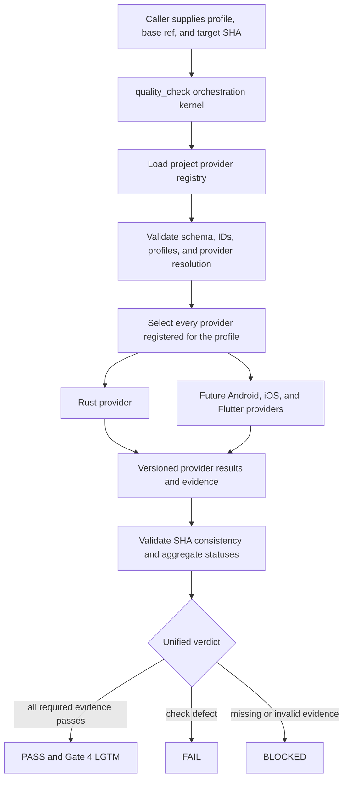

# Provider-Based Quality Check Design

- **Date**: 2026-10-11
- **Status**: Design approved; written specification awaiting review
- **Scope**: `quality_check`, a new `rust-quality-check` provider, provider contracts and validators,
  lifecycle integrations, verification, and bilingual architecture documentation
- **Repository**: `ai-agent-tools`
- **Next step**: Gate 1 review of this written specification, then epic HLD through `dev-designer`

## Table of Contents

- [1. Context](#1-context)
- [2. Goals and Non-Goals](#2-goals-and-non-goals)
- [3. Design Decisions](#3-design-decisions)
- [4. Architecture Overview](#4-architecture-overview)
- [5. Project Registry](#5-project-registry)
- [6. Provider Discovery and Invocation Contract](#6-provider-discovery-and-invocation-contract)
- [7. Provider Result Contract](#7-provider-result-contract)
- [8. Aggregation and Fail-Closed Semantics](#8-aggregation-and-fail-closed-semantics)
- [9. Rust Quality Provider](#9-rust-quality-provider)
- [10. Quality Profiles](#10-quality-profiles)
- [11. Lifecycle Integration](#11-lifecycle-integration)
- [12. Repository Changes](#12-repository-changes)
- [13. Test-Driven Skill Validation](#13-test-driven-skill-validation)
- [14. Migration and Compatibility](#14-migration-and-compatibility)
- [15. Risks and Controls](#15-risks-and-controls)
- [16. Acceptance Criteria](#16-acceptance-criteria)
- [17. Out of Scope](#17-out-of-scope)

## 1. Context

The current [`quality_check`](../../../skills/quality_check/SKILL.md) is both an orchestrator and an
implementation for Flutter, Android, and iOS. It detects a platform, embeds its commands and
thresholds, invokes semantic audits, and synthesizes a verdict. This creates three structural
problems:

1. Adding Rust requires editing the central skill, so every new ecosystem increases its branching
   logic and regression surface.
2. A repository containing more than one platform can be misclassified and only one quality suite
   can run.
3. Missing tools or unknown layouts can be interpreted as a skipped check instead of a blocked
   quality gate.

The requested design separates orchestration from platform knowledge. A project explicitly
registers its quality providers. The central skill discovers and invokes every selected provider,
validates their machine-readable results, and computes one deterministic verdict. Rust becomes the
first provider implemented against this contract; Android, iOS, and Flutter templates can register
their own providers later without changing the orchestrator.

Rust does not currently have one mature, direct equivalent to Kotlin Konsist for arbitrary
architecture rules. The reliable equivalent for a feature-first, crate-oriented workspace is a
project-owned architecture gate built on Cargo metadata, normally exposed through an `xtask`.
Source parsers and dependency visualization tools can supplement that gate, but do not replace it.

## 2. Goals and Non-Goals

**Goals:**

- Make `quality_check` a platform-neutral orchestration kernel.
- Discover providers through one project-owned registry and invoke all applicable providers.
- Define versioned invocation and result contracts that can be validated mechanically.
- Add a read-only, fail-closed Rust quality provider with explicit profiles.
- Preserve Gate 4's single executive verdict while attaching it to one immutable repository SHA.
- Document how consumer templates register platform providers.
- Validate both scripts and skill behavior with a red-first skill-authoring workflow.

**Non-goals:**

- Implement or edit Android, iOS, or Flutter provider templates in this epic.
- Modify the D3Nexus product repository or its Rust source code.
- Edit an installed plugin cache.
- Auto-fix formatting, lint, architecture, security, or test failures.
- Invent one universal list of commands for every Rust workspace.
- Replace a project's own architecture policy with a generic syntax-only rule set.

## 3. Design Decisions

| ID | Decision | Rationale |
|----|----------|-----------|
| D1 | Projects register providers in `.agents/quality/check_quality.json` | Project intent is authoritative and composite repositories are unambiguous |
| D2 | `quality_check` contains no platform commands, thresholds, or file heuristics | The orchestrator remains stable as ecosystems are added |
| D3 | Every provider selected for the requested profile runs | First-match platform detection would miss quality coverage in super apps and multi-service repositories |
| D4 | Missing or invalid registration is `BLOCKED`; there is no legacy fallback | A silent skip must never produce a green quality verdict |
| D5 | Providers return a versioned machine-readable result bound to the requested SHA | Aggregation is deterministic and stale evidence cannot grant approval |
| D6 | Provider execution is read-only | Quality checks report changes needed; they do not mutate the tree they certify |
| D7 | Profiles are `pr`, `epic`, `scheduled`, and `release` | Cost and depth are explicit instead of inferred from agent judgment |
| D8 | A direct invocation defaults to `pr`; lifecycle callers pass a profile explicitly | Interactive use stays convenient while formal gates remain unambiguous |
| D9 | Rust architecture enforcement uses Cargo metadata plus a project-owned `xtask` contract | It provides semantic workspace knowledge and supports repository-specific feature-first constraints |
| D10 | Validators and aggregation are deterministic scripts; judgment and remediation remain in skills | Contract enforcement should not depend on prose compliance |
| D11 | Gate precedence is `FAIL` over `BLOCKED` over `PASS` | Known defects remain visible even when infrastructure is also incomplete |
| D12 | This is a breaking, fail-closed migration | A repository without the manifest receives `BLOCKED`, forcing explicit adoption |

## 4. Architecture Overview



The registry is a dependency-injection boundary: consumer repositories provide the list of quality
capabilities, while the orchestrator depends only on their shared contract. A provider owns its
ecosystem's command selection, capability configuration, evidence collection, and semantic audits.
The orchestrator owns discovery, fan-out, contract validation, aggregation, and presentation.

Provider execution may be parallelized when providers do not share mutable state. Result order and
the final report remain deterministic by sorting on provider ID and check ID.

## 5. Project Registry

Every participating project defines `.agents/quality/check_quality.json`. The initial schema is:

```json
{
  "schema_version": 1,
  "providers": [
    {
      "id": "rust-core",
      "skill": "d3nexus:rust-quality-check",
      "required": true,
      "profiles": ["pr", "epic", "scheduled", "release"]
    }
  ]
}
```

Contract rules:

- `schema_version` must be a supported integer.
- `providers` must be a non-empty array.
- `id` is stable, unique within the repository, and suitable for evidence filenames.
- `skill` uses a resolvable namespaced skill identifier.
- `required` is explicit; omission is invalid.
- `profiles` is non-empty, contains only the four defined profiles, and has no duplicates.
- Additional unknown fields are rejected in schema version 1 so misspellings cannot silently change
  behavior.
- Registry order does not control execution priority or output order.

The manifest deliberately stores provider registration, not commands. Provider-specific project
capabilities belong in provider configuration such as `.agents/quality/rust-quality.json`.

## 6. Provider Discovery and Invocation Contract

`quality_check` accepts this normalized request:

```json
{
  "contract_version": 1,
  "profile": "epic",
  "base_ref": "develop",
  "repository_sha": "5d8b7b0f1b7a9c6f7c8f6498e69c3d6f1e0a4123"
}
```

The orchestrator performs these steps:

1. Resolve the repository root and requested SHA before provider execution.
2. Load and validate the project registry.
3. Select all providers whose `profiles` include the requested profile.
4. Resolve each namespaced skill without guessing a platform from repository files.
5. Invoke each provider with the identical normalized request plus its `provider_id` and `required`
   flag.
6. Collect one result document per selected provider.
7. Re-read `HEAD`; any drift from the requested SHA invalidates the run.
8. Validate, sort, aggregate, and render the executive report.

A formal caller such as `dev-implementation` must supply `profile=epic`. A direct human invocation
may omit the profile and receives `pr`. `base_ref` is required for changed-file scope and impact
analysis. The orchestrator may resolve a conventional base only for a direct `pr` invocation; it
must display that resolution in the report.

An unresolved skill, duplicate provider ID, unsupported profile, empty selection, malformed
registry, invocation failure, timeout, or missing result is a contract failure and produces
`BLOCKED`.

## 7. Provider Result Contract

Each selected provider writes or returns one JSON result with these required top-level fields:

```json
{
  "provider_id": "rust-core",
  "contract_version": 1,
  "profile": "epic",
  "repository_sha": "5d8b7b0f1b7a9c6f7c8f6498e69c3d6f1e0a4123",
  "status": "PASS",
  "checks": [],
  "coverage": {},
  "evidence": [],
  "started_head": "5d8b7b0f1b7a9c6f7c8f6498e69c3d6f1e0a4123",
  "finished_head": "5d8b7b0f1b7a9c6f7c8f6498e69c3d6f1e0a4123",
  "duration": 84.2,
  "blockers": [],
  "warnings": []
}
```

Each check records a stable check ID, category, status, command or audit source, duration, concise
summary, and evidence references. Allowed provider and check statuses are `PASS`, `FAIL`,
`BLOCKED`, and `NOT_APPLICABLE`.

Evidence entries identify their type, source, and location or digest. They must be sufficient to
distinguish a command that passed from a command that was never run. Coverage records both measured
values and the configured threshold; an omitted threshold is not treated as zero.

`NOT_APPLICABLE` requires a structured reason and evidence of the applicability decision. It is not
an alias for a missing executable, unsupported command, absent configuration, or timeout. A required
provider cannot satisfy the overall gate with an entirely `NOT_APPLICABLE` result.

The validator requires `started_head`, `finished_head`, and `repository_sha` to match the requested
SHA. It also confirms that the provider ID, profile, and contract version match the invocation.

## 8. Aggregation and Fail-Closed Semantics

Aggregation has two stages. First, every provider result is validated against the registry and the
invocation. Invalid or absent evidence is converted to a synthetic `BLOCKED` provider result.
Second, valid results are reduced to one verdict.

Rules:

- Any `FAIL` produces overall `FAIL`, even when another provider is blocked.
- With no failure, any `BLOCKED` produces overall `BLOCKED`.
- A required provider with only `NOT_APPLICABLE` checks is `BLOCKED`.
- An optional provider may be `NOT_APPLICABLE` only with valid applicability evidence; it is neutral
  in the final reduction.
- Overall `PASS` requires every required selected provider to return `PASS` and all contract checks
  to succeed.
- Only overall `PASS` may be rendered as Gate 4 `LGTM`.
- Warnings never downgrade or upgrade a verdict, but remain visible.
- Results from a different SHA, profile, provider ID, or contract version are rejected.

The executive report includes the invocation identity, registry digest, per-provider table,
per-check findings, coverage matrix, blockers, warnings, evidence locations, and the final precedence
decision. This keeps infrastructure gaps distinct from product defects while preventing either from
being hidden.

## 9. Rust Quality Provider

The new `rust-quality-check` skill owns Rust-specific behavior and remains read-only. It reads
`.agents/quality/rust-quality.json`, validates the configuration, executes the requested profile,
runs semantic audits declared by the provider, and emits the shared result contract.

The Rust configuration describes capabilities rather than relying on repository-name heuristics. It
can declare command arrays for formatting, compilation, lint, unit tests, integration tests,
architecture checks, coverage, dependency policy, vulnerability audit, unsafe-code policy, WASM,
FFI, acceptance tests, documentation, and API compatibility. It also declares which commands are
required by each profile and their thresholds. Commands run exactly as configured from the resolved
repository root; shell interpolation is not implicit.

The default mapping for a mature Rust workspace is:

| Android-native concept | Rust quality capability |
|------------------------|-------------------------|
| Spotless | `cargo fmt --all -- --check` or the project's formatting command |
| Android Lint and Detekt | `cargo check` plus Clippy with warnings denied |
| Konsist | Cargo metadata plus a project-owned `xtask` architecture check |
| Unit and instrumented tests | Unit, integration, WASM, FFI, and acceptance commands declared by the project |
| Coverage gate | `cargo-llvm-cov` or a project wrapper with an explicit threshold |
| Dependency and license policy | `cargo-deny` when declared and installed |
| Vulnerability database audit | `cargo-audit` when declared and installed |
| Binary compatibility validation | `cargo-semver-checks`, plus separate FFI or WASM contract tests |

There is no single mandatory third-party Konsist replacement. The authoritative architecture check
uses `cargo_metadata` data and project policy, normally through `cargo run -p xtask -- <command>`.
It can enforce crate dependency direction, feature isolation, composition-root wiring, domain
purity, naming, and forbidden dependencies. `cargo-modules` may provide diagnostic graphs;
ArchUnitRust may be evaluated as an experimental DSL; `syn` may support narrow source-level checks.
None of those tools is treated as authoritative without an explicit project capability and stable
evidence.

For a feature-first Clean Architecture and MVI codebase, the architecture evidence should cover:

- feature ownership and forbidden cross-feature dependencies;
- inward dependency direction across domain, application, data, and presentation boundaries;
- dependency injection and composition-root-only construction;
- immutable state and explicit intent, reducer, effect, and navigation contracts;
- separation of super-app shell/navigation from feature internals;
- service boundary contracts for microservices, FFI, and WASM where applicable.

If a required executable, configuration, threshold, architecture command, or evidence artifact is
missing, the provider returns `BLOCKED`. A nonzero quality command returns `FAIL` when it completed
and found a defect; inability to execute or prove the check returns `BLOCKED`.

## 10. Quality Profiles

Profiles define intent, not a hardcoded global command list. Each provider maps the common profile
to its own declared capabilities.

| Profile | Purpose | Minimum Rust intent |
|---------|---------|---------------------|
| `pr` | Fast feedback for a focused change | Format check, compile/check, lint, changed-scope tests, required architecture checks |
| `epic` | Gate 4 for a completed epic | Full workspace tests, architecture, semantic audits, coverage, integration/contract suites relevant to the repository |
| `scheduled` | Deeper recurring assurance | `epic` plus expensive dependency, vulnerability, unused-dependency, matrix, or diagnostic checks configured by the project |
| `release` | Release candidate certification | `epic` plus release build, API compatibility, packaging, FFI/WASM and acceptance contracts declared for release |

Profiles are monotonic in intent, but providers may avoid rerunning identical commands by reusing
evidence only when the contract proves the same SHA, tool configuration, and profile requirement.
A cheaper profile never satisfies a more demanding caller. In particular, a `pr` result cannot
satisfy Gate 4's `epic` request.

## 11. Lifecycle Integration

[`dev-implementation`](../../../skills/dev-implementation/SKILL.md) will stop detecting a mobile
platform for end-of-epic quality. It will invoke `quality_check` with `profile=epic`, the epic base
reference, and the candidate SHA. Platform-specific task implementation guidance may remain where
it serves implementation; Gate 4 wording becomes provider-based.

[`dev-lifecycle`](../../../skills/dev-lifecycle/SKILL.md) will define Gate 4 in terms of the unified
provider verdict. Its acceptance criteria become:

1. the registry and every selected provider satisfy the contract;
2. every required provider passes the `epic` profile;
3. semantic and impact evidence required by those providers is present;
4. the aggregated verdict is bound to the candidate SHA.

[`pr_review`](../../../skills/pr_review/SKILL.md) will invoke the same orchestrator with `pr`, then
use the normalized report instead of assuming one of three mobile command matrices.

These integration skills do not acquire Rust commands or provider selection logic. They state the
required profile and consume the shared verdict. `quality_check` remains the sole aggregation
boundary.

## 12. Repository Changes

| Area | Planned change |
|------|----------------|
| `skills/quality_check/SKILL.md` | Rewrite as a thin provider orchestrator with no platform command matrix |
| `skills/quality_check/references/` | Add registry, invocation, result, aggregation, and report contracts |
| `skills/quality_check/resources/scripts/` | Add deterministic manifest/result validation and aggregation scripts with unit tests |
| `skills/rust-quality-check/SKILL.md` | Add the Rust provider workflow, activation description, profile handling, and fail-closed rules |
| `skills/rust-quality-check/references/` | Add Rust configuration schema, capability mapping, architecture guidance, and report details |
| `docs/architecture/quality-provider-system.en.md` | Add the durable English consumer and provider architecture document |
| `docs/architecture/quality-provider-system.vi.md` | Add the synchronized Vietnamese document |
| `skills/dev-implementation/SKILL.md` | Pass explicit Gate 4 inputs and consume provider results |
| `skills/dev-lifecycle/SKILL.md` | Define provider-based Gate 4 acceptance and return paths |
| `skills/pr_review/SKILL.md` | Route PR verification through profile `pr` without platform assumptions |
| [`scripts/verify.sh`](../../../scripts/verify.sh) | Validate new skill files, schemas, contracts, fixtures, and script tests |

Every new skill keeps exactly `name` and `description` in frontmatter. Cross-skill references use the
`d3nexus:` namespace. Durable documents explain both provider authoring and project registration;
the skill files remain concise and operational.

## 13. Test-Driven Skill Validation

Implementation follows `writing-skills` and `test-driven-development`. Behavioral pressure tests
are run before authoring the new instructions, and their failures are recorded. The minimum red
scenarios are:

1. A composite repository contains two registered providers, but an agent chooses only the first
   recognizable platform.
2. A required tool is absent, but an agent describes the check as skipped and grants a pass.
3. Gate 4 requests `epic`, but an agent runs or reuses `pr` evidence.
4. Provider outputs disagree, but an agent ignores the precedence rules.
5. `HEAD` changes during execution, but an agent grants `LGTM` using stale evidence.

The minimal skill and references are then added, the same scenarios are rerun, and remaining
rationalizations are closed. Script-level tests cover at least:

- valid and invalid registries;
- unsupported schema versions and unknown fields;
- duplicate IDs and unresolved provider skills;
- multiple providers selected for one profile;
- empty selection and profile mismatch;
- precedence `FAIL` over `BLOCKED` over `PASS`;
- valid and invalid `NOT_APPLICABLE` evidence;
- SHA drift and invocation identity mismatch;
- missing, corrupt, or duplicate provider results;
- contract-version mismatch and deterministic ordering.

The repository's full verification script runs these tests. Document checks require complete linked
tables of contents and synchronized EN/VI heading structures.

## 14. Migration and Compatibility

The migration is intentionally fail-closed. After the new orchestrator ships, a consumer repository
without `.agents/quality/check_quality.json` receives `BLOCKED`. There is no hidden Android,
Flutter, iOS, or Rust detection fallback.

Recommended rollout:

1. Publish the provider contract and documentation with the Rust provider.
2. Add a registry and Rust capability configuration to Rust consumers.
3. Add provider registration to Android, iOS, and Flutter templates in later, platform-owned work.
4. Migrate existing consumers before requiring the new kit version in their formal gates.

The registry's `schema_version` and each result's `contract_version` permit additive future
evolution. Breaking changes require a new version and an explicit migration path. The orchestrator
must reject versions it cannot safely interpret.

## 15. Risks and Controls

| Risk | Control |
|------|---------|
| A provider fabricates or omits evidence | Strict result schema, required evidence fields, SHA binding, and validator-generated `BLOCKED` |
| Composite repositories become slow | Independent provider execution may run in parallel; profiles make cost explicit |
| Arbitrary project commands create shell risk | Commands are structured arrays, run from the repository root, and do not receive implicit shell interpolation |
| A new provider weakens the common gate | Orchestrator validates identity and status semantics; required providers cannot turn absence into `NOT_APPLICABLE` |
| Rust architecture checks become syntax heuristics | Cargo metadata and project-owned `xtask` policy remain authoritative; source parsing is supplemental |
| Breaking migration interrupts existing consumers | Documentation and staged template adoption make the requirement visible; failure is `BLOCKED`, never a false pass |
| Evidence becomes stale during a long run | Start SHA, finish SHA, requested SHA, and final repository HEAD must agree |
| Platform logic leaks back into lifecycle skills | Verification asserts that orchestration and lifecycle files contain no provider command matrices |

## 16. Acceptance Criteria

The epic is complete only when all of the following are true:

- `quality_check` discovers providers exclusively from the project registry and contains no
  platform command or threshold logic.
- A repository registering multiple matching providers invokes all of them and reports each result.
- Missing, invalid, unresolved, stale, or incomplete required evidence cannot produce `LGTM`.
- Aggregation is deterministic and implements the documented precedence.
- `rust-quality-check` is read-only, profile-aware, capability-driven, and fail-closed.
- The Rust architecture guidance defines the Cargo metadata plus project `xtask` mechanism as the
  Konsist-equivalent governance boundary.
- Gate 4 passes `epic` explicitly and binds its verdict to the candidate SHA.
- PR review uses `pr` explicitly.
- Red-first behavioral evaluations demonstrate the prior failure modes and their corrected behavior.
- Validator and aggregator unit tests pass.
- Bilingual architecture documents explain registration, provider authoring, status semantics, and
  migration.
- [`scripts/verify.sh`](../../../scripts/verify.sh) passes for the complete agent-kit repository.

## 17. Out of Scope

- Provider implementations or template registrations for Android, iOS, and Flutter.
- Refactoring application architecture inside the D3Nexus Rust workspace.
- CI workflow changes in consumer repositories.
- Installing third-party Rust tools on behalf of a consumer project.
- Automatically changing source code or formatting during a quality run.
- Publishing, releasing, or pushing the agent kit.
