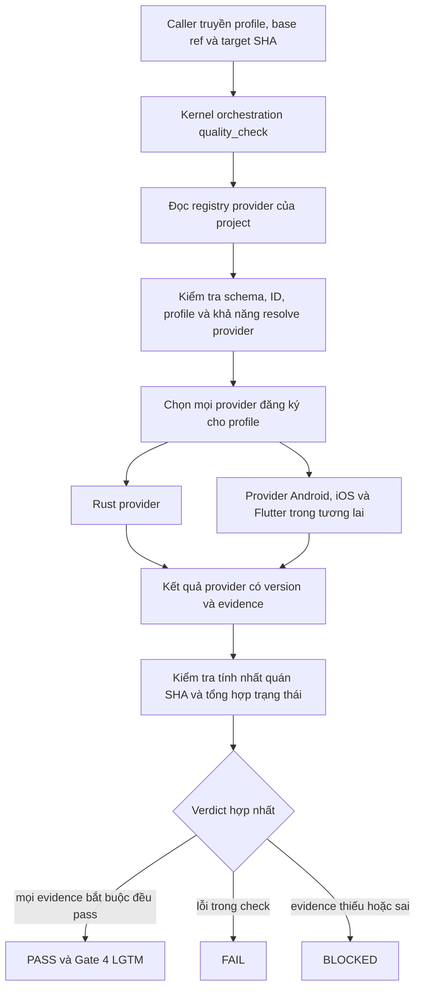

# Thiết Kế Quality Check Dựa Trên Provider

- **Ngày**: 2026-10-11
- **Trạng thái**: Thiết kế đã được duyệt; đặc tả thành văn đang chờ rà soát
- **Phạm vi**: `quality_check`, provider `rust-quality-check` mới, contract và validator cho
  provider, tích hợp lifecycle, kiểm chứng và tài liệu kiến trúc song ngữ
- **Repository**: `ai-agent-tools`
- **Bước tiếp theo**: Rà soát Gate 1 cho đặc tả này, sau đó thiết kế HLD của epic bằng `dev-designer`

## Mục Lục

- [1. Bối Cảnh](#1-bối-cảnh)
- [2. Mục Tiêu Và Ngoài Phạm Vi](#2-mục-tiêu-và-ngoài-phạm-vi)
- [3. Các Quyết Định Thiết Kế](#3-các-quyết-định-thiết-kế)
- [4. Tổng Quan Kiến Trúc](#4-tổng-quan-kiến-trúc)
- [5. Registry Của Project](#5-registry-của-project)
- [6. Contract Khám Phá Và Gọi Provider](#6-contract-khám-phá-và-gọi-provider)
- [7. Contract Kết Quả Của Provider](#7-contract-kết-quả-của-provider)
- [8. Tổng Hợp Và Ngữ Nghĩa Fail-Closed](#8-tổng-hợp-và-ngữ-nghĩa-fail-closed)
- [9. Rust Quality Provider](#9-rust-quality-provider)
- [10. Các Quality Profile](#10-các-quality-profile)
- [11. Tích Hợp Lifecycle](#11-tích-hợp-lifecycle)
- [12. Thay Đổi Trong Repository](#12-thay-đổi-trong-repository)
- [13. Kiểm Chứng Skill Theo TDD](#13-kiểm-chứng-skill-theo-tdd)
- [14. Migration Và Tương Thích](#14-migration-và-tương-thích)
- [15. Rủi Ro Và Biện Pháp Kiểm Soát](#15-rủi-ro-và-biện-pháp-kiểm-soát)
- [16. Tiêu Chí Nghiệm Thu](#16-tiêu-chí-nghiệm-thu)
- [17. Ngoài Phạm Vi](#17-ngoài-phạm-vi)

## 1. Bối Cảnh

[`quality_check`](../../../skills/quality_check/SKILL.md) hiện vừa là orchestrator vừa là phần triển
khai cho Flutter, Android và iOS. Skill này tự phát hiện nền tảng, chứa các command và threshold,
gọi semantic audit rồi tổng hợp verdict. Cấu trúc đó tạo ra ba vấn đề:

1. Muốn thêm Rust phải sửa skill trung tâm, vì vậy mỗi hệ sinh thái mới đều làm tăng nhánh logic và
   vùng có nguy cơ regression.
2. Repository có nhiều nền tảng có thể bị phân loại sai và chỉ chạy một quality suite.
3. Tool bị thiếu hoặc layout không nhận diện được có thể bị hiểu là bỏ qua check thay vì chặn quality
   gate.

Thiết kế được yêu cầu tách orchestration khỏi kiến thức nền tảng. Project đăng ký rõ các quality
provider của mình. Skill trung tâm khám phá và gọi mọi provider được chọn, kiểm tra kết quả có cấu
trúc máy đọc được, rồi tính một verdict xác định. Rust là provider đầu tiên được triển khai theo
contract này; template Android, iOS và Flutter có thể đăng ký provider riêng sau này mà không sửa
orchestrator.

Rust hiện không có một lựa chọn trưởng thành tương đương trực tiếp với Kotlin Konsist cho mọi loại
architecture rule. Cách tương đương đáng tin cậy cho workspace feature-first dựa trên crate là một
architecture gate do project sở hữu, xây trên Cargo metadata và thường được công bố qua `xtask`.
Parser mã nguồn và công cụ hiển thị dependency có thể bổ trợ gate đó nhưng không thay thế nó.

## 2. Mục Tiêu Và Ngoài Phạm Vi

**Mục tiêu:**

- Biến `quality_check` thành kernel orchestration trung lập với nền tảng.
- Khám phá provider qua một registry do project sở hữu và gọi tất cả provider phù hợp.
- Định nghĩa contract invocation và result có version, kiểm tra được bằng máy.
- Thêm Rust quality provider chỉ đọc, fail-closed và có profile tường minh.
- Giữ một executive verdict duy nhất cho Gate 4, đồng thời gắn nó với đúng một repository SHA bất
  biến.
- Tài liệu hóa cách consumer template đăng ký platform provider.
- Kiểm chứng script và hành vi skill bằng quy trình authoring red-first.

**Ngoài mục tiêu:**

- Triển khai hoặc sửa provider template Android, iOS hay Flutter trong epic này.
- Sửa repository sản phẩm D3Nexus hoặc mã nguồn Rust trong đó.
- Sửa plugin cache đã cài đặt.
- Tự động sửa lỗi format, lint, architecture, security hoặc test.
- Tạo một danh sách command chung bắt buộc cho mọi Rust workspace.
- Thay chính sách architecture riêng của project bằng một bộ rule tổng quát chỉ dựa trên syntax.

## 3. Các Quyết Định Thiết Kế

| ID | Quyết định | Lý do |
|----|------------|-------|
| D1 | Project đăng ký provider trong `.agents/quality/check_quality.json` | Ý định của project là nguồn chuẩn và repository phức hợp không còn mơ hồ |
| D2 | `quality_check` không chứa command, threshold hoặc file heuristic của nền tảng | Orchestrator ổn định khi thêm hệ sinh thái mới |
| D3 | Mọi provider được chọn cho profile yêu cầu đều phải chạy | Phát hiện nền tảng kiểu first-match sẽ bỏ sót coverage trong super app và repository nhiều service |
| D4 | Đăng ký bị thiếu hoặc sai là `BLOCKED`; không có legacy fallback | Bỏ qua âm thầm không bao giờ được tạo verdict xanh |
| D5 | Provider trả kết quả máy đọc được, có version và gắn với SHA yêu cầu | Tổng hợp có tính xác định và evidence cũ không thể cấp duyệt |
| D6 | Provider chỉ đọc | Quality check báo thay đổi cần thiết; không sửa cây mã nguồn mà chính nó chứng nhận |
| D7 | Profile gồm `pr`, `epic`, `scheduled` và `release` | Chi phí và độ sâu tường minh thay vì do agent suy đoán |
| D8 | Gọi trực tiếp mặc định là `pr`; caller lifecycle phải truyền profile rõ ràng | Dùng tương tác vẫn tiện, còn gate chính thức không mơ hồ |
| D9 | Rust architecture enforcement dùng Cargo metadata cộng contract `xtask` do project sở hữu | Cơ chế này có kiến thức semantic về workspace và hỗ trợ constraint feature-first riêng của repository |
| D10 | Validator và aggregation là script xác định; judgment và remediation ở trong skill | Việc thực thi contract không nên phụ thuộc vào agent tuân thủ prose |
| D11 | Thứ tự ưu tiên gate là `FAIL`, rồi `BLOCKED`, rồi `PASS` | Lỗi đã biết vẫn hiển thị ngay cả khi hạ tầng cũng chưa hoàn chỉnh |
| D12 | Đây là migration breaking và fail-closed | Repository thiếu manifest nhận `BLOCKED`, buộc adoption phải tường minh |

## 4. Tổng Quan Kiến Trúc



Registry là boundary dependency injection: consumer repository cung cấp danh sách quality
capability, còn orchestrator chỉ phụ thuộc vào contract chung. Provider sở hữu việc chọn command
cho hệ sinh thái, cấu hình capability, thu thập evidence và semantic audit. Orchestrator sở hữu
discovery, fan-out, kiểm tra contract, aggregation và trình bày.

Provider có thể chạy song song khi không dùng chung mutable state. Thứ tự kết quả và report cuối vẫn
xác định bằng cách sắp xếp theo provider ID và check ID.

## 5. Registry Của Project

Mọi project tham gia định nghĩa `.agents/quality/check_quality.json`. Schema ban đầu là:

```json
{
  "schema_version": 1,
  "providers": [
    {
      "id": "rust-core",
      "skill": "d3nexus:rust-quality-check",
      "required": true,
      "profiles": ["pr", "epic", "scheduled", "release"]
    }
  ]
}
```

Quy tắc contract:

- `schema_version` phải là integer được hỗ trợ.
- `providers` phải là array không rỗng.
- `id` ổn định, duy nhất trong repository và phù hợp để đặt tên file evidence.
- `skill` dùng định danh skill có namespace và resolve được.
- `required` phải khai báo rõ; bỏ qua field này là không hợp lệ.
- `profiles` không rỗng, chỉ chứa bốn profile đã định nghĩa và không trùng lặp.
- Field lạ bị từ chối trong schema version 1 để lỗi chính tả không âm thầm đổi hành vi.
- Thứ tự trong registry không điều khiển ưu tiên chạy hoặc thứ tự output.

Manifest chỉ lưu đăng ký provider, không lưu command. Capability riêng của provider thuộc về cấu
hình provider, ví dụ `.agents/quality/rust-quality.json`.

## 6. Contract Khám Phá Và Gọi Provider

`quality_check` nhận request đã chuẩn hóa như sau:

```json
{
  "contract_version": 1,
  "profile": "epic",
  "base_ref": "develop",
  "repository_sha": "5d8b7b0f1b7a9c6f7c8f6498e69c3d6f1e0a4123"
}
```

Orchestrator thực hiện các bước:

1. Resolve repository root và SHA yêu cầu trước khi chạy provider.
2. Đọc và kiểm tra registry của project.
3. Chọn tất cả provider có `profiles` chứa profile yêu cầu.
4. Resolve từng skill có namespace mà không đoán nền tảng từ file trong repository.
5. Gọi từng provider với cùng request chuẩn hóa, cộng `provider_id` và cờ `required`.
6. Thu một result document cho mỗi provider được chọn.
7. Đọc lại `HEAD`; mọi thay đổi khỏi SHA yêu cầu làm run mất hiệu lực.
8. Kiểm tra, sắp xếp, tổng hợp và render executive report.

Caller chính thức như `dev-implementation` phải truyền `profile=epic`. Lời gọi trực tiếp của người
dùng có thể bỏ profile và nhận `pr`. `base_ref` là bắt buộc để xác định changed scope và impact
analysis. Orchestrator chỉ có thể resolve base theo convention trong lời gọi `pr` trực tiếp; report
phải hiển thị giá trị đã resolve.

Skill không resolve được, provider ID trùng, profile không hỗ trợ, selection rỗng, registry sai,
invocation lỗi, timeout hoặc thiếu result đều là lỗi contract và tạo `BLOCKED`.

## 7. Contract Kết Quả Của Provider

Mỗi provider được chọn ghi hoặc trả về một JSON result với các field top-level bắt buộc sau:

```json
{
  "provider_id": "rust-core",
  "contract_version": 1,
  "profile": "epic",
  "repository_sha": "5d8b7b0f1b7a9c6f7c8f6498e69c3d6f1e0a4123",
  "status": "PASS",
  "checks": [],
  "coverage": {},
  "evidence": [],
  "started_head": "5d8b7b0f1b7a9c6f7c8f6498e69c3d6f1e0a4123",
  "finished_head": "5d8b7b0f1b7a9c6f7c8f6498e69c3d6f1e0a4123",
  "duration": 84.2,
  "blockers": [],
  "warnings": []
}
```

Mỗi check ghi stable check ID, category, status, command hoặc audit source, duration, summary ngắn
và reference tới evidence. Trạng thái hợp lệ của provider và check là `PASS`, `FAIL`, `BLOCKED` và
`NOT_APPLICABLE`.

Evidence entry xác định type, source, cùng location hoặc digest. Evidence phải đủ để phân biệt một
command đã pass với command chưa từng chạy. Coverage ghi cả giá trị đo được và threshold đã cấu
hình; threshold bị bỏ qua không được hiểu là bằng không.

`NOT_APPLICABLE` cần reason có cấu trúc và evidence cho quyết định applicability. Nó không phải tên
khác của executable bị thiếu, command không hỗ trợ, cấu hình vắng mặt hoặc timeout. Provider bắt
buộc không thể thỏa overall gate bằng result hoàn toàn `NOT_APPLICABLE`.

Validator yêu cầu `started_head`, `finished_head` và `repository_sha` khớp SHA được yêu cầu. Nó cũng
xác nhận provider ID, profile và contract version khớp invocation.

## 8. Tổng Hợp Và Ngữ Nghĩa Fail-Closed

Aggregation có hai giai đoạn. Đầu tiên, mọi provider result được kiểm tra với registry và invocation.
Evidence sai hoặc vắng mặt được chuyển thành provider result tổng hợp mang trạng thái `BLOCKED`.
Sau đó, các result hợp lệ được reduce thành một verdict.

Quy tắc:

- Có bất kỳ `FAIL` nào thì overall là `FAIL`, kể cả khi provider khác bị blocked.
- Nếu không có failure, có bất kỳ `BLOCKED` nào thì overall là `BLOCKED`.
- Provider bắt buộc chỉ có check `NOT_APPLICABLE` sẽ thành `BLOCKED`.
- Provider không bắt buộc chỉ được `NOT_APPLICABLE` khi có applicability evidence hợp lệ; nó trung
  lập trong phép reduce cuối.
- Overall `PASS` yêu cầu mọi provider bắt buộc đã chọn trả `PASS` và tất cả contract check thành công.
- Chỉ overall `PASS` mới được render thành Gate 4 `LGTM`.
- Warning không hạ hoặc nâng verdict nhưng luôn phải hiển thị.
- Result khác SHA, profile, provider ID hoặc contract version bị từ chối.

Executive report gồm invocation identity, registry digest, bảng theo provider, finding theo check,
coverage matrix, blocker, warning, vị trí evidence và quyết định precedence cuối. Cách này phân biệt
rõ khoảng trống hạ tầng với lỗi sản phẩm, đồng thời không cho phép che giấu một trong hai.

## 9. Rust Quality Provider

Skill `rust-quality-check` mới sở hữu hành vi riêng của Rust và luôn chỉ đọc. Nó đọc
`.agents/quality/rust-quality.json`, kiểm tra cấu hình, chạy profile được yêu cầu, thực hiện semantic
audit do provider khai báo và phát ra contract result chung.

Cấu hình Rust mô tả capability thay vì dựa trên heuristic tên repository. Nó có thể khai báo command
array cho format, compile, lint, unit test, integration test, architecture check, coverage, dependency
policy, vulnerability audit, unsafe-code policy, WASM, FFI, acceptance test, documentation và API
compatibility. Nó cũng khai báo command nào bắt buộc theo từng profile và threshold tương ứng.
Command chạy chính xác như đã cấu hình từ repository root đã resolve; không ngầm shell interpolate.

Mapping mặc định cho một Rust workspace trưởng thành là:

| Khái niệm Android Native | Rust quality capability |
|--------------------------|-------------------------|
| Spotless | `cargo fmt --all -- --check` hoặc command format của project |
| Android Lint và Detekt | `cargo check` cộng Clippy với warning bị từ chối |
| Konsist | Cargo metadata cộng architecture check `xtask` do project sở hữu |
| Unit và instrumented test | Unit, integration, WASM, FFI và acceptance command do project khai báo |
| Coverage gate | `cargo-llvm-cov` hoặc wrapper của project với threshold rõ ràng |
| Chính sách dependency và license | `cargo-deny` khi được khai báo và đã cài |
| Audit cơ sở dữ liệu lỗ hổng | `cargo-audit` khi được khai báo và đã cài |
| Kiểm tra tương thích binary | `cargo-semver-checks`, cộng test contract FFI hoặc WASM riêng |

Không có một package bên thứ ba duy nhất bắt buộc để thay Konsist. Architecture check có thẩm quyền
dùng dữ liệu `cargo_metadata` và policy của project, thường qua `cargo run -p xtask -- <command>`.
Nó có thể enforce chiều dependency giữa crate, feature isolation, wiring ở composition root, domain
purity, naming và forbidden dependency. `cargo-modules` có thể cung cấp graph chẩn đoán;
ArchUnitRust có thể được đánh giá như DSL thử nghiệm; `syn` có thể hỗ trợ các check source-level hẹp.
Không công cụ nào trong số đó được coi là có thẩm quyền nếu thiếu project capability tường minh và
evidence ổn định.

Với codebase Clean Architecture và MVI theo feature-first, architecture evidence nên bao phủ:

- quyền sở hữu feature và dependency cross-feature bị cấm;
- chiều dependency hướng vào trong giữa domain, application, data và presentation;
- dependency injection và việc chỉ khởi tạo tại composition root;
- state bất biến và contract rõ ràng cho intent, reducer, effect và navigation;
- tách super-app shell/navigation khỏi nội bộ feature;
- contract tại boundary microservice, FFI và WASM khi có áp dụng.

Nếu thiếu executable, cấu hình, threshold, architecture command hoặc evidence artifact bắt buộc,
provider trả `BLOCKED`. Quality command trả mã khác không sau khi chạy đầy đủ và phát hiện defect sẽ
trả `FAIL`; không thể thực thi hoặc chứng minh check sẽ trả `BLOCKED`.

## 10. Các Quality Profile

Profile định nghĩa ý định, không phải danh sách command global hardcode. Mỗi provider map profile
chung sang các capability đã khai báo của mình.

| Profile | Mục đích | Ý định Rust tối thiểu |
|---------|----------|-----------------------|
| `pr` | Feedback nhanh cho thay đổi tập trung | Format check, compile/check, lint, test theo changed scope, architecture check bắt buộc |
| `epic` | Gate 4 cho epic đã hoàn tất | Full workspace test, architecture, semantic audit, coverage, integration/contract suite phù hợp repository |
| `scheduled` | Assurance định kỳ sâu hơn | `epic` cộng dependency, vulnerability, unused-dependency, matrix hoặc diagnostic check tốn thời gian đã cấu hình |
| `release` | Chứng nhận release candidate | `epic` cộng release build, API compatibility, packaging, FFI/WASM và acceptance contract đã khai báo cho release |

Profile tăng dần về ý định, nhưng provider có thể tránh chạy lại command giống nhau bằng cách tái sử
dụng evidence chỉ khi contract chứng minh cùng SHA, tool configuration và profile requirement.
Profile rẻ hơn không bao giờ thỏa caller đòi profile cao hơn. Cụ thể, result `pr` không thể thỏa yêu
cầu `epic` của Gate 4.

## 11. Tích Hợp Lifecycle

[`dev-implementation`](../../../skills/dev-implementation/SKILL.md) sẽ ngừng phát hiện nền tảng
mobile cho quality cuối epic. Nó gọi `quality_check` với `profile=epic`, base reference của epic và
candidate SHA. Hướng dẫn triển khai task riêng theo platform có thể được giữ lại ở nơi phục vụ việc
triển khai; diễn đạt Gate 4 chuyển sang mô hình provider.

[`dev-lifecycle`](../../../skills/dev-lifecycle/SKILL.md) sẽ định nghĩa Gate 4 theo verdict hợp nhất
của provider. Tiêu chí chấp nhận trở thành:

1. registry và mọi provider được chọn thỏa contract;
2. mọi provider bắt buộc pass profile `epic`;
3. semantic và impact evidence do provider yêu cầu hiện diện;
4. verdict tổng hợp gắn với candidate SHA.

[`pr_review`](../../../skills/pr_review/SKILL.md) sẽ gọi cùng orchestrator với `pr`, rồi dùng report
chuẩn hóa thay vì giả định một trong ba mobile command matrix.

Các integration skill này không nhận command Rust hoặc logic chọn provider. Chúng nêu profile yêu
cầu và tiêu thụ verdict chung. `quality_check` vẫn là aggregation boundary duy nhất.

## 12. Thay Đổi Trong Repository

| Khu vực | Thay đổi dự kiến |
|---------|------------------|
| `skills/quality_check/SKILL.md` | Viết lại thành provider orchestrator mỏng, không còn platform command matrix |
| `skills/quality_check/references/` | Thêm contract cho registry, invocation, result, aggregation và report |
| `skills/quality_check/resources/scripts/` | Thêm script xác định để kiểm tra manifest/result và aggregation, kèm unit test |
| `skills/rust-quality-check/SKILL.md` | Thêm workflow Rust provider, activation description, xử lý profile và rule fail-closed |
| `skills/rust-quality-check/references/` | Thêm schema cấu hình Rust, mapping capability, hướng dẫn architecture và chi tiết report |
| `docs/architecture/quality-provider-system.en.md` | Thêm tài liệu kiến trúc tiếng Anh bền vững cho consumer và provider |
| `docs/architecture/quality-provider-system.vi.md` | Thêm tài liệu tiếng Việt đồng bộ |
| `skills/dev-implementation/SKILL.md` | Truyền input Gate 4 tường minh và tiêu thụ provider result |
| `skills/dev-lifecycle/SKILL.md` | Định nghĩa acceptance Gate 4 dựa trên provider và đường quay lại |
| `skills/pr_review/SKILL.md` | Route PR verification qua profile `pr` mà không giả định nền tảng |
| [`scripts/verify.sh`](../../../scripts/verify.sh) | Kiểm tra skill mới, schema, contract, fixture và script test |

Mỗi skill mới chỉ giữ đúng `name` và `description` trong frontmatter. Cross-skill reference dùng
namespace `d3nexus:`. Tài liệu bền vững giải thích cả việc author provider và đăng ký project; file
skill giữ ngắn gọn và mang tính vận hành.

## 13. Kiểm Chứng Skill Theo TDD

Triển khai tuân theo `writing-skills` và `test-driven-development`. Behavioral pressure test chạy
trước khi viết instruction mới và failure được ghi nhận. Các red scenario tối thiểu là:

1. Repository phức hợp đăng ký hai provider nhưng agent chỉ chọn nền tảng đầu tiên nhận diện được.
2. Tool bắt buộc bị thiếu nhưng agent mô tả check là đã bỏ qua và cấp pass.
3. Gate 4 yêu cầu `epic` nhưng agent chạy hoặc tái dùng evidence của `pr`.
4. Output của provider bất đồng nhưng agent bỏ qua precedence rule.
5. `HEAD` thay đổi trong khi chạy nhưng agent cấp `LGTM` bằng evidence cũ.

Sau đó mới thêm skill và reference tối thiểu, chạy lại cùng scenario và đóng các rationalization còn
lại. Test ở cấp script bao phủ ít nhất:

- registry hợp lệ và không hợp lệ;
- schema version không hỗ trợ và field lạ;
- ID trùng và provider skill không resolve được;
- nhiều provider được chọn cho cùng profile;
- selection rỗng và profile mismatch;
- precedence `FAIL`, rồi `BLOCKED`, rồi `PASS`;
- evidence `NOT_APPLICABLE` hợp lệ và không hợp lệ;
- SHA drift và invocation identity mismatch;
- provider result bị thiếu, hỏng hoặc trùng;
- contract-version mismatch và thứ tự xác định.

Verification script đầy đủ của repository chạy các test này. Document check yêu cầu mục lục liên
kết đầy đủ và cấu trúc heading EN/VI đồng bộ.

## 14. Migration Và Tương Thích

Migration cố ý fail-closed. Sau khi orchestrator mới được phát hành, consumer repository thiếu
`.agents/quality/check_quality.json` nhận `BLOCKED`. Không có fallback ẩn để phát hiện Android,
Flutter, iOS hoặc Rust.

Thứ tự rollout được khuyến nghị:

1. Phát hành provider contract và tài liệu cùng Rust provider.
2. Thêm registry và cấu hình Rust capability vào Rust consumer.
3. Thêm đăng ký provider vào template Android, iOS và Flutter trong các hạng mục riêng do từng
   platform sở hữu.
4. Migrate consumer hiện có trước khi yêu cầu version agent kit mới trong formal gate của chúng.

`schema_version` của registry và `contract_version` của mỗi result cho phép tiến hóa bổ sung trong
tương lai. Breaking change cần version mới và migration path tường minh. Orchestrator phải từ chối
version mà nó không thể diễn giải an toàn.

## 15. Rủi Ro Và Biện Pháp Kiểm Soát

| Rủi ro | Biện pháp kiểm soát |
|--------|---------------------|
| Provider giả hoặc bỏ evidence | Result schema nghiêm ngặt, field evidence bắt buộc, gắn SHA và validator tạo `BLOCKED` |
| Repository phức hợp trở nên chậm | Provider độc lập có thể chạy song song; profile làm chi phí tường minh |
| Command tùy ý của project tạo rủi ro shell | Command là array có cấu trúc, chạy từ repository root và không nhận shell interpolation ngầm |
| Provider mới làm yếu gate chung | Orchestrator kiểm tra identity và status semantics; provider bắt buộc không thể đổi vắng mặt thành `NOT_APPLICABLE` |
| Rust architecture check trở thành syntax heuristic | Cargo metadata và policy `xtask` của project vẫn có thẩm quyền; source parsing chỉ bổ trợ |
| Breaking migration làm gián đoạn consumer hiện có | Tài liệu và adoption theo giai đoạn ở template làm yêu cầu hiển thị rõ; failure là `BLOCKED`, không bao giờ false pass |
| Evidence cũ trong run kéo dài | Start SHA, finish SHA, requested SHA và repository HEAD cuối phải đồng nhất |
| Platform logic rò rỉ trở lại lifecycle skill | Verification khẳng định file orchestration và lifecycle không chứa provider command matrix |

## 16. Tiêu Chí Nghiệm Thu

Epic chỉ hoàn tất khi tất cả điều sau đúng:

- `quality_check` chỉ khám phá provider từ project registry và không chứa platform command hoặc
  threshold logic.
- Repository đăng ký nhiều provider phù hợp sẽ gọi tất cả và báo từng result.
- Evidence bắt buộc bị thiếu, sai, không resolve được, cũ hoặc không đầy đủ không thể tạo `LGTM`.
- Aggregation có tính xác định và thực thi đúng precedence đã tài liệu hóa.
- `rust-quality-check` chỉ đọc, hiểu profile, dựa trên capability và fail-closed.
- Hướng dẫn Rust architecture định nghĩa Cargo metadata cộng project `xtask` là governance boundary
  tương đương Konsist.
- Gate 4 truyền `epic` rõ ràng và gắn verdict với candidate SHA.
- PR review dùng `pr` rõ ràng.
- Behavioral evaluation red-first chứng minh failure mode cũ và hành vi đã sửa.
- Unit test của validator và aggregator pass.
- Tài liệu kiến trúc song ngữ giải thích đăng ký, authoring provider, status semantics và migration.
- [`scripts/verify.sh`](../../../scripts/verify.sh) pass cho toàn bộ agent-kit repository.

## 17. Ngoài Phạm Vi

- Provider implementation hoặc template registration cho Android, iOS và Flutter.
- Tái cấu trúc application architecture trong Rust workspace D3Nexus.
- Thay đổi CI workflow trong consumer repository.
- Cài third-party Rust tool thay cho consumer project.
- Tự động thay đổi mã nguồn hoặc format trong quality run.
- Publish, release hoặc push agent kit.
