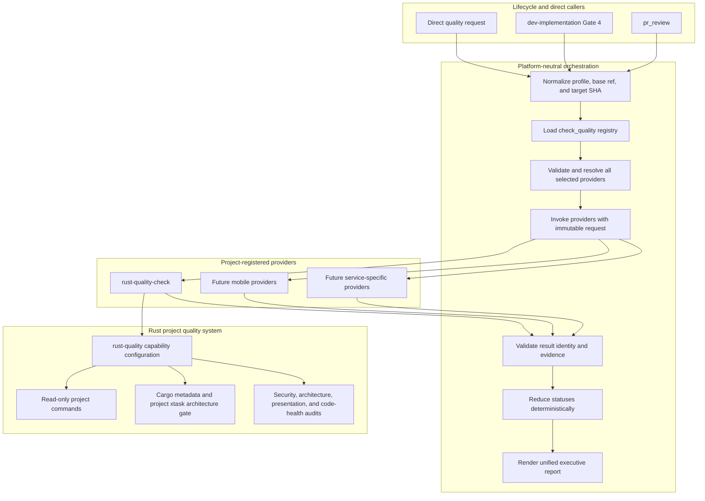
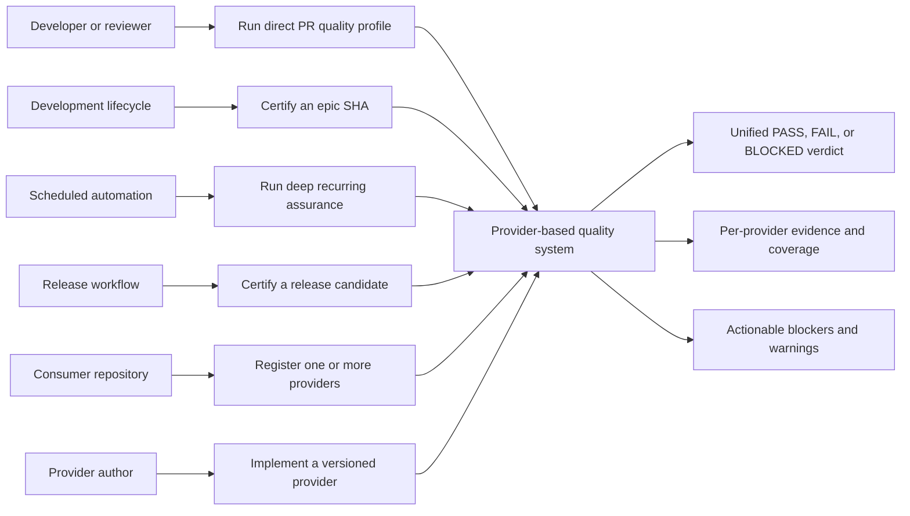
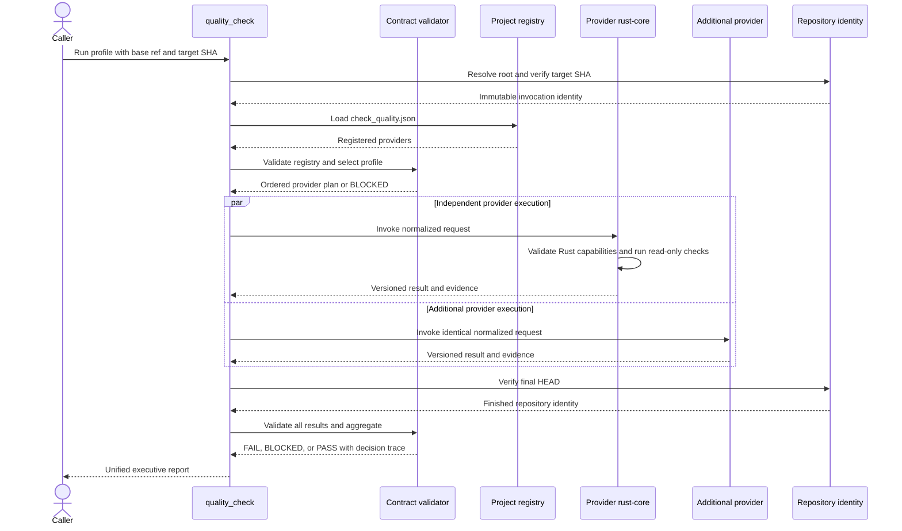
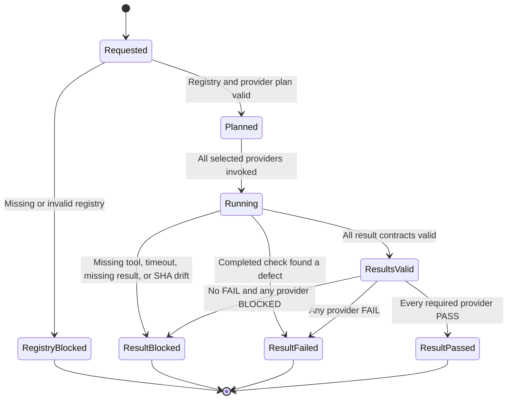

# Provider-Based Quality Check Epic

## Table of Contents

- [Meta Data](#meta-data)
- [Background](#background)
- [Goals and Non-Goals](#goals-and-non-goals)
- [Architecture and Technical Design](#architecture-and-technical-design)
- [Use Cases](#use-cases)
- [Primary Sequence](#primary-sequence)
- [Contracts and State Model](#contracts-and-state-model)
- [Impact Analysis](#impact-analysis)
- [BDD Scenarios](#bdd-scenarios)
- [Verification Strategy](#verification-strategy)
- [Rollout Strategy and Mitigation](#rollout-strategy-and-mitigation)
- [Kanban Tasks Breakdown](#kanban-tasks-breakdown)

## Meta Data

| Field | Value |
|-------|-------|
| Epic | `provider_based_quality_check` |
| Status | Ready for implementation — Gate 2 task breakdown confirmed |
| Target Release | Next `d3nexus` agent-kit release after implementation and Gate 5 approval |
| Platform | Agent Kit — Markdown skills and Python validators |
| Source Spec | [Approved provider-based quality design](2026-10-11-provider-based-quality-check-design.en.md) |
| Canonical Language | English |

## Background

The current quality gate contains platform detection, mobile commands, semantic audit routing, and
verdict aggregation in one skill. It cannot safely represent a super app or multi-service repository
that needs several quality systems at once, and it creates a central edit for every new ecosystem.
It can also treat unavailable tooling as an informal skip, which makes the absence of evidence look
green.

This epic introduces a project-provided quality registry and a common provider contract. The central
`quality_check` becomes a platform-neutral composition root. Provider skills own platform behavior;
the orchestrator owns dependency resolution, fan-out, validation, status reduction, and the final
Gate 4 verdict. Rust is the first new provider. Mobile templates can register equivalent providers
in later platform-owned work.

## Goals and Non-Goals

**Goals:**

- Introduce explicit dependency injection for quality capabilities through a project registry.
- Invoke every provider applicable to the requested profile in composite repositories.
- Validate versioned requests, results, evidence, and repository identity mechanically.
- Aggregate `PASS`, `FAIL`, `BLOCKED`, and `NOT_APPLICABLE` without agent interpretation.
- Add a read-only Rust provider with `pr`, `epic`, `scheduled`, and `release` profiles.
- Define Cargo metadata plus project `xtask` policy as the authoritative Rust architecture gate.
- Integrate the provider model into Gate 4 and PR review without leaking Rust commands upstream.
- Add durable EN/VI documentation, migration guidance, red-first skill evaluations, and end-to-end
  acceptance fixtures.

**Non-goals:**

- Adding Android, iOS, or Flutter provider implementations or template registrations.
- Changing Rust application code in D3Nexus or any consumer repository.
- Editing installed plugin caches.
- Auto-fixing source, formatting, dependency, or architecture findings.
- Installing tools for consumers or defining one mandatory Rust command matrix.
- Publishing, pushing, or releasing the agent kit.

## Architecture and Technical Design



The dependency direction is deliberate:

1. Lifecycle skills depend on the stable `quality_check` interface.
2. `quality_check` depends on registry and result contracts, never on platform implementations.
3. A project injects providers through `.agents/quality/check_quality.json`.
4. Each provider depends on its own project configuration and toolchain.
5. Deterministic scripts enforce data contracts; skill prose owns orchestration intent and human
   remediation guidance.

The implementation adds one validator/aggregator engine under
`skills/quality_check/resources/scripts/`. Structured JSON schemas and reference documents live
beside the orchestrator. Provider results are sorted by provider ID and check ID before reporting so
parallel execution cannot change the verdict or presentation.

## Use Cases



| Use Case | Primary actor | Success outcome |
|----------|---------------|-----------------|
| UC1 | Developer or reviewer | All registered `pr` providers run and a SHA-bound report is returned |
| UC2 | `dev-implementation` | Every required `epic` provider passes before Gate 4 grants `LGTM` |
| UC3 | Scheduler | Expensive configured checks run without weakening normal gate semantics |
| UC4 | Release workflow | Release-only API, packaging, FFI, WASM, and acceptance evidence is present |
| UC5 | Consumer repository | Provider composition is explicit and supports more than one ecosystem |
| UC6 | Provider author | A new ecosystem integrates without editing orchestrator platform branches |

## Primary Sequence



No provider may change the working tree. If `HEAD` changes between the initial and final identity
checks, all otherwise valid evidence becomes stale and the run is `BLOCKED`.

## Contracts and State Model

The registry is versioned independently from provider results. Schema version 1 rejects unknown
fields, duplicate provider IDs, invalid profile names, missing `required` flags, empty provider
lists, and unresolvable namespaced skills.

The normalized invocation contains:

- `contract_version`;
- `profile`;
- `base_ref`;
- `repository_sha`;
- provider identity and requiredness supplied by the orchestrator.

Each result contains provider and contract identity, requested profile, repository SHA, overall
status, checks, coverage, evidence, starting and finishing HEAD, duration, blockers, and warnings.



Reduction precedence is `FAIL > BLOCKED > PASS`. `NOT_APPLICABLE` is allowed only with structured
applicability evidence. It is neutral only for an optional provider; a required provider whose
entire result is `NOT_APPLICABLE` is converted to `BLOCKED`.

The Rust provider reads `.agents/quality/rust-quality.json`. Commands are structured arrays and run
from the resolved repository root without implicit shell interpolation. Required missing tools,
commands, thresholds, or evidence produce `BLOCKED`. A completed command that detects a defect
produces `FAIL`.

## Impact Analysis

Shift-left analysis ran against the planned existing and new touchpoints using `main` as the base.

| Dimension | Finding | Design response |
|-----------|---------|-----------------|
| Upstream divergence | Clean; no unmerged commits touch the planned paths | Proceed from the approved spec commit |
| Downstream callers | One incidental textual reference in the documentation checker | No runtime caller contract to preserve |
| Native bridges | No `MethodChannel` or native bridge detected | FFI and WASM remain provider-declared consumer capabilities |
| Existing test safety net | Markdown skill files and `scripts/verify.sh` were reported as unprotected | Add red-first behavioral fixtures, validator unit tests, and an end-to-end acceptance fixture |
| Central blast radius | `quality_check`, Gate 4, PR review, and repository verification all change semantics | Separate contract, provider, consumer, and acceptance tasks with explicit dependency order |
| Consumer compatibility | Missing registry becomes `BLOCKED` | Publish migration documentation and keep mobile template changes outside this epic |

Planned touchpoints are the current quality orchestrator, new contract resources and scripts, the
new Rust provider, `dev-implementation`, `dev-lifecycle`, `pr_review`, durable architecture docs,
and `scripts/verify.sh`. No product repository or installed cache is a write target.

## BDD Scenarios

The canonical exhaustive suite is [BDD scenarios](bdd_scenarios.en.md). The following scenarios
freeze the system-level behavior used by the task breakdown.

```gherkin
Feature: Provider-based quality orchestration

  Scenario: All providers registered for an epic profile pass
    Given a valid registry with two required providers supporting the epic profile
    And both providers return valid PASS results for the requested repository SHA
    When quality_check aggregates the run
    Then both providers are present in the report
    And the final verdict is PASS
    And Gate 4 may render LGTM for that SHA

  Scenario: A required provider tool is unavailable
    Given a required provider selected for the requested profile
    And one required executable cannot be invoked
    When the provider produces its result
    Then the provider status is BLOCKED
    And the orchestrator cannot render LGTM

  Scenario: A product defect and an infrastructure blocker coexist
    Given one provider returns FAIL with defect evidence
    And another provider returns BLOCKED with missing-tool evidence
    When results are aggregated
    Then the final verdict is FAIL
    And both the defect and blocker remain visible

  Scenario: Repository identity changes during provider execution
    Given providers started on the requested repository SHA
    When final HEAD differs from that SHA
    Then all collected evidence is rejected as stale
    And the final verdict is BLOCKED

  Scenario: Rust architecture policy is required but absent
    Given the Rust epic profile requires a project architecture command
    And the Rust configuration omits that command
    When rust-quality-check validates its capabilities
    Then it returns BLOCKED
    And it does not substitute a syntax-only architecture heuristic
```

The full suite covers happy paths, malformed and boundary inputs, state transitions, concurrent
provider completion and SHA races, and tool or evidence failures for every use case.

## Verification Strategy

The agent-kit adaptation of the three testing tiers is:

| Tier | Scope | Evidence |
|------|-------|----------|
| Tier A | Registry/result validation, aggregation, ordering, profile rules, SHA identity | Python unit tests and JSON fixtures written red-first |
| Tier B | Skill frontmatter, relative links, ToC, schema/reference consistency, prohibited platform logic, source fidelity | Extended `scripts/verify.sh` checks |
| Tier C | A temporary composite consumer repository with multiple providers, Rust capabilities, lifecycle caller inputs, and stale-SHA cases | End-to-end acceptance test invoked by `scripts/verify.sh` |

Skill behavior follows the `writing-skills` pressure-test method:

1. Run baseline agents against adversarial scenarios before new instructions exist.
2. Record first-match routing, skip-as-pass, profile downgrade, precedence, and stale-SHA failures.
3. Add the smallest contract and skill changes that close those failures.
4. Rerun identical scenarios and capture corrected behavior.
5. Add new rationalization cases until no tested path can create a false `LGTM`.

The final verification includes document validation for the spec, HLD, BDD, and durable EN/VI
architecture pairs; all unit and acceptance tests; `git diff --check`; and the complete
`scripts/verify.sh` suite.

## Rollout Strategy and Mitigation

This is a fail-closed breaking migration.

1. Implement and validate the shared contract and Rust provider in the agent kit.
2. Publish durable registration and provider-authoring documentation.
3. Adopt the registry and Rust capability configuration in Rust consumers through separate project
   work.
4. Add and register Android, iOS, and Flutter providers in later platform-owned template work.
5. Upgrade formal consumer gates only after their manifests are present.

Rollback is a normal revert of the agent-kit epic before consumers require its version. The system
does not provide a hidden legacy fallback because that would restore false-green behavior. During
migration, a missing manifest remains a visible `BLOCKED` result with a link to the registration
guide.

## Kanban Tasks Breakdown

The Gate 2 task split is confirmed:

1. [Capture the RED behavioral baseline](task_1_capture_red_behavioral_baseline.md).
2. [Build the provider contract validator](task_2_build_provider_contract_validator.md).
3. [Build the result aggregation engine](task_3_build_result_aggregation_engine.md).
4. [Refactor the quality check orchestrator](task_4_refactor_quality_check_orchestrator.md).
5. [Add the Rust quality provider](task_5_add_rust_quality_provider.md).
6. [Integrate lifecycle consumers](task_6_integrate_lifecycle_consumers.md).
7. [Publish provider architecture documentation](task_7_publish_provider_architecture_docs.md).
8. [Run end-to-end acceptance](task_8_run_end_to_end_acceptance.md).

The dependency path is Task 1, Task 2, Task 3, Tasks 4 and 5 in parallel, Task 6, Task 7, and Task 8.
Each English-only task is live in `.devtool/features/` and mirrored here as a permanent epic output.
