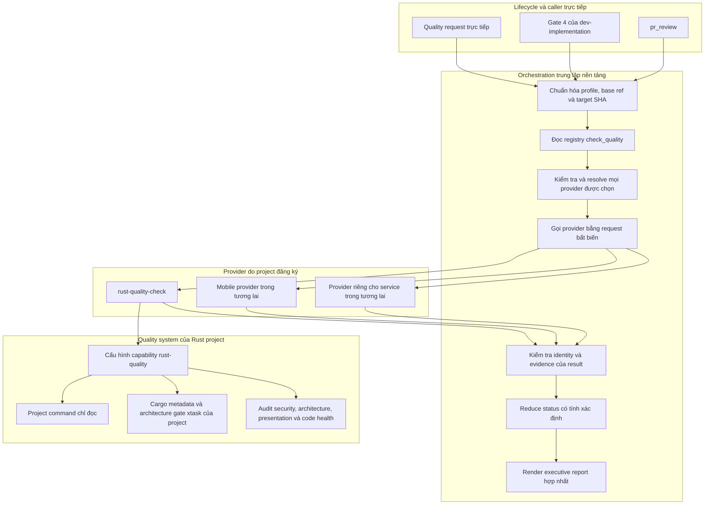
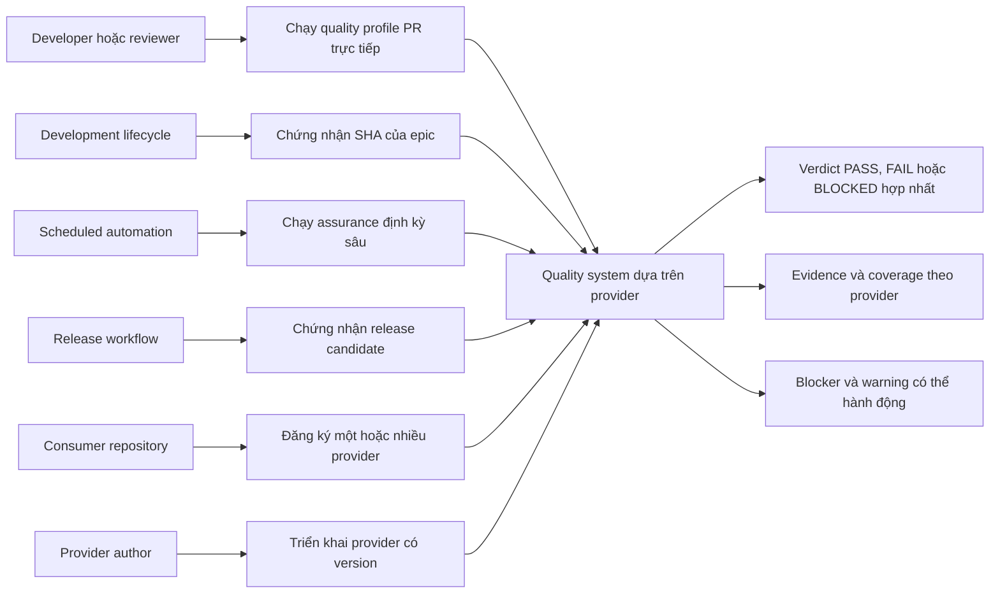
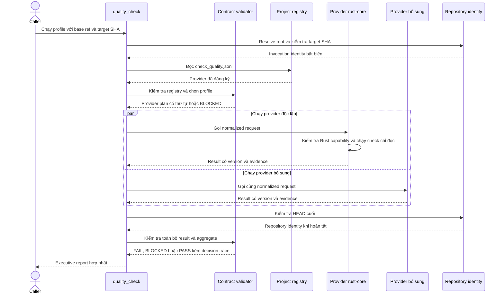
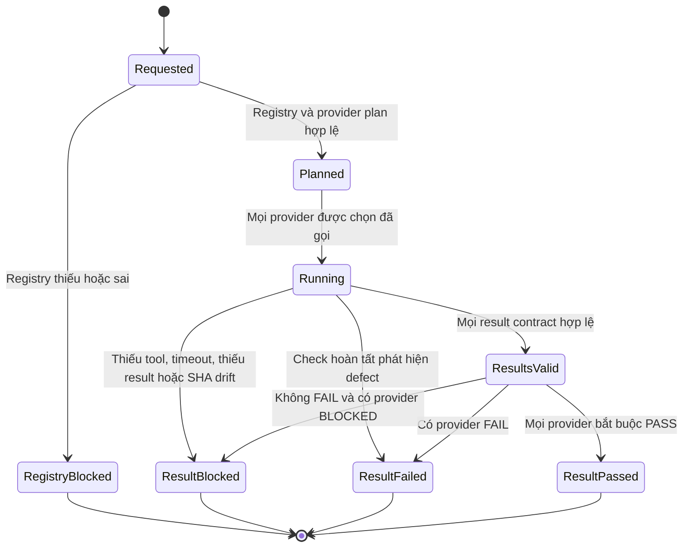

# Epic Quality Check Dựa Trên Provider

## Mục Lục

- [Meta Data](#meta-data)
- [Bối Cảnh](#bối-cảnh)
- [Mục Tiêu Và Ngoài Phạm Vi](#mục-tiêu-và-ngoài-phạm-vi)
- [Kiến Trúc Và Thiết Kế Kỹ Thuật](#kiến-trúc-và-thiết-kế-kỹ-thuật)
- [Use Case](#use-case)
- [Sequence Chính](#sequence-chính)
- [Contract Và State Model](#contract-và-state-model)
- [Phân Tích Tác Động](#phân-tích-tác-động)
- [Kịch Bản BDD](#kịch-bản-bdd)
- [Chiến Lược Kiểm Chứng](#chiến-lược-kiểm-chứng)
- [Chiến Lược Rollout Và Giảm Thiểu Rủi Ro](#chiến-lược-rollout-và-giảm-thiểu-rủi-ro)
- [Phân Rã Kanban Task](#phân-rã-kanban-task)

## Meta Data

| Trường | Giá trị |
|--------|---------|
| Epic | `provider_based_quality_check` |
| Trạng thái | Sẵn sàng triển khai — phân rã task Gate 2 đã xác nhận |
| Target Release | Bản phát hành agent kit `d3nexus` kế tiếp sau implementation và Gate 5 |
| Nền tảng | Agent Kit — Markdown skill và Python validator |
| Source Spec | [Thiết kế quality dựa trên provider đã duyệt](2026-10-11-provider-based-quality-check-design.vi.md) |
| Ngôn ngữ chuẩn | Tiếng Anh |

## Bối Cảnh

Quality gate hiện tại chứa chung logic phát hiện nền tảng, command mobile, định tuyến semantic audit
và tổng hợp verdict trong một skill. Cấu trúc đó không thể biểu diễn an toàn super app hoặc
repository nhiều service cần chạy nhiều quality system cùng lúc, đồng thời buộc sửa trung tâm mỗi
khi thêm hệ sinh thái. Nó cũng có thể coi tool không khả dụng là một lần bỏ qua không chính thức,
khiến việc thiếu evidence trông như kết quả xanh.

Epic này đưa vào quality registry do project cung cấp và contract provider chung. `quality_check`
trung tâm trở thành composition root trung lập nền tảng. Provider skill sở hữu hành vi nền tảng;
orchestrator sở hữu dependency resolution, fan-out, validation, status reduction và verdict Gate 4
cuối. Rust là provider mới đầu tiên. Mobile template có thể đăng ký provider tương đương trong các
hạng mục riêng của từng platform sau này.

## Mục Tiêu Và Ngoài Phạm Vi

**Mục tiêu:**

- Đưa dependency injection tường minh cho quality capability qua project registry.
- Gọi mọi provider phù hợp profile yêu cầu trong repository phức hợp.
- Kiểm tra bằng máy request, result, evidence và repository identity có version.
- Tổng hợp `PASS`, `FAIL`, `BLOCKED` và `NOT_APPLICABLE` mà không phụ thuộc diễn giải của agent.
- Thêm Rust provider chỉ đọc với profile `pr`, `epic`, `scheduled` và `release`.
- Định nghĩa Cargo metadata cộng policy `xtask` của project là Rust architecture gate có thẩm quyền.
- Tích hợp mô hình provider vào Gate 4 và PR review mà không làm command Rust rò rỉ lên caller.
- Thêm tài liệu EN/VI bền vững, hướng dẫn migration, skill evaluation red-first và fixture acceptance
  end-to-end.

**Ngoài mục tiêu:**

- Thêm provider implementation hoặc template registration cho Android, iOS hay Flutter.
- Thay đổi mã nguồn ứng dụng Rust trong D3Nexus hoặc consumer repository khác.
- Sửa plugin cache đã cài đặt.
- Tự động sửa source, format, dependency hoặc architecture finding.
- Cài tool cho consumer hoặc định nghĩa một Rust command matrix bắt buộc.
- Publish, push hoặc release agent kit.

## Kiến Trúc Và Thiết Kế Kỹ Thuật



Chiều dependency được thiết kế có chủ đích:

1. Lifecycle skill phụ thuộc interface ổn định của `quality_check`.
2. `quality_check` phụ thuộc registry và result contract, không phụ thuộc platform implementation.
3. Project inject provider qua `.agents/quality/check_quality.json`.
4. Mỗi provider phụ thuộc cấu hình project và toolchain của chính nó.
5. Script xác định enforce data contract; skill prose sở hữu ý định orchestration và hướng dẫn
   remediation cho con người.

Implementation thêm một validator/aggregator engine trong
`skills/quality_check/resources/scripts/`. JSON schema có cấu trúc và reference document nằm cạnh
orchestrator. Provider result được sắp theo provider ID và check ID trước khi báo cáo để việc chạy
song song không làm thay đổi verdict hoặc cách trình bày.

## Use Case



| Use Case | Actor chính | Kết quả thành công |
|----------|------------|--------------------|
| UC1 | Developer hoặc reviewer | Mọi provider `pr` đã đăng ký chạy và trả report gắn SHA |
| UC2 | `dev-implementation` | Mọi provider `epic` bắt buộc pass trước khi Gate 4 cấp `LGTM` |
| UC3 | Scheduler | Check tốn thời gian đã cấu hình chạy mà không làm yếu ngữ nghĩa gate bình thường |
| UC4 | Release workflow | Có đủ evidence release-only về API, packaging, FFI, WASM và acceptance |
| UC5 | Consumer repository | Việc kết hợp provider tường minh và hỗ trợ nhiều hệ sinh thái |
| UC6 | Provider author | Hệ sinh thái mới tích hợp mà không sửa platform branch trong orchestrator |

## Sequence Chính



Không provider nào được thay đổi working tree. Nếu `HEAD` đổi giữa identity check đầu và cuối, mọi
evidence dù hợp lệ trước đó đều trở thành cũ và run nhận `BLOCKED`.

## Contract Và State Model

Registry có version độc lập với provider result. Schema version 1 từ chối field lạ, provider ID
trùng, profile name sai, thiếu cờ `required`, provider list rỗng và namespaced skill không resolve
được.

Normalized invocation chứa:

- `contract_version`;
- `profile`;
- `base_ref`;
- `repository_sha`;
- provider identity và requiredness do orchestrator cấp.

Mỗi result chứa provider và contract identity, profile được yêu cầu, repository SHA, overall status,
check, coverage, evidence, HEAD đầu và cuối, duration, blocker và warning.



Precedence khi reduce là `FAIL > BLOCKED > PASS`. Chỉ cho phép `NOT_APPLICABLE` khi có applicability
evidence có cấu trúc. Nó chỉ trung lập với provider không bắt buộc; provider bắt buộc có toàn bộ
result là `NOT_APPLICABLE` được chuyển thành `BLOCKED`.

Rust provider đọc `.agents/quality/rust-quality.json`. Command là array có cấu trúc và chạy từ
repository root đã resolve, không có shell interpolation ngầm. Thiếu tool, command, threshold hoặc
evidence bắt buộc tạo `BLOCKED`. Command chạy xong và phát hiện defect tạo `FAIL`.

## Phân Tích Tác Động

Shift-left analysis đã chạy trên các touchpoint hiện tại và dự kiến, dùng `main` làm base.

| Chiều phân tích | Finding | Phản hồi trong thiết kế |
|-----------------|---------|-------------------------|
| Upstream divergence | Sạch; không có unmerged commit chạm path dự kiến | Tiếp tục từ commit spec đã duyệt |
| Downstream caller | Một textual reference ngẫu nhiên trong documentation checker | Không có runtime caller contract cần giữ |
| Native bridge | Không phát hiện `MethodChannel` hoặc native bridge | FFI và WASM vẫn là capability consumer khai báo qua provider |
| Test safety net hiện tại | Markdown skill và `scripts/verify.sh` bị báo không được bảo vệ | Thêm behavioral fixture red-first, validator unit test và fixture acceptance end-to-end |
| Blast radius trung tâm | `quality_check`, Gate 4, PR review và repository verification đều đổi semantics | Tách task contract, provider, consumer và acceptance theo dependency rõ ràng |
| Tương thích consumer | Thiếu registry trở thành `BLOCKED` | Phát hành tài liệu migration và giữ mobile template ngoài epic này |

Touchpoint dự kiến gồm quality orchestrator hiện tại, contract resource và script mới, Rust provider
mới, `dev-implementation`, `dev-lifecycle`, `pr_review`, tài liệu kiến trúc bền vững và
`scripts/verify.sh`. Không product repository hoặc installed cache nào là write target.

## Kịch Bản BDD

Bộ exhaustive chuẩn nằm tại [kịch bản BDD](bdd_scenarios.vi.md). Các scenario sau đóng băng hành vi
cấp hệ thống dùng cho task breakdown.

```gherkin
Tính năng: Điều phối quality dựa trên provider

  Kịch bản: Mọi provider đăng ký cho profile epic đều pass
    Biết rằng registry hợp lệ có hai provider bắt buộc hỗ trợ profile epic
    Và cả hai provider trả result PASS hợp lệ cho repository SHA được yêu cầu
    Khi quality_check tổng hợp run
    Thì cả hai provider xuất hiện trong report
    Và verdict cuối là PASS
    Và Gate 4 có thể render LGTM cho SHA đó

  Kịch bản: Tool của provider bắt buộc không khả dụng
    Biết rằng provider bắt buộc được chọn cho profile yêu cầu
    Và một executable bắt buộc không thể chạy
    Khi provider tạo result
    Thì status của provider là BLOCKED
    Và orchestrator không thể render LGTM

  Kịch bản: Product defect và infrastructure blocker cùng tồn tại
    Biết rằng một provider trả FAIL kèm defect evidence
    Và provider khác trả BLOCKED kèm evidence thiếu tool
    Khi result được aggregate
    Thì verdict cuối là FAIL
    Và cả defect lẫn blocker đều hiển thị

  Kịch bản: Repository identity thay đổi trong khi provider chạy
    Biết rằng provider bắt đầu ở repository SHA được yêu cầu
    Khi HEAD cuối khác SHA đó
    Thì mọi evidence thu được bị từ chối vì đã cũ
    Và verdict cuối là BLOCKED

  Kịch bản: Rust architecture policy bắt buộc nhưng vắng mặt
    Biết rằng profile Rust epic yêu cầu architecture command của project
    Và cấu hình Rust bỏ command đó
    Khi rust-quality-check kiểm tra capability
    Thì nó trả BLOCKED
    Và không thay thế bằng architecture heuristic chỉ dựa trên syntax
```

Bộ đầy đủ bao phủ happy path, input sai và boundary, state transition, provider hoàn tất đồng thời
và SHA race, cùng lỗi tool hoặc evidence cho mọi use case.

## Chiến Lược Kiểm Chứng

Ba testing tier được thích nghi cho agent kit như sau:

| Tier | Phạm vi | Evidence |
|------|---------|----------|
| Tier A | Kiểm tra registry/result, aggregation, ordering, profile rule, SHA identity | Python unit test và JSON fixture được viết red-first |
| Tier B | Skill frontmatter, relative link, ToC, nhất quán schema/reference, platform logic bị cấm, source fidelity | Check mở rộng trong `scripts/verify.sh` |
| Tier C | Consumer repository tạm có nhiều provider, Rust capability, lifecycle caller input và stale-SHA case | End-to-end acceptance test do `scripts/verify.sh` gọi |

Hành vi skill tuân theo phương pháp pressure-test của `writing-skills`:

1. Chạy baseline agent với adversarial scenario trước khi instruction mới tồn tại.
2. Ghi nhận lỗi first-match routing, skip-as-pass, hạ profile, precedence và stale SHA.
3. Thêm thay đổi contract và skill nhỏ nhất để đóng các lỗi đó.
4. Chạy lại đúng các scenario và ghi nhận hành vi đã sửa.
5. Thêm rationalization case mới đến khi không test path nào có thể tạo `LGTM` sai.

Verification cuối gồm document validation cho spec, HLD, BDD và cặp architecture EN/VI bền vững;
toàn bộ unit và acceptance test; `git diff --check`; cùng suite `scripts/verify.sh` đầy đủ.

## Chiến Lược Rollout Và Giảm Thiểu Rủi Ro

Đây là migration breaking và fail-closed.

1. Triển khai và kiểm chứng contract chung cùng Rust provider trong agent kit.
2. Phát hành tài liệu bền vững về đăng ký và author provider.
3. Adopt registry và cấu hình Rust capability trong Rust consumer qua hạng mục project riêng.
4. Thêm và đăng ký provider Android, iOS, Flutter trong hạng mục template do từng platform sở hữu.
5. Chỉ nâng cấp formal gate của consumer sau khi manifest của chúng đã có.

Rollback là revert epic agent-kit theo cách thông thường trước khi consumer yêu cầu version đó. Hệ
thống không cung cấp legacy fallback ẩn vì điều đó khôi phục hành vi false-green. Trong migration,
manifest bị thiếu vẫn là result `BLOCKED` hiển thị rõ, kèm link tới hướng dẫn đăng ký.

## Phân Rã Kanban Task

Phân rã task Gate 2 đã được xác nhận:

1. [Ghi nhận behavioral baseline RED](task_1_capture_red_behavioral_baseline.md).
2. [Xây provider contract validator](task_2_build_provider_contract_validator.md).
3. [Xây result aggregation engine](task_3_build_result_aggregation_engine.md).
4. [Refactor quality check orchestrator](task_4_refactor_quality_check_orchestrator.md).
5. [Thêm Rust quality provider](task_5_add_rust_quality_provider.md).
6. [Tích hợp lifecycle consumer](task_6_integrate_lifecycle_consumers.md).
7. [Phát hành tài liệu kiến trúc provider](task_7_publish_provider_architecture_docs.md).
8. [Chạy acceptance end-to-end](task_8_run_end_to_end_acceptance.md).

Đường dependency là Task 1, Task 2, Task 3, Tasks 4 và 5 chạy song song, Task 6, Task 7 rồi Task 8.
Mỗi task chỉ dùng tiếng Anh đang live trong `.devtool/features/` và được mirror tại đây như output
bền vững của epic.
