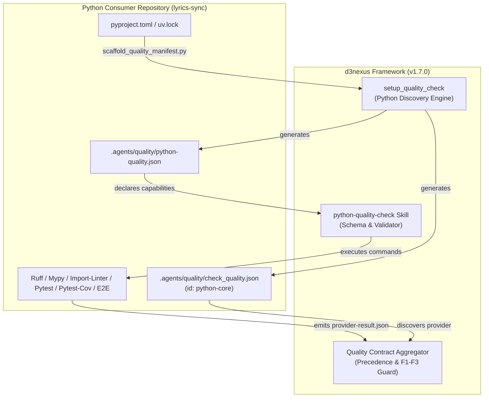

# Python Quality Provider and Onboarding Architecture Design

## Table of Contents

- [1. Executive Summary](#1-executive-summary)
- [2. Problem Statement and Rationale](#2-problem-statement-and-rationale)
- [3. Target Architecture and Component Interactions](#3-target-architecture-and-component-interactions)
- [4. Python Quality Provider Specification](#4-python-quality-provider-specification)
- [5. Automated Scaffolding Engine Extension](#5-automated-scaffolding-engine-extension)
- [6. Consumer Onboarding and Baseline Hardening for lyrics-sync](#6-consumer-onboarding-and-baseline-hardening-for-lyrics-sync)
- [7. Verification Strategy and Quality Gates](#7-verification-strategy-and-quality-gates)
- [8. Release and Rollout Plan](#8-release-and-rollout-plan)

---

## 1. Executive Summary

This specification establishes a first-class Python quality governance provider (`python-quality-check`) for the `d3nexus` agentic tooling framework (`v1.7.0`), enhances the automated onboarding engine (`setup_quality_check`) to detect Python workspaces, and integrates the architecture into the canonical [lyrics-sync](file:///Users/danhdueexoictif/AllProjects/lyrics-sync) codebase.

By unifying Python code formatting, static analysis, strict type checking, architectural boundary governance, unit testing, test coverage, and schema compliance into standardized quality contracts, development agents and engineers achieve deterministic, tamper-proof quality certification.

---

## 2. Problem Statement and Rationale

Recent operational audits across existing codebases revealed that without upfront, automated quality gates, rapid code generation by AI agents introduces silent debt:
1. **Unchecked Code Smells**: In `lyrics-sync`, 44 lint issues accumulated across test and script files (un-sorted imports, unused variables, and lines exceeding 100 characters).
2. **Provider Ecosystem Asymmetry**: While `d3nexus` provides dedicated quality providers for Rust, Flutter, Android, and iOS, Python codebases lack a dedicated provider and automatic discovery.
3. **Brownfield Adoption Friction**: Setting up quality configurations manually is error-prone. An automated scaffolding mechanism is required to inspect Python markers (`pyproject.toml`, `uv.lock`, `requirements.txt`) and bootstrap contract-compliant manifests in seconds.

---

## 3. Target Architecture and Component Interactions

The Python quality provider integrates into the platform-neutral quality orchestration model via version 1 contracts:



Key invariants:
- **Strict Read-Only Enforcement**: Providers verify existing tree state at candidate commit SHAs; auto-fix routines (`--fix`) are strictly prohibited during verification runs.
- **Contract Adherence**: Capability commands are declared strictly as non-empty arrays of strings.

---

## 4. Python Quality Provider Specification

### 4.1. Configuration Schema (python-quality.schema.json)

The manifest `.agents/quality/python-quality.json` is strictly validated by `validate_python_quality.py`:

```json
{
  "$schema": "https://json-schema.org/draft/2020-12/schema",
  "title": "Python Quality Capability Configuration Schema",
  "type": "object",
  "additionalProperties": false,
  "required": ["schema_version", "capabilities", "profiles"],
  "properties": {
    "schema_version": { "type": "integer", "const": 1 },
    "capabilities": {
      "type": "object",
      "additionalProperties": false,
      "properties": {
        "format": { "type": "array", "minItems": 1, "items": { "type": "string" } },
        "lint": { "type": "array", "minItems": 1, "items": { "type": "string" } },
        "type_check": { "type": "array", "minItems": 1, "items": { "type": "string" } },
        "boundaries": { "type": "array", "minItems": 1, "items": { "type": "string" } },
        "test": { "type": "array", "minItems": 1, "items": { "type": "string" } },
        "coverage": {
          "type": "object",
          "additionalProperties": false,
          "required": ["command", "threshold"],
          "properties": {
            "command": { "type": "array", "minItems": 1, "items": { "type": "string" } },
            "json_path": { "type": "string" },
            "threshold": { "type": "number", "minimum": 0, "maximum": 1 }
          }
        },
        "schema": { "type": "array", "minItems": 1, "items": { "type": "string" } },
        "acceptance": { "type": "array", "minItems": 1, "items": { "type": "string" } }
      }
    },
    "profiles": {
      "type": "object",
      "additionalProperties": false,
      "required": ["pr", "epic"],
      "properties": {
        "pr": { "type": "array", "items": { "type": "string" } },
        "epic": { "type": "array", "items": { "type": "string" } }
      }
    }
  }
}
```

### 4.2. Capability Tool Mapping

The standard Python provider capabilities map directly to canonical Python engineering tooling:

| Capability ID | Command Invocation | Verification Goal | Result Category |
|---|---|---|---|
| `format` | `["uv", "run", "ruff", "format", "--check", "."]` | Verify PEP 8 / project code formatting | `formatting` |
| `lint` | `["uv", "run", "ruff", "check", "."]` | Enforce static analysis and clean imports | `lint` |
| `type_check` | `["uv", "run", "mypy", "--strict", "src"]` | Static type safety and strict null-checking | `types` |
| `boundaries` | `["uv", "run", "lint-imports"]` | Clean Architecture layer dependency boundaries | `architecture` |
| `test` | `["uv", "run", "pytest", "-m", "not slow and not acceptance and not live_llm"]` | Fast Tier A unit test execution | `tests` |
| `coverage` | `["uv", "run", "pytest", "--cov=src", "--cov-report=json:coverage.json"]` | Enforce >= 80% line coverage threshold | `coverage` |
| `schema` | `["uv", "run", "python", "-m", "lyrics_sync.model", "--check-schema"]` | Model JSON schema contract validation | `compliance` |
| `acceptance` | `["./scripts/run_e2e_acceptance.sh"]` | End-to-end multi-module acceptance verification | `acceptance` |

---

## 5. Automated Scaffolding Engine Extension

The scaffolding engine [`scaffold_quality_manifest.py`](file:///Users/danhdueexoictif/AllProjects/ai-agent-tools/skills/setup_quality_check/resources/scripts/scaffold_quality_manifest.py) is enhanced to recognize Python repositories:

1. **Detection Heuristics**:
   - Inspects target repository root for: `pyproject.toml`, `uv.lock`, `requirements.txt`, `setup.py`, or `Pipfile`.
   - Adds `"python"` to detected platforms.
2. **Deterministic Manifest Output**:
   - Generates `.agents/quality/check_quality.json` declaring provider `python-core` mapped to `d3nexus:python-quality-check`.
   - Generates `.agents/quality/python-quality.json` pre-populated with standard capabilities.
3. **Safety & Flags**:
   - Fails safely if quality manifests already exist unless `--force` is provided.
   - Supports `--dry-run` and explicit `--platform python` override.

---

## 6. Consumer Onboarding and Baseline Hardening for lyrics-sync

To onboard the canonical consumer repository [lyrics-sync](file:///Users/danhdueexoictif/AllProjects/lyrics-sync):

1. **Bootstrap Manifests**: Run `scaffold_quality_manifest.py` against `lyrics-sync` to generate `.agents/quality/`.
2. **Audit and Remediate Accumulated Debt**:
   - Resolve 44 existing ruff lint violations in `lyrics-sync`.
   - Automatically format imports and remove unused variables.
   - Refactor long string constants and line lengths exceeding 100 characters in test fixtures.
3. **Baseline Certification**:
   - Execute `@quality_check` with profile `pr` and `epic`.
   - Verify 100% PASS across format, lint, mypy, lint-imports, pytest, and coverage.
   - Commit certified baseline to `lyrics-sync`.

---

## 7. Verification Strategy and Quality Gates

Verification follows the strict multi-tier standard:

1. **Tier A (Unit Testing)**:
   - `test_validate_python_quality.py`: Assert schema validation of valid manifests and rejection of empty arrays or malformed configurations.
   - `test_scaffold_quality_manifest.py`: Assert Python detection heuristics and polyglot composites.
2. **Tier B (Contract & Link Verification)**:
   - Verify skill frontmatter, single-line descriptions, and relative link resolution.
3. **Tier C (Integration & Acceptance Testing)**:
   - Extend `test_quality_provider_acceptance.py` to simulate pure Python and polyglot workspaces.
   - Run root `./scripts/verify.sh` to confirm all 13+ pre-release check suites PASS.

---

## 8. Release and Rollout Plan

1. **Task 1**: Implement `python-quality-check` skill, schema, validator, and test suite.
2. **Task 2**: Extend `setup_quality_check` scaffolding engine with Python detection and tests.
3. **Task 3**: Update `verify.sh`, acceptance tests, bump plugin manifests to version `1.7.0`, and update CHANGELOG.
4. **Task 4**: Bootstrap `.agents/quality/` in `lyrics-sync`, remediate existing lint debt, and certify green baseline.
