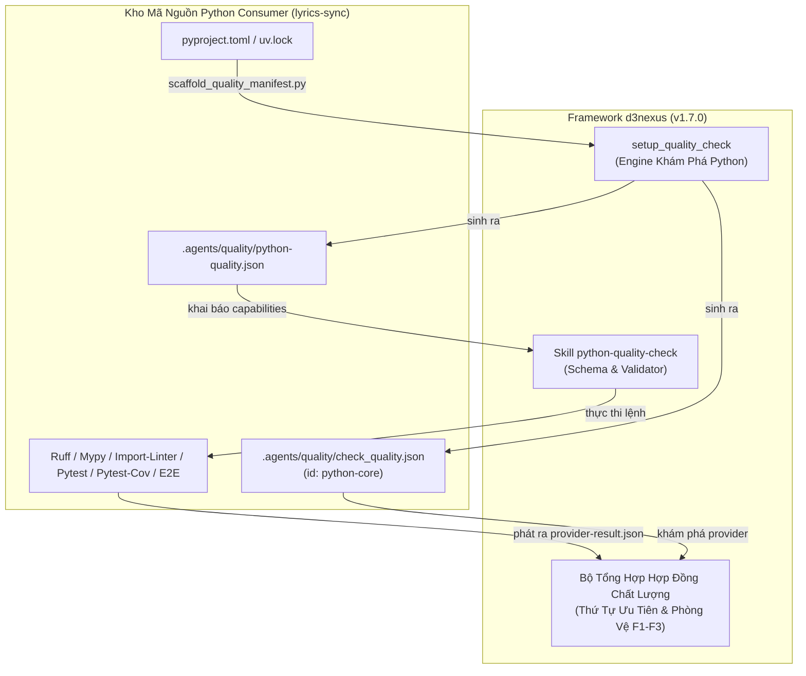

# Thiết Kế Kiến Trúc Python Quality Provider và Onboarding

## Mục Lục

- [1. Tóm Tắt Tổng Quan](#1-tóm-tắt-tổng-quan)
- [2. Đặt Vấn Đề và Cơ Sở Lý Luận](#2-đặt-vấn-đề-và-cơ-sở-lý-luận)
- [3. Kiến Trúc Mục Tiêu và Tương Tác Giữa Các Thành Phần](#3-kiến-trúc-mục-tiêu-và-tương-tác-giữa-các-thành-phần)
- [4. Đặc Tả Skill Python Quality Provider](#4-đặc-tả-skill-python-quality-provider)
- [5. Mở Rộng Engine Khởi Tạo Mẫu Tự Động](#5-mở-rộng-engine-khởi-tạo-mẫu-tự-động)
- [6. Onboarding và Gia Cố Baseline Cho Codebase lyrics-sync](#6-onboarding-và-gia-cố-baseline-cho-codebase-lyrics-sync)
- [7. Chiến Lược Kiểm Thử và Quality Gates](#7-chiến-lược-kiểm-thử-và-quality-gates)
- [8. Kế Hoạch Phát Hành và Lộ Trình Triển Khai](#8-kế-hoạch-phát-hành-và-lộ-trình-triển-khai)

---

## 1. Tóm Tắt Tổng Quan

Tài liệu thiết kế này xác lập provider quản trị chất lượng hạng nhất cho Python (`python-quality-check`) trong bộ công cụ agentic `d3nexus` (`v1.7.0`), nâng cấp engine khởi tạo tự động (`setup_quality_check`) để nhận diện môi trường Python, và áp dụng mô hình kiến trúc này vào codebase mẫu chuẩn [lyrics-sync](file:///Users/danhdueexoictif/AllProjects/lyrics-sync).

Thông qua việc hợp nhất định dạng mã nguồn Python, phân tích tĩnh, kiểm tra kiểu dữ liệu nghiêm ngặt, quản trị ranh giới kiến trúc, kiểm thử đơn vị, độ bao phủ kiểm thử và tuân thủ schema vào các hợp đồng chất lượng chuẩn mực, các agent và kỹ sư phát triển đạt được năng lực chứng nhận chất lượng mang tính tất định và chống giả mạo.

---

## 2. Đặt Vấn Đề và Cơ Sở Lý Luận

Qua kiểm tra thực tế trên codebase đang hoạt động, việc thiếu các cổng kiểm soát chất lượng tự động ngay từ đầu khi AI sinh mã nguồn dẫn đến tích lũy nợ kỹ thuật:
1. **Lỗi Lint Chưa Được Kiểm Soát**: Trong `lyrics-sync`, 44 lỗi lint đã tích lũy trên các file test và script (import chưa sắp xếp, biến thừa không dùng, và dòng vượt quá 100 ký tự).
2. **Sự Bất Đối Xứng Trong Hệ Sinh Thái Provider**: Trong khi `d3nexus` đã cung cấp provider chuyên biệt cho Rust, Flutter, Android và iOS, các codebase Python vẫn thiếu provider riêng và cơ chế tự động khám phá.
3. **Rào Cản Áp Dụng Trên Codebase Hiện Hữu (Brownfield)**: Việc thiết lập file cấu hình thủ công rất dễ gặp sai sót. Cần có một cơ chế tự động quét các dấu hiệu đặc trưng của Python (`pyproject.toml`, `uv.lock`, `requirements.txt`) và tạo manifest chuẩn trong vài giây.

---

## 3. Kiến Trúc Mục Tiêu và Tương Tác Giữa Các Thành Phần

Provider chất lượng Python tích hợp vào mô hình điều phối chất lượng trung lập nền tảng thông qua hợp đồng phiên bản 1:



Các bất biến then chốt:
- **Thực Thi Chỉ Đọc Tuyệt Đối (Read-Only Enforcement)**: Các provider chỉ kiểm tra trạng thái cây mã nguồn tại commit SHA ứng viên; các lệnh auto-fix (`--fix`) bị nghiêm cấm trong quá trình xác thực.
- **Tuân Thủ Hợp Đồng Chặt Chẽ**: Mọi lệnh capability phải được khai báo dưới dạng mảng các chuỗi không rỗng.

---

## 4. Đặc Tả Skill Python Quality Provider

### 4.1. Schema Cấu Hình (python-quality.schema.json)

Manifest `.agents/quality/python-quality.json` được kiểm thực nghiêm ngặt bởi `validate_python_quality.py`:

```json
{
  "$schema": "https://json-schema.org/draft/2020-12/schema",
  "title": "Python Quality Capability Configuration Schema",
  "type": "object",
  "additionalProperties": false,
  "required": ["schema_version", "capabilities", "profiles"],
  "properties": {
    "schema_version": { "type": "integer", "const": 1 },
    "capabilities": {
      "type": "object",
      "additionalProperties": false,
      "properties": {
        "format": { "type": "array", "minItems": 1, "items": { "type": "string" } },
        "lint": { "type": "array", "minItems": 1, "items": { "type": "string" } },
        "type_check": { "type": "array", "minItems": 1, "items": { "type": "string" } },
        "boundaries": { "type": "array", "minItems": 1, "items": { "type": "string" } },
        "test": { "type": "array", "minItems": 1, "items": { "type": "string" } },
        "coverage": {
          "type": "object",
          "additionalProperties": false,
          "required": ["command", "threshold"],
          "properties": {
            "command": { "type": "array", "minItems": 1, "items": { "type": "string" } },
            "json_path": { "type": "string" },
            "threshold": { "type": "number", "minimum": 0, "maximum": 1 }
          }
        },
        "schema": { "type": "array", "minItems": 1, "items": { "type": "string" } },
        "acceptance": { "type": "array", "minItems": 1, "items": { "type": "string" } }
      }
    },
    "profiles": {
      "type": "object",
      "additionalProperties": false,
      "required": ["pr", "epic"],
      "properties": {
        "pr": { "type": "array", "items": { "type": "string" } },
        "epic": { "type": "array", "items": { "type": "string" } }
      }
    }
  }
}
```

### 4.2. Ánh Xạ Công Cụ và Capability

Các capability chuẩn của Python provider ánh xạ trực tiếp vào bộ công cụ chuẩn mực của hệ sinh thái Python:

| Capability ID | Lệnh Thực Thi | Mục Tiêu Kiểm Tra | Phân Loại Kết Quả |
|---|---|---|---|
| `format` | `["uv", "run", "ruff", "format", "--check", "."]` | Kiểm tra định dạng code PEP 8 và chuẩn dự án | `formatting` |
| `lint` | `["uv", "run", "ruff", "check", "."]` | Phân tích tĩnh cú pháp và dọn sạch import | `lint` |
| `type_check` | `["uv", "run", "mypy", "--strict", "src"]` | Kiểm tra an toàn kiểu tĩnh và null-safety | `types` |
| `boundaries` | `["uv", "run", "lint-imports"]` | Ranh giới phụ thuộc phân tầng Clean Architecture | `architecture` |
| `test` | `["uv", "run", "pytest", "-m", "not slow and not acceptance and not live_llm"]` | Chạy nhanh bộ unit test Tier A | `tests` |
| `coverage` | `["uv", "run", "pytest", "--cov=src", "--cov-report=json:coverage.json"]` | Đảm bảo ngưỡng bao phủ dòng >= 80% | `coverage` |
| `schema` | `["uv", "run", "python", "-m", "lyrics_sync.model", "--check-schema"]` | Kiểm định hợp đồng schema JSON của model | `compliance` |
| `acceptance` | `["./scripts/run_e2e_acceptance.sh"]` | Kiểm thử nghiệm thu tích hợp đa module Tier C | `acceptance` |

---

## 5. Mở Rộng Engine Khởi Tạo Mẫu Tự Động

Engine khởi tạo mẫu [`scaffold_quality_manifest.py`](file:///Users/danhdueexoictif/AllProjects/ai-agent-tools/skills/setup_quality_check/resources/scripts/scaffold_quality_manifest.py) được nâng cấp để nhận diện kho mã nguồn Python:

1. **Heuristic Nhận Diện**:
   - Quét thư mục gốc tìm: `pyproject.toml`, `uv.lock`, `requirements.txt`, `setup.py`, hoặc `Pipfile`.
   - Bổ sung `"python"` vào danh sách nền tảng được phát hiện.
2. **Đầu Ra Manifest Tất Định**:
   - Tạo `.agents/quality/check_quality.json` khai báo provider `python-core` ánh xạ tới `d3nexus:python-quality-check`.
   - Tạo `.agents/quality/python-quality.json` điền sẵn các capability chuẩn mực.
3. **An Toàn & Tùy Chọn**:
   - Dừng lại an toàn nếu cấu hình chất lượng đã tồn tại trừ khi có tùy chọn `--force`.
   - Hỗ trợ chế độ duyệt thử `--dry-run` và cờ ép buộc nền tảng `--platform python`.

---

## 6. Onboarding và Gia Cố Baseline Cho Codebase lyrics-sync

Các bước áp dụng trên kho mã nguồn [lyrics-sync](file:///Users/danhdueexoictif/AllProjects/lyrics-sync):

1. **Khởi Tạo Cấu Hình**: Chạy `scaffold_quality_manifest.py` trên `lyrics-sync` để sinh `.agents/quality/`.
2. **Thẩm Định và Xử Lý Nợ Kỹ Thuật Tồn Đọng**:
   - Khắc phục triệt để 44 vi phạm ruff lint hiện có trong `lyrics-sync`.
   - Tự động sắp xếp import và loại bỏ các biến không sử dụng.
   - Refactor các chuỗi hằng số dài và dòng vượt quá 100 ký tự trong file test.
3. **Chứng Nhận Baseline Xanh**:
   - Thực thi `@quality_check` cho cả hai profile `pr` và `epic`.
   - Xác nhận 100% PASS trên format, lint, mypy, lint-imports, pytest, và coverage.
   - Tạo commit chứng nhận baseline xanh cho `lyrics-sync`.

---

## 7. Chiến Lược Kiểm Thử và Quality Gates

Quy trình nghiệm thu tuân thủ nghiêm ngặt tiêu chuẩn đa tầng:

1. **Tier A (Kiểm Thử Đơn Vị)**:
   - `test_validate_python_quality.py`: Xác thực schema cho manifest hợp lệ, từ chối mảng lệnh rỗng hoặc cấu hình sai lệch.
   - `test_scaffold_quality_manifest.py`: Kiểm thử heuristic phát hiện Python và các kho mã nguồn hỗn hợp (polyglot).
2. **Tier B (Xác Thực Hợp Đồng & Liên Kết)**:
   - Kiểm tra frontmatter của skill, mô tả 1 dòng, và tính phân giải của liên kết tương đối.
3. **Tier C (Kiểm Thử Tích Hợp & Nghiệm Thu)**:
   - Mở rộng `test_quality_provider_acceptance.py` mô phỏng kho mã nguồn thuần Python và kho mã nguồn hỗn hợp.
   - Thực thi `./scripts/verify.sh` ở thư mục gốc đảm bảo toàn bộ 13+ bộ kiểm thử PASS 100%.

---

## 8. Kế Hoạch Phát Hành và Lộ Trình Triển Khai

1. **Task 1**: Hiện thực skill `python-quality-check`, schema, validator và bộ test đơn vị.
2. **Task 2**: Mở rộng engine khởi tạo `setup_quality_check` với heuristic Python và bộ kiểm thử.
3. **Task 3**: Cập nhật `verify.sh`, test nghiệm thu, nâng phiên bản plugin lên `1.7.0` và cập nhật CHANGELOG.
4. **Task 4**: Khởi tạo `.agents/quality/` trong `lyrics-sync`, xử lý nợ lint tồn đọng, và xác nhận baseline xanh.
