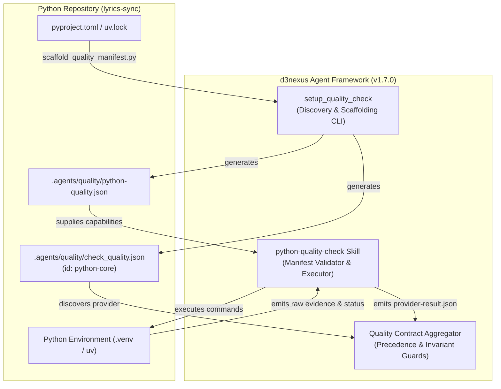
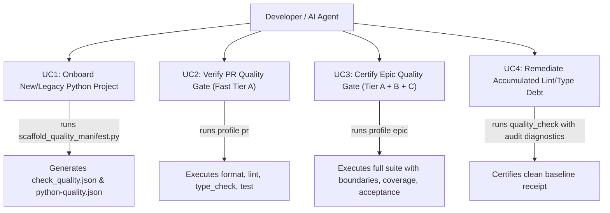
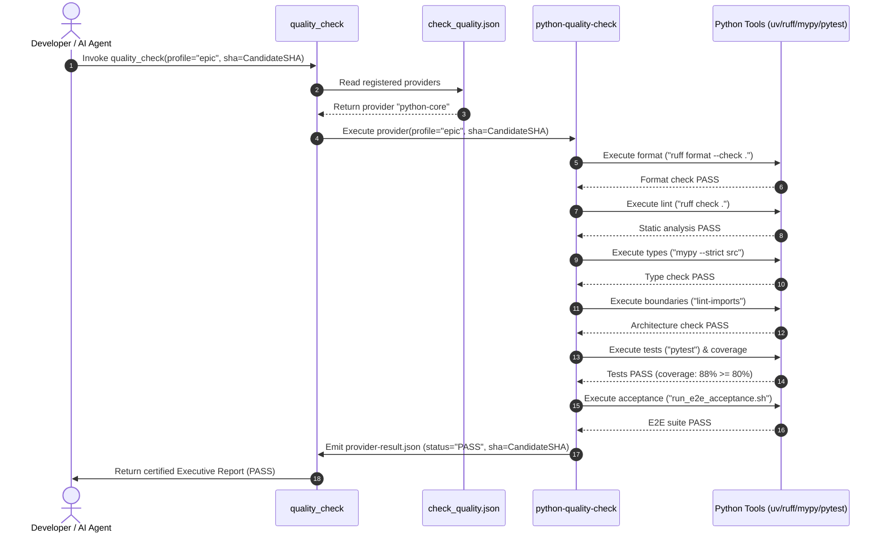

# Epic Overview: Python Quality Provider and Onboarding

## Table of Contents

- [1. Meta Data](#1-meta-data)
- [2. Background](#2-background)
- [3. Goals and Non-Goals](#3-goals-and-non-goals)
- [4. Architecture and Technical Design](#4-architecture-and-technical-design)
  - [4.1. High-Level Architecture](#41-high-level-architecture)
  - [4.2. Use Cases](#42-use-cases)
  - [4.3. Sequence Diagram](#43-sequence-diagram)
  - [4.4. BDD Scenario Mapping](#44-bdd-scenario-mapping)
- [5. Rollout Strategy and Mitigation](#5-rollout-strategy-and-mitigation)
- [6. Kanban Tasks Breakdown](#6-kanban-tasks-breakdown)

---

## 1. Meta Data

- **Epic Name**: `python_quality_provider_and_onboarding`
- **Status**: `todo`
- **Target Release**: `v1.7.0`
- **Platform**: `Python / Platform-Neutral Core`
- **Source Spec**: [2026-10-12-python-quality-provider-and-onboarding-design.en.md](2026-10-12-python-quality-provider-and-onboarding-design.en.md)
- **BDD Scenarios**: [bdd_scenarios.en.md](bdd_scenarios.en.md)

---

## 2. Background

The `d3nexus` framework recently unified mobile and system quality gates by establishing dedicated providers for Rust, Flutter, Android Native, and iOS Native. However, Python codebases—critical for ETL, AI pipelines, and backend services such as [lyrics-sync](file:///Users/danhdueexoictif/AllProjects/lyrics-sync)—lacked a dedicated quality provider and automated scaffolding.

An operational inspection of `lyrics-sync` confirmed that 44 lint issues accumulated across test and script files. Without automated quality enforcement integrated before code generation or maintenance begins, codebases accumulate technical debt rapidly.

This epic introduces the `python-quality-check` skill, extends `setup_quality_check` with Python detection heuristics, and onboards `lyrics-sync` as the certified canonical Python reference.

---

## 3. Goals and Non-Goals

### Goals
- **Dedicated Python Quality Provider**: Implement `d3nexus:python-quality-check` adhering to version 1 contracts, supporting Ruff formatting, Ruff linting, Mypy strict type checking, Import-Linter architectural governance, Pytest, coverage thresholds, schema validation, and E2E acceptance.
- **Automated Python Scaffolding**: Extend `scaffold_quality_manifest.py` to auto-detect Python projects (`pyproject.toml`, `uv.lock`, `requirements.txt`, `setup.py`, `Pipfile`) and generate valid `.agents/quality/` configurations.
- **Contract Hardening Alignment**: Ensure the Python provider respects False-PASS guards (F1–F3), rejects empty command arrays, and binds receipts to candidate commit SHAs.
- **Consumer Onboarding for lyrics-sync**: Bootstrap `.agents/quality/` in `lyrics-sync`, remediate existing lint violations, and certify a 100% green baseline.

### Non-Goals
- Modifying non-Python provider contracts or schemas.
- Introducing external non-standard Python dependencies into `d3nexus`.
- Automatic auto-fixing (`--fix`) during quality verification runs.

---

## 4. Architecture and Technical Design

### 4.1. High-Level Architecture

### 4.2. Use Cases

### 4.3. Sequence Diagram

### 4.4. BDD Scenario Mapping

Exhaustive Gherkin specifications covering Dan Olsen's 5-Dimension Boundary Matrix (Happy Paths, Edge Cases, State Transitions, Concurrency, and Resilience) are defined in [bdd_scenarios.en.md](bdd_scenarios.en.md).

---

## 5. Rollout Strategy and Mitigation

- **Phased Rollout**:
  - Phase 1: Core skill implementation, schemas, validators, and unit tests in `d3nexus`.
  - Phase 2: Scaffolding engine extension and verification harness updates.
  - Phase 3: Acceptance test simulation across pure Python and polyglot composites, bumping version to `1.7.0`.
  - Phase 4: Consumer onboarding and baseline remediation in `lyrics-sync`.
- **Mitigation & Rollback**:
  - `setup_quality_check` is idempotent and will never overwrite existing manifests without `--force`.
  - If regressions occur, consumer projects can temporarily bypass or pin previous provider releases without blocking build pipelines.

---

## 6. Kanban Tasks Breakdown

1. [Task 1: Build Python Quality Provider](task_1_build_python_quality_provider.md)
2. [Task 2: Extend Scaffolding Skill for Python](task_2_extend_scaffolding_skill.md)
3. [Task 3: Run Acceptance Verification and Release v1.7.0](task_3_run_acceptance_and_release.md)
4. [Task 4: Onboard lyrics-sync and Certify Baseline](task_4_onboard_lyrics_sync.md)
