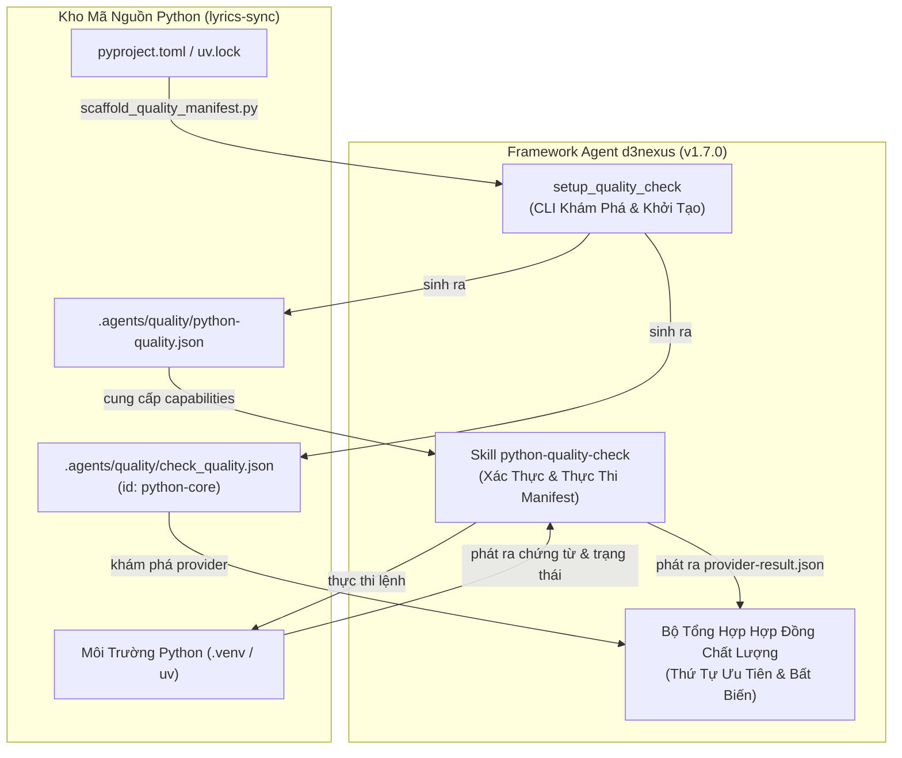
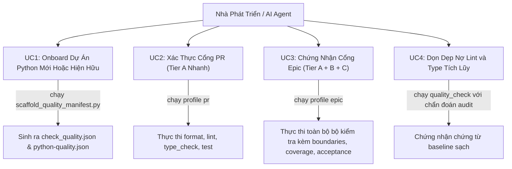
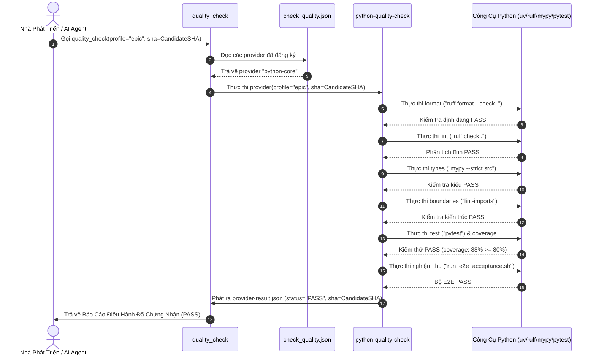

# Tổng Quan Epic: Python Quality Provider và Onboarding

## Mục Lục

- [1. Dữ Liệu Đặc Tả](#1-dữ-liệu-đặc-tả)
- [2. Bối Cảnh](#2-bối-cảnh)
- [3. Mục Tiêu và Không Thuộc Phạm Vi](#3-mục-tiêu-và-không-thuộc-phạm-vi)
- [4. Kiến Trúc và Thiết Kế Kỹ Thuật](#4-kiến-trúc-và-thiết-kế-kỹ-thuật)
  - [4.1. Kiến Trúc Cấp Cao](#41-kiến-trúc-cấp-cao)
  - [4.2. Kịch Bản Sử Dụng](#42-kịch-bản-sử-dụng)
  - [4.3. Sơ Đồ Trình Tự](#43-sơ-đồ-trình-tự)
  - [4.4. Ánh Xạ Kịch Bản BDD](#44-ánh-xạ-kịch-bản-bdd)
- [5. Chiến Lược Triển Khai và Giảm Thiểu Rủi Ro](#5-chiến-lược-triển-khai-và-giảm-thiểu-rủi-ro)
- [6. Phân Rã Kanban Task](#6-phân-rã-kanban-task)

---

## 1. Dữ Liệu Đặc Tả

- **Tên Epic**: `python_quality_provider_and_onboarding`
- **Trạng Thái**: `todo`
- **Phiên Bản Mục Tiêu**: `v1.7.0`
- **Nền Tảng**: `Python / Lõi Trung Lập Nền Tảng`
- **Tài Liệu Đặc Tả Gốc**: [2026-10-12-python-quality-provider-and-onboarding-design.vi.md](2026-10-12-python-quality-provider-and-onboarding-design.vi.md)
- **Kịch Bản BDD**: [bdd_scenarios.vi.md](bdd_scenarios.vi.md)

---

## 2. Bối Cảnh

Framework `d3nexus` gần đây đã hợp nhất các cổng kiểm soát chất lượng di động và hệ thống thông qua việc thiết lập các provider chuyên biệt cho Rust, Flutter, Android Native, và iOS Native. Tuy nhiên, các codebase Python—vốn đóng vai trò then chốt cho các pipeline ETL, AI, và dịch vụ backend như [lyrics-sync](file:///Users/danhdueexoictif/AllProjects/lyrics-sync)—vẫn thiếu provider chất lượng chuyên biệt và cơ chế khởi tạo mẫu tự động.

Kiểm tra vận hành trên `lyrics-sync` đã xác nhận 44 lỗi lint tích lũy trên các file test và script. Nếu không có cơ chế cưỡng chế chất lượng tự động ngay từ đầu trước khi AI sinh code hoặc bảo trì, kho mã nguồn sẽ tích lũy nợ kỹ thuật rất nhanh.

Epic này xây dựng skill `python-quality-check`, mở rộng `setup_quality_check` với heuristic nhận diện Python, và onboard `lyrics-sync` thành codebase Python mẫu chuẩn được chứng nhận.

---

## 3. Mục Tiêu và Không Thuộc Phạm Vi

### Mục Tiêu
- **Python Quality Provider Chuyên Biệt**: Hiện thực `d3nexus:python-quality-check` tuân thủ hợp đồng phiên bản 1, hỗ trợ Ruff format, Ruff lint, Mypy strict type checking, Import-Linter ranh giới kiến trúc, Pytest, ngưỡng coverage, kiểm tra schema, và nghiệm thu E2E.
- **Khởi Tạo Tự Động Cho Python**: Mở rộng `scaffold_quality_manifest.py` để tự động phát hiện dự án Python (`pyproject.toml`, `uv.lock`, `requirements.txt`, `setup.py`, `Pipfile`) và sinh cấu hình `.agents/quality/` hợp lệ.
- **Tuân Thủ Cơ Chế Phòng Vệ Hợp Đồng**: Đảm bảo Python provider tuân thủ nghiêm ngặt các chốt chặn False-PASS (F1–F3), từ chối mảng lệnh rỗng, và gắn kết mật mã với commit SHA ứng viên.
- **Onboarding Consumer Cho lyrics-sync**: Khởi tạo `.agents/quality/` trong `lyrics-sync`, dọn dẹp các lỗi lint hiện có, và xác nhận baseline xanh 100%.

### Không Thuộc Phạm Vi
- Chỉnh sửa hợp đồng hoặc schema của các provider không thuộc Python.
- Thêm các dependency Python bên ngoài không thuộc thư viện chuẩn vào `d3nexus`.
- Tự ý áp dụng auto-fix (`--fix`) trong quá trình chạy kiểm tra chất lượng.

---

## 4. Kiến Trúc và Thiết Kế Kỹ Thuật

### 4.1. Kiến Trúc Cấp Cao

### 4.2. Kịch Bản Sử Dụng

### 4.3. Sơ Đồ Trình Tự

### 4.4. Ánh Xạ Kịch Bản BDD

Các kịch bản Gherkin chi tiết bao phủ Ma trận Ranh giới 5 Chiều của Dan Olsen (Kịch bản thành công, Trường hợp biên, Chuyển đổi trạng thái, Đồng thời, và Phục hồi lỗi) được định nghĩa đầy đủ tại [bdd_scenarios.vi.md](bdd_scenarios.vi.md).

---

## 5. Chiến Lược Triển Khai và Giảm Thiểu Rủi Ro

- **Triển Khai Phân Kỳ**:
  - Giai đoạn 1: Hiện thực skill cốt lõi, schema, validator và unit test trong `d3nexus`.
  - Giai đoạn 2: Mở rộng engine khởi tạo mẫu và cập nhật bộ kiểm tra xác thực.
  - Giai đoạn 3: Kiểm thử nghiệm thu mô phỏng kho mã nguồn thuần Python và hỗn hợp, nâng phiên bản lên `1.7.0`.
  - Giai đoạn 4: Onboard consumer và dọn dẹp baseline trong `lyrics-sync`.
- **Giảm Thiểu Rủi Ro & Rollback**:
  - `setup_quality_check` mang tính tất định an toàn, không bao giờ ghi đè file hiện có nếu thiếu `--force`.
  - Nếu phát sinh lỗi hồi quy, các dự án consumer có thể tạm thời ghim phiên bản provider trước đó mà không làm tắc nghẽn luồng build.

---

## 6. Phân Rã Kanban Task

1. [Task 1: Xây Dựng Python Quality Provider](task_1_build_python_quality_provider.md)
2. [Task 2: Mở Rộng Skill Khởi Tạo Mẫu Cho Python](task_2_extend_scaffolding_skill.md)
3. [Task 3: Chạy Nghiệm Thu và Phát Hành v1.7.0](task_3_run_acceptance_and_release.md)
4. [Task 4: Onboard lyrics-sync và Chứng Nhận Baseline](task_4_onboard_lyrics_sync.md)
