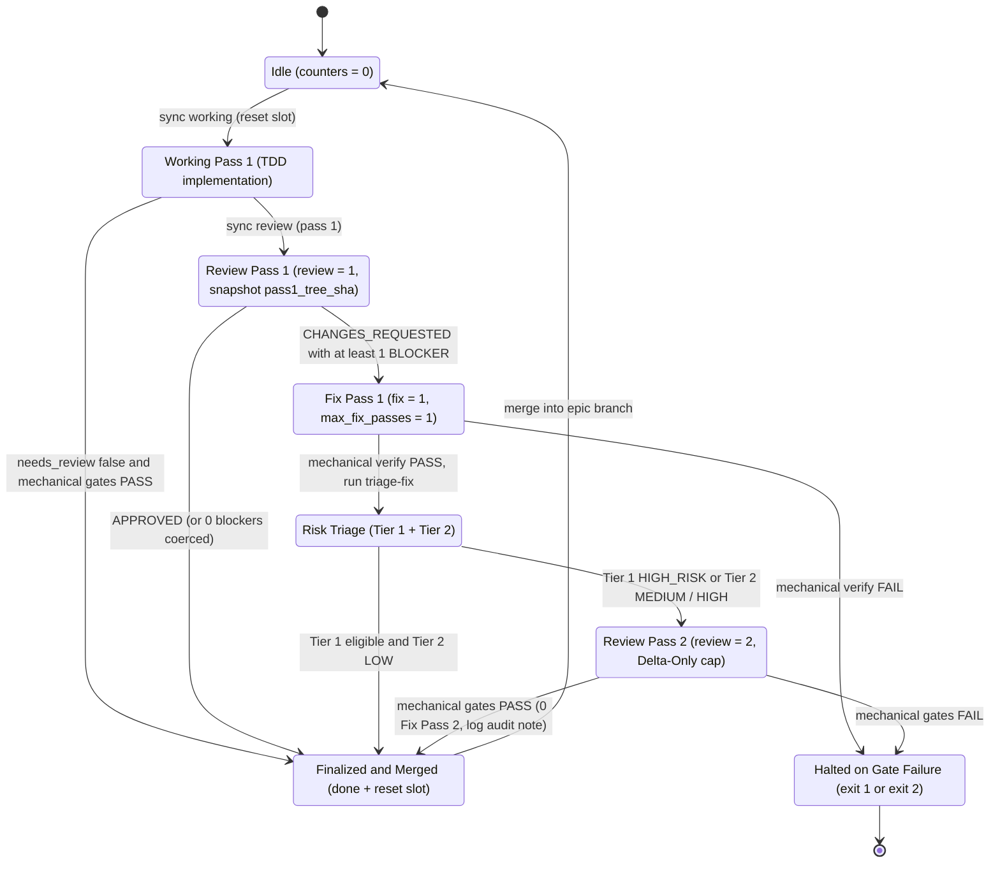
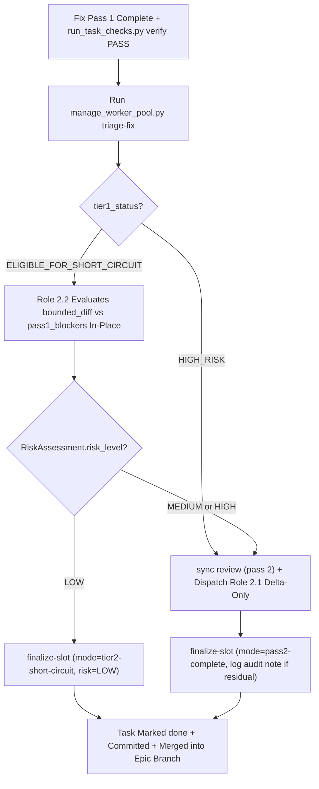

# Hard Review Cap Blocker-Only Triage and Two-Tier Risk Short-Circuit Design

- **Date**: 2026-11-18
- **Epic Slug**: `review_cap_and_risk_triage`
- **Repository**: `ai-agent-tools` (`d3nexus` plugin)
- **Status**: Approved
- **PIC**: nguyenhieu000690

## Table of Contents

- [1 Problem Context and Goals](#1-problem-context-and-goals)
- [2 Non-Goals and Scope Boundaries](#2-non-goals-and-scope-boundaries)
- [3 Shared Contract Warnings](#3-shared-contract-warnings)
- [4 Layered Configuration Schema](#4-layered-configuration-schema)
- [5 Slot State Machine and Snapshot Architecture](#5-slot-state-machine-and-snapshot-architecture)
- [6 Severity Triage Rubric and Reviewer Contracts](#6-severity-triage-rubric-and-reviewer-contracts)
- [7 Two-Tier Risk Assessment Gate](#7-two-tier-risk-assessment-gate)
- [8 Controlled Role 2.2 Exception and Runner Parity](#8-controlled-role-22-exception-and-runner-parity)
- [9 Error Handling and Terminal Finalization](#9-error-handling-and-terminal-finalization)
- [10 Dependencies Risks and Verification Plan](#10-dependencies-risks-and-verification-plan)

## 1 Problem Context and Goals

During recent 2-slot parallel task execution (`task_03` in `translation_studio_sync_and_standalone`), the `Role 2.1 (task-reviewer)` loop triggered 4 review passes and 3 fix passes via `manage_worker_pool.py`. Each subsequent review pass uncovered incremental edge-case refinements and stylistic preferences (Nitpick Escalation), burning substantial wall-clock time and frontier model quota without preventing real specification regressions.

This specification introduces three mutually reinforcing safeguards across `d3nexus`:

1. **Mechanical Hard Cap (`max_task_review_passes = 2`, `max_fix_passes = 1`)**: Configured in `personas.json` and enforced by exit code inside `manage_worker_pool.py` (and mirrored in `lifecycle_runner.py`). A single Kanban task can undergo at most one initial comprehensive review (Pass 1), at most one scoped remediation pass (Fix Pass 1), and—only when warranted by risk—at most one final delta-only verification pass (Pass 2). Fix Pass 2 and Review Pass 3+ are structurally impossible.
2. **Blocker-Only Rejection Rubric (`BLOCKER` vs. `NON_BLOCKING_OBSERVATION`)**: `Role 2.1 (task-reviewer)` may return `CHANGES_REQUESTED` only when at least one `BLOCKER` exists. Minor edge-case refinements, stylistic preferences, and micro-optimizations must be logged under `Observations (Non-Blocking)` with verdict `APPROVED`, backed by a mechanical parser coercion guard.
3. **Two-Tier Risk Assessment Gate Before Review Pass 2**: After Fix Pass 1 passes all mechanical checks (`pytest`, `ruff`, `mypy`, `done_gate`), `manage_worker_pool.py triage-fix` runs a deterministic heuristic check (Tier 1) against the exact Fix Pass 1 delta (`git diff <pass1_tree_sha>`). When Tier 1 reports `ELIGIBLE_FOR_SHORT_CIRCUIT`, `Role 2.2 (Orchestrator)` performs an in-place semantic check (Tier 2) with zero extra subagent spawns, short-circuiting `LOW`-risk fixes directly to `done` and merging into the epic branch.

## 2 Non-Goals and Scope Boundaries

- **Epic-level external reviews remain unchanged**: Stage 2 `/principal-review` and Stage 3 `/cross-model-review` retain their existing `max_rounds = 3` funnel governed by `run_external_review.py`.
- **Selective `task-reviewer` gating remains intact**: Tasks with `needs_review == false` (`review_tier == "standard"`, no high-risk labels, and `<= 2` changed non-test modules) still finalize directly after Pass 1 implementation without invoking `task-reviewer`.
- **Mechanical gates are never bypassed**: `finalize-slot` refuses to transition any task to `done` or merge it if `run_task_checks.py status` (`done gate: PASS`) or `check_bdd_traceability.py` fails.
- **Unrelated workspace state is untouched**: Active work in `skills/check-quota/resources/dashboard/quota_dashboard.html` and `.worktrees/bg_task_watchdog_and_stall_detection` is strictly out of scope.

## 3 Shared Contract Warnings

`shared-contracts/` is absent in `ai-agent-tools` (this repository is the standalone `d3nexus` agent kit rather than a D3Nexus Hub/Satellite service). No HTTP REST/SSE wire contracts are affected. Internal CLI JSON contracts between `persona_config.py`, `manage_worker_pool.py`, `resume_context.py`, and `lifecycle_runner.py` preserve backward compatibility for existing consumers and test suites as specified in Sections 6 and 8.

## 4 Layered Configuration Schema

### 4.1 Top-Level Keys and Inheritance

Add two top-level integer keys to the layered persona configuration system (`kit` -> `global` -> `project`):

```json
{
  "max_task_review_passes": 2,
  "max_fix_passes": 1
}
```

- **Kit Defaults (`scripts/personas.default.json`)**: Seed `"max_task_review_passes": 2` and `"max_fix_passes": 1` so every downstream repository inherits the cap automatically even before creating a project-level `personas.json`.
- **Project Config (`.agents/config/personas.json`)**: Create `.agents/config/personas.json` in `ai-agent-tools` with `"schema_version": 1`, `"max_task_review_passes": 2`, and `"max_fix_passes": 1` (and update `/d3nexus:dev-config` scaffolding/inspection so project overlays preserve or display these bounds).
- **Schema Validation (`scripts/persona_config.py`)**:
  - Extend `_ALLOWED_TOP_KEYS` with `"max_task_review_passes"` and `"max_fix_passes"`.
  - Validate in `_validate_policy_and_low_quota(cfg)` that `"max_task_review_passes"` is an `int >= 1` (rejecting booleans via `type(v) is int`) and `"max_fix_passes"` is an `int >= 0`.
  - Provide `resolve_task_review_limits(project_root: Path, *, real_home: Path | str | None = None) -> tuple[int, int]` returning `(max_task_review_passes, max_fix_passes)` with safe fallback `(2, 1)` if `persona_config` is invoked outside a configured workspace.

## 5 Slot State Machine and Snapshot Architecture

### 5.1 Heartbeat Slot Record Extensions

In `skills/dev-implementation/resources/scripts/manage_worker_pool.py`, each `slots["slot-N"]` entry inside `.devtool/state/<safe_epic_slug>.heartbeat.json` (with a direct JSON read/write fallback when `_state_envelope` is unavailable in isolated unit tests) maintains:

```json
{
  "status": "review",
  "branch": "epic/demo-epic-slot-1",
  "path": "/abs/repo/.worktrees/demo_epic-slot-1",
  "task_id": "task_03",
  "review_passes_used": 1,
  "fix_passes_used": 0,
  "pass1_tree_sha": "4b825dc642cb6eb9a060e54bf8d69288fbee4904",
  "pass1_head_sha": "a1b2c3d",
  "pass1_blockers": [],
  "last_triage": null
}
```

### 5.2 Non-Destructive `pass1_tree_sha` Snapshot Capture

When a task has `needs_review == true`, `task-implementer` leaves changes uncommitted in the slot worktree (`finalized: false`) so `run_task_checks.py` evidence remains bound to `patch_id`. During Fix Pass 1, `task-implementer` edits the same uncommitted slot worktree (`sync --status working --no-reset`). Diffing against `HEAD` after Fix Pass 1 would erroneously measure the entire task's diff rather than Fix Pass 1's delta.

To isolate Fix Pass 1's exact delta without mutating `HEAD` or the slot's real git index:

1. On `sync --status review` when `review_passes_used` transitions `0 -> 1`:
2. Copy the slot's current git index file (`git rev-parse --git-path index`) into a `tempfile.TemporaryDirectory()` as `TMP_INDEX`.
3. Run `git add -A` with `GIT_INDEX_FILE=TMP_INDEX`, then `git reset -q -- <excluded_paths>` for `CACHE_DIR_CANDIDATES` symlinks and `.devtool/epic/<epic_dir>/evidence/`.
4. Run `git write-tree` with `GIT_INDEX_FILE=TMP_INDEX` to obtain an immutable Git tree object SHA (`pass1_tree_sha`) stored in the repository object database, and delete `TMP_INDEX`.
5. Neither `HEAD`, the working tree, nor the real `.git/index` changes; `run_task_checks.py status` continues to validate the existing `patch_id` with zero redundant test runs.

### 5.3 State Transitions and Hard-Cap Enforcement



| Command / Transition | Preconditions Checked | Mutation / Exit Behavior |
|---|---|---|
| `init`, `merge`, `sync --status idle` (reset), `sync --status working` (reset) | Slot directory exists | Resets `review_passes_used = 0`, `fix_passes_used = 0`, `pass1_tree_sha = None`, `pass1_blockers = []`, `last_triage = None` |
| `sync --status review` (Pass 1) | `review_passes_used == 0 < max_task_review_passes` | Sets `review_passes_used = 1`, captures `pass1_tree_sha` & `pass1_head_sha`, returns `0` |
| `sync --status working --no-reset` (Fix Pass 1) | `fix_passes_used < max_fix_passes` (`1`); if `--review-file` / `--blockers-file` given, normalized verdict must be `CHANGES_REQUESTED` with `len(blockers) >= 1` | Sets `fix_passes_used = 1`, stores `pass1_blockers`, returns `0`. Exits `2` (`HARD_FIX_CAP_EXCEEDED` or `NO_BLOCKER_FOR_FIX_PASS`) if violated |
| `sync --status review` (Pass 2) | `review_passes_used == 1 < max_task_review_passes` (`2`) | Sets `review_passes_used = 2`, preserves `pass1_tree_sha` and `pass1_blockers`, returns `0`. Exits `2` (`HARD_REVIEW_CAP_EXCEEDED`) if `review_passes_used >= max_task_review_passes` |
| `triage-fix` | `fix_passes_used == 1` and `pass1_tree_sha` present | Computes Tier 1 heuristic report against `pass1_tree_sha`, persists `last_triage`, prints JSON to `stdout`, returns `0` |
| `finalize-slot` | Mechanical gates (`run_task_checks.py status` `done gate: PASS` + `check_bdd_traceability.py`) green | Records optional audit/triage note, commits slot changes if uncommitted, marks task `done`, reconciles `.devtool/` mirrors, merges slot into epic branch, resets slot to `idle` |

## 6 Severity Triage Rubric and Reviewer Contracts

### 6.1 Canonical `task-reviewer` JSON Contract

Update `scripts/resume_context.py`, `skills/dev-implementation/SKILL.md`, `skills/dev-lifecycle/references/orchestration-roles.md`, and `skills/dev-lifecycle/resources/scripts/lifecycle_runner.py` to emit and parse the structured reviewer contract:

```json
{
  "task_id": "task_03",
  "pass": 1,
  "verdict": "APPROVED",
  "head_sha": "a1b2c3d",
  "done_gate": "PASS",
  "blockers": [],
  "observations": [
    {
      "id": "OBS-1",
      "file": "src/module.py",
      "summary": "Optional micro-optimization or non-BDD edge refinement"
    }
  ]
}
```

When `verdict == "CHANGES_REQUESTED"`, each entry in `blockers` MUST carry:
- `id`: `"BLK-1"`, `"BLK-2"`, ...
- `category`: one of `"BDD_VIOLATION"`, `"CONTRACT_SCHEMA_VIOLATION"`, `"RUNTIME_SAFETY"`, or `"OWNERSHIP_ARCHITECTURE_VIOLATION"`
- `file`: path within the repository
- `summary`: concrete defect statement citing the violated BDD scenario, HLD section, test failure, or ownership boundary
- `remediation`: minimal surgical fix required

### 6.2 Strict Severity Rubric

1. **`BLOCKER` (Allowed to trigger `CHANGES_REQUESTED`)**:
   - Direct violation of an approved BDD scenario, HLD contract, or API schema.
   - Runtime crash, data corruption, unhandled exception, or failing automated test / `done_gate: FAIL`.
   - Violation of Exclusive File Ownership (`Allowed files`) or architectural layer import rules.
2. **`NON_BLOCKING_OBSERVATION` (MUST return `APPROVED`)**:
   - Minor edge-case refinements outside approved BDD scenarios, stylistic preferences, defensive micro-optimizations, or non-critical UI state tweaks.
   - Must be logged under `Observations (Non-Blocking)` in prose and `"observations"` in JSON, returning `"verdict": "APPROVED"` immediately so the task merges without a fix pass.

### 6.3 Mechanical Parser Coercion Guard and Backward Compatibility

A shared helper `normalize_task_review_payload(payload: Mapping[str, Any]) -> dict[str, Any]` (exposed in `manage_worker_pool.py` and used by `lifecycle_runner.py`) enforces:
- `"APPROVED"` and legacy `"PASS"` map to canonical `"APPROVED"`.
- `"CHANGES_REQUESTED"` and legacy `"FAIL"` map to `"CHANGES_REQUESTED"` **only** when either (a) `blockers` contains `>= 1` entry, or (b) legacy `findings` is non-empty, `blockers` key is absent, and at least one finding is not explicitly tagged `NON_BLOCKING_OBSERVATION`.
- **Coercion Guard**: If `verdict` is `"CHANGES_REQUESTED"` (or `"FAIL"`) while `blockers` is present and empty (`[]`) and `done_gate == "PASS"`, the parser overrides `verdict` to `"APPROVED"` (`coerced_from_non_blocking: true`) and logs `observations` to `.devtool/epic/<epic_dir>/review_audit_notes.jsonl`.

### 6.4 Pass 1 Comprehensive vs. Pass 2 Delta-Only Prompt Templates

Extend `python3 scripts/resume_context.py --emit-prompt brief --brief-role task-reviewer --epic <slug>` with optional flags `--review-pass <1|2>`, `--pass1-tree-sha <sha>`, and `--blockers-file <path>`:
- **Pass 1 (`--review-pass 1`, default)**: Comprehensive single-pass audit of the task diff against BDD scenarios, HLD/API contracts, and `Allowed files`. Explicitly instructs `Role 2.1` that all blocking defects MUST be reported upfront in Pass 1.
- **Pass 2 (`--review-pass 2`)**: Delta-Only Verification. Instructs `Role 2.1` to inspect ONLY `git diff <pass1_tree_sha>`, the Pass 1 `blockers` list, `run_task_checks.py status`, and `check_bdd_traceability.py`. **Strict Rule**: Introducing new review findings, new edge cases, or state-transition nitpicks in Pass 2 is strictly forbidden unless Fix Pass 1 introduced a direct syntax or runtime regression (`category: "DIRECT_REGRESSION"`).

## 7 Two-Tier Risk Assessment Gate

### 7.1 Tier 1 Deterministic Heuristic Check (`manage_worker_pool.py triage-fix`)

Command signature:
```bash
python3 skills/dev-implementation/resources/scripts/manage_worker_pool.py triage-fix <epic> \
  --slot <N> --task <task_id> [--format json]
```

`triage-fix` inspects `git diff --unified=0 <pass1_tree_sha>` across the slot worktree (excluding `CACHE_DIR_CANDIDATES`, `.devtool/epic/<epic_dir>/evidence/`, and `.devtool/state/`). Files are partitioned into **test files** (`tests/...`, `**/test_*.py`, `**/*_test.py`, `**/*.spec.ts`, `**/*.test.ts`) and **non-test production files**.

`triage-fix` classifies `tier1_status = "HIGH_RISK"` (requiring `Role 2.1` Review Pass 2) if **ANY** trigger fires:

1. **Line Budget Exceeded (`NON_TEST_DIFF_OVER_30_LINES`)**:
   - `non_test_insertions + non_test_deletions > 30` changed lines across non-test files.
2. **Sensitive Surface Modified in Non-Test Diff Hunks**:
   - `PUBLIC_SIGNATURE_CHANGED`: Added/removed lines modify a public function, method, or class declaration (e.g., `^\s*(async\s+)?def\s+[A-Za-z][A-Za-z0-9_]*\s*\(`, `^\s*class\s+[A-Za-z]`, `^\s*export\s+(async\s+)?(function|class|interface|type)\b`, `^\s*pub\s+(async\s+)?(fn|struct|enum|trait)\b`, excluding private `_`-prefixed helpers when only body lines change).
   - `API_ROUTE_OR_SCHEMA_CHANGED`: Added/removed lines touch route decorators or schema definitions (`@(router|app)\.(get|post|put|patch|delete|websocket)\b`, `APIRouter`, `BaseModel`, `TypedDict`, `openapi`, `json_schema`).
   - `DB_OR_PERSISTENCE_CHANGED`: Added/removed lines touch SQL/ORM/persistence primitives (`\b(SELECT|INSERT\s+INTO|UPDATE|DELETE\s+FROM|CREATE\s+TABLE|ALTER\s+TABLE)\b`, `\bsession\.(execute|commit|rollback|query)\b`, `\b(alembic|migration|sqlite3|atomic_write)\b`).
   - `CONCURRENCY_OR_LOCKING_CHANGED`: Added/removed lines touch synchronization, subprocess group, or async cancellation primitives (`\b(Lock|RLock|Semaphore|Condition|Event)\s*\(`, `\b(asyncio|threading|multiprocessing|concurrent\.futures)\.`, `\bfcntl\.flock\b`, `\bos\.(setpgrp|killpg)\b`, `\bcancel_event\b`).
3. **Test Assertions Deleted or Weakened (`TEST_ASSERTION_WEAKENED`)**:
   - In any test file touched by Fix Pass 1, either (a) the count of removed assertion lines (`assert\b`, `self\.assert`, `pytest\.raises`, `expect\(`) exceeds added assertion lines in that file (`net_assertions < 0`), or (b) skip/xfail markers (`pytest.mark.skip`, `pytest.mark.xfail`, `@unittest.skip`, `.skip(`) are added.

When zero triggers fire, `triage-fix` outputs:
```json
{
  "task_id": "task_03",
  "slot": 1,
  "pass1_tree_sha": "4b825dc...",
  "tier1_status": "ELIGIBLE_FOR_SHORT_CIRCUIT",
  "triggers": [],
  "non_test_changed_lines": 12,
  "test_changed_lines": 8,
  "changed_files": ["src/service.py", "tests/test_service.py"],
  "pass1_blockers": [{"id": "BLK-1", "category": "BDD_VIOLATION", "file": "src/service.py", "summary": "..."}],
  "bounded_diff": "--- a/src/service.py\n+++ b/src/service.py\n..."
}
```
When any trigger fires, `tier1_status` is `"HIGH_RISK"`, `triggers` lists every matched code, and `bounded_diff` is omitted (`null`) so Role 2.2 never loads large diffs into orchestrator context.

### 7.2 Tier 2 Orchestrator Semantic Risk Triage (Zero Extra Subagent Spawn)



When `tier1_status == "ELIGIBLE_FOR_SHORT_CIRCUIT"`:
1. `Role 2.2 (Orchestrator)` compares `bounded_diff` (`<= 30` non-test lines) against `pass1_blockers` in-place without spawning any subagent and formulates a structured `RiskAssessment`:
   - `risk_level`: `"LOW"` | `"MEDIUM"` | `"HIGH"`
   - `rationale`: 1–2 sentences verifying whether Fix Pass 1 directly resolves every Pass 1 `BLOCKER` without introducing side effects or state regressions.
2. **Routing**:
   - `risk_level == "LOW"`: Orchestrator calls `manage_worker_pool.py finalize-slot <epic> --slot <N> --task <id> --mode tier2-short-circuit --risk-level LOW --rationale "<1-2 sentences>"`, recording the `RiskAssessment` to `.devtool/epic/<epic_dir>/review_audit_notes.jsonl`, finalizing `done`, committing, and merging immediately (skipping Review Pass 2).
   - `risk_level in ("MEDIUM", "HIGH")`: Orchestrator records the assessment via `triage-fix --record-tier2 --risk-level <MEDIUM|HIGH> --rationale "..."`, runs `sync --status review` (`review_passes_used = 2`), and dispatches `Role 2.1 (task-reviewer)` with `--review-pass 2`.

## 8 Controlled Role 2.2 Exception and Runner Parity

### 8.1 Governance Matrix Update

Update `skills/dev-lifecycle/references/orchestration-roles.md`, `rules/CRITICAL_RULES.md`, and `skills/dev-implementation/SKILL.md`:
- Preserve the core boundary that `Role 2.2 Orchestrator` never opens or edits `src/` or `tests/` files directly.
- Document the **single bounded exception**: `Role 2.2` is explicitly authorized to read the JSON stdout of `manage_worker_pool.py triage-fix` (whose `bounded_diff` is mechanically capped at `<= 30` non-test changed lines and emitted only when `tier1_status == "ELIGIBLE_FOR_SHORT_CIRCUIT"`) solely to produce the Tier 2 `RiskAssessment`.

### 8.2 Headless `lifecycle_runner.py` Parity

Align `skills/dev-lifecycle/resources/scripts/lifecycle_runner.py` with the same config bounds (`resolve_task_review_limits`):
- Cap task execution/review cycles according to `max_task_review_passes` (`2`) and `max_fix_passes` (`1`).
- Parse both `APPROVED`/`CHANGES_REQUESTED` and legacy `PASS`/`FAIL` via `normalize_task_review_payload`, applying the Coercion Guard when `blockers` is empty.
- Pass `--review-pass 2` Delta-Only instructions when a 2nd review pass runs, and finalize to `done` with an audit note once Pass 2 completes with green mechanical gates (`done_gate == "PASS"`).

## 9 Error Handling and Terminal Finalization

- **Pass 2 Residual Warning Handling (`A1` Policy)**: Once Review Pass 2 completes and mechanical gates (`run_task_checks.py status` `done gate: PASS` and `check_bdd_traceability.py`) are green inside the slot, `finalize-slot --mode pass2-complete` MUST finalize the task to `done` and merge it into the epic branch even if `Role 2.1` returned a residual `CHANGES_REQUESTED`. Any residual remarks are appended to `.devtool/epic/<epic_dir>/review_audit_notes.jsonl` (`event: "pass2_residual_logged_on_cap"`) so Stage 3 `/cross-model-review` and Gate 5 surface them without spawning Fix Pass 2 or stalling the wave.
- **Mechanical Gate Failure After Fix Pass 1 or Pass 2**: If `run_task_checks.py status` reports `done gate: FAIL` (red tests, lint/type error, stale `patch_id`) or `check_bdd_traceability.py` fails, `finalize-slot` exits `1` (`MECHANICAL_GATE_FAILED`) and refuses to mark `done` or merge, surfacing a deterministic task blocker to the Orchestrator.
- **Cross-Worktree `.devtool/` Mirror Hygiene**: Before running `git merge` on the main epic worktree, `finalize-slot` (and `merge_slot`) reconciles unstaged status-mirror diffs under `.devtool/features/` and `.devtool/epic/<epic_dir>/` caused by `sync_task_status.py` cross-worktree mirroring so `git merge` never aborts on dirty mirror files.

## 10 Dependencies Risks and Verification Plan

### 10.1 Dependencies and Risks

- **Existing Governance Text Contract Tests**: `tests/test_fpg_governance_text.py` and `tests/test_fpg_checkpoint_and_briefs.py` assert specific substrings in `orchestration-roles.md`, `CRITICAL_RULES.md`, and `resume_context.py`. Edits to those files MUST preserve required Four-Persona invariants and update contract assertions in lockstep.
- **Dirty Unrelated File on `main`**: `skills/check-quota/resources/dashboard/quota_dashboard.html` has uncommitted edits on `main` in `ai-agent-tools`. All Stage 1–2 commits on `main` must stage explicit file paths only (`git add <exact_paths>`), and Stage 3 must execute inside an isolated epic worktree (`.worktrees/review_cap_and_risk_triage`).

### 10.2 Verification Plan

1. **Persona Config Unit Tests (`tests/test_fpg_persona_config.py`)**:
   - Verify `max_task_review_passes` (`2`) and `max_fix_passes` (`1`) load from `personas.default.json`, `.agents/config/personas.json`, and layered overrides; verify invalid types/negative values raise `PersonaConfigError`.
2. **Worker Pool State Machine & Triage Tests (`skills/dev-implementation/resources/scripts/test_manage_worker_pool.py` & `tests/test_task_review_cap_and_triage.py`)**:
   - Hard-cap enforcement: 3rd `sync --status review` exits `2`; 2nd `sync --status working --no-reset` exits `2`; `sync --no-reset` with `0` blockers exits `2`.
   - `pass1_tree_sha` isolation: verify `triage-fix` measures ONLY Fix Pass 1's delta (`<= 30` lines) even when Pass 1 uncommitted task changes exceed 200 lines, and preserves `.git/index` + `HEAD`.
   - Tier 1 triggers: test `> 30` non-test lines, public `def`/`class` signature edit, `@router.post`/`BaseModel` edit, SQL/persistence edit, `Lock()`/`os.killpg` edit, and deleted/skipped test assertions in `tests/` -> all return `HIGH_RISK`; verify a clean 10-line internal fix + added test assertion returns `ELIGIBLE_FOR_SHORT_CIRCUIT` with `bounded_diff`.
   - Tier 2 & `finalize-slot`: test `tier2-short-circuit` (`risk_level=LOW` -> commits, marks `done`, merges, resets slot) and `pass2-complete` (`A1` residual warning -> logs to `review_audit_notes.jsonl`, merges cleanly, `0` Fix Pass 2).
3. **Briefs, Runner & Full Kit Gate**:
   - Verify `resume_context.py --emit-prompt brief --brief-role task-reviewer --review-pass 1|2` and `lifecycle_runner.py` parity.
   - Run `bash scripts/verify.sh --full` and `@quality_check --profile epic` to green.
