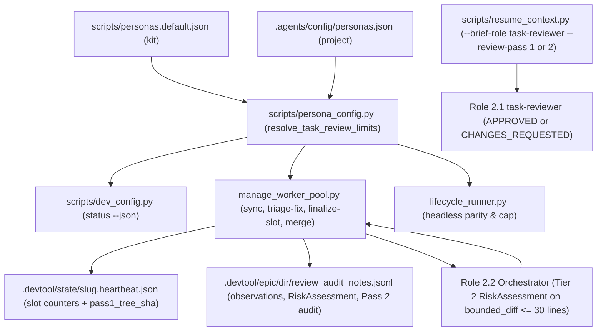
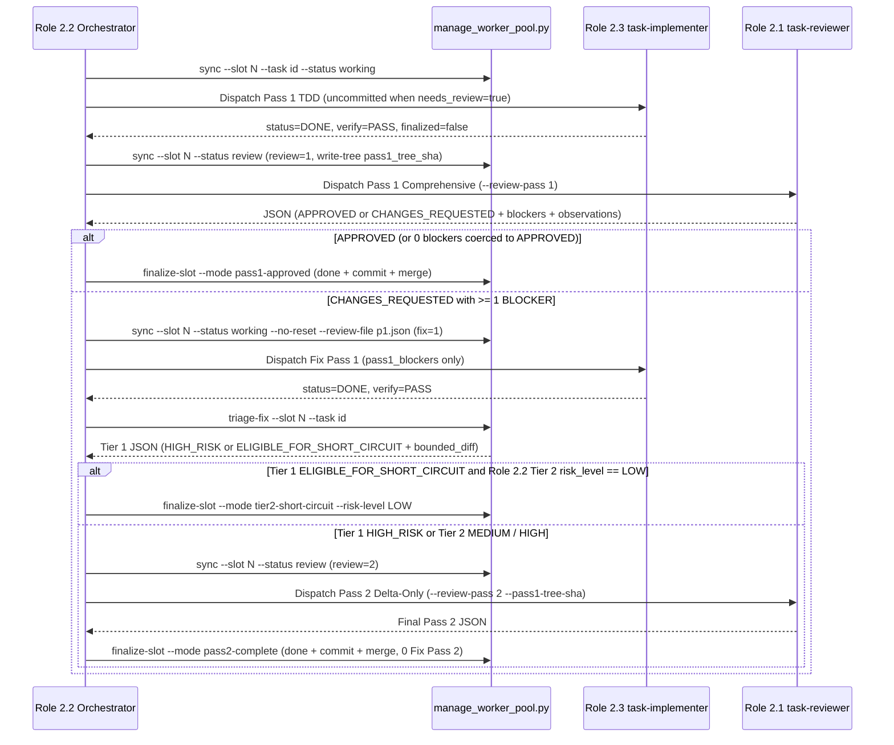

# Task Review Cap Blocker-Only Triage and Two-Tier Risk Short-Circuit High-Level Design

## Table of Contents

- [Meta Data](#meta-data)
- [Background](#background)
- [Goals and Non-Goals](#goals-and-non-goals)
- [Architecture and Technical Design](#architecture-and-technical-design)
- [Feature Maintenance Map](#feature-maintenance-map)
- [Module Contracts and CLI Interfaces](#module-contracts-and-cli-interfaces)
- [Impact Analysis](#impact-analysis)
- [Shared Contract Impact](#shared-contract-impact)
- [Integration Test Plan and Boundary Matrix](#integration-test-plan-and-boundary-matrix)
- [Verification Environment](#verification-environment)
- [Comprehensive BDD Scenario Coverage](#comprehensive-bdd-scenario-coverage)
- [Rollout Strategy and Mitigation](#rollout-strategy-and-mitigation)
- [Kanban Tasks Breakdown](#kanban-tasks-breakdown)
- [Spec Errata](#spec-errata)

## Meta Data

- **Epic name**: `review_cap_and_risk_triage`
- **Status**: Draft
- **PIC**: `nguyenhieu000690`
- **Target release**: Next plugin release
- **Platform**: Python 3 CLI tooling, Markdown skills and governance rules (`ai-agent-tools`)
- **Depends on epic**: none
- **Source Spec**: [Hard Review Cap Blocker-Only Triage and Two-Tier Risk Short-Circuit Design](2026-11-18-task-review-cap-and-risk-triage-design.md)

## Background

During recent 2-slot parallel task execution (`task_03` in `translation_studio_sync_and_standalone`), the `Role 2.1 (task-reviewer)` loop ran 4 review passes and 3 fix passes through `skills/dev-implementation/resources/scripts/manage_worker_pool.py`:

1. **Unbounded review/fix state transitions.** `manage_worker_pool.py::sync_slot` (`L331-L415`) updates `<epic_slug>.heartbeat.json` between `"working"` and `"review"` any number of times with zero counters or config-driven bounds, and `scripts/persona_config.py` (`L33-L43`, `L312-L339`) defines no task-review pass limits.
2. **No severity floor on `task-reviewer` rejections.** `scripts/resume_context.py` (`_BRIEF_ROLE_CONTRACTS["task-reviewer"]`, `L2246-L2252`), `skills/dev-implementation/SKILL.md` (`L159`, `L205-L206`), `skills/dev-lifecycle/references/orchestration-roles.md` (`L72`, `L82`), and `skills/dev-lifecycle/resources/scripts/lifecycle_runner.py` (`L1693-L1709`, `L1896-L1956`) emit a binary `PASS|FAIL` contract with a flat `findings` array, allowing incremental edge-case nitpicks to trigger repeated fix passes.
3. **Full-slot diff confusion and unconditional Pass 2 spawns.** When `needs_review` is `true`, `task-implementer` leaves Pass 1 changes uncommitted in the slot worktree (`finalized: false`) to preserve `run_task_checks.py` `patch_id`, and Fix Pass 1 edits the same uncommitted working tree (`sync --status working --no-reset`). Without a pre-fix Git tree snapshot, `git diff HEAD` measures the entire task rather than Fix Pass 1's delta, and every single-line remediation spawns a full `Role 2.1` subagent for Review Pass 2.

## Goals and Non-Goals

### Goals

- Enforce `"max_task_review_passes": 2` and `"max_fix_passes": 1` across `scripts/personas.default.json`, `.agents/config/personas.json`, `scripts/persona_config.py`, `scripts/dev_config.py`, `manage_worker_pool.py`, and `lifecycle_runner.py`.
- Capture an immutable pre-fix Git tree SHA (`pass1_tree_sha`) via a temporary `GIT_INDEX_FILE` + `git write-tree` during Pass 1 `sync --status review` without mutating `HEAD` or the real `.git/index`.
- Enforce strict `BLOCKER` vs. `NON_BLOCKING_OBSERVATION` severity triage in `Role 2.1 (task-reviewer)` briefs and parsers, backed by a mechanical Coercion Guard (`verdict: "CHANGES_REQUESTED"` with empty `blockers` -> `"APPROVED"`).
- Separate Pass 1 (Initial Comprehensive Audit) from Pass 2 (Delta-Only Verification over `git diff <pass1_tree_sha>`), prohibiting new Pass 2 nitpicks and finalizing to `done` + merge (with an audit note in `review_audit_notes.jsonl` if residual warnings remain) once Pass 2 completes with green mechanical gates.
- Introduce the Two-Tier Risk Assessment Gate after Fix Pass 1: Tier 1 deterministic heuristics (`manage_worker_pool.py triage-fix`) + Tier 2 in-place `Role 2.2` `RiskAssessment` (`LOW` -> short-circuit `finalize-slot` to `done` + merge; `MEDIUM`/`HIGH` -> Review Pass 2).

### Non-Goals

- Modifying Stage 2 `/principal-review` or Stage 3 `/cross-model-review` (`max_rounds = 3` in `run_external_review.py`).
- Bypassing selective `task-reviewer` gating (`needs_review == false`) or mechanical gates (`run_task_checks.py status` `done gate: PASS` and `check_bdd_traceability.py`).
- Touching unrelated uncommitted workspace state (`skills/check-quota/resources/dashboard/quota_dashboard.html` on `main` or `.worktrees/bg_task_watchdog_and_stall_detection`).

## Architecture and Technical Design

### High-Level Component Architecture



### Review Loop and Two-Tier Triage Sequence



## Feature Maintenance Map

| Capability | Canonical Entry Point | Paired Verification Suite |
|---|---|---|
| Review/fix pass config schema & resolution | `scripts/persona_config.py::resolve_task_review_limits` | `tests/test_trc_persona_limits.py` |
| Pass 1/Pass 2 `task-reviewer` prompt emitter | `scripts/resume_context.py::emit_handoff_prompt` | `tests/test_trc_reviewer_briefs_and_governance.py` |
| Role 2.2 bounded `triage-fix` governance rule | `skills/dev-lifecycle/references/orchestration-roles.md` | `tests/test_trc_reviewer_briefs_and_governance.py` |
| Slot hard-cap state machine & `pass1_tree_sha` | `skills/dev-implementation/resources/scripts/manage_worker_pool.py::sync_slot` | `tests/test_trc_worker_pool_triage.py` |
| Tier 1 heuristic diff gate (`triage-fix`) | `skills/dev-implementation/resources/scripts/manage_worker_pool.py::triage_fix_slot` | `tests/test_trc_worker_pool_triage.py` |
| Terminal slot commit, status sync & merge (`finalize-slot`) | `skills/dev-implementation/resources/scripts/manage_worker_pool.py::finalize_slot` | `tests/test_trc_worker_pool_triage.py` |
| Autonomous runner parity & kit verification registration | `skills/dev-lifecycle/resources/scripts/lifecycle_runner.py` & `scripts/verify.sh` | `tests/test_trc_runner_and_acceptance.py` |

## Module Contracts and CLI Interfaces

1. **`scripts/persona_config.py` & `scripts/dev_config.py`**:
   ```python
   DEFAULT_MAX_TASK_REVIEW_PASSES: int = 2
   DEFAULT_MAX_FIX_PASSES: int = 1

   def resolve_task_review_limits(
       project_root: Path,
       *,
       real_home: Path | str | None = None,
   ) -> tuple[int, int]: ...
   ```
   - `_ALLOWED_TOP_KEYS` adds `"max_task_review_passes"` and `"max_fix_passes"`.
   - `_validate_policy_and_low_quota(cfg)` validates `type(max_task_review_passes) is int and max_task_review_passes >= 1` and `type(max_fix_passes) is int and max_fix_passes >= 0` when present in merged config (seeded in `scripts/personas.default.json` and `.agents/config/personas.json`).
   - `dev_config.py status --json` includes `"task_review_limits": {"max_task_review_passes": 2, "max_fix_passes": 1}` alongside existing keys.

2. **`skills/dev-implementation/resources/scripts/manage_worker_pool.py`**:
   ```python
   HARD_CAP_EXIT_CODE: int = 2
   NON_TEST_DIFF_LINE_CAP: int = 30

   def normalize_task_review_payload(payload: Mapping[str, Any]) -> dict[str, Any]: ...
   def capture_slot_tree_sha(slot_path: Path, epic_dir: str) -> str: ...
   def triage_fix_slot(
       root: Path,
       epic_dir: str,
       epic_slug: str,
       slot: int,
       *,
       task_id: str | None = None,
   ) -> dict[str, Any]: ...
   def finalize_slot(
       root: Path,
       epic_dir: str,
       epic_slug: str,
       slot: int,
       task_id: str,
       *,
       mode: str = "pass1-approved",
       risk_level: str | None = None,
       rationale: str | None = None,
       review_payload: Mapping[str, Any] | None = None,
       active_wave: int | None = None,
       epic_worktree_root: Path | None = None,
   ) -> dict[str, Any]: ...
   ```
   - CLI extensions:
     - `sync`: idempotent for any pass (`Pass 1` or `Pass 2`) whenever `prev_status == status` and `effective_task_id == prev_task_id` (preserving counters across `model_unavailable`/`quota_low` stops and resumes); increments `review_passes_used` only when transitioning into `review` from another status (`Pass 2` requires `fix_passes_used >= 1`, and entering `review` from another status with `prev_review >= max_review_passes` exits `2` `HARD_REVIEW_CAP_EXCEEDED`), and increments `fix_passes_used` only when transitioning from `review` (`review_passes_used >= 1`) to `working --no-reset`. Adds optional `--review-file <json_path>` / `--blockers-file <json_path>`; exits `2` (`HARD_REVIEW_CAP_EXCEEDED`, `HARD_FIX_CAP_EXCEEDED`, `NO_BLOCKER_FOR_FIX_PASS`, or `NO_FIX_PASS_BEFORE_REVIEW_PASS_2`) when caps or preconditions fail.
     - `triage-fix`: `manage_worker_pool.py triage-fix <epic> --slot <N> [--task <id>] [--record-tier2 --risk-level <MEDIUM|HIGH> --rationale <text>]`. Computes `non_test_changed_lines = insertions + deletions` from `git diff --numstat <pass1_tree_sha> <curr_tree_sha>` (`[SE-03]`) and evaluates hunk lines with leading `+`/`-` markers stripped.
     - `finalize-slot`: `manage_worker_pool.py finalize-slot <epic> --slot <N> --task <id> [--wave <W>] [--mode <pass1-approved|tier2-short-circuit|pass2-complete>] [--risk-level <LOW>] [--rationale <text>] [--review-file <json_path>]`.
   - Audit-note commit & mirror isolation: `append_review_audit_note` writes `review_audit_notes.jsonl` exclusively in `main_wt` under `.devtool/epic/<epic_dir>/review_audit_notes.jsonl` (serialized under `.devtool/.memory.lock` and excluded from slot staging via `:!.devtool/epic/<epic_dir>/review_audit_notes*`) and immediately commits it on `main_wt` (`git add .devtool/epic/<epic_dir>/review_audit_notes.jsonl && git commit -m "[<EPIC_SLUG_UPPER>] Record review audit note for <task_id>"`, no trailers) so `/cross-model-review --base <ref>` sees every note on the epic branch and `integrate_branch.py` finds a clean worktree. Prior to `git merge`, `merge_slot` and `finalize_slot` restore tracked paths listed by `git diff --name-only -- .devtool/features .devtool/epic/<epic_dir>` with `git checkout --` and delete untracked files only under `.devtool/features` (`git ls-files --others --exclude-standard -- .devtool/features`, including `.devtool/features/done/<task_id>.md`) while never touching non-`.devtool/` files.

3. **`scripts/resume_context.py`**:
   - Adds CLI options `--review-pass {1,2}` (default `1`), `--pass1-tree-sha <sha>`, and `--blockers-file <path>` consumed when `--emit-prompt brief --brief-role task-reviewer` runs.
   - Updates `_BRIEF_ROLE_CONTRACTS["task-reviewer"]` schema to `'{"task_id": "...", "pass": 1, "verdict": "APPROVED|CHANGES_REQUESTED", "head_sha": "...", "done_gate": "PASS|FAIL", "blockers": [...], "observations": [...]}'` while preserving `"Role 2.1 AI Architect & Reviewer"`, `expected_ro_argv`, read-only boundaries, and zero `.vi.md` paths.
   - Updates `--emit-prompt implement` (`L2410-L2420`) pool command guidance to include `triage-fix` and `finalize-slot` while keeping `--emit-prompt principal-review` byte-identical (`[SE-02]`).

4. **`skills/dev-lifecycle/resources/scripts/lifecycle_runner.py`**:
   - Reads `(max_task_review_passes, max_fix_passes)` via `persona_config.resolve_task_review_limits`.
   - Evaluates `task-reviewer` output through `normalize_task_review_payload` (accepting `"APPROVED"`/`"PASS"` and coercing empty-blocker `"CHANGES_REQUESTED"`/`"FAIL"` when `done_gate == "PASS"`).
   - Emits Pass 2 Delta-Only instructions on the second review pass and finalizes the task to `done` (logging any residual remarks to `review_audit_notes.jsonl`) once Pass 2 finishes with `done_gate == "PASS"` and matching `head_sha`.

## Impact Analysis

Shift-left `check_code_impact.py --base-ref main` and downstream caller inspection identified all affected skill, prompt, and test modules:

- **Downstream skill and prompt callers updated in Task 2**:
  - `skills/subagent-driven-development/SKILL.md` (`L332-L365`), `skills/subagent-driven-development/task-reviewer-prompt.md` (`L180-L230`), and `skills/subagent-driven-development/re-review-prompt.md`: align task review / scoped re-review prompts and fix-loop instructions with the `max_task_review_passes = 2` / `max_fix_passes = 1` cap, `BLOCKER` vs. `NON_BLOCKING_OBSERVATION` rubric, and Pass 2 Delta-Only scope while keeping `"Critical"`, `"run_task_checks.py status"`, `"Role 2.1 AI Architect & Reviewer"`, and `"check_bdd_traceability.py"` required by `scripts/test_verifiable_handoff_text.py`.
  - `skills/dev-lifecycle/SKILL.md` (`L110-L115`, kept `<= 2500` words) and `skills/dev-lifecycle/references/handoff-template.md` (`L45-L80`): include `triage-fix` and `finalize-slot` in Orchestrator pool command lists alongside `sync`, `merge`, and `cleanup`.
- **Existing contract tests with strict size/substring guards**:
  - `tests/test_tto_docs_and_slimming.py`: enforces `len(CRITICAL_RULES.md) <= 8192` bytes (currently `8169` bytes — see `[SE-01]`), `dev-lifecycle/SKILL.md <= 2500` words, and `dev-implementation/SKILL.md <= 4500` words.
  - `tests/test_fpg_governance_text.py`: enforces `"APPROVED" not in rule_6` inside `rules/CRITICAL_RULES.md`, mandatory reference pointers in `dev-implementation/SKILL.md`, and exact byte-identity of `resume_context.py --emit-prompt principal-review` against `docs/context-memory-quick-guide.en.md` (see `[SE-02]`).
  - `scripts/test_verifiable_handoff_text.py`, `scripts/test_lifecycle_document_contract.py`, `tests/test_rsdh_orchestration.py`, `tests/test_runtime_sync_and_dashboard_hardening.py`, `tests/test_fpg_english_only_text.py`, `tests/test_workflow_anti_rationalization.py`, and `tests/test_token_throttling_acceptance.py`: pin governance phrases across `CRITICAL_RULES.md`, `dev-implementation/SKILL.md`, `dev-lifecycle/SKILL.md`, `handoff-template.md`, and `subagent-driven-development/*` (all included in Task 2 verification).
  - `tests/test_fpg_checkpoint_and_briefs.py` & `scripts/test_resume_context.py`: assert `task-reviewer` brief names `Role 2.1 AI Architect & Reviewer`, resolved read-only argv, `forbid`/`do NOT edit`, and omits `"mark \`done\` and commit"` and `".vi.md"`.
  - `tests/test_lifecycle_runner.py`, `tests/test_fpg_runner_personas.py`, & `skills/dev-implementation/resources/scripts/test_manage_worker_pool.py`: pass legacy `{"verdict": "PASS", "done_gate": "PASS"}` stubs and `sync --no-reset` transitions, which remain green via backward compatibility.
  - Historical snapshots `docs/architecture/resume_context.py` and gitignored `skill-observations/skill-updates/` require no edits.

## Shared Contract Impact

None — self-contained feature inside `ai-agent-tools` (`shared-contracts/` does not exist in this repository).

## Integration Test Plan and Boundary Matrix

Integration test roots: tests
Protected paths: .agents/quality/**, .devtool/epic/review_cap_and_risk_triage/bdd_scenarios.md
Integration results: python3 -m pytest -q --tb=short --maxfail=3 --junitxml=build/test-results/review-cap-and-risk-triage.xml tests/test_trc_persona_limits.py tests/test_trc_reviewer_briefs_and_governance.py tests/test_trc_worker_pool_triage.py tests/test_trc_runner_and_acceptance.py skills/dev-implementation/resources/scripts/test_manage_worker_pool.py tests/test_fpg_persona_config.py tests/test_fpg_checkpoint_and_briefs.py tests/test_fpg_governance_text.py tests/test_tto_docs_and_slimming.py tests/test_fpg_runner_personas.py tests/test_rsdh_orchestration.py tests/test_runtime_sync_and_dashboard_hardening.py tests/test_fpg_english_only_text.py tests/test_workflow_anti_rationalization.py -> build/test-results/review-cap-and-risk-triage.xml

| Boundary | Producer | Consumer | Verification Tier |
|---|---|---|---|
| Layered `max_task_review_passes` & `max_fix_passes` | `persona_config.py`, `personas.default.json`, `.agents/config/personas.json` | `manage_worker_pool.py`, `lifecycle_runner.py`, `dev_config.py` | Tier A Unit, Tier C CLI |
| Slot snapshot `pass1_tree_sha` & `triage-fix` JSON | `manage_worker_pool.py` | Role 2.2 Orchestrator, Role 2.1 Pass 2 brief | Tier A Unit, Tier C Git Worktree |
| Structured `task-reviewer` JSON & Coercion Guard | `resume_context.py`, Role 2.1 subagent | `manage_worker_pool.py`, `lifecycle_runner.py` | Tier A Unit, Tier C Runner |
| Terminal `finalize-slot` & `review_audit_notes.jsonl` | `manage_worker_pool.py` | Main epic branch, Gate 4/5 audit | Tier C Git Worktree & Concurrency |
| Governance Role 2.2 bounded exception & byte/word caps | `CRITICAL_RULES.md`, `orchestration-roles.md`, `dev-implementation/SKILL.md` | `test_fpg_governance_text.py`, `test_tto_docs_and_slimming.py`, `verify.sh` | Tier A Contract, Tier C Acceptance |

## Verification Environment

- **Data Isolation**: All unit and integration tests execute inside `pytest` `tmp_path` Git repositories with isolated `HOME`, `REAL_HOME`, and `WORKSPACE_ROOT` environment variables plus stub check scripts.
- **Forbidden Live Stores**: Tests never read or mutate the host `~/.d3nexus/`, `~/.gemini/`, `~/antigravity_homes/`, `~/.zshrc`, or real model CLIs.
- **Needs Variables**: None (`Needs: none`).

## Comprehensive BDD Scenario Coverage

All 18 scenarios (`TRC-HP-01`..`TRC-HP-04`, `TRC-EC-01`..`TRC-EC-04`, `TRC-ST-01`..`TRC-ST-04`, `TRC-AR-01`..`TRC-AR-03`, and `TRC-FR-01`..`TRC-FR-03`) are defined in [bdd_scenarios.md](bdd_scenarios.md) across Happy Path (`HP`), Edge Cases (`EC`), State Transitions (`ST`), Architecture and Concurrency (`AR`), and Fault Resilience (`FR`).

## Rollout Strategy and Mitigation

- **Wave Plan (2-Slot Worker Pool)**:
  - **Wave 1 (Parallel)**: `Task 01` (Persona config limits) + `Task 02` (Reviewer briefs & governance text) — disjoint `Allowed files`.
  - **Wave 2**: `Task 03` (`manage_worker_pool.py` state machine, `pass1_tree_sha`, `triage-fix`, `finalize-slot`) — consumes `Task 01`'s `resolve_task_review_limits`.
  - **Wave 3**: `Task 04` (`lifecycle_runner.py` parity, `scripts/verify.sh` suite registration, and end-to-end Tier C acceptance) — consumes `Tasks 01, 02, 03`.
- **Dirty File Isolation on `main`**: Stage 3 creates an isolated epic worktree `.worktrees/review_cap_and_risk_triage` branched from `main` `HEAD` without touching `skills/check-quota/resources/dashboard/quota_dashboard.html`.

## Kanban Tasks Breakdown

1. **[Task 01: Persona Config Review and Fix Pass Limits](task_01_persona_config_task_review_limits.md)** (`review_tier: "full"`) — Covers: `TRC-HP-01`, `TRC-EC-01`, `TRC-FR-01`
2. **[Task 02: Blocker-Only Reviewer Briefs Pass 2 Delta Prompt and Role 2.2 Governance Exception](task_02_reviewer_briefs_and_governance_exception.md)** (`review_tier: "full"`) — Covers: `TRC-HP-02`, `TRC-AR-01`
3. **[Task 03: Worker Pool Hard Cap Git-Tree Snapshot and Two-Tier Risk Triage CLI](task_03_worker_pool_cap_snapshot_and_triage.md)** (`review_tier: "full"`, Blocked by Task 01) — Covers: `TRC-HP-03`, `TRC-EC-02`, `TRC-EC-03`, `TRC-EC-04`, `TRC-ST-01`, `TRC-ST-02`, `TRC-ST-03`, `TRC-AR-02`, `TRC-AR-03`, `TRC-FR-02`
4. **[Task 04: Lifecycle Runner Parity verify.sh Registration and End-to-End Acceptance](task_04_runner_parity_and_acceptance.md)** (`review_tier: "full"`, Blocked by Tasks 01, 02, 03) — Covers: `TRC-HP-04`, `TRC-ST-04`, `TRC-FR-03`

## Spec Errata

- **[SE-01] §8.1 `rules/CRITICAL_RULES.md` 8192-Byte Cap and Rule 6 Invariant**: `tests/test_tto_docs_and_slimming.py::test_tto_hp_05_slimmed_rules_and_skills_caps` enforces `len(CRITICAL_RULES.md) <= 8192` UTF-8 bytes (currently `8169` bytes), and `tests/test_fpg_governance_text.py` asserts `"APPROVED" not in rule_6`. Accordingly, Rule 6 in `rules/CRITICAL_RULES.md` stays untouched (it governs external reviews only), Rule 8.2 adds the compact parenthetical `(except triage-fix bounded output)` while trimming redundant words in Rule 8 to keep `CRITICAL_RULES.md <= 8192` bytes, and the full Tier 1/Tier 2 protocol lives in `skills/dev-lifecycle/references/orchestration-roles.md` and `skills/dev-lifecycle/references/governance-checklists.md`.
- **[SE-02] §6.4 Preserving `resume_context.py --emit-prompt principal-review` Byte Identity**: `tests/test_fpg_governance_text.py::test_fpg_context_guide_principal_review_prompt_matches_emitter` asserts exact string equality between `emit_handoff_prompt("principal-review", ...)` and `docs/context-memory-quick-guide.en.md`. New flags (`--review-pass`, `--pass1-tree-sha`, `--blockers-file`) affect `mode == "brief"` (`brief_role == "task-reviewer"`), and `mode == "implement"` adds `triage-fix`/`finalize-slot` pool guidance, while `principal-review` stays byte-identical.
- **[SE-03] §7.1 Tree-Versus-Tree Diff for `triage-fix` and Committed `main_wt`-Only Audit Notes**: Spec §7.1 writes `git diff --unified=0 <pass1_tree_sha>`, which omits newly created untracked files added during Fix Pass 1, and Spec §9 writes `review_audit_notes.jsonl` inside slots where parallel merges would collide. `triage-fix` instead snapshots the post-fix slot working tree into a second temporary-index Git tree `<curr_tree_sha>` and diffs `<pass1_tree_sha>..<curr_tree_sha>` (`--numstat` + `--unified=0` with `+`/`-` stripped for regex checks), while `review_audit_notes.jsonl` is appended exclusively in `main_wt` under `.devtool/.memory.lock`, excluded from slot commits, and immediately committed in `main_wt` (`[<EPIC_SLUG_UPPER>] Record review audit note for <task_id>`) so `/cross-model-review` sees it on the epic branch and `integrate_branch.py` sees a clean worktree.
