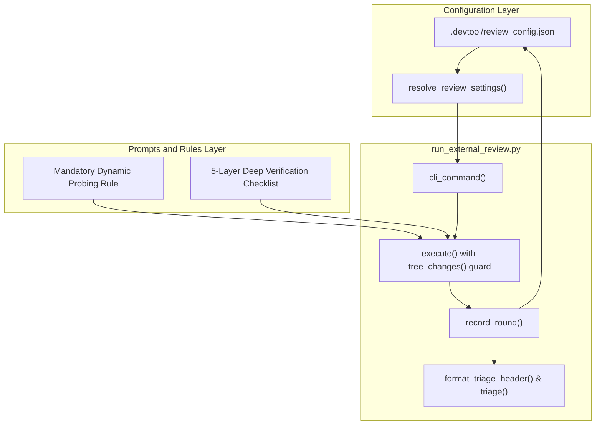
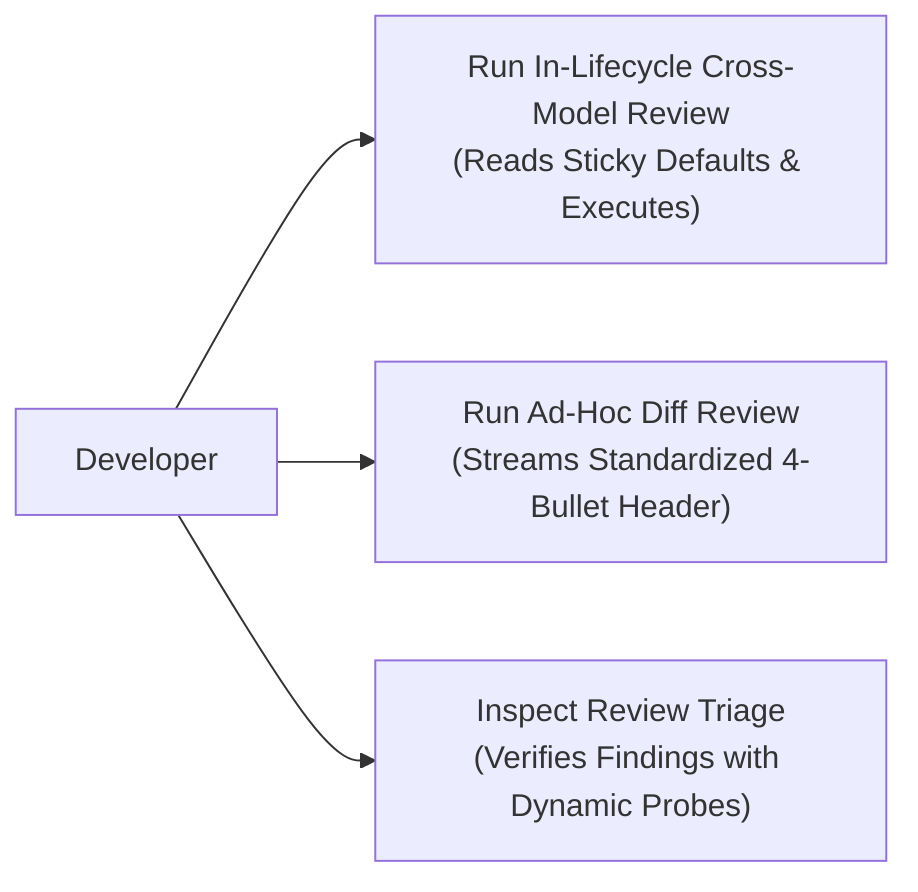
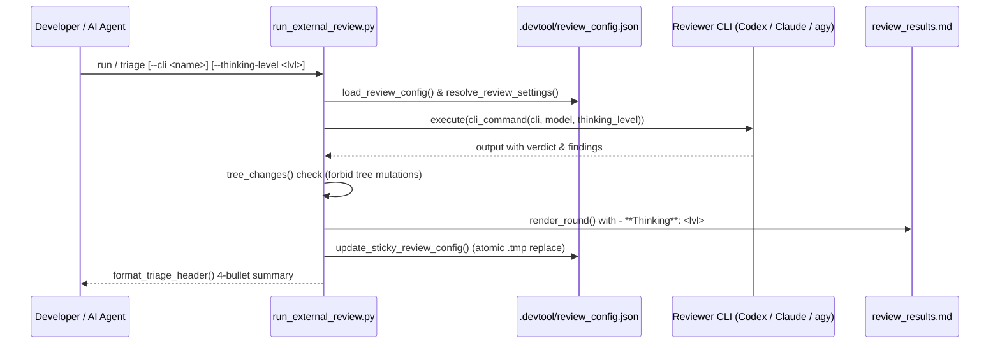

# Review Triage Standardization High-Level Design

## Table of Contents

- [Meta Data](#meta-data)
- [Background](#background)
- [Goals and Non-Goals](#goals-and-non-goals)
- [Architecture and Technical Design](#architecture-and-technical-design)
- [Integration Test Plan and Boundary Matrix](#integration-test-plan-and-boundary-matrix)
- [Verification Environment](#verification-environment)
- [Shared Contract Impact](#shared-contract-impact)
- [Comprehensive BDD Scenario Coverage](#comprehensive-bdd-scenario-coverage)
- [Rollout Strategy and Mitigation](#rollout-strategy-and-mitigation)
- [Kanban Tasks Breakdown](#kanban-tasks-breakdown)

## Meta Data

- **Epic name**: `review_triage_standardization`
- **Status**: In Progress
- **Target release**: Next plugin release (1.18.0)
- **Platform**: Python tooling / agent skill kit
- **Source Spec**: [Approved Review Triage Header and Provider Defaults Design](2026-10-31-review-triage-header-and-provider-defaults-design.en.md)

## Background

Review triage presentations across `/principal-review` (Shift-Left design verification) and `/cross-model-review` (Shift-Right code verification) currently exhibit minor discrepancies across model CLIs, triage tables, and conversational agent summaries. Specifically:
1. Review summaries lacked a unified 4-bullet header identifying Candidate SHA, Reviewer (`CLI ( Model )`), Thinking Level, and Verdict with finding counts.
2. Review runners did not persist sticky per-provider default configurations (`.devtool/review_config.json`), requiring redundant flag specifications or colliding between different model names (e.g. Codex model names colliding with Claude).
3. The prompt harness lacked an explicit Dynamic Probing mandate, causing static-only inspection in read-only models that missed runtime exception unbound variables, morphological token deformations, and database statement flush order bugs.
4. Reviewer rules lacked the senior reviewer 5-layer verification checklist (Unbound Variable in Fallback, Part-of-Speech Ambiguity, ORM Flush Semantics, Interactive Contract Boundary, Fixture Schema Sanity).

This epic standardizes the review triage presentation, seeds and persists per-provider preferences, equips Claude CLI with `--dangerously-skip-permissions` (guarded by `tree_changes`), and establishes dynamic probing and the 5-layer senior verification rules across all review skills.

## Goals and Non-Goals

### Goals

- Enforce a standard 4-bullet header across all review modes (`triage`, `run`, `run_adhoc_code`, and conversational summaries):
  - `• Candidate SHA: <commit_sha>`
  - `• Reviewer: <CLI> ( <model> )`
  - `• Thinking Level: <Light | Low | Medium | High | Extra High | None>`
  - `• Verdict: <VERDICT> (<count> <Severity> findings)`
- Seed and persist per-provider preferences in `.devtool/review_config.json` with sticky memory:
  - Claude: `Opus 5.5` (high)
  - Codex: `gpt-6.1-sol` (high)
  - agy: `Gemini 4 Argon (Medium)` (medium)
  - ollama: `qwen38-fast:latest` (high)
  - Default provider: `codex`
- Translate `--thinking-level` (`none`, `light`, `low`, `medium`, `high`, `extra-high`) to CLI execution flags (`--effort` for Claude, `-c model_reasoning_effort="<level>"` for Codex).
- Enable Claude CLI read-only dynamic probes by invoking `--dangerously-skip-permissions` while enforcing zero tree mutation via `tree_changes(root, before, sha)`.
- Embed `## Mandatory Dynamic Probing Rule` and the `5-Layer Deep Verification Checklist` into review prompts and rules in English.

### Non-Goals

- Bypassing human review choice checkpoints or automated sign-offs.
- Overwriting non-review configuration files in `.devtool/` or `.agents/`.
- Permitting review tools to mutate working tree files.

## Architecture and Technical Design

### High-Level Architecture

### Use Cases

### Sequence Diagram

## Integration Test Plan and Boundary Matrix

Integration test roots: skills/dev-implementation/resources/scripts/

Protected paths: .agents/quality/**, .devtool/epic/review_triage_standardization/bdd_scenarios.en.md, .devtool/epic/review_triage_standardization/bdd_scenarios.vi.md

Integration results: python3 scripts/run_unittest_junit.py --junitxml build/test-results/run-external-review.xml skills/dev-implementation/resources/scripts/test_run_external_review.py -> build/test-results/run-external-review.xml

| Component | Test File | Test Case | Target Boundary |
|---|---|---|---|
| Review Config & Defaults | `test_run_external_review.py` | `test_default_config_resolution_and_persistence` | Canonical defaults generation and sticky update in `.devtool/review_config.json` |
| Codex Reasoning Effort | `test_run_external_review.py` | `test_codex_thinking_level_arguments` | Maps `--thinking-level` to `-c model_reasoning_effort=...` |
| Claude Flags & Permissions | `test_run_external_review.py` | `test_claude_thinking_level_arguments` | Maps `--thinking-level` to `--effort` with `--dangerously-skip-permissions` |
| 4-Bullet Header Format | `test_run_external_review.py` | `test_standardized_4_bullet_header_in_triage` | Triage output verifies Candidate SHA, Reviewer, Thinking Level, and Verdict |
| Release Harness Gate | `test_local_review.py` | `test_lmr_hp_08_triage_lists_every_finding_of_the_latest_round` | Local review suite and verify harness compatibility |

## Verification Environment

- **Runtime**: Python 3.10+ (Standard Library only: `argparse`, `json`, `pathlib`, `re`, `subprocess`, `unittest`, `tempfile`).
- **Isolation**: Unit tests execute against mock CLI binaries inside isolated `tempfile.TemporaryDirectory()` workspaces with zero network access.
- **Environment Variables (`Needs`)**: None (`—`).
- **Test Command**: `python3 -m unittest skills/dev-implementation/resources/scripts/test_run_external_review.py`
- **Harness Gate**: `bash scripts/verify.sh` executes all 15 quality checks across the entire repository.

## Shared Contract Impact

`None — self-contained developer tooling skill (operates on review harness, prompts, and config files)`.

## Comprehensive BDD Scenario Coverage

Full Gherkin test scenarios covering Happy Paths, Edge Cases, State Transitions, Async Concurrency, and Failures are documented in:
- English (Canonical): [bdd_scenarios.en.md](bdd_scenarios.en.md)
- Vietnamese: [bdd_scenarios.vi.md](bdd_scenarios.vi.md)

Scenario IDs use prefix `[RTS-` (`[RTS-HP-01]` through `[RTS-FR-02]`).

## Rollout Strategy and Mitigation

- **Rollout**: Immediate local deployment across installed plugin caches for Claude, Codex, and Antigravity.
- **Backward Compatibility**: If `.devtool/review_config.json` is missing or corrupted, the runner reverts cleanly to canonical baseline defaults without halting.
- **Safety**: Claude dynamic probes operate under strict working tree monitoring (`tree_changes`), ensuring read-only safety.

## Kanban Tasks Breakdown

- [Task 1: Review Config Persistence and Sticky Defaults](task_1_review_config_and_sticky_defaults.md)
- [Task 2: Dynamic Probing Mandate and Senior Review Rules](task_2_dynamic_probing_and_senior_review_rules.md)
- [Task 3: Standardize 4-Bullet Triage Header](task_3_standardize_4_bullet_triage_header.md)
