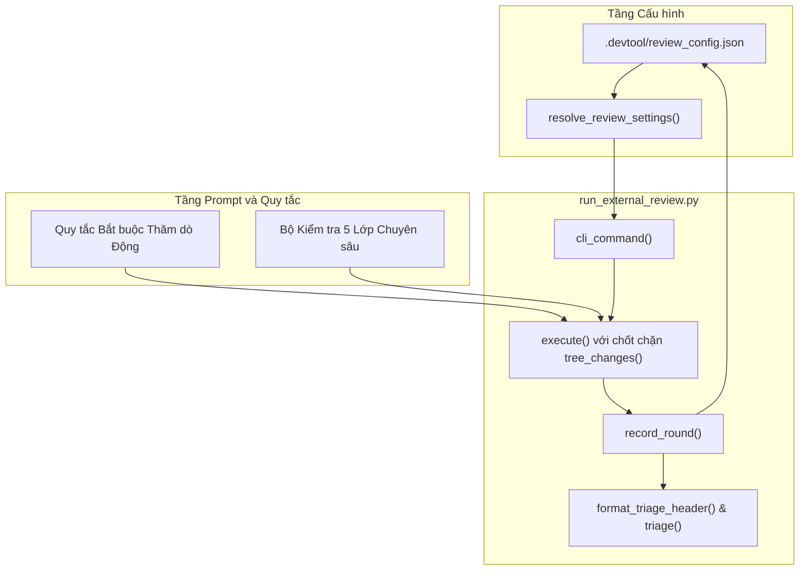
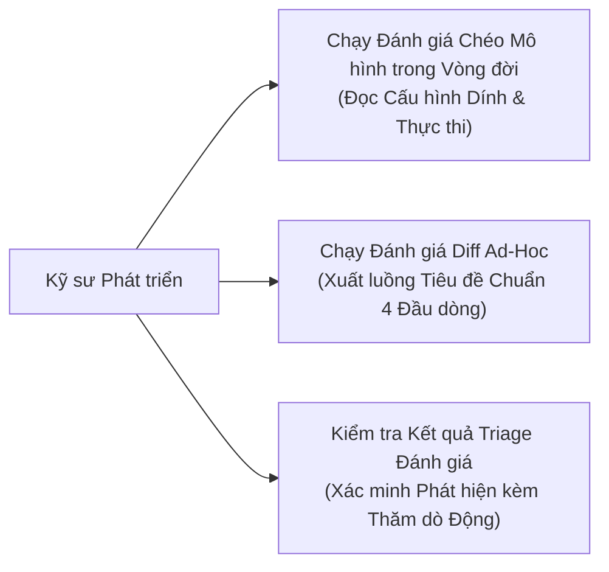
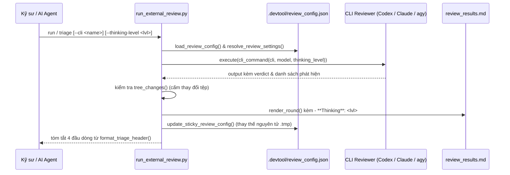

# Thiết Kế Cấp Cao Chuẩn Hóa Triage Đánh Giá (Review Triage Standardization)

## Mục lục

- [Thông tin Meta](#thông-tin-meta)
- [Bối cảnh](#bối-cảnh)
- [Mục tiêu và Ngoài phạm vi](#mục-tiêu-và-ngoài-phạm-vi)
- [Kiến trúc và Thiết kế Kỹ thuật](#kiến-trúc-và-thiết-kế-kỹ-thuật)
- [Kế hoạch Kiểm thử Tích hợp và Ma trận Biên giới](#kế-hoạch-kiểm-thử-tích-hợp-và-ma-trận-biên-giới)
- [Môi trường Kiểm chứng](#môi-trường-kiểm-chứng)
- [Tác động Hợp đồng Dùng chung](#tác-động-hợp-đồng-dùng-chung)
- [Phạm vi Kịch bản BDD Toàn diện](#phạm-vi-kịch-bản-bdd-toàn-diện)
- [Chiến lược Triển khai và Giảm thiểu Rủi ro](#chiến-lược-triển-khai-và-giảm-thiểu-rủi-ro)
- [Phân rã Công việc Kanban](#phân-rã-công-việc-kanban)

## Thông tin Meta

- **Tên Epic**: `review_triage_standardization`
- **Trạng thái**: Done
- **Bản phát hành mục tiêu**: Bản phát hành plugin tiếp theo (1.18.0)
- **Nền tảng**: Python tooling / bộ công cụ agent skill
- **Tài liệu đặc tả nguồn**: [Đặc tả Thiết kế Tiêu đề Triage Đánh giá và Cấu hình Mặc định Provider](2026-10-31-review-triage-header-and-provider-defaults-design.vi.md)

## Bối cảnh

Việc trình bày kết quả phân loại (triage) đánh giá giữa `/principal-review` (kiểm chứng thiết kế Shift-Left) và `/cross-model-review` (kiểm chứng mã nguồn Shift-Right) trước đây tồn tại một số điểm không đồng nhất giữa các CLI mô hình, bảng triage và tóm tắt của AI Agent:
1. Bản tóm tắt đánh giá thiếu phần tiêu đề 4 gạch đầu dòng chuẩn hóa xác định Candidate SHA, Reviewer (`CLI ( Model )`), Thinking Level và Verdict kèm số lượng phát hiện.
2. Bộ chạy đánh giá chưa ghi nhớ các cấu hình mặc định dính (sticky memory) theo từng provider (`.devtool/review_config.json`), dẫn tới việc phải gõ lại flag hoặc xung đột tên model giữa các provider (ví dụ tên model Codex xung đột khi chuyển sang Claude).
3. Harness prompt thiếu mệnh lệnh Bắt buộc Thăm dò Động (Dynamic Probing), khiến các mô hình chỉ phân tích tĩnh trên văn bản diff mà bỏ sót biến chưa gán trong fallback ngoại lệ, biến dạng hình thái từ và xung đột thứ tự flush cơ sở dữ liệu.
4. Quy tắc reviewer còn thiếu bộ quy tắc kiểm tra 5 lớp của senior reviewer (Biến chưa gán trong Fallback, Nhập nhằng Từ loại, Ngữ nghĩa Flush ORM, Biên giới Hợp đồng Tương tác, Hợp lệ Schema Fixture).

Epic này chuẩn hóa định dạng hiển thị triage, khởi tạo và ghi nhớ cấu hình theo từng provider, cấp quyền `--dangerously-skip-permissions` an toàn cho Claude CLI (được giám sát bởi `tree_changes`), đồng thời thiết lập quy tắc thăm dò động và 5 lớp kiểm chứng chuyên sâu xuyên suốt các skill review.

## Mục tiêu và Ngoài phạm vi

### Mục tiêu

- Thực thi tiêu đề chuẩn 4 gạch đầu dòng trên toàn bộ các chế độ review (`triage`, `run`, `run_adhoc_code`, và tóm tắt hội thoại của AI Agent):
  - `• Candidate SHA: <commit_sha>`
  - `• Reviewer: <CLI> ( <model> )`
  - `• Thinking Level: <Light | Low | Medium | High | Extra High | None>`
  - `• Verdict: <VERDICT> (<count> <Severity> findings)`
- Khởi tạo và lưu trữ cấu hình theo provider trong `.devtool/review_config.json` với cơ chế sticky:
  - Claude: `Opus 5.5` (high)
  - Codex: `gpt-6.1-sol` (high)
  - agy: `Gemini 4 Argon (Medium)` (medium)
  - ollama: `qwen38-fast:latest` (high)
  - Provider mặc định: `codex`
- Chuyển đổi `--thinking-level` (`none`, `light`, `low`, `medium`, `high`, `extra-high`) sang các cờ thực thi của CLI tương ứng (`--effort` cho Claude, `-c model_reasoning_effort="<level>"` cho Codex).
- Mở quyền chạy probe động ở chế độ chỉ đọc cho Claude CLI bằng cờ `--dangerously-skip-permissions`, bảo vệ cây làm việc bằng kiểm tra `tree_changes(root, before, sha)`.
- Nhúng `## Mandatory Dynamic Probing Rule` và `5-Layer Deep Verification Checklist` vào prompt và rules bằng tiếng Anh.

### Ngoài phạm vi

- Bỏ qua các điểm kiểm tra lựa chọn đánh giá của con người (Review Choice checkpoints) hoặc tự động duyệt qua các cổng chất lượng.
- Ghi đè lên các tệp cấu hình không liên quan trong `.devtool/` hoặc `.agents/`.
- Cho phép các công cụ review sửa đổi cây tệp làm việc thực tế.

## Kiến trúc và Thiết kế Kỹ thuật

### Kiến trúc Cấp cao

### Các Trường hợp Sử dụng (Use Cases)

### Biểu đồ Trình tự (Sequence Diagram)

## Kế hoạch Kiểm thử Tích hợp và Ma trận Biên giới

Integration test roots: skills/dev-implementation/resources/scripts/

Protected paths: .agents/quality/**, .devtool/epic/review_triage_standardization/bdd_scenarios.en.md, .devtool/epic/review_triage_standardization/bdd_scenarios.vi.md

Integration results: python3 scripts/run_unittest_junit.py --junitxml build/test-results/run-external-review.xml skills/dev-implementation/resources/scripts/test_run_external_review.py -> build/test-results/run-external-review.xml

| Thành phần | Tệp Kiểm thử | Trường hợp Kiểm thử | Biên giới Mục tiêu |
|---|---|---|---|
| Review Config & Defaults | `test_run_external_review.py` | `test_default_config_resolution_and_persistence` | Khởi tạo cấu hình mặc định chuẩn và cập nhật dính trong `.devtool/review_config.json` |
| Codex Reasoning Effort | `test_run_external_review.py` | `test_codex_thinking_level_arguments` | Ánh xạ `--thinking-level` sang `-c model_reasoning_effort=...` |
| Claude Flags & Permissions | `test_run_external_review.py` | `test_claude_thinking_level_arguments` | Ánh xạ `--thinking-level` sang `--effort` kèm `--dangerously-skip-permissions` |
| 4-Bullet Header Format | `test_run_external_review.py` | `test_standardized_4_bullet_header_in_triage` | Đầu ra triage xác minh Candidate SHA, Reviewer, Thinking Level và Verdict |
| Release Harness Gate | `test_local_review.py` | `test_lmr_hp_08_triage_lists_every_finding_of_the_latest_round` | Bộ test local review và khả năng tương thích toàn bộ harness verify |

## Môi trường Kiểm chứng

- **Môi trường thực thi**: Python 3.10+ (Chỉ dùng thư viện chuẩn: `argparse`, `json`, `pathlib`, `re`, `subprocess`, `unittest`, `tempfile`).
- **Cách ly**: Các bài kiểm thử đơn vị chạy với mock CLI nhị phân bên trong không gian làm việc tạm thời `tempfile.TemporaryDirectory()` không cần kết nối mạng.
- **Biến môi trường phụ thuộc (`Needs`)**: Không (`—`).
- **Lệnh kiểm thử**: `python3 -m unittest skills/dev-implementation/resources/scripts/test_run_external_review.py`
- **Chốt chặn Harness**: `bash scripts/verify.sh` thực thi toàn bộ 15 khâu kiểm tra chất lượng của kho mã.

## Tác động Hợp đồng Dùng chung

`Không — bộ công cụ phát triển độc lập (hoạt động trên runner đánh giá, file prompt và tệp cấu hình)`.

## Phạm vi Kịch bản BDD Toàn diện

Chi tiết các kịch bản kiểm thử Gherkin đầy đủ bao phủ Happy Paths, Edge Cases, State Transitions, Async Concurrency, và Failures được lập tài liệu tại:
- Tiếng Anh (Chuẩn): [bdd_scenarios.en.md](bdd_scenarios.en.md)
- Tiếng Việt: [bdd_scenarios.vi.md](bdd_scenarios.vi.md)

Các mã kịch bản sử dụng tiền tố `[RTS-` (`[RTS-HP-01]` đến `[RTS-FR-02]`).

## Chiến lược Triển khai và Giảm thiểu Rủi ro

- **Triển khai**: Áp dụng ngay lập tức cho các cache plugin cục bộ của Claude, Codex và Antigravity.
- **Khả năng tương thích ngược**: Nếu `.devtool/review_config.json` bị thiếu hoặc hỏng định dạng, trình chạy sẽ tự động khôi phục về các giá trị chuẩn mặc định mà không dừng đột ngột.
- **An toàn**: Lệnh probe động của Claude hoạt động dưới sự giám sát chặt chẽ của `tree_changes`, đảm bảo tính an toàn chỉ đọc tuyệt đối.

## Phân rã Công việc Kanban

- [Task 1: Lưu trữ Cấu hình Đánh giá và Cấu hình Mặc định Dính](task_1_review_config_and_sticky_defaults.md)
- [Task 2: Mệnh lệnh Thăm dò Động và Quy tắc Đánh giá Chuyên sâu](task_2_dynamic_probing_and_senior_review_rules.md)
- [Task 3: Chuẩn hóa Tiêu đề Triage 4 Đầu dòng](task_3_standardize_4_bullet_triage_header.md)
