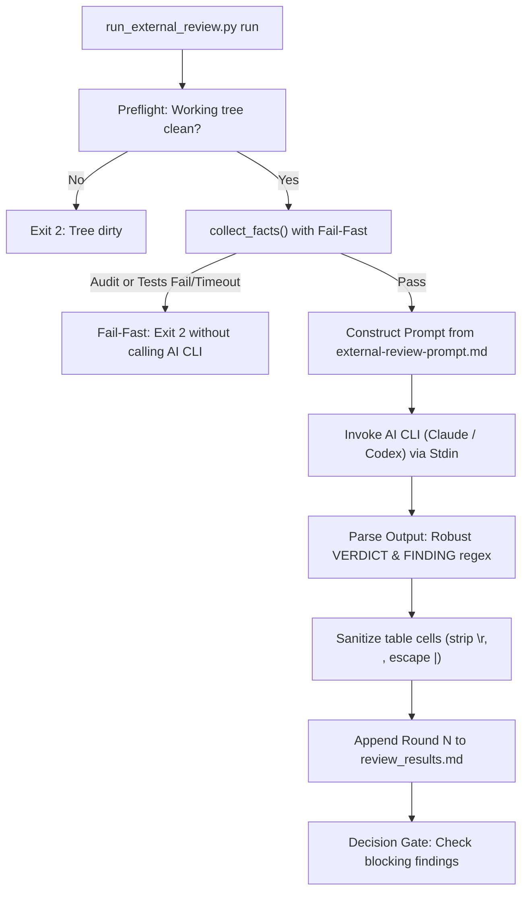

# Review Workflow Enhancements Design Spec

## Table of Contents

- [Executive Summary](#executive-summary)
- [Problem Statement and Motivation](#problem-statement-and-motivation)
- [Goals and Non-Goals](#goals-and-non-goals)
- [Architecture and System Design](#architecture-and-system-design)
  - [Module 1: Hardening run_external_review.py](#module-1-hardening-run_external_reviewpy)
  - [Module 2: Enhancing external-review-prompt.md](#module-2-enhancing-external-review-promptmd)
  - [Module 3: Anti-Pattern Prevention in Test Quality Rules](#module-3-anti-pattern-prevention-in-test-quality-rules)
  - [Module 4: Automated Contract Drift Detection Guidelines](#module-4-automated-contract-drift-detection-guidelines)
- [Verification and Testing Strategy](#verification-and-testing-strategy)
- [Rollout and Migration Plan](#rollout-and-migration-plan)

## Executive Summary

During real-world development cycles (such as the `learning_core` epic), the external cross-model review workflow (`run_external_review.py` invoking Claude Code CLI and OpenAI Codex CLI) proved vital for catching subtle contract deviations and schema mismatches. However, the process exposed critical runtime vulnerabilities in the review runner:
1. Overly strict regexes caused false "no verdict" crashes when AI models added Markdown bolding or headers.
2. Unparsed blocking heuristics flagged benign summary prose as Critical blockers.
3. Carriage returns (`\r`) broke Markdown review tables, halting downstream verification.
4. Absence of fail-fast behavior burned tokens and credits on broken builds.
5. Incomplete prompt context led reviewers to confuse Task-level verification with Gate 4 workspace governance and misunderstand compiled-language TDD RED semantics.

This specification designs comprehensive enhancements to the `dev-implementation` review infrastructure, prompt templates, and audit rules within the `ai-agent-tools` platform.

## Problem Statement and Motivation

The cross-model review stage acts as an automated governance checkpoint before Gate 4. The current implementation has several friction points:

1. **False Verdict Parsing Rejections**:
   Claude Code CLI frequently emits `**Verdict:** PASS`, `Verdict: **PASS**`, or `### Verdict: CHANGES REQUIRED`. The existing regex `^Verdict:\s*(PASS|CHANGES REQUIRED)\s*$` fails to match, resulting in `status = "no verdict"` (exit code 2), wasting several minutes and AI tokens.
2. **False-Positive Blocking Findings**:
   `UNPARSED_BLOCKING` matches any text containing `[Critical]` or `[Important]`. When a model politely writes *"I found 0 [Critical] or [Important] issues"*, the line is transformed into an unparsed Critical defect, causing `run()` to exit 1 despite a `Verdict: PASS`.
3. **Table Formatting Corruption via Control Characters**:
   `cell(text)` escapes `|` but preserves `\r` and `\n`. On multi-line error messages or CRLF environments, a single finding splits across lines, causing `check()` to report `unreadable findings row: len(cells) != 5`.
4. **Credit Waste on Broken Pre-conditions**:
   `collect_facts()` runs `audit_epic.py`, integration tests, and BDD traceability with the same global timeout (default 1800s). If `audit_epic.py` or integration tests hang or fail, the script still proceeds to invoke the AI CLI, burning money to review a known-broken build.
5. **Reviewer Scope Ambiguity**:
   The prompt lacks explicit instructions about architectural hierarchy. Independent reviewers frequently complain that individual task evidence does not execute the entire workspace profile (coverage, deny, WASM, acceptance), failing to understand that workspace-wide capabilities belong to Gate 4 (`@quality_check`), not individual task deliverables. Additionally, reviewers misclassify compilation failures on unimplemented functions as invalid TDD RED states.

## Goals and Non-Goals

### Goals
- Make `run_external_review.py` resilient to diverse LLM Markdown output formats.
- Eliminate false-positive blocking findings from conversational summary text.
- Sanitize Markdown table cells against control characters (`\r`, `\n`).
- Implement fail-fast execution in `collect_facts()` to prevent calling external AI CLIs on failing builds.
- Refactor `external-review-prompt.md` to instruct reviewers on verification hierarchy, compiled language TDD semantics, and code diff inspection.
- Document and enforce the anti-pattern rule prohibiting uncounted test iteration loops on build artifacts.

### Non-Goals
- Changing the fundamental review results state machine or Decision governance workflow (`fixed in <sha>` / `dismissed: <reason>`).
- Replacing Claude Code CLI or Codex CLI with custom API clients.
- Modifying underlying git worktree isolation or branch landing mechanics.

## Architecture and System Design



### Module 1: Hardening run_external_review.py

#### 1. Resilient Verdict Matching
The `VERDICT` regular expression is updated to tolerate optional Markdown headers (`#`, `##`, `###`), optional bold asterisks around the keyword and value, and whitespace:

```python
VERDICT = re.compile(
    r"^\s*(?:#+\s*)?\*{0,2}Verdict\*{0,2}:\s*\*{0,2}(PASS|CHANGES REQUIRED)\*{0,2}\s*$",
    re.IGNORECASE | re.MULTILINE
)
```

#### 2. Guarded Unparsed Blocking Detection
`UNPARSED_BLOCKING` is restricted to lines formatted as list items or bullets (`-`, `*`, `+`, `1.`):

```python
UNPARSED_BLOCKING = re.compile(
    r"^\s*(?:[-*+]|\d+[.)])\s+.*?\[\*{0,2}(Critical|Important)\*{0,2}\]",
    re.IGNORECASE
)
```
In `parse_findings()`, if the extracted verdict is `PASS` and no valid structured findings were matched, unparsed lines in prose paragraphs are ignored.

#### 3. Table Cell Sanitization
The `cell()` helper is updated to clean carriage returns and replace internal newlines with spaces before escaping pipe delimiters:

```python
def cell(text: str) -> str:
    cleaned = text.replace("\r", "").replace("\n", " ").strip()
    return cleaned.replace("|", "\\|")
```

#### 4. Fail-Fast Execution and Fact Timeout
`collect_facts()` is modified to enforce fail-fast behavior:
- Individual fact commands (audit, integration tests, traceability) receive a dedicated timeout (defaulting to 300 seconds per command, configurable via `--facts-timeout`).
- If `audit_epic.py` exits with non-zero or an integration test encounters a timeout (`code is None`), `collect_facts()` raises a `PreconditionFailedError`, printing the failing fact and terminating before calling `cli_command()`.

### Module 2: Enhancing external-review-prompt.md

`skills/dev-implementation/references/external-review-prompt.md` is updated to include a dedicated section:

```markdown
## Verification Hierarchy & Process Rules

To avoid false-positive findings, evaluate evidence against these architectural principles:

1. **Task-Level vs. Gate 4 Workspace Scope**:
   - Each task's `Verification` table is strictly scoped to that individual task's deliverables (e.g. documentation, domain models, or specific adapters).
   - Tasks are NOT required to execute workspace-wide profiles. Full workspace capabilities (coverage thresholds, security advisories/deny, FFI/WASM release builds, database hygiene, and end-to-end acceptance) belong exclusively to the platform-neutral **Gate 4 Quality Orchestrator (`@quality_check`)** evaluated on the final candidate SHA. Do not report task evidence as defective solely because it does not run the entire workspace epic profile.
2. **Compiled Language TDD RED Semantics**:
   - In compiled languages (Rust, Go, C++, etc.), the initial TDD RED phase for a new component or function is legitimately satisfied by a compilation failure or missing test target. A non-zero exit code prior to implementation code being written demonstrates a valid RED state.
3. **Artifact Budget Assertions**:
   - Verify that test assertions checking generated build artifacts (such as WASM binary size or exported types) strictly verify that the target artifact actually exists (avoiding vacuous false-PASS loops).
4. **Contract Drift Inspection**:
   - Check whether code constants, default parameters, and enum variants match the published API reference documentation and cross-epic integration contracts without divergence.
```

### Module 3: Anti-Pattern Prevention in Test Quality Rules

When auditing test suites, an explicit heuristic is documented:
- **Anti-Pattern**: Iterating over candidate file paths and asserting conditions only `if path.exists()`, without asserting that at least one candidate was evaluated.
- **Remediation**: Maintain a count of evaluated artifacts and include `assert!(found > 0, "No release artifact found at candidates: {candidates:?}")`.

### Module 4: Automated Contract Drift Detection Guidelines

For projects exposing public domain models or configuration parameters:
- Specifications must document the canonical Rust/Kotlin/Dart source of truth for all default values and weights.
- Epic integration handoffs (such as D17 in `sync_s1_server`) must be cross-verified against the domain crate's `default_params()` or equivalents before freezing.

## Verification and Testing Strategy

1. **Unit Tests in `test_run_external_review.py`**:
   - Test verdict parsing with `**Verdict:** PASS`, `Verdict: **PASS**`, `### Verdict: CHANGES REQUIRED`.
   - Test that conversational summary sentences containing `[Critical]` are not misparsed into blocking findings.
   - Test that `cell()` removes `\r`, converts `\n` to space, and escapes pipes.
   - Test fail-fast abort when `audit_epic.py` fails.
2. **End-to-End Regression**:
   - Run `python3 -m unittest discover -s skills/dev-implementation/resources/scripts`.
   - Verify all 213+ unit tests pass cleanly.

## Rollout and Migration Plan

1. Stage 1: Approve this Design Spec.
2. Stage 2: Execute `dev-designer` to generate High-Level Design (HLD) and Kanban tasks.
3. Stage 3: Implement changes in an isolated worktree on `ai-agent-tools`.
4. Stage 4: Run full test suites, cross-model review, Gate 4 `@quality_check`, and merge to `main`.
