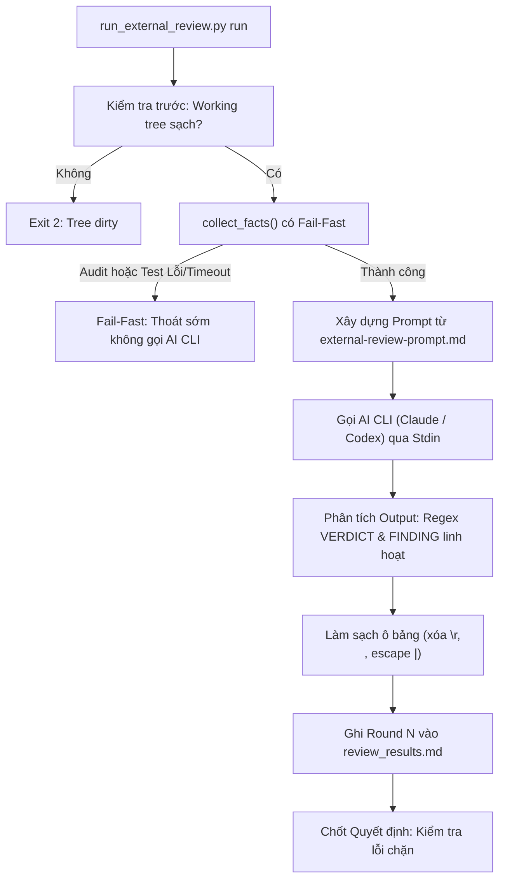

# Đặc tả Thiết kế Cải tiến Quy trình Review

## Mục lục

- [Tóm tắt Điều hành](#tóm-tắt-điều-hành)
- [Bối cảnh và Động lực](#bối-cảnh-và-động-lực)
- [Mục tiêu và Giới hạn Phạm vi](#mục-tiêu-và-giới-hạn-phạm-vi)
- [Kiến trúc và Thiết kế Hệ thống](#kiến-trúc-và-thiết-kế-hệ-thống)
  - [Module 1: Gia cố run_external_review.py](#module-1-gia-cố-run_external_reviewpy)
  - [Module 2: Nâng cấp external-review-prompt.md](#module-2-nâng-cấp-external-review-promptmd)
  - [Module 3: Ngăn chặn Anti-Pattern trong Quy tắc Chất lượng Kiểm thử](#module-3-ngăn-chặn-anti-pattern-trong-quy-tắc-chất-lượng-kiểm-thử)
  - [Module 4: Hướng dẫn Phát hiện Sai lệch Khế ước Tự động](#module-4-hướng-dẫn-phát-hiện-sai-lệch-khế-ước-tự-động)
- [Chiến lược Kiểm thử và Xác minh](#chiến-lược-kiểm-thử-và-xác-minh)
- [Kế hoạch Triển khai và Tích hợp](#kế-hoạch-triển-khai-và-tích-hợp)

## Tóm tắt Điều hành

Trong các chu kỳ phát triển thực tế (như epic `learning_core`), quy trình kiểm tra chéo độc lập (`run_external_review.py` gọi Claude Code CLI và OpenAI Codex CLI) đã chứng minh vai trò thiết yếu trong việc phát hiện các sai lệch khế ước và bất đồng bộ schema. Tuy nhiên, quá trình này cũng bộc lộ một số lỗ hổng runtime nghiêm trọng trong script thực thi:
1. Regex kết luận quá khắt khe khiến việc phân tích kết quả bị lỗi "no verdict" khi AI thêm định dạng in đậm hoặc tiêu đề Markdown.
2. Heuristic phát hiện lỗi chặn (unparsed blocking) nhận nhầm văn bản tóm tắt thông thường thành lỗi Critical nghiêm trọng.
3. Ký tự điều khiển xuống dòng (`\r`, `\n`) làm gãy bảng Markdown, khiến các bước kiểm tra tiếp theo bị dừng.
4. Thiếu cơ chế fail-fast dẫn đến việc lãng phí token và credit khi gọi AI review một bản build vốn đã hỏng từ trước.
5. Ngữ cảnh prompt chưa làm rõ phân cấp giữa kiểm thử cấp Task và kiểm định cấp Workspace (Gate 4), cũng như ngữ nghĩa TDD RED của ngôn ngữ biên dịch.

Tài liệu đặc tả này thiết kế các cải tiến toàn diện cho hạ tầng review `dev-implementation`, template prompt và quy tắc audit chất lượng trong nền tảng `ai-agent-tools`.

## Bối cảnh và Động lực

Giai đoạn kiểm tra chéo độc lập đóng vai trò chốt chặn quản trị trước Gate 4. Việc triển khai hiện tại gặp phải các điểm ma sát sau:

1. **Từ chối Phân tích Kết luận do Sai lệch Định dạng**:
   Claude Code CLI thường xuất ra `**Verdict:** PASS`, `Verdict: **PASS**`, hoặc `### Verdict: CHANGES REQUIRED`. Regex hiện tại `^Verdict:\s*(PASS|CHANGES REQUIRED)\s*$` không khớp, dẫn đến `status = "no verdict"` (exit code 2), lãng phí thời gian và token AI.
2. **Báo động giả Lỗi Chặn (False-Positive Blocking)**:
   `UNPARSED_BLOCKING` quét bất kỳ dòng nào chứa `[Critical]` hoặc `[Important]`. Khi model phản hồi lịch sự: *"I found 0 [Critical] or [Important] issues"*, dòng này bị chuyển thành một lỗi Critical chưa phân tích, khiến `run()` trả về exit code 1 dù kết luận là `Verdict: PASS`.
3. **Lỗi Định dạng Bảng do Ký tự Điều khiển**:
   Hàm `cell(text)` chỉ escape `|` nhưng giữ nguyên `\r` và `\n`. Khi gặp output từ môi trường Windows (CRLF) hoặc log nhiều dòng, một finding bị gãy đôi, làm hàm `check()` báo lỗi `unreadable findings row: len(cells) != 5`.
4. **Lãng phí Chi phí Gọi AI trên Build Hỏng**:
   `collect_facts()` thực thi `audit_epic.py`, integration test và BDD traceability với cùng một timeout chung (mặc định 1800s). Nếu `audit_epic.py` hoặc integration test bị treo hoặc fail, script vẫn tiếp tục gọi AI CLI, lãng phí chi phí gọi LLM vào đọc log lỗi.
5. **Mơ hồ về Phạm vi Thẩm quyền của Reviewer**:
   Prompt thiếu chỉ dẫn về phân cấp kiến trúc. Các reviewer độc lập thường xuyên phàn nàn rằng bằng chứng của từng task không chạy toàn bộ profile epic (coverage, deny, WASM, acceptance), mà không hiểu rằng các năng lực cấp workspace thuộc thẩm quyền của Gate 4 (`@quality_check`), không phải của từng task lẻ. Ngoài ra, reviewer cũng hiểu sai lỗi biên dịch khi hàm chưa được viết là pha TDD RED không hợp lệ.

## Mục tiêu và Giới hạn Phạm vi

### Mục tiêu
- Giúp `run_external_review.py` linh hoạt trước các định dạng Markdown đa dạng của LLM.
- Loại bỏ hoàn toàn báo động giả lỗi chặn từ văn bản tóm tắt thông thường.
- Làm sạch các ô trong bảng Markdown khỏi ký tự điều khiển (`\r`, `\n`).
- Cài đặt cơ chế fail-fast trong `collect_facts()` để ngăn gọi AI CLI khi build kiểm thử không đạt.
- Nâng cấp `external-review-prompt.md` để hướng dẫn reviewer về phân cấp kiểm thử, ngữ nghĩa TDD của ngôn ngữ biên dịch và việc kiểm tra git diff.
- Quy định và thực thi quy tắc chống anti-pattern vòng lặp kiểm tra artifact không đếm số lượng.

### Giới hạn Phạm vi
- Không thay đổi máy trạng thái cốt lõi của bảng kết quả review hay quy trình quản trị Decision (`fixed in <sha>` / `dismissed: <reason>`).
- Không thay thế Claude Code CLI hay Codex CLI bằng các client API tự viết.
- Không thay đổi cơ chế cô lập worktree hay quy trình merge nhánh của git.

## Kiến trúc và Thiết kế Hệ thống



### Module 1: Gia cố run_external_review.py

#### 1. Khớp Kết luận Linh hoạt
Cập nhật biểu thức chính quy `VERDICT` để chấp nhận tiêu đề Markdown tùy chọn (`#`, `##`, `###`), dấu sao in đậm tùy chọn quanh từ khóa và giá trị, cùng khoảng trắng linh hoạt:

```python
VERDICT = re.compile(
    r"^\s*(?:#+\s*)?\*{0,2}Verdict\*{0,2}:\s*\*{0,2}(PASS|CHANGES REQUIRED)\*{0,2}\s*$",
    re.IGNORECASE | re.MULTILINE
)
```

#### 2. Kiểm soát Nhận diện Lỗi Chặn Chưa Phân tích
`UNPARSED_BLOCKING` chỉ áp dụng cho các dòng có cấu trúc danh sách hoặc dấu đầu dòng (`-`, `*`, `+`, `1.`):

```python
UNPARSED_BLOCKING = re.compile(
    r"^\s*(?:[-*+]|\d+[.)])\s+.*?\[\*{0,2}(Critical|Important)\*{0,2}\]",
    re.IGNORECASE
)
```
Trong `parse_findings()`, nếu kết luận là `PASS` và không có finding cấu trúc hợp lệ nào khác, các dòng unparsed trong các đoạn văn xuôi sẽ được bỏ qua.

#### 3. Làm sạch Ô Bảng Markdown
Hàm `cell()` được nâng cấp để loại bỏ ký tự `\r` và thay thế ký tự `\n` bên trong bằng khoảng trắng trước khi escape dấu `|`:

```python
def cell(text: str) -> str:
    cleaned = text.replace("\r", "").replace("\n", " ").strip()
    return cleaned.replace("|", "\\|")
```

#### 4. Thực thi Fail-Fast và Quản lý Timeout
Điều chỉnh `collect_facts()` để áp dụng cơ chế fail-fast:
- Các lệnh thu thập thông tin (audit, integration test, traceability) được gán timeout riêng (mặc định 300 giây mỗi lệnh, có thể cấu hình qua `--facts-timeout`).
- Nếu `audit_epic.py` trả về exit code khác 0 hoặc test bị timeout (`code is None`), `collect_facts()` kích hoạt lỗi điều kiện tiên quyết, in thông tin lỗi và dừng ngay trước khi gọi `cli_command()`.

### Module 2: Nâng cấp external-review-prompt.md

Bổ sung một mục chuyên biệt vào `skills/dev-implementation/references/external-review-prompt.md`:

```markdown
## Verification Hierarchy & Process Rules

To avoid false-positive findings, evaluate evidence against these architectural principles:

1. **Task-Level vs. Gate 4 Workspace Scope**:
   - Each task's `Verification` table is strictly scoped to that individual task's deliverables (e.g. documentation, domain models, or specific adapters).
   - Tasks are NOT required to execute workspace-wide profiles. Full workspace capabilities (coverage thresholds, security advisories/deny, FFI/WASM release builds, database hygiene, and end-to-end acceptance) belong exclusively to the platform-neutral **Gate 4 Quality Orchestrator (`@quality_check`)** evaluated on the final candidate SHA. Do not report task evidence as defective solely because it does not run the entire workspace epic profile.
2. **Compiled Language TDD RED Semantics**:
   - In compiled languages (Rust, Go, C++, etc.), the initial TDD RED phase for a new component or function is legitimately satisfied by a compilation failure or missing test target. A non-zero exit code prior to implementation code being written demonstrates a valid RED state.
3. **Artifact Budget Assertions**:
   - Verify that test assertions checking generated build artifacts (such as WASM binary size or exported types) strictly verify that the target artifact actually exists (avoiding vacuous false-PASS loops).
4. **Contract Drift Inspection**:
   - Check whether code constants, default parameters, and enum variants match the published API reference documentation and cross-epic integration contracts without divergence.
```

### Module 3: Ngăn chặn Anti-Pattern trong Quy tắc Chất lượng Kiểm thử

Khi audit các bộ kiểm thử, tài liệu hóa quy tắc nhận diện:
- **Anti-Pattern**: Lặp qua danh sách đường dẫn candidate và chỉ assert điều kiện `if path.exists()`, mà không assert có ít nhất một candidate được kiểm tra.
- **Biện pháp khắc phục**: Duy trì biến đếm các artifact đã kiểm tra và bắt buộc có assertion `assert!(found > 0, "No release artifact found at candidates: {candidates:?}")`.

### Module 4: Hướng dẫn Phát hiện Sai lệch Khế ước Tự động

Đối với các dự án công bố domain model hoặc tham số cấu hình:
- Đặc tả phải nêu rõ nguồn chân lý duy nhất trong code (Rust/Kotlin/Dart) cho mọi hằng số và trọng số mặc định.
- Các phụ lục bàn giao liên epic (như D17 trong `sync_s1_server`) phải được đối chiếu chéo với `default_params()` của crate domain trước khi đóng băng.

## Chiến lược Kiểm thử và Xác minh

1. **Unit Tests trong `test_run_external_review.py`**:
   - Kiểm thử phân tích kết luận với `**Verdict:** PASS`, `Verdict: **PASS**`, `### Verdict: CHANGES REQUIRED`.
   - Kiểm thử các câu tóm tắt chứa `[Critical]` không bị nhận nhầm thành lỗi chặn unparsed.
   - Kiểm thử hàm `cell()` loại bỏ `\r`, chuyển `\n` thành khoảng trắng và escape dấu `|`.
   - Kiểm thử cơ chế fail-fast dừng sớm khi `audit_epic.py` thất bại.
2. **Kiểm tra Hồi quy Toàn diện**:
   - Thực thi `python3 -m unittest discover -s skills/dev-implementation/resources/scripts`.
   - Đảm bảo toàn bộ 213+ bài test đều PASS 100%.

## Kế hoạch Triển khai và Tích hợp

1. Giai đoạn 1: Phê duyệt Đặc tả Thiết kế này (Gate 1).
2. Giai đoạn 2: Kích hoạt `dev-designer` để sinh HLD và chia nhỏ Kanban tasks (Gate 2).
3. Giai đoạn 3: Thực thi code trên worktree độc lập của `ai-agent-tools`.
4. Giai đoạn 4: Chạy test suite, kiểm tra chéo, Gate 4 `@quality_check` và merge vào `main`.
