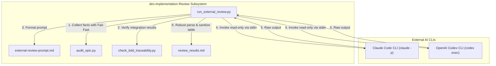
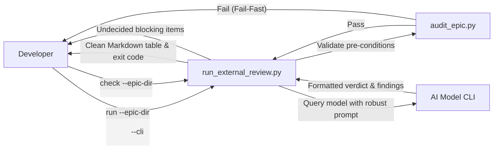
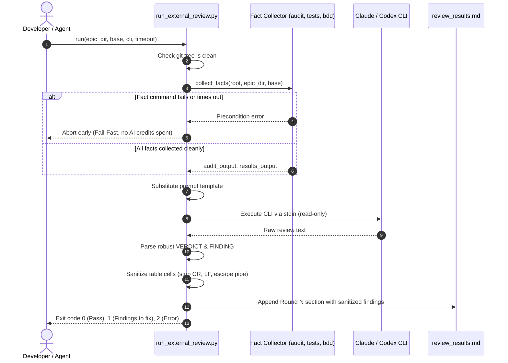

# Review Workflow Enhancements High-Level Design

## Table of Contents

- [Meta Data](#meta-data)
- [Background](#background)
- [Goals & Non-Goals](#goals--non-goals)
- [Architecture & Technical Design](#architecture--technical-design)
  - [High-Level Architecture](#high-level-architecture)
  - [Use Cases](#use-cases)
  - [Sequence Diagram](#sequence-diagram)
- [Integration Test Plan & Boundary Matrix](#integration-test-plan--boundary-matrix)
- [Verification Environment](#verification-environment)
- [Rollout & Migration Strategy](#rollout--migration-strategy)
- [Kanban Tasks Breakdown](#kanban-tasks-breakdown)

## Meta Data

- **Epic Name**: `review_workflow_enhancements`
- **Status**: Done
- **Target Release**: `v1.9.2`
- **Platform**: `Python`
- **Source Spec**: [2026-10-18-review-workflow-enhancements-design.en.md](2026-10-18-review-workflow-enhancements-design.en.md)

## Background

During actual end-to-end development of complex epics (such as `learning_core`), the cross-model review workflow implemented by `run_external_review.py` served as an indispensable gate before Gate 4. However, live execution against real LLM outputs (from Claude Code CLI and OpenAI Codex CLI) exposed critical operational vulnerabilities:
1. LLM formatting variations (Markdown bolding, headers, case) caused `VERDICT` parsing to fail, resulting in erroneous `status = "no verdict"` (exit code 2) and wasting developer time and API credits.
2. Unparsed blocking heuristics treated polite conversational sentences containing `[Critical]` or `[Important]` as fatal blocking defects.
3. Raw carriage returns (`\r`) or embedded newlines in finding texts broke Markdown table formatting, causing subsequent `check` runs to fail with unreadable rows.
4. Facts collection lacked fail-fast protection: when `audit_epic.py` failed or tests timed out, the runner proceeded to invoke expensive external AI models to review a broken build.
5. Reviewer prompts lacked explicit guidance on verification hierarchy (Task-level vs. Gate 4 Quality Orchestrator) and compiled language TDD RED semantics, leading to recurrent false-positive findings.

## Goals & Non-Goals

### Goals
- Harden `run_external_review.py` against diverse LLM Markdown output formats for verdicts and findings.
- Guard `UNPARSED_BLOCKING` against conversational false positives.
- Sanitize finding cells in Markdown tables against `\r` and `\n`.
- Introduce fail-fast and separated facts timeouts in `collect_facts()`.
- Refactor `external-review-prompt.md` to establish clear verification scope hierarchy, compiled language TDD semantics, and code diff inspection rules.
- Document and enforce test quality rules against uncounted artifact assertion loops.

### Non-Goals
- Changing the review state machine or Decision recording workflow (`fixed in <sha>` / `dismissed: <reason>`).
- Replacing CLI invocation with direct HTTP API wrappers.
- Altering git worktree isolation mechanics.

## Architecture & Technical Design

### High-Level Architecture

### Use Cases

### Sequence Diagram

## Integration Test Plan & Boundary Matrix

| Use Case / Scenario | Test Method | Boundary Condition | Expected Outcome |
|---|---|---|---|
| Robust Verdict Parsing | Unit Test | `**Verdict:** PASS`, `Verdict: **PASS**`, `### Verdict: CHANGES REQUIRED` | Matched cleanly, status `completed` |
| Bounding Unparsed Blocking | Unit Test | Model summary text: `"I found 0 [Critical] issues"` | Ignored, no false-positive unparsed finding |
| Table Cell Sanitization | Unit Test | Finding location or problem containing `\r`, `\n`, or `|` | Clean single-line cell, pipes escaped |
| Fail-Fast on Audit Error | Unit Test | `audit_epic.py` returns non-zero exit code | Aborts before calling CLI, exit 2 |
| Fail-Fast on Test Timeout | Unit Test | Integration test returns `code is None` | Aborts before calling CLI, exit 2 |
| Reviewer Prompt Scope | Contract Audit | Prompt template inspection | Contains verification hierarchy and TDD rules |
| Anti-pattern Detection | Guideline Audit | Heuristic check for uncounted artifact loops | Explicit `assert!(found > 0)` requirement documented |

Integration test roots: skills/dev-implementation/resources/scripts
Protected paths: .agents/quality/**, .devtool/epic/review_workflow_enhancements/bdd_scenarios.en.md, .devtool/epic/review_workflow_enhancements/bdd_scenarios.vi.md
Integration results: python3 scripts/run_unittest_junit.py --junitxml build/test-results/unit.xml skills/dev-implementation/resources/scripts/test_run_external_review.py -> build/test-results/unit.xml

## Verification Environment

- **Isolated Execution**: All unit tests run against ephemeral temporary directories and mock subprocesses.
- **Subprocess Safety**: Command executions use isolated process groups (`start_new_session=True`).
- **Dependencies**: Standard Python library only (`argparse`, `os`, `re`, `subprocess`, `unittest`).

## Rollout & Migration Strategy

1. Implement hardened parsing, sanitization, and fail-fast in `ai-agent-tools`.
2. Expand `test_run_external_review.py` to cover all regression cases.
3. Sync changes into the active plugin at `~/.gemini/config/plugins/d3nexus/`.
4. Run full test suites across `ai-agent-tools` and verify 100% green status.

## Kanban Tasks Breakdown

- [ ] **Task 1: Resilient Verdict and Finding Parsing**
  - Update `VERDICT` regex to support Markdown bolding, headings, and case insensitivity.
  - Guard `UNPARSED_BLOCKING` against non-list prose.
  - Add unit tests in `test_run_external_review.py`.
- [ ] **Task 2: Table Cell Sanitizer and Control Character Handling**
  - Update `cell()` to strip `\r`, convert `\n` to spaces, and escape `|`.
  - Add unit tests validating single-line Markdown table rows.
- [ ] **Task 3: Facts Timeout Isolation and Fail-Fast Preconditions**
  - Implement fail-fast in `collect_facts()` when audit or test commands fail/timeout.
  - Introduce separated facts timeout parameter.
  - Add unit tests for fail-fast behavior.
- [ ] **Task 4: External Review Prompt Verification Hierarchy**
  - Update `external-review-prompt.md` with verification hierarchy, compiled TDD semantics, and git diff inspection.
  - Verify prompt template formatting and variable substitution.
- [ ] **Task 5: Anti-Pattern Prevention in Test Quality Rules & Suite Regression**
  - Document artifact assertion anti-pattern guidelines.
  - Run full regression suite across all 213+ tests in `ai-agent-tools`.
- [ ] **Task 5: Smart Hybrid Diff Inlining in Prompt**
  - Compute candidate diff excluding lock files.
  - Inline full diff when within limit (<=1,500 lines); fallback to diff --stat when larger.
  - Update external-review-prompt.md template and run_external_review.py prompt builder.
  - Add unit tests covering RWE-HP-05 and RWE-EC-05.
