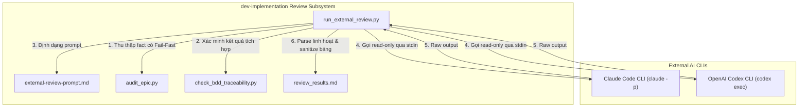
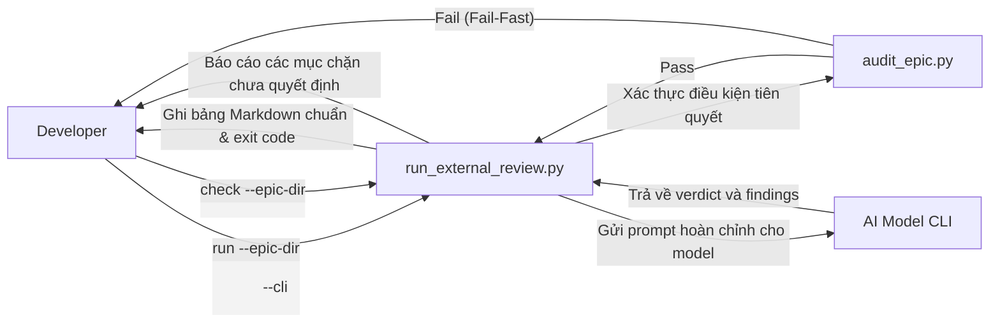

# Thiết kế Kiến trúc Cấp cao Cải tiến Quy trình Review

## Mục lục

- [Metadata](#metadata)
- [Bối cảnh](#bối-cảnh)
- [Mục tiêu và Giới hạn Phạm vi](#mục-tiêu-và-giới-hạn-phạm-vi)
- [Kiến trúc và Thiết kế Kỹ thuật](#kiến-trúc-và-thiết-kế-kỹ-thuật)
  - [Kiến trúc Cấp cao](#kiến-trúc-cấp-cao)
  - [Use Cases](#use-cases)
  - [Sơ đồ Trình tự](#sơ-đồ-trình-tự)
- [Kế hoạch Kiểm thử Tích hợp và Ma trận Ranh giới](#kế-hoạch-kiểm-thử-tích-hợp-và-ma-trận-ranh-giới)
- [Môi trường Xác minh](#môi-trường-xác-minh)
- [Chiến lược Triển khai và Di chuyển](#chiến-lược-triển-khai-và-di-chuyển)
- [Phân chia Nhiệm vụ Kanban](#phân-chia-nhiệm-vụ-kanban)

## Metadata

- **Epic Name**: `review_workflow_enhancements`
- **Status**: Draft
- **Target Release**: `v1.9.2`
- **Platform**: `Python`
- **Source Spec**: [2026-10-18-review-workflow-enhancements-design.vi.md](2026-10-18-review-workflow-enhancements-design.vi.md)

## Bối cảnh

Trong quá trình phát triển thực tế các epic phức tạp (như `learning_core`), quy trình kiểm tra chéo độc lập do `run_external_review.py` thực hiện đóng vai trò chốt chặn kiểm thử không thể thiếu trước Gate 4. Tuy nhiên, việc vận hành trực tiếp với output thực tế của LLM (từ Claude Code CLI và OpenAI Codex CLI) đã bộc lộ những điểm yếu runtime nghiêm trọng:
1. Định dạng Markdown đa dạng của LLM (in đậm, heading, chữ hoa/thường) khiến việc parse `VERDICT` thất bại, dẫn đến trạng thái sai `status = "no verdict"` (exit code 2) làm lãng phí thời gian và chi phí token.
2. Heuristic phát hiện lỗi chặn (unparsed blocking) nhận nhầm các câu văn lịch sự chứa `[Critical]` hoặc `[Important]` thành lỗi nghiêm trọng fatal.
3. Ký tự xuống dòng (`\r`, `\n`) trong văn bản finding làm vỡ cấu trúc bảng Markdown, khiến lệnh `check` tiếp theo báo lỗi unreadable rows.
4. Bước thu thập fact thiếu cơ chế fail-fast: khi `audit_epic.py` fail hoặc test bị timeout, runner vẫn tiếp tục gọi AI model bên ngoài để review một bản build đã hỏng.
5. Prompt cho reviewer thiếu hướng dẫn về phân cấp kiểm thử (cấp Task vs Gate 4 Workspace Quality Orchestrator) và ngữ nghĩa TDD RED của ngôn ngữ biên dịch, dẫn đến các phát hiện sai lặp đi lặp lại.

## Mục tiêu và Giới hạn Phạm vi

### Mục tiêu
- Gia cố `run_external_review.py` linh hoạt trước mọi định dạng Markdown của LLM cho kết luận và findings.
- Bảo vệ `UNPARSED_BLOCKING` khỏi báo động giả từ các đoạn văn tóm tắt.
- Làm sạch ô trong bảng Markdown khỏi các ký tự `\r` và `\n`.
- Bổ sung cơ chế fail-fast và tách biệt timeout cho fact trong `collect_facts()`.
- Nâng cấp `external-review-prompt.md` để xác định rõ phân cấp phạm vi kiểm thử, ngữ nghĩa TDD biên dịch và quy tắc đọc git diff.
- Quy định và thực thi quy tắc chất lượng kiểm thử chống vòng lặp kiểm tra artifact không đếm số lượng.

### Giới hạn Phạm vi
- Không thay đổi máy trạng thái review hoặc quy trình quản trị Decision (`fixed in <sha>` / `dismissed: <reason>`).
- Không thay thế CLI bằng các client gọi HTTP API trực tiếp.
- Không thay đổi cơ chế cô lập worktree của git.

## Kiến trúc và Thiết kế Kỹ thuật

### Kiến trúc Cấp cao



### Use Cases



### Sơ đồ Trình tự

```mermaid
sequenceDiagram
    autonumber
    actor Dev as Developer / Agent
    participant Runner as run_external_review.py
    participant Facts as Fact Collector (audit, tests, bdd)
    participant Model as Claude / Codex CLI
    participant Results as review_results.md

    Dev->>Runner: run(epic_dir, base, cli, timeout)
    Runner->>Runner: Kiểm tra git working tree sạch
    Runner->>Facts: collect_facts(root, epic_dir, base)
    alt Lệnh fact thất bại hoặc timeout
        Facts-->>Runner: Báo lỗi điều kiện tiên quyết
        Runner-->>Dev: Dừng sớm (Fail-Fast, không tốn credit AI)
    else Mọi fact thu thập thành công
        Facts-->>Runner: audit_output, results_output
    end
    Runner->>Runner: Thay thế biến vào prompt template
    Runner->>Model: Thực thi CLI qua stdin (read-only)
    Model-->>Runner: Nội dung review thô
    Runner->>Runner: Parse linh hoạt VERDICT & FINDING
    Runner->>Runner: Sanitize các ô bảng (xóa 
, 
, escape |)
    Runner->>Results: Ghi tiếp Round N vào review_results.md
    Runner-->>Dev: Exit code 0 (Pass), 1 (Có finding cần sửa), 2 (Lỗi)
```

## Kế hoạch Kiểm thử Tích hợp và Ma trận Ranh giới

| Kịch bản Kiểm thử | Phương pháp | Điều kiện Ranh giới | Kết quả Kỳ vọng |
|---|---|---|---|
| Khớp Verdict Linh hoạt | Unit Test | `**Verdict:** PASS`, `Verdict: **PASS**`, `### Verdict: CHANGES REQUIRED` | Parse khớp thành công, status `completed` |
| Bọc Chặn Unparsed Finding | Unit Test | Đoạn văn tóm tắt của model: `"I found 0 [Critical] issues"` | Bị bỏ qua, không sinh lỗi unparsed giả |
| Làm sạch Ô Bảng Markdown | Unit Test | Finding location hoặc problem chứa `\r`, `\n`, hoặc `|` | Ô hiển thị trên 1 dòng duy nhất, dấu pipe được escape |
| Fail-Fast khi Audit Lỗi | Unit Test | `audit_epic.py` trả về exit code khác 0 | Dừng trước khi gọi CLI, exit 2 |
| Fail-Fast khi Test Timeout | Unit Test | Integration test trả về `code is None` | Dừng trước khi gọi CLI, exit 2 |
| Phạm vi Hướng dẫn Reviewer | Contract Audit | Kiểm tra template prompt | Chứa đầy đủ phân cấp kiểm định và quy tắc TDD |
| Nhận diện Anti-pattern | Guideline Audit | Kiểm tra heuristic loop duyệt artifact | Bắt buộc có assertion `assert!(found > 0)` |

Integration test roots: skills/dev-implementation/resources/scripts
Protected paths: .agents/quality/**, .devtool/epic/review_workflow_enhancements/bdd_scenarios.en.md, .devtool/epic/review_workflow_enhancements/bdd_scenarios.vi.md
Integration results: python3 scripts/run_unittest_junit.py --junitxml build/test-results/unit.xml skills/dev-implementation/resources/scripts/test_run_external_review.py -> build/test-results/unit.xml

## Môi trường Xác minh

- **Thực thi Cô lập**: Toàn bộ unit test chạy trên các thư mục tạm ephemeral và subprocess giả lập.
- **An toàn Tiến trình Con**: Lệnh thực thi sử dụng process group riêng biệt (`start_new_session=True`).
- **Phụ thuộc**: Chỉ sử dụng thư viện chuẩn của Python (`argparse`, `os`, `re`, `subprocess`, `unittest`).

## Chiến lược Triển khai và Di chuyển

1. Cài đặt các cải tiến parser, sanitizer và fail-fast trong `ai-agent-tools`.
2. Mở rộng `test_run_external_review.py` để bao phủ toàn bộ các trường hợp hồi quy.
3. Đồng bộ các thay đổi vào plugin hoạt động tại `~/.gemini/config/plugins/d3nexus/`.
4. Chạy toàn bộ test suite của `ai-agent-tools` và xác nhận trạng thái xanh 100%.

## Phân chia Nhiệm vụ Kanban

- [ ] **Task 1: Parse Verdict và Finding Linh hoạt**
  - Cập nhật regex `VERDICT` hỗ trợ in đậm, heading Markdown và case-insensitive.
  - Bảo vệ `UNPARSED_BLOCKING` không nhận nhầm văn xuôi.
  - Thêm unit tests trong `test_run_external_review.py`.
- [ ] **Task 2: Bộ Làm sạch Ô Bảng và Xử lý Ký tự Điều khiển**
  - Cập nhật `cell()` xóa `\r`, chuyển `\n` thành khoảng trắng và escape `|`.
  - Thêm unit tests xác thực các hàng bảng Markdown trên một dòng duy nhất.
- [ ] **Task 3: Tách Timeout cho Fact và Cơ chế Dừng sớm Fail-Fast**
  - Cài đặt fail-fast trong `collect_facts()` khi lệnh audit hoặc test thất bại/timeout.
  - Thêm tham số timeout riêng cho facts.
  - Thêm unit tests cho hành vi fail-fast.
- [ ] **Task 4: Phân cấp Kiểm định trong External Review Prompt**
  - Cập nhật `external-review-prompt.md` với phân cấp kiểm định, ngữ nghĩa TDD biên dịch và đọc git diff.
  - Xác thực việc thay thế biến và định dạng trong template prompt.
- [ ] **Task 5: Quy tắc Ngăn chặn Anti-Pattern Kiểm thử & Kiểm tra Hồi quy**
  - Tài liệu hóa quy tắc chống anti-pattern assertion artifact.
  - Chạy toàn bộ bộ test hồi quy gồm 213+ bài test trong `ai-agent-tools`.
