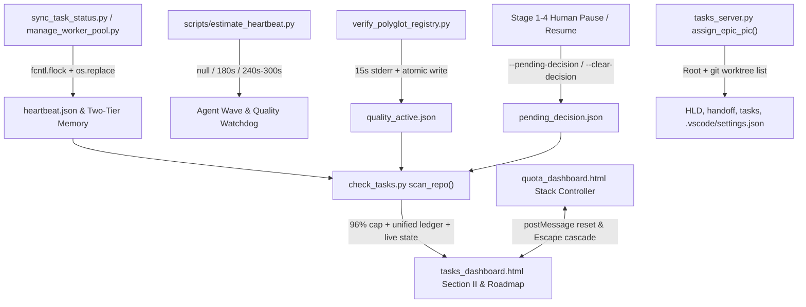

# Runtime State Sync, Hybrid Heartbeat, and Dashboard Hardening Design

- **Date**: 2026-11-13
- **Status**: Approved (Gate 1)
- **Epic Directory**: `runtime_sync_and_dashboard_hardening`
- **Epic Slug**: `runtime-sync-and-dashboard-hardening`
- **Scope**: `scripts/_state_envelope.py`, `scripts/estimate_heartbeat.py`, `scripts/resume_context.py`, `scripts/verify.sh`, `.agents/quality/python-quality.json`, `skills/quality_check/resources/scripts/verify_polyglot_registry.py`, `skills/quality_check/SKILL.md`, `skills/dev-lifecycle/references/handoff-template.md`, `skills/dev-implementation/SKILL.md`, `skills/dev-implementation/resources/scripts/package_epic.py`, `skills/dev-implementation/resources/scripts/check_epic_readiness.py`, `skills/dev-implementation/resources/scripts/check_task_contract.py`, `skills/dev-implementation/resources/scripts/sync_task_status.py`, `skills/dev-implementation/resources/scripts/manage_worker_pool.py`, `skills/finishing-a-development-branch/SKILL.md`, `skills/finishing-a-development-branch/resources/scripts/integrate_branch.py`, `skills/dev-brainstorming/SKILL.md`, `skills/dev-designer/SKILL.md`, `skills/principal-review/SKILL.md`, `skills/cross-model-review/SKILL.md`, `skills/check-tasks/resources/scripts/check_tasks.py`, `skills/check-tasks/resources/scripts/tasks_server.py`, `skills/check-tasks/resources/dashboard/tasks_dashboard.html`, `skills/check-quota/resources/dashboard/quota_dashboard.html`, `rules/CRITICAL_RULES.md`, `tests/`
- **Next step**: `dev-designer` (Stage 2)

## Table of Contents

- [1. Background](#1-background)
- [2. Goals and Non-Goals](#2-goals-and-non-goals)
  - [Goals](#goals)
  - [Non-Goals](#non-goals)
- [3. Architecture and Data Flow](#3-architecture-and-data-flow)
- [4. Detailed Component Design](#4-detailed-component-design)
  - [4.1. Atomic Runtime State Envelope and Two-Tier Memory Sync](#41-atomic-runtime-state-envelope-and-two-tier-memory-sync)
  - [4.2. Hybrid Heartbeat, Simple Estimator, and Quality Check Progress](#42-hybrid-heartbeat-simple-estimator-and-quality-check-progress)
  - [4.3. Wave-Parallel Handoff and Stage 3 Revise Fix](#43-wave-parallel-handoff-and-stage-3-revise-fix)
  - [4.4. Worker Pool and Subagent Mechanical Cleanup](#44-worker-pool-and-subagent-mechanical-cleanup)
  - [4.5. Approval Bottleneck (Choice A), 96% Ceiling, and Section II Live Sync](#45-approval-bottleneck-choice-a-96-ceiling-and-section-ii-live-sync)
  - [4.6. PIC Root + Worktree Sync and Roadmap Row Stability](#46-pic-root--worktree-sync-and-roadmap-row-stability)
  - [4.7. Check-Quota Modal Stack Controller](#47-check-quota-modal-stack-controller)
- [5. Error Handling and Resilience](#5-error-handling-and-resilience)
- [6. Shared Contract Warnings](#6-shared-contract-warnings)
- [7. Verification and Testing Strategy](#7-verification-and-testing-strategy)
- [8. Risks and Mitigations](#8-risks-and-mitigations)

---

## 1. Background

During recent multi-agent epics using `d3nexus:dev-lifecycle`, eight tightly coupled workflow, observability, and dashboard defects surfaced across execution orchestration and the companion `check-tasks` / `check-quota` interfaces:

1. **Opaque long-running steps**: Multi-subagent implementation waves and `quality_check` runs provide no zero-token live progress stream and no adaptive heuristic for setting an LLM progress-reporting watchdog (`none` vs `180s`–`300s`).
2. **Stale Two-Tier Memory & Section II Dashboard**: Kanban transitions (`sync_task_status.py`), worker pool slot states, and verification activity do not mechanically update Two-Tier Memory or trigger incremental Section II DOM refreshes (`tier2Sig` in `tasks_dashboard.html` watches only `[act, stg, wt]`).
3. **Sequential Handoff Prompt & Stage 3 `--revise` Failure**: `resume_context.py --emit-prompt implement` and `handoff-template.md` still instruct sequential execution rather than wave-parallel execution, while `package_epic.py --revise` fails during Stage 3 because `check_epic_readiness.py` unconditionally runs `check_task_contract.py --design`, triggering `<file> is marked (new) but already exists` on completed tasks.
4. **Orphaned Worker Slot Resources**: Interrupted or finished parallel waves leave `.worktrees/<epic>-slot-*` clones and temporary branches without automatic cleanup hooks.
5. **False-Positive Approval Bottlenecks**: `check_tasks.py` falls back to scanning `.devtool/epic/` alphabetically (flagging idle directories such as `choosing_a_lifecycle` as `Approve Gate 1 (Design Spec)`), splits ledger sources between `GATE_LEDGER.md` and `gate_ledger.jsonl`, and has no explicit Choice A `pending_decision` save/clear mechanism when agents pause for human input.
6. **99% Pre-Finish Ceiling / Uncapped Section II**: Section I sidebar currently caps all-tasks-done-pre-finish progress at `99%` (`⚡ 99% Review`) while Section II (`renderExecutionEpics`) shows raw `100%` without checking Gate 4 convergence; both should enforce the `96%` pre-finish ceiling (`95%` in-progress, `100%` only on Gate 4 converged Waiting Finish / Done).
7. **Broken PIC Reassignment**: `assign_epic_pic()` in `tasks_server.py` misses worktree `.devtool/epic/<epic>/` copies and `**PIC / Assigned Profile**` lines, edits unrelated markdown files (`principal_review.md`, `bdd_scenarios.*.md`), while `tasks_dashboard.html` re-sorts Roadmap rows by volatile `mtime` and replaces `<select>` DOM elements mid-interaction, causing wrong-row selections and missed `modal-epics` updates.
8. **Layered Check-Quota Dialogs**: Embedding `quota_dashboard.html` inside `modal-quota` creates triple overlay stacking; opening another inner dialog does not close the previous one; backdrop clicks and `Escape` bypass inner modals (`profileInfoModal`, `appealDetailModal`) and close the parent iframe instead.

---

## 2. Goals and Non-Goals

### Goals
- Provide a unified, atomic file-based **Runtime State Envelope** under `.devtool/state/` (`<epic_slug>.heartbeat.json`, `quality_active.json`, `pending_decision.json`) shared across CLI orchestrators and `check_tasks.py`.
- Emit zero-token periodic progress lines (`stderr`) and atomic JSON snapshots during `verify_polyglot_registry.py` and implementation waves, paired with a lightweight rule-based `scripts/estimate_heartbeat.py` returning `null` / `180` / `240` / `300` seconds.
- Mechanically sync Kanban and worker slot changes into `.devtool/state/<epic_slug>.md` and `assistant_state.md`, and stream those signals live into `tasks_dashboard.html` Section II.
- Switch `emit_handoff_prompt` (`implement`) and `handoff-template.md` to wave-parallel execution (`compute_execution_order.py --parallel`), fix `package_epic.py --revise` for Stage 3 epics, and automate worker pool slot cleanup.
- Enforce Choice A Approval Bottleneck tracking (`--pending-decision` on pause, automatic clear on confirm/resume/gate advance), lower the pre-finish ceiling from `99%` to **`96%`**, fix `assign_epic_pic()` across root + worktrees with stable Roadmap row keys, and introduce a single Modal Stack Controller in `quota_dashboard.html`.

### Non-Goals
- Do not introduce a persistent database daemon or SQLite write server for cross-process locking (atomic JSON + existing `fcntl.flock` suffices).
- Do not call external LLM APIs inside `estimate_heartbeat.py` or `verify_polyglot_registry.py`.
- Do not alter production code or `.devtool/` files inside unrelated downstream repositories (e.g. `lyrics-sync`) during kit implementation.

---

## 3. Architecture and Data Flow

The selected **Approach B (Runtime State Envelope + Pure UI/Contract Layer)** separates zero-token machine state producers (CLI scripts) from stateless consumers (`check_tasks.py` and dashboard HTML):

All Python state writers resolve **both** the active worktree `.devtool/state/` and the primary root repository `.devtool/state/` (resolved via `git rev-parse --git-common-dir` / `resolve_primary_repo_root()`) so `tasks_server.py` scanning the root workspace sees live state regardless of which worktree runs the command.

---

## 4. Detailed Component Design

### 4.1. Atomic Runtime State Envelope and Two-Tier Memory Sync

Create a lightweight helper `scripts/_state_envelope.py` usable both from `scripts/` and via `KIT_ROOT / "scripts"` from any skill script:
- `resolve_shared_devtool_dirs(cwd: Path) -> list[Path]`: returns unique `.devtool/` directories for the primary repo root first and the active worktree (if inside a worktree).
- **Canonical-Root Transaction Lock & Versioned Snapshots**: `run_state_transaction()` acquires a single `fcntl.flock` lock on the primary repo `.devtool/state/.state_envelope.lock` wrapping the full read -> merge -> monotonic `generation += 1` bump -> atomic temp write + `os.replace()` to the primary root -> mirrored atomic write to any active worktree root (rejecting stale lower-generation writes so interleaved multi-process RMW updates never drop slots or diverge across mirrors).
- `read_json_safe(path: Path, default: T) -> T`: returns `default` gracefully on missing or corrupt JSON (never crashing `check_tasks.py` polling).
- Whenever `sync_task_status.py`, `manage_worker_pool.py` (`init`, `sync`, `merge`, `cleanup`), or `resume_context.py` (`--state`, `--wave`) updates epic progress or slots, `.devtool/state/<epic_slug>.heartbeat.json` is updated transactionally (`generation`, `epic_slug`, `stage`, `active_wave`, `active_tasks`, `slots`, `last_event`, `updated_at`) and `<epic_slug>.md` / `assistant_state.md` regenerate under lock.

### 4.2. Hybrid Heartbeat, Simple Estimator, and Quality Check Progress

1. **Zero-Token Quality Progress (`verify_polyglot_registry.py`)**:
   - Isolate each invocation with a unique `run_id` (`uuid`/timestamp-pid), run capability commands in child process groups (`subprocess.Popen(..., start_new_session=True)`), and stream combined output to run-scoped logs `build/quality/<provider>/runs/<run_id>/<cap>.log`.
   - Every `heartbeat_interval` seconds (default `15s`, configurable for tests), emit a single concise line to `stderr` (`[quality_check] 2/5 <provider>:<cap> (<elapsed>s elapsed)`) and update namespaced `runs[run_id]` inside `.devtool/state/quality_active.json` (`{run_id, epic_slug, profile, status, provider, capability, step_index, step_total, pid, host, started_at, updated_at, ttl_sec, elapsed_sec}`) under run-ownership locking so concurrent runs never overwrite one another.
   - Install `SIGINT`/`SIGTERM` signal handlers alongside `try ... finally` to terminate + reap active child process groups and finalize **only** `runs[run_id]` as `"passed" | "failed" | "aborted"`; consumers (`check_tasks.py`) expire dead-PID or `updated_at + ttl_sec`-overdue entries as `"stale"`.
2. **Simple Rule-Based Estimator (`scripts/estimate_heartbeat.py`)**:
   - Accepts CLI inputs (`--tasks-count`, `--files-count`, `--epic-dir` / `--wave`, or `--quality-profile fast|pr|epic|release|full`, `--has-e2e`).
   - Computes an additive duration estimate in seconds (`estimated_sec`) and maps to discrete tiers:
     - `estimated_sec < 60` -> tier `"light"`, `recommended_interval_sec: null` (skip `schedule()` timer, 0 extra LLM tokens).
     - `60 <= estimated_sec <= 240` -> tier `"medium"`, `recommended_interval_sec: 180`.
     - `estimated_sec > 240` -> tier `"heavy"`, `recommended_interval_sec: 240` (or `300` when `--has-e2e` / `epic` full regression is set).
   - Document this pre-flight estimation step succinctly in `skills/dev-implementation/SKILL.md` and `skills/quality_check/SKILL.md`, and keep `rules/CRITICAL_RULES.md` within `<= 8192` bytes.

### 4.3. Wave-Parallel Handoff and Stage 3 Revise Fix

1. **Wave-Parallel Handoff (`resume_context.py` & `handoff-template.md`)**:
   - Update `emit_handoff_prompt()` (`mode == "implement"`) in `scripts/resume_context.py` and the `## Resume Prompt` / execution instructions in `skills/dev-lifecycle/references/handoff-template.md`.
   - Instruct the receiving Role 2.3 Orchestrator to: (a) run `compute_execution_order.py <epic_slug> --parallel`, (b) run `estimate_heartbeat.py` per wave / before Gate 4, (c) execute multi-task independent waves in parallel via `manage_worker_pool.py` / parallel subagents (`workspace:"share"`) and single-task / shared-file waves in the main epic worktree, (d) merge + verify wave integration + cleanup finished slots.
2. **Stage 3 `--revise` Contract Compatibility (`package_epic.py`, `check_epic_readiness.py`, `check_task_contract.py`)**:
   - Add `--post-design` to `check_epic_readiness.py` and `--allow-existing-done-new` to `check_task_contract.py`.
   - In `package_epic.py --revise`, detect automatically whether the epic has entered Stage 3 (Gate 3 recorded in `gate_ledger.jsonl` / `GATE_LEDGER.md` OR any task has status `in-progress`, `review`, or `done`). When true, invoke `check_epic_readiness.py <epic_dir> --post-design`.
   - Inside `check_task_contract.py`: when `--design --allow-existing-done-new` is active, tasks in status `done`, `review`, or `in-progress` skip the `<pattern> is marked (new) but already exists` error on their own previously created Allowed/Evidence files (rejecting duplicate `(new)` declarations across tasks and failing `todo` tasks whose `(new)` paths already exist). Pre-Stage-3 epics retain strict `--design` enforcement.

### 4.4. Worker Pool and Subagent Mechanical Cleanup

- Enhance `cleanup_slots()` / `cleanup` CLI in `skills/dev-implementation/resources/scripts/manage_worker_pool.py`:
  - Assign explicit slot/wave heartbeat producers across `init`, `sync --task --wave`, `merge`, `cleanup`, and `resume_context.py --wave`.
  - Inspect each slot worktree and branch (even when the worktree folder is missing) before deleting: auto-remove **only** clean, integrated slots (`git status --porcelain` empty and merged into target epic/base branch) plus run `git worktree prune`; **preserve and report** dirty worktrees, unmerged commits, or unmerged missing-worktree branches (updating slot status cleanly rather than silently deleting) unless `--discard-unmerged` / `--force` is explicitly requested.
  - Support `--stale-only`, mandate safe `manage_worker_pool.py cleanup` before Gate 4 (`dev-implementation/SKILL.md`), and run orphan slot cleanup during `integrate_branch.py cmd_land`.

### 4.5. Approval Bottleneck (Choice A), 96% Ceiling, and Section II Live Sync

1. **Pending Decision Save-on-Pause & Auto-Clear (Choice A)**:
   - Extend `scripts/resume_context.py` CLI with `--pending-decision "<reason>"`, `--decision-kind <kind>`, and `--clear-decision` storing epic-namespaced records in `.devtool/state/pending_decision.json` (`decisions[epic_slug] = {decision_id, epic, kind, reason, stage, created_at, worktree}` plus active summary mirror) under the canonical transaction lock.
   - Clearing requires matching `epic` (and optional `--decision-id`) ownership when `--gate <N>`, `--clear-decision`, `--state`, `sync_task_status.py`, or `package_epic.py` runs, so concurrent epics never erase another epic's outstanding human approval.
   - Update Stage 1–4 skill guidance (`dev-brainstorming`, `dev-designer`, `principal-review`, `cross-model-review`, `finishing-a-development-branch`, `CRITICAL_RULES.md`) so stopping for human confirmation records `--pending-decision` before ending the turn.
2. **Eliminate Idle False Positives & Unify Ledgers (`check_tasks.py`)**:
   - Remove Strategy 7 dormant alphabetical fallback in `resolve_active_epic()` while preserving Strategy 6 (`features/` scan), and remove implicit `Approve Gate 1 (Design Spec)` synthesis when no `pending_decision` or active execution state exists.
   - Fix `parse_gate_ledger_entries()` so it merges entries across root + active worktree `gate_ledger.jsonl` and `GATE_LEDGER.md` instead of short-circuiting on `gate_ledger.jsonl` when `GATE_LEDGER.md` holds newer approvals.
   - Surface epic-matched `pending_decision`, `heartbeat`, `quality_active`, and concurrent live `quality_runs` (expiring dead/overdue runs to `"stale"`) in `RepoMetadata` / `/api/tasks`.
3. **96% Completion Ceiling & Section II Live DOM Updates (`tasks_dashboard.html`)**:
   - Enact the all-tasks-done-pre-finish `96%` ceiling (`⚡ 96% Review`) across Section I (`renderKanbanDashboard`: update `99`/`98` to `96`/`95`) and Section II (`renderExecutionEpics`: add `isFullyDone`/`isWaitingFinish`-aware cap where it today renders raw `100%`), reserving `100%` strictly for `Waiting Finish` converged / `Done`.
   - Fix `tier2Sig` at mount (`L2938`) and polling (`L2724`) to include `account_id`, `prompt`, `is_human_action_required`, `task_progress` counts/active task, `heartbeat`, and `quality_active`, rendering live wave/slot/quality progress bars in Section II without page reloads.

### 4.6. PIC Root + Worktree Sync and Roadmap Row Stability

1. **Backend (`tasks_server.py` & `check_tasks.py`)**:
   - Refactor `assign_epic_pic()` to discover all matching worktrees via `git worktree list --porcelain` (matching branch name `epic/<slug>` or worktree folder/prefix `<epic_dir>` / `<slug>`) plus the root repository.
   - Update PIC atomically across **both** root and matched worktrees in targeted files only: HLD (`<epic>.en.md`, `<epic>.vi.md`, design spec metadata), `handoff.md` (including `- **PIC / Assigned Profile**:` lines), `task_*.md` inside both `.devtool/epic/<epic>/` and `.devtool/features/`, `.devtool/state/<slug>.pipeline.json`, `.devtool/state/<slug>.heartbeat.json`, and worktree `.vscode/settings.json`. Never inject `- **PIC**:` into review/BDD prose artifacts (`bdd_scenarios.*`, `principal_review.md`, `review_results.md`).
   - Update `extract_epic_pic()` to inspect `**PIC / Assigned Profile**` placeholders accurately and check active worktree `handoff.md`/HLD alongside root.
2. **Frontend (`tasks_dashboard.html`)**:
   - Stabilize Roadmap sorting (`sortEpicsForRoadmap`): explicitly replace sub-day `mtime` timestamp comparison with status category + `active_epic` + created/date-day bucket (`YYYY-MM-DD`) + deterministic slug tie-breaker (`a.slug.localeCompare(b.slug)`), and annotate every row/select with canonical `data-row-key="<repo>:<epic_slug>"`.
   - Defer `roadmapTbody.innerHTML` replacement during 5s polling whenever any `.select-pic-roadmap` has focus/active interaction (`document.activeElement`), align mount vs polling `roadmapSig` (`L2934` vs `L2699`), and fix `updateEpicPic()`'s `modal-epics` visibility check (`style.display === 'flex'` instead of `.classList.contains('active')`) + explicit `refreshAllProfileSelects` key matching.

### 4.7. Check-Quota Modal Stack Controller

In `skills/check-quota/resources/dashboard/quota_dashboard.html` and `skills/check-tasks/resources/dashboard/tasks_dashboard.html`:
- Replace ad-hoc modal toggles (`openScheduleModal`, `openLoginModal`, `openProfileInfoModal`, `openAppealModal`) with a single `openQuotaSubModal(modalId)` / `closeQuotaSubModal(modalId)` / `closeAllQuotaSubModals()` controller enforcing an invariant: **at most one sub-modal is open inside `quota_dashboard.html` at any time**.
- Attach backdrop-click dismissal directly to `#scheduleModal`, `#loginModal`, `#profileInfoModal`, `#appealDetailModal` (`if (e.target === modalEl) closeQuotaSubModal(...)`), and add all 4 sub-modal IDs to the iframe document click guard so clicking outside a sub-modal card closes **only that sub-modal**, never the parent `#modal-quota`.
- Fix `Escape` cascading: inside `quota_dashboard.html`, `Escape` closes the currently open sub-modal first; only when zero sub-modals are open does it invoke `handleCardClose()`.
- On the parent `tasks_dashboard.html`, append `?embedded=1` to `#quota-iframe.src` in `openQuotaModal` and `refreshQuotaIframe` (with `window.parent !== window` fallback detection inside `quota_dashboard.html` to flatten `#dashboardCard` outer padding/card-in-modal duplication), intercept parent `Escape` cleanly, and post `{action: 'reset_quota_submodals'}` to `#quota-iframe` whenever `#modal-quota` opens or closes so reopening Quota never reveals a stale orphaned sub-modal.

---

## 5. Error Handling and Resilience

- **Corrupt / partial JSON state files**: `_state_envelope.py` writes to temp files + `os.replace()` under `fcntl.flock`; `read_json_safe()` logs debug warning and falls back cleanly without blocking CLI pipelines or `/api/tasks`.
- **Orphan worktrees or crashed verification**: `verify_polyglot_registry.py` finalizes `quality_active.json` in `finally`; `manage_worker_pool.py cleanup --stale-only` tolerates already-deleted folders via `git worktree prune`.
- **Cross-origin or unloaded iframe**: `postMessage` calls between `tasks_dashboard.html` and `#quota-iframe` guard against `contentWindow` readiness and ignore unrelated origins/messages.
- **`assign_epic_pic()` partial failures**: Collect updated paths and warnings; validate `new_pic` strictly (`^[a-zA-Z0-9_\-]+$`) and resolve paths inside repository boundaries only.

---

## 6. Shared Contract Warnings

This repository (`ai-agent-tools`) is the standalone shared agent kit plugin repository and **does not contain a `shared-contracts/` symlink or physical cross-repo contract directory**. Downstream consumer projects (`lyrics-sync`, `D3Nexus`, `nexus`) read `.devtool/` files and invoke `check-tasks` / `dev-implementation` / `quality_check` scripts from this plugin. Therefore:
- Additive JSON schemas (`heartbeat.json`, `quality_active.json`, `pending_decision.json`) and new optional CLI flags (`--post-design`, `--pending-decision`, `--clear-decision`) maintain backward compatibility with existing repositories that do not yet possess those files.
- `tasks_dashboard.html` handles optional fields gracefully when older snapshots omit new keys.

---

## 7. Verification and Testing Strategy

All behavior will be verified by automated unit, integration, and browser/UI regression tests integrated into `scripts/verify.sh`:
- **Envelope & Estimator**: transactional RMW concurrency + matching `generation` mirrors, namespaced `pending_decision`/`quality_active`, corrupt JSON fallback, 3-tier `estimate_heartbeat.py` (`light -> null`, `medium -> 180`, `heavy -> 240/300`).
- **Quality Check Live Progress**: mock capability runner verifying 15s (parameterized `0.1s` in tests) stderr heartbeat output, `runs/<run_id>/<cap>.log` isolation, `SIGINT`/`SIGTERM` child reaping -> `"aborted"`, and consumer `ttl_sec`/dead-PID `"stale"` expiry.
- **Handoff, Stage 3 Revise & Cleanup**: `resume_context.py --emit-prompt implement` asserting wave-parallel text, `package_epic.py --revise` passing on Stage 3 `done`/`review`/`in-progress` tasks while failing colliding `todo` tasks, and safe `manage_worker_pool.py cleanup` preserving dirty/unmerged & missing-worktree branches unless `--discard-unmerged` while populating `working` slots before cleanup.
- **Choice A Pending Decision & 96% Ceiling**: epic-namespaced save/auto-clear across `--pending-decision`, `--gate`, `--state`, `sync_task_status.py` without clobbering sibling epics; `check_tasks.py` returning `is_human_action_required=False` on idle repos plus `quality_runs` / stale recovery; Section I/II asserting `96%` cap.
- **PIC Sync, Roadmap & Modal Stack (Node Unit + Provisioned Chrome CDP)**: `assign_epic_pic()` updating root + worktree `handoff.md`/HLD/`task_*.md`/`.vscode/settings.json` without touching `principal_review.md`; headless Node script unit checks PLUS a provisioned real headless Google Chrome CDP harness (`CHROME_BIN` / local Chrome + `node v25` WebSocket) against live `127.0.0.1` `TasksServer` verifying rendered `getComputedStyle` (`?embedded=1` card flattening), native `<select>` focus retention under polling despite distinct same-day `mtime` timestamps, and real parent/iframe `Escape`/backdrop/`postMessage` transitions inside `#modal-quota`.

---

## 8. Risks and Mitigations

| Risk | Impact | Mitigation |
| :--- | :--- | :--- |
| **`CRITICAL_RULES.md` exceeds 8192-byte prompt budget** | Rule file truncation across agent harnesses | Keep any addition in `rules/CRITICAL_RULES.md` concise (`<= 8000` bytes total); place procedural detail inside skill `SKILL.md` files and scripts. |
| **`--post-design` weakens pre-implementation validation** | False pass on malformed new tasks in Stage 2 | Activate `--allow-existing-done-new` strictly when `--revise` detects Stage 3 indicators and strictly for `done`/`review`/`in-progress` tasks, while blocking colliding `todo` `(new)` declarations. |
| **Root vs worktree state divergence** | `check_tasks` shows stale approval/progress when work runs in a worktree | `_state_envelope.py` executes RMW updates under a canonical primary-root `fcntl.flock` lock with monotonic `generation` numbers and atomic primary + worktree publication. |
| **Roadmap table sorting instability during typing/clicking** | Wrong epic PIC changed when 5s poll replaces DOM | Pin stable row keys (`data-row-key`), remove sub-day `mtime` ordering from `sortEpicsForRoadmap`, skip `tbody` replacement while `.select-pic-roadmap` holds focus, and verify in real Chrome CDP. |

