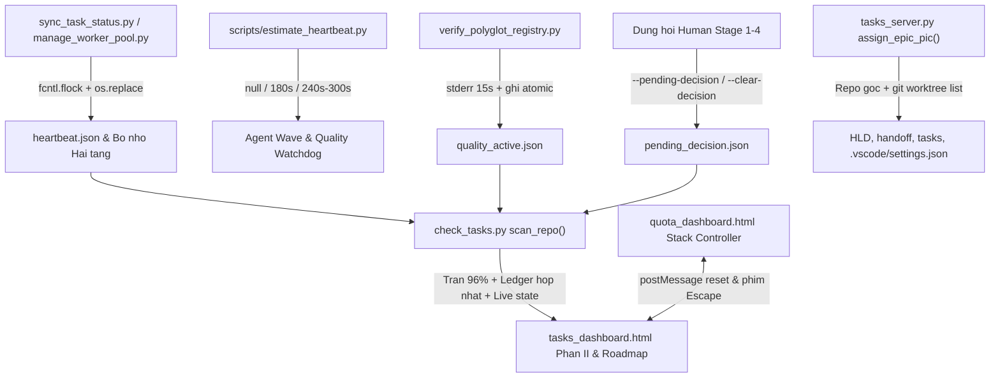

# Thiết kế Đồng bộ Trạng thái Runtime, Hybrid Heartbeat và Gia cố Dashboard

- **Ngày**: 2026-11-13
- **Trạng thái**: Đã phê duyệt (Gate 1)
- **Thư mục Epic**: `runtime_sync_and_dashboard_hardening`
- **Epic Slug**: `runtime-sync-and-dashboard-hardening`
- **Phạm vi**: `scripts/_state_envelope.py`, `scripts/estimate_heartbeat.py`, `scripts/resume_context.py`, `skills/quality_check/resources/scripts/verify_polyglot_registry.py`, `skills/quality_check/SKILL.md`, `skills/dev-lifecycle/references/handoff-template.md`, `skills/dev-implementation/SKILL.md`, `skills/dev-implementation/resources/scripts/package_epic.py`, `skills/dev-implementation/resources/scripts/check_epic_readiness.py`, `skills/dev-implementation/resources/scripts/check_task_contract.py`, `skills/dev-implementation/resources/scripts/sync_task_status.py`, `skills/dev-implementation/resources/scripts/manage_worker_pool.py`, `skills/finishing-a-development-branch/resources/scripts/integrate_branch.py`, `skills/dev-brainstorming/SKILL.md`, `skills/dev-designer/SKILL.md`, `skills/principal-review/SKILL.md`, `skills/cross-model-review/SKILL.md`, `skills/check-tasks/resources/scripts/check_tasks.py`, `skills/check-tasks/resources/scripts/tasks_server.py`, `skills/check-tasks/resources/dashboard/tasks_dashboard.html`, `skills/check-quota/resources/dashboard/quota_dashboard.html`, `rules/CRITICAL_RULES.md`, `tests/`
- **Bước tiếp theo**: `dev-designer` (Stage 2)

## Mục lục

- [1. Bối cảnh](#1-bối-cảnh)
- [2. Mục tiêu và Ngoài phạm vi](#2-mục-tiêu-và-ngoài-phạm-vi)
  - [Mục tiêu](#mục-tiêu)
  - [Ngoài phạm vi](#ngoài-phạm-vi)
- [3. Kiến trúc và Luồng dữ liệu](#3-kiến-trúc-và-luồng-dữ-liệu)
- [4. Thiết kế Chi tiết Từng Thành phần](#4-thiết-kế-chi-tiết-từng-thành-phần)
  - [4.1. Vỏ Trạng thái Runtime Atomic và Đồng bộ Bộ nhớ Hai tầng](#41-vỏ-trạng-thái-runtime-atomic-và-đồng-bộ-bộ-nhớ-hai-tầng)
  - [4.2. Hybrid Heartbeat, Estimator Đơn giản và Tiến độ Quality Check](#42-hybrid-heartbeat-estimator-đơn-giản-và-tiến-độ-quality-check)
  - [4.3. Handoff Song song Theo Wave và Sửa `--revise` ở Stage 3](#43-handoff-song-song-theo-wave-và-sửa---revise-ở-stage-3)
  - [4.4. Dọn dẹp Cơ học Worker Pool và Subagent](#44-dọn-dẹp-cơ-học-worker-pool-và-subagent)
  - [4.5. Điểm nghẽn Phê duyệt (Phương án A), Trần 96% và Sync Live Phần II](#45-điểm-nghẽn-phê-duyệt-phương-án-a-trần-96-và-sync-live-phần-ii)
  - [4.6. Đồng bộ PIC Repo Gốc + Worktree và Ổn định Bảng Roadmap](#46-đồng-bộ-pic-repo-gốc--worktree-và-ổn-định-bảng-roadmap)
  - [4.7. Bộ Điều khiển Tầng Dialog cho Check-Quota](#47-bộ-điều-khiển-tầng-dialog-cho-check-quota)
- [5. Xử lý Lỗi và Khả năng Phục hồi](#5-xử-lý-lỗi-và-khả-năng-phục-hồi)
- [6. Cảnh báo Shared Contract](#6-cảnh-báo-shared-contract)
- [7. Chiến lược Kiểm thử và Xác minh](#7-chiến-lược-kiểm-thử-và-xác-minh)
- [8. Rủi ro và Biện pháp Giảm thiểu](#8-rủi-ro-và-biện-pháp-giảm-thiểu)

---

## 1. Bối cảnh

Qua các epic đa-agent gần đây sử dụng `d3nexus:dev-lifecycle`, tám lỗi và điểm nghẽn liên hoàn đã phát sinh giữa tầng điều phối thực thi và cặp giao diện `check-tasks` / `check-quota`:

1. **Thiếu hiển thị tiến độ tác vụ dài**: Các wave thực thi nhiều subagent và quá trình chạy `quality_check` kéo dài không có luồng tiến độ 0-token và chưa có bộ ước lượng để LLM chọn chu kỳ báo cáo hợp lý (`none` so với `180s`–`300s`).
2. **Trôi lệch Bộ nhớ Hai tầng & Phần II Dashboard**: Thay đổi trạng thái Kanban (`sync_task_status.py`), slot worker pool và tiến độ verify chưa tự đồng bộ vào Bộ nhớ Hai tầng và Phần II UI (`tier2Sig` trong `tasks_dashboard.html` chỉ theo dõi `[act, stg, wt]`).
3. **Handoff Tuần tự & Lỗi `--revise` ở Stage 3**: `resume_context.py --emit-prompt implement` và `handoff-template.md` vẫn hướng dẫn chạy tuần tự từng task thay vì song song theo wave, còn `package_epic.py --revise` bị lỗi khi chạy ở Stage 3 vì `check_epic_readiness.py` luôn bật `check_task_contract.py --design`, báo `<file> is marked (new) but already exists` đối với task đã hoàn thành.
4. **Rò rỉ tài nguyên Worker Slot**: Khi một wave song song kết thúc hoặc bị gián đoạn, thư mục `.worktrees/<epic>-slot-*` và nhánh tạm chưa có cơ chế dọn dẹp cơ học xuyên suốt.
5. **Báo giả Điểm nghẽn Phê duyệt**: `check_tasks.py` rơi về cơ chế quét `.devtool/epic/` theo bảng chữ cái (gắn nhầm `choosing_a_lifecycle` thành `Approve Gate 1 (Design Spec)`), đọc lệch giữa `GATE_LEDGER.md` và `gate_ledger.jsonl`, đồng thời chưa có cơ chế lưu `pending_decision` khi agent dừng hỏi người dùng và tự gỡ khi xác nhận (Phương án A).
6. **Trần tiến độ 99% trước khi Finish**: Cả sidebar Phần I lẫn card Phần II đang hiển thị `99%` (`⚡ 99% Review`) khi làm xong hết tasks trước Gate 5 Sign-off; mức mong muốn là `96%`.
7. **Lỗi Chuyển PIC**: `assign_epic_pic()` trong `tasks_server.py` bỏ sót các bản sao `.devtool/epic/<epic>/` trong worktree, không khớp dòng `**PIC / Assigned Profile**` và sửa lan sang các file không liên quan (`principal_review.md`, `bdd_scenarios.*.md`); trong khi `tasks_dashboard.html` sắp xếp bảng Roadmap theo `mtime` biến động liên tục và thay thế DOM `<select>` giữa lúc thao tác, dẫn tới đổi nhầm dòng và không refresh `modal-epics`.
8. **Chồng nhiều tầng Dialog ở Check-Quota**: Nhúng `quota_dashboard.html` trong `modal-quota` tạo 3 lớp overlay lồng nhau; mở dialog con mới không đóng dialog con cũ; click nền mờ hoặc nhấn `Escape` bỏ qua `profileInfoModal`/`appealDetailModal` và đóng nhầm luôn iframe cha.

---

## 2. Mục tiêu và Ngoài phạm vi

### Mục tiêu
- Cung cấp tầng **Vỏ Trạng thái Runtime (Runtime State Envelope)** ghi atomic trong `.devtool/state/` (`<epic_slug>.heartbeat.json`, `quality_active.json`, `pending_decision.json`) dùng chung giữa CLI điều phối và `check_tasks.py`.
- Xuất dòng tiến độ 0-token ra `stderr` kèm snapshot JSON atomic khi chạy `verify_polyglot_registry.py` và từng wave thực thi, kết hợp script estimator đơn giản `scripts/estimate_heartbeat.py` trả về `null` / `180` / `240` / `300` giây.
- Tự động đồng bộ thay đổi Kanban và slot worker vào `.devtool/state/<epic_slug>.md` + `assistant_state.md` và đẩy live lên Phần II của `tasks_dashboard.html`.
- Chuyển `emit_handoff_prompt` (`implement`) và `handoff-template.md` sang thực thi song song theo wave (`compute_execution_order.py --parallel`), sửa `package_epic.py --revise` cho Stage 3, và tự động hóa dọn dẹp worker pool.
- Áp dụng cơ chế Điểm nghẽn Phê duyệt Phương án A (`--pending-decision` lúc dừng và tự gỡ khi duyệt/tiếp tục), hạ trần trước Finish từ `99%` xuống **`96%`**, sửa `assign_epic_pic()` đồng bộ repo gốc + toàn bộ worktree với khóa dòng ổn định, và gom quản lý dialog trong `quota_dashboard.html` qua một Modal Stack Controller duy nhất.

### Ngoài phạm vi
- Không dựng daemon SQLite hay server DB tập trung để giữ khóa liên tiến trình (ghi JSON atomic + `fcntl.flock` là đủ).
- Không gọi LLM API bên ngoài bên trong `estimate_heartbeat.py` hay `verify_polyglot_registry.py`.
- Không sửa mã nguồn hay `.devtool/` trong các repo đích khác (ví dụ `lyrics-sync`) trong quá trình triển khai epic này của bộ kit.

---

## 3. Kiến trúc và Luồng dữ liệu

Phương án được chọn là **Phương án B (Runtime State Envelope + Pure UI/Contract Layer)**, tách rạch ròi giữa bên ghi state 0-token (các CLI scripts) và bên đọc hiển thị (`check_tasks.py` cùng hai dashboard HTML):

Mọi script ghi state đều phân giải **cả** `.devtool/state/` của worktree hiện hành lẫn repo gốc (`git rev-parse --git-common-dir` / `resolve_primary_repo_root()`) để `tasks_server.py` quét từ repo gốc luôn thấy dữ liệu live dù lệnh chạy từ bất kỳ worktree nào.

---

## 4. Thiết kế Chi tiết Từng Thành phần

### 4.1. Vỏ Trạng thái Runtime Atomic và Đồng bộ Bộ nhớ Hai tầng

Tạo module dùng chung `scripts/_state_envelope.py` để cả `scripts/` lẫn các skill scripts gọi được qua `KIT_ROOT / "scripts"`:
- `atomic_write_json(path: Path, payload: dict[str, Any]) -> None`: ghi qua file tạm cùng thư mục rồi `os.replace()` dưới khóa sidecar `.lock` (`fcntl.flock`).
- `read_json_safe(path: Path, default: T) -> T`: trả về `default` an toàn nếu thiếu file hoặc JSON hỏng (không làm sập polling của `check_tasks.py`).
- `resolve_shared_devtool_dirs(cwd: Path) -> list[Path]`: trả về danh sách `.devtool/` không trùng lặp gồm worktree hiện hành (nếu có) và repo gốc.
- Mỗi khi `sync_task_status.py` đổi trạng thái task/epic, `manage_worker_pool.py` cập nhật slots, hoặc `resume_context.py --state` lưu ngữ cảnh, hệ thống ghi `.devtool/state/<epic_slug>.heartbeat.json` (`{epic_slug, stage, active_wave, active_tasks, slots, last_event, updated_at}`) và tự động tái tạo `<epic_slug>.md` cùng `assistant_state.md` dưới `file_lock`.

### 4.2. Hybrid Heartbeat, Estimator Đơn giản và Tiến độ Quality Check

1. **Tiến độ Quality Check 0-Token (`verify_polyglot_registry.py`)**:
   - Thay `subprocess.run(..., capture_output=True)` bằng `subprocess.Popen` vừa ghi log vào `build/quality/<provider>/<cap>.log` vừa xuất heartbeat định kỳ.
   - Mỗi `heartbeat_interval` giây (mặc định `15s`, tham số hóa để test nhanh), in 1 dòng gọn ra `stderr` (`[quality_check] 2/5 <provider>:<cap> (<elapsed>s elapsed)`) và ghi `.devtool/state/quality_active.json` (`{run_id, profile, status, provider, capability, step_index, step_total, started_at, updated_at, elapsed_sec}`).
   - Bọc trong khối `try ... finally` để dù pass, fail hay bị ngắt giữa chừng, `quality_active.json` luôn chốt về `status: "passed" | "failed" | "aborted"`, tránh treo banner "đang chạy" giả trên UI.
2. **Script Estimator Quy tắc Đơn giản (`scripts/estimate_heartbeat.py`)**:
   - Nhận tham số CLI gọn nhẹ (`--tasks-count`, `--files-count`, `--epic-dir` / `--wave`, hoặc `--quality-profile fast|pr|epic|release|full`, `--has-e2e`).
   - Cộng điểm ước lượng thời lượng (`estimated_sec`) và trả về JSON 3 ngưỡng:
     - `estimated_sec < 60` -> mức `"light"`, `recommended_interval_sec: null` (không đặt timer `schedule()`, 0 token phát sinh).
     - `60 <= estimated_sec <= 240` -> mức `"medium"`, `recommended_interval_sec: 180`.
     - `estimated_sec > 240` -> mức `"heavy"`, `recommended_interval_sec: 240` (hoặc `300` khi có `--has-e2e` / `epic` full regression).
   - Bổ sung bước gọi pre-flight ngắn gọn vào `skills/dev-implementation/SKILL.md` và `skills/quality_check/SKILL.md`, giữ `rules/CRITICAL_RULES.md` nằm gọn trong giới hạn `<= 8192` bytes.

### 4.3. Handoff Song song Theo Wave và Sửa `--revise` ở Stage 3

1. **Handoff Song song Theo Wave (`resume_context.py` & `handoff-template.md`)**:
   - Cập nhật `emit_handoff_prompt()` (`mode == "implement"`) trong `scripts/resume_context.py` và phần `## Resume Prompt` trong `skills/dev-lifecycle/references/handoff-template.md`.
   - Hướng dẫn Role 2.3 Orchestrator thực hiện: (a) chạy `compute_execution_order.py <epic_slug> --parallel`, (b) chạy `estimate_heartbeat.py` trước mỗi wave / Gate 4, (c) chạy song song các task độc lập qua `manage_worker_pool.py` hoặc subagent (`workspace:"share"`) và chạy tuần tự tại worktree chính với wave 1 task hoặc chạm chung file, (d) merge từng slot, chạy verify wave và dọn slot xong.
2. **Tương thích `--revise` ở Stage 3 (`package_epic.py`, `check_epic_readiness.py`, `check_task_contract.py`)**:
   - Thêm cờ `--post-design` trên `check_epic_readiness.py` và `--allow-existing-done-new` trên `check_task_contract.py`.
   - Trong `package_epic.py --revise`: tự nhận diện nếu epic đã vào Stage 3 (có Gate 3 trong `gate_ledger.jsonl` / `GATE_LEDGER.md` HOẶC có ít nhất 1 task ở trạng thái `in-progress`, `review` hay `done`) để truyền `--post-design` cho `check_epic_readiness.py`.
   - Trong `check_task_contract.py`: khi bật `--design --allow-existing-done-new`, chỉ các task `done` hoặc `review` được miễn lỗi `<pattern> is marked (new) but already exists` (cho cả Allowed Files lẫn Evidence files) nhưng vẫn kiểm tra cấu trúc, BDD traceability, test matrix và surgical anchors đối với task chưa xong. Các epic Stage 2 giữ nguyên kiểm tra `--design` chặt chẽ.

### 4.4. Dọn dẹp Cơ học Worker Pool và Subagent

- Mở rộng `cleanup_pool()` / lệnh `cleanup` trong `skills/dev-implementation/resources/scripts/manage_worker_pool.py`:
  - Gỡ toàn bộ thư mục worktree `<epic>-slot-*` (`git worktree remove --force`), chạy `git worktree prune`, xóa nhánh tạm `worker/<epic>/slot-*` và loại bỏ slot đã dọn khỏi `.devtool/state/<epic_slug>.heartbeat.json`.
  - Hỗ trợ `--stale-only` (thu hồi slot hỏng/chết mà không chạm slot đang chạy); đồng thời ràng buộc trong `dev-implementation/SKILL.md` (dọn slot cuối wave/trước Gate 4) và `integrate_branch.py` (quét dọn orphan slots khi land hoặc discard).

### 4.5. Điểm nghẽn Phê duyệt (Phương án A), Trần 96% và Sync Live Phần II

1. **Lưu khi dừng — Tự gỡ khi duyệt (Phương án A)**:
   - Bổ sung `--pending-decision "<lý do>"`, `--decision-kind <loại>` và `--clear-decision` vào `scripts/resume_context.py` để ghi/xóa `.devtool/state/pending_decision.json` (`{active, epic, kind, reason, stage, created_at, worktree}`).
   - Tự động xóa `pending_decision.json` khi: (a) `--gate <N>` ghi nhận phê duyệt, (b) truyền `--clear-decision`, (c) `--state` chuyển sang trạng thái thực thi tiếp (`Executing`, `Stage 3`, v.v.), hoặc (d) `sync_task_status.py` đưa task sang `in-progress` / `done` hoặc chạy `package_epic.py`.
   - Cập nhật hướng dẫn tại `dev-brainstorming`, `dev-designer`, `principal-review`, `cross-model-review`, `finishing-a-development-branch` và `CRITICAL_RULES.md` để mỗi lần dừng hỏi Human đều ghi `--pending-decision` trước khi kết thúc lượt.
2. **Loại bỏ báo giả lúc Idle & Hợp nhất Ledger (`check_tasks.py`)**:
   - Bỏ nhánh fallback chọn bừa thư mục epic theo thứ tự chữ cái (`choosing_a_lifecycle`) trong `resolve_active_epic()`, và bỏ logic tự bịa `Approve Gate 1 (Design Spec)` trong `derive_lifecycle_state()` khi không có worktree chạy, không có task mở và không có `pending_decision.json`.
   - Sửa `parse_gate_ledger_entries()` để gộp và khử trùng dữ liệu giữa `gate_ledger.jsonl` và `GATE_LEDGER.md` của cả repo gốc lẫn active worktree, không còn dừng sớm khi `GATE_LEDGER.md` có dòng mới hơn.
   - Đưa `pending_decision`, `heartbeat` và `quality_active` vào `RepoMetadata` và JSON `/api/tasks`.
3. **Trần `96%` & Cập nhật Live Phần II (`tasks_dashboard.html`)**:
   - Hạ mức trần khi hết tasks trước lúc Finish ở cả sidebar Phần I lẫn Phần II (`renderExecutionEpics`) từ `99%` (`⚡ 99% Review`) xuống **`96%`** (task đang chạy tối đa `95%`; chỉ lên `100%` khi converged `Waiting Finish` / `Done`).
   - Đồng bộ `tier2Sig` lúc mount (`L2938`) và lúc polling (`L2724`) để theo dõi `account_id`, `prompt`, `is_human_action_required`, `task_progress`, `heartbeat`, và `quality_active`, hiển thị thanh tiến độ wave/slot/quality trực tiếp ở Phần II.

### 4.6. Đồng bộ PIC Repo Gốc + Worktree và Ổn định Bảng Roadmap

1. **Backend (`tasks_server.py` & `check_tasks.py`)**:
   - Sửa `assign_epic_pic()` dùng `git worktree list --porcelain` tìm tất cả worktree khớp epic (theo tên nhánh `epic/<slug>` hoặc thư mục `<epic_dir>` / `<slug>`) bên cạnh repo gốc.
   - Chỉ cập nhật PIC trong các tệp siêu dữ liệu chuẩn ở **cả repo gốc lẫn mọi worktree khớp epic**: HLD (`<epic>.en.md`, `<epic>.vi.md`, design spec), `handoff.md` (hỗ trợ chuẩn cả `- **PIC / Assigned Profile**:`), các `task_*.md` trong cả `.devtool/epic/<epic>/` và `.devtool/features/`, `.devtool/state/<slug>.pipeline.json`, `.devtool/state/<slug>.heartbeat.json`, và `.vscode/settings.json` của worktree. Cấm sửa lan sang `bdd_scenarios.*`, `principal_review.md` hay `review_results.md`.
   - Cập nhật `extract_epic_pic()` đọc chính xác pattern `PIC / Assigned Profile` và ưu tiên kiểm tra thêm worktree đang hoạt động.
2. **Frontend (`tasks_dashboard.html`)**:
   - Ổn định `sortEpicsForRoadmap`: giữ nhóm trạng thái + `active_epic` + thứ tự ngày/slug ổn định, tránh nhảy dòng tức thì vì chênh `mtime` vài giây khi sửa PIC; gắn khóa `data-row-key="<repo>:<epic_slug>"` cho từng hàng và `<select>`.
   - Tạm hoãn thay HTML của `roadmapTbody` trong nhịp polling 5 giây khi một `.select-pic-roadmap` đang focus/tương tác (`document.activeElement`), làm khớp `roadmapSig` lúc mount (`L2934`) với lúc poll (`L2699`), và sửa `updateEpicPic()` kiểm tra đúng `style.display === 'flex'` khi làm mới `modal-epics`.

### 4.7. Bộ Điều khiển Tầng Dialog cho Check-Quota

Trong `skills/check-quota/resources/dashboard/quota_dashboard.html` và `skills/check-tasks/resources/dashboard/tasks_dashboard.html`:
- Thay các hàm đóng/mở rời rạc (`openScheduleModal`, `openLoginModal`, `openProfileInfoModal`, `openAppealModal`) bằng `openQuotaSubModal(modalId)` / `closeQuotaSubModal(modalId)` / `closeAllQuotaSubModals()` với bất biến: **tại một thời điểm chỉ có tối đa 1 dialog con được mở trong `quota_dashboard.html`**.
- Gắn xử lý click nền mờ trực tiếp lên từng dialog con (`#scheduleModal`, `#loginModal`, `#profileInfoModal`, `#appealDetailModal`) và đưa đủ cả 4 ID vào bộ lọc click ngoài của iframe để click nền ngoài chỉ đóng **chính dialog con đó**, không đóng nhầm `#modal-quota`.
- Chuẩn hóa tầng phím `Escape`: trong `quota_dashboard.html`, nhấn `Escape` ưu tiên đóng dialog con đang mở trên cùng; chỉ khi không còn dialog con nào mở mới gọi `handleCardClose()`.
- Phía `tasks_dashboard.html`, tinh gọn chế độ nhúng iframe (ẩn/giảm padding lồng khung đôi trên `#dashboardCard`), bắt `Escape` tôn trọng sub-modal trước, và gửi `{action: 'reset_submodals'}` vào `#quota-iframe` mỗi khi đóng `#modal-quota` để lần mở lại không còn dialog cũ bị kẹt.

---

## 5. Xử lý Lỗi và Khả năng Phục hồi

- **File JSON hỏng hoặc ghi dở dang**: `_state_envelope.py` ghi qua file tạm + `os.replace()` dưới `fcntl.flock`; `read_json_safe()` trả giá trị mặc định an toàn để không làm treo pipeline hoặc `/api/tasks`.
- **Worktree mồ côi hoặc verify bị ngắt ngang**: `verify_polyglot_registry.py` luôn chốt `quality_active.json` trong `finally`; `manage_worker_pool.py cleanup --stale-only` bỏ qua thư mục đã mất và chạy `git worktree prune`.
- **Iframe chưa tải xong / khác origin**: Giao tiếp `postMessage` giữa `tasks_dashboard.html` và `#quota-iframe` kiểm tra tồn tại `contentWindow` và bỏ qua thông điệp không đúng schema.
- **Bảo vệ đầu vào `assign_epic_pic()`**: Kiểm tra chặt `new_pic` khớp `^[a-zA-Z0-9_\-]+$` và chỉ thao tác file nằm trong cây thư mục repo/worktree hợp lệ.

---

## 6. Cảnh báo Shared Contract

Kho lưu trữ này (`ai-agent-tools`) là repo kit/plugin dùng chung độc lập và **không có thư mục hay symlink `shared-contracts/`**. Các repo sử dụng (`lyrics-sync`, `D3Nexus`, `nexus`) đọc dữ liệu `.devtool/` và gọi scripts từ plugin này. Do đó:
- Các schema JSON mới (`heartbeat.json`, `quality_active.json`, `pending_decision.json`) và các cờ CLI mở rộng (`--post-design`, `--pending-decision`, `--clear-decision`) đều mang tính **bổ sung tùy chọn**, tương thích ngược hoàn toàn với repo chưa có các tệp state mới.
- `tasks_dashboard.html` xử lý mặc định an toàn khi snapshot JSON cũ thiếu các trường mới.

---

## 7. Chiến lược Kiểm thử và Xác minh

Toàn bộ yêu cầu sẽ được kiểm thử tự động (unit, integration và DOM/UI tests) tích hợp vào `scripts/verify.sh`:
- **Envelope & Estimator**: Kiểm thử ghi/đọc atomic đa luồng, chịu lỗi JSON hỏng, phân ngưỡng `estimate_heartbeat.py` (`light -> null`, `medium -> 180`, `heavy -> 240/300`).
- **Tiến độ Quality Check**: Mock provider runner xác minh dòng `stderr` định kỳ (tham số hóa `0.1s` trong test), vòng đời `running -> passed/failed` của `quality_active.json`, và khôi phục trạng thái ở `finally`.
- **Handoff, `--revise` Stage 3 & Dọn Worker**: Kiểm thử `resume_context.py --emit-prompt implement` sinh chỉ dẫn wave song song, `package_epic.py --revise` pass ở Stage 3 với task `done` có file `(new)` trong khi Stage 2 `--design` vẫn chặn file `(new)` trùng, và `manage_worker_pool.py cleanup` thu hồi slot worktrees/branches + cập nhật `heartbeat.json`.
- **Điểm nghẽn Phương án A & Trần 96%**: Kiểm thử lưu/tự xóa qua `--pending-decision`, `--gate`, `--state`, `sync_task_status.py`; `check_tasks.py` trả `is_human_action_required=False` cho repo idle có `choosing_a_lifecycle`; UI Phần I/II chốt trần `96%`.
- **Chuyển PIC & Tầng Dialog Quota**: Kiểm thử `assign_epic_pic()` cập nhật đủ repo gốc + worktree mà không đụng `principal_review.md`; kiểm thử DOM/Playwright xác minh dropdown bảng Roadmap không nhảy nhầm dòng khi poll 5s và bộ điều khiển modal của `quota_dashboard.html` trong `#modal-quota` đóng mở đúng từng tầng qua backdrop và phím `Escape`.

---

## 8. Rủi ro và Biện pháp Giảm thiểu

| Rủi ro | Mức ảnh hưởng | Biện pháp giảm thiểu |
| :--- | :--- | :--- |
| **`CRITICAL_RULES.md` vượt ngưỡng 8192 bytes** | Bị cắt bớt rule khi nạp vào context | Chỉ thêm chỉ dẫn rất ngắn tại `rules/CRITICAL_RULES.md` (giữ tổng `<= 8000` bytes); đặt chi tiết vận hành trong `SKILL.md` và script. |
| **`--post-design` nới lỏng check ở Stage 2** | Bỏ sót lỗi file `(new)` đã tồn tại trước khi code | Chỉ kích hoạt `--allow-existing-done-new` khi `--revise` phát hiện dấu hiệu Stage 3 và chỉ áp dụng cho task có trạng thái `done`/`review`. |
| **Lệch state giữa repo gốc và worktree** | `check_tasks` hiển thị trễ hoặc sai điểm nghẽn | `_state_envelope.py` đồng bộ atomic vào cả `.devtool/state/` của worktree lẫn repo gốc. |
| **Bảng Roadmap nhảy hàng lúc thao tác** | Click chọn PIC rơi sang epic khác | Ghim `data-row-key`, bỏ so sánh `mtime` theo giây trong `sortEpicsForRoadmap`, và hoãn thay `tbody` khi `<select>` đang focus. |

