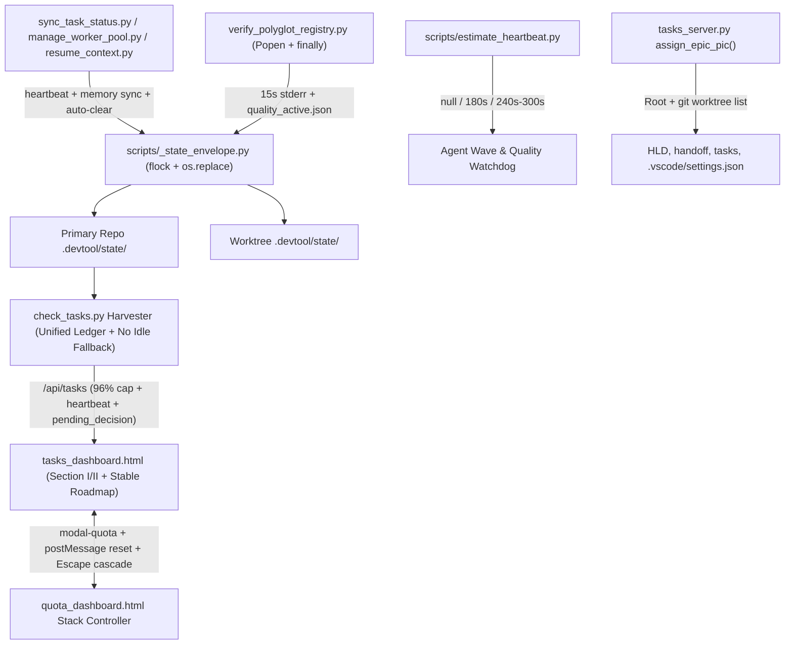

# Runtime State Sync, Hybrid Heartbeat, and Dashboard Hardening High-Level Design

## Table of Contents

- [Meta Data](#meta-data)
- [Background](#background)
- [Goals and Non-Goals](#goals-and-non-goals)
- [Architecture and Technical Design](#architecture-and-technical-design)
- [Feature Maintenance Map](#feature-maintenance-map)
- [Module Contracts and CLI Interfaces](#module-contracts-and-cli-interfaces)
- [Impact Analysis](#impact-analysis)
- [Shared Contract Impact](#shared-contract-impact)
- [Integration Test Plan and Boundary Matrix](#integration-test-plan-and-boundary-matrix)
- [Verification Environment](#verification-environment)
- [Comprehensive BDD Scenario Coverage](#comprehensive-bdd-scenario-coverage)
- [Rollout Strategy and Mitigation](#rollout-strategy-and-mitigation)
- [Kanban Tasks Breakdown](#kanban-tasks-breakdown)
- [Spec Errata](#spec-errata)

## Meta Data

- **Epic name**: `runtime_sync_and_dashboard_hardening`
- **Status**: Packaged (2026-11-13)
- **PIC**: `brother`
- **Target release**: Next plugin release
- **Platform**: Python tooling, dashboard HTML/JS UI, and agent workflow kit
- **Depends on epic**: none
- **Source Spec**: [Approved Runtime State Sync, Hybrid Heartbeat, and Dashboard Hardening Design Spec](2026-11-13-runtime-sync-and-dashboard-hardening-design.en.md)

## Background

During recent multi-agent epics under `d3nexus:dev-lifecycle`, eight tightly coupled runtime observability, packaging, cleanup, and dashboard defects created friction across execution and review workflows:

1. **Silent long-running execution & no watchdog estimation**: Multi-subagent waves and `verify_polyglot_registry.py` (`L240-L440`) run capabilities via blocking `subprocess.run(..., capture_output=True)` with zero live progress stream on `stderr` or disk, and agents lack a lightweight estimator deciding when a watchdog heartbeat (`schedule()`) is warranted versus zero-token silence.
2. **Stale Two-Tier Memory & Section II Dashboard**: `sync_task_status.py` (`sync_task`, `sync_epic`) and `manage_worker_pool.py` mutate Kanban markdown and slot worktrees without refreshing `.devtool/state/<epic_slug>.md` / `.devtool/assistant_state.md` or emitting heartbeat snapshots, while `tasks_dashboard.html` (`L2724`, `L2938`) checks only `tier2Sig = [act, stg, wt]` and misses `account_id`, `prompt`, `is_human_action_required`, `task_progress`, heartbeat, and active quality runs.
3. **Sequential Handoff Prompt & Stage 3 `--revise` Failure**: `resume_context.py` (`emit_handoff_prompt` `L1770-L1783`) and `skills/dev-lifecycle/references/handoff-template.md` instruct sequential task execution, while `package_epic.py --revise` (`L292-L306`) unconditionally invokes `check_epic_readiness.py` -> `check_task_contract.py --design`, failing Stage 3 revisions with `<pattern> is marked (new) but already exists` on completed tasks.
4. **Orphaned Worker Slot Resources**: Interrupted or completed waves leave `.worktrees/<epic>-slot-*` directories and `worker/<epic>/slot-*` / `epic/<slug>-slot-*` branches behind without automated cleanup before Gate 4 or branch integration.
5. **False-Positive Approval Bottlenecks & Uncleared Pause Markers**: `check_tasks.py` (`resolve_active_epic` `L434-L537`) falls back alphabetically onto unstarted directories (`choosing_a_lifecycle`) and synthesizes `Approve Gate 1 (Design Spec)` (`L1240-L1258`), `parse_gate_ledger_entries()` (`L1007-L1065`) short-circuits on older `gate_ledger.jsonl` files when `GATE_LEDGER.md` holds newer approvals, and no explicit Choice A `pending_decision.json` save/clear protocol exists.
6. **99% Pre-Finish Ceiling / Uncapped Section II**: Section I sidebar (`renderKanbanDashboard` `L2252`, `L2255`, `L2277`) caps all-tasks-done-pre-finish progress at `99%` (`⚡ 99% Review`) while Section II (`renderExecutionEpics` `L2037`) renders raw `100%` without checking Gate 4 convergence; both must enforce the **`96%`** pre-finish ceiling (`95%` in-progress, `100%` reserved strictly for Gate 4 converged Waiting Finish / Gate 5 Done).
7. **Broken PIC Assignment & Volatile Roadmap Sorting**: `assign_epic_pic()` (`tasks_server.py` `L520-L678`) misses worktree `.devtool/epic/<epic>/` copies and `- **PIC / Assigned Profile**:` lines while polluting unrelated prose (`bdd_scenarios.*`, `principal_review.md`), and `tasks_dashboard.html` (`sortEpicsForRoadmap` `L1721`, polling `L2696-L2715`, `updateEpicPic` `L1642`) re-sorts rows on second-level `mtime` bumps, destroys focused `<select>` controls mid-interaction, and checks the wrong `active` class on `modal-epics`.
8. **Layered Check-Quota Dialogs**: `quota_dashboard.html` (`L407-L765`, `L3570-L3885`, `L4056-L4081`) lets inner dialogs (`#scheduleModal`, `#loginModal`, `#profileInfoModal`, `#appealDetailModal`) overlap simultaneously inside `#modal-quota`, omits `#profileInfoModal` and `#appealDetailModal` from click guards, and allows `Escape` to bypass inner dialogs and dismiss the parent iframe.

## Goals and Non-Goals

### Goals

- Deliver an atomic file-based **Runtime State Envelope** (`scripts/_state_envelope.py`) writing `<epic_slug>.heartbeat.json`, `quality_active.json`, and `pending_decision.json` under `fcntl.flock` + `os.replace` to **both** the active worktree `.devtool/state/` and the primary repo `.devtool/state/`, mechanically syncing `<epic_slug>.md` and `assistant_state.md`.
- Implement hybrid progress observability: `scripts/estimate_heartbeat.py` (`light -> null`, `medium -> 180`, `heavy -> 240/300`) plus zero-token `15s` (configurable) `stderr` progress lines and `finally`-safe `quality_active.json` telemetry in `verify_polyglot_registry.py`.
- Switch `emit_handoff_prompt` (`implement`) and `handoff-template.md` to wave-parallel execution, fix `package_epic.py --revise` for Stage 3 via `--post-design` + `--allow-existing-done-new`, and enforce worker pool slot cleanup in `manage_worker_pool.py cleanup`, `integrate_branch.py`, and `dev-implementation/SKILL.md`.
- Implement Choice A approval bottleneck save/auto-clear (`--pending-decision`, `--clear-decision`), remove idle alphabetical false positives and unify gate ledgers in `check_tasks.py`, lower the pre-finish ceiling to **`96%`** across backend and Section I/II UI, and stream live Section II telemetry without reloads.
- Fix `assign_epic_pic()` across root + worktrees on PIC-bearing files only, stabilize `sortEpicsForRoadmap` with `data-row-key` and focus preservation, and enforce a single-layer Modal Stack Controller + parent `postMessage` reset between `tasks_dashboard.html` and `quota_dashboard.html`.

### Non-Goals

- Adding external background daemon databases, Redis, or SQLite lock servers (standard library `fcntl.flock` + atomic `os.replace` suffices).
- Invoking LLM APIs inside `estimate_heartbeat.py` or `verify_polyglot_registry.py`.
- Modifying source code or `.devtool/` directories inside unrelated downstream repositories (`lyrics-sync`, `D3Nexus`, `nexus`), or committing pre-existing local snapshot diffs (`PROFILES_DATA` in `quota_dashboard.html`, `.vscode/settings.json`).

## Architecture and Technical Design

### High-Level Architecture



### Runtime State Envelope and Two-Tier Memory Synchronization

1. **Dual-Root Transactional Atomicity (`scripts/_state_envelope.py`)**:
   - `resolve_shared_devtool_dirs(start_path)` resolves unique `.devtool/` directories ordered with the primary repository root (`git rev-parse --git-common-dir` parent) first and the active worktree root (`git rev-parse --show-toplevel`) second.
   - `run_state_transaction()` / domain helpers (`update_epic_heartbeat`, `record_pending_decision`, `clear_pending_decision`, `update_quality_run`) hold a canonical primary-root `fcntl.flock` lock (`.devtool/state/.state_envelope.lock`) over read -> merge -> monotonic `generation += 1` increment -> atomic sibling-temp + `os.replace()` write to primary root -> mirrored atomic write to any active worktree root (rejecting stale lower-generation writes so interleaved RMW updates never drop slots or diverge across mirrors). `read_json_safe(path, default)` catches `OSError`/`json.JSONDecodeError`.
2. **Mechanical Two-Tier Sync**:
   - `sync_task_status.py` (`sync_task`, `sync_epic`) calls `update_epic_heartbeat()` (recording task/wave transitions) and mechanically updates active task tally + timestamp in `.devtool/state/<epic_slug>.md` + `.devtool/assistant_state.md` via `resume_context.render_assistant_state_rollup()` under `.devtool/.memory.lock`.
   - When `sync_task_status.py` sets a task to `in-progress` or `done`, it calls `clear_pending_decision(..., epic_slug=<epic_slug>)` so only the matching epic's bottleneck clears without touching sibling epic decisions.

### Hybrid Heartbeat Estimator and Quality Progress Stream

1. **Rule-Based Pre-Flight Estimator (`scripts/estimate_heartbeat.py`)**:
   - Pure deterministic scorer accepting `--tasks-count`, `--files-count`, `--epic-dir`, `--wave`, `--quality-profile` (`fast|pr|epic|release|full`), and `--has-e2e`.
   - Formula adds base setup (`5s`), per-task weight (`25s` * `tasks_count`), per-file complexity (`5s` * `files_count`), quality profile baseline (`fast: 15s`, `pr: 120s`, `epic: 210s`, `release/full: 245s`), and E2E bonus (`240s` when `--has-e2e`).
   - Maps `< 60s` -> tier `"light"`, `recommended_interval_sec: null` (skip `schedule()`, e.g. 0 tasks/0 files -> `5s`, 1 task/1 file -> `35s`); `60..240s` -> `"medium"`, `180` (e.g. 2 tasks/5 files -> `80s`); `> 240s` -> `"heavy"`, `240` (e.g. `--quality-profile full` -> `250s`), upgrading `"heavy"` strictly to `300` when `--has-e2e` is set.
2. **Zero-Token Live Quality Stream (`verify_polyglot_registry.py`)**:
   - Assigns each invocation a unique `run_id`, launches capability subprocesses via `subprocess.Popen(..., start_new_session=True)` streaming into run-isolated logs `build/quality/<provider_id>/runs/<run_id>/<cap_name>.log`.
   - Poll loop wakes every `heartbeat_interval` (default `15.0s`, parameterized in Python API and CLI `--heartbeat-interval` for sub-second tests) to print `[quality_check] <i>/<n> <provider>:<cap> (<elapsed>s elapsed)` to `stderr` and refresh namespaced `runs[run_id]` (`run_id`, `epic_slug`, `pid`, `host`, `updated_at`, `ttl_sec`) inside `.devtool/state/quality_active.json` under run-ownership locking.
   - Registers `SIGINT`/`SIGTERM` handlers (safely chaining prior handlers on exit) alongside `try ... finally` to terminate + reap active child process groups cleanly and finalize only `runs[run_id]` as `"passed"`, `"failed"`, or `"aborted"` (`finished_at`, `elapsed_sec`) without clobbering sibling concurrent runs. Consumer readers expire dead local PIDs or overdue `ttl_sec` entries to `"stale"`.

### Stage 3 Revise Compatibility, Wave Handoff, and Pool Cleanup

1. **Wave-Parallel Handoff (`resume_context.py` + `handoff-template.md`)**:
   - `emit_handoff_prompt(mode="implement")` emits instructions to compute parallel waves via `compute_execution_order.py <epic_slug> --parallel`, run `estimate_heartbeat.py` before waves and Gate 4, execute multi-task waves across `manage_worker_pool.py` / `workspace:"share"` subagents, verify + merge each wave, and run safe `manage_worker_pool.py cleanup`.
2. **Stage 3 `--revise` Bypass (`package_epic.py` -> `check_epic_readiness.py` -> `check_task_contract.py`)**:
   - `package_epic.py --revise` detects Stage 3 entry via Gate 3 presence in `gate_ledger.jsonl` / `GATE_LEDGER.md` OR any task in status `in-progress`, `review`, or `done`, passing `--post-design` to `check_epic_readiness.py`.
   - `check_epic_readiness.py --post-design` forwards `--allow-existing-done-new` to `check_task_contract.py --design`. When active, **strictly** tasks with status `done`, `review`, or `in-progress` skip the `<pattern> is marked (new) but already exists` error on their own created Allowed/Evidence files, while colliding `todo` `(new)` declarations and duplicate `(new)` claims across tasks still fail alongside all structural/range/BDD rules.
3. **Worker Pool Slot Producers & Safe Preservation Cleanup (`manage_worker_pool.py` + `integrate_branch.py`)**:
   - Explicit envelope producers update `<epic_slug>.heartbeat.json`: `manage_worker_pool.py init` registers slots as `"idle"` (`--wave`), `sync --slot N [--task <id>] [--wave <k>]` sets `"working"` + `task_id` + `active_wave`, `merge --slot N` resets to `"idle"`, and `resume_context.py --wave <k>` sets `active_wave`.
   - Safe `cleanup_slots()` (default mode) checks slot worktrees (`git status --porcelain`) AND branch ancestry against `epic/<slug>`/`base` (even when `slot_path` directory is missing): deletes ONLY clean, integrated slots and merged branches (`git worktree prune`), clearing only deleted slots from `heartbeat.json`; preserves & reports dirty worktrees, unmerged commits, and missing-worktree unmerged orphan branches (`preserved_dirty`/`preserved_unmerged`, non-zero exit unless `--discard-unmerged` / `--force` is given). Supports `--stale-only`. `integrate_branch.py cmd_land` runs safe cleanup after landing, and `dev-implementation/SKILL.md` mandates slot tracking + pre-Gate-4 safe `cleanup`.

### Approval Bottleneck Choice A, Unified Ledger, 96% Cap, and PIC Sync

1. **Choice A Pending Decision & Idle False-Positive Elimination**:
   - `resume_context.py` gains `--pending-decision "<reason>"`, `--decision-kind <kind>`, `--decision-id <id>`, and `--clear-decision`, storing epic-namespaced entries inside `.devtool/state/pending_decision.json` (`decisions[epic_slug] = {decision_id, epic, ...}`). Gate approvals (`--gate --epic`), non-paused `--state --epic`, `sync_task_status.py`, and `package_epic.py` clear ONLY the matching `epic` (and optional `decision_id`), leaving concurrent epic decisions intact.
   - `check_tasks.py`: `resolve_active_epic()` removes **Strategy 7** (`check_tasks.py:519-536`) alphabetical `.devtool/epic/` fallback while preserving **Strategy 6** (`check_tasks.py:508-517`) `.devtool/features/` scan so idle repos report `active_epic = None`; `derive_lifecycle_state()` removes implicit `Approve Gate 1 (Design Spec)` unless backed by matching epic `pending_decision` or an explicitly awaiting Gate 1 checkpoint; `parse_gate_ledger_entries()` merges root + active worktree `gate_ledger.jsonl` AND `GATE_LEDGER.md` chronologically; `scan_repo()` expires dead/overdue `quality_active` runs to `"stale"` and exposes concurrent live `quality_runs`.
2. **96% Ceiling & Live Section II (`check_tasks.py` & `tasks_dashboard.html`)**:
   - Both `renderExecutionEpics()` (`L2037`, replacing raw `Math.round((doneCount / totalCount) * 100)`) and `renderKanbanDashboard()` (`L2252`, `L2255`, `L2277`, replacing `99`/`98` literals) alongside `check_tasks.py` cap pre-finish all-tasks-done progress at **`96%`** (`⚡ 96% Review`) and in-progress at **`95%`**; `100%` requires `isWaitingFinish` (Gate 4 converged Sign-off) or `isFullyDone` (Gate 5 Done).
   - `tier2Sig` at mount (`L2938`) and poll (`L2724`) tracks `account_id`, `prompt`, `is_human_action_required`, `task_progress`, `pending_decision`, `heartbeat`, and `quality_active`, updating Section II cards incrementally.
3. **PIC Root + Worktree Sync & Roadmap Stability (`tasks_server.py` & `tasks_dashboard.html`)**:
   - `assign_epic_pic()` discovers matched worktrees via `git worktree list --porcelain` (branch `epic/<slug>` or worktree dir `<epic_dir>`/`<slug>`) alongside root, updating **only** HLD (`<epic>.{en,vi}.md`, design specs), `handoff.md` (including `- **PIC / Assigned Profile**:`), `task_*.md` in `.devtool/epic/<epic>/` & `.devtool/features/`, `.pipeline.json`, `.heartbeat.json`, and worktree `.vscode/settings.json`. Prose/review files (`bdd_scenarios.*`, `principal_review.md`, `review_results.md`, `fix_plan_*.md`, `manual_smoke_checklist.md`) are never modified. Unknown/invalid PIC inputs raise `ValueError`, caught in `do_POST()` (`L799-812`) to return HTTP `400`.
   - `sortEpicsForRoadmap` drops second-level `mtime` thrash in favor of status category + `active_epic` + created/date-day + deterministic tie-breakers, adds `data-row-key="<repo>:<slug>"`, skips `roadmapTbody.innerHTML` replacement while a `.select-pic-roadmap` holds focus, aligns mount vs poll `roadmapSig`, and fixes `modal-epics` `style.display === 'flex'` check.
4. **Check-Quota Single Modal Stack Controller (`quota_dashboard.html` & `tasks_dashboard.html`)**:
   - Single `openQuotaSubModal` / `closeQuotaSubModal` / `closeAllQuotaSubModals` registry over `['scheduleModal', 'loginModal', 'profileInfoModal', 'appealDetailModal']` enforces max `1` open inner modal, fixes backdrop clicks + `Escape` precedence (inner sub-modal -> `handleCardClose()`), flattens `#dashboardCard` on `?embedded=1` (appended by `openQuotaModal()` / `refreshQuotaIframe()` at `L1470-1511`), checks `window.parent !== window`, and resets all sub-modals via `{ action: 'reset_quota_submodals' }` (`e.data.action`) when `#modal-quota` closes.

## Feature Maintenance Map

| Component / Document | Purpose & Ownership | Tasks |
| :--- | :--- | :--- |
| `scripts/_state_envelope.py` | Shared atomic JSON envelope, dual-root resolver, heartbeat/decision/quality writers | Task 01 |
| `scripts/estimate_heartbeat.py` | Zero-LLM workload/quality duration & heartbeat cadence estimator CLI | Task 02 |
| `scripts/resume_context.py` | Heartbeat/decision hooks, `--pending-decision` / `--clear-decision`, wave-parallel `emit_handoff_prompt` | Task 01, Task 03 |
| `skills/quality_check/resources/scripts/verify_polyglot_registry.py` | `Popen` live `stderr` heartbeats + `finally`-safe `quality_active.json` | Task 02 |
| `skills/dev-implementation/resources/scripts/package_epic.py` | Stage 3 auto-detection for `--post-design` during `--revise`, auto-clear `pending_decision` | Task 03 |
| `skills/dev-implementation/resources/scripts/check_epic_readiness.py` | `--post-design` flag forwarding `--allow-existing-done-new` | Task 03 |
| `skills/dev-implementation/resources/scripts/check_task_contract.py` | `--allow-existing-done-new` exemption strictly for `done`/`review` tasks under `--design` | Task 03 |
| `skills/dev-implementation/resources/scripts/sync_task_status.py` | Mechanical heartbeat + Two-Tier sync + `pending_decision` clear on task/epic update | Task 01 |
| `skills/dev-implementation/resources/scripts/manage_worker_pool.py` | Slot worktree/branch/heartbeat cleanup & `--stale-only` pruning | Task 03 |
| `skills/finishing-a-development-branch/resources/scripts/integrate_branch.py` | Automatic orphan worker slot cleanup during branch `land` | Task 03 |
| `skills/check-tasks/resources/scripts/check_tasks.py` | Remove idle fallback/implicit Gate 1, unify ledgers, ingest envelope JSON, `96%` cap backend | Task 04 |
| `skills/check-tasks/resources/scripts/tasks_server.py` | Root + worktree matched `assign_epic_pic()` on PIC-bearing files only + path safety | Task 04 |
| `skills/check-tasks/resources/dashboard/tasks_dashboard.html` | `96%` cap UI, Section II live `tier2Sig`, stable Roadmap `data-row-key` & focus guard, `?embedded=1` quota reset | Task 05 |
| `skills/check-quota/resources/dashboard/quota_dashboard.html` | Single Modal Stack Controller (`max=1`), click/Escape guards, `?embedded=1`, `postMessage` reset | Task 06 |
| `rules/CRITICAL_RULES.md` & Skill Markdown Docs | Concise rules (`<= 8192` bytes) for Choice A pause/clear, wave cleanup, estimator pre-flight | Task 02, Task 03 |
| `tests/test_runtime_sync_and_dashboard_hardening.py`, `.agents/quality/python-quality.json`, `scripts/verify.sh` | Cross-layer unit + Tier C integration + Node DOM suite registration & standing `python-quality.json` coverage | Task 07 |

## Module Contracts and CLI Interfaces

### `_state_envelope.py` JSON Contracts (`.devtool/state/`)

- **`<epic_slug>.heartbeat.json`**:
  ```json
  {
    "schema_version": 1,
    "generation": 4,
    "epic_slug": "runtime-sync-and-dashboard-hardening",
    "stage": "Stage 3 Phase 2 (TDD)",
    "active_wave": 1,
    "active_tasks": ["task_01_runtime_state_envelope_and_two_tier_sync"],
    "slots": {"1": {"task_id": "task_01", "path": ".worktrees/...", "status": "working"}},
    "last_event": "manage_worker_pool sync slot 1 working task_01",
    "updated_at": "2026-11-13T09:20:00+00:00"
  }
  ```
- **`quality_active.json`** (namespaced per `run_id` with compatibility summary + lease TTL):
  ```json
  {
    "schema_version": 1,
    "generation": 2,
    "run_id": "20261113T092000Z-1234-a1b2",
    "profile": "epic",
    "status": "running",
    "runs": {
      "20261113T092000Z-1234-a1b2": {
        "run_id": "20261113T092000Z-1234-a1b2",
        "epic_slug": "runtime-sync-and-dashboard-hardening",
        "profile": "epic",
        "status": "running",
        "provider": "python-qa",
        "capability": "test",
        "step_index": 3,
        "step_total": 4,
        "pid": 12345,
        "host": "workstation.local",
        "ttl_sec": 490,
        "started_at": "2026-11-13T09:20:00+00:00",
        "updated_at": "2026-11-13T09:20:45+00:00",
        "finished_at": null,
        "elapsed_sec": 45.0
      }
    }
  }
  ```
- **`pending_decision.json`** (namespaced per `epic` + `decision_id` with active compatibility summary):
  ```json
  {
    "schema_version": 1,
    "generation": 1,
    "active": true,
    "epic": "runtime-sync-and-dashboard-hardening",
    "decision_id": "dec-20261113T092000Z-a1b2",
    "decisions": {
      "runtime-sync-and-dashboard-hardening": {
        "decision_id": "dec-20261113T092000Z-a1b2",
        "active": true,
        "epic": "runtime-sync-and-dashboard-hardening",
        "kind": "gate_2_choice",
        "reason": "Confirm Gate 2 task breakdown or Auto vs Handoff mode",
        "stage": "Stage 2 (Architecture)",
        "worktree": "/abs/path",
        "created_at": "2026-11-13T09:20:00+00:00"
      }
    }
  }
  ```

### CLI Interfaces

- `python3 scripts/estimate_heartbeat.py [--tasks-count N] [--files-count N] [--epic-dir SLUG] [--wave N] [--quality-profile fast|pr|epic|release|full] [--has-e2e] [--json]`
  Outputs `{estimated_sec, tier, recommended_interval_sec, reason}`.
- `python3 scripts/resume_context.py --detect-profile` (returns active Antigravity profile identifier: `AGY_PROFILE` / `ANTIGRAVITY_PROFILE` -> `/antigravity_homes/<profile>` folder name -> running IDE `--user-data-dir` / `workspaceStorage` -> `.vscode/settings.json` `[@profile]` -> `USER`, so whichever profile creates an epic is automatically recorded as `- **PIC**: <profile>` in HLD and `handoff.md`).
- `python3 scripts/resume_context.py --pending-decision "<reason>" [--decision-kind <kind>] [--decision-id <id>] --epic <slug>` / `--clear-decision --epic <slug> [--decision-id <id>]` / `--wave <k>`
- `python3 skills/dev-implementation/resources/scripts/manage_worker_pool.py sync --epic-dir <dir> --epic-slug <slug> --slot <n> [--task <id>] [--wave <k>]`
- `python3 skills/dev-implementation/resources/scripts/manage_worker_pool.py cleanup --epic-dir <dir> --epic-slug <slug> [--stale-only] [--discard-unmerged]`
- `python3 skills/dev-implementation/resources/scripts/check_epic_readiness.py <epic_dir> [--post-design]`
- `python3 skills/dev-implementation/resources/scripts/check_task_contract.py --hld <hld> --tasks <t...> [--design] [--allow-existing-done-new]`

## Impact Analysis

Shift-Left `check_code_impact.py --files ... --base-ref main` reported:
- **Upstream Git Status**: Clean (`0` unmerged commits against `main`). Note: pre-existing local uncommitted changes in `skills/check-quota/resources/dashboard/quota_dashboard.html` (`PROFILES_DATA` runtime snapshot) and `.vscode/settings.json` MUST NOT be committed via `git add -A`.
- **Protected & Unprotected Surface Assessment**:
  - 10 Python modules already have paired test suites (`scripts/test_resume_context.py`, `tests/test_polyglot_gate4.py`, `tests/test_multi_epic_governance_acceptance.py`, `skills/dev-implementation/resources/scripts/test_check_epic_readiness.py`, `test_check_task_contract.py`, `test_sync_task_status.py`, `test_manage_worker_pool.py`, `skills/finishing-a-development-branch/resources/scripts/test_integrate_branch.py`, `tests/test_check_tasks_fsm.py`, `tests/test_check_tasks_server.py`).
  - `skills/check-tasks/resources/dashboard/tasks_dashboard.html` and `skills/check-quota/resources/dashboard/quota_dashboard.html` were flagged at `0.0%` automated JS DOM coverage (`🔴 UNPROTECTED CODE`). Task 05, Task 06, and Task 07 close this gap with real extracted-script DOM/event integration tests executing under Node `v25.6.0` plus live `TasksServer` HTTP tests.
  - Note: `skills/dev-implementation/resources/scripts/test_manage_worker_pool.py` (`L41-L42`) explicitly asserts `get_slot_branch("logging-refactor", 1) == "epic/logging-refactor-slot-1"`. We preserve existing `get_slot_branch` naming and handle both `epic/<slug>-slot-*` and `worker/<epic>/slot-*` branch patterns in `cleanup_slots()` so zero existing tests break.
  - Note: `rules/CRITICAL_RULES.md` currently sits at `7760` bytes (`432` bytes under the `8192`-byte truncation ceiling). Any additions must trim/tighten phrasing proportionally to stay strictly `<= 8192` bytes.

## Shared Contract Impact

None — self-contained feature in `ai-agent-tools` plugin kit. All new `.devtool/state/*.json` envelopes and CLI flags (`--post-design`, `--allow-existing-done-new`, `--pending-decision`, `--clear-decision`, `--stale-only`) are strictly additive and backward-compatible with downstream consumer repositories (`lyrics-sync`, `D3Nexus`, `nexus`).

## Integration Test Plan and Boundary Matrix

Integration test roots: tests
Protected paths: .devtool/epic/runtime_sync_and_dashboard_hardening/bdd_scenarios.en.md
Integration results: python3 -m pytest -q --tb=short --maxfail=3 --junitxml=build/test-results/runtime-sync-and-dashboard-hardening.xml tests/test_rsdh_state_envelope.py tests/test_rsdh_heartbeat_quality.py tests/test_rsdh_orchestration.py tests/test_rsdh_harvester_and_pic.py tests/test_rsdh_tasks_dashboard_ui.py tests/test_rsdh_quota_modal_stack.py tests/test_runtime_sync_and_dashboard_hardening.py tests/test_check_tasks_server.py tests/test_check_tasks_fsm.py tests/test_check_tasks_harvester.py tests/test_check_tasks_cli.py tests/test_check_tasks_e2e.py tests/test_polyglot_gate4.py tests/test_gate_approval_ledger.py tests/test_multi_epic_governance_acceptance.py -> build/test-results/runtime-sync-and-dashboard-hardening.xml

| Layer Boundary | Real Fixture / Harness | Behavior Asserted | Covered Scenarios |
| :--- | :--- | :--- | :--- |
| `_state_envelope` + Git Worktree | Temp git repo + `git worktree add` + `ProcessPoolExecutor` | Canonical transaction `flock`, zero lost RMW slot updates, matching primary+worktree `generation`, namespaced envelopes, corrupt fallback | `RSDH-HP-01`, `RSDH-EC-01`, `RSDH-AR-01`, `RSDH-FR-01` |
| Estimator + Polyglot Runner | Subprocess `Popen` (`start_new_session=True`) test capabilities + fast `--heartbeat-interval` + `SIGTERM` | Tier calculation (`null`/`180`/`240`/`300`), `runs/<run_id>/<cap>.log` isolation, `runs[run_id]` updates, `SIGTERM` child reaping -> `"aborted"` without sibling clobbering | `RSDH-HP-02`, `RSDH-HP-03`, `RSDH-EC-02`, `RSDH-FR-02`, `RSDH-FR-07` |
| Handoff + Stage 3 Revise + Pool | Temp Stage 2 & Stage 3 git epics + real `git worktree` slots | Wave-parallel handoff, creator profile PIC stamping, Stage 3 `--revise` ownership (`done`/`review`/`in-progress` vs colliding `todo`), live working slots -> safe cleanup preservation vs `--discard-unmerged`, multi-epic Choice A isolation, `CRITICAL_RULES.md <= 8192B` | `RSDH-HP-04`, `RSDH-HP-05`, `RSDH-EC-03`, `RSDH-EC-08`, `RSDH-ST-01`, `RSDH-ST-03`, `RSDH-ST-07`, `RSDH-FR-03` |
| Harvester + `TasksServer` HTTP | Live bound `127.0.0.1` `TasksServer` + multi-worktree repo + `/api/epic/pic` POST | Idle repo `None`, ledger union, per-epic `pending_decision`, live `quality_runs` & stale dead-PID/`ttl_sec` recovery, root+worktree PIC update on allowed files only, HTTP `400` validation | `RSDH-HP-06`, `RSDH-EC-04`, `RSDH-EC-05`, `RSDH-ST-02`, `RSDH-ST-04`, `RSDH-AR-03`, `RSDH-FR-04` |
| Dashboard & Quota DOM / Chrome CDP | Headless `node` (`v25.6.0`) script checks PLUS **provisioned real headless Chrome CDP** (`CHROME_BIN` / local Google Chrome + `node v25` `WebSocket`) | `96%` cap in Section I/II, live `tier2Sig` updates, sub-day `mtime` removed + native `<select>` focus retention under polling, `getComputedStyle` `?embedded=1` card flattening, real parent/iframe `Escape`/backdrop/`postMessage` reset with zero console errors | `RSDH-HP-07`, `RSDH-HP-08`, `RSDH-EC-06`, `RSDH-EC-07`, `RSDH-ST-05`, `RSDH-ST-06`, `RSDH-AR-02`, `RSDH-FR-05` |
| End-to-End Cross-Layer Suite | Live `TasksServer` + git worktrees + CLI subprocesses + real Chrome CDP parent+iframe harness + `verify.sh --quiet` | Cross-layer regression invariants, `CRITICAL_RULES.md <= 8192B`, zero snapshot pollution | `RSDH-HP-09`, `RSDH-FR-06` |

## Verification Environment

- **Runtime & Test Tooling**: `Python 3.15.2`, `pytest 9.2.0`, `ruff` (resolved against `~/.config/ruff/ruff.toml` when no local `ruff.toml` exists; `.agents/quality/python-quality.json` scopes standing `format`/`lint`/`type_check` targets and Task 07 extends them to `scripts/_state_envelope.py` and `scripts/estimate_heartbeat.py`), `Node.js v25.6.0` (`/opt/homebrew/bin/node`), `Google Chrome 156.0.8078.49` (`/Applications/Google Chrome.app/Contents/MacOS/Google Chrome`), `bash scripts/verify.sh --full --quiet`.
- **Browser Integration Harness (Node + Provisioned Headless Chrome CDP)**: `playwright` Python/CLI package is not installed (`playwright_pkg: False`), so Tasks 05–07 combine fast headless `node v25` DOM script unit checks WITH a **provisioned real headless Google Chrome CDP harness** (`CHROME_BIN` -> `/Applications/Google Chrome.app/Contents/MacOS/Google Chrome` -> `google-chrome`/`chromium` launched headless on `--remote-debugging-port=0` and controlled via `node v25` built-in `WebSocket` + `fetch`, zero external package installs) against live bound `127.0.0.1` `TasksServer`. This directly verifies rendered CSS (`window.getComputedStyle`), native `<select>` focus under 5s polling despite distinct same-day `mtime` values, and real parent/iframe `Escape`/backdrop/`postMessage` transitions with zero console or runtime exceptions.
- **Database / External Services**: None (`tmp_path` real git repositories and local HTTP loopback sockets only).

## Comprehensive BDD Scenario Coverage

All 34 adversarial BDD scenarios defined in [BDD Scenarios](bdd_scenarios.en.md) across Happy Path (`HP`), Edge Cases (`EC`), State Transitions (`ST`), Async & Concurrency (`AR`), and Failure Recovery (`FR`) map deterministically to Kanban tasks:

| BDD ID | Tier | Dimension | Summary | Assigned Task |
| :--- | :--- | :--- | :--- | :--- |
| `RSDH-HP-01` | Tier C | Happy Path | Dual-root atomic heartbeat + mechanical Two-Tier Memory sync | Task 01 |
| `RSDH-EC-01` | Tier A | Edge Case | Safe fallback on missing, empty, or corrupt state JSON | Task 01 |
| `RSDH-AR-01` | Tier C | Concurrency | Canonical transaction `flock` serializes interleaved slot RMW updates & matching `generation` mirrors | Task 01 |
| `RSDH-FR-01` | Tier C | Failure Recovery | Recoverable stale heartbeat after interrupted execution | Task 01 |
| `RSDH-HP-02` | Tier A | Happy Path | Estimator maps light/medium/heavy tasks to `null`/`180`/`240`/`300` | Task 02 |
| `RSDH-HP-03` | Tier C | Happy Path | `verify_polyglot_registry.py` isolates concurrent runs (`runs[run_id]`, `runs/<run_id>/<cap>.log`) & `stderr` ticks | Task 02 |
| `RSDH-EC-02` | Tier A | Edge Case | Estimator zero-count and `--has-e2e` ceiling handling (`300s`) | Task 02 |
| `RSDH-FR-02` | Tier C | Failure Recovery | Failing `run_id` finalizes to `"failed"` without clobbering concurrent runs | Task 02 |
| `RSDH-FR-07` | Tier C | Failure Recovery | `SIGTERM` traps, terminates & reaps child process group, finalizing only aborted `run_id` | Task 02 |
| `RSDH-HP-04` | Tier C | Happy Path | `emit_handoff_prompt` + `handoff-template.md` use wave-parallel instructions | Task 03 |
| `RSDH-HP-05` | Tier C | Happy Path | Pool updates live `"working"` slots & `active_wave` before cleanup clears clean slots | Task 03 |
| `RSDH-EC-03` | Tier C | Edge Case | Stage 3 `--revise` accepts `done`/`review`/`in-progress` `(new)` files while failing colliding `todo` `(new)` | Task 03 |
| `RSDH-ST-01` | Tier C | State Transition | Namespaced `pending_decision` isolates concurrent epics on pause/clear | Task 03 |
| `RSDH-ST-02` | Tier C | State Transition | Gate ledger merge across root + worktree `jsonl` and `GATE_LEDGER.md` | Task 04 |
| `RSDH-ST-03` | Tier C | State Transition | `cleanup --stale-only` & safe `integrate_branch.py land` orphan cleanup | Task 03 |
| `RSDH-ST-07` | Tier C | State Transition | Pool cleanup preserves dirty worktrees, unmerged commits & missing-worktree branches unless `--discard-unmerged` | Task 03 |
| `RSDH-FR-03` | Tier C | Failure Recovery | `CRITICAL_RULES.md <= 8192B` & `verify.sh` §1–§10 structural integrity | Task 03 |
| `RSDH-HP-06` | Tier C | Happy Path | `assign_epic_pic()` syncs root + worktree PIC files only, skipping prose/reviews | Task 04 |
| `RSDH-EC-04` | Tier A | Edge Case | Idle repo returns `active_epic=None` and `is_human_action_required=False` | Task 04 |
| `RSDH-EC-05` | Tier A | Edge Case | `assign_epic_pic()` raises `ValueError` (`400` in HTTP) & isolates sibling epics | Task 04 |
| `RSDH-ST-04` | Tier A | State Transition | `extract_epic_pic()` resolves `**PIC / Assigned Profile**` across root/worktree | Task 04 |
| `RSDH-AR-03` | Tier C | Concurrency | Harvester exposes live `quality_runs`, expires stale PID/TTL to `"stale"`, isolates per-epic `pending_decision` | Task 04 |
| `RSDH-EC-08` | Tier C | Edge Case | Epic creator profile is automatically detected (`--detect-profile`) and stamped as initial PIC | Task 03 |
| `RSDH-FR-04` | Tier C | Failure Recovery | `assign_epic_pic()` partial failure handling reports updated vs skipped cleanly | Task 04 |
| `RSDH-HP-07` | Tier C | Happy Path | `tasks_dashboard.html` shows `96%` cap & updates Section II live via `tier2Sig` | Task 05 |
| `RSDH-EC-06` | Tier C | Edge Case | Roadmap removes sub-day `mtime` sort, pins `data-row-key`, guards `<select>` focus in Chrome CDP | Task 05 |
| `RSDH-ST-05` | Tier C | State Transition | Progress transitions (`75%` / `<=95%` -> `96%` pre-finish -> `100%` Sign-off/Done) | Task 05 |
| `RSDH-AR-02` | Tier C | Concurrency | Live polling preserves active `<select>` focus and renders Section II cleanly | Task 05 |
| `RSDH-HP-08` | Tier C | Happy Path | `quota_dashboard.html` Stack Controller enforces max `1` inner modal + real Chrome iframe reset | Task 06 |
| `RSDH-EC-07` | Tier C | Edge Case | Inner backdrop click & `Escape` dismiss only inner sub-modal inside `#modal-quota` | Task 06 |
| `RSDH-ST-06` | Tier C | State Transition | `?embedded=1` flattens container card `getComputedStyle` padding/borders in Chrome iframe | Task 06 |
| `RSDH-FR-05` | Tier C | Failure Recovery | `Escape` with `0` open inner modals cleanly triggers `handleCardClose()` | Task 06 |
| `RSDH-HP-09` | Tier C | Happy Path | Cross-layer Wave 1–4 orchestration, HTTP server, and Chrome CDP run cleanly | Task 07 |
| `RSDH-FR-06` | Tier C | Failure Recovery | `verify.sh --quiet` & regression suite enforce byte caps and clean state | Task 07 |

*(All 34 `[RSDH-*]` scenarios have 100% 1-to-1 coverage across `task_01`..`task_07`.)*

## Rollout Strategy and Mitigation

- **Wave 1 (Disjoint Foundations)**: Task 01 (`_state_envelope.py`, `sync_task_status.py`, `resume_context.write_epic_state`) and Task 02 (`estimate_heartbeat.py`, `verify_polyglot_registry.py`, `quality_check/SKILL.md`) run in parallel without file overlap.
- **Wave 2 (Orchestration & Gates)**: Task 03 integrates `_state_envelope` into `resume_context` Choice A flags + wave handoff, Stage 3 `--revise` ownership readiness, live slot tracking + safe preservation cleanup, and concise workflow rules (`CRITICAL_RULES.md <= 8192B`).
- **Wave 3 (Parallel Dashboard Layer)**: Task 04 (`check_tasks.py` + `tasks_server.py`), Task 05 (`tasks_dashboard.html`), and Task 06 (`quota_dashboard.html`) execute independently across disjoint backend/frontend files, with Tasks 05–06 adding provisioned Chrome CDP browser tests alongside Node script checks.
- **Wave 4 (Full Verification & Registration)**: Task 07 locks in the full end-to-end suite (`tests/test_runtime_sync_and_dashboard_hardening.py`, including real parent+iframe Chrome CDP verification), extends `.agents/quality/python-quality.json` standing checks to `scripts/_state_envelope.py` + `scripts/estimate_heartbeat.py`, and registers all 7 epic suites in `scripts/verify.sh`, followed by Gate 4 `verify_polyglot_registry.py --profile epic --execute --compact`, `ruff`, and `verify.sh --full --quiet`.

## Kanban Tasks Breakdown

| Task ID | Title | Covers | Blocked By | Wave | Review Tier |
| :--- | :--- | :--- | :--- | :--- | :--- |
| `task_01` | Atomic Runtime State Envelope and Two-Tier Memory Sync | `RSDH-HP-01`, `RSDH-EC-01`, `RSDH-AR-01`, `RSDH-FR-01` | None | 1 | `full` |
| `task_02` | Hybrid Heartbeat Estimator and Live Quality Progress | `RSDH-HP-02`, `RSDH-HP-03`, `RSDH-EC-02`, `RSDH-FR-02`, `RSDH-FR-07` | None | 1 | `full` |
| `task_03` | Wave Handoff, Stage 3 Revise Fix, Pool Cleanup, and Choice A CLI | `RSDH-HP-04`, `RSDH-HP-05`, `RSDH-EC-03`, `RSDH-EC-08`, `RSDH-ST-01`, `RSDH-ST-03`, `RSDH-ST-07`, `RSDH-FR-03` | `task_01`, `task_02` | 2 | `full` |
| `task_04` | Check-Tasks Harvester, Ledger Union, 96% Backend, and PIC Sync | `RSDH-HP-06`, `RSDH-EC-04`, `RSDH-EC-05`, `RSDH-ST-02`, `RSDH-ST-04`, `RSDH-AR-03`, `RSDH-FR-04` | `task_01`, `task_03` | 3 | `full` |
| `task_05` | Tasks Dashboard 96% Ceiling, Section II Live Telemetry, and Roadmap Stability | `RSDH-HP-07`, `RSDH-EC-06`, `RSDH-ST-05`, `RSDH-AR-02` | `task_01`, `task_03` | 3 | `full` |
| `task_06` | Check-Quota Single Modal Stack Controller and Embedded Cleanup | `RSDH-HP-08`, `RSDH-EC-07`, `RSDH-ST-06`, `RSDH-FR-05` | `task_03` | 3 | `full` |
| `task_07` | End-to-End Integration Suite and Verify Registration | `RSDH-HP-09`, `RSDH-FR-06` | `task_01`..`task_06` | 4 | `full` |

## Spec Errata

None yet.

