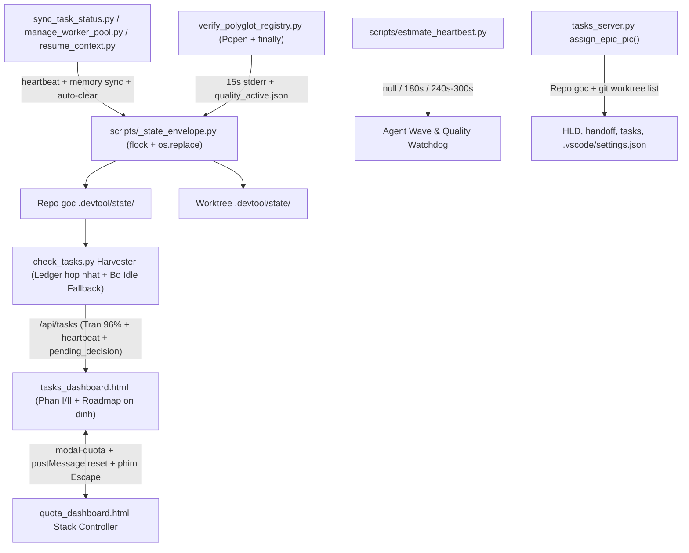

# Thiết kế Cấp cao: Đồng bộ Trạng thái Runtime, Hybrid Heartbeat và Gia cố Dashboard

## Mục lục

- [Meta Data](#meta-data)
- [Bối cảnh](#bối-cảnh)
- [Mục tiêu và Ngoài phạm vi](#mục-tiêu-và-ngoài-phạm-vi)
- [Kiến trúc và Thiết kế Kỹ thuật](#kiến-trúc-và-thiết-kế-kỹ-thuật)
- [Bản đồ Bảo trì Tính năng](#bản-đồ-bảo-trì-tính-năng)
- [Hợp đồng Module và Giao diện CLI](#hợp-đồng-module-và-giao-diện-cli)
- [Phân tích Tác động](#phân-tích-tác-động)
- [Tác động Shared Contract](#tác-động-shared-contract)
- [Kế hoạch Kiểm thử Tích hợp và Ma trận Ranh giới](#kế-hoạch-kiểm-thử-tích-hợp-và-ma-trận-ranh-giới)
- [Môi trường Kiểm thử](#môi-trường-kiểm-thử)
- [Phạm vi Kịch bản BDD toàn diện](#phạm-vi-kịch-bản-bdd-toàn-diện)
- [Chiến lược Triển khai và Giảm thiểu Rủi ro](#chiến-lược-triển-khai-và-giảm-thiểu-rủi-ro)
- [Phân rã Kanban Tasks](#phân-rã-kanban-tasks)
- [Đính chính Đặc tả (Spec Errata)](#đính-chính-đặc-tả-spec-errata)

## Meta Data

- **Epic name**: `runtime_sync_and_dashboard_hardening`
- **Trạng thái**: Done
- **PIC**: `brother`
- **Target release**: Next plugin release
- **Platform**: Python tooling, dashboard HTML/JS UI, and agent workflow kit
- **Depends on epic**: none
- **Source Spec**: [Đặc tả Thiết kế Đồng bộ Trạng thái Runtime, Hybrid Heartbeat và Gia cố Dashboard Được Phê duyệt](2026-11-13-runtime-sync-and-dashboard-hardening-design.vi.md)

## Bối cảnh

Trong các epic đa-agent gần đây theo `d3nexus:dev-lifecycle`, tám lỗi và điểm nghẽn liên hoàn về khả năng quan sát runtime, đóng gói, dọn dẹp và giao diện dashboard đã gây ma sát xuyên suốt luồng thực thi và review:

1. **Thực thi dài im lặng & thiếu ước lượng watchdog**: Các wave nhiều subagent và `verify_polyglot_registry.py` (`L240-L440`) chạy từng capability bằng `subprocess.run(..., capture_output=True)` chặn đứng mà không phát dòng tiến độ live ra `stderr` hay đĩa, và các agent thiếu bộ ước lượng nhẹ để quyết định khi nào cần watchdog (`schedule()`) thay vì giữ im lặng 0-token.
2. **Bộ nhớ Hai tầng & Phần II Dashboard bị cũ**: `sync_task_status.py` (`sync_task`, `sync_epic`) và `manage_worker_pool.py` cập nhật markdown Kanban cùng worktree slot mà không đồng bộ `.devtool/state/<epic_slug>.md` / `.devtool/assistant_state.md` hay phát heartbeat snapshot, trong khi `tasks_dashboard.html` (`L2724`, `L2938`) chỉ theo dõi `tier2Sig = [act, stg, wt]` nên bỏ sót `account_id`, `prompt`, `is_human_action_required`, `task_progress`, heartbeat và các quality runs đang chạy.
3. **Handoff Tuần tự & Lỗi `--revise` ở Stage 3**: `resume_context.py` (`emit_handoff_prompt` `L1770-L1783`) và `skills/dev-lifecycle/references/handoff-template.md` hướng dẫn thực thi tuần tự từng task, còn `package_epic.py --revise` (`L292-L306`) gọi vô điều kiện `check_epic_readiness.py` -> `check_task_contract.py --design`, khiến chỉnh sửa ở Stage 3 bị lỗi `<pattern> is marked (new) but already exists` đối với task đã hoàn tất.
4. **Tài nguyên Worker Slot mồ côi**: Các wave song song hoàn tất hoặc bị ngắt để lại thư mục `.worktrees/<epic>-slot-*` cùng nhánh `worker/<epic>/slot-*` / `epic/<slug>-slot-*` mà không được dọn tự động trước Gate 4 hoặc trước khi merge nhánh.
5. **Báo giả Điểm nghẽn Phê duyệt & Cờ dừng không tự xóa**: `check_tasks.py` (`resolve_active_epic` `L434-L537`) rơi về fallback quét `.devtool/epic/` theo thứ tự chữ cái (báo sai `choosing_a_lifecycle`) và tự suy diễn `Approve Gate 1 (Design Spec)` (`L1240-L1258`), `parse_gate_ledger_entries()` (`L1007-L1065`) dừng sớm tại tệp `gate_ledger.jsonl` cũ hơn khi `GATE_LEDGER.md` chứa phê duyệt mới, và thiếu giao thức Choice A lưu/xóa `pending_decision.json`.
6. **Trần 99% trước Finish / Phần II không có trần**: Sidebar Phần I (`renderKanbanDashboard` `L2252`, `L2255`, `L2277`) chặn tiến độ xong hết tasks trước Finish ở `99%` (`⚡ 99% Review`), còn Phần II (`renderExecutionEpics` `L2037`) render thẳng `100%` không kiểm tra hội tụ Gate 4; cả hai phải thực thi trần **`96%`** (`95%` đang làm, `100%` chỉ dành cho Waiting Finish đã hội tụ Gate 4 / Gate 5 Done).
7. **Chuyển PIC hỏng & Bảng Roadmap nhảy dòng**: `assign_epic_pic()` (`tasks_server.py` `L520-L678`) bỏ sót bản sao `.devtool/epic/<epic>/` trong worktree và dòng `- **PIC / Assigned Profile**:` trong khi ghi nhầm vào các file prose (`bdd_scenarios.*`, `principal_review.md`), còn `tasks_dashboard.html` (`sortEpicsForRoadmap` `L1721`, polling `L2696-L2715`, `updateEpicPic` `L1642`) sắp xếp theo `mtime` biến động từng giây, phá `<select>` đang focus và kiểm tra sai class `active` trên `modal-epics`.
8. **Dialog Check-Quota chồng lớp**: `quota_dashboard.html` (`L407-L765`, `L3570-L3885`, `L4056-L4081`) cho phép các dialog con (`#scheduleModal`, `#loginModal`, `#profileInfoModal`, `#appealDetailModal`) mở chồng nhau bên trong `#modal-quota`, thiếu `#profileInfoModal` và `#appealDetailModal` trong bộ lọc click, và để phím `Escape` đóng nhầm iframe cha thay vì dialog con.

## Mục tiêu và Ngoài phạm vi

### Mục tiêu

- Cung cấp tầng **Vỏ Trạng thái Runtime (Runtime State Envelope)** nguyên tử dựa trên tệp (`scripts/_state_envelope.py`) ghi `<epic_slug>.heartbeat.json`, `quality_active.json`, và `pending_decision.json` dưới khóa `fcntl.flock` + `os.replace` vào **cả** `.devtool/state/` của worktree đang chạy lẫn repo gốc, đồng thời đồng bộ cơ học `<epic_slug>.md` và `assistant_state.md`.
- Triển khai khả năng quan sát tiến độ hybrid: `scripts/estimate_heartbeat.py` (`light -> null`, `medium -> 180`, `heavy -> 240/300`) kết hợp dòng tiến độ 0-token định kỳ mỗi `15s` (tham số hóa được) ra `stderr` và ghi `quality_active.json` an toàn `finally` trong `verify_polyglot_registry.py`.
- Chuyển `emit_handoff_prompt` (`implement`) và `handoff-template.md` sang thực thi song song theo wave, sửa `package_epic.py --revise` ở Stage 3 qua `--post-design` + `--allow-existing-done-new`, và siết chặt dọn dẹp worker pool an toàn trong `manage_worker_pool.py cleanup`, `integrate_branch.py`, và `dev-implementation/SKILL.md`.
- Thực thi cơ chế lưu/tự gỡ điểm nghẽn Choice A (`--pending-decision`, `--clear-decision`), xóa fallback chữ cái khi idle và hợp nhất gate ledgers trong `check_tasks.py`, hạ trần trước Finish xuống **`96%`** xuyên suốt backend và UI Phần I/II, và cập nhật live Phần II không cần reload.
- Sửa `assign_epic_pic()` trên repo gốc + worktree chỉ với các tệp siêu dữ liệu mang PIC, ổn định `sortEpicsForRoadmap` bằng `data-row-key` và bảo vệ focus, đồng thời áp đặt một Modal Stack Controller duy nhất + đồng bộ `postMessage` giữa `tasks_dashboard.html` và `quota_dashboard.html`.

### Ngoài phạm vi

- Không bổ sung daemon cơ sở dữ liệu bên ngoài, Redis hay máy chủ khóa SQLite (`fcntl.flock` thư viện chuẩn + `os.replace` nguyên tử là đủ).
- Không gọi LLM API bên ngoài bên trong `estimate_heartbeat.py` hoặc `verify_polyglot_registry.py`.
- Không sửa mã nguồn hay thư mục `.devtool/` bên trong các repo đích không liên quan (`lyrics-sync`, `D3Nexus`, `nexus`), và không commit thay đổi cục bộ sẵn có (`PROFILES_DATA` trong `quota_dashboard.html`, `.vscode/settings.json`).

## Kiến trúc và Thiết kế Kỹ thuật

### Kiến trúc Tổng quan



### Vỏ Trạng thái Runtime và Đồng bộ Bộ nhớ Hai tầng

1. **Nguyên tử Giao dịch Đa Gốc (`scripts/_state_envelope.py`)**:
   - `resolve_shared_devtool_dirs(start_path)` phân giải các thư mục `.devtool/` không trùng lặp theo thứ tự: thư mục gốc repo chính (cha của `git rev-parse --git-common-dir`) trước và thư mục gốc worktree hiện tại (`git rev-parse --show-toplevel`) sau.
   - `run_state_transaction()` và các hàm miền (`update_epic_heartbeat`, `record_pending_decision`, `clear_pending_decision`, `update_quality_run`) giữ một khóa `fcntl.flock` chuẩn tại repo gốc (`.devtool/state/.state_envelope.lock`) bao trùm quy trình read -> merge -> tăng đơn điệu `generation += 1` -> ghi file tạm cùng thư mục + `os.replace()` tại repo gốc -> ghi nhân bản nguyên tử tới mọi worktree đang hoạt động (từ chối ghi đè snapshot có `generation` nhỏ hơn để các RMW đan xen không mất slot hay lệch bản sao). `read_json_safe(path, default)` bắt an toàn `OSError`/`json.JSONDecodeError`.
2. **Đồng bộ Hai tầng Cơ học**:
   - `sync_task_status.py` (`sync_task`, `sync_epic`) gọi `update_epic_heartbeat()` và tự động tái tạo bản đếm task + mốc thời gian trong `.devtool/state/<epic_slug>.md` + `.devtool/assistant_state.md` qua `resume_context.render_assistant_state_rollup()` dưới `.devtool/.memory.lock`.
   - Khi `sync_task_status.py` đưa một task sang `in-progress` hoặc `done`, hệ thống gọi `clear_pending_decision(..., epic_slug=<epic_slug>)` để chỉ gỡ điểm nghẽn của đúng epic khớp, giữ nguyên quyết định đang chờ của epic khác.

### Bộ Ước lượng Hybrid Heartbeat và Luồng Tiến độ Quality

1. **Estimator Trước Chạy Theo Quy tắc (`scripts/estimate_heartbeat.py`)**:
   - Bộ chấm điểm tất định thuần túy nhận `--tasks-count`, `--files-count`, `--epic-dir`, `--wave`, `--quality-profile` (`fast|pr|epic|release|full`), và `--has-e2e`.
   - Công thức cộng nền khởi tạo (`5s`), trọng số mỗi task (`25s` * `tasks_count`), độ phức tạp mỗi file (`5s` * `files_count`), nền profile (`fast: 15s`, `pr: 120s`, `epic: 210s`, `release/full: 245s`), và cộng thêm E2E (`240s` khi bật `--has-e2e`).
   - Ánh xạ `< 60s` -> tier `"light"`, `recommended_interval_sec: null` (bỏ `schedule()`, vd 0 task/0 file -> `5s`, 1 task/1 file -> `35s`); `60..240s` -> `"medium"`, `180` (vd 2 tasks/5 files -> `80s`); `> 240s` -> `"heavy"`, `240` (vd `--quality-profile full` -> `250s`), và nâng cấp `"heavy"` lên `300` khi bật `--has-e2e`.
2. **Luồng Tiến độ Quality 0-Token (`verify_polyglot_registry.py`)**:
   - Cấp `run_id` duy nhất cho từng lần gọi, khởi chạy tiến trình capability con qua `subprocess.Popen(..., start_new_session=True)` ghi vào log cô lập `build/quality/<provider_id>/runs/<run_id>/<cap_name>.log`.
   - Vòng lặp poll đánh thức mỗi `heartbeat_interval` giây (mặc định `15.0s`, tham số hóa trong Python API và cờ CLI `--heartbeat-interval` để test nhanh dưới 1 giây) in `[quality_check] <i>/<n> <provider>:<cap> (<elapsed>s elapsed)` ra `stderr` và làm mới `runs[run_id]` (`run_id`, `epic_slug`, `pid`, `host`, `updated_at`, `ttl_sec`) trong `.devtool/state/quality_active.json` dưới khóa sở hữu run.
   - Đăng ký signal handler `SIGINT`/`SIGTERM` (nối tiếp an toàn các handler trước đó khi thoát) cùng `try ... finally` để chấm dứt + thu hồi cả process group con và chốt riêng `runs[run_id]` thành `"passed"`, `"failed"`, hoặc `"aborted"` (`finished_at`, `elapsed_sec`) không đụng tới các run song song. Bên đọc hết hạn các mục có PID chết hoặc quá `ttl_sec` sang `"stale"`.

### Tương thích Revise Stage 3, Wave Handoff và Dọn Pool

1. **Wave-Parallel Handoff (`resume_context.py` + `handoff-template.md`)**:
   - `emit_handoff_prompt(mode="implement")` xuất chỉ dẫn tính toán wave song song bằng `compute_execution_order.py <epic_slug> --parallel`, chạy `estimate_heartbeat.py` trước từng wave và trước Gate 4, thực thi các wave nhiều task song song qua `manage_worker_pool.py` / subagent `workspace:"share"`, verify + merge từng wave, và chạy `manage_worker_pool.py cleanup` an toàn.
2. **Miễn trừ `--revise` ở Stage 3 (`package_epic.py` -> `check_epic_readiness.py` -> `check_task_contract.py`)**:
   - `package_epic.py --revise` phát hiện epic đã vào Stage 3 qua sự hiện diện Gate 3 trong `gate_ledger.jsonl` / `GATE_LEDGER.md` HOẶC có task ở trạng thái `in-progress`, `review`, hoặc `done`, và truyền `--post-design` cho `check_epic_readiness.py`.
   - `check_epic_readiness.py --post-design` chuyển tiếp `--allow-existing-done-new` sang `check_task_contract.py --design`. Khi bật cờ này, **chỉ** các task `done`, `review`, hoặc `in-progress` được bỏ qua lỗi `<pattern> is marked (new) but already exists` đối với tệp Allowed/Evidence do chính mình tạo, trong khi các khai báo `(new)` trên task `todo` bị va chạm và khai báo `(new)` trùng lặp giữa các task vẫn bị chặn cùng toàn bộ quy tắc cấu trúc/dải dòng/BDD.
3. **Cập nhật Slot Pool & Dọn dẹp An toàn Bảo toàn (`manage_worker_pool.py` + `integrate_branch.py`)**:
   - Các lệnh producer cập nhật `<epic_slug>.heartbeat.json`: `manage_worker_pool.py init` đăng ký slot `"idle"` (`--wave`), `sync --slot N [--task <id>] [--wave <k>]` đặt `"working"` + `task_id` + `active_wave`, `merge --slot N` đặt lại `"idle"`, và `resume_context.py --wave <k>` đặt `active_wave`.
   - `cleanup_slots()` an toàn (chế độ mặc định) kiểm tra cả worktree slot (`git status --porcelain`) LẪN lịch sử merge của branch so với `epic/<slug>`/`base` (kể cả khi thư mục `slot_path` đã bị xóa): chỉ xóa các slot sạch đã tích hợp và branch đã merge (`git worktree prune`), chỉ gỡ các slot đã xóa khỏi `heartbeat.json`; **giữ lại và báo cáo** worktree bẩn, commit chưa merge, hoặc nhánh mồ côi thiếu worktree chưa merge (`preserved_dirty`/`preserved_unmerged`, trả mã khác 0 trừ khi truyền `--discard-unmerged` / `--force`). Hỗ trợ `--stale-only`. `integrate_branch.py cmd_land` dọn slot mồ côi sau khi land, và `dev-implementation/SKILL.md` bắt buộc theo dõi slot + dọn `cleanup` an toàn trước Gate 4.

### Điểm nghẽn Phê duyệt Phương án A, Ledger Hợp nhất, Trần 96% và Đồng bộ PIC

1. **Điểm nghẽn Choice A & Loại bỏ Báo giả khi Idle**:
   - `resume_context.py` bổ sung `--pending-decision "<reason>"`, `--decision-kind <kind>`, `--decision-id <id>`, và `--clear-decision` lưu bản ghi theo namespace epic vào `.devtool/state/pending_decision.json` (`decisions[epic_slug] = {decision_id, epic, ...}`). Xác nhận Gate (`--gate --epic`), `--state --epic` không ở trạng thái dừng, `sync_task_status.py`, và `package_epic.py` chỉ xóa đúng `epic` (và `decision_id` tùy chọn) khớp quyền sở hữu.
   - `check_tasks.py`: `resolve_active_epic()` bỏ **Strategy 7** (`check_tasks.py:519-536`) fallback chữ cái trên `.devtool/epic/` trong khi giữ nguyên **Strategy 6** (`check_tasks.py:508-517`) quét `.devtool/features/` để repo rỗi trả `active_epic = None`; `derive_lifecycle_state()` bỏ suy diễn ngầm `Approve Gate 1 (Design Spec)` khi không có `pending_decision` khớp hoặc checkpoint Gate 1; `parse_gate_ledger_entries()` hợp nhất theo thời gian từ cả `gate_ledger.jsonl` lẫn `GATE_LEDGER.md` của repo gốc + worktree; `scan_repo()` hết hạn run PID chết/quá `ttl_sec` sang `"stale"` và cung cấp `quality_runs`.
2. **Trần 96% & Phần II Live (`check_tasks.py` & `tasks_dashboard.html`)**:
   - Cả `renderExecutionEpics()` (`L2037`) lẫn `renderKanbanDashboard()` (`L2252`, `L2255`, `L2277`) cùng `check_tasks.py` giới hạn tiến độ khi xong hết tasks trước Finish ở **`96%`** (`⚡ 96% Review`) và khi đang chạy ở **`95%`**; `100%` chỉ xuất hiện khi `isWaitingFinish` (đã hội tụ Gate 4 Sign-off) hoặc `isFullyDone` (Gate 5 Done).
   - `tier2Sig` lúc mount (`L2938`) và lúc poll (`L2724`) theo dõi `account_id`, `prompt`, `is_human_action_required`, `task_progress`, `pending_decision`, `heartbeat`, và `quality_active`, cập nhật card Phần II tăng dần không cần tải lại trang.
3. **Đồng bộ PIC Repo Gốc + Worktree & Ổn định Roadmap (`tasks_server.py` & `tasks_dashboard.html`)**:
   - `assign_epic_pic()` dò worktree khớp epic qua `git worktree list --porcelain` (branch `epic/<slug>` hoặc thư mục `<epic_dir>`/`<slug>`) cùng repo gốc, chỉ cập nhật HLD (`<epic>.{en,vi}.md`, design specs), `handoff.md` (gồm `- **PIC / Assigned Profile**:`), `task_*.md` trong `.devtool/epic/<epic>/` & `.devtool/features/`, `.pipeline.json`, `.heartbeat.json`, và `.vscode/settings.json` của worktree. Không sửa `bdd_scenarios.*`, `principal_review.md`, `review_results.md`, `fix_plan_*.md`, hay `manual_smoke_checklist.md`. Giá trị PIC không hợp lệ ném `ValueError`, bị `do_POST()` (`L799-812`) bắt và trả HTTP `400`.
   - `sortEpicsForRoadmap` bỏ sắp xếp theo `mtime` dưới 1 ngày, thay bằng nhóm trạng thái + `active_epic` + ngày tạo + khóa phụ tất định, thêm `data-row-key="<repo>:<slug>"`, hoãn thay `roadmapTbody.innerHTML` khi `.select-pic-roadmap` giữ focus, đồng bộ `roadmapSig` mount với poll, và sửa điều kiện hiển thị `modal-epics` `style.display === 'flex'`.
4. **Bộ Điều khiển Tầng Dialog Check-Quota (`quota_dashboard.html` & `tasks_dashboard.html`)**:
   - Bộ điều khiển `openQuotaSubModal` / `closeQuotaSubModal` / `closeAllQuotaSubModals` quản lý `['scheduleModal', 'loginModal', 'profileInfoModal', 'appealDetailModal']` bảo đảm mở tối đa `1` dialog con, sửa click backdrop + thứ tự `Escape` (sub-modal -> `handleCardClose()`), làm phẳng `#dashboardCard` khi có `?embedded=1` (gắn trong `openQuotaModal()` / `refreshQuotaIframe()` ở `L1470-1511`), kiểm tra `window.parent !== window`, và gửi `{ action: 'reset_quota_submodals' }` (`e.data.action`) khi `#modal-quota` đóng mở.

## Bản đồ Bảo trì Tính năng

| Thành phần / Tài liệu | Mục đích & Quyền sở hữu | Tasks |
| :--- | :--- | :--- |
| `scripts/_state_envelope.py` | Vỏ JSON nguyên tử dùng chung, bộ phân giải đa gốc, hàm ghi heartbeat/decision/quality | Task 01 |
| `scripts/estimate_heartbeat.py` | CLI ước lượng thời lượng công việc/quality và chu kỳ heartbeat 0-LLM | Task 02 |
| `scripts/resume_context.py` | Hook heartbeat/decision, `--pending-decision` / `--clear-decision`, `emit_handoff_prompt` song song | Task 01, Task 03 |
| `skills/quality_check/resources/scripts/verify_polyglot_registry.py` | `Popen` phát heartbeat `stderr` + chốt `quality_active.json` an toàn `finally` | Task 02 |
| `skills/dev-implementation/resources/scripts/package_epic.py` | Tự nhận diện Stage 3 để truyền `--post-design` lúc `--revise`, tự xóa `pending_decision` | Task 03 |
| `skills/dev-implementation/resources/scripts/check_epic_readiness.py` | Cờ `--post-design` chuyển tiếp `--allow-existing-done-new` | Task 03 |
| `skills/dev-implementation/resources/scripts/check_task_contract.py` | Miễn trừ `--allow-existing-done-new` nghiêm ngặt cho task `done`/`review`/`in-progress` dưới `--design` | Task 03 |
| `skills/dev-implementation/resources/scripts/sync_task_status.py` | Heartbeat cơ học + đồng bộ Bộ nhớ Hai tầng + gỡ `pending_decision` khi đổi task/epic | Task 01 |
| `skills/dev-implementation/resources/scripts/manage_worker_pool.py` | Dọn dẹp slot worktree/branch/heartbeat & tỉa `--stale-only` | Task 03 |
| `skills/finishing-a-development-branch/resources/scripts/integrate_branch.py` | Tự động dọn dẹp slot worker mồ côi khi `land` nhánh | Task 03 |
| `skills/check-tasks/resources/scripts/check_tasks.py` | Bỏ fallback idle/Gate 1 ngầm, hợp nhất ledger, đọc JSON envelope, trần backend `96%` | Task 04 |
| `skills/check-tasks/resources/scripts/tasks_server.py` | `assign_epic_pic()` đồng bộ repo gốc + worktree chỉ trên các file mang PIC + an toàn đường dẫn | Task 04 |
| `skills/check-tasks/resources/dashboard/tasks_dashboard.html` | UI trần `96%`, live `tier2Sig` Phần II, khóa Roadmap `data-row-key` & giữ focus, reset quota `?embedded=1` | Task 05 |
| `skills/check-quota/resources/dashboard/quota_dashboard.html` | Bộ điều khiển Modal Stack duy nhất (`max=1`), click/Escape guards, `?embedded=1`, reset `postMessage` | Task 06 |
| `rules/CRITICAL_RULES.md` & Tài liệu Skill Markdown | Quy tắc súc tích (`<= 8192` bytes) cho Choice A dừng/gỡ, dọn wave, pre-flight estimator | Task 02, Task 03 |
| `tests/test_runtime_sync_and_dashboard_hardening.py`, `.agents/quality/python-quality.json`, `scripts/verify.sh` | Đăng ký bộ unit + tích hợp Tier C + Node DOM vào `verify.sh` & bao phủ `python-quality.json` | Task 07 |

## Hợp đồng Module và Giao diện CLI

### Hợp đồng JSON `_state_envelope.py` (`.devtool/state/`)

- **`<epic_slug>.heartbeat.json`**:
  ```json
  {
    "schema_version": 1,
    "generation": 4,
    "epic_slug": "runtime-sync-and-dashboard-hardening",
    "stage": "Stage 3 Phase 2 (TDD)",
    "active_wave": 1,
    "active_tasks": ["task_01_runtime_state_envelope_and_two_tier_sync"],
    "slots": {"1": {"task_id": "task_01", "path": ".worktrees/...", "status": "working"}},
    "last_event": "manage_worker_pool sync slot 1 working task_01",
    "updated_at": "2026-11-13T09:20:00+00:00"
  }
  ```
- **`quality_active.json`** (phân tách namespace theo `run_id` kèm tóm tắt tương thích & TTL):
  ```json
  {
    "schema_version": 1,
    "generation": 2,
    "run_id": "20261113T092000Z-1234-a1b2",
    "profile": "epic",
    "status": "running",
    "runs": {
      "20261113T092000Z-1234-a1b2": {
        "run_id": "20261113T092000Z-1234-a1b2",
        "epic_slug": "runtime-sync-and-dashboard-hardening",
        "profile": "epic",
        "status": "running",
        "provider": "python-qa",
        "capability": "test",
        "step_index": 3,
        "step_total": 4,
        "pid": 12345,
        "host": "workstation.local",
        "ttl_sec": 490,
        "started_at": "2026-11-13T09:20:00+00:00",
        "updated_at": "2026-11-13T09:20:45+00:00",
        "finished_at": null,
        "elapsed_sec": 45.0
      }
    }
  }
  ```
- **`pending_decision.json`** (phân tách namespace theo `epic` + `decision_id` kèm tóm tắt active tương thích):
  ```json
  {
    "schema_version": 1,
    "generation": 1,
    "active": true,
    "epic": "runtime-sync-and-dashboard-hardening",
    "decision_id": "dec-20261113T092000Z-a1b2",
    "decisions": {
      "runtime-sync-and-dashboard-hardening": {
        "decision_id": "dec-20261113T092000Z-a1b2",
        "active": true,
        "epic": "runtime-sync-and-dashboard-hardening",
        "kind": "gate_2_choice",
        "reason": "Confirm Gate 2 task breakdown or Auto vs Handoff mode",
        "stage": "Stage 2 (Architecture)",
        "worktree": "/abs/path",
        "created_at": "2026-11-13T09:20:00+00:00"
      }
    }
  }
  ```

### Giao diện CLI

- `python3 scripts/estimate_heartbeat.py [--tasks-count N] [--files-count N] [--epic-dir SLUG] [--wave N] [--quality-profile fast|pr|epic|release|full] [--has-e2e] [--json]`
  Xuất `{estimated_sec, tier, recommended_interval_sec, reason}`.
- `python3 scripts/resume_context.py --detect-profile` (trả về mã profile Antigravity hiện hành: `AGY_PROFILE` / `ANTIGRAVITY_PROFILE` -> tên thư mục `/antigravity_homes/<profile>` -> tiến trình IDE `--user-data-dir` / `workspaceStorage` -> `.vscode/settings.json` `[@profile]` -> `USER`, để profile nào tạo epic thì profile ấy tự động được đóng dấu `- **PIC**: <profile>` trong HLD và `handoff.md`).
- `python3 scripts/resume_context.py --pending-decision "<reason>" [--decision-kind <kind>] [--decision-id <id>] --epic <slug>` / `--clear-decision --epic <slug> [--decision-id <id>]` / `--wave <k>`
- `python3 skills/dev-implementation/resources/scripts/manage_worker_pool.py sync --epic-dir <dir> --epic-slug <slug> --slot <n> [--task <id>] [--wave <k>]`
- `python3 skills/dev-implementation/resources/scripts/manage_worker_pool.py cleanup --epic-dir <dir> --epic-slug <slug> [--stale-only] [--discard-unmerged]`
- `python3 skills/dev-implementation/resources/scripts/check_epic_readiness.py <epic_dir> [--post-design]`
- `python3 skills/dev-implementation/resources/scripts/check_task_contract.py --hld <hld> --tasks <t...> [--design] [--allow-existing-done-new]`

## Phân tích Tác động

Phân tích Shift-Left `check_code_impact.py --files ... --base-ref main` ghi nhận:
- **Trạng thái Git Upstream**: Sạch (`0` commit chưa merge so với `main`). Lưu ý: thay đổi cục bộ chưa commit sẵn có trên `skills/check-quota/resources/dashboard/quota_dashboard.html` (snapshot runtime `PROFILES_DATA`) và `.vscode/settings.json` KHÔNG ĐƯỢC commit bằng `git add -A`.
- **Đánh giá Bề mặt Có Bảo vệ & Chưa Bảo vệ**:
  - 10 module Python đã có bộ kiểm thử đi kèm (`scripts/test_resume_context.py`, `tests/test_polyglot_gate4.py`, `tests/test_multi_epic_governance_acceptance.py`, `skills/dev-implementation/resources/scripts/test_check_epic_readiness.py`, `test_check_task_contract.py`, `test_sync_task_status.py`, `test_manage_worker_pool.py`, `skills/finishing-a-development-branch/resources/scripts/test_integrate_branch.py`, `tests/test_check_tasks_fsm.py`, `tests/test_check_tasks_server.py`).
  - `skills/check-tasks/resources/dashboard/tasks_dashboard.html` và `skills/check-quota/resources/dashboard/quota_dashboard.html` ban đầu ở mức `0.0%` phủ JS DOM tự động (`🔴 UNPROTECTED CODE`). Tasks 05, 06 và 07 lấp đầy khoảng trống này với kiểm thử DOM/sự kiện Node `v25.6.0` kèm kiểm thử HTTP `TasksServer` thật.
  - Lưu ý: `skills/dev-implementation/resources/scripts/test_manage_worker_pool.py` (`L41-L42`) khẳng định `get_slot_branch("logging-refactor", 1) == "epic/logging-refactor-slot-1"`. Ta giữ nguyên quy ước đặt tên `get_slot_branch` và xử lý cả hai mẫu nhánh `epic/<slug>-slot-*` lẫn `worker/<epic>/slot-*` trong `cleanup_slots()` để không làm gãy test cũ.
  - Lưu ý: `rules/CRITICAL_RULES.md` ban đầu ở mức `7760` bytes (dư `432` bytes so với trần cắt `8192` bytes). Mọi bổ sung phải rút gọn câu chữ tương xứng để luôn giữ chặt `<= 8192` bytes.

## Tác động Shared Contract

None — tính năng tự khép kín trong plugin kit `ai-agent-tools`. Mọi schema JSON `.devtool/state/*.json` và cờ CLI mới (`--post-design`, `--allow-existing-done-new`, `--pending-decision`, `--clear-decision`, `--stale-only`) đều bổ sung thuần túy và tương thích ngược với các repo dùng kit (`lyrics-sync`, `D3Nexus`, `nexus`).

## Kế hoạch Kiểm thử Tích hợp và Ma trận Ranh giới

Integration test roots: tests
Protected paths: .devtool/epic/runtime_sync_and_dashboard_hardening/bdd_scenarios.en.md, .devtool/epic/runtime_sync_and_dashboard_hardening/bdd_scenarios.vi.md
Integration results: python3 -m pytest -q --tb=short --maxfail=3 --junitxml=build/test-results/runtime-sync-and-dashboard-hardening.xml tests/test_rsdh_state_envelope.py tests/test_rsdh_heartbeat_quality.py tests/test_rsdh_orchestration.py tests/test_rsdh_harvester_and_pic.py tests/test_rsdh_tasks_dashboard_ui.py tests/test_rsdh_quota_modal_stack.py tests/test_runtime_sync_and_dashboard_hardening.py tests/test_check_tasks_server.py tests/test_check_tasks_fsm.py tests/test_check_tasks_harvester.py tests/test_check_tasks_cli.py tests/test_check_tasks_e2e.py tests/test_polyglot_gate4.py tests/test_gate_approval_ledger.py tests/test_multi_epic_governance_acceptance.py -> build/test-results/runtime-sync-and-dashboard-hardening.xml

| Ranh giới Tầng | Fixture / Harness Thật | Hành vi Được Xác minh | Kịch bản Bao phủ |
| :--- | :--- | :--- | :--- |
| `_state_envelope` + Git Worktree | Temp git repo + `git worktree add` + `ProcessPoolExecutor` | Khóa giao dịch chuẩn `flock`, không mất cập nhật slot RMW, khớp `generation` repo gốc+worktree, envelope theo namespace, dự phòng JSON hỏng | `RSDH-HP-01`, `RSDH-EC-01`, `RSDH-AR-01`, `RSDH-FR-01` |
| Estimator + Polyglot Runner | Subprocess `Popen` (`start_new_session=True`) test capabilities + `--heartbeat-interval` nhanh + `SIGTERM` | Tính ngưỡng (`null`/`180`/`240`/`300`), cô lập `runs/<run_id>/<cap>.log`, cập nhật `runs[run_id]`, thu hồi tiến trình con `SIGTERM` -> `"aborted"` không đụng run anh em | `RSDH-HP-02`, `RSDH-HP-03`, `RSDH-EC-02`, `RSDH-FR-02`, `RSDH-FR-07` |
| Handoff + Stage 3 Revise + Pool | Epic git Stage 2 & Stage 3 tạm + slot `git worktree` thật | Handoff wave song song, đóng dấu PIC profile tạo epic, sở hữu `--revise` Stage 3 (`done`/`review`/`in-progress` so với `todo` va chạm), bảo toàn slot bẩn/chưa merge trừ `--discard-unmerged`, cô lập Choice A đa epic, `CRITICAL_RULES.md <= 8192B` | `RSDH-HP-04`, `RSDH-HP-05`, `RSDH-EC-03`, `RSDH-EC-08`, `RSDH-ST-01`, `RSDH-ST-03`, `RSDH-ST-07`, `RSDH-FR-03` |
| Harvester + `TasksServer` HTTP | `TasksServer` `127.0.0.1` sống + repo đa worktree + POST `/api/epic/pic` | Repo rỗi `None`, hợp nhất ledger, `pending_decision` theo epic, `quality_runs` live & thu hồi stale PID chết/`ttl_sec`, cập nhật PIC repo gốc+worktree đúng tệp cho phép, kiểm tra HTTP `400` | `RSDH-HP-06`, `RSDH-EC-04`, `RSDH-EC-05`, `RSDH-ST-02`, `RSDH-ST-04`, `RSDH-AR-03`, `RSDH-FR-04` |
| Dashboard & Quota DOM / Chrome CDP | Kiểm thử Node (`v25.6.0`) KÈM **Chrome CDP không giao diện thật được cấp phát** (`CHROME_BIN` / Chrome máy + `node v25` `WebSocket`) | Trần `96%` ở Phần I/II, cập nhật live `tier2Sig`, bỏ sort `mtime` dưới 1 ngày + giữ focus `<select>` khi poll, `getComputedStyle` `?embedded=1` phẳng thẻ, tương tác parent/iframe `Escape`/backdrop/`postMessage` thật với 0 lỗi console | `RSDH-HP-07`, `RSDH-HP-08`, `RSDH-EC-06`, `RSDH-EC-07`, `RSDH-ST-05`, `RSDH-ST-06`, `RSDH-AR-02`, `RSDH-FR-05` |
| Bộ Liên tầng Đầu-cuối | `TasksServer` thật + git worktrees + tiến trình CLI + harness Chrome CDP parent+iframe thật + `verify.sh --quiet` | Bất biến hồi quy xuyên tầng, `CRITICAL_RULES.md <= 8192B`, không rò rỉ snapshot | `RSDH-HP-09`, `RSDH-FR-06` |

## Môi trường Kiểm thử

- **Runtime & Công cụ Kiểm thử**: `Python 3.15.2`, `pytest 9.2.0`, `ruff` (tự nhận `~/.config/ruff/ruff.toml` khi thiếu `ruff.toml` cục bộ; `.agents/quality/python-quality.json` định nghĩa phạm vi `format`/`lint`/`type_check` và Task 07 mở rộng thêm `scripts/_state_envelope.py` cùng `scripts/estimate_heartbeat.py`), `Node.js v25.6.0` (`/opt/homebrew/bin/node`), `Google Chrome 156.0.8078.49` (`/Applications/Google Chrome.app/Contents/MacOS/Google Chrome`), `bash scripts/verify.sh --full --quiet`.
- **Harness Trình duyệt Tích hợp (Node + Chrome CDP Cấp phát Thật)**: Gói `playwright` Python/CLI chưa cài sẵn (`playwright_pkg: False`), nên Tasks 05–07 kết hợp unit check DOM `node v25` nhanh CÙNG **harness Google Chrome CDP không giao diện thật** (`CHROME_BIN` -> `/Applications/Google Chrome.app/Contents/MacOS/Google Chrome` -> `google-chrome`/`chromium` chạy `--remote-debugging-port=0` và điều khiển qua `WebSocket` + `fetch` tích hợp của `node v25`, không cần cài thêm package ngoài) trên `TasksServer` `127.0.0.1` thật. Qua đó xác minh trực tiếp `window.getComputedStyle` đã render, giữ focus `<select>` dưới chu kỳ poll 5s bất chấp `mtime` cùng ngày khác nhau, và chuyển đổi `Escape`/backdrop/`postMessage` thật giữa iframe/cha với 0 lỗi console hoặc ngoại lệ runtime.
- **Cơ sở dữ liệu / Dịch vụ Ngoài**: Không có (`tmp_path` repo git thật và socket HTTP loopback nội bộ).

## Phạm vi Kịch bản BDD toàn diện

Toàn bộ 34 kịch bản BDD đối kháng trong [Kịch bản BDD](bdd_scenarios.vi.md) trải trên 5 chiều Happy Path (`HP`), Edge Cases (`EC`), State Transitions (`ST`), Async & Concurrency (`AR`), và Failure Recovery (`FR`) ánh xạ tất định 1-1 tới các task Kanban:

| BDD ID | Tầng | Chiều | Tóm tắt | Task được Gán |
| :--- | :--- | :--- | :--- | :--- |
| `RSDH-HP-01` | Tier C | Happy Path | Heartbeat atomic đa gốc + đồng bộ Bộ nhớ Hai tầng cơ học | Task 01 |
| `RSDH-EC-01` | Tier A | Edge Case | Dự phòng an toàn khi JSON state thiếu, rỗng hoặc hỏng | Task 01 |
| `RSDH-AR-01` | Tier C | Concurrency | Khóa giao dịch chuẩn `flock` tuần tự hóa cập nhật RMW đan xen & bản sao khớp `generation` | Task 01 |
| `RSDH-FR-01` | Tier C | Failure Recovery | Phục hồi an toàn heartbeat cũ sau gián đoạn thực thi | Task 01 |
| `RSDH-HP-02` | Tier A | Happy Path | Estimator ánh xạ workload nhẹ/trung bình/nặng thành `null`/`180`/`240`/`300` | Task 02 |
| `RSDH-HP-03` | Tier C | Happy Path | `verify_polyglot_registry.py` cô lập các run đồng thời (`runs[run_id]`, `runs/<run_id>/<cap>.log`) & dòng `stderr` | Task 02 |
| `RSDH-EC-02` | Tier A | Edge Case | Xử lý biên 0 đầu vào và trần E2E `--has-e2e` (`300s`) của Estimator | Task 02 |
| `RSDH-FR-02` | Tier C | Failure Recovery | `run_id` thất bại chốt về `"failed"` mà không ghi đè run chạy song song | Task 02 |
| `RSDH-FR-07` | Tier C | Failure Recovery | `SIGTERM` bẫy tín hiệu, chấm dứt & thu hồi process group con, chỉ chốt `run_id` bị ngắt | Task 02 |
| `RSDH-HP-04` | Tier C | Happy Path | `emit_handoff_prompt` + `handoff-template.md` dùng chỉ dẫn song song theo wave | Task 03 |
| `RSDH-HP-05` | Tier C | Happy Path | Pool cập nhật slots `"working"` & `active_wave` sống trước khi `cleanup` dọn slot sạch | Task 03 |
| `RSDH-EC-03` | Tier C | Edge Case | `--revise` Stage 3 chấp nhận file `(new)` của `done`/`review`/`in-progress` nhưng chặn `todo` va chạm | Task 03 |
| `RSDH-ST-01` | Tier C | State Transition | `pending_decision` theo namespace cô lập nhiều epic khi dừng/gỡ | Task 03 |
| `RSDH-ST-02` | Tier C | State Transition | Hợp nhất gate ledger từ `jsonl` và `GATE_LEDGER.md` của repo gốc + worktree | Task 04 |
| `RSDH-ST-03` | Tier C | State Transition | `cleanup --stale-only` & `integrate_branch.py land` dọn slot mồ côi an toàn | Task 03 |
| `RSDH-ST-07` | Tier C | State Transition | Cleanup pool bảo toàn worktree bẩn, commit chưa merge & branch thiếu worktree trừ `--discard-unmerged` | Task 03 |
| `RSDH-FR-03` | Tier C | Failure Recovery | `CRITICAL_RULES.md <= 8192B` & toàn vẹn cấu trúc `verify.sh` mục §1–§10 | Task 03 |
| `RSDH-HP-06` | Tier C | Happy Path | `assign_epic_pic()` đồng bộ file PIC repo gốc + worktree, bỏ qua prose/review | Task 04 |
| `RSDH-EC-04` | Tier A | Edge Case | Repo rỗi trả `active_epic=None` và `is_human_action_required=False` | Task 04 |
| `RSDH-EC-05` | Tier A | Edge Case | `assign_epic_pic()` ném `ValueError` (HTTP `400`) & cô lập epic anh em | Task 04 |
| `RSDH-ST-04` | Tier A | State Transition | `extract_epic_pic()` đọc `**PIC / Assigned Profile**` trên repo gốc/worktree | Task 04 |
| `RSDH-AR-03` | Tier C | Concurrency | Harvester xuất `quality_runs` live, hết hạn PID/TTL chết thành `"stale"`, cô lập `pending_decision` từng epic | Task 04 |
| `RSDH-EC-08` | Tier C | Edge Case | Tự động nhận diện profile tạo epic (`--detect-profile`) làm PIC khởi tạo | Task 03 |
| `RSDH-FR-04` | Tier C | Failure Recovery | Xử lý lỗi một phần của `assign_epic_pic()` báo cáo rõ file đã sửa với file bị bỏ qua | Task 04 |
| `RSDH-HP-07` | Tier C | Happy Path | `tasks_dashboard.html` hiển thị trần `96%` & cập nhật live Phần II qua `tier2Sig` | Task 05 |
| `RSDH-EC-06` | Tier C | Edge Case | Roadmap bỏ sort `mtime` dưới 1 ngày, ghim `data-row-key`, giữ focus `<select>` trên Chrome CDP | Task 05 |
| `RSDH-ST-05` | Tier C | State Transition | Chuyển dịch tiến độ (`75%` / `<=95%` -> `96%` trước Finish -> `100%` Sign-off/Done) | Task 05 |
| `RSDH-AR-02` | Tier C | Concurrency | Poll live giữ nguyên focus `<select>` đang chọn và render sạch Phần II | Task 05 |
| `RSDH-HP-08` | Tier C | Happy Path | Stack Controller `quota_dashboard.html` giữ tối đa `1` modal con + reset iframe Chrome thật | Task 06 |
| `RSDH-EC-07` | Tier C | Edge Case | Click backdrop con & `Escape` chỉ đóng dialog con bên trong `#modal-quota` | Task 06 |
| `RSDH-ST-06` | Tier C | State Transition | `?embedded=1` làm phẳng `getComputedStyle` padding/viền thẻ container trong iframe Chrome | Task 06 |
| `RSDH-FR-05` | Tier C | Failure Recovery | `Escape` khi có `0` modal con mở sẽ gọi sạch `handleCardClose()` | Task 06 |
| `RSDH-HP-09` | Tier C | Happy Path | Điều phối liên tầng Wave 1–4, HTTP server và Chrome CDP chạy sạch cùng nhau | Task 07 |
| `RSDH-FR-06` | Tier C | Failure Recovery | `verify.sh --quiet` & bộ hồi quy giữ chặt giới hạn byte và trạng thái sạch | Task 07 |

*(Toàn bộ 34 kịch bản `[RSDH-*]` đều được phủ 1-1 xuyên suốt `task_01`..`task_07`.)*

## Chiến lược Triển khai và Giảm thiểu Rủi ro

- **Wave 1 (Nền tảng Độc lập)**: Task 01 (`_state_envelope.py`, `sync_task_status.py`, `resume_context.write_epic_state`) và Task 02 (`estimate_heartbeat.py`, `verify_polyglot_registry.py`, `quality_check/SKILL.md`) chạy song song không đụng file nhau.
- **Wave 2 (Điều phối & Cổng kiểm tra)**: Task 03 tích hợp `_state_envelope` vào cờ Choice A + wave handoff của `resume_context`, kiểm tra sở hữu `--revise` ở Stage 3, theo dõi slot live + dọn bảo toàn an toàn, và quy tắc súc tích (`CRITICAL_RULES.md <= 8192B`).
- **Wave 3 (Tầng Dashboard Song song)**: Task 04 (`check_tasks.py` + `tasks_server.py`), Task 05 (`tasks_dashboard.html`), và Task 06 (`quota_dashboard.html`) chạy độc lập trên các file backend/frontend tách biệt, kèm kiểm thử Chrome CDP cấp phát thật bên cạnh kiểm thử script Node.
- **Wave 4 (Xác minh Toàn diện & Đăng ký)**: Task 07 khóa chặt bộ đầu-cuối (`tests/test_runtime_sync_and_dashboard_hardening.py`, gồm kiểm chứng Chrome CDP parent+iframe thật), mở rộng `.agents/quality/python-quality.json` tới `scripts/_state_envelope.py` + `scripts/estimate_heartbeat.py`, và đăng ký đủ 7 bộ suite epic vào `scripts/verify.sh`, nối tiếp bằng Gate 4 `verify_polyglot_registry.py --profile epic --execute --compact`, `ruff`, và `verify.sh --full --quiet`.

## Phân rã Kanban Tasks

| Task ID | Tiêu đề | Bao phủ | Chặn bởi | Wave | Tầng Review |
| :--- | :--- | :--- | :--- | :--- | :--- |
| `task_01` | Atomic Runtime State Envelope and Two-Tier Memory Sync | `RSDH-HP-01`, `RSDH-EC-01`, `RSDH-AR-01`, `RSDH-FR-01` | None | 1 | `full` |
| `task_02` | Hybrid Heartbeat Estimator and Live Quality Progress | `RSDH-HP-02`, `RSDH-HP-03`, `RSDH-EC-02`, `RSDH-FR-02`, `RSDH-FR-07` | None | 1 | `full` |
| `task_03` | Wave Handoff, Stage 3 Revise Fix, Pool Cleanup, and Choice A CLI | `RSDH-HP-04`, `RSDH-HP-05`, `RSDH-EC-03`, `RSDH-EC-08`, `RSDH-ST-01`, `RSDH-ST-03`, `RSDH-ST-07`, `RSDH-FR-03` | `task_01`, `task_02` | 2 | `full` |
| `task_04` | Check-Tasks Harvester, Ledger Union, 96% Backend, and PIC Sync | `RSDH-HP-06`, `RSDH-EC-04`, `RSDH-EC-05`, `RSDH-ST-02`, `RSDH-ST-04`, `RSDH-AR-03`, `RSDH-FR-04` | `task_01`, `task_03` | 3 | `full` |
| `task_05` | Tasks Dashboard 96% Ceiling, Section II Live Telemetry, and Roadmap Stability | `RSDH-HP-07`, `RSDH-EC-06`, `RSDH-ST-05`, `RSDH-AR-02` | `task_01`, `task_03` | 3 | `full` |
| `task_06` | Check-Quota Single Modal Stack Controller and Embedded Cleanup | `RSDH-HP-08`, `RSDH-EC-07`, `RSDH-ST-06`, `RSDH-FR-05` | `task_03` | 3 | `full` |
| `task_07` | End-to-End Integration Suite and Verify Registration | `RSDH-HP-09`, `RSDH-FR-06` | `task_01`..`task_06` | 4 | `full` |

## Đính chính Đặc tả (Spec Errata)

Chưa có.

<!-- sync-en-sha256: 4f9a4d59426dd272 -->
