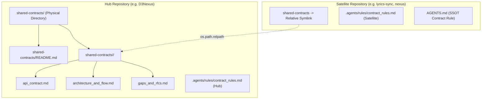

# Setup Shared Contracts High-Level Design

## Table of Contents

- [Meta Data](#meta-data)
- [Background](#background)
- [Goals and Non-Goals](#goals-and-non-goals)
- [Architecture and Technical Design](#architecture-and-technical-design)
- [Integration Test Plan and Boundary Matrix](#integration-test-plan-and-boundary-matrix)
- [Verification Environment](#verification-environment)
- [Shared Contract Impact](#shared-contract-impact)
- [Comprehensive BDD Scenario Coverage](#comprehensive-bdd-scenario-coverage)
- [Rollout Strategy and Mitigation](#rollout-strategy-and-mitigation)
- [Kanban Tasks Breakdown](#kanban-tasks-breakdown)

## Meta Data

- **Epic name**: `setup_shared_contracts`
- **Status**: In-Progress
- **Target release**: Next plugin release (1.16.0)
- **Platform**: Python tooling / agent skill kit
- **Source Spec**: [Approved Setup Shared Contracts design](2026-10-30-setup-shared-contracts-design.en.md)

## Background

In modern multi-repository ecosystems (such as the D3Nexus hub connecting with satellite worker fleets and mobile clients), cross-service communication relies on a shared contract directory (`shared-contracts/`). Previously, establishing this infrastructure required manual directory creation, manual template authoring, and brittle manual symlinking.

Manual setups led to several failure modes:
1. Inconsistent contract documentation across domains.
2. Dangling or absolute symlinks that broke on other developer machines and CI/CD pipelines.
3. Git tracking boundary violations where satellite repos attempted to stage files through symlinks.
4. Missing local workspace governance rules (`.agents/rules/contract_rules.md`).

This epic provides an automated, deterministic skill `setup-shared-contracts` and CLI engine `setup_contracts.py` to scaffold and verify Hub and Satellite contract environments.

## Goals and Non-Goals

### Goals

- Build `skills/setup-shared-contracts/SKILL.md` to guide AI agents and developers.
- Build `skills/setup-shared-contracts/resources/scripts/setup_contracts.py` implementing `init-hub`, `link-satellite`, and `verify`.
- Bundle canonical templates in `resources/templates/` for the 3 canonical contract files (`api_contract.md`, `architecture_and_flow.md`, `gaps_and_rfcs.md`), root `README.md`, and local rules.
- Compute single-direction relative symbolic links (`os.path.relpath`) to guarantee cross-machine portability.
- Implement hermetic unit tests (`test_setup_contracts.py`) integrated into `scripts/verify.sh`.

### Non-Goals

- Generating language-specific client SDK code (Rust crates, Dart packages, Python libraries).
- Managing remote Git operations or pushing commits.

## Architecture and Technical Design

### Topology and Component Layout

### CLI Engine Architecture

The CLI engine `setup_contracts.py` operates via three subcommands:
1. `init-hub`:
   - Validates that `shared-contracts` is not an existing symlink.
   - Creates physical `shared-contracts/` and renders `README.md`.
   - Populates domain subfolder with 3 canonical files from templates.
   - Installs Hub local rules into `.agents/rules/contract_rules.md`.
2. `link-satellite`:
   - Validates that the Hub directory exists and contains the requested domain.
   - Computes relative symlink path via `os.path.relpath(hub_domain, satellite_root)`.
   - Creates the symlink and validates it is not dangling.
   - Installs Satellite local rules and updates `AGENTS.md`.
3. `verify`:
   - Auto-detects Hub vs Satellite mode.
   - Verifies physical presence of all 3 canonical files and local rules.
   - Verifies symlink validity and Git tracking isolation.

## Integration Test Plan and Boundary Matrix

| Component | Test File | Test Case | Target Boundary |
|---|---|---|---|
| Hub Initialization | `test_setup_contracts.py` | `test_init_hub_fresh` | Creates directory structure, 3 canonical files, README, and Hub rules |
| Hub Idempotency | `test_setup_contracts.py` | `test_init_hub_preserves_customizations` | Re-running preserves existing modified contract files |
| Satellite Linking | `test_setup_contracts.py` | `test_link_satellite_relative_symlink` | Computes valid relative symlink across sibling directories |
| Dangling Prevention | `test_setup_contracts.py` | `test_link_satellite_rejects_missing_hub` | Aborts when hub path or domain does not exist |
| Force Overwrite | `test_setup_contracts.py` | `test_link_satellite_force_existing` | Replaces existing symlink safely when `--force` is passed |
| Verification Engine | `test_setup_contracts.py` | `test_verify_hub_and_satellite` | Verifies healthy setups pass and corrupted setups fail with exit 1 |

## Verification Environment

- **Runtime**: Python 3.10+ (Standard Library only: `pathlib`, `os`, `sys`, `argparse`, `unittest`, `tempfile`).
- **Test Command**: `python3 -m unittest skills/setup-shared-contracts/resources/scripts/test_setup_contracts.py`
- **Release Gate**: `scripts/verify.sh` executes the test suite on every commit and release validation.

## Shared Contract Impact

`None — self-contained developer tooling skill (operates on and generates shared contracts for other projects)`.

## Comprehensive BDD Scenario Coverage

Full Gherkin scenarios covering all 5 dimensions live in `bdd_scenarios.en.md` and `bdd_scenarios.vi.md`.

- **Happy Paths**:
  - `[SSC-HP-01]`: Fresh Hub initialization.
  - `[SSC-HP-02]`: Fresh Satellite linking.
  - `[SSC-HP-03]`: Full verification of healthy Hub and Satellite.
- **Edge Cases & Boundaries**:
  - `[SSC-EC-01]`: Idempotent runs preserve custom edits.
  - `[SSC-EC-02]`: Multi-level deep sibling directory relative path calculation.
  - `[SSC-EC-03]`: Domain name normalization and whitespace stripping.
- **State Transitions**:
  - `[SSC-ST-01]`: Adding new domain updates existing Hub README without erasing prior entries.
  - `[SSC-ST-02]`: Re-linking satellite with `--force` updates link cleanly.
- **Async & Concurrency**:
  - `[SSC-AR-01]`: Atomic file writes during concurrent verify checks.
  - `[SSC-AR-02]`: Circular symlink and filesystem loop protection.
- **Failures & Resilience**:
  - `[SSC-FR-01]`: Refusing `init-hub` inside an existing symlink.
  - `[SSC-FR-02]`: Refusing `link-satellite` with non-existent target.
  - `[SSC-FR-03]`: Protecting existing physical directory from accidental overwrite.

## Rollout Strategy and Mitigation

- **Deployment**: Delivered as a standard skill inside the `d3nexus` plugin.
- **Phased Rollout**:
  1. Internal verification in `ai-agent-tools` test harness.
  2. Pilot execution on `D3Nexus` (Hub) and `lyrics-sync` / `nexus` (Satellites).
  3. Release in plugin version 1.16.0.
- **Rollback**: Reverting the skill folder leaves existing repositories completely unaffected.

## Kanban Tasks Breakdown

- **Task 1: Canonical Template Bundles** (`task_1_canonical_template_bundles.md`) — Covers: `[SSC-HP-01]`, `[SSC-EC-01]`
- **Task 2: CLI Engine Hub Initialization and Rules** (`task_2_cli_engine_hub_init.md`) — Covers: `[SSC-HP-01]`, `[SSC-ST-01]`, `[SSC-FR-01]`
- **Task 3: CLI Engine Satellite Linking and Relative Symlinks** (`task_3_cli_engine_satellite_linking.md`) — Covers: `[SSC-HP-02]`, `[SSC-EC-02]`, `[SSC-ST-02]`, `[SSC-FR-02]`, `[SSC-FR-03]`
- **Task 4: CLI Engine Verification and Integrity Audit** (`task_4_cli_engine_verification.md`) — Covers: `[SSC-HP-03]`, `[SSC-EC-03]`, `[SSC-AR-01]`, `[SSC-AR-02]`
- **Task 5: Skill Definition and Verify Harness Integration** (`task_5_skill_definition_and_harness_integration.md`) — Covers: `[SSC-HP-01]`, `[SSC-HP-02]`, `[SSC-HP-03]`
