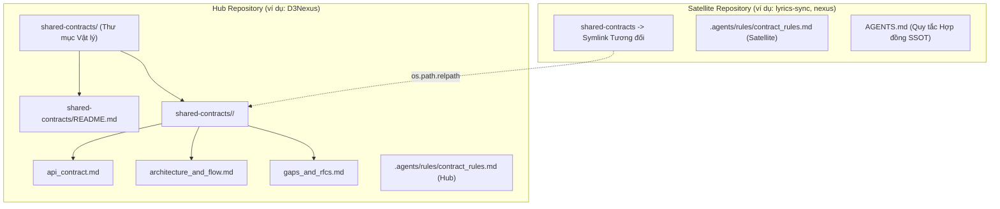

# Thiết Kế Chi Tiết Skill Thiết Lập Thư Mục Shared Contracts

## Mục lục

- [Meta Data](#meta-data)
- [Bối cảnh](#bối-cảnh)
- [Mục tiêu và Ngoài phạm vi](#mục-tiêu-và-ngoài-phạm-vi)
- [Kiến trúc và Thiết kế Kỹ thuật](#kiến-trúc-và-thiết-kế-kỹ-thuật)
- [Kế hoạch Kiểm thử Tích hợp và Ma trận Ranh giới](#kế-hoạch-kiểm-thử-tích-hợp-và-ma-trận-ranh-giới)
- [Môi trường Xác minh](#môi-trường-xác-minh)
- [Tác động Hợp đồng Dùng chung](#tác-động-hợp-đồng-dùng-chung)
- [Độ bao phủ Kịch bản BDD Toàn diện](#độ-bao-phủ-kịch-bản-bdd-toàn-diện)
- [Chiến lược Triển khai và Giảm thiểu Rủi ro](#chiến-lược-triển-khai-và-giảm-thiểu-rủi-ro)
- [Phân rã Công việc Kanban](#phân-rã-công-việc-kanban)

## Meta Data

- **Tên Epic**: `setup_shared_contracts`
- **Trạng thái**: Packaged
- **Phiên bản đích**: Bản phát hành plugin tiếp theo (1.16.0)
- **Nền tảng**: Python tooling / agent skill kit
- **Spec gốc**: [Approved Setup Shared Contracts design](2026-10-30-setup-shared-contracts-design.vi.md)

## Bối cảnh

Trong các hệ sinh thái đa repository hiện đại (như hub D3Nexus kết nối với các cụm worker fleet và ứng dụng di động), việc giao tiếp liên dịch vụ phụ thuộc vào thư mục hợp đồng dùng chung (`shared-contracts/`). Trước đây, việc thiết lập hạ tầng này đòi hỏi tạo thư mục thủ công, soạn thảo template thủ công và tạo symlink thủ công rất dễ lỗi.

Các thiết lập thủ công dẫn đến nhiều rủi ro:
1. Tài liệu hợp đồng không đồng nhất giữa các domain.
2. Symlink bị gãy (dangling) hoặc dùng đường dẫn tuyệt đối (absolute path), gây lỗi trên máy lập trình viên khác hoặc trên CI/CD.
3. Vi phạm ranh giới Git tracking khi repo vệ tinh cố tình stage file xuyên qua symlink.
4. Thiếu vắng các quy tắc quản trị workspace cục bộ (`.agents/rules/contract_rules.md`).

Epic này cung cấp skill tự động `setup-shared-contracts` và công cụ CLI `setup_contracts.py` để khởi tạo và kiểm tra môi trường hợp đồng Hub và Satellite một cách chuẩn xác và xác định.

## Mục tiêu và Ngoài phạm vi

### Mục tiêu

- Xây dựng `skills/setup-shared-contracts/SKILL.md` để hướng dẫn AI agent và lập trình viên.
- Xây dựng `skills/setup-shared-contracts/resources/scripts/setup_contracts.py` thực thi các lệnh `init-hub`, `link-satellite`, và `verify`.
- Đóng gói các template canonical trong `resources/templates/` cho 3 file canonical (`api_contract.md`, `architecture_and_flow.md`, `gaps_and_rfcs.md`), file `README.md` gốc, và các rule cục bộ.
- Tính toán symbolic link tương đối một chiều (`os.path.relpath`) bảo đảm tính di động trên mọi máy tính.
- Xây dựng bộ kiểm thử hermetic unit test (`test_setup_contracts.py`) được nhúng vào `scripts/verify.sh`.

### Ngoài phạm vi

- Không sinh code SDK client theo ngôn ngữ lập trình cụ thể (Rust crates, Dart packages, Python libraries).
- Không quản lý thao tác Git remote hoặc push commits.

## Kiến trúc và Thiết kế Kỹ thuật

### Cấu trúc Topology và Thành phần

### Kiến trúc CLI Engine

Công cụ CLI `setup_contracts.py` hoạt động thông qua 3 lệnh con:
1. `init-hub`:
   - Xác thực bảo đảm `shared-contracts` không phải là một symlink có sẵn.
   - Tạo thư mục vật lý `shared-contracts/` và xuất file `README.md`.
   - Tạo thư mục con domain với 3 file canonical từ template.
   - Cài đặt rule cục bộ Hub vào `.agents/rules/contract_rules.md`.
2. `link-satellite`:
   - Xác thực thư mục Hub tồn tại và có chứa domain được yêu cầu.
   - Tính toán đường dẫn symlink tương đối bằng `os.path.relpath(hub_domain, satellite_root)`.
   - Tạo symlink và xác thực link không bị gãy (dangling).
   - Cài đặt rule cục bộ Satellite và cập nhật `AGENTS.md`.
3. `verify`:
   - Tự động nhận diện chế độ Hub vs Satellite.
   - Xác minh sự hiện diện vật lý của cả 3 file canonical và rule cục bộ.
   - Xác minh tính toàn vẹn của symlink và sự cô lập ranh giới Git tracking.

## Kế hoạch Kiểm thử Tích hợp và Ma trận Ranh giới

Integration test roots: skills/setup-shared-contracts/resources/scripts/, scripts/

Protected paths: .agents/quality/**, .devtool/epic/setup_shared_contracts/bdd_scenarios.en.md, .devtool/epic/setup_shared_contracts/bdd_scenarios.vi.md, scripts/verify.sh

Integration results: python3 scripts/run_unittest_junit.py --junitxml build/test-results/setup-shared-contracts.xml skills/setup-shared-contracts/resources/scripts/test_setup_contracts.py -> build/test-results/setup-shared-contracts.xml

| Thành phần | File Kiểm thử | Kịch bản Kiểm thử | Ranh giới Mục tiêu |
|---|---|---|---|
| Khởi tạo Hub | `test_setup_contracts.py` | `test_init_hub_fresh` | Tạo cấu trúc thư mục, 3 file canonical, README, và rule Hub |
| Tính Bất biến Hub | `test_setup_contracts.py` | `test_init_hub_preserves_customizations` | Chạy lại lệnh bảo tồn các file hợp đồng đã chỉnh sửa |
| Liên kết Satellite | `test_setup_contracts.py` | `test_link_satellite_relative_symlink` | Tính toán symlink tương đối chuẩn xác giữa các thư mục anh em |
| Chống Dangling Link | `test_setup_contracts.py` | `test_link_satellite_rejects_missing_hub` | Dừng hoạt động khi đường dẫn hub hoặc domain không tồn tại |
| Ghi đè Cưỡng bức | `test_setup_contracts.py` | `test_link_satellite_force_existing` | Thay thế an toàn symlink hiện có khi có cờ `--force` |
| Bộ máy Xác minh | `test_setup_contracts.py` | `test_verify_hub_and_satellite` | Xác minh hệ thống chuẩn trả về 0 và hệ thống lỗi trả về 1 |

## Môi trường Xác minh

- **Môi trường chạy**: Python 3.10+ (Chỉ dùng Thư viện Tiêu chuẩn: `pathlib`, `os`, `sys`, `argparse`, `unittest`, `tempfile`).
- **Lệnh kiểm thử**: `python3 -m unittest skills/setup-shared-contracts/resources/scripts/test_setup_contracts.py`
- **Cổng phát hành**: `scripts/verify.sh` thực thi bộ kiểm thử trong mọi lượt commit và kiểm tra phát hành.

## Tác động Hợp đồng Dùng chung

`None — self-contained developer tooling skill (operates on and generates shared contracts for other projects)`.

## Độ bao phủ Kịch bản BDD Toàn diện

Các kịch bản Gherkin hoàn chỉnh bao phủ cả 5 chiều nằm trong `bdd_scenarios.en.md` và `bdd_scenarios.vi.md`.

- **Happy Paths**:
  - `[SSC-HP-01]`: Khởi tạo Hub mới tinh.
  - `[SSC-HP-02]`: Liên kết Satellite mới tinh.
  - `[SSC-HP-03]`: Xác minh toàn diện Hub và Satellite hoạt động tốt.
- **Edge Cases & Boundaries**:
  - `[SSC-EC-01]`: Chạy lặp lại bảo toàn các chỉnh sửa tùy biến.
  - `[SSC-EC-02]`: Tính toán đường dẫn tương đối xuyên qua nhiều cấp thư mục.
  - `[SSC-EC-03]`: Chuẩn hóa tên domain và xử lý khoảng trắng.
- **State Transitions**:
  - `[SSC-ST-01]`: Thêm domain mới cập nhật README của Hub mà không xóa các mục trước.
  - `[SSC-ST-02]`: Liên kết lại satellite với `--force` cập nhật link an toàn.
- **Async & Concurrency**:
  - `[SSC-AR-01]`: Ghi file nguyên tử trong khi đang chạy lệnh verify đồng thời.
  - `[SSC-AR-02]`: Bảo vệ chống vòng lặp symlink và đệ quy vô tận.
- **Failures & Resilience**:
  - `[SSC-FR-01]`: Từ chối chạy `init-hub` bên trong một symlink có sẵn.
  - `[SSC-FR-02]`: Từ chối chạy `link-satellite` với đường dẫn đích không tồn tại.
  - `[SSC-FR-03]`: Bảo vệ thư mục vật lý hiện có không bị ghi đè nhầm.

## Chiến lược Triển khai và Giảm thiểu Rủi ro

- **Triển khai**: Đóng gói như một skill tiêu chuẩn bên trong plugin `d3nexus`.
- **Triển khai theo giai đoạn**:
  1. Xác minh nội bộ trong bộ test harness của `ai-agent-tools`.
  2. Thực thi thử nghiệm trên `D3Nexus` (Hub) và `lyrics-sync` / `nexus` (Satellites).
  3. Phát hành chính thức trong phiên bản plugin 1.16.0.
- **Khôi phục (Rollback)**: Xóa hoặc revert thư mục skill sẽ hoàn toàn không gây ảnh hưởng đến các repository hiện có.

## Phân rã Công việc Kanban

- [Task 1: Canonical Template Bundles](task_1_canonical_template_bundles.md) — Covers: `[SSC-HP-01]`, `[SSC-EC-01]`
- [Task 2: CLI Engine Hub Initialization and Rules](task_2_cli_engine_hub_init.md) — Covers: `[SSC-HP-01]`, `[SSC-ST-01]`, `[SSC-FR-01]`
- [Task 3: CLI Engine Satellite Linking and Relative Symlinks](task_3_cli_engine_satellite_linking.md) — Covers: `[SSC-HP-02]`, `[SSC-EC-02]`, `[SSC-ST-02]`, `[SSC-FR-02]`, `[SSC-FR-03]`
- [Task 4: CLI Engine Verification and Integrity Audit](task_4_cli_engine_verification.md) — Covers: `[SSC-HP-03]`, `[SSC-EC-03]`, `[SSC-AR-01]`, `[SSC-AR-02]`
- [Task 5: Skill Definition and Verify Harness Integration](task_5_skill_definition_and_harness_integration.md) — Covers: `[SSC-HP-01]`, `[SSC-HP-02]`, `[SSC-HP-03]`
