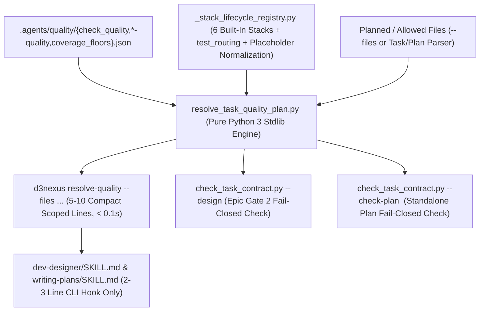

# Shift-Left Quality Layer Resolver and Mechanical Contract Enforcement

- **Date**: 2026-11-28
- **Status**: Approved
- **PIC**: tess
- **Epic Slug**: `shift_left_quality_resolver`
- **Target Repository**: `ai-agent-tools` (`d3nexus` plugin)

## Table of Contents

- [1. Problem Statement and Goals](#1-problem-statement-and-goals)
- [2. Shared Contract Warnings](#2-shared-contract-warnings)
- [3. Architecture and Component Overview](#3-architecture-and-component-overview)
- [4. Additive Provider Schema and Prefix Normalization](#4-additive-provider-schema-and-prefix-normalization)
- [5. On-Demand File-Scoped Quality Resolver CLI](#5-on-demand-file-scoped-quality-resolver-cli)
- [6. Fail-Closed Task and Plan Contract Guards](#6-fail-closed-task-and-plan-contract-guards)
- [7. Gate 4 Receipt Lifecycle Hygiene](#7-gate-4-receipt-lifecycle-hygiene)
- [8. Post-Rollout Blueprint Alignment in setup_quality_check and check_diff_coverage](#8-post-rollout-blueprint-alignment-in-setup_quality_check-and-check_diff_coverage)
- [9. Lean Skill Integration and Legacy Template Cleanup](#9-lean-skill-integration-and-legacy-template-cleanup)
- [10. Dependencies, Risks, and Non-Goals](#10-dependencies-risks-and-non-goals)
- [11. Verification and Acceptance Plan](#11-verification-and-acceptance-plan)

## 1. Problem Statement and Goals

Across polyglot and mobile repositories consuming `d3nexus` (`D3Nexus`, `lyrics-sync`, `nexus`, `android_digital_wallet`, `ios_digital_wallet`), Gate 4 (`/quality_check --profile epic`) enforces dual-floor coverage, hunk-level diff coverage, canonical test layouts, static `?v=` asset cache-busting, and multi-directory type checking. However, Stage 2 task design (`/dev-designer`) and standalone plan authoring (`/writing-plans`) still suffer from five concrete gaps documented in field observations `#0020`, `#0022`, `#0023`, `#0024`, and `#0025` (plus provider JSON Schema drift):

1. **Shift-Left Quality Layer Blindness (`#0024`, `#0025`)**: `dev-designer/SKILL.md` and `writing-plans/SKILL.md` instruct agents only to inspect `lint` and `type_check` in `.agents/quality/*-quality.json`. Authors miss active V8 LCOV `diff_coverage` requirements on `.js`/`.mjs` (planning Playwright E2E only without `node:test` unit suites), per-adapter/module coverage floors in `.agents/quality/coverage_floors.json`, canonical test directory rules, paired router/service tests, and referencing `.html`/`.astro`/`.jinja` templates needing `?v=` cache-bust updates.
2. **Prose Matrix Duplication and Context Bloat Hazard (`#0025`)**: Embedding six-stack test matrices into `SKILL.md` or requiring every repository to maintain prose tables in `docs/development/quality-check-strategy.md` wastes prompt tokens on untouched stacks and drifts across repositories.
3. **Multi-Target `type_check`, Monorepo Tool Wrappers, and `{skills_dir}` Prefix Breakage (`#0022`)**: `matches_cap()` in `skills/dev-implementation/resources/scripts/check_task_contract.py` strips at most a single trailing token (`cap[:-1]`) and gates `_cap_tool_prefix()` behind `allow_historical_prefix`, rejecting task-scoped `uv run mypy --strict src/pkg/mod.py tests/unit/test_mod.py` whenever `python-quality.json` declares `["uv", "run", "mypy", "--strict", "src", "tests"]`. Simultaneously, `_merge_tier_b_policy()` and `_strip_command_wrappers()` in `_stack_lifecycle_registry.py` preserve literal `{skills_dir}/.../check_vanilla_js.py` tokens and do not unwrap monorepo/version-manager prefixes (`uv --directory <dir> run`, `mise exec --`, `npm --prefix <dir>`), forcing repositories (`lyrics-sync`, `D3Nexus`, `ios_digital_wallet`) to manually patch `task_tier_b`.
4. **Legacy Script Hardcoding in Authoring Templates (`#0020`)**: While sequential `&&`/`;` splitting landed in commit `c4a53a2`, `skills/dev-designer/SKILL.md` and `skills/dev-designer/references/verification-rows.md` still hardcode retired repository-specific script names (`verify_importlinter_coverage.py`, `pre_review_self_probe.py`, `verify_bdd_coverage.py`) that fail `check_grounding` in modernized repositories.
5. **Stale `gate4_receipt.json` Survival (`#0023`), Provider Schema Drift, and Post-Rollout Blueprint Gaps**: `verify_polyglot_registry.py` writes `build/quality/gate4_receipt.json` on `epic`/`release` `PASS` runs without unlinking stale receipts on subsequent `FAIL`/`BLOCKED` runs. Meanwhile, comparing the original Open-Closed Polyglot Blueprint (`nexus/docs/development/polyglot-quality-lifecycle-handoff.md`) against the completed 5-repo rollout reveals: (a) `flutter-quality.schema.json` omits `architecture` and `rust/web/python-quality.schema.json` omit `cache_enable`/`cache_purge`; (b) `scaffold_quality_manifest.py` still scaffolds duplicate `pr_*` + `workspace_*` checks in `release`, omits `workspace_*` in `epic`, runs online `cargo audit` inside offline `pr`/`epic`, and uses bare `npx` without `--no-install`; and (c) portable `check_diff_coverage.py` lacks `--package-floors <coverage_floors.json>` monotonic adapter/module ratchet support.

### Goals

- Derive task-level test topology, coverage floors, referencing `?v=` templates, and scoped `TIER-B` commands **100% mechanically** from `.agents/quality/*.json` and `_stack_lifecycle_registry.py` using Python 3 standard library only (`0` LLM tokens, `< 0.1s` in-process resolution and `< 1.0s` cold CLI execution).
- Expose an on-demand CLI resolver (`resolve_task_quality_plan.py` / `d3nexus resolve-quality --files <planned_files>`) emitting **5–10 compact lines** scoped strictly to the touched file extensions and paths.
- Enforce the exact same invariants fail-closed (`exit 1`) in `check_task_contract.py --design` (for `/dev-designer` Gate 2) and a new `check_task_contract.py --check-plan <plan.md>` mode (for `/writing-plans`).
- Fix multi-target `matches_cap()`, `{skills_dir}` placeholder normalization, stale `gate4_receipt.json` deletion on non-passing `epic`/`release` runs, legacy script references in `dev-designer`, and JSON Schema capability parity across all 6 stack providers.

## 2. Shared Contract Warnings

`shared-contracts/` is absent in `ai-agent-tools`; this repository is the upstream agent kit plugin and defines no Hub/Satellite wire contracts. No shared contract drift or warning decisions apply.

## 3. Architecture and Component Overview

Both the authoring-time CLI resolver and the pre-implementation contract validator share one deterministic resolution model over existing `.agents/quality/` manifests, guaranteeing zero drift between planning guidance and gate enforcement.



### Core Architectural Boundaries

1. **`_stack_lifecycle_registry.py`**: Normalizes `{skills_dir}` and `{base_ref}` placeholders in manifest-derived `TierBPolicy` prefixes, adds `"check_vanilla_js.py"` to built-in Web `typecheck_prefixes`, generalizes script-basename + required-flag matching in `_match_prefix_on_tokens()`, and loads optional additive `test_routing` metadata per stack.
2. **`resolve_task_quality_plan.py` + `bin/d3nexus` (`resolve-quality`)**: Pure-stdlib module and CLI placed alongside `_stack_lifecycle_registry.py` and `check_task_contract.py` inside `skills/dev-implementation/resources/scripts/`. Computes active stacks, canonical/forbidden test globs, LCOV unit-test obligations, `coverage_floors.json` thresholds, referencing `?v=` templates, and file-scoped `TIER-B` commands for a file list.
3. **`check_task_contract.py`**: Imports `resolve_task_quality_plan` directly to enforce fail-closed guards in `--design` mode and adds `--check-plan <plan.md>` for Markdown plans under `docs/superpowers/plans/`. Fixes `_cap_tool_prefix()` and `matches_cap()` for multi-target `type_check`/`lint` commands and flags full-repo Python `TIER-B` targets on intermediate tasks (`Task 1..N-1`).
4. **`verify_polyglot_registry.py` + `finishing-a-development-branch`**: Unlinks `build/quality/gate4_receipt.json` whenever an `epic` or `release` run finishes with `status != "PASS"` and documents clean-worktree precondition checks before receipt reuse.
5. **Provider JSON Schemas & Validators**: Syncs `*-quality.schema.json` and `_provider_manifest_common.py` for `architecture`, `cache_enable`, `cache_purge`, `coverage_floors`, and optional `test_routing`, guarded by an automated schema-vs-validator parity test.

## 4. Additive Provider Schema and Prefix Normalization

### 4.1 Optional `test_routing` Additive v1 Block

Any `.agents/quality/<stack>-quality.json` manifest may optionally declare a compact `"test_routing"` object (all fields optional; omitted fields fall back to built-in stack defaults and manifest capability inference):

```json
{
  "test_routing": {
    "canonical_test_globs": ["tests/unit/**/test_*.py", "tests/integration/test_*.py", "tests/e2e/test_*.py", "tests/acceptance/test_*.py"],
    "forbidden_test_globs": ["tests/test_*.py", "tests/e2e_*.py", "scripts/test_*.py"],
    "paired_source_globs": ["src/*/api/**/*.py", "src/*/*service*.py"],
    "lcov_unit_test_globs": ["tests/js/*.test.mjs"],
    "cache_bust_extensions": [".js", ".css"]
  }
}
```

Validation rules in `_provider_manifest_common.py` (`validate_additive_provider_fields`):
- `test_routing` must be a JSON object containing only the five allowed keys above (`invalid_test_routing` -> `BLOCKED`).
- Every present key must be an array of non-empty relative glob/extension strings without `..` path traversal (`invalid_test_routing` -> `BLOCKED`).
- `coverage` object in `*-quality.json` additionally accepts optional `"package_floors"` (non-empty relative path string, e.g. `".agents/quality/coverage_floors.json"`).

### 4.2 Provider JSON Schema Synchronization

Update `skills/*-quality-check/resources/schemas/*-quality.schema.json` so JSON Schema `additionalProperties: false` matches the generic capability validation in `validate_<stack>_quality.py` and shared helpers in `_provider_manifest_common.py` 100% (`validate_<stack>_quality.py` accept arbitrary capability arrays and delegate `test_routing`/`package_floors` to `_provider_manifest_common.py`, requiring no edits to `validate_<stack>_quality.py`):
- Add `"test_routing"` top-level property and `"package_floors"` inside `capabilities.coverage.properties` across all 6 stack schemas.
- Add `"architecture"` to `flutter-quality.schema.json`.
- Add `"cache_enable"` and `"cache_purge"` to `rust-quality.schema.json`, `web-quality.schema.json`, and `python-quality.schema.json` (matching `D3Nexus` subtree receipt runners).

### 4.3 Multi-Target Capability Stripping and `{skills_dir}` Normalization (`#0022`)

1. **`check_task_contract.py` (`_cap_tool_prefix` & `matches_cap`)**:
   - Expand `_cap_tool_prefix(cap)` to retain the runner wrapper (`uv run`, `uv --directory <dir> run`, `python3 -m`), tool binary (`ruff`, `mypy`, `pyright`, `ty`, `flake8`, `pylint`), subcommand (`check`, `format`), and all leading flags — including value-taking flags (`--extend-select <val>`, `--select <val>`, `--ignore <val>`, `--per-file-ignores <val>`, `--config <path>`, `--config-file <path>`, `--target-version <val>`, `--line-length <val>`, `--python-version <val>`) — stopping immediately before trailing positional file/directory targets (`src`, `tests`, `.`).
   - Enable `_cap_tool_prefix(cap)` matching for active `todo` tasks (`not allow_historical_prefix`) ONLY when `len(sub) > len(prefix)`, `allowed_py` is non-empty, every file in `allowed_py` is covered by the subcommand's non-flag positional targets, and every positional target either covers at least one `allowed_py` path or appears in `cap[len(prefix):]` (preventing `mypy unrelated.py` bypasses on single-file tasks and preserving `test_todo_task_still_rejected_when_omitting_newly_registered_targets`).
2. **`_stack_lifecycle_registry.py` (`_cap_command_str`, `_match_prefix_on_tokens`, `_subcommand_matches_prefix`, `BUILTIN_STACKS["web"]`)**:
   - Add `"check_vanilla_js.py"` to `BUILTIN_STACKS["web"].default_tier_b.typecheck_prefixes`.
   - Normalize `{skills_dir}` to `$D3NEXUS_KIT/skills` when building `TierBPolicy` prefixes from `capabilities` (while skipping `--base-ref {base_ref}` tail value comparison in prefix matching), and extend `_strip_command_wrappers()` to unwrap monorepo and version-manager prefixes (`uv --directory <dir> run`, `uv --project <dir> run`, `mise exec [--]`, `npm --prefix <dir>`) observed across `D3Nexus` and `ios_digital_wallet`.
   - In `_subcommand_matches_prefix()`, unwrap version-manager prefixes (`mise exec [--]`) on both `sub` and `ptoks` while enforcing monorepo directory wrapper agreement (`--directory <dir>`, `--project <dir>`, `--prefix <dir>`): a candidate with a different wrapper directory never matches, and when `ptoks` carries a monorepo directory wrapper, either `sub` carries the exact same wrapper directory or its unwrapped positional targets all lie under `<dir>/`. Strip value-taking wrapper flags before Rule 2 flag scanning.
   - Extend Rule 4 in `_match_prefix_on_tokens()` so multi-token capability prefixes invoking a `.py` or `.sh` script (`python3 {skills_dir}/.../check_vanilla_js.py --target-dir src/...`) match any candidate subcommand invoking the same script basename (`Path(tok).name == script_name`) regardless of whether the caller wrote `$D3NEXUS_KIT/skills/...`, `"$HOME/.gemini/..."`, or a repo-relative `scripts/...` path, provided required `--flag` names are present.

## 5. On-Demand File-Scoped Quality Resolver CLI

Create `skills/dev-implementation/resources/scripts/resolve_task_quality_plan.py` and register `"resolve-quality": "skills/dev-implementation/resources/scripts/resolve_task_quality_plan.py"` in `bin/d3nexus`.

### 5.1 CLI Interface

```bash
d3nexus resolve-quality --files <path1> [<path2> ...] [--repo-root <dir>] [--base-ref <ref>] [--json]
```

- Exit `0`: Valid resolution emitted (`5–10` compact lines by default, or structured JSON when `--json` is passed).
- Exit `2`: Invalid CLI arguments, missing `--files`, or malformed `.agents/quality/*.json` manifest.
- Performance target: `< 0.1s` in-process `resolve_quality_plan()` execution (and `< 1.0s` cold CLI subprocess wall-clock time) using Python 3 stdlib (`json`, `pathlib`, `re`, `shlex`, `argparse`).

### 5.2 Deterministic Resolution Rules

Given `--files <planned_files>` (stripping `(new)` annotations and line anchors):
1. **Stack Filtering (Zero Untouched-Stack Noise)**: Intersect `<planned_files>` suffixes/manifest names with `.agents/quality/*-quality.json` (falling back to `BUILTIN_STACKS` when `.agents/quality/` is absent). Untouched stacks emit **zero** lines.
2. **Test Topology & LCOV Detection**:
   - Report canonical test roots from `test_routing.canonical_test_globs` or stack defaults (`tests/unit/`, `tests/integration/`, `tests/e2e/` for Python; `tests/js/`, `tests/e2e/` for Web; `test/`, `test/integration/` for Flutter; `src/test/` for Android; `Tests/` for iOS; `tests/` or inline `#[cfg(test)]` for Rust), plus any `forbidden_test_globs`.
   - Inspect `web-quality.json` `capabilities.diff_coverage` and `capabilities.test_unit`: when `diff_coverage` checks `.info` / `--lcov` over `.js`/`.mjs` (or `test_unit` emits LCOV) and `<planned_files>` includes non-test `.js`/`.mjs` files, emit an explicit **Dual Web Test Requirement**: unit test in `tests/js/*.test.mjs` (or configured `lcov_unit_test_globs`) for V8 LCOV diff coverage **plus** Playwright `# tier: C2` (`Needs: PLAYWRIGHT_BROWSER`) if DOM/UI behavior changes.
   - When `<planned_files>` matches `test_routing.paired_source_globs`, flag mandatory source-to-test pairing.
3. **Coverage & Adapter Ratchet Floors**:
   - Extract `threshold`, `min_package_coverage`, and `min_diff_coverage` (from `capabilities.coverage` and `--min-diff-coverage` in `capabilities.diff_coverage`).
   - If `.agents/quality/coverage_floors.json` exists, match each planned file against `python.adapters` (longest path-prefix match) and `web_modules` (exact POSIX path match) and emit only the matched adapter/module ratchet floors (e.g. `src/lyrics_sync/align >= 88.25%`, `align-studio.js >= 46.75%`).
4. **Referencing `?v=` Cache-Bust Template Discovery**:
   - When `<planned_files>` modifies non-test `.js` or `.css` assets and `web-quality.json` declares `ui_review` (or `test_routing.cache_bust_extensions`), scan repository `*.html`, `*.astro`, `*.jinja`, and `*.jinja2` files (excluding `.git`, `node_modules`, `build`, `dist`, `.worktrees`, `.venv`, `target`) using `audit_ui_state_and_styles.py`'s exact attribute pattern `(?:src|href)=['"][^'"]*?{re.escape(asset_name)}(\?[^'"]*)?['"]`.
   - Emit the exact relative template paths that must be added to `Allowed files` / `Modify:` for atomic `?v=` cache-bust updates.
5. **Scoped `TIER-B` Command Synthesis**:
   - Interpolate `{skills_dir}` -> `"$D3NEXUS_KIT/skills"` and `{base_ref}` -> `<resolved_base_ref>` (default `develop`).
   - Replace full-repo trailing targets (`.`, `src`, `tests`) on file-scoping tools (`ruff check`, `ruff format --check`, `mypy`, `pyright`, `dart format`) with `<matching_planned_files>` (placeholder `<test_files>` appended when no test path was passed yet), and include fast delta gates (`boundaries` when imports/manifests change, plus `pr_diff_audit` / `security` when configured in `profiles.pr`).

### 5.3 Example Compact Output (`7` Lines for a Mixed `.py` + `.js` Task)

```text
[quality-plan] stacks: python, web (base_ref=develop)
- test_roots[python]: tests/unit/**/test_*.py (Tier A), tests/integration/test_*.py (Tier C1) [forbid: tests/test_*.py, scripts/test_*.py]
- test_roots[web]: DUAL REQUIRED -> unit LCOV in tests/js/*.test.mjs + UI E2E in tests/e2e/test_*.py (# tier: C2, Needs: PLAYWRIGHT_BROWSER)
- floors[python]: workspace>=80%, pkg>=65%, diff>=85% | ratchet src/lyrics_sync/align>=88.25%
- floors[web]: workspace>=75%, pkg>=60%, diff>=80% (js-lcov.info) | ratchet align-studio.js>=46.75%
- cache_bust_templates: src/lyrics_sync/preview/static/index.html (add to Allowed files for ?v= bump)
- tier_b[python]: uv run ruff check --extend-select F821,F823,F841,B007,B904,PLE,PLW0602 <allowed_py_files> && uv run ruff format --check <allowed_py_files> && uv run mypy --strict <allowed_py_files> && uv run lint-imports
- tier_b[web]: python3 "$D3NEXUS_KIT/skills/web-quality-check/resources/scripts/check_vanilla_js.py" --target-dir src/lyrics_sync/preview && python3 scripts/check_anti_stub.py --web-only src/lyrics_sync/preview/static
```

## 6. Fail-Closed Task and Plan Contract Guards

### 6.1 Shared Quality-Layer Guards in `check_task_contract.py --design`

During `--design` validation (invoked by `check_epic_readiness.py` at Gate 2), `check_task_contract.py` enforces five mechanical guards across `tasks`:

1. **Unexpanded Placeholder Guard**: Any `Verification` row containing literal `{skills_dir}` or `{base_ref}` fails closed (`unexpanded manifest placeholder '{skills_dir}'; use "$D3NEXUS_KIT/skills"`).
2. **Intermediate-Task Full-Repo Python `TIER-B` Guard**: When an epic has `>= 2` tasks, for every task except the final task (highest task number / sink in `tasks`) and unless `pyproject.toml` or `.agents/quality/` is in `Allowed files`, any Python `ruff` or `mypy`/`pyright` `TIER-B` subcommand whose manifest capability ends in `"."` or `["src", "tests"]` (or when `.agents/quality/python-quality.json` is absent) that still passes bare `"."` or both `"src"` and `"tests"` instead of scoping to `Allowed files` fails closed (`Task 1..N-1 TIER-B must scope ruff/mypy to Allowed files, not full-repo '.' or 'src tests'`).
3. **Web V8 LCOV Unit-Test Guard**: When a task modifies or creates production `.js`/`.mjs` files in a repository whose `web-quality.json` enforces LCOV `diff_coverage` on `.js`/`.mjs`, at least one JS unit test file (`tests/js/*.test.mjs`, `*.test.js`, `*.test.mjs`, `*.test.ts`, or `test_routing.lcov_unit_test_globs`) must appear in `Allowed files` OR be executed in `GREEN`/`REGRESSION` rows. Planning only Playwright E2E (`tests/e2e/...`) fails closed.
4. **Canonical Test Directory & Pairing Guard**:
   - Any `(new)` test file matching `test_routing.forbidden_test_globs` (or placed outside `test_routing.canonical_test_globs` when configured) fails closed.
   - Any `(new)` production source file matching `test_routing.paired_source_globs` without a `(new)` or modified unit test in `Allowed files` fails closed.
5. **Atomic `?v=` Cache-Bust Template Guard**: When a task modifies an existing non-test `.js` or `.css` asset in a repository with `ui_review` (or `test_routing.cache_bust_extensions`) enabled, every existing tracked template (`*.html`, `*.astro`, `*.jinja`, `*.jinja2`) referencing that asset via `(?:src|href)=['"][^'"]*?<asset_name>(\?[^'"]*)?['"]` must appear in the same task's `Allowed files`.

### 6.2 Standalone Plan Mode: `check_task_contract.py --check-plan <plan.md>`

Extend `check_task_contract.py` CLI so `--check-plan <plan_path>` is mutually exclusive with `--hld` / `--tasks`:

```bash
python3 skills/dev-implementation/resources/scripts/check_task_contract.py --check-plan docs/superpowers/plans/YYYY-MM-DD-<feature>.md [--json] [--verbose]
```

Parser & enforcement contract for Markdown plans:
- Splits the plan by `^###\s+Task\s+\d+\b.*` headings (failing closed if `0` task sections exist).
- Extracts file paths from `- Create:`, `- Modify:`, and `- Test:` bullets (stripping `:line-range` suffixes like `:123-145` and `(new)` notes).
- Extracts shell commands from `Run: \`...\`` lines and ```` ```bash ```` / ```` ```sh ```` code blocks inside each task.
- Runs five deterministic checks across each plan task:
  1. No unexpanded `{skills_dir}` / `{base_ref}` placeholders and no bare `npx <bin>` (requiring `npx --no-install` or `npx --yes --package <pkg>`) in verification commands.
  2. No full-repo Python `ruff`/`mypy` targets (`.` or bare `src tests`) in `Task 1..N-1` when the plan has `>= 2` tasks and the task does not modify `pyproject.toml`.
  3. Stack static gate presence: when a plan task touches files of an active `.agents/quality/<stack>-quality.json` stack, at least one command in that task (or a dedicated final verification task) invokes the stack's `lint` and `type_check` tool prefixes.
  4. Web V8 LCOV unit-test requirement when touching production `.js`/`.mjs` in an LCOV `diff_coverage` repository.
  5. Canonical/forbidden test directory placement (`test_routing`), `paired_source_globs`, and referencing `?v=` template inclusion in `Modify:` / `Create:` when editing `.js`/`.css` assets.
- Output matches `check_task_contract.py` compact contract: `Result: 0 problems — PASS` (`exit 0`) or problem lines + `Result: K problems — FAIL` (`exit 1`), plus `--json` support.

## 7. Gate 4 Receipt Lifecycle Hygiene

### 7.1 Unlink Stale `gate4_receipt.json` on Non-Passing Runs (`#0023`)

In `skills/quality_check/resources/scripts/verify_polyglot_registry.py` (`verify_polyglot_execution`, `L1576–1600`):
- When `repo_root is not None` and `requested_profile in ("epic", "release")`:
  - If `out_res.get("status") == "PASS"`, write `build/quality/gate4_receipt.json` atomically as before.
  - **Else (`status` in `{"FAIL", "BLOCKED", "NOT_APPLICABLE"}`)**: call `(repo_root / "build" / "quality" / "gate4_receipt.json").unlink(missing_ok=True)` inside a `contextlib.suppress(OSError)` guard so a failing or blocked re-run immediately invalidates any prior `PASS` receipt on disk.

### 7.2 Clean Working-Tree Precondition on Receipt Reuse

In `skills/finishing-a-development-branch/SKILL.md` (and `integrate_branch.py` `verify-tier` warning / check):
- Clarify that reusing an existing Gate 4 `PASS` verdict under `verify-tier == noop` requires both `repository_sha == HEAD` AND zero uncommitted tracked changes (`dirty_files(untracked=False)` empty, matching `integrate_branch.py::cmd_preflight`), ensuring uncommitted dirty edits on the verified SHA can never ride a prior `gate4_receipt.json`.

## 8. Post-Rollout Blueprint Alignment in setup_quality_check and check_diff_coverage

Reconciling the original Open-Closed Polyglot Lifecycle Blueprint (`nexus/docs/development/polyglot-quality-lifecycle-handoff.md`) with the empirical rollout across all five repositories establishes **`QualityPlanResolver`** (`resolve_task_quality_plan.py` + `test_routing`) as the **fifth Open-Closed Contract** alongside `TierBContractAdapter`, `PoolWorkspaceStrategy`, `TriageSurfaceRegistry`, and `TierCTaxonomy`, and upgrades two shared kit engines:

1. **Deduplicated, Offline-Safe Scaffolding in `scaffold_quality_manifest.py` and `web-quality.template.json` (`setup_quality_check`)**:
   - Deduplicate `profiles.epic` and `profiles.release` across all 6 stack templates (and `skills/setup_quality_check/resources/templates/web-quality.template.json`): keep delta checks (`pr_diff_audit`, `pr_impact`) strictly in `pr`, and use `workspace_audit` + `workspace_impact` (`--all-files`) in `epic`, `scheduled`, and `release` (`0` duplicate audit/impact invocations per profile).
   - Enforce offline `pr` and `epic` determinism in the Rust template (`security` runs local secret/unsafe hygiene rather than online `cargo audit`, keeping `cargo audit` / `cargo deny` advisories in `security_deps` for `scheduled`/`release`).
   - Replace bare `npx` commands in the Web scaffolder and `web-quality.template.json` with `npx --no-install` (`prettier`, `playwright`), remove `test_e2e` from `scheduled` (matching offline/headless nightly parity), and default Python `type_check` to `["uv", "run", "mypy", "--strict", "src", "tests"]`.
2. **Per-Adapter / Per-Module Monotonic Floor Ratchets in `check_diff_coverage.py` (`quality_check`)**:
   - Add optional `--package-floors <path>` (reading `.agents/quality/coverage_floors.json`) to `skills/quality_check/resources/scripts/check_diff_coverage.py`, supporting both explicit per-package/adapter path prefixes (`python.adapters`, `packages`, or flat mappings) and per-file module ratchets (`web_modules`), failing closed with `exit 2` (`BLOCKED`) when a configured floor file is missing or malformed and `exit 1` (`FAIL`) when any measured adapter or module drops below its monotonic floor.
3. **Blueprint Evolution Synchronization**:
   - Document the 5-contract Open-Closed architecture and post-rollout improvements in `ai-agent-tools` and append the v2 post-rollout architecture summary to the sibling `nexus/docs/development/polyglot-quality-lifecycle-handoff.md` document during the final synchronization step (without unauthorized cross-repo commits).

## 9. Lean Skill Integration and Legacy Template Cleanup

Following `task-observer/references/skill-authoring.md` (Progressive Disclosure + Pre-Flight Principle):

1. **`skills/dev-designer/SKILL.md` (`+3` net lines, zero prose matrix)**:
   - In Step 1.3 (Shift-Left Impact Analysis) & Step 2.5 (`TIER-B` Scope): add the 2-line `d3nexus resolve-quality --files <planned_files>` call to derive canonical test roots, V8 LCOV + Tier C2 dual Web tests, `coverage_floors.json` ratchets, `?v=` templates, and `$D3NEXUS_KIT/skills`-interpolated scoped `TIER-B` commands; replace "copy `type_check`/`lint` verbatim" with scoped resolution.
   - In Step 2.3: replace hardcoded `verify_importlinter_coverage.py`, `verify_bdd_coverage.py`, and `pre_review_self_probe.py` examples with manifest-driven capabilities (`boundaries`, `architecture`, `check`) resolved from `.agents/quality/*-quality.json`.
2. **`skills/dev-designer/references/verification-rows.md` (`#0020`)**:
   - Remove retired script names (`verify_importlinter_coverage.py`, `verify_bdd_coverage.py`, `pre_review_self_probe.py`) from the Python `Task N` example (`L79`), replacing them with portable `$D3NEXUS_KIT/skills/...` / manifest-registered `architecture` and `boundaries` commands, and show the `d3nexus resolve-quality --files ...` one-liner under *How to Read the Examples*.
3. **`skills/writing-plans/SKILL.md` & `skills/writing-plans/plan-document-reviewer-prompt.md` (`+4` net lines)**:
   - Replace §5 ("copy verbatim") with running `d3nexus resolve-quality --files <planned_files>` before locking task files/tests.
   - Add `python3 "$D3NEXUS_KIT/skills/dev-implementation/resources/scripts/check_task_contract.py" --check-plan docs/superpowers/plans/YYYY-MM-DD-<feature-name>.md` right next to `check_document.py --require-toc` in Self-Review, and add mechanical `--check-plan` verification to `plan-document-reviewer-prompt.md`.

## 10. Dependencies, Risks, and Non-Goals

### Risks and Mitigations

- **Risk — False-Positive Rejection on Legacy Epics or Repos Without `.agents/quality/`**:
  - *Mitigation*: When `.agents/quality/` is absent, all manifest-specific guards (`LCOV` diff coverage, `test_routing`, `?v=` `ui_review` template scan) self-skip cleanly; `allow_existing_done_new` / historical done-task replay continues to pass `allow_historical_prefix=True`.
- **Risk — Bundled Frontend Apps (`Astro` / `Vite`) Flagged by `?v=` Template Guard**:
  - *Mitigation*: Only templates matching explicit `(?:src|href)=['"][^'"]*?<asset_name>(\?[^'"]*)?['"]` attribute references (identical to `audit_ui_state_and_styles.py`) trigger the `Allowed files` requirement; ES module `import` statements never trigger `?v=` template warnings.
- **Risk — Unverified Embedded CLI Snippets Failing in Clean Shells**:
  - *Mitigation*: Every command snippet embedded in `dev-designer/SKILL.md`, `verification-rows.md`, `writing-plans/SKILL.md`, and `finishing-a-development-branch/SKILL.md` will be pre-flight executed verbatim from a clean subprocess shell against real repo fixtures (`lyrics-sync` + `ai-agent-tools`) before completion.

### Non-Goals (Deferred to Follow-Up Epic)

- Code-Tree Equivalence Fast-Path skipping post-Cross-Model-Review Gate 4 reruns on metadata-only `review_results.md` commits (`lyrics-sync #0021` / `ai-agent-tools #2028`).
- Host-scoped `fcntl.flock` heavy-capability semaphore across concurrent multi-repo Gate 4 runs (`lyrics-sync #0026`) and `estimate_heartbeat.py` concurrent `max()` calibration.
- Mutating or committing `.agents/quality/*.json` manifests inside sibling repositories (`D3Nexus`, `android_digital_wallet`, `ios_digital_wallet`).

## 11. Verification and Acceptance Plan

1. **Unit & BDD Negative/Positive Suites**:
   - `resolve_task_quality_plan.py`: single-stack `.py` output (`0` Web/Flutter/Rust lines), `.js` in LCOV repo (dual `node:test` + Playwright Tier C2 + `coverage_floors.json` ratchet + `?v=` HTML template discovery + `$D3NEXUS_KIT/skills` interpolation), polyglot `.rs` + `.ts`, monorepo wrappers (`uv --directory`, `mise exec --`), `< 0.1s` in-process resolution assertion, and `< 1.0s` cold CLI assertion.
   - `check_task_contract.py` (`--design` & `--check-plan`): positive and negative tests for multi-target `mypy --strict src tests` (`#0022`), `{skills_dir}` normalization & unexpanded placeholder rejection, intermediate-task full-repo `ruff`/`mypy` rejection, missing JS LCOV unit test when touching `.js`, forbidden test directory placement, missing `?v=` template in `Allowed files` / `Modify:`, and bare `npx` rejection in `--check-plan`.
   - `verify_polyglot_registry.py`, `scaffold_quality_manifest.py` & `check_diff_coverage.py`: `PASS` writes `gate4_receipt.json` while subsequent `FAIL` and `BLOCKED` on `epic`/`release` unlink `gate4_receipt.json` (`#0023`); `scaffold_quality_manifest.py` emits `0` duplicate `pr_*`+`workspace_*` profile entries and uses `--no-install` / offline `pr`+`epic` gates; `check_diff_coverage.py --package-floors` enforces adapter/module ratchets; schema-vs-validator parity test passes across all 6 stack schemas and all 5 live ecosystem repos (`44/44` profile checks).
2. **Pre-Flight & Kit Release Gates**:
   - Execute `bash scripts/verify.sh --full` and `check_document.py --require-toc` across all modified skills, references, specs, and HLDs until `0` errors and `0` warnings.
   - At completion, mark `lyrics-sync` observations `#0017`, `#0018`, `#0019`, `#0020`, `#0022`, `#0023`, `#0024`, and `#0025` as `status: actioned` with exact resolution SHAs/files and update `nexus/docs/development/polyglot-quality-lifecycle-handoff.md` with the post-rollout v2 summary.
