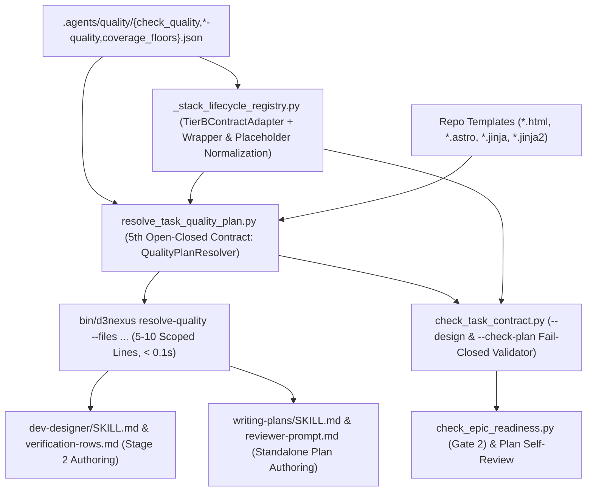
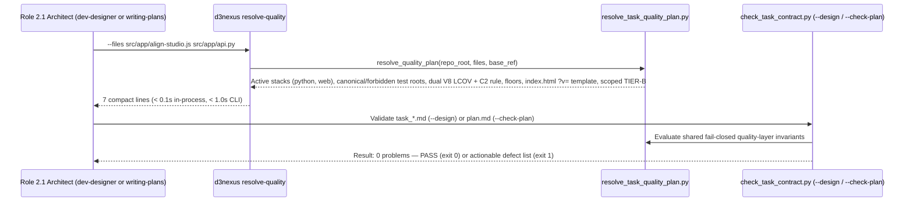

# Shift-Left Quality Layer Resolver and Mechanical Contract Enforcement High-Level Design

## Table of Contents

- [Meta Data](#meta-data)
- [Background](#background)
- [Goals and Non-Goals](#goals-and-non-goals)
- [Architecture and Technical Design](#architecture-and-technical-design)
- [Feature Maintenance Map](#feature-maintenance-map)
- [Module Contracts and CLI Interfaces](#module-contracts-and-cli-interfaces)
- [Impact Analysis](#impact-analysis)
- [Shared Contract Impact](#shared-contract-impact)
- [Integration Test Plan and Boundary Matrix](#integration-test-plan-and-boundary-matrix)
- [Verification Environment](#verification-environment)
- [Comprehensive BDD Scenario Coverage](#comprehensive-bdd-scenario-coverage)
- [Rollout Strategy and Mitigation](#rollout-strategy-and-mitigation)
- [Kanban Tasks Breakdown](#kanban-tasks-breakdown)
- [Spec Errata](#spec-errata)

## Meta Data

- **Epic name**: `shift_left_quality_resolver`
- **Status**: Planning
- **PIC**: `tess`
- **Target release**: Next `d3nexus` plugin release
- **Platform**: Python 3 stdlib CLI tooling, JSON Schemas, and Markdown skills (`ai-agent-tools`)
- **Depends on epic**: none
- **Source Spec**: [Shift-Left Quality Layer Resolver and Mechanical Contract Enforcement](2026-11-28-shift-left-quality-resolver-design.md)

## Background

Following the rollout of the Open-Closed Polyglot `/quality_check` architecture (`polyglot-quality-lifecycle-handoff.md`) across all five ecosystem repositories (`D3Nexus`, `lyrics-sync`, `nexus`, `android_digital_wallet`, `ios_digital_wallet`), empirical benchmarking and `task-observer` logs (`#0020`, `#0022`, `#0023`, `#0024`, `#0025`) exposed five concrete disconnects between downstream Gate 4 quality enforcement and upstream Stage 2 / standalone plan design:

1. **Shift-Left Quality Layer Blindness (`#0024`, `#0025`)**: `skills/dev-designer/SKILL.md` (`L60`) and `skills/writing-plans/SKILL.md` (`L58-60`) only instruct authors to inspect `lint` and `type_check` in `.agents/quality/*-quality.json`. Task and plan authors routinely miss dual Web test requirements (Node.js `node:test` V8 LCOV suites alongside Playwright E2E when `diff_coverage` reads `js-lcov.info`), adapter/module coverage ratchets in `.agents/quality/coverage_floors.json`, canonical/forbidden test directory rules, paired router/service unit suites, and referencing `*.html`/`*.astro`/`*.jinja` templates needing `?v=` cache-bust bumps.
2. **Multi-Target `type_check`, Monorepo Wrappers, and `{skills_dir}` Friction (`#0022`)**: `check_task_contract.py::matches_cap()` (`L1098-1114`) strips only `cap[:-1]` and gates `_cap_tool_prefix()` behind `allow_historical_prefix`, rejecting task-scoped `uv run mypy --strict src/pkg/a.py tests/unit/test_a.py` when `python-quality.json` declares `["uv", "run", "mypy", "--strict", "src", "tests"]` (forcing `lyrics-sync` `align_studio_post_editing_realign` tasks to run full-repo `mypy --strict src tests` on `Task 1..N-1`). Simultaneously, `_stack_lifecycle_registry.py` (`L576-656`, `L772`, `L1039`) keeps unexpanded `{skills_dir}` literals and lacks unwrapping for `uv --directory <dir> run`, `mise exec --`, and `npm --prefix <dir>`.
3. **Retired Script Hardcoding in Designer Templates (`#0020`)**: `skills/dev-designer/SKILL.md` (`L54`) and `skills/dev-designer/references/verification-rows.md` (`L79`) still hardcode retired `lyrics-sync` script names (`verify_importlinter_coverage.py`, `pre_review_self_probe.py`, `verify_bdd_coverage.py`).
4. **Stale `gate4_receipt.json` Survival on Non-Passing Runs (`#0023`)**: `verify_polyglot_registry.py::verify_polyglot_execution()` (`L1576-1600`) writes `build/quality/gate4_receipt.json` on `epic`/`release` `PASS`, never unlinking stale receipts when a later `epic` or `release` run returns `FAIL` or `BLOCKED`.
5. **Post-Rollout Blueprint & Schema Drift**: Comparing `nexus/docs/development/polyglot-quality-lifecycle-handoff.md` against the 5-repo rollout shows `flutter-quality.schema.json` missing `architecture`, `rust/web/python-quality.schema.json` missing `cache_enable`/`cache_purge`, `scaffold_quality_manifest.py` scaffolding duplicate `pr_*` + `workspace_*` checks in `release` (and online `cargo audit` in offline `pr`/`epic` plus bare `npx`), and `check_diff_coverage.py` missing `--package-floors <coverage_floors.json>`.

## Goals and Non-Goals

### Goals

- Establish **`QualityPlanResolver`** (`resolve_task_quality_plan.py` + optional additive `test_routing` in `*-quality.json`) as the **fifth Open-Closed Contract** alongside `TierBContractAdapter`, `PoolWorkspaceStrategy`, `TriageSurfaceRegistry`, and `TierCTaxonomy`, using 100% Python 3 stdlib (`0` LLM tokens, `< 0.1s` in-process resolution and `< 1.0s` cold CLI execution).
- Expose `d3nexus resolve-quality --files <planned_files> [--repo-root <dir>] [--base-ref <ref>] [--json]` emitting **5–10 compact lines** filtered strictly to the touched file extensions and paths (zero untouched-stack noise).
- Fix multi-target `_cap_tool_prefix()` / `matches_cap()`, `{skills_dir}` normalization, script-basename + required-flag matching, and `uv --directory` / `mise exec --` / `npm --prefix` unwrapping across `_stack_lifecycle_registry.py` and `check_task_contract.py`.
- Enforce fail-closed Shift-Left contract checks in `check_task_contract.py --design` (Gate 2) and add `check_task_contract.py --check-plan <plan.md>` (standalone `/writing-plans` plans) catching unexpanded `{skills_dir}`/`{base_ref}`, bare `npx`, intermediate-task full-repo Python `TIER-B` runs, missing JS V8 LCOV unit tests, forbidden test placements, missing paired tests, and omitted `?v=` referencing templates.
- Unlink stale `build/quality/gate4_receipt.json` on non-passing `epic`/`release` runs in `verify_polyglot_registry.py`, add `--package-floors` to `check_diff_coverage.py`, deduplicate/harden `scaffold_quality_manifest.py` and `web-quality.template.json`, synchronize all 6 `*-quality.schema.json` files with runtime validators, and update `dev-designer` / `writing-plans` with minimal 2–3 line CLI hooks passing UTF-8 byte/word caps and clean-shell Pre-Flight verification.

### Non-Goals

- Requiring any repository to author prose `quality-check-strategy.md` tables or embedding multi-stack test matrices into `SKILL.md` prompts.
- Implementing the post-Cross-Model-Review Code-Tree Equivalence Fast-Path (`lyrics-sync #0021` / `ai-agent-tools #2028`) or host-level `fcntl.flock` CPU semaphore (`lyrics-sync #0026`), which are scoped to a dedicated follow-up epic.
- Committing changes inside sibling repositories (`D3Nexus`, `lyrics-sync`, `nexus`, `android_digital_wallet`, `ios_digital_wallet`).

## Architecture and Technical Design

### Five-Contract Open-Closed Shift-Left Architecture

### Authoring-to-Validation Resolution Sequence

## Feature Maintenance Map

| Capability | Canonical Entry Point | Paired Verification Suite |
| :--- | :--- | :--- |
| `{skills_dir}` normalization, monorepo wrapper stripping, `test_routing` & `package_floors` schema/validator parity across 6 stacks | `skills/dev-implementation/resources/scripts/_stack_lifecycle_registry.py`, `skills/quality_check/resources/scripts/_provider_manifest_common.py`, `skills/*-quality-check/resources/schemas/*-quality.schema.json` | `tests/test_slqr_registry_and_schemas.py`, `tests/test_stack_lifecycle_registry.py` |
| Stale `gate4_receipt.json` unlink (`#0023`), `check_diff_coverage.py --package-floors`, deduplicated/offline `scaffold_quality_manifest.py` + `web-quality.template.json`, `integrate_branch.py` dirty-tree warning | `skills/quality_check/resources/scripts/verify_polyglot_registry.py`, `skills/quality_check/resources/scripts/check_diff_coverage.py`, `skills/setup_quality_check/resources/scripts/scaffold_quality_manifest.py`, `skills/setup_quality_check/resources/templates/web-quality.template.json`, `skills/finishing-a-development-branch/resources/scripts/integrate_branch.py` | `tests/test_slqr_receipt_coverage_and_scaffolder.py`, `tests/test_plq_quality_contracts_and_scaffolder.py`, `tests/test_check_diff_coverage.py` |
| On-demand file-scoped quality resolver (`QualityPlanResolver`) and `d3nexus resolve-quality` subcommand | `skills/dev-implementation/resources/scripts/resolve_task_quality_plan.py`, `bin/d3nexus` | `tests/test_slqr_quality_plan_resolver.py`, `tests/test_task_contract_ergonomics_e2e.py` |
| Multi-target `matches_cap()` fix (`#0022`), `--design` Shift-Left guards, and `--check-plan <plan.md>` validator | `skills/dev-implementation/resources/scripts/check_task_contract.py` | `tests/test_slqr_task_and_plan_contracts.py`, `skills/dev-implementation/resources/scripts/test_check_task_contract.py`, `tests/test_plq_task_contract_polyglot.py` |
| Lean skill hooks, `verification-rows.md` cleanup (`#0020`), `verify.sh` registration, clean-shell Pre-Flight & ecosystem acceptance | `skills/dev-designer/SKILL.md`, `skills/dev-designer/references/verification-rows.md`, `skills/writing-plans/SKILL.md`, `skills/writing-plans/plan-document-reviewer-prompt.md`, `skills/finishing-a-development-branch/SKILL.md`, `skills/setup_quality_check/SKILL.md`, `skills/quality_check/SKILL.md`, `scripts/verify.sh` | `tests/test_slqr_end_to_end_acceptance.py`, `tests/test_tto_docs_and_slimming.py`, `tests/test_ohk2_skill_docs.py` |

## Module Contracts and CLI Interfaces

1. **`_provider_manifest_common.py` & 6 `*-quality.schema.json` files** (`validate_*_quality.py` already accept arbitrary capability arrays and delegate additive fields to `_provider_manifest_common.py`, requiring no edits to `validate_*_quality.py`):
   - Adds `TEST_ROUTING_KEYS = ("canonical_test_globs", "forbidden_test_globs", "paired_source_globs", "lcov_unit_test_globs", "cache_bust_extensions")`.
   - `validate_additive_provider_fields(config)` validates optional top-level `test_routing` (object with only `TEST_ROUTING_KEYS`; relative globs without `..` for the first four keys and dot-prefixed extensions for `cache_bust_extensions`; emits `"invalid_test_routing"` on failure).
   - `validate_dual_floor_coverage(coverage_val)` validates optional `package_floors` (safe relative path string).
   - Syncs all 6 `*-quality.schema.json` files so every capability emitted by `scaffold_quality_manifest.py`, present in `.agents/quality/*-quality.json` / `templates/*.json`, or added post-rollout (`architecture` in Flutter; `cache_enable` and `cache_purge` in Rust/Web/Python) exists in `capabilities.properties`, with top-level `test_routing` and `coverage.properties.package_floors` allowed in all 6 schemas.

2. **`_stack_lifecycle_registry.py`**:
   - Adds `TestRoutingPolicy` frozen dataclass (`canonical_test_globs`, `forbidden_test_globs`, `paired_source_globs`, `lcov_unit_test_globs`, `cache_bust_extensions`) onto `StackDescriptor` (default empty tuples, populated from `data.get("test_routing")`).
   - Updates `BUILTIN_STACKS["web"].default_tier_b.typecheck_prefixes` to include `"check_vanilla_js.py"`.
   - Updates `_cap_command_str()` to normalize `{skills_dir}` -> `$D3NEXUS_KIT/skills` and strip trailing `--base-ref {base_ref}` pairs when deriving static `TierBPolicy` prefixes from `capabilities`.
   - Updates `_strip_command_wrappers()` (`L576-656`) to unwrap `uv [--directory <dir>|--project <dir>] run`, `mise exec [--]`, and `npm --prefix <dir>` (when followed by `exec`), and updates `_subcommand_matches_prefix()` (`L1066-1094`) to unwrap version-manager wrappers (`mise exec [--]`) on both `sub` and `ptoks` while enforcing monorepo directory wrapper agreement (`--directory <dir>`, `--project <dir>`, `--prefix <dir>`): mismatched wrapper directories fail closed, and when `ptoks` declares a directory wrapper `<dir>`, `sub` must either declare the identical wrapper `<dir>` or scope all positional targets under `<dir>/`. Value-taking wrapper flags are stripped before Rule 2 required-flag scanning.
   - Updates `_match_prefix_on_tokens()` Rule 4 (`L1038-1042`) so any prefix containing a `.py` or `.sh` script token matches a candidate subcommand invoking the same script basename (`Path(tok).name == script_basename`) provided all required `--flag` names (excluding `--base-ref`) appear in the candidate subcommand.

3. **`verify_polyglot_registry.py`, `check_diff_coverage.py`, `scaffold_quality_manifest.py`, `web-quality.template.json` & `integrate_branch.py`**:
   - `verify_polyglot_execution()` unlinks `repo_root / "build" / "quality" / "gate4_receipt.json"` (`missing_ok=True`) whenever `repo_root is not None`, `requested_profile in ("epic", "release")`, and `out_res.get("status") != "PASS"`.
   - `integrate_branch.py::cmd_verify_tier()` includes `"the worktree has uncommitted changes"` in `warnings` when `dirty_files(untracked=False)` is non-empty so dirty tracked checkouts cannot silently masquerade as clean `noop` receipt reuse.
   - `check_diff_coverage.py` adds `--package-floors <path>` parsing `.agents/quality/coverage_floors.json` (supporting `python.adapters`, `web_modules`, `packages`, or flat `<path_prefix>: <float|{"floor": float}>` schemas; `[0..1]` or `(1..100]` normalized), failing `exit 2` (`BLOCKED`) on missing/corrupt JSON and `exit 1` (`FAIL`) when any measured adapter prefix or module file falls below its configured floor.
   - `scaffold_quality_manifest.py` (and `skills/setup_quality_check/resources/templates/web-quality.template.json`) deduplicates `epic` and `release` profiles (`workspace_audit` + `workspace_impact` in `epic`, `scheduled`, `release`; `pr_diff_audit` + `pr_impact` in `pr` only), moves online `cargo audit` out of `rust` `security` into `security_deps` (replacing `rust` `security` with `./scripts/check_security.sh`), uses `npx --no-install` in `web`, drops `test_e2e` from `web` `scheduled`, and sets `python` `type_check` to `["uv", "run", "mypy", "--strict", "src", "tests"]`.

4. **`resolve_task_quality_plan.py` & `bin/d3nexus` (`resolve-quality`)**:
   - Exports `ResolvedQualityPlan` dataclass and `resolve_quality_plan(repo_root: Path, planned_files: Sequence[str], *, base_ref: str = "develop") -> ResolvedQualityPlan` (`< 0.1s` in-process), plus `format_compact_plan(plan: ResolvedQualityPlan) -> str`.
   - CLI: `resolve_task_quality_plan.py --files <path1> [<path2> ...] [--repo-root <dir>] [--base-ref <ref>] [--json]` (`< 1.0s` cold CLI execution).
   - Emits `0` lines for untouched stacks; `5–10` compact lines covering active stacks, canonical/forbidden test globs, dual Web V8 LCOV unit + Playwright Tier C2 requirements (when `web-quality.json` uses `.info`/`--lcov` in `diff_coverage` or `test_unit`), `coverage_floors.json` matched ratchets, referencing `?v=` template files (via `(?:src|href)=['"][^'"]*?{re.escape(name)}(\?[^'"]*)?['"]` when `ui_review` or `cache_bust_extensions` is active), and `$D3NEXUS_KIT/skills`-interpolated, `<allowed_files>`-scoped `TIER-B` commands.

5. **`check_task_contract.py` (`--design` & `--check-plan`)**:
   - `_cap_tool_prefix(cap)` strips trailing positional path tokens after runner wrappers (`uv [--directory <d>] run`, `python3 -m`), tool binary, subcommand (`check`, `format`), and flags (handling value-taking flags `--extend-select`, `--select`, `--ignore`, `--per-file-ignores`, `--config`, `--config-file`, `--target-version`, `--line-length`, `--python-version`). For `not allow_historical_prefix`, `matches_cap()` accepts a `_cap_tool_prefix(cap)` match ONLY when `len(sub) > len(prefix)`, `allowed_py` is non-empty, every file in `allowed_py` is covered by the subcommand's non-flag positional targets, and every positional target either covers at least one `allowed_py` path or appears in `cap[len(prefix):]` (preserving `test_todo_task_still_rejected_when_omitting_newly_registered_targets` and rejecting `mypy unrelated.py` on single-file tasks).
   - Adds `--design` guards: (a) literal `{skills_dir}` / `{base_ref}` rejection in `Verification` commands; (b) intermediate-task (`Task 1..N-1` when `len(tasks) >= 2` and `pyproject.toml` / `.agents/quality/` not in `Allowed files`) rejection of Python `ruff`/`mypy`/`pyright` `TIER-B` subcommands whose manifest capability ends in `"."` or `["src", "tests"]` (or when `python-quality.json` is absent) when the subcommand still passes bare `"."` or both `"src"` and `"tests"` instead of scoping to `Allowed files`; (c) Web V8 LCOV unit-test requirement when non-test `.js`/`.mjs` files are in `Allowed files` and `web-quality.json` enforces LCOV `diff_coverage` on `.js`/`.mjs`; (d) `test_routing` `forbidden_test_globs` / `canonical_test_globs` / `paired_source_globs` checks; (e) atomic `?v=` referencing template requirement in `Allowed files` when modifying existing `.js`/`.css` assets referenced via `src=`/`href=` in tracked templates under `ui_review` or `test_routing.cache_bust_extensions`.
   - Adds mutually exclusive `--check-plan <plan_path>` mode parsing `### Task N:` blocks (`Create:`/`Modify:`/`Test:` bullets + `Run:`/fenced `bash`/`sh` commands) and enforcing the same five guards plus bare-`npx` and active-stack `lint`/`type_check` presence checks.

## Impact Analysis

`check_code_impact.py --base-ref main` passed **🟢 CLEAN** (0 divergent commits on `main`) and identified 16 downstream caller/test modules:

- **Target Files > 200 lines (Bounded-Read Anchors)**:
  - `skills/dev-implementation/resources/scripts/_stack_lifecycle_registry.py` (`1899` lines): `TierBPolicy` & `StackDescriptor` (`L114-169`), `BUILTIN_STACKS["web"]` (`L333-382`), `_strip_command_wrappers` (`L576-656`), `_cap_command_str` & `_merge_tier_b_policy` (`L739-820`), `_load_repo_manifests` (`L875-945`), `_match_prefix_on_tokens` (`L984-1064`).
  - `skills/quality_check/resources/scripts/_provider_manifest_common.py` (`373` lines): `validate_dual_floor_coverage` (`L130-187`), `validate_additive_provider_fields` (`L189-319`).
  - `skills/quality_check/resources/scripts/verify_polyglot_registry.py` (`1784` lines): `verify_polyglot_execution` receipt block (`L1576-1601`).
  - `skills/quality_check/resources/scripts/check_diff_coverage.py` (`1576` lines): `evaluate_coverage` (`L1050-1240`), `_build_parser` & `main` (`L1297-1555`).
  - `skills/setup_quality_check/resources/scripts/scaffold_quality_manifest.py` (`1202` lines): `PLATFORM_CONFIGS` (`L101-950`).
  - `skills/finishing-a-development-branch/resources/scripts/integrate_branch.py` (`604` lines): `cmd_verify_tier` (`L409-425`).
  - `skills/dev-implementation/resources/scripts/check_task_contract.py` (`1760` lines): `_cap_tool_prefix` (`L805-824`), `check_python_tier_b` (`L1043-1160`), `_check_python_tier_b_allowed_coverage` (`L1160-1235`), `check_task` (`L1440-1540`), `main` (`L1660-1750`).
  - `skills/writing-plans/SKILL.md` (`248` lines): §5 (`L58-61`), Step 5 (`L175-180`), Self-Review (`L209-229`).
  - `scripts/verify.sh` (`569` lines): test suite registry (`L300-569`).
- **Downstream Regression Suites**:
  - `tests/test_stack_lifecycle_registry.py`, `skills/dev-implementation/resources/scripts/test_check_task_contract.py`, `tests/test_plq_quality_contracts_and_scaffolder.py` (`L288-297` `epic.issubset(release)` preserved cleanly), `tests/test_plq_task_contract_polyglot.py`, `tests/test_check_diff_coverage.py`, `skills/setup_quality_check/resources/scripts/test_scaffold_quality_manifest.py`, `tests/test_polyglot_gate4.py`, `tests/test_tto_docs_and_slimming.py` (`skills/dev-designer/SKILL.md <= 22528` UTF-8 bytes), and `tests/test_ohk2_skill_docs.py`.

## Shared Contract Impact

None — self-contained feature inside `ai-agent-tools` (`shared-contracts/` does not exist in this repository).

## Integration Test Plan and Boundary Matrix

Integration test roots: tests
Protected paths: .agents/quality/**, .devtool/epic/shift_left_quality_resolver/bdd_scenarios.md
Integration results: python3 -m pytest -q --tb=short --maxfail=3 --junitxml=build/test-results/shift-left-quality-resolver.xml tests/test_slqr_registry_and_schemas.py tests/test_slqr_receipt_coverage_and_scaffolder.py tests/test_slqr_quality_plan_resolver.py tests/test_slqr_task_and_plan_contracts.py tests/test_slqr_end_to_end_acceptance.py -> build/test-results/shift-left-quality-resolver.xml

| Boundary | Producer | Consumer | Verification Tier |
| :--- | :--- | :--- | :--- |
| `test_routing`, `package_floors`, `{skills_dir}` & wrapper normalization, 6-stack schema parity | `_stack_lifecycle_registry.py`, `_provider_manifest_common.py`, `*-quality.schema.json` | `resolve_task_quality_plan.py`, `check_task_contract.py`, `validate_*_quality.py` | Tier A Unit, Tier C Subcutaneous |
| `gate4_receipt.json` invalidation, `--package-floors` ratchets, deduplicated scaffolder | `verify_polyglot_registry.py`, `check_diff_coverage.py`, `scaffold_quality_manifest.py`, `integrate_branch.py` | `@quality_check`, `@setup_quality_check`, `@finishing-a-development-branch` | Tier A Unit, Tier C CLI Subcutaneous |
| `d3nexus resolve-quality` file-scoped 5–10 line resolver | `resolve_task_quality_plan.py`, `bin/d3nexus` | `/dev-designer`, `/writing-plans`, `check_task_contract.py` | Tier A Unit, Tier C CLI Subcutaneous |
| `--design` & `--check-plan` fail-closed Shift-Left contract enforcement | `check_task_contract.py` | `check_epic_readiness.py` (Gate 2), `/writing-plans` Self-Review & Reviewer | Tier A Unit, Tier C CLI Subcutaneous |
| Lean skill hooks, `#0020` cleanup, `verify.sh` registration, clean-shell Pre-Flight | Skill `SKILL.md` / `references/`, `scripts/verify.sh` | All 5 ecosystem repos (`44/44` profiles) + `verify.sh` | Tier A Contract, Tier C End-to-End Acceptance |

## Verification Environment

- **Data Isolation**: Every unit and integration test constructs synthetic or copied `.agents/quality/` manifests and temporary Git repositories inside `pytest` `tmp_path` directories; read-only live ecosystem parity assertions read sibling `.agents/quality/*.json` manifests without writing a single byte outside `tmp_path`.
- **Forbidden Live Stores**: Tests never mutate sibling repositories (`D3Nexus`, `lyrics-sync`, `nexus`, `android_digital_wallet`, `ios_digital_wallet`) or `~/.gemini/config/plugins/d3nexus`.
- **Needs Variables**: None (`Needs: none`).

## Comprehensive BDD Scenario Coverage

All 20 adversarial scenarios (`SLQR-HP-01`..`SLQR-HP-05`, `SLQR-EC-01`..`SLQR-EC-04`, `SLQR-ST-01`..`SLQR-ST-03`, `SLQR-AR-01`..`SLQR-AR-04`, `SLQR-FR-01`..`SLQR-FR-04`) across Happy Path (`HP`), Edge Cases (`EC`), State Transitions (`ST`), Architecture and Isolation (`AR`), and Fault Resilience (`FR`) are defined in [bdd_scenarios.md](bdd_scenarios.md).

## Rollout Strategy and Mitigation

- **4-Wave Execution Plan (100% disjoint `Allowed files` within Wave 1)**:
  - **Wave 1 (Parallel)**: `task_01` (registry, wrappers, `test_routing`, 6-stack schemas & validators) || `task_02` (`gate4_receipt.json` unlink `#0023`, `check_diff_coverage.py --package-floors`, deduplicated `scaffold_quality_manifest.py`, `integrate_branch.py` dirty warning).
  - **Wave 2**: `task_03` (`resolve_task_quality_plan.py` + `bin/d3nexus` `resolve-quality` CLI, `< 0.1s` budget).
  - **Wave 3**: `task_04` (`check_task_contract.py` `#0022` multi-target `matches_cap`, `--design` Shift-Left guards, and `--check-plan <plan.md>`).
  - **Wave 4**: `task_05` (lean `dev-designer` / `writing-plans` / `verification-rows.md` `#0020` / `finishing-a-development-branch` / `setup_quality_check` / `quality_check` updates, `scripts/verify.sh` registration, clean-shell Pre-Flight & 5-repo acceptance).
- **Rollback Plan**: Purely additive JSON keys (`test_routing`, `package_floors`, `cache_enable`, `cache_purge`, `architecture`) and opt-in `--check-plan` flag; reverting the epic merge commit restores prior validator behavior cleanly.

## Kanban Tasks Breakdown

1. [Task 01](task_01_registry_prefix_wrappers_and_provider_schemas.md) — Normalize `{skills_dir}` and monorepo/mise wrappers (`uv --directory`, `mise exec --`, `npm --prefix`) in `_stack_lifecycle_registry.py`, add `test_routing` & `package_floors` validation in `_provider_manifest_common.py`, and synchronize all 6 `*-quality.schema.json` files (`Covers: SLQR-HP-01, SLQR-EC-01, SLQR-FR-01`; `review_tier: "full"`).
2. [Task 02](task_02_receipt_hygiene_diff_coverage_and_scaffolder.md) — Unlink stale `gate4_receipt.json` on non-passing `epic`/`release` runs in `verify_polyglot_registry.py` (`#0023`), warn on dirty worktrees in `integrate_branch.py verify-tier`, add `--package-floors` adapter/module ratchets to `check_diff_coverage.py`, and deduplicate/harden `scaffold_quality_manifest.py` + `web-quality.template.json` (`Covers: SLQR-HP-02, SLQR-EC-02, SLQR-ST-01, SLQR-ST-02, SLQR-FR-02`; `review_tier: "full"`).
3. [Task 03](task_03_on_demand_quality_plan_resolver_cli.md) — Implement `resolve_task_quality_plan.py` (`QualityPlanResolver`) and `bin/d3nexus resolve-quality` emitting 5–10 file-scoped lines (`< 0.1s` in-process, `< 1.0s` CLI) for canonical/forbidden test roots, dual Web V8 LCOV + Tier C2 rules, `coverage_floors.json` ratchets, `?v=` templates, and scoped `TIER-B` commands (`Covers: SLQR-HP-03, SLQR-AR-01, SLQR-AR-02, SLQR-FR-03`; `review_tier: "full"`).
4. [Task 04](task_04_fail_closed_task_and_plan_contract_guards.md) — Fix multi-target `_cap_tool_prefix()` / `matches_cap()` (`#0022`) and enforce fail-closed Shift-Left quality-layer guards in `check_task_contract.py --design` and `--check-plan <plan.md>` (`Covers: SLQR-HP-04, SLQR-EC-03, SLQR-EC-04, SLQR-ST-03, SLQR-AR-03, SLQR-FR-04`; `review_tier: "full"`).
5. [Task 05](task_05_lean_skills_verify_registry_and_acceptance.md) — Wire 2–3 line CLI hooks into `dev-designer` and `writing-plans`, clean retired script names in `verification-rows.md` (`#0020`), register SLQR suites in `scripts/verify.sh`, and certify clean-shell Pre-Flight + ecosystem parity (`Covers: SLQR-HP-05, SLQR-AR-04`; `review_tier: "full"`).

## Spec Errata

- **[SE-01] §4.3 Multi-Target Capability Stripping**: Non-historical `_cap_tool_prefix()` matches in `check_task_contract.py` require `allowed_py` to be non-empty, every file in `allowed_py` to be covered by positional targets, and every positional target to cover an `allowed_py` path or appear in `cap[len(prefix):]`.
- **[SE-02] §4.3 Wrapper Normalization**: `_subcommand_matches_prefix()` unwraps version-manager prefixes (`mise exec`) on both `sub` and `ptoks` while enforcing monorepo wrapper directory agreement (`--directory`, `--project`, `--prefix`).
- **[SE-03] §6.1 Intermediate-Task Scope Guard**: Full-repo Python `TIER-B` rejection on `Task 1..N-1` applies specifically when the manifest capability ends in `.` or `src tests` (or when `python-quality.json` is absent) and the subcommand passes bare `.` or both `src` and `tests`.
- **[SE-04] §8.1 Scaffolder Deduplication**: `skills/setup_quality_check/resources/templates/web-quality.template.json` is updated alongside `scaffold_quality_manifest.py` in Task 02 (`npx --no-install`, deduplicated `epic`/`release` profiles, no `test_e2e` in `scheduled`).
- **[SE-05] §5.1 Resolver Latency Budget**: In-process `resolve_quality_plan()` is bounded at `< 0.10s` (best of 3 runs) and cold subprocess `bin/d3nexus resolve-quality` is bounded at `< 1.0s`.
