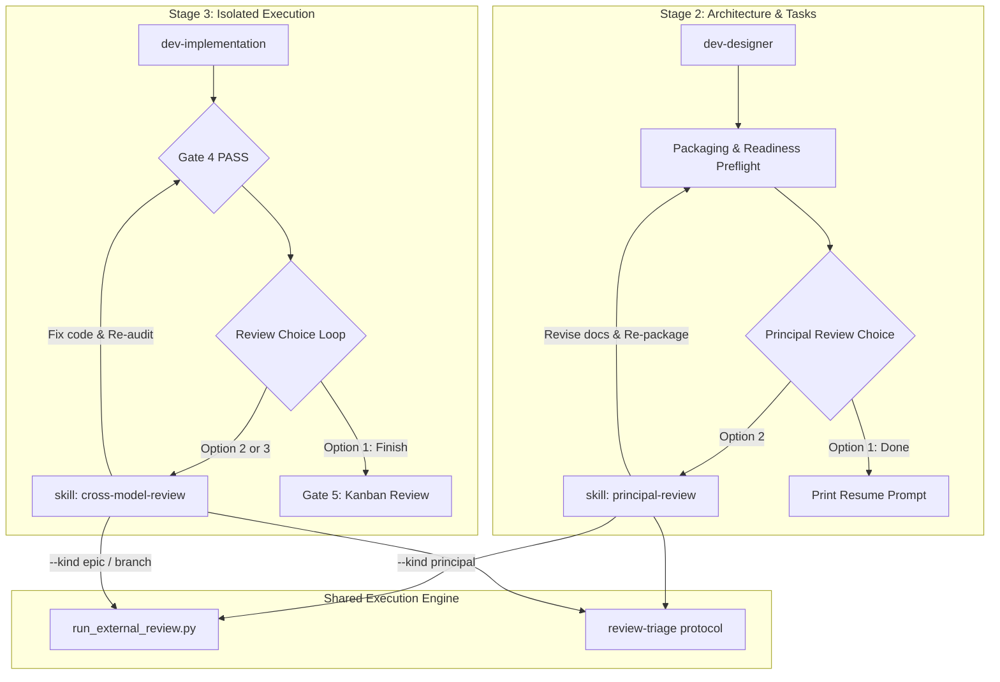

# Split Review Skills: Principal Review and Cross-Model Review Design

- **Date**: 2026-10-23
- **Status**: Approved
- **Scope**: New skills `principal-review` and `cross-model-review`, `dev-lifecycle`, `dev-implementation`, `docs/lifecycles.*.md`
- **Next step**: `dev-designer` (Epic-scale refactor)

## Table of Contents

- [1. Background](#1-background)
- [2. Theoretical Foundation and Architectural Rationale](#2-theoretical-foundation-and-architectural-rationale)
- [3. Goals and Non-Goals](#3-goals-and-non-goals)
- [4. Skill Architecture and Component Boundary](#4-skill-architecture-and-component-boundary)
- [5. Skill 1: Principal Review](#5-skill-1-principal-review)
- [6. Skill 2: Cross-Model Review](#6-skill-2-cross-model-review)
- [7. Shared Runner Engine and Triage Protocol](#7-shared-runner-engine-and-triage-protocol)
- [8. Lifecycle Integration and Orchestrator Refactoring](#8-lifecycle-integration-and-orchestrator-refactoring)
- [9. Testing and Contract Verification](#9-testing-and-contract-verification)
- [10. Risks and Mitigations](#10-risks-and-mitigations)

## 1. Background

In the current `d3nexus` engineering kit, review workflows were introduced in two distinct phases of the development lifecycle:
1. **Principal Review**: A cross-model review of architecture and task documents before implementation begins, currently embedded as a procedural reference in `dev-lifecycle/references/principal-review.md`.
2. **Cross-Model Review**: A multi-model and local-model review of completed code changes, task commits, and test integrity after Gate 4 machine checks pass, currently embedded inside `dev-implementation/SKILL.md` (Phase 4 Review Choice loop).

While effective, this coupling introduces two structural architectural issues:
- **Violation of the Orchestrator Contract**: `dev-lifecycle` states as its core invariant: *"It owns sequence and gates only — each stage's how stays in that stage's own skill."* Embedding procedural review execution, prompt dispatching, triage presentation, and revision loops directly into `dev-lifecycle` and `dev-implementation` compromises this boundary.
- **Lack of Ad-hoc Composability**: Developers and subagents frequently require independent document review (e.g., vetting an RFC, an HLD, or a standalone specification) or code review (e.g., auditing a feature branch or Pull Request) without running through an entire epic packaging or execution pipeline.

Separating these capabilities into two first-class, standalone skills—`principal-review` and `cross-model-review`—solves both issues while keeping the underlying execution engine unified.

## 2. Theoretical Foundation and Architectural Rationale

The decision to separate review workflows into two distinct skills rests on four engineering principles:

### 2.1. Boehm's Defect Cost Curve (Shift-Left vs. Shift-Right)

The cost to fix software defects increases exponentially as an artifact progresses through development phases (Boehm's Law):
- **Shift-Left Document Review (`principal-review`)**: Flaws in domain boundaries, architectural assumptions, API contracts, or task granularity are identified at Gate 2. Correcting these flaws requires only editing markdown specifications, costing an order of magnitude less than refactoring code.
- **Shift-Right Code Review (`cross-model-review`)**: Implementation defects, logic bugs, semantic test integrity compromises, concurrency race conditions, and integration regressions can only be detected after code is authored and passes machine validation.

Because the artifact type, evaluation criteria, and remediation mechanisms at these two points are fundamentally different, treating them as separate skills ensures neither compromises the rigor of the other.

### 2.2. Context Window Separation and Cognitive Load

AI agents operating under large context windows suffer degraded attention when instructions contain irrelevant procedural branches:
- A developer or agent executing task implementation in `dev-implementation` requires code-level context: git diffs, test logs, mock verification, and TDD steps. It should not carry document packaging instructions or HLD authoring rules.
- An agent conducting architectural review in `principal-review` requires static domain context: existing codebase schemas, module boundaries, HLD, BDD scenarios, and task granularity. It should not carry git worktree setup or test runner harnesses.

Decoupling the skills ensures minimal, high-signal system prompts for each agent invocation.

### 2.3. Single Responsibility Principle for Agent Skills

Each skill in the d3nexus taxonomy should own exactly one coherent capability:
- `dev-lifecycle`: Orchestrates epic stages and enforces transition gates.
- `dev-implementation`: Executes tasks in isolated worktrees using TDD and runs machine gates.
- `principal-review`: Audits design specifications against the source repository and guides document revisions.
- `cross-model-review`: Audits code diffs against the base branch using independent models and guides code fixes.

### 2.4. Composability and Dual-Mode Operation

Modern engineering workflows require tooling that functions both inside structured orchestrators and as ad-hoc developer utilities:
- **In-Lifecycle Mode**: Automated invocation at designated lifecycle checkpoints (Handoff Choice and Gate 4 Review Choice).
- **Ad-hoc Mode**: Direct on-demand execution on arbitrary files, branches, or PRs (`/principal-review <path>` or `/cross-model-review --base <base>`).

## 3. Goals and Non-Goals

### 3.1. Goals

- Extract `principal-review` into an independent skill (`skills/principal-review/SKILL.md`) supporting both in-lifecycle epic reviews and ad-hoc document reviews.
- Extract `cross-model-review` into an independent skill (`skills/cross-model-review/SKILL.md`) supporting both in-lifecycle epic reviews and ad-hoc branch/PR reviews with External CLI and Local Ollama backends.
- Refactor `dev-lifecycle` and `dev-implementation` to delegate to these standalone skills, adhering strictly to "sequence and gates only".
- Share the CLI runner script engine (`run_external_review.py`) and triage protocol (`review-triage.md`) without duplicating bridge logic.
- Update human-facing lifecycle documentation (`docs/lifecycles.en.md` and `docs/lifecycles.vi.md`) and contract verification tests.

### 3.2. Non-Goals

- Rewriting the CLI bridge, Ollama streaming client, or JSON parser in `run_external_review.py`.
- Altering Gate 4 machine checks (`audit_epic.py`, `check_bdd_traceability.py`, `@quality_check`).
- Removing the mandatory Review Choice loop or Gate 5 Developer Kanban Sign-Off.

## 4. Skill Architecture and Component Boundary

## 5. Skill 1: Principal Review

- **Location**: `skills/principal-review/SKILL.md`
- **Frontmatter**:
  - `name`: `principal-review`
  - `description`: "Audits software architecture, BDD scenarios, and task breakdown documents against the target codebase using an independent reasoning model (Claude CLI or Codex CLI). Use during epic packaging or ad-hoc before implementing new designs."

### 5.1. In-Lifecycle Mode

Invoked from `dev-lifecycle` Handoff Choice:
1. Runs preflight readiness check (`check_epic_readiness.py <epic_dir>`).
2. Prompts developer for CLI runner (`claude` or `codex`) and strongest reasoning model.
3. Invokes `run_external_review.py run --kind principal --epic-dir <epic_dir> --base <base> --cli <cli>`.
4. Formats review triage table (`run_external_review.py triage --kind principal`) and waits for developer decisions.
5. Guides document revision: commits document updates first, records decision SHAs in `principal_review.md`, commits decisions, and re-packages.

### 5.2. Ad-hoc Mode

Invoked directly via `/principal-review [path/to/spec_or_hld]`:
1. Validates document structure and links.
2. Prompts developer for target CLI and base branch/reference code.
3. Executes review against current codebase context.
4. Emits formatted triage and findings report.

## 6. Skill 2: Cross-Model Review

- **Location**: `skills/cross-model-review/SKILL.md`
- **Frontmatter**:
  - `name`: `cross-model-review`
  - `description`: "Audits implemented code changes, git commits, diffs, and semantic test integrity against a base branch using an independent model (Claude CLI, Codex CLI) or a local model (Ollama). Use after Gate 4 machine checks or ad-hoc on any branch or pull request."

### 6.1. In-Lifecycle Mode

Invoked from `dev-implementation` Review Choice loop:
1. Verifies clean git working tree on candidate SHA.
2. Supports Option 2 (External CLI: Claude/Codex) and Option 3 (Local Ollama).
3. Invokes `run_external_review.py run --kind epic --epic-dir <epic_dir> --base <base> ...`.
4. Records round in `.devtool/epic/<epic_dir>/review_results.md`.
5. Emits triage table (`run_external_review.py triage --epic-dir <epic_dir>`), stops calling tools, and waits for developer decisions.
6. Guides separate Fix commits (`[EPIC_NAME] Fix ...`), records decisions, and triggers full Gate 4 re-verification.

### 6.2. Ad-hoc Mode

Invoked directly via `/cross-model-review [--base <base_ref>] [--commits <range>]`:
1. Resolves diff and commit log for the specified branch or range.
2. Runs external or local model review against the changes.
3. Emits triage markdown and action items for the author.

## 7. Shared Runner Engine and Triage Protocol

Both skills leverage a shared infrastructure layer to avoid code duplication:
- **Runner Script**: `skills/dev-lifecycle/resources/scripts/run_external_review.py` retains:
  - Unified CLI invocation (`claude`, `codex`, `ollama`).
  - Streaming output capture and JSON findings parsing.
  - Subcommands: `run`, `triage`, `check`, `report`.
  - Discriminator: `--kind principal` (documents) vs `--kind epic` / `--kind diff` (code).
- **Triage Protocol**: Standardized in `references/review-triage.md`:
  - Enforces evidence verification against source artifacts before accepting reviewer claims.
  - Rejects performative agreement.
  - Requires explicit developer decisions (`fixed in <sha>` or `dismissed: <reason>`).

## 8. Lifecycle Integration and Orchestrator Refactoring

### 8.1. `dev-lifecycle` Refactoring

- In `dev-lifecycle/SKILL.md`, the inline packaging and review text under Handoff Choice is streamlined:
  - Gate 2 passes -> Handoff Choice (Package or Continue).
  - Package -> run readiness preflight, write `handoff.md`, sync status, and invoke `d3nexus:principal-review`.
- Move detailed review loop instructions from `skills/dev-lifecycle/references/principal-review.md` into `skills/principal-review/SKILL.md`.

### 8.2. `dev-implementation` Refactoring

- In `dev-implementation/SKILL.md`, Phase 4 Review Choice retains its mandatory stop & wait invariant:
  - On Gate 4 PASS, present Review Choice (1. Finish, 2. Cross-model review, 3. Local model review).
  - Option 2 and Option 3 delegate execution directly to `d3nexus:cross-model-review`.
  - On completion of each review round, control returns to Phase 4 / Gate 4 in full.

### 8.3. Documentation Updates

- Update `docs/lifecycles.en.md` and `docs/lifecycles.vi.md` Mermaid diagrams to show explicit calls to `principal-review` in Stage 2 and `cross-model-review` in Stage 3.

## 9. Testing and Contract Verification

1. **Skill Discovery and Frontmatter**:
   - `scripts/verify.sh` Section 2 validates that both new skills have exact `name` and `description` YAML frontmatter.
2. **Lifecycle Document Contract**:
   - `tests/test_lifecycle_document_contract.py` validates that `docs/lifecycles.*.md`, `dev-lifecycle/SKILL.md`, and `dev-implementation/SKILL.md` keep matching headings and skill references.
3. **Unit Tests**:
   - Add test cases covering `principal-review` and `cross-model-review` invocation contracts in `tests/test_run_external_review.py`.
4. **Markdown Quality Standards**:
   - Run `check_document.py --require-toc --require-bilingual` on this design spec and all modified lifecycle documents.

## 10. Risks and Mitigations

| Risk | Impact | Mitigation |
|---|---|---|
| **Breaking existing resume prompts** | Medium | Maintain backward compatibility for `handoff.md` and `.devtool/epic/` status conventions. |
| **Silent gate bypass** | High | Retain `<HARD-GATE>` in both orchestrators; external review rounds must return to machine verification before completion. |
| **CLI availability failure** | Low | Preflight checks verify tool existence (`command -v claude codex ollama`) and print actionable setup guides before executing. |
