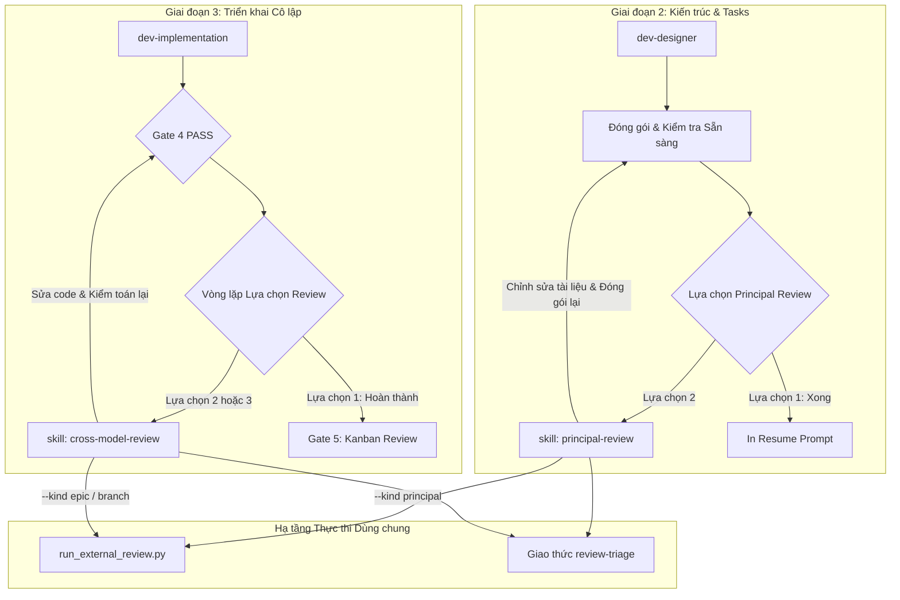

# Thiết Kế Tách Hai Kỹ Năng Đánh Giá: Principal Review và Cross-Model Review

- **Ngày**: 2026-10-23
- **Trạng thái**: Đã duyệt
- **Phạm vi**: Các skills mới `principal-review` và `cross-model-review`, `dev-lifecycle`, `dev-implementation`, `docs/lifecycles.*.md`
- **Bước tiếp theo**: `dev-designer` (Epic tái cấu trúc)

## Mục lục

- [1. Bối cảnh](#1-bối-cảnh)
- [2. Cơ sở lý luận và Động lực kiến trúc](#2-cơ-sở-lý-luận-và-động-lực-kiến-trúc)
- [3. Mục tiêu và Ngoài phạm vi](#3-mục-tiêu-và-ngoài-phạm-vi)
- [4. Kiến trúc Skill và Ranh giới Thành phần](#4-kiến-trúc-skill-và-ranh-giới-thành-phần)
- [5. Skill 1: Principal Review](#5-skill-1-principal-review)
- [6. Skill 2: Cross-Model Review](#6-skill-2-cross-model-review)
- [7. Hạ tầng Runner và Giao thức Triage Dùng chung](#7-hạ-tầng-runner-và-giao-thức-triage-dùng-chung)
- [8. Tích hợp Vòng đời và Tái cấu trúc Orchestrator](#8-tích-hợp-vòng-đời-và-tái-cấu-trúc-orchestrator)
- [9. Kiểm thử và Xác thực Hợp đồng](#9-kiểm-thử-và-xác-thực-hợp-đồng)
- [10. Rủi ro và Biện pháp Giảm thiểu](#10-rủi-ro-và-biện-pháp-giảm-thiểu)

## 1. Bối cảnh

Trong bộ công cụ kỹ thuật `d3nexus` hiện tại, các quy trình đánh giá phản biện được đưa vào ở hai giai đoạn riêng biệt của vòng đời phát triển:
1. **Principal Review**: Đánh giá chéo kiến trúc và tài liệu task bằng mô hình độc lập trước khi bắt đầu triển khai code, hiện đang nằm trong tài liệu hướng dẫn thủ tục `dev-lifecycle/references/principal-review.md`.
2. **Cross-Model Review**: Đánh giá chéo mã nguồn hoàn thiện, các commit task và tính toàn vẹn của test suite bằng mô hình bên ngoài hoặc mô hình cục bộ sau khi vượt qua kiểm tra máy Gate 4, hiện đang nằm lồng bên trong `dev-implementation/SKILL.md` (vòng lặp Review Choice của Phase 4).

Dù mang lại hiệu quả cao, sự gắn kết này gây ra hai vấn đề kiến trúc mang tính cấu trúc:
- **Vi phạm Hợp đồng của Orchestrator**: `dev-lifecycle` xác định bất biến cốt lõi: *"Nó chỉ sở hữu thứ tự và các gate — cách thực hiện của từng giai đoạn nằm trong skill riêng của giai đoạn đó."* Việc nhúng trực tiếp thủ tục thực thi review, gửi prompt, trình bày triage và vòng lặp chỉnh sửa vào `dev-lifecycle` và `dev-implementation` đã làm mờ ranh giới này.
- **Thiếu tính Khả tổ hợp Độc lập (Ad-hoc Composability)**: Các kỹ sư và subagent thường xuyên có nhu cầu đánh giá tài liệu độc lập (ví dụ: thẩm định một RFC, một HLD, hoặc một bản đặc tả độc lập) hoặc đánh giá code độc lập (ví dụ: audit một feature branch hoặc Pull Request) mà không cần phải chạy qua toàn bộ quy trình đóng gói hay thực thi epic.

Việc tách các năng lực này thành hai skills độc lập, hạng nhất—`principal-review` và `cross-model-review`—giải quyết triệt để cả hai vấn đề trên trong khi vẫn giữ nguyên hạ tầng thực thi thống nhất bên dưới.

## 2. Cơ sở lý luận và Động lực kiến trúc

Quyết định tách các quy trình đánh giá thành hai skills riêng biệt dựa trên bốn nguyên lý kỹ thuật:

### 2.1. Đường cong Chi phí Lỗi của Boehm (Shift-Left vs. Shift-Right)

Chi phí khắc phục khiếm khuyết phần mềm tăng theo hàm mũ khi một hạng mục tiến xa hơn qua các giai đoạn phát triển (Định luật Boehm):
- **Đánh giá Tài liệu Dịch trái (`principal-review`)**: Các sai lệch về ranh giới domain, giả định kiến trúc, hợp đồng API hoặc độ mịn của task được phát hiện tại Gate 2. Việc khắc phục chỉ đòi hỏi chỉnh sửa văn bản markdown, với chi phí rẻ hơn một bậc độ lớn so với việc tái cấu trúc code.
- **Đánh giá Mã nguồn Dịch phải (`cross-model-review`)**: Các lỗi triển khai, bug logic, vi phạm tính toàn vẹn ngữ nghĩa của test, xung đột tương tranh và hồi quy tích hợp chỉ có thể được phát hiện sau khi code đã được viết và vượt qua các bộ kiểm tra máy.

Bởi vì loại artifact, tiêu chí đánh giá và cơ chế khắc phục tại hai điểm này hoàn toàn khác nhau, việc coi chúng là hai skills độc lập đảm bảo tính nghiêm ngặt của từng quy trình không bị xâm phạm.

### 2.2. Phân tách Không gian Ngữ cảnh và Giảm tải Nhận thức

Các AI agent hoạt động trong cửa sổ ngữ cảnh lớn thường bị suy giảm mức độ tập trung khi chỉ dẫn chứa quá nhiều nhánh thủ tục không liên quan:
- Một lập trình viên hoặc agent thực hiện task trong `dev-implementation` cần ngữ cảnh ở cấp độ mã nguồn: git diffs, log test, xác minh mock và các bước TDD. Agent này không nên gánh thêm chỉ dẫn đóng gói tài liệu hay quy tắc viết HLD.
- Một agent thực hiện đánh giá kiến trúc trong `principal-review` cần ngữ cảnh domain tĩnh: cấu trúc schema hiện có của codebase, ranh giới module, HLD, kịch bản BDD và độ mịn của task. Agent này không cần phải quan tâm tới việc thiết lập git worktree hay cấu hình test runner.

Việc phân tách các skills đảm bảo system prompt luôn tinh gọn, mang lại tín hiệu chất lượng cao cho từng lượt gọi agent.

### 2.3. Nguyên lý Đơn Trách nhiệm cho Agent Skills

Mỗi skill trong cấu trúc d3nexus cần sở hữu chính xác một năng lực mạch lạc:
- `dev-lifecycle`: Điều phối các giai đoạn của epic và thực thi các cổng chuyển tiếp.
- `dev-implementation`: Triển khai các task trong worktree cô lập theo TDD và chạy các cổng kiểm thử máy.
- `principal-review`: Kiểm toán tài liệu thiết kế đối chiếu với codebase nguồn và hướng dẫn chỉnh sửa tài liệu.
- `cross-model-review`: Kiểm toán diff mã nguồn đối chiếu với nhánh base bằng các mô hình độc lập và hướng dẫn sửa code.

### 2.4. Tính Khả tổ hợp và Chế độ Hoạt động Kép

Quy trình kỹ thuật hiện đại đòi hỏi công cụ phải vận hành linh hoạt ở cả trong orchestrator có cấu trúc lẫn dạng tiện ích độc lập theo nhu cầu:
- **Chế độ Trong Vòng đời (In-Lifecycle Mode)**: Tự động kích hoạt tại các trạm kiểm soát vòng đời được chỉ định (Handoff Choice và Gate 4 Review Choice).
- **Chế độ Tùy biến (Ad-hoc Mode)**: Kích hoạt trực tiếp theo nhu cầu trên bất kỳ tệp tin, nhánh hoặc PR nào (`/principal-review <path>` hoặc `/cross-model-review --base <base>`).

## 3. Mục tiêu và Ngoài phạm vi

### 3.1. Mục tiêu

- Trích xuất `principal-review` thành một skill độc lập (`skills/principal-review/SKILL.md`) hỗ trợ cả review epic trong vòng đời lẫn review tài liệu độc lập.
- Trích xuất `cross-model-review` thành một skill độc lập (`skills/cross-model-review/SKILL.md`) hỗ trợ cả review epic trong vòng đời lẫn review nhánh/PR độc lập với các backend External CLI và Local Ollama.
- Tái cấu trúc `dev-lifecycle` và `dev-implementation` để chuyển giao cho các standalone skills này, tuân thủ nghiêm ngặt nguyên tắc "chỉ thứ tự và các cổng".
- Dùng chung script runner (`run_external_review.py`) và giao thức triage (`review-triage.md`) mà không làm trùng lặp logic gọi CLI.
- Cập nhật tài liệu vòng đời dành cho con người (`docs/lifecycles.en.md` và `docs/lifecycles.vi.md`) cùng các bài test kiểm tra hợp đồng.

### 3.2. Ngoài phạm vi

- Viết lại cầu nối CLI, client streaming Ollama hoặc bộ phân tích JSON trong `run_external_review.py`.
- Thay đổi các bộ kiểm tra máy tại Gate 4 (`audit_epic.py`, `check_bdd_traceability.py`, `@quality_check`).
- Loại bỏ vòng lặp bắt buộc Review Choice hoặc điểm dừng Developer Kanban Sign-Off tại Gate 5.

## 4. Kiến trúc Skill và Ranh giới Thành phần

## 5. Skill 1: Principal Review

- **Vị trí**: `skills/principal-review/SKILL.md`
- **Frontmatter**:
  - `name`: `principal-review`
  - `description`: "Audits software architecture, BDD scenarios, and task breakdown documents against the target codebase using an independent reasoning model (Claude CLI or Codex CLI). Use during epic packaging or ad-hoc before implementing new designs."

### 5.1. Chế độ Trong Vòng đời

Được gọi từ bước Handoff Choice của `dev-lifecycle`:
1. Chạy bước kiểm tra độ sẵn sàng (`check_epic_readiness.py <epic_dir>`).
2. Nhắc nhà phát triển chọn CLI runner (`claude` hoặc `codex`) và mô hình suy luận mạnh nhất.
3. Chạy `run_external_review.py run --kind principal --epic-dir <epic_dir> --base <base> --cli <cli>`.
4. Định dạng bảng triage (`run_external_review.py triage --kind principal`) và đợi quyết định từ nhà phát triển.
5. Hướng dẫn chỉnh sửa tài liệu: commit phần sửa tài liệu trước, ghi nhận SHA quyết định vào `principal_review.md`, commit quyết định và đóng gói lại.

### 5.2. Chế độ Tùy biến (Ad-hoc)

Được gọi trực tiếp qua `/principal-review [path/to/spec_or_hld]`:
1. Xác thực cấu trúc tài liệu và các liên kết.
2. Nhắc nhà phát triển chọn CLI mục tiêu và nhánh base/codebase tham chiếu.
3. Thực thi đánh giá đối chiếu với ngữ cảnh codebase hiện tại.
4. Xuất bảng triage định dạng chuẩn và danh sách các phát hiện.

## 6. Skill 2: Cross-Model Review

- **Vị trí**: `skills/cross-model-review/SKILL.md`
- **Frontmatter**:
  - `name`: `cross-model-review`
  - `description`: "Audits implemented code changes, git commits, diffs, and semantic test integrity against a base branch using an independent model (Claude CLI, Codex CLI) or a local model (Ollama). Use after Gate 4 machine checks or ad-hoc on any branch or pull request."

### 6.1. Chế độ Trong Vòng đời

Được gọi từ vòng lặp Review Choice của `dev-implementation`:
1. Xác nhận working tree git sạch sẽ trên commit SHA ứng viên.
2. Hỗ trợ Lựa chọn 2 (External CLI: Claude/Codex) và Lựa chọn 3 (Local Ollama).
3. Chạy `run_external_review.py run --kind epic --epic-dir <epic_dir> --base <base> ...`.
4. Ghi nhận vòng review vào `.devtool/epic/<epic_dir>/review_results.md`.
5. Xuất bảng triage (`run_external_review.py triage --epic-dir <epic_dir>`), dừng gọi tool và chờ quyết định từ nhà phát triển.
6. Hướng dẫn tạo các commit Fix riêng biệt (`[EPIC_NAME] Fix ...`), ghi nhận quyết định và kích hoạt lại toàn bộ kiểm tra Gate 4.

### 6.2. Chế độ Tùy biến (Ad-hoc)

Được gọi trực tiếp qua `/cross-model-review [--base <base_ref>] [--commits <range>]`:
1. Trích xuất diff và log commit cho nhánh hoặc phạm vi được chỉ định.
2. Chạy đánh giá bằng mô hình bên ngoài hoặc mô hình cục bộ trên các thay đổi.
3. Xuất tài liệu markdown triage và danh sách đầu việc cần xử lý cho tác giả.

## 7. Hạ tầng Runner và Giao thức Triage Dùng chung

Cả hai skills cùng tận dụng lớp hạ tầng dùng chung để tránh trùng lặp mã:
- **Script Runner**: `skills/dev-lifecycle/resources/scripts/run_external_review.py` tiếp tục duy trì:
  - Gọi CLI hợp nhất (`claude`, `codex`, `ollama`).
  - Ghi nhận output dạng stream và bóc tách các phát hiện JSON.
  - Các lệnh phụ: `run`, `triage`, `check`, `report`.
  - Phân loại: `--kind principal` (tài liệu) đối chiếu với `--kind epic` / `--kind diff` (code).
- **Giao thức Triage**: Được chuẩn hóa trong `references/review-triage.md`:
  - Bắt buộc kiểm chứng bằng chứng thực tế trên mã nguồn trước khi chấp nhận khiếu nại của reviewer.
  - Bác bỏ sự đồng thuận hình thức (performative agreement).
  - Đòi hỏi quyết định dứt khoát từ nhà phát triển (`fixed in <sha>` hoặc `dismissed: <reason>`).

## 8. Tích hợp Vòng đời và Tái cấu trúc Orchestrator

### 8.1. Tái cấu trúc `dev-lifecycle`

- Trong `dev-lifecycle/SKILL.md`, phần văn bản đóng gói và review tại Handoff Choice được tinh gọn:
  - Gate 2 đạt -> Handoff Choice (Package hoặc Continue).
  - Package -> chạy tiền kiểm tra sẵn sàng, ghi `handoff.md`, đồng bộ trạng thái và gọi `d3nexus:principal-review`.
- Chuyển toàn bộ chỉ dẫn chi tiết về vòng lặp review từ `skills/dev-lifecycle/references/principal-review.md` vào `skills/principal-review/SKILL.md`.

### 8.2. Tái cấu trúc `dev-implementation`

- Trong `dev-implementation/SKILL.md`, vòng lặp Review Choice tại Phase 4 giữ nguyên bất biến bắt buộc dừng và chờ:
  - Khi Gate 4 PASS, hiển thị Review Choice (1. Finish, 2. Cross-model review, 3. Local model review).
  - Lựa chọn 2 và Lựa chọn 3 chuyển giao thực thi trực tiếp sang `d3nexus:cross-model-review`.
  - Khi hoàn thành mỗi vòng review, quyền điều khiển quay trở lại kiểm tra toàn bộ Phase 4 / Gate 4.

### 8.3. Cập nhật Tài liệu

- Cập nhật sơ đồ Mermaid trong `docs/lifecycles.en.md` và `docs/lifecycles.vi.md` để thể hiện rõ ràng các lời gọi tới `principal-review` ở Giai đoạn 2 và `cross-model-review` ở Giai đoạn 3.

## 9. Kiểm thử và Xác thực Hợp đồng

1. **Khám phá Skill và Frontmatter**:
   - Mục 2 trong `scripts/verify.sh` xác thực cả hai skill mới đều có frontmatter YAML chuẩn xác với `name` và `description`.
2. **Hợp đồng Tài liệu Vòng đời**:
   - `tests/test_lifecycle_document_contract.py` xác thực `docs/lifecycles.*.md`, `dev-lifecycle/SKILL.md` và `dev-implementation/SKILL.md` luôn duy trì các tiêu đề và tham chiếu skill đồng bộ.
3. **Unit Tests**:
   - Thêm các test case kiểm tra hợp đồng gọi `principal-review` và `cross-model-review` trong `tests/test_run_external_review.py`.
4. **Tiêu chuẩn Chất lượng Markdown**:
   - Chạy `check_document.py --require-toc --require-bilingual` trên bản thiết kế này và tất cả các tài liệu vòng đời được chỉnh sửa.

## 10. Rủi ro và Biện pháp Giảm thiểu

| Rủi ro | Tác động | Biện pháp giảm thiểu |
|---|---|---|
| **Làm gãy các resume prompt hiện tại** | Trung bình | Duy trì khả năng tương thích ngược cho `handoff.md` và các quy ước trạng thái trong `.devtool/epic/`. |
| **Bỏ qua cổng ngầm định** | Cao | Giữ nguyên `<HARD-GATE>` trong cả hai orchestrator; mọi vòng review bên ngoài bắt buộc phải quay lại kiểm tra máy trước khi kết thúc. |
| **Lỗi thiếu công cụ CLI** | Thấp | Kiểm tra sự tồn tại của công cụ trước khi chạy (`command -v claude codex ollama`) và in hướng dẫn cài đặt cụ thể nếu thiếu. |
