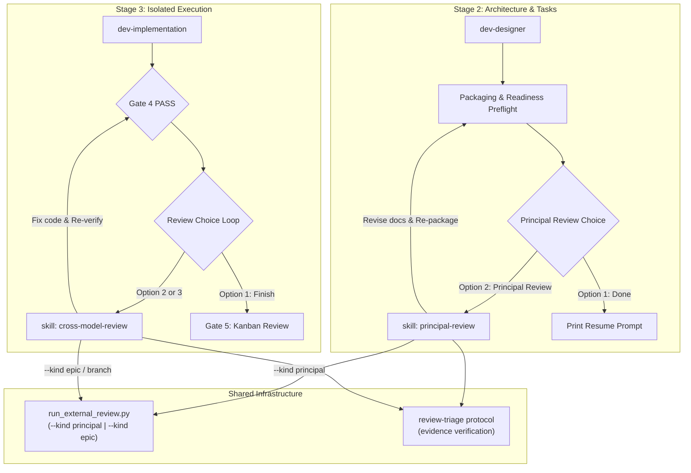
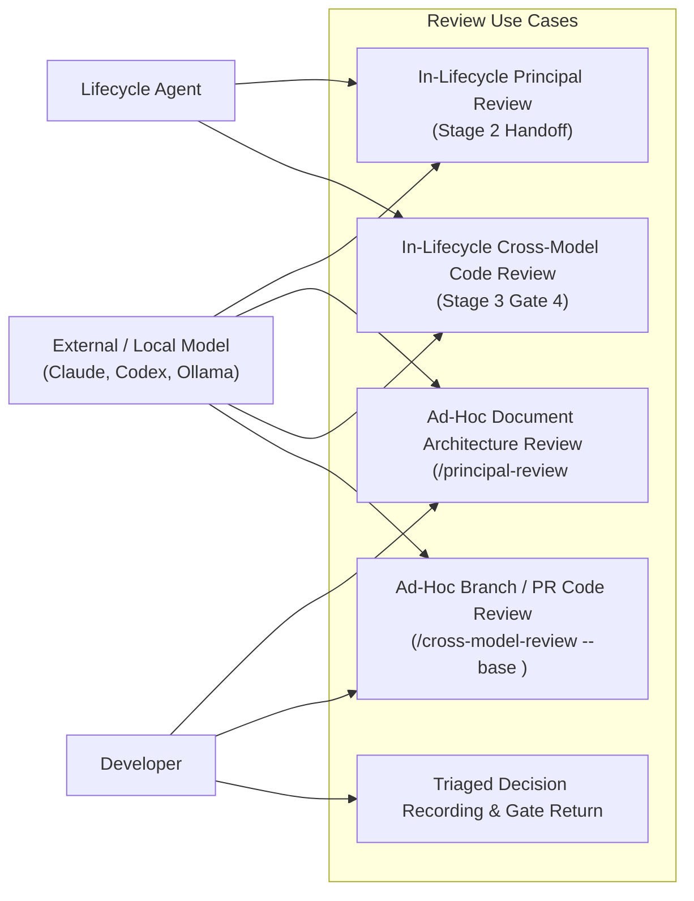
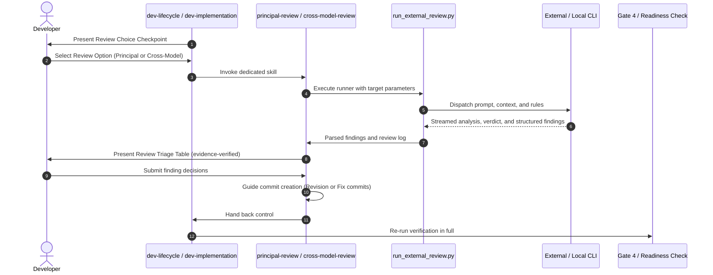

# Split Review Skills High-Level Design

## Table of Contents

- [Meta Data](#meta-data)
- [Background](#background)
- [Goals and Non-Goals](#goals-and-non-goals)
- [Architecture and Technical Design](#architecture-and-technical-design)
- [Integration Test Plan and Boundary Matrix](#integration-test-plan-and-boundary-matrix)
- [Verification Environment](#verification-environment)
- [Comprehensive BDD Scenario Coverage](#comprehensive-bdd-scenario-coverage)
- [Rollout Strategy and Mitigation](#rollout-strategy-and-mitigation)
- [Kanban Tasks Breakdown](#kanban-tasks-breakdown)

## Meta Data

- **Epic name**: `split_review_skills`
- **Status**: Planning
- **Target release**: Next plugin release
- **Platform**: Python tooling / agent skill kit
- **Source Spec**: [Approved Split Review Skills design](2026-10-23-split-review-skills-design.en.md)

## Background

Review workflows in the `d3nexus` engineering kit currently operate in two coupled locations:
1. **Principal Review** is embedded in `dev-lifecycle` under `references/principal-review.md`.
2. **Cross-Model Review** is embedded in `dev-implementation` under Phase 4 Review Choice.

This structure introduces architectural tension:
- `dev-lifecycle` declares that it *"owns sequence and gates only — each stage's how stays in that stage's own skill"*. Embedding concrete review procedures violates this boundary.
- Developers cannot easily trigger a standalone architectural review of an RFC or a standalone code review of a pull request without going through the complete epic machinery.

This epic extracts both capabilities into first-class skills—`principal-review` and `cross-model-review`—while unifying the underlying CLI runner engine and preserving all lifecycle gate invariants.

## Goals and Non-Goals

### Goals

- Create `skills/principal-review/SKILL.md` to govern Shift-Left architectural document review against repository source.
- Create `skills/cross-model-review/SKILL.md` to govern Shift-Right code diff review against base branches.
- Support dual-mode execution for both skills: In-Lifecycle (called by orchestrators) and Ad-hoc (called directly by developers).
- Share the CLI runner engine (`run_external_review.py`) and review triage protocol without duplicating logic.
- Update `dev-lifecycle`, `dev-implementation`, human-facing lifecycle documentation (`docs/lifecycles.*.md`), and contract test suites.

### Non-Goals

- Replacing or rewriting the CLI wrappers for Claude Code, Codex CLI, or Ollama.
- Altering the Gate 4 machine checks or removing the mandatory Review Choice loop.
- Altering Gate 5 Developer Kanban Sign-Off.

## Architecture and Technical Design

### High-Level Architecture

### Use Cases

### Sequence Diagram

### Module Contracts

#### `skills/principal-review/SKILL.md` (new)
- Governs document review against codebase source.
- Subcommands/Modes:
  - In-lifecycle: Reads `.devtool/epic/<epic_dir>/`, checks readiness preflight, records `principal_review.md`.
  - Ad-hoc: `/principal-review <path>`, validates file formatting, reviews against current git repository context.

#### `skills/cross-model-review/SKILL.md` (new)
- Governs commit and diff review against base branch.
- Subcommands/Modes:
  - In-lifecycle: Reads `.devtool/epic/<epic_dir>/`, records `review_results.md`, requires clean working tree.
  - Ad-hoc: `/cross-model-review [--base <base>] [--commits <range>]`, reviews diff without requiring epic directory.

#### `run_external_review.py` (updated)
- Supports `--kind principal` (documents) and `--kind epic` / `--kind diff` (code).
- Allows standalone target document with `--doc <path>`.
- Allows standalone commit diff review with `--base <base>` `--commits <range>`.

## Integration Test Plan and Boundary Matrix

Integration test roots: skills/dev-implementation/resources/scripts/, scripts/

Protected paths: .agents/quality/**, .devtool/epic/split_review_skills/bdd_scenarios.en.md, .devtool/epic/split_review_skills/bdd_scenarios.vi.md, skills/principal-review/SKILL.md, skills/cross-model-review/SKILL.md

Integration results: python3 scripts/run_unittest_junit.py --junitxml build/test-results/split-review-skills.xml skills/dev-implementation/resources/scripts/test_run_external_review.py scripts/test_lifecycle_document_contract.py scripts/test_lifecycle_signals.py -> build/test-results/split-review-skills.xml

| Boundary | Real components | Isolation or fixture | Required assertions |
|---|---|---|---|
| Principal skill, in-lifecycle | `principal-review/SKILL.md`, `run_external_review.py --kind principal` | Throwaway epic fixture, mock CLI script | Prompt content, `principal_review.md` round recorded, exit 0 |
| Principal skill, ad-hoc | `principal-review/SKILL.md`, standalone `--doc` | Standalone markdown file, git fixture | Markdown validated, triage table emitted, no epic dir needed |
| Cross-model skill, in-lifecycle | `cross-model-review/SKILL.md`, `run_external_review.py --kind epic` | Clean git worktree fixture, mock CLI | `review_results.md` round recorded, clean tree enforced |
| Cross-model skill, ad-hoc | `cross-model-review/SKILL.md`, `--base`, `--commits` | Git repository fixture with diverging commits | Diff analyzed, triage table generated, no epic dir needed |
| Lifecycle delegation | `dev-lifecycle/SKILL.md`, `dev-implementation/SKILL.md` | Skill markdown files | Explicit delegation calls, HARD-GATE invariants preserved |
| Contract verification | `test_lifecycle_document_contract.py`, `verify.sh` | Full repository checkout | Zero contract regressions, all 62 skills pass frontmatter check |

## Verification Environment

- Tests use temporary directories (`tempfile`) and isolated fixture git repositories; they never mutate active repository state.
- External CLIs (`claude`, `codex`) are mocked using lightweight shell scripts on `PATH` during testing. No real network or credentials required.
- Integration test results write to `build/test-results/split-review-skills.xml`.
- The project has no live database or remote service dependencies.

## Comprehensive BDD Scenario Coverage

The canonical Gherkin definitions are in [BDD scenarios](bdd_scenarios.en.md), with the synchronized [Vietnamese translation](bdd_scenarios.vi.md).

| Dimension | Scenario IDs | Coverage intent |
|---|---|---|
| Happy Paths | SRS-HP-01 through SRS-HP-05 | In-lifecycle and ad-hoc principal review, in-lifecycle and ad-hoc cross-model review, and local model review |
| Edge Cases and Boundaries | SRS-EC-01 through SRS-EC-04 | Missing document, dirty git tree refusal, missing CLI guidance, broken doc formatting |
| State Transitions | SRS-ST-01 through SRS-ST-04 | Document revision commit ordering, code fix Gate 4 loop, Gate 3 principal check, Gate 5 finish check |
| Async and Resilience | SRS-AR-01, SRS-AR-02 | Process timeout termination and sequential review round numbering |
| Failures and Resilience | SRS-FR-01, SRS-FR-02 | Precondition readiness failure halt and malformed model response triage parsing |

## Rollout Strategy and Mitigation

- **Phase 1**: Add standalone `principal-review` and `cross-model-review` skills with prompt templates and references.
- **Phase 2**: Add ad-hoc support flags to `run_external_review.py`.
- **Phase 3**: Refactor `dev-lifecycle` and `dev-implementation` to delegate to the new skills while keeping pinned tokens.
- **Phase 4**: Update human documentation (`docs/lifecycles.*.md`) and contract test assertions.
- **Rollback Plan**: If any contract test regresses, the runner maintains backward-compatible `--kind principal` and `--kind epic` flags.

## Kanban Tasks Breakdown

1. **Task 1: Standalone Principal Review Skill and References** (`task_1_standalone_principal_review_skill.md`)
2. **Task 2: Standalone Cross-Model Review Skill and Ad-Hoc Diff Support** (`task_2_standalone_cross_model_review_skill.md`)
3. **Task 3: Refactor Dev-Lifecycle and Dev-Implementation Orchestrators** (`task_3_orchestrators_delegation_refactor.md`)
4. **Task 4: Update Lifecycle Documentation, Diagrams and Contract Tests** (`task_4_documentation_and_contract_tests.md`)
