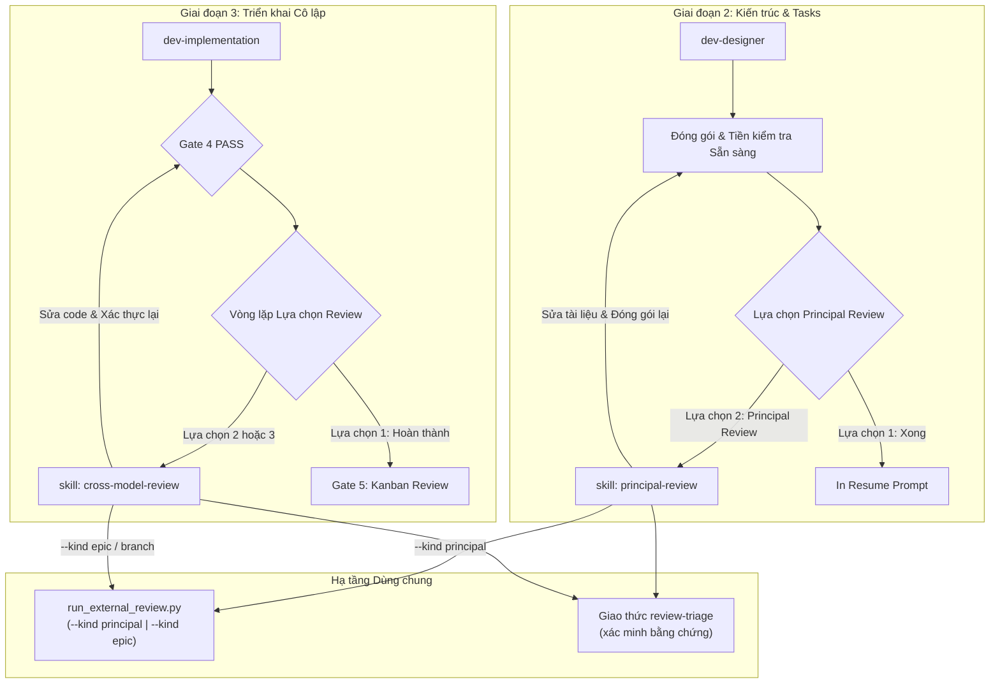
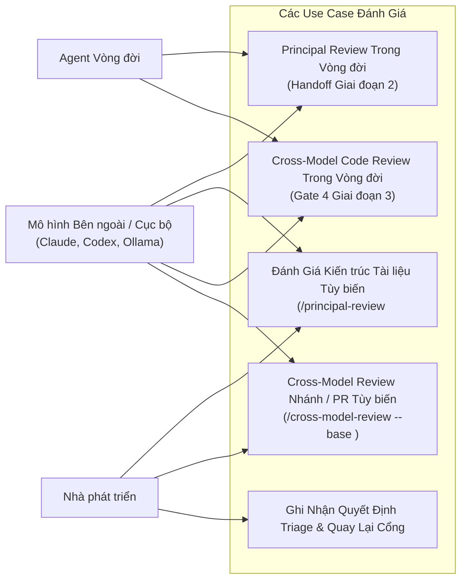
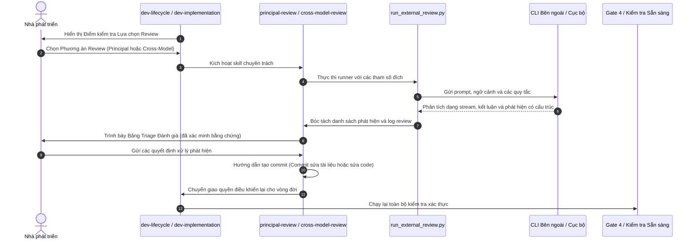

# Thiết Kế Cấp Cao Tách Hai Kỹ Năng Đánh Giá

## Mục lục

- [Meta Data](#meta-data)
- [Bối cảnh](#bối-cảnh)
- [Mục tiêu và Ngoài phạm vi](#mục-tiêu-và-ngoài-phạm-vi)
- [Kiến trúc và Thiết kế Kỹ thuật](#kiến-trúc-và-thiết-kế-kỹ-thuật)
- [Kế hoạch Kiểm thử Tích hợp và Ma trận Ranh giới](#kế-hoạch-kiểm-thử-tích-hợp-và-ma-trận-ranh-giới)
- [Môi trường Xác thực](#môi-trường-xác-thực)
- [Độ Phủ Kịch Bản BDD Toàn Diện](#độ-phủ-kịch-bản-bdd-toàn-diện)
- [Chiến lược Triển khai và Giảm thiểu Rủi ro](#chiến-lược-triển-khai-và-giảm-thiểu-rủi-ro)
- [Phân Rã Nhiệm Vụ Kanban](#phân-rã-nhiệm-vụ-kanban)

## Meta Data

- **Tên Epic**: `split_review_skills`
- **Trạng thái**: Done
- **Phiên bản mục tiêu**: Next plugin release
- **Nền tảng**: Python tooling / agent skill kit
- **Tài liệu Nguồn**: [Tài liệu thiết kế đã duyệt](2026-10-23-split-review-skills-design.vi.md)

## Bối cảnh

Các quy trình đánh giá phản biện trong bộ công cụ kỹ thuật `d3nexus` hiện tại đang vận hành ở hai vị trí bị gắn kết:
1. **Principal Review** được nhúng trực tiếp trong `dev-lifecycle` tại `references/principal-review.md`.
2. **Cross-Model Review** được nhúng trực tiếp trong `dev-implementation` tại vòng lặp Review Choice của Phase 4.

Cấu trúc này tạo ra sự mâu thuẫn về mặt kiến trúc:
- `dev-lifecycle` tuyên bố rằng nó *"chỉ sở hữu thứ tự và các cổng — cách thực hiện của từng giai đoạn nằm trong skill riêng của giai đoạn đó"*. Việc nhúng các thủ tục đánh giá cụ thể đã vi phạm ranh giới này.
- Các kỹ sư không thể dễ dàng kích hoạt đánh giá kiến trúc độc lập cho một RFC hay đánh giá mã nguồn độc lập cho một pull request nếu không kích hoạt toàn bộ cỗ máy epic đồ sộ.

Epic này trích xuất cả hai năng lực thành các skills hạng nhất—`principal-review` và `cross-model-review`—đồng thời thống nhất engine runner CLI bên dưới và bảo toàn mọi bất biến cổng của vòng đời.

## Mục tiêu và Ngoài phạm vi

### Mục tiêu

- Tạo `skills/principal-review/SKILL.md` để quản lý việc đánh giá tài liệu kiến trúc dịch trái (Shift-Left) đối chiếu với source codebase.
- Tạo `skills/cross-model-review/SKILL.md` để quản lý việc đánh giá diff mã nguồn dịch phải (Shift-Right) đối chiếu với các nhánh base.
- Hỗ trợ thực thi chế độ kép cho cả hai skills: Trong Vòng đời (In-Lifecycle, được gọi bởi orchestrator) và Tùy biến (Ad-hoc, được gọi trực tiếp bởi nhà phát triển).
- Dùng chung engine runner CLI (`run_external_review.py`) và giao thức review triage mà không làm trùng lặp logic.
- Cập nhật `dev-lifecycle`, `dev-implementation`, tài liệu vòng đời dành cho con người (`docs/lifecycles.*.md`) và các bộ kiểm thử hợp đồng.

### Ngoài phạm vi

- Thay thế hoặc viết lại các wrapper CLI cho Claude Code, Codex CLI hoặc Ollama.
- Thay đổi các bộ kiểm tra máy tại Gate 4 hoặc loại bỏ vòng lặp bắt buộc Review Choice.
- Thay đổi điểm kiểm tra Developer Kanban Sign-Off tại Gate 5.

## Kiến trúc và Thiết kế Kỹ thuật

### Kiến trúc Cấp cao

### Các Use Case

### Sơ đồ Tuần tự

### Hợp đồng Module

#### `skills/principal-review/SKILL.md` (mới)
- Quản lý việc đánh giá tài liệu đối chiếu với mã nguồn codebase.
- Các chế độ/Lệnh phụ:
  - Trong vòng đời: Đọc `.devtool/epic/<epic_dir>/`, kiểm tra sẵn sàng, ghi nhận `principal_review.md`.
  - Tùy biến (Ad-hoc): `/principal-review <path>`, kiểm tra định dạng tệp, đánh giá đối chiếu với ngữ cảnh kho git hiện tại.

#### `skills/cross-model-review/SKILL.md` (mới)
- Quản lý việc đánh giá commit và diff đối chiếu với nhánh base.
- Các chế độ/Lệnh phụ:
  - Trong vòng đời: Đọc `.devtool/epic/<epic_dir>/`, ghi nhận `review_results.md`, yêu cầu cây làm việc sạch.
  - Tùy biến (Ad-hoc): `/cross-model-review [--base <base>] [--commits <range>]`, đánh giá diff mà không yêu cầu thư mục epic.

#### `run_external_review.py` (cập nhật)
- Hỗ trợ `--kind principal` (tài liệu) và `--kind epic` / `--kind diff` (code).
- Cho phép chỉ định tệp tài liệu độc lập với `--doc <path>`.
- Cho phép đánh giá diff commit độc lập với `--base <base>` `--commits <range>`.

## Kế hoạch Kiểm thử Tích hợp và Ma trận Ranh giới

Integration test roots: skills/dev-implementation/resources/scripts/, scripts/

Protected paths: .agents/quality/**, .devtool/epic/split_review_skills/bdd_scenarios.en.md, .devtool/epic/split_review_skills/bdd_scenarios.vi.md, skills/dev-implementation/resources/scripts/test_run_external_review.py, scripts/test_lifecycle_document_contract.py, scripts/test_lifecycle_signals.py, scripts/run_unittest_junit.py, scripts/verify.sh, skills/doc_quality_check/resources/scripts/check_document.py

Integration results: python3 scripts/run_unittest_junit.py --junitxml build/test-results/split-review-skills.xml skills/dev-implementation/resources/scripts/test_run_external_review.py scripts/test_lifecycle_document_contract.py scripts/test_lifecycle_signals.py -> build/test-results/split-review-skills.xml

| Ranh giới | Thành phần thực tế | Cách ly hoặc fixture | Xác nhận bắt buộc |
|---|---|---|---|
| Skill principal, trong vòng đời | `principal-review/SKILL.md`, `run_external_review.py --kind principal` | Throwaway epic fixture, mock CLI script | Nội dung prompt, ghi nhận vòng trong `principal_review.md`, thoát mã 0 |
| Skill principal, tùy biến | `principal-review/SKILL.md`, `--doc` độc lập | Tệp markdown độc lập, git fixture | Markdown được xác thực, xuất bảng triage, không cần thư mục epic |
| Skill cross-model, trong vòng đời | `cross-model-review/SKILL.md`, `run_external_review.py --kind epic` | Clean git worktree fixture, mock CLI | Ghi nhận vòng trong `review_results.md`, bắt buộc cây sạch |
| Skill cross-model, tùy biến | `cross-model-review/SKILL.md`, `--base`, `--commits` | Fixture kho git với các commit rẽ nhánh | Phân tích diff, tạo bảng triage, không cần thư mục epic |
| Chuyển giao vòng đời | `dev-lifecycle/SKILL.md`, `dev-implementation/SKILL.md` | Các tệp markdown skill | Lời gọi chuyển giao rõ ràng, bảo toàn các bất biến HARD-GATE |
| Xác thực hợp đồng | `test_lifecycle_document_contract.py`, `verify.sh` | Toàn bộ checkout của kho | Không có hồi quy hợp đồng, toàn bộ 62 skills vượt qua kiểm tra frontmatter |

## Môi trường Xác thực

- Các bài kiểm thử sử dụng thư mục tạm (`tempfile`) và kho git fixture cô lập; không bao giờ làm thay đổi trạng thái thực tế của kho lưu trữ.
- Các CLI bên ngoài (`claude`, `codex`) được mock bằng shell script nhẹ trên `PATH` trong suốt quá trình kiểm thử. Không đòi hỏi mạng hay thông tin xác thực thật.
- Kết quả kiểm thử tích hợp được ghi vào `build/test-results/split-review-skills.xml`.
- Dự án không phụ thuộc vào cơ sở dữ liệu thật hoặc dịch vụ từ xa.

## Độ Phủ Kịch Bản BDD Toàn Diện

Các định nghĩa Gherkin chuẩn nằm trong [Kịch bản BDD](bdd_scenarios.en.md), cùng bản dịch [tiếng Việt](bdd_scenarios.vi.md).

| Chiều kiểm thử | Mã kịch bản | Mục đích độ phủ |
|---|---|---|
| Happy Paths | SRS-HP-01 đến SRS-HP-07 | Principal review và cross-model review trong vòng đời và tùy biến, đánh giá mô hình cục bộ, và đảm bảo hợp đồng vòng đời |
| Các trường hợp biên | SRS-EC-01 đến SRS-EC-04 | Thiếu tài liệu, từ chối cây git bẩn, thiếu hướng dẫn CLI, lỗi định dạng tài liệu |
| Chuyển đổi trạng thái | SRS-ST-01 đến SRS-ST-04 | Thứ tự commit sửa tài liệu, vòng lặp sửa code Gate 4, kiểm tra principal Gate 3, kiểm tra finish Gate 5 |
| Bất đồng bộ và Phục hồi | SRS-AR-01, SRS-AR-02 | Chấm dứt tiến trình khi timeout và đánh số thứ tự tuần tự các vòng review |
| Thất bại và Phục hồi | SRS-FR-01, SRS-FR-02 | Dừng quy trình khi tiền kiểm tra sẵn sàng thất bại và phân tích triage khi phản hồi mô hình lỗi |

## Chiến lược Triển khai và Giảm thiểu Rủi ro

- **Giai đoạn 1**: Thêm các skills độc lập `principal-review` và `cross-model-review` cùng các mẫu prompt và tài liệu tham chiếu.
- **Giai đoạn 2**: Bổ sung các cờ hỗ trợ chế độ tùy biến (ad-hoc) vào `run_external_review.py`.
- **Giai đoạn 3**: Tái cấu trúc `dev-lifecycle` và `dev-implementation` để chuyển giao cho các skills mới trong khi vẫn giữ nguyên các token ghim.
- **Giai đoạn 4**: Cập nhật tài liệu con người (`docs/lifecycles.*.md`) và các assertion kiểm thử hợp đồng.
- **Kế hoạch Rollback**: Nếu có bất kỳ kiểm thử hợp đồng nào bị hồi quy, runner tiếp tục duy trì các cờ tương thích ngược `--kind principal` và `--kind epic`.

## Phân Rã Nhiệm Vụ Kanban

1. [Nhiệm vụ 1: Standalone Principal Review Skill và Tài Liệu Tham Chiếu](task_1_standalone_principal_review_skill.md)
2. [Nhiệm vụ 2: Standalone Cross-Model Review Skill và Hỗ Trợ Diff Tùy Biến](task_2_standalone_cross_model_review_skill.md)
3. [Nhiệm vụ 3: Tái Cấu Trúc Chuyển Giao Orchestrator Dev-Lifecycle và Dev-Implementation](task_3_orchestrators_delegation_refactor.md)
4. [Nhiệm vụ 4: Cập Nhật Tài Liệu Vòng Đời, Sơ Đồ và Kiểm Thử Hợp Đồng](task_4_documentation_and_contract_tests.md)
