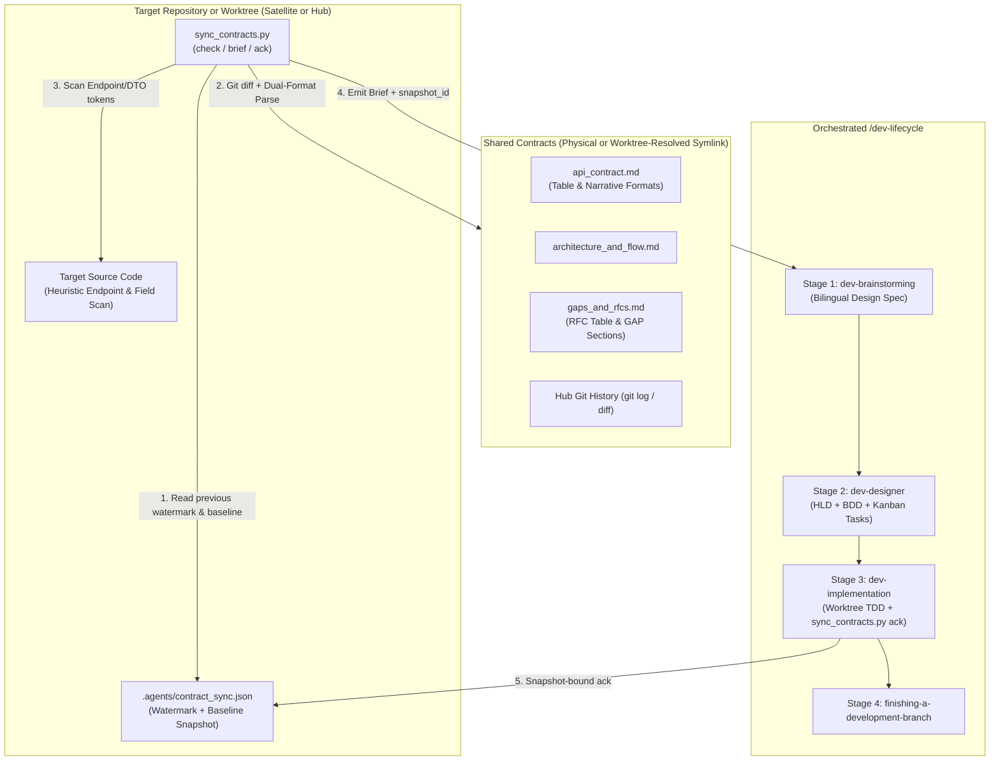

# Sync Shared Contracts Design

- **Date**: 2026-10-30
- **Status**: Approved
- **Scope**: New skill `skills/sync-shared-contracts/`, CLI engine `sync_contracts.py`, canonical delta brief template, hermetic test suite `test_sync_contracts.py`, integration with `scripts/verify.sh`
- **Next step**: `d3nexus:dev-designer` (Stage 2 — High-Level Design, BDD Scenarios, and Kanban Breakdown)

## Table of Contents

- [1. Background and Motivation](#1-background-and-motivation)
- [2. Goals and Non-Goals](#2-goals-and-non-goals)
- [3. Architecture and Dual-Mode Detection](#3-architecture-and-dual-mode-detection)
- [4. Directory Structure and Sync Watermark Schema](#4-directory-structure-and-sync-watermark-schema)
- [5. CLI Engine Specifications](#5-cli-engine-specifications)
- [6. Target Codebase Heuristic Scanner](#6-target-codebase-heuristic-scanner)
- [7. Orchestrated Lifecycle Bridge](#7-orchestrated-lifecycle-bridge)
- [8. Verification and Test Strategy](#8-verification-and-test-strategy)
- [9. Error Handling and Edge Cases](#9-error-handling-and-edge-cases)
- [10. Risks and Mitigations](#10-risks-and-mitigations)

## 1. Background and Motivation

With the introduction of `setup-shared-contracts`, multi-repository ecosystems (such as the control plane `D3Nexus` paired with worker satellites like `lyrics-sync` and mobile clients like `nexus`) have a standardized way to initialize physical `shared-contracts/` directories, relative symbolic links, and governance rules.

However, after initial setup (Day-0), teams face continuous synchronization challenges (Day-2 operations):
- When the Hub repository updates `api_contract.md` or `architecture_and_flow.md` (or approves an RFC in `gaps_and_rfcs.md`), satellite repositories lack an automated tool to detect what changed since their last implementation cycle.
- When a satellite repository logs a new `Draft` / `OPEN` or `In Review` / `PROPOSED` entry in `gaps_and_rfcs.md`, the Hub repository needs a deterministic check to discover actionable RFCs and incorporate them into backend implementation plans.
- Existing pilot contracts (such as `D3Nexus/shared-contracts/lyrics-sync/`) use narrative Markdown sections (HTML comment metadata `Version: 3.0.0`, `### 2.1. Claim Task (POST /api/v1/...)` with `* **Method**:` / `* **Path**:` bullets, and `### GAP-01:` sections with `* **Status**: OPEN | PROPOSED | ACCEPTED`), while newly generated contracts use `setup-shared-contracts` tables. Both formats must be parsed seamlessly.
- Executing tasks in nested git worktrees (`.worktrees/<epic_dir>`) shifts the working directory depth by two levels, causing relative symlinks (`../D3Nexus/shared-contracts/<domain>`) created at the satellite root to appear dangling unless resolved relative to the primary checkout root.

To bridge contract changes directly into target repository execution, we are introducing the `sync-shared-contracts` skill and its companion CLI engine `sync_contracts.py`.

## 2. Goals and Non-Goals

### Goals
- Provide a zero-dependency standard-library Python CLI (`sync_contracts.py`) supporting `check`, `brief`, and `ack` subcommands.
- Implement a **3-Layer Hybrid Delta Engine**:
  1. **Git, SHA-256 Watermark, and Normalized Baseline Diff**: Compare Hub git history, canonical file hashes, and persisted `baseline_snapshot` structures against `.agents/contract_sync.json`.
  2. **Dual-Format Structured Markdown Contract Parser**: Parse both `setup-shared-contracts` canonical tables and live narrative Markdown contracts (`api_contract.md`, `architecture_and_flow.md`, `gaps_and_rfcs.md`), normalizing RFC/Gap statuses and rejecting unrecognizable formats with exit code `1`.
  3. **Target Codebase Heuristic Scanner**: Scan target repository source files to classify contract endpoints, headers, and payload keys as `FOUND_IN_CODE` or `MISSING_IN_CODE`.
- Support **Dual-Mode Execution** (auto-detecting Satellite symlink mode vs Hub physical directory mode) with **Worktree-Aware Symlink Resolution** so nested `.worktrees/<epic_dir>` checkouts resolve relative satellite symlinks against the primary repository root without modifying the tracked symlink.
- Generate a structured **Contract Requirements Brief** (`brief`) carrying a composite `snapshot_id` that feeds directly into `d3nexus:dev-lifecycle` across all 4 stages (`dev-brainstorming` -> `dev-designer` -> `dev-implementation` -> `finishing-a-development-branch`).
- Provide a snapshot-and-scope-bound watermark update command (`ack`) that verifies `--snapshot <snapshot_id>`, tracks `acknowledged_rfcs` vs `pending_rfcs`, and persists `baseline_snapshot` in `.agents/contract_sync.json`.

### Non-Goals
- Modifying or replacing `setup-shared-contracts` topology initialization (`init-hub`, `link-satellite`).
- Autonomously committing across git symlink boundaries in violation of Rule 7 of `CRITICAL_RULES.md`.
- Pushing git commits to remote repositories without explicit user confirmation (prohibited by Rule 3).

## 3. Architecture and Dual-Mode Detection

The skill operates across both sides of the Star Topology by inspecting `<repo_root>/shared-contracts`:

1. **Satellite Mode (`shared-contracts` is a relative symbolic link)**:
   - Resolves the symlink target to identify the `<domain>` folder and parent `<hub_root>`.
   - **Worktree-Aware Resolution**: If `<repo_root>/shared-contracts` does not resolve directly from `<repo_root>` because `<repo_root>` is a nested git worktree (e.g. `<main_root>/.worktrees/<epic_dir>`), `sync_contracts.py` inspects `.git` / `git rev-parse --git-common-dir` to locate `<main_root>` and resolves `os.readlink("shared-contracts")` relative to `<main_root>` (bounded by `MAX_SYMLINK_HOPS = 10`). Codebase scanning and `.agents/contract_sync.json` writes still occur inside `<repo_root>`.
   - Enforces the strict Git read-only symlink boundary (never staging `shared-contracts/` inside the satellite repository; tracking sync state exclusively in `.agents/contract_sync.json`).
2. **Hub Mode (`shared-contracts/` is a physical directory)**:
   - Iterates over domain subdirectories `shared-contracts/<domain>/` (or targets a specific `--domain`).
   - Detects actionable RFCs and gaps (`OPEN`, `PROPOSED`, `DRAFT`, `IN_REVIEW`, `ACCEPTED`, `APPROVED`) in `gaps_and_rfcs.md`, as well as contract changes not yet reflected in the Hub backend source code or `.agents/contract_sync.json`.
   - Enforces the `task_01` Contract-First synchronization rule during `dev-designer` task breakdown.



## 4. Directory Structure and Sync Watermark Schema

### 4.1 Skill Directory Structure

```text
skills/sync-shared-contracts/
├── SKILL.md
└── resources/
    ├── scripts/
    │   ├── sync_contracts.py
    │   └── test_sync_contracts.py
    └── templates/
        └── contract_delta_brief.md.tmpl
```

### 4.2 Sync Watermark Schema (`.agents/contract_sync.json`)

The watermark file is stored inside the target repository at `.agents/contract_sync.json` and includes a normalized `baseline_snapshot` so semantic diffs work even without Git history or with uncommitted contract edits:

```json
{
  "schema_version": 1,
  "mode": "satellite",
  "domains": {
    "lyrics-sync": {
      "snapshot_id": "sha256:9f86d081884c7d659a2feaa0c55ad015a3bf4f1b2b0b822cd15d6c15b0f00a08",
      "hub_commit_sha": "a1b2c3d4e5f6a1b2c3d4e5f6a1b2c3d4e5f6a1b2",
      "contract_version": "1.1.0",
      "last_synced_at": "2026-10-30T18:30:00Z",
      "file_hashes": {
        "api_contract.md": "sha256:e3b0c44298fc1c149afbf4c8996fb92427ae41e4649b934ca495991b7852b855",
        "architecture_and_flow.md": "sha256:...",
        "gaps_and_rfcs.md": "sha256:..."
      },
      "acknowledged_rfcs": ["RFC-001", "GAP-03"],
      "pending_rfcs": [],
      "acknowledged_endpoints": [
        "POST /api/v1/lyrics-sync/tasks/claim",
        "POST /api/v1/lyrics-sync/tasks/{id}/progress",
        "POST /api/v1/lyrics-sync/tasks/{id}/complete",
        "GET /api/v1/lyrics-sync/status"
      ],
      "baseline_snapshot": {
        "endpoints": [
          "POST /api/v1/lyrics-sync/tasks/claim",
          "POST /api/v1/lyrics-sync/tasks/{id}/progress",
          "POST /api/v1/lyrics-sync/tasks/{id}/complete",
          "GET /api/v1/lyrics-sync/status"
        ],
        "headers": ["Authorization", "X-Worker-Token", "X-Correlation-ID", "X-Client-Timestamp"],
        "payload_keys": ["config", "domain", "error", "lease_duration_ms", "metrics", "output_data", "parameters", "payload", "status", "task_id"],
        "pipeline_steps": ["Lease Acquisition", "Input Validation", "Scratch Isolation", "Core Compute", "Heartbeat and Progress", "Terminal Result Delivery", "Scratch Teardown"],
        "rfcs": {
          "RFC-001": "APPROVED"
        }
      }
    }
  }
}
```

## 5. CLI Engine Specifications

The script `sync_contracts.py` provides three subcommands:

### 5.1 Command: `check`
```bash
python3 sync_contracts.py check [--repo-root <path>] [--domain <domain_name>] [--json] [--strict]
```
- **Validation**:
  - Verifies `shared-contracts` exists and resolves cleanly (using direct path or worktree-aware primary repo fallback, bounded to 10 symlink hops, with all 3 canonical files present).
  - Verifies that `api_contract.md`, `architecture_and_flow.md`, and `gaps_and_rfcs.md` contain recognizable contract metadata/sections; if a file is unparseable or lacks endpoints/sections (`UNSUPPORTED_CONTRACT_FORMAT`), exits `1` with a diagnostic error.
- **Actions**:
  1. Loads `.agents/contract_sync.json` if present; otherwise marks the domain status as `INITIAL_SYNC`.
  2. Computes current `sha256` hashes for the 3 canonical files, a composite `snapshot_id`, and queries the latest git commit SHA affecting the domain folder in the Hub repository (falling back gracefully if git history is unavailable).
  3. Parses the 3 canonical Markdown files supporting both **Table Format** (`setup-shared-contracts`) and **Narrative Format** (`D3Nexus/shared-contracts/lyrics-sync/`):
     - Extracts `Version` from either `- **Version**: \`X.Y.Z\`` or HTML comment metadata `Version: X.Y.Z`.
     - Extracts headers from markdown tables or `http` code blocks (`X-Worker-Token`, `Authorization`, `X-Correlation-ID`).
     - Extracts endpoints from `| Method | Endpoint | ... |` tables OR narrative `### ... (METHOD /path)` headings and `* **Method**:` / `* **Path**:` bullet pairs.
     - Extracts JSON payload keys (along with their sample value types) from `json` code fences.
     - Extracts pipeline steps from numbered lists or `### Step N` headings in `architecture_and_flow.md`.
     - Extracts RFC and Gap entries from `| RFC ID | ... |` tables OR `### GAP-XX: Title` / `### RFC-XXX: Title` sections with `* **Status**: \`...\``, normalizing statuses into:
       - `ACTIONABLE_PENDING`: `OPEN`, `PROPOSED`, `DRAFT`, `IN REVIEW`, `IN_REVIEW`
       - `ACKNOWLEDGED_ACTIVE`: `ACCEPTED`, `APPROVED`, `IMPLEMENTED`
       - `INACTIVE`: `SUPERSEDED`, `REJECTED`
  4. Compares current parsed structures against `baseline_snapshot` in `.agents/contract_sync.json` to compute added, removed, or modified endpoints, payload keys, pipeline steps, and RFCs even without Git history.
  5. Runs the Target Codebase Heuristic Scanner across `<repo_root>` to check whether extracted endpoints, headers, and payload keys appear in source code.
  6. Determines overall sync status:
     - `IN_SYNC`: `file_hashes` match `.agents/contract_sync.json`, `pending_rfcs` is empty, and all active RFCs are in `acknowledged_rfcs`.
     - `INITIAL_SYNC`: no valid domain entry in `.agents/contract_sync.json`.
     - `DRIFT_DETECTED`: `file_hashes` changed, semantic baseline differs, or unacknowledged `pending_rfcs` / new `ACKNOWLEDGED_ACTIVE` RFCs exist.
- **Exit Codes**:
  - `0` when `IN_SYNC` (or when `DRIFT_DETECTED` / `INITIAL_SYNC` without `--strict`).
  - `1` when topology/symlink/format errors occur, or when `--strict` is passed and status is not `IN_SYNC`.

### 5.2 Command: `brief`
```bash
python3 sync_contracts.py brief [--repo-root <path>] [--domain <domain_name>] [--output <path>]
```
- **Actions**:
  - Executes the full 3-layer delta analysis from `check`.
  - Renders `contract_delta_brief.md.tmpl` into a structured Markdown report containing:
    1. **Topology & Sync Metadata**: Mode (`hub` / `satellite`), Domain, Composite `snapshot_id`, Version transition (`previous -> current`), Hub commit range, and Changed files list.
    2. **API & Schema Requirements**: Endpoints and JSON payload fields added, modified, or unchanged (computed against `baseline_snapshot` when available, or full baseline during `INITIAL_SYNC`), annotated with heuristic scan status (`FOUND_IN_CODE` vs `MISSING_IN_CODE`).
    3. **Architecture & Pipeline Invariants**: Canonical pipeline steps, state machine transitions, and cancellation/isolation constraints.
    4. **Actionable RFCs & Gaps**: Normalized entries from `gaps_and_rfcs.md` (`ACTIONABLE_PENDING` and unacknowledged `ACKNOWLEDGED_ACTIVE` items).
    5. **Lifecycle Execution Rules**: Mandatory instructions for `dev-brainstorming`, `dev-designer` (`task_01` rule and symlink boundary rules), and `dev-implementation` (`sync_contracts.py ack --snapshot <snapshot_id>` verification step).

### 5.3 Command: `ack`
```bash
python3 sync_contracts.py ack [--repo-root <path>] [--domain <domain_name>] [--snapshot <snapshot_id>] [--rfc <RFC-ID> ...]
```
- **Actions**:
  - Computes the current file hashes and composite `snapshot_id`.
  - **Snapshot Guard**: If `--snapshot <expected_id>` is supplied and does not match the current `snapshot_id` on disk, `ack` aborts with exit code `1` and an error message explaining that the shared contract changed since the brief was generated.
  - **Scope-Bound RFC Tracking**:
    - By default, `ACKNOWLEDGED_ACTIVE` entries (`ACCEPTED`, `APPROVED`, `IMPLEMENTED`) are added to `acknowledged_rfcs`.
    - `ACTIONABLE_PENDING` entries (`OPEN`, `PROPOSED`, `DRAFT`, `IN_REVIEW`) remain in `pending_rfcs` unless explicitly acknowledged via `--rfc <ID>` (which moves `<ID>` into `acknowledged_rfcs`). If `pending_rfcs` is non-empty, subsequent `check --strict` runs continue to report `DRIFT_DETECTED` until remaining pending RFCs are resolved or explicitly acknowledged.
  - Persists the updated `baseline_snapshot`, `file_hashes`, `snapshot_id`, `hub_commit_sha`, `acknowledged_rfcs`, `pending_rfcs`, and `acknowledged_endpoints` into `.agents/contract_sync.json` atomically using a temporary file and `os.replace()`.

## 6. Target Codebase Heuristic Scanner

To provide immediate visibility into whether contract items are already implemented in the target repository (especially during `INITIAL_SYNC` or partial implementations):
- **Scanned Directories**: Walks `<repo_root>` recursively while excluding `.git`, `.worktrees`, `shared-contracts`, `.devtool`, `.agents`, `node_modules`, `build`, `dist`, `target`, `.dart_tool`, and `__pycache__`.
- **Supported Source Extensions**: `.py`, `.rs`, `.dart`, `.kt`, `.kts`, `.swift`, `.ts`, `.tsx`, `.js`, `.go`, `.java`, `.yaml`, `.yml`, `.json`.
- **Token Normalization**:
  - For endpoints like `/api/v1/lyrics-sync/tasks/{id}/progress` or `/api/v1/align/worker/tasks/{id}/heartbeat`, extracts static path segments (e.g., `/api/v1/lyrics-sync/tasks` and `/progress`) and checks whether those route fragments exist in source files.
  - For headers (`X-Worker-Token`, `X-Correlation-ID`) and JSON schema keys (`task_id`, `lease_duration_ms`, `output_data`), checks identifier presence in both `snake_case` and `camelCase` equivalents.

## 7. Orchestrated Lifecycle Bridge

When a developer invokes `/sync-shared-contracts` (or asks to check contract changes and execute on a target repo), the skill orchestrates the following 5-step workflow:

1. **Step 1 — Contract Audit & Brief Generation**:
   - Run `sync_contracts.py check` and `sync_contracts.py brief`.
   - If `shared-contracts` is missing or broken, direct the user to `d3nexus:setup-shared-contracts`.
   - If `IN_SYNC` and no `MISSING_IN_CODE` items or pending RFCs exist, report that the repository is fully synchronized and stop.
2. **Step 2 — Scope Confirmation**:
   - Present the generated **Contract Requirements Brief** (including its `snapshot_id`) to the developer and confirm which deltas/RFCs to target and the `<epic_slug>`.
3. **Step 3 — Stage 1 (`dev-brainstorming`) & Stage 2 (`dev-designer`)**:
   - Enter `d3nexus:dev-lifecycle` using the confirmed Contract Requirements Brief as grounding context:
     - **Stage 1 (`dev-brainstorming`)**: Produce the bilingual spec pair (`docs/superpowers/specs/YYYY-MM-DD-<topic>-design.en.md` and `.vi.md`) anchored on the contract delta without re-asking questions already settled by the contract, then obtain Gate 1 approval.
     - **Stage 2 (`dev-designer`)**: Generate the bilingual HLD, 5-dimension BDD scenarios (`bdd_scenarios.en.md` / `.vi.md`), and Kanban task breakdown (`task_*.md`) for Gate 2:
       - In **Hub Mode**: `task_01` updates the physical `shared-contracts/<domain>/` files (`api_contract.md`, `architecture_and_flow.md`, `gaps_and_rfcs.md`).
       - In **Satellite Mode**: `task_01` updates internal consumer DTOs, API clients, and mock fixtures (never including `shared-contracts/` in `Files Allowed`).
       - In **Both Modes**: The final task includes `.agents/contract_sync.json` in `Files Allowed` and runs `sync_contracts.py ack --snapshot <snapshot_id> [--rfc <ID> ...]` + `sync_contracts.py check --strict` so the sync watermark is verified and committed alongside the implementation.
4. **Step 4 — Stage 3 (`dev-implementation`)**:
   - Execute tasks in an isolated worktree (`.worktrees/<epic_dir>`) via TDD. `sync_contracts.py` automatically resolves the Satellite's relative `shared-contracts` symlink via the primary repository root while reading/writing `.agents/contract_sync.json` inside the worktree. Run Gate 4 (`quality_check` + `check_bdd_traceability.py` + `audit_epic.py`), and pass the Review Choice loop and Gate 5.
5. **Step 5 — Stage 4 (`finishing-a-development-branch`)**:
   - Rebase, verify, merge `--no-ff`, and archive epic artifacts into `.devtool/epic/<epic_slug>/`.

## 8. Verification and Test Strategy

The hermetic test suite in `skills/sync-shared-contracts/resources/scripts/test_sync_contracts.py` uses Python's standard `unittest` framework and `tempfile.TemporaryDirectory`:
- **Test Dual-Format Markdown Contract Parser**: Verifies parsing of both `setup-shared-contracts` table contracts and live `D3Nexus/shared-contracts/lyrics-sync/` narrative contracts (HTML comment `Version`, heading/bullet `Method`/`Path` endpoints, `### GAP-XX` sections with `OPEN`/`PROPOSED`/`ACCEPTED` statuses), plus rejection of unsupported/empty files.
- **Test Initial Sync, Dual-Mode, and Worktree Symlink Resolution**: Verifies `check` accurately detects Hub physical mode, Satellite symlink mode, and nested `.worktrees/<epic_dir>` Satellite checkouts without modifying the relative symlink.
- **Test Target Codebase Heuristic Scanner**: Verifies detection of implemented vs missing endpoints and `snake_case` / `camelCase` DTO fields across mock source files.
- **Test Snapshot-Bound Watermark Ack, Semantic Baseline Diff, and Incremental Drift**: Verifies `--snapshot` mismatch rejection, `pending_rfcs` retention vs `--rfc` acknowledgement, `baseline_snapshot` semantic diffing in Git-less or uncommitted setups, and `--strict` exit codes.
- **Harness Integration**: Registered in `scripts/verify.sh` alongside `test_setup_contracts.py`.

## 9. Error Handling and Edge Cases

| Scenario | Handled By | Behavior |
|---|---|---|
| `shared-contracts` does not exist | `check` / `brief` / `ack` | Exits `1` with remediation prompt pointing to `setup_contracts.py`. |
| Satellite `shared-contracts` is a dangling symlink (even after worktree fallback) | `check` / `brief` / `ack` | Detects broken target, exits `1` with instructions to re-run `link-satellite --force`. |
| Contract file has unrecognizable format (0 endpoints/sections) | `check` / `brief` / `ack` | Exits `1` with `UNSUPPORTED_CONTRACT_FORMAT` diagnostic naming the file. |
| `ack --snapshot <id>` does not match current contract files | `ack` | Exits `1` with `SNAPSHOT_MISMATCH` error preventing silent overwrite of concurrent Hub edits. |
| `.agents/contract_sync.json` does not exist yet | `check` / `brief` | Reports status `INITIAL_SYNC`, parses full contract baseline, and classifies items via codebase heuristic scan. |
| `.agents/contract_sync.json` contains malformed JSON | `check` / `ack` | Logs warning, treats state as unsynced during `check`, and overwrites cleanly on `ack`. |
| Hub directory is not a Git repository or has uncommitted edits | `check` / `brief` / `ack` | Skips `git log` gracefully and computes semantic field/endpoint/RFC diffs against `baseline_snapshot` in `.agents/contract_sync.json`. |

## 10. Risks and Mitigations

- **Risk: Divergent contract formatting across legacy narrative contracts and template-generated contracts.**
  *Mitigation*: The parser supports both table-driven and heading/bullet-driven schemas and fails closed (`exit 1`) if a contract file yields zero recognizable endpoints or sections.
- **Risk: Relative symlinks breaking inside `.worktrees/<epic_dir>` during Stage 3 (`dev-implementation`).**
  *Mitigation*: `resolve_topology()` detects git worktrees via `.git` / `git rev-parse --git-common-dir` and resolves relative symlink targets from the main repository root while keeping all writes local to the worktree.
- **Risk: Prematurely acknowledging unimplemented RFCs or concurrent upstream edits.**
  *Mitigation*: `ack` validates `--snapshot <snapshot_id>` and keeps `ACTIONABLE_PENDING` items in `pending_rfcs` unless explicitly acknowledged via `--rfc <ID>`.
