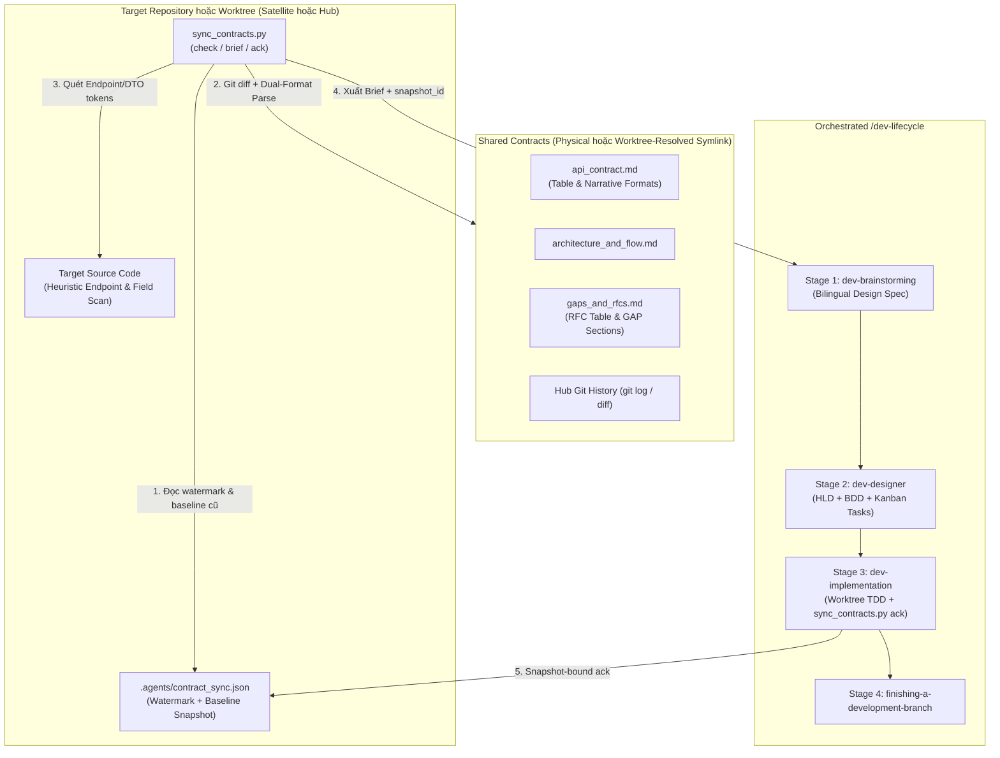

# Thiết Kế Skill Đồng Bộ Và Thực Thi Shared Contracts

- **Ngày**: 2026-10-30
- **Trạng thái**: Đã phê duyệt
- **Phạm vi**: Skill mới `skills/sync-shared-contracts/`, CLI engine `sync_contracts.py`, template báo cáo delta chuẩn hóa, bộ test hermetic `test_sync_contracts.py`, tích hợp vào `scripts/verify.sh`
- **Bước tiếp theo**: `d3nexus:dev-designer` (Stage 2 — Thiết kế Mức cao HLD, Kịch bản BDD, và Phân rã Kanban Tasks)

## Mục lục

- [1. Bối cảnh và Động lực](#1-bối-cảnh-và-động-lực)
- [2. Mục tiêu và Ngoài phạm vi](#2-mục-tiêu-và-ngoài-phạm-vi)
- [3. Kiến trúc và Cơ chế Tự động Nhận diện Dual-Mode](#3-kiến-trúc-và-cơ-chế-tự-động-nhận-diện-dual-mode)
- [4. Cấu trúc Thư mục và Schema Mốc Đồng bộ](#4-cấu-trúc-thư-mục-và-schema-mốc-đồng-bộ)
- [5. Đặc tả Kỹ thuật CLI Engine](#5-đặc-tả-kỹ-thuật-cli-engine)
- [6. Bộ Quét Heuristic trên Source Code Đích](#6-bộ-quét-heuristic-trên-source-code-đích)
- [7. Cầu nối Điều phối sang Vòng đời Phát triển](#7-cầu-nối-điều-phối-sang-vòng-đời-phát-triển)
- [8. Chiến lược Kiểm thử và Xác minh](#8-chiến-lược-kiểm-thử-và-xác-minh)
- [9. Xử lý Lỗi và các Trường hợp Biên](#9-xử-lý-lỗi-và-các-trường-hợp-biên)
- [10. Rủi ro và Biện pháp Giảm thiểu](#10-rủi-ro-và-biện-pháp-giảm-thiểu)

## 1. Bối cảnh và Động lực

Sau khi có skill `setup-shared-contracts`, các hệ sinh thái đa repository (chẳng hạn như control plane `D3Nexus` kết nối với các worker node như `lyrics-sync` và ứng dụng di động như `nexus`) đã có công cụ chuẩn hóa để khởi tạo thư mục vật lý `shared-contracts/`, tạo relative symlink và cài đặt các quy tắc quản trị.

Tuy nhiên, sau bước thiết lập ban đầu (Day-0), các đội phát triển đối mặt với bài toán đồng bộ và thực thi liên tục (Day-2 operations):
- Khi Hub repository cập nhật `api_contract.md` hoặc `architecture_and_flow.md` (hoặc phê duyệt một RFC trong `gaps_and_rfcs.md`), các satellite repository thiếu công cụ tự động để phát hiện chính xác những gì đã thay đổi kể từ lần đồng bộ gần nhất.
- Khi một satellite repository ghi nhận đề xuất `Draft` / `OPEN` hoặc `In Review` / `PROPOSED` mới vào `gaps_and_rfcs.md`, Hub repository cần cơ chế tự động rà soát các RFC đang chờ xử lý để đưa vào kế hoạch triển khai ở phía backend.
- Các hợp đồng thực tế đang chạy (như `D3Nexus/shared-contracts/lyrics-sync/`) sử dụng định dạng Markdown narrative (`Version: 3.0.0` trong khối HTML comment, tiêu đề `### 2.1. Claim Task (POST /api/v1/...)` kèm các dòng bullet `* **Method**:` / `* **Path**:`, và các mục `### GAP-01:` với `* **Status**: OPEN | PROPOSED | ACCEPTED`), trong khi các hợp đồng mới tạo từ `setup-shared-contracts` dùng định dạng bảng Markdown. Bộ công cụ cần hỗ trợ đồng thời cả hai định dạng.
- Khi thực thi Stage 3 (`dev-implementation`) bên trong các git worktree lồng nhau (`.worktrees/<epic_dir>`), độ sâu thư mục thay đổi 2 cấp khiến relative symlink (`../D3Nexus/shared-contracts/<domain>`) bị lệch đường dẫn nếu không có cơ chế phân giải qua thư mục gốc của repository chính.

Để tự động hóa toàn diện quy trình kiểm tra sự thay đổi, trích xuất requirements từ contracts và kích hoạt `/dev-lifecycle` trên target repo, chúng tôi xây dựng skill `sync-shared-contracts` cùng CLI engine `sync_contracts.py`.

## 2. Mục tiêu và Ngoài phạm vi

### Mục tiêu
- Cung cấp CLI Python tiêu chuẩn không phụ thuộc thư viện ngoài (`sync_contracts.py`) hỗ trợ 3 lệnh `check`, `brief`, và `ack`.
- Triển khai **Cơ chế Phát hiện Thay đổi Lai 3 Tầng (3-Layer Hybrid Delta Engine)**:
  1. **Git, SHA-256 Watermark, và Normalized Baseline Diff**: So sánh lịch sử commit trên Hub, mã băm SHA-256 của 3 file canonical, và cấu trúc `baseline_snapshot` đã lưu trong `.agents/contract_sync.json`.
  2. **Dual-Format Structured Markdown Contract Parser**: Phân tích cú pháp cả định dạng bảng của `setup-shared-contracts` lẫn định dạng narrative thực tế (`api_contract.md`, `architecture_and_flow.md`, `gaps_and_rfcs.md`), chuẩn hóa trạng thái RFC/Gap và báo lỗi thoát mã `1` nếu định dạng không hợp lệ.
  3. **Target Codebase Heuristic Scanner**: Quét nhanh source code của target repo để phân loại từng endpoint, header, và trường dữ liệu theo trạng thái `FOUND_IN_CODE` hoặc `MISSING_IN_CODE`.
- Hỗ trợ **Chế độ Kép (Dual-Mode Execution)** kèm **Worktree-Aware Symlink Resolution** để các worktree `.worktrees/<epic_dir>` phân giải chính xác relative symlink từ thư mục gốc của repo chính mà không làm thay đổi symlink được git theo dõi.
- Sinh bản **Contract Requirements Brief** (`brief`) kèm mã `snapshot_id` làm đầu vào chuẩn hóa cho trọn vẹn 4 giai đoạn của `d3nexus:dev-lifecycle` (`dev-brainstorming` -> `dev-designer` -> `dev-implementation` -> `finishing-a-development-branch`).
- Cung cấp lệnh cập nhật mốc đồng bộ nguyên tử (`ack`) có kiểm tra `--snapshot <snapshot_id>`, phân tách `acknowledged_rfcs` với `pending_rfcs`, và lưu `baseline_snapshot` vào `.agents/contract_sync.json`.

### Ngoài phạm vi
- Không thay thế chức năng khởi tạo hạ tầng ban đầu (`init-hub`, `link-satellite`) của `setup-shared-contracts`.
- Không tự ý thực hiện git commit xuyên qua ranh giới symlink trái với Rule 7 của `CRITICAL_RULES.md`.
- Không tự động đẩy code (`git push`) lên remote repository khi chưa có sự đồng ý rõ ràng từ người dùng (bị nghiêm cấm theo Rule 3).

## 3. Kiến trúc và Cơ chế Tự động Nhận diện Dual-Mode

Skill hoạt động trên cả hai phía của mô hình Star Topology bằng cách kiểm tra `<repo_root>/shared-contracts`:

1. **Satellite Mode (`shared-contracts` là một relative symbolic link)**:
   - Phân giải đích của symlink để xác định thư mục `<domain>` và thư mục gốc `<hub_root>` của Hub.
   - **Phân giải nhận biết Worktree (Worktree-Aware Resolution)**: Nếu `<repo_root>/shared-contracts` không phân giải được trực tiếp từ `<repo_root>` do `<repo_root>` là một git worktree lồng bên trong (ví dụ `<main_root>/.worktrees/<epic_dir>`), `sync_contracts.py` kiểm tra `.git` / `git rev-parse --git-common-dir` để tìm `<main_root>` và phân giải `os.readlink("shared-contracts")` tương đối từ `<main_root>` (giới hạn tối đa `MAX_SYMLINK_HOPS = 10`). Việc quét source code và ghi `.agents/contract_sync.json` vẫn thực hiện bên trong `<repo_root>`.
   - Thực thi nghiêm ngặt ranh giới chỉ đọc đối với symlink trong Git (không bao giờ đưa `shared-contracts/` vào git staging của satellite; trạng thái đồng bộ chỉ được lưu tại `.agents/contract_sync.json`).
2. **Hub Mode (`shared-contracts/` là một thư mục vật lý)**:
   - Duyệt qua các thư mục con `shared-contracts/<domain>/` (hoặc lọc theo tham số `--domain`).
   - Phát hiện các RFC/Gaps cần xử lý (`OPEN`, `PROPOSED`, `DRAFT`, `IN_REVIEW`, `ACCEPTED`, `APPROVED`) trong `gaps_and_rfcs.md`, cũng như các thay đổi trong contract chưa được đồng bộ vào source code backend của Hub hoặc `.agents/contract_sync.json`.
   - Áp dụng quy tắc ưu tiên `task_01` (Contract-First synchronization) khi phân rã task trong `dev-designer`.



## 4. Cấu trúc Thư mục và Schema Mốc Đồng bộ

### 4.1 Cấu trúc Thư mục của Skill

```text
skills/sync-shared-contracts/
├── SKILL.md
└── resources/
    ├── scripts/
    │   ├── sync_contracts.py
    │   └── test_sync_contracts.py
    └── templates/
        └── contract_delta_brief.md.tmpl
```

### 4.2 Schema Mốc Đồng bộ (`.agents/contract_sync.json`)

File trạng thái đồng bộ được lưu trực tiếp trong target repository tại `.agents/contract_sync.json` và bao gồm `baseline_snapshot` chuẩn hóa (lưu cả kiểu dữ liệu theo đường dẫn lồng nhau trong `payload_fields` và metadata có cấu trúc trong `rfcs`) để tính toán semantic diff ngay cả khi không có lịch sử Git hoặc khi thay đổi chưa commit:

```json
{
  "schema_version": 1,
  "mode": "satellite",
  "domains": {
    "lyrics-sync": {
      "snapshot_id": "sha256:9f86d081884c7d659a2feaa0c55ad015a3bf4f1b2b0b822cd15d6c15b0f00a08",
      "hub_commit_sha": "a1b2c3d4e5f6a1b2c3d4e5f6a1b2c3d4e5f6a1b2",
      "contract_version": "1.1.0",
      "last_synced_at": "2026-10-30T18:30:00Z",
      "file_hashes": {
        "api_contract.md": "sha256:e3b0c44298fc1c149afbf4c8996fb92427ae41e4649b934ca495991b7852b855",
        "architecture_and_flow.md": "sha256:...",
        "gaps_and_rfcs.md": "sha256:..."
      },
      "acknowledged_rfcs": ["RFC-001", "GAP-03"],
      "pending_rfcs": [],
      "acknowledged_endpoints": [
        "POST /api/v1/lyrics-sync/tasks/claim",
        "POST /api/v1/lyrics-sync/tasks/{id}/progress",
        "POST /api/v1/lyrics-sync/tasks/{id}/complete",
        "GET /api/v1/lyrics-sync/status"
      ],
      "baseline_snapshot": {
        "endpoints": [
          "POST /api/v1/lyrics-sync/tasks/claim",
          "POST /api/v1/lyrics-sync/tasks/{id}/progress",
          "POST /api/v1/lyrics-sync/tasks/{id}/complete",
          "GET /api/v1/lyrics-sync/status"
        ],
        "headers": ["Authorization", "X-Worker-Token", "X-Correlation-ID", "X-Client-Timestamp"],
        "payload_keys": ["config", "domain", "error", "execution_time_ms", "lease_duration_ms", "metrics", "output_data", "parameters", "payload", "status", "task_id"],
        "payload_fields": {
          "domain": "string",
          "lease_duration_ms": "integer",
          "metrics": "object",
          "metrics.execution_time_ms": "integer",
          "output_data": "object",
          "payload": "object",
          "payload.config": "object",
          "payload.parameters": "object",
          "status": "string",
          "task_id": "string"
        },
        "pipeline_steps": ["Lease Acquisition", "Input Validation", "Scratch Isolation", "Core Compute", "Heartbeat and Progress", "Terminal Result Delivery", "Scratch Teardown"],
        "rfcs": {
          "RFC-001": {
            "status": "ACKNOWLEDGED_ACTIVE",
            "raw_status": "APPROVED",
            "title": "Initial Baseline"
          }
        }
      }
    }
  }
}
```

## 5. Đặc tả Kỹ thuật CLI Engine

Script `sync_contracts.py` cung cấp 3 lệnh con (subcommands):

### 5.1 Lệnh: `check`
```bash
python3 sync_contracts.py check [--repo-root <path>] [--domain <domain_name>] [--json] [--strict] [--rfc <RFC-ID> ...]
```
- **Xác thực**:
  - Kiểm tra `shared-contracts` tồn tại và phân giải hợp lệ (hỗ trợ cả đường dẫn trực tiếp lẫn phân giải qua repo chính khi chạy trong git worktree, giới hạn 10 bước nhảy symlink, có đủ 3 file canonical).
  - Xác thực `api_contract.md`, `architecture_and_flow.md`, và `gaps_and_rfcs.md` chứa metadata và các mục hợp lệ; nếu file không thể phân tích hoặc không có endpoints/sections nào (`UNSUPPORTED_CONTRACT_FORMAT`), thoát mã `1` kèm thông báo lỗi.
- **Hành động**:
  1. Đọc `.agents/contract_sync.json` nếu có; nếu chưa tồn tại thì đánh dấu trạng thái domain là `INITIAL_SYNC`.
  2. Tính toán mã băm `sha256` của 3 file canonical, mã tổng hợp `snapshot_id`, và truy vấn commit SHA mới nhất của thư mục domain trên Hub repository (tự động fallback an toàn nếu không có git history).
  3. Phân tích cú pháp 3 file Markdown hỗ trợ đồng thời **Định dạng Bảng (Table Format)** và **Định dạng Narrative (Narrative Format)**:
     - Trích xuất `Version` từ dòng `- **Version**: \`X.Y.Z\`` hoặc từ khối HTML comment `Version: X.Y.Z`.
     - Trích xuất headers từ bảng Markdown hoặc khối code `http` (`X-Worker-Token`, `Authorization`, `X-Correlation-ID`).
     - Trích xuất endpoints từ bảng `| Method | Endpoint | ... |` HOẶC tiêu đề `### ... (METHOD /path)` kết hợp cặp bullet `* **Method**:` / `* **Path**:`.
     - Trích xuất đồng thời danh sách khóa phẳng `payload_keys` (cho bộ quét code heuristic) và từ điển `payload_fields` (`{"payload.parameters": "object", "metrics.execution_time_ms": "integer", ...}`) từ các khối code `json` và bảng schema.
     - Trích xuất các bước pipeline từ danh sách đánh số hoặc tiêu đề `### Step N` trong `architecture_and_flow.md`.
     - Trích xuất danh mục RFC và Gap từ bảng `| RFC ID | ... |` HOẶC các mục `### GAP-XX: Title` / `### RFC-XXX: Title` kèm dòng `* **Status**: \`...\``, chuẩn hóa trạng thái thành 3 nhóm:
       - `ACTIONABLE_PENDING`: `OPEN`, `PROPOSED`, `DRAFT`, `IN REVIEW`, `IN_REVIEW`
       - `ACKNOWLEDGED_ACTIVE`: `ACCEPTED`, `APPROVED`, `IMPLEMENTED`
       - `INACTIVE`: `SUPERSEDED`, `REJECTED`
  4. So sánh cấu trúc vừa phân tích với `baseline_snapshot` trong `.agents/contract_sync.json` để xác định chính xác các endpoints, trường `payload_fields` mới thêm, bị xóa hoặc đổi kiểu dữ liệu (`timeout_ms: integer -> string`), bước pipeline, và RFC ngay cả khi không có Git history.
  5. Chạy bộ quét Target Codebase Heuristic Scanner trên `<repo_root>` để kiểm tra sự hiện diện của các endpoints, headers, và trường dữ liệu trong source code.
  6. Kết luận trạng thái đồng bộ toàn cục và theo phạm vi:
     - `IN_SYNC`: `file_hashes` khớp với `.agents/contract_sync.json`, `pending_rfcs` rỗng, và mọi RFC active (`ACTIONABLE_PENDING` và `ACKNOWLEDGED_ACTIVE`) đều nằm trong `acknowledged_rfcs`.
     - `INITIAL_SYNC`: chưa có dữ liệu domain hợp lệ trong `.agents/contract_sync.json`.
     - `DRIFT_DETECTED`: `file_hashes` thay đổi, khác biệt so với `baseline_snapshot`, hoặc còn tồn tại RFC trong `pending_rfcs`.
     - `scoped_in_sync`: khi truyền `--rfc <ID>` cho lệnh `check`, `scoped_in_sync` đạt `true` nếu `file_hashes` khớp với `.agents/contract_sync.json`, mọi `<ID>` được yêu cầu đều nằm trong `acknowledged_rfcs` (không còn trong `pending_rfcs`), và không còn endpoints/keys nào ở trạng thái `missing_in_code`.
- **Mã thoát (Exit Codes)**:
  - `0` khi ở trạng thái `IN_SYNC`, hoặc khi truyền `--strict --rfc <ID>` mà `scoped_in_sync` đạt `true`, hoặc ở chế độ thông tin không có cờ `--strict`.
  - `1` khi cấu trúc thư mục/symlink/định dạng file bị lỗi, khi truyền `--strict` (không kèm `--rfc`) mà trạng thái toàn cục khác `IN_SYNC`, hoặc khi truyền `--strict --rfc <ID>` mà `scoped_in_sync` là `false`.

### 5.2 Lệnh: `brief`
```bash
python3 sync_contracts.py brief [--repo-root <path>] [--domain <domain_name>] [--output <path>]
```
- **Hành động**:
  - Thực thi toàn bộ phân tích delta 3 tầng tương tự lệnh `check`.
  - Kết xuất từ template `contract_delta_brief.md.tmpl` ra báo cáo Markdown có cấu trúc gồm:
    1. **Topology & Sync Metadata**: Chế độ (`hub` / `satellite`), Domain, Mã `snapshot_id`, Chuyển đổi phiên bản (`cũ -> mới`), dải commit trên Hub, và danh sách các file thay đổi.
    2. **API & Schema Requirements**: Các endpoints và trường JSON payload mới thêm, bị xóa, đổi kiểu dữ liệu (`field: old_type -> new_type`), hoặc giữ nguyên (đối chiếu với `baseline_snapshot` nếu có, hoặc toàn bộ baseline khi `INITIAL_SYNC`), kèm nhãn kết quả quét code (`FOUND_IN_CODE` vs `MISSING_IN_CODE`).
    3. **Architecture & Pipeline Invariants**: Các bước pipeline bắt buộc, chuyển đổi state machine, và ràng buộc cô lập/cancellation.
    4. **Actionable RFCs & Gaps**: Các mục RFC/Gap đã chuẩn hóa trạng thái (`ACTIONABLE_PENDING` và các mục `ACKNOWLEDGED_ACTIVE` chưa được ack).
    5. **Lifecycle Execution Rules**: Chỉ dẫn bắt buộc cho `dev-brainstorming`, `dev-designer` (quy tắc `task_01`, quy tắc làm mới `snapshot_id` sau `task_01` ở Hub, và ranh giới symlink ở Satellite), cùng `dev-implementation` (bước xác minh bằng `sync_contracts.py ack --snapshot <snapshot_id> [--rfc <ID> ... | --all-rfcs]`).

### 5.3 Lệnh: `ack`
```bash
python3 sync_contracts.py ack [--repo-root <path>] [--domain <domain_name>] [--snapshot <snapshot_id>] [--rfc <RFC-ID> ...] [--all-rfcs]
```
- **Hành động**:
  - Tính toán mã băm 3 file hiện tại và mã tổng hợp `snapshot_id`.
  - **Bảo vệ Snapshot (`--snapshot`)**: Nếu truyền `--snapshot <expected_id>` mà không khớp với `snapshot_id` hiện tại trên đĩa, lệnh `ack` dừng ngay với mã thoát `1` và báo lỗi (`SNAPSHOT_MISMATCH`) rằng contract đã bị thay đổi kể từ lúc tạo brief.
  - **Theo dõi RFC Tường minh theo Phạm vi (Explicit Scope-Bound RFC Tracking)**:
    - Mọi RFC/Gap thuộc diện active (`ACTIONABLE_PENDING` hoặc `ACKNOWLEDGED_ACTIVE`) đã nằm trong `acknowledged_rfcs` của mốc đồng bộ trước đó sẽ tiếp tục được giữ trong `acknowledged_rfcs` trừ khi định nghĩa/trạng thái của nó trong contract bị thay đổi.
    - Các RFC active mới xuất hiện hoặc chưa từng được ack (dù mang trạng thái `OPEN`, `PROPOSED`, `ACCEPTED`, `APPROVED`, hay `IMPLEMENTED`) mặc định được đưa vào `pending_rfcs` và **chỉ** được chuyển sang `acknowledged_rfcs` khi được chỉ định tường minh qua cờ `--rfc <ID>` (hoặc khi truyền `--all-rfcs`, hoặc khi contract không có RFC nào).
    - Nếu `pending_rfcs` vẫn còn phần tử sau khi chạy `ack`, lệnh toàn cục `check --strict` sẽ tiếp tục báo `DRIFT_DETECTED` (exit `1`), trong khi lệnh kiểm tra theo phạm vi `check --strict --rfc <ID>` trả về `0` (`scoped_in_sync: true`) cho tập con RFC vừa hoàn thành.
  - Ghi nguyên tử `baseline_snapshot` (bao gồm `payload_fields` và `rfcs`), `file_hashes`, `snapshot_id`, `hub_commit_sha`, `acknowledged_rfcs`, `pending_rfcs`, và `acknowledged_endpoints` vào `.agents/contract_sync.json` thông qua file tạm và `os.replace()`.

## 6. Bộ Quét Heuristic trên Source Code Đích

Nhằm cung cấp góc nhìn tức thì về việc các thành phần trong contract đã được hiện thực hóa trong target repository hay chưa (đặc biệt hữu ích trong lần chạy `INITIAL_SYNC` hoặc khi repo đã code sẵn một phần):
- **Phạm vi Thư mục Quét**: Duyệt đệ quy `<repo_root>` và loại trừ `.git`, `.worktrees`, `shared-contracts`, `.devtool`, `.agents`, `node_modules`, `build`, `dist`, `target`, `.dart_tool`, cùng `__pycache__`.
- **Định dạng File Hỗ trợ**: `.py`, `.rs`, `.dart`, `.kt`, `.kts`, `.swift`, `.ts`, `.tsx`, `.js`, `.go`, `.java`, `.yaml`, `.yml`, `.json`.
- **Chuẩn hóa Token khi Đối chiếu**:
  - Đối với các endpoint có tham số động như `/api/v1/lyrics-sync/tasks/{id}/progress` hoặc `/api/v1/align/worker/tasks/{id}/heartbeat`, bộ quét tách các đoạn đường dẫn tĩnh (như `/api/v1/lyrics-sync/tasks` và `/progress`) để kiểm tra sự xuất hiện trong source code.
  - Đối với các header (`X-Worker-Token`, `X-Correlation-ID`) và khóa JSON payload (`task_id`, `lease_duration_ms`, `output_data`), bộ quét kiểm tra cả dạng `snake_case` lẫn biến thể `camelCase` tương ứng.

## 7. Cầu nối Điều phối sang Vòng đời Phát triển

Khi lập trình viên gọi `/sync-shared-contracts` (hoặc yêu cầu kiểm tra thay đổi từ contract và triển khai trên target repo), skill sẽ điều phối quy trình 5 bước khép kín:

1. **Bước 1 — Kiểm toán Contract & Sinh Bản Tổng hợp (Brief)**:
   - Chạy `sync_contracts.py check` và `sync_contracts.py brief`.
   - Nếu thiếu `shared-contracts` hoặc symlink bị đứt, hướng dẫn chạy `d3nexus:setup-shared-contracts`.
   - Nếu kết quả là `IN_SYNC` và không có mục nào `MISSING_IN_CODE` hay RFC chờ xử lý, thông báo repo đã đồng bộ hoàn toàn và kết thúc.
2. **Bước 2 — Xác nhận Phạm vi (Scope Confirmation)**:
   - Trình bày bản **Contract Requirements Brief** (kèm mã `snapshot_id`) cho lập trình viên để xác nhận các thay đổi/RFC sẽ thực hiện trong đợt này (tập con `--rfc <ID>` hoặc `--all-rfcs`) và thống nhất tên `<epic_slug>`.
3. **Bước 3 — Chuyển giao vào Stage 1 (`dev-brainstorming`) & Stage 2 (`dev-designer`)**:
   - Kích hoạt `d3nexus:dev-lifecycle` với đầu vào là bản **Contract Requirements Brief**:
     - **Stage 1 (`dev-brainstorming`)**: Soạn thảo cặp Design Spec song ngữ (`docs/superpowers/specs/YYYY-MM-DD-<topic>-design.en.md` và `.vi.md`) bám sát các thông số đã định nghĩa trong contract (không hỏi lại các thông tin đã được chốt trong contract), và xin phê duyệt Gate 1.
     - **Stage 2 (`dev-designer`)**: Tạo tài liệu HLD song ngữ, kịch bản BDD 5 chiều (`bdd_scenarios.en.md` / `.vi.md`), và tách các Kanban tasks (`task_*.md`) trình duyệt ở Gate 2:
       - Ở **Hub Mode**: `task_01` cập nhật các file vật lý trong `shared-contracts/<domain>/` (`api_contract.md`, `architecture_and_flow.md`, `gaps_and_rfcs.md`) và chạy `sync_contracts.py brief --domain <domain>` (hoặc `check --json`) ở cuối `task_01` để ghi nhận `snapshot_id` mới sau khi cập nhật contract. Task cuối của Hub ràng buộc `sync_contracts.py ack --snapshot <post_task_01_snapshot_id>` với mã snapshot vừa làm mới này để chặn mọi chỉnh sửa ngoài ý muốn phát sinh sau `task_01`.
       - Ở **Satellite Mode**: `task_01` cập nhật các DTO nội bộ, API client, và mock fixtures (tuyệt đối không đưa `shared-contracts/` vào `Files Allowed`), và task cuối của Satellite ràng buộc `sync_contracts.py ack --snapshot <brief_snapshot_id>` với mã snapshot chụp ở Bước 1.
       - Ở **Cả Hai Mode**: Task cuối cùng khai báo `.agents/contract_sync.json` trong `Files Allowed`, chạy lệnh `sync_contracts.py ack --snapshot <expected_snapshot_id> [--rfc <ID> ... | --all-rfcs]`, và xác minh hoàn tất bằng `sync_contracts.py check --strict` (khi thực hiện toàn bộ RFC của domain) hoặc `sync_contracts.py check --strict --rfc <ID> ...` (khi thực hiện một tập con RFC mà vẫn bảo toàn cảnh báo drift toàn cục cho các RFC còn lại).
4. **Bước 4 — Thực thi tại Stage 3 (`dev-implementation`)**:
   - Thực thi từng task theo TDD trong git worktree cô lập (`.worktrees/<epic_dir>`). `sync_contracts.py` tự động phân giải relative symlink `shared-contracts` của Satellite qua thư mục gốc của repo chính trong khi vẫn đọc/ghi `.agents/contract_sync.json` ngay trong worktree. Vượt qua Gate 4 (`quality_check` + `check_bdd_traceability.py` + `audit_epic.py`), thực hiện vòng lặp Review Choice và duyệt Gate 5.
5. **Bước 5 — Hoàn tất Nhánh tại Stage 4 (`finishing-a-development-branch`)**:
   - Rebase, kiểm tra theo tier, merge `--no-ff`, và lưu trữ toàn bộ hồ sơ epic vào `.devtool/epic/<epic_slug>/`.

## 8. Chiến lược Kiểm thử và Xác minh

Bộ kiểm thử cô lập (hermetic) trong `skills/sync-shared-contracts/resources/scripts/test_sync_contracts.py` sử dụng `unittest` và `tempfile.TemporaryDirectory`:
- **Kiểm thử Bộ Phân tích Markdown Kép (Dual-Format Parser)**: Xác minh phân tích chính xác cả định dạng bảng của `setup-shared-contracts` lẫn định dạng narrative thực tế của `D3Nexus/shared-contracts/lyrics-sync/` (`Version` trong HTML comment, endpoints dạng tiêu đề/bullet `Method`/`Path`, đường dẫn trường lồng nhau `payload_fields` kèm kiểu dữ liệu, các mục `### GAP-XX` với trạng thái `OPEN`/`PROPOSED`/`ACCEPTED`), và từ chối các file sai định dạng.
- **Kiểm thử Initial Sync, Dual-Mode, và Phân giải Symlink trong Worktree**: Xác minh lệnh `check` hoạt động chính xác trên Hub physical mode, Satellite symlink mode, và bên trong worktree lồng `.worktrees/<epic_dir>` mà không sửa đổi symlink gốc.
- **Kiểm thử Bộ Quét Heuristic trên Source Code**: Xác minh khả năng phân loại đúng các endpoints và trường DTO (`snake_case` / `camelCase`) đã có hoặc còn thiếu trên các file code giả lập.
- **Kiểm thử Lệnh Ack theo Snapshot, Kiểm tra RFC theo Phạm vi, Làm mới Snapshot ở Hub, và Semantic Field-Type Diff**: Xác minh từ chối khi `--snapshot` lệch, luồng làm mới snapshot sau `task_01` ở Hub, xác nhận tường minh `--rfc` so với việc giữ lại `pending_rfcs` toàn cục, kiểm tra hoàn tất theo phạm vi `check --strict --rfc <ID>`, và phát hiện đổi kiểu dữ liệu qua `payload_fields` trong `baseline_snapshot` khi không có Git hoặc có thay đổi chưa commit.
- **Tích hợp vào Bộ Kiểm tra Phát hành**: Đăng ký chạy tự động trong `scripts/verify.sh` cùng với `test_setup_contracts.py`.

## 9. Xử lý Lỗi và các Trường hợp Biên

| Kịch bản | Được xử lý bởi | Hành vi |
|---|---|---|
| Chưa tồn tại `shared-contracts` | `check` / `brief` / `ack` | Thoát mã `1` kèm hướng dẫn chạy `setup_contracts.py`. |
| Symlink `shared-contracts` ở Satellite bị đứt (kể cả sau khi thử fallback qua worktree) | `check` / `brief` / `ack` | Phát hiện đích không tồn tại, thoát mã `1` và hướng dẫn chạy lại `link-satellite --force`. |
| File contract sai định dạng (không có endpoints/sections hợp lệ) | `check` / `brief` / `ack` | Thoát mã `1` với lỗi `UNSUPPORTED_CONTRACT_FORMAT` chỉ rõ tên file. |
| Tham số `ack --snapshot <id>` không khớp với file hiện tại | `ack` | Thoát mã `1` với lỗi `SNAPSHOT_MISMATCH` ngăn chặn việc ghi đè nhầm khi Hub vừa cập nhật. |
| Chưa có file `.agents/contract_sync.json` | `check` / `brief` | Báo trạng thái `INITIAL_SYNC`, phân tích toàn bộ contract hiện tại và phân loại qua bộ quét code heuristic. |
| File `.agents/contract_sync.json` bị lỗi cú pháp JSON | `check` / `ack` | Ghi nhận cảnh báo, coi như chưa đồng bộ khi chạy `check`, và ghi đè lại file chuẩn khi chạy `ack`. |
| Thư mục Hub không phải là Git repository hoặc có thay đổi chưa commit | `check` / `brief` / `ack` | Bỏ qua `git log` an toàn và tính toán semantic diff của từng trường/kiểu dữ liệu/endpoint/RFC dựa trên `baseline_snapshot` trong `.agents/contract_sync.json`. |

## 10. Rủi ro và Biện pháp Giảm thiểu

- **Rủi ro: Khác biệt định dạng giữa các file contract narrative đang vận hành và các file sinh từ template.**
  *Biện pháp*: Bộ phân tích hỗ trợ cả hai cấu trúc (bảng Markdown và tiêu đề/bullet narrative) đồng thời dừng báo lỗi (`exit 1`) nếu file không có cấu trúc hợp lệ.
- **Rủi ro: Relative symlink bị lệch đường dẫn khi chạy bên trong `.worktrees/<epic_dir>` ở Stage 3 (`dev-implementation`).**
  *Biện pháp*: `resolve_topology()` tự động phát hiện git worktree qua `.git` / `git rev-parse --git-common-dir` và phân giải đích symlink từ thư mục gốc của repo chính trong khi mọi thao tác ghi vẫn cô lập trong worktree.
- **Rủi ro: Đánh dấu đồng bộ nhầm các RFC chưa thực hiện hoặc các thay đổi mới phát sinh trên Hub.**
  *Biện pháp*: Lệnh `ack` kiểm tra `--snapshot <snapshot_id>` và giữ mọi RFC mới phát sinh trong `pending_rfcs` trừ khi được xác nhận tường minh qua `--rfc <ID>` hoặc `--all-rfcs`, trong khi `check --strict --rfc <ID>` cho phép kiểm tra hoàn tất theo đúng phạm vi đã chọn mà không xóa cảnh báo drift toàn cục.
