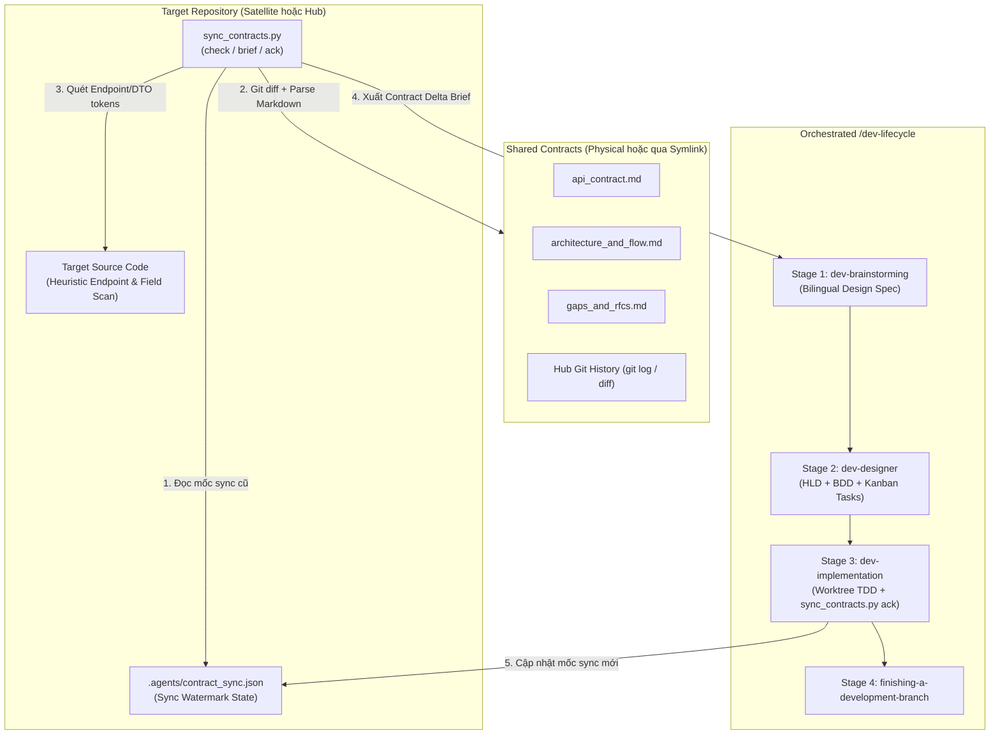

# Thiết Kế Skill Đồng Bộ Và Thực Thi Shared Contracts

- **Ngày**: 2026-10-30
- **Trạng thái**: Đã phê duyệt
- **Phạm vi**: Skill mới `skills/sync-shared-contracts/`, CLI engine `sync_contracts.py`, template báo cáo delta chuẩn hóa, bộ test hermetic `test_sync_contracts.py`, tích hợp vào `scripts/verify.sh`
- **Bước tiếp theo**: `d3nexus:dev-designer` (Stage 2 — Thiết kế Mức cao HLD, Kịch bản BDD, và Phân rã Kanban Tasks)

## Mục lục

- [1. Bối cảnh và Động lực](#1-bối-cảnh-và-động-lực)
- [2. Mục tiêu và Ngoài phạm vi](#2-mục-tiêu-và-ngoài-phạm-vi)
- [3. Kiến trúc và Cơ chế Tự động Nhận diện Dual-Mode](#3-kiến-trúc-và-cơ-chế-tự-động-nhận-diện-dual-mode)
- [4. Cấu trúc Thư mục và Schema Mốc Đồng bộ](#4-cấu-trúc-thư-mục-và-schema-mốc-đồng-bộ)
- [5. Đặc tả Kỹ thuật CLI Engine](#5-đặc-tả-kỹ-thuật-cli-engine)
- [6. Bộ Quét Heuristic trên Source Code Đích](#6-bộ-quét-heuristic-trên-source-code-đích)
- [7. Cầu nối Điều phối sang Vòng đời Phát triển](#7-cầu-nối-điều-phối-sang-vòng-đời-phát-triển)
- [8. Chiến lược Kiểm thử và Xác minh](#8-chiến-lược-kiểm-thử-và-xác-minh)
- [9. Xử lý Lỗi và các Trường hợp Biên](#9-xử-lý-lỗi-và-các-trường-hợp-biên)
- [10. Rủi ro và Biện pháp Giảm thiểu](#10-rủi-ro-và-biện-pháp-giảm-thiểu)

## 1. Bối cảnh và Động lực

Sau khi có skill `setup-shared-contracts`, các hệ sinh thái đa repository (chẳng hạn như control plane `D3Nexus` kết nối với các worker node như `lyrics-sync` và ứng dụng di động như `nexus`) đã có công cụ chuẩn hóa để khởi tạo thư mục vật lý `shared-contracts/`, tạo relative symlink và cài đặt các quy tắc quản trị.

Tuy nhiên, sau bước thiết lập ban đầu (Day-0), các đội phát triển đối mặt với bài toán đồng bộ và thực thi liên tục (Day-2 operations):
- Khi Hub repository cập nhật `api_contract.md` hoặc `architecture_and_flow.md` (hoặc phê duyệt một RFC trong `gaps_and_rfcs.md`), các satellite repository thiếu công cụ tự động để phát hiện chính xác những gì đã thay đổi kể từ lần đồng bộ gần nhất.
- Khi một satellite repository ghi nhận đề xuất `Draft` hoặc `In Review` mới vào `gaps_and_rfcs.md`, Hub repository cần cơ chế tự động rà soát các RFC đang chờ xử lý để đưa vào kế hoạch triển khai ở phía backend.
- Việc chuyển tiếp từ các thay đổi trong contract sang quy trình `d3nexus:dev-lifecycle` (Spec -> HLD & BDD -> Worktree TDD Implementation -> Branch Finishing) trên target repo hiện vẫn phải đối chiếu thủ công.

Để tự động hóa toàn diện quy trình kiểm tra sự thay đổi, trích xuất requirements từ contracts và kích hoạt `/dev-lifecycle` trên target repo, chúng tôi xây dựng skill `sync-shared-contracts` cùng CLI engine `sync_contracts.py`.

## 2. Mục tiêu và Ngoài phạm vi

### Mục tiêu
- Cung cấp CLI Python tiêu chuẩn không phụ thuộc thư viện ngoài (`sync_contracts.py`) hỗ trợ 3 lệnh `check`, `brief`, và `ack`.
- Triển khai **Cơ chế Phát hiện Thay đổi Lai 3 Tầng (3-Layer Hybrid Delta Engine)**:
  1. **Git & SHA-256 Watermark Diff**: So sánh lịch sử commit trên Hub và mã băm SHA-256 của 3 file canonical với mốc lưu tại `.agents/contract_sync.json`.
  2. **Structured Markdown Contract Parser**: Phân tích cú pháp bảng endpoints, headers, các trường JSON payload, các bước pipeline, và bảng RFC từ 3 file canonical (`api_contract.md`, `architecture_and_flow.md`, `gaps_and_rfcs.md`).
  3. **Target Codebase Heuristic Scanner**: Quét nhanh source code của target repo để phân loại từng endpoint, header, và trường dữ liệu theo trạng thái `FOUND_IN_CODE` (đã xuất hiện trong code) hoặc `MISSING_IN_CODE` (chưa có trong code).
- Hỗ trợ **Chế độ Kép (Dual-Mode Execution)** tự động nhận diện Satellite symlink mode và Hub physical directory mode.
- Sinh bản **Contract Requirements Brief** (`brief`) làm đầu vào chuẩn hóa để dẫn dắt AI Agent thực thi trọn vẹn 4 giai đoạn của `d3nexus:dev-lifecycle` (`dev-brainstorming` -> `dev-designer` -> `dev-implementation` -> `finishing-a-development-branch`).
- Cung cấp lệnh cập nhật mốc đồng bộ nguyên tử (`ack`) ghi nhận phiên bản contract, Hub commit SHA, mã băm file, và danh sách RFC/endpoints đã xử lý vào `.agents/contract_sync.json`.

### Ngoài phạm vi
- Không thay thế chức năng khởi tạo hạ tầng ban đầu (`init-hub`, `link-satellite`) của `setup-shared-contracts`.
- Không tự ý thực hiện git commit xuyên qua ranh giới symlink trái với Rule 7 của `CRITICAL_RULES.md`.
- Không tự động đẩy code (`git push`) lên remote repository khi chưa có sự đồng ý rõ ràng từ người dùng (bị nghiêm cấm theo Rule 3).

## 3. Kiến trúc và Cơ chế Tự động Nhận diện Dual-Mode

Skill hoạt động trên cả hai phía của mô hình Star Topology bằng cách kiểm tra `<repo_root>/shared-contracts`:

1. **Satellite Mode (`shared-contracts` là một relative symbolic link)**:
   - Phân giải đích của symlink để xác định thư mục `<domain>` và thư mục gốc `<hub_root>` của Hub.
   - Phát hiện các thay đổi từ phía Hub (endpoints mới, trường payload mới, quy tắc pipeline, và các RFC đã `Approved`) cần được implement tại codebase của satellite consumer/worker.
   - Thực thi nghiêm ngặt ranh giới chỉ đọc đối với symlink trong Git (không bao giờ đưa `shared-contracts/` vào git staging của satellite; trạng thái đồng bộ chỉ được lưu tại `.agents/contract_sync.json`).
2. **Hub Mode (`shared-contracts/` là một thư mục vật lý)**:
   - Duyệt qua các thư mục con `shared-contracts/<domain>/` (hoặc lọc theo tham số `--domain`).
   - Phát hiện các RFC/Gaps ở trạng thái `Draft`, `In Review`, hoặc `Approved` do các satellite đề xuất trong `gaps_and_rfcs.md`, cũng như các thay đổi trong contract chưa được đồng bộ vào source code backend của Hub hoặc `.agents/contract_sync.json`.
   - Áp dụng quy tắc ưu tiên `task_01` (Contract-First synchronization) khi phân rã task trong `dev-designer`.



## 4. Cấu trúc Thư mục và Schema Mốc Đồng bộ

### 4.1 Cấu trúc Thư mục của Skill

```text
skills/sync-shared-contracts/
├── SKILL.md
└── resources/
    ├── scripts/
    │   ├── sync_contracts.py
    │   └── test_sync_contracts.py
    └── templates/
        └── contract_delta_brief.md.tmpl
```

### 4.2 Schema Mốc Đồng bộ (`.agents/contract_sync.json`)

File trạng thái đồng bộ được lưu trực tiếp trong target repository tại đường dẫn `.agents/contract_sync.json`:

```json
{
  "schema_version": 1,
  "mode": "satellite",
  "domains": {
    "lyrics-sync": {
      "hub_commit_sha": "a1b2c3d4e5f6a1b2c3d4e5f6a1b2c3d4e5f6a1b2",
      "contract_version": "1.1.0",
      "last_synced_at": "2026-10-30T18:30:00Z",
      "file_hashes": {
        "api_contract.md": "sha256:e3b0c44298fc1c149afbf4c8996fb92427ae41e4649b934ca495991b7852b855",
        "architecture_and_flow.md": "sha256:...",
        "gaps_and_rfcs.md": "sha256:..."
      },
      "acknowledged_rfcs": ["RFC-001", "RFC-002"],
      "acknowledged_endpoints": [
        "POST /api/v1/lyrics-sync/tasks/claim",
        "POST /api/v1/lyrics-sync/tasks/{id}/progress",
        "POST /api/v1/lyrics-sync/tasks/{id}/complete",
        "GET /api/v1/lyrics-sync/status"
      ]
    }
  }
}
```

## 5. Đặc tả Kỹ thuật CLI Engine

Script `sync_contracts.py` cung cấp 3 lệnh con (subcommands):

### 5.1 Lệnh: `check`
```bash
python3 sync_contracts.py check [--repo-root <path>] [--domain <domain_name>] [--json] [--strict]
```
- **Xác thực**:
  - Kiểm tra `shared-contracts` tồn tại và phân giải hợp lệ (không bị dangling symlink, có đủ 3 file canonical).
- **Hành động**:
  1. Đọc `.agents/contract_sync.json` nếu có; nếu chưa tồn tại thì đánh dấu trạng thái domain là `INITIAL_SYNC`.
  2. Tính toán mã băm `sha256` hiện tại của `api_contract.md`, `architecture_and_flow.md`, và `gaps_and_rfcs.md`, đồng thời truy vấn commit SHA mới nhất của thư mục domain trên Hub repository (tự động fallback an toàn nếu không có git history).
  3. Phân tích cú pháp 3 file Markdown canonical để trích xuất thông tin phiên bản, bảng headers, bảng `Endpoints Matrix`, các khóa JSON schema, các bước pipeline, và danh mục RFC trong `Active RFC Ledger`.
  4. Chạy bộ quét Target Codebase Heuristic Scanner trên `<repo_root>` để kiểm tra sự hiện diện của các endpoints, headers, và trường dữ liệu trong source code.
  5. Kết luận trạng thái đồng bộ: `IN_SYNC`, `INITIAL_SYNC`, hoặc `DRIFT_DETECTED`.
- **Mã thoát (Exit Codes)**:
  - `0` khi ở trạng thái `IN_SYNC` (hoặc khi `DRIFT_DETECTED` / `INITIAL_SYNC` ở chế độ thông tin không có cờ `--strict`).
  - `1` khi cấu trúc thư mục/symlink bị lỗi, hoặc khi truyền cờ `--strict` mà trạng thái khác `IN_SYNC`.

### 5.2 Lệnh: `brief`
```bash
python3 sync_contracts.py brief [--repo-root <path>] [--domain <domain_name>] [--output <path>]
```
- **Hành động**:
  - Thực thi toàn bộ phân tích delta 3 tầng tương tự lệnh `check`.
  - Kết xuất từ template `contract_delta_brief.md.tmpl` ra báo cáo Markdown có cấu trúc gồm:
    1. **Topology & Sync Metadata**: Chế độ (`hub` / `satellite`), Domain, Chuyển đổi phiên bản (`cũ -> mới`), dải commit trên Hub, và danh sách các file thay đổi.
    2. **API & Schema Requirements**: Các endpoints và trường JSON payload mới hoặc thay đổi, kèm nhãn kết quả quét code (`FOUND_IN_CODE` vs `MISSING_IN_CODE`).
    3. **Architecture & Pipeline Invariants**: Các bước pipeline bắt buộc, chuyển đổi state machine, và ràng buộc cô lập/cancellation.
    4. **Actionable RFCs & Gaps**: Các mục RFC/Gap đang chờ xử lý hoặc vừa được phê duyệt trong `gaps_and_rfcs.md` tương ứng với vai trò của repo hiện tại.
    5. **Lifecycle Execution Rules**: Chỉ dẫn bắt buộc cho `dev-brainstorming`, `dev-designer` (quy tắc `task_01` và ranh giới symlink), cùng `dev-implementation` (bước xác minh bằng `sync_contracts.py ack`).

### 5.3 Lệnh: `ack`
```bash
python3 sync_contracts.py ack [--repo-root <path>] [--domain <domain_name>] [--rfc <RFC-ID> ...]
```
- **Hành động**:
  - Thu thập mã băm 3 file hiện tại, phiên bản contract, Hub git commit SHA, danh sách endpoints, và danh sách mã RFC (toàn bộ các RFC có trạng thái `Approved` / `Implemented` cộng với các mã được chỉ định qua `--rfc`).
  - Ghi hoặc cập nhật file `.agents/contract_sync.json` một cách nguyên tử (atomic write) thông qua file tạm và `os.replace()`.

## 6. Bộ Quét Heuristic trên Source Code Đích

Nhằm cung cấp góc nhìn tức thì về việc các thành phần trong contract đã được hiện thực hóa trong target repository hay chưa (đặc biệt hữu ích trong lần chạy `INITIAL_SYNC` hoặc khi repo đã code sẵn một phần):
- **Phạm vi Thư mục Quét**: Duyệt đệ quy `<repo_root>` và loại trừ `.git`, `shared-contracts`, `.devtool`, `.agents`, `node_modules`, `build`, `dist`, `target`, `.dart_tool`, cùng `__pycache__`.
- **Định dạng File Hỗ trợ**: `.py`, `.rs`, `.dart`, `.kt`, `.kts`, `.swift`, `.ts`, `.tsx`, `.js`, `.go`, `.java`, `.yaml`, `.yml`, `.json`.
- **Chuẩn hóa Token khi Đối chiếu**:
  - Đối với các endpoint có tham số động như `/api/v1/lyrics-sync/tasks/{id}/progress`, bộ quét tách các đoạn đường dẫn tĩnh (như `/api/v1/lyrics-sync/tasks` và `/progress` hoặc `tasks/claim`) để kiểm tra sự xuất hiện trong source code.
  - Đối với các header (`X-Worker-Token`, `X-Correlation-ID`) và khóa JSON payload (`task_id`, `lease_duration_ms`, `output_data`), bộ quét kiểm tra cả dạng `snake_case` lẫn biến thể `camelCase` tương ứng (phục vụ các client viết bằng Dart, Swift, Kotlin, TypeScript).

## 7. Cầu nối Điều phối sang Vòng đời Phát triển

Khi lập trình viên gọi `/sync-shared-contracts` (hoặc yêu cầu kiểm tra thay đổi từ contract và triển khai trên target repo), skill sẽ điều phối quy trình 5 bước khép kín:

1. **Bước 1 — Kiểm toán Contract & Sinh Bản Tổng hợp (Brief)**:
   - Chạy `sync_contracts.py check` và `sync_contracts.py brief`.
   - Nếu thiếu `shared-contracts` hoặc symlink bị đứt, hướng dẫn chạy `d3nexus:setup-shared-contracts`.
   - Nếu kết quả là `IN_SYNC` và không có mục nào `MISSING_IN_CODE` hay RFC chờ xử lý, thông báo repo đã đồng bộ hoàn toàn và kết thúc.
2. **Bước 2 — Xác nhận Phạm vi (Scope Confirmation)**:
   - Trình bày bản **Contract Requirements Brief** cho lập trình viên để xác nhận các thay đổi/RFC sẽ thực hiện trong đợt này và thống nhất tên `<epic_slug>`.
3. **Bước 3 — Chuyển giao vào Stage 1 (`dev-brainstorming`) & Stage 2 (`dev-designer`)**:
   - Kích hoạt `d3nexus:dev-lifecycle` với đầu vào là bản **Contract Requirements Brief**:
     - **Stage 1 (`dev-brainstorming`)**: Soạn thảo cặp Design Spec song ngữ (`docs/superpowers/specs/YYYY-MM-DD-<topic>-design.en.md` và `.vi.md`) bám sát các thông số đã định nghĩa trong contract (không hỏi lại các thông tin đã được chốt trong contract), và xin phê duyệt Gate 1.
     - **Stage 2 (`dev-designer`)**: Tạo tài liệu HLD song ngữ, kịch bản BDD 5 chiều (`bdd_scenarios.en.md` / `.vi.md`), và tách các Kanban tasks (`task_*.md`) trình duyệt ở Gate 2:
       - Ở **Hub Mode**: `task_01` cập nhật các file vật lý trong `shared-contracts/<domain>/` (`api_contract.md`, `architecture_and_flow.md`, `gaps_and_rfcs.md`).
       - Ở **Satellite Mode**: `task_01` cập nhật các DTO nội bộ, API client, và mock fixtures (tuyệt đối không đưa `shared-contracts/` vào `Files Allowed`).
       - Ở **Cả Hai Mode**: Task cuối cùng (hoặc bước kiểm tra của `task_01`) khai báo `.agents/contract_sync.json` trong `Files Allowed` và chạy lệnh `sync_contracts.py ack` + `sync_contracts.py check --strict` để mốc đồng bộ được commit cùng với code.
4. **Bước 4 — Thực thi tại Stage 3 (`dev-implementation`)**:
   - Thực thi từng task theo TDD trong git worktree cô lập, xác minh `sync_contracts.py check --strict` trả về mã thoát `0`, vượt qua Gate 4 (`quality_check` + `check_bdd_traceability.py` + `audit_epic.py`), thực hiện vòng lặp Review Choice và duyệt Gate 5.
5. **Bước 5 — Hoàn tất Nhánh tại Stage 4 (`finishing-a-development-branch`)**:
   - Rebase, kiểm tra theo tier, merge `--no-ff`, và lưu trữ toàn bộ hồ sơ epic vào `.devtool/epic/<epic_slug>/`.

## 8. Chiến lược Kiểm thử và Xác minh

Bộ kiểm thử cô lập (hermetic) trong `skills/sync-shared-contracts/resources/scripts/test_sync_contracts.py` sử dụng `unittest` và `tempfile.TemporaryDirectory`:
- **Kiểm thử Initial Sync & Nhận diện Dual-Mode**: Xác minh lệnh `check` nhận diện đúng Hub physical mode và Satellite symlink mode trên các repo mới chưa có `.agents/contract_sync.json`.
- **Kiểm thử Bộ Phân tích Markdown Contract**: Xác minh trích xuất chính xác `Version`, headers, các dòng trong bảng `Endpoints Matrix`, các khóa JSON schema, các bước pipeline, và trạng thái trong bảng `Active RFC Ledger`.
- **Kiểm thử Bộ Quét Heuristic trên Source Code**: Xác minh khả năng phân loại đúng các endpoints và trường DTO (`snake_case` / `camelCase`) đã có hoặc còn thiếu trên các file code giả lập.
- **Kiểm thử Lệnh Ack & Phát hiện Thay đổi Tăng dần (Incremental Drift)**: Xác minh sau khi chạy `ack`, lệnh `check --strict` trả về mã `0` (`IN_SYNC`); khi chỉnh sửa `api_contract.md` hoặc thêm RFC mới trên Hub, lệnh `check --strict` từ Satellite trả về mã `1` (`DRIFT_DETECTED`) kèm lịch sử git commit và file hash delta chính xác.
- **Kiểm thử Kết xuất Brief & Xử lý Lỗi**: Xác minh cấu trúc báo cáo Markdown của lệnh `brief` và mã thoát lỗi khi thiếu thư mục hoặc đứt symlink `shared-contracts`.
- **Tích hợp vào Bộ Kiểm tra Phát hành**: Đăng ký chạy tự động trong `scripts/verify.sh` cùng với `test_setup_contracts.py`.

## 9. Xử lý Lỗi và các Trường hợp Biên

| Kịch bản | Được xử lý bởi | Hành vi |
|---|---|---|
| Chưa tồn tại `shared-contracts` | `check` / `brief` / `ack` | Thoát mã `1` kèm hướng dẫn chạy `setup_contracts.py`. |
| Symlink `shared-contracts` ở Satellite bị đứt | `check` / `brief` / `ack` | Phát hiện đích không tồn tại, thoát mã `1` và hướng dẫn chạy lại `link-satellite --force`. |
| Chưa có file `.agents/contract_sync.json` | `check` / `brief` | Báo trạng thái `INITIAL_SYNC`, phân tích toàn bộ contract hiện tại và phân loại qua bộ quét code heuristic. |
| File `.agents/contract_sync.json` bị lỗi cú pháp JSON | `check` / `ack` | Ghi nhận cảnh báo, coi như chưa đồng bộ khi chạy `check`, và ghi đè lại file chuẩn khi chạy `ack`. |
| Thư mục Hub không phải là Git repository | `check` / `brief` / `ack` | Bỏ qua `git log` / `git rev-parse` an toàn và dựa trên mã băm `sha256` cùng trường `Version`. |

## 10. Rủi ro và Biện pháp Giảm thiểu

- **Rủi ro: Bộ quét Heuristic báo thiếu nhầm (false negative) khi target repo đặt tên biến theo camelCase hoặc ghép nối chuỗi URL.**
  *Biện pháp*: Bộ quét chuẩn hóa các đoạn đường dẫn tĩnh (loại bỏ `{param}`) và kiểm tra cả hai biến thể `snake_case` lẫn `camelCase`, đồng thời kết quả heuristic đóng vai trò chỉ báo bổ trợ bên cạnh mốc đồng bộ chính thức trong `.agents/contract_sync.json`.
- **Rủi ro: Agent trên Satellite vô tình đưa `shared-contracts/` vào git staging khi lưu trạng thái đồng bộ.**
  *Biện pháp*: Trạng thái đồng bộ được lưu hoàn toàn tại `<repo_root>/.agents/contract_sync.json` (nằm ngoài symlink `shared-contracts`), và báo cáo `brief` luôn đính kèm quy tắc cấm đưa `shared-contracts/` vào `Files Allowed` cho `dev-designer`.

