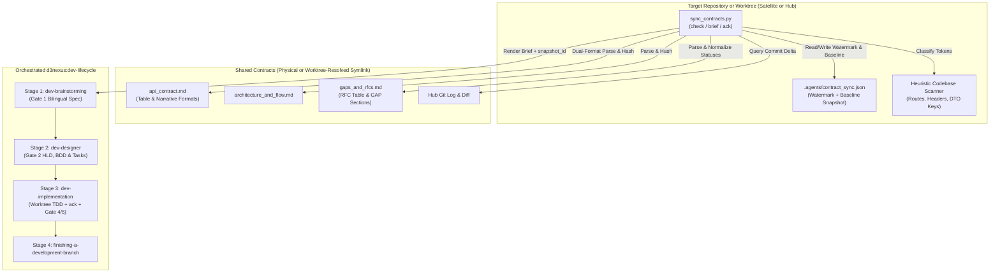
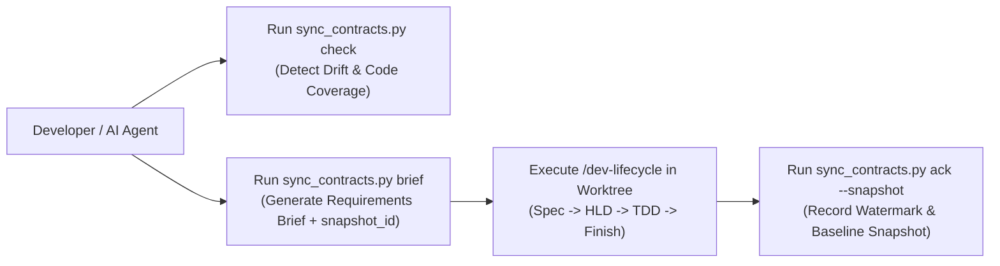
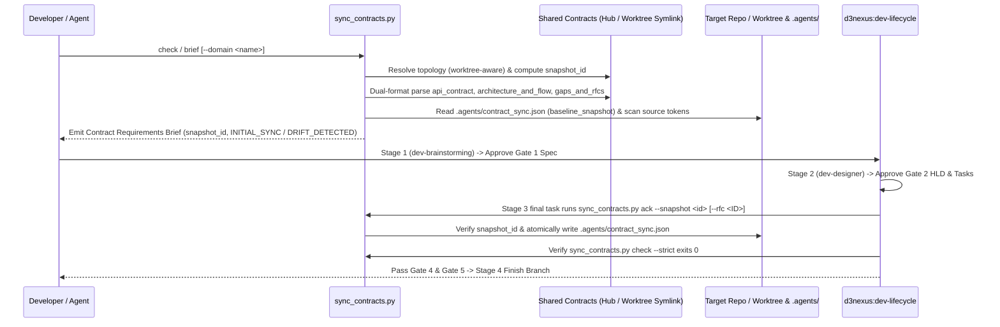

# Sync Shared Contracts High-Level Design

## Table of Contents

- [Meta Data](#meta-data)
- [Background](#background)
- [Goals and Non-Goals](#goals-and-non-goals)
- [Architecture and Technical Design](#architecture-and-technical-design)
- [Integration Test Plan and Boundary Matrix](#integration-test-plan-and-boundary-matrix)
- [Verification Environment](#verification-environment)
- [Shared Contract Impact](#shared-contract-impact)
- [Comprehensive BDD Scenario Coverage](#comprehensive-bdd-scenario-coverage)
- [Rollout Strategy and Mitigation](#rollout-strategy-and-mitigation)
- [Kanban Tasks Breakdown](#kanban-tasks-breakdown)

## Meta Data

- **Epic name**: `sync_shared_contracts`
- **Status**: Packaged
- **Target release**: Next plugin release (1.16.0)
- **Platform**: Python tooling / agent skill kit
- **Source Spec**: [Approved Sync Shared Contracts design](2026-10-30-sync-shared-contracts-design.en.md)

## Background

While `setup-shared-contracts` automates Day-0 topology initialization (creating physical `shared-contracts/` in the Hub repository and relative mode `120000` symbolic links in Satellite repositories), engineering teams and AI agents require a deterministic Day-2 workflow to continuously detect contract changes, audit actionable RFCs, check target codebase readiness, and drive implementation through `d3nexus:dev-lifecycle`.

Without an automated synchronization engine:
1. Satellite repositories cannot easily tell which endpoints, payload fields, or pipeline rules changed in the Hub since their last implementation cycle.
2. Hub repositories lack an automated scanner to surface newly proposed `Draft` / `OPEN` or `In Review` / `PROPOSED` RFCs logged by satellites in `gaps_and_rfcs.md`.
3. Live pilot contracts (such as `D3Nexus/shared-contracts/lyrics-sync/`) use narrative Markdown headings, HTML comment metadata, and `GAP-XX` sections alongside the table templates generated by `setup-shared-contracts`.
4. Executing Stage 3 (`dev-implementation`) inside nested git worktrees (`.worktrees/<epic_dir>`) shifts relative symlink resolution unless resolved against the primary checkout root.

This epic delivers the `sync-shared-contracts` skill and its standard-library Python CLI engine `sync_contracts.py` (`check`, `brief`, `ack`) to automate contract delta detection and orchestrate target repository execution via `d3nexus:dev-lifecycle`.

## Goals and Non-Goals

### Goals

- Build `skills/sync-shared-contracts/SKILL.md` to orchestrate contract delta auditing and the 4-stage `d3nexus:dev-lifecycle` bridge on target repositories.
- Build `skills/sync-shared-contracts/resources/scripts/sync_contracts.py` implementing `check`, `brief`, and `ack` using Python's standard library.
- Implement a 3-layer Hybrid Delta Engine:
  1. Git commit history, SHA-256 file hash comparison, and persisted `baseline_snapshot` structural diffing against `.agents/contract_sync.json`.
  2. Dual-Format Structured Markdown parsing of `api_contract.md`, `architecture_and_flow.md`, and `gaps_and_rfcs.md` (supporting both `setup-shared-contracts` tables and live narrative sections, normalizing statuses into `ACTIONABLE_PENDING`, `ACKNOWLEDGED_ACTIVE`, and `INACTIVE`, and rejecting unsupported formats with exit `1`).
  3. Target Codebase Heuristic Scanner classifying endpoints, headers, and DTO fields (`snake_case` and `camelCase`) as `FOUND_IN_CODE` or `MISSING_IN_CODE`.
- Implement **Worktree-Aware Symlink Resolution** so relative `shared-contracts` symlinks inside nested `.worktrees/<epic_dir>` checkouts resolve against the primary repository root while keeping scans and `.agents/contract_sync.json` writes local to the worktree.
- Implement **Snapshot- and Scope-Bound Acknowledgement (`ack`)** verifying `--snapshot <snapshot_id>` and retaining `pending_rfcs` unless explicitly acknowledged via `--rfc <ID>`.
- Bundle `skills/sync-shared-contracts/resources/templates/contract_delta_brief.md.tmpl` to render actionable **Contract Requirements Briefs**.
- Implement hermetic unit and integration tests in `test_sync_contracts.py` and register them in `scripts/verify.sh`.

### Non-Goals

- Replacing `setup-shared-contracts` (`init-hub`, `link-satellite`).
- Autonomously staging or committing files across symbolic link boundaries.
- Pushing git commits to remote repositories without explicit user approval.

## Architecture and Technical Design

### High-Level Architecture

### Use Cases

### Sequence Diagram

## Integration Test Plan and Boundary Matrix

Integration test roots: skills/sync-shared-contracts/resources/scripts/, scripts/

Protected paths: .agents/quality/**, .devtool/epic/sync_shared_contracts/bdd_scenarios.en.md, .devtool/epic/sync_shared_contracts/bdd_scenarios.vi.md, scripts/verify.sh

Integration results: python3 scripts/run_unittest_junit.py --junitxml build/test-results/sync-shared-contracts.xml skills/sync-shared-contracts/resources/scripts/test_sync_contracts.py -> build/test-results/sync-shared-contracts.xml

| Component | Test File | Test Case | Target Boundary |
|---|---|---|---|
| Dual-Format Parser & Brief | `test_sync_contracts.py` | `test_syc_hp_01_parse_and_render_brief` | Parses both table and narrative (`GAP-XX` / `Method`/`Path`) contracts and renders brief |
| Worktree & Dual-Mode Check | `test_sync_contracts.py` | `test_syc_hp_02_satellite_worktree_and_hub_check` | Resolves relative symlink inside `.worktrees/<epic_dir>` and verifies `IN_SYNC` |
| Heuristic Codebase Scanner | `test_sync_contracts.py` | `test_syc_ec_02_heuristic_snake_and_camel_scan` | Matches static route prefixes, headers, and `snake_case`/`camelCase` keys |
| Snapshot Ack & Baseline Diff | `test_sync_contracts.py` | `test_syc_st_01_ack_snapshot_and_incremental_drift` | Enforces `--snapshot` guard, `pending_rfcs` retention, and `baseline_snapshot` diffing |
| Skill & Harness Verification | `test_sync_contracts.py` | `test_syc_hp_03_skill_and_verify_harness` | Validates `SKILL.md` frontmatter, links, and `scripts/verify.sh` integration |

## Verification Environment

- **Runtime**: Python 3.10+ (Standard Library only: `pathlib`, `os`, `sys`, `json`, `hashlib`, `re`, `subprocess`, `argparse`, `unittest`, `tempfile`).
- **Isolation**: All tests execute inside isolated `tempfile.TemporaryDirectory()` workspaces with zero network access or live external repositories.
- **Environment Variables (`Needs`)**: None (`—`).
- **Test Command**: `python3 -m unittest skills/sync-shared-contracts/resources/scripts/test_sync_contracts.py`
- **Release Gate**: `scripts/verify.sh` executes the test suite on every release verification run.

## Shared Contract Impact

`None — self-contained developer tooling skill (audits and synchronizes shared contracts for target repositories)`.

## Comprehensive BDD Scenario Coverage

Full Gherkin scenarios covering all 5 dimensions live in `bdd_scenarios.en.md` and `bdd_scenarios.vi.md`.

- **Happy Paths**:
  - `[SYC-HP-01]`: Dual-format structured parsing (canonical table format and live narrative `Method`/`Path` + `GAP-XX` format) and rendering of the Contract Requirements Brief.
  - `[SYC-HP-02]`: End-to-end Satellite synchronization (including nested `.worktrees/<epic_dir>` symlink resolution), acknowledgement (`ack`), and `--strict` verification pass.
  - `[SYC-HP-03]`: Skill definition validation and `scripts/verify.sh` harness execution.
- **Edge Cases & Boundaries**:
  - `[SYC-EC-01]`: Initial sync (`INITIAL_SYNC`) when `.agents/contract_sync.json` does not exist yet.
  - `[SYC-EC-02]`: Heuristic codebase scanner matching parameterized routes (`/tasks/{id}/progress`) and `camelCase` DTO properties (`leaseDurationMs`).
  - `[SYC-EC-03]`: Semantic baseline diffing (`baseline_snapshot`) when the Hub directory has no `.git` repository or has uncommitted edits modifying existing payload keys/endpoints.
- **State Transitions**:
  - `[SYC-ST-01]`: Transitioning from `INITIAL_SYNC` to `IN_SYNC` via `ack`, rejecting mismatched `--snapshot <id>`, and transitioning to `DRIFT_DETECTED` when `api_contract.md` or `gaps_and_rfcs.md` is updated in the Hub.
  - `[SYC-ST-02]`: Retaining `ACTIONABLE_PENDING` items (`OPEN`, `PROPOSED`, `DRAFT`) in `pending_rfcs` until explicitly acknowledged via `ack --rfc <ID>`, while preserving sibling domain entries in `.agents/contract_sync.json`.
- **Async & Concurrency**:
  - `[SYC-AR-01]`: Atomic watermark file updates via temporary swap file (`os.replace`) leaving zero partial JSON files.
  - `[SYC-AR-02]`: Circular symbolic link protection when resolving `shared-contracts` targets.
- **Failures & Resilience**:
  - `[SYC-FR-01]`: Refusing execution with exit code `1` when `shared-contracts` is missing.
  - `[SYC-FR-02]`: Refusing execution with exit code `1` when `shared-contracts` is a dangling symlink, missing canonical files, or contains an unrecognizable contract format (`UNSUPPORTED_CONTRACT_FORMAT`).
  - `[SYC-FR-03]`: Recovering gracefully from a corrupted `.agents/contract_sync.json` file during `check` and overwriting cleanly on `ack`.

## Rollout Strategy and Mitigation

- **Deployment**: Shipped as a core skill in `skills/sync-shared-contracts/` within the `d3nexus` plugin.
- **Phased Rollout**:
  1. Unit and integration verification in `ai-agent-tools` via `scripts/verify.sh`.
  2. Pilot usage across `D3Nexus` (Hub) and `lyrics-sync` / `nexus` (Satellites).
  3. Bundled in plugin release 1.16.0.
- **Rollback**: Removing `skills/sync-shared-contracts/` and reverting `scripts/verify.sh` cleanly restores the prior state.

## Kanban Tasks Breakdown

- [Task 1: Canonical Brief Template and Markdown Contract Parser](task_1_brief_template_and_contract_parser.md) — Covers: `[SYC-HP-01]`, `[SYC-EC-01]`
- [Task 2: Target Codebase Heuristic Scanner and Dual-Mode Check Engine](task_2_heuristic_scanner_and_check_engine.md) — Covers: `[SYC-EC-02]`, `[SYC-EC-03]`, `[SYC-AR-02]`, `[SYC-FR-01]`, `[SYC-FR-02]`
- [Task 3: Watermark Ack Command, Drift Detection, and Brief CLI Subcommands](task_3_watermark_ack_and_brief_cli.md) — Covers: `[SYC-HP-02]`, `[SYC-ST-01]`, `[SYC-ST-02]`, `[SYC-AR-01]`, `[SYC-FR-03]`
- [Task 4: Skill Definition, Lifecycle Bridge Instructions, and Verify Harness Integration](task_4_skill_definition_and_verify_integration.md) — Covers: `[SYC-HP-03]`
