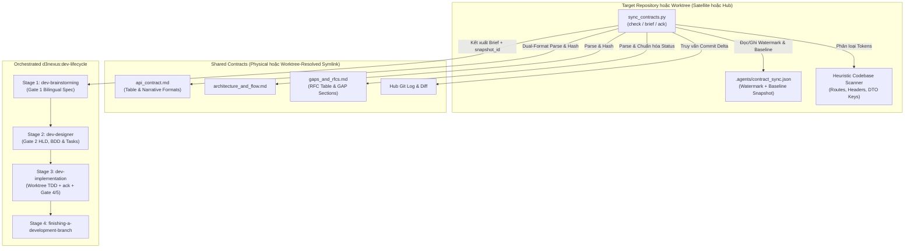
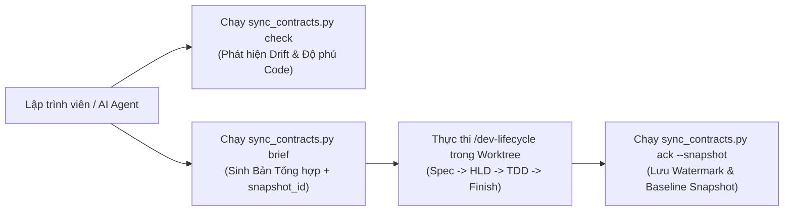

# Thiết Kế Chi Tiết Skill Đồng Bộ Và Thực Thi Shared Contracts

## Mục lục

- [Meta Data](#meta-data)
- [Bối cảnh](#bối-cảnh)
- [Mục tiêu và Ngoài phạm vi](#mục-tiêu-và-ngoài-phạm-vi)
- [Kiến trúc và Thiết kế Kỹ thuật](#kiến-trúc-và-thiết-kế-kỹ-thuật)
- [Kế hoạch Kiểm thử Tích hợp và Ma trận Ranh giới](#kế-hoạch-kiểm-thử-tích-hợp-và-ma-trận-ranh-giới)
- [Môi trường Xác minh](#môi-trường-xác-minh)
- [Tác động Hợp đồng Dùng chung](#tác-động-hợp-đồng-dùng-chung)
- [Độ bao phủ Kịch bản BDD Toàn diện](#độ-bao-phủ-kịch-bản-bdd-toàn-diện)
- [Chiến lược Triển khai và Giảm thiểu Rủi ro](#chiến-lược-triển-khai-và-giảm-thiểu-rủi-ro)
- [Phân rã Công việc Kanban](#phân-rã-công-việc-kanban)

## Meta Data

- **Tên Epic**: `sync_shared_contracts`
- **Trạng thái**: In Progress
- **Phiên bản đích**: Bản phát hành plugin tiếp theo (1.16.0)
- **Nền tảng**: Python tooling / agent skill kit
- **Spec gốc**: [Approved Sync Shared Contracts design](2026-10-30-sync-shared-contracts-design.vi.md)

## Bối cảnh

Trong khi `setup-shared-contracts` giải quyết bài toán khởi tạo hạ tầng ngày đầu (Day-0: tạo thư mục vật lý `shared-contracts/` tại Hub và relative symlink mode `120000` tại các Satellite), các đội phát triển và AI agent cần một quy trình tự động cho vận hành liên tục (Day-2) để kiểm tra sự thay đổi trong contract, rà soát các RFC cần xử lý, đối chiếu mức độ đáp ứng trong source code của target repo, và kích hoạt quy trình `d3nexus:dev-lifecycle`.

Nếu thiếu công cụ đồng bộ tự động:
1. Các Satellite repository không thể biết chính xác những endpoints, trường dữ liệu hay quy tắc pipeline nào vừa thay đổi trên Hub kể từ lần đồng bộ trước.
2. Hub repository thiếu công cụ quét tự động để phát hiện các đề xuất `Draft` / `OPEN` hoặc `In Review` / `PROPOSED` mới do Satellite ghi vào `gaps_and_rfcs.md`.
3. Các hợp đồng thực tế đang chạy (như `D3Nexus/shared-contracts/lyrics-sync/`) sử dụng định dạng Markdown narrative (`Version` trong HTML comment, tiêu đề endpoint kèm bullet `Method`/`Path`, và các mục `GAP-XX`) song song với định dạng bảng của template `setup-shared-contracts`.
4. Khi thực thi Stage 3 (`dev-implementation`) bên trong git worktree lồng nhau (`.worktrees/<epic_dir>`), relative symlink sẽ bị lệch cấp thư mục nếu không được phân giải qua thư mục gốc của repo chính.

Epic này xây dựng skill `sync-shared-contracts` cùng công cụ CLI `sync_contracts.py` (`check`, `brief`, `ack`) để tự động hóa việc phát hiện thay đổi từ contract và điều phối thực thi trên target repo qua `d3nexus:dev-lifecycle`.

## Mục tiêu và Ngoài phạm vi

### Mục tiêu

- Xây dựng `skills/sync-shared-contracts/SKILL.md` hướng dẫn kiểm toán contract delta và điều phối cầu nối 4 giai đoạn của `d3nexus:dev-lifecycle` trên target repository.
- Xây dựng `skills/sync-shared-contracts/resources/scripts/sync_contracts.py` thực thi 3 lệnh `check`, `brief`, và `ack` bằng thư viện chuẩn Python.
- Triển khai Cơ chế Phát hiện Thay đổi Lai 3 Tầng (3-Layer Hybrid Delta Engine):
  1. Đối chiếu lịch sử commit Git, mã băm SHA-256 của 3 file canonical, và so sánh cấu trúc `baseline_snapshot` (bao gồm từ điển đường dẫn/kiểu dữ liệu `payload_fields` và metadata `rfcs`) trong `.agents/contract_sync.json`.
  2. Phân tích cú pháp Markdown Kép (Dual-Format Parser) cho `api_contract.md`, `architecture_and_flow.md`, và `gaps_and_rfcs.md` (hỗ trợ cả bảng của `setup-shared-contracts` lẫn narrative sections thực tế, chuẩn hóa trạng thái thành `ACTIONABLE_PENDING`, `ACKNOWLEDGED_ACTIVE`, `INACTIVE`, và từ chối định dạng lỗi với mã thoát `1`).
  3. Quét Heuristic trên source code của target repo để phân loại endpoints, headers, và trường DTO (`snake_case` lẫn `camelCase`) thành `FOUND_IN_CODE` hoặc `MISSING_IN_CODE`.
- Triển khai **Phân giải Symlink Nhận biết Worktree (Worktree-Aware Symlink Resolution)** để các symlink `shared-contracts` bên trong `.worktrees/<epic_dir>` phân giải qua thư mục gốc của repo chính trong khi việc quét code và ghi `.agents/contract_sync.json` vẫn cô lập trong worktree.
- Triển khai **Xác nhận Đồng bộ Ràng buộc theo Snapshot và Phạm vi (`ack`)** có kiểm tra `--snapshot <snapshot_id>` (bao gồm luồng làm mới snapshot sau `task_01` ở Hub) và giữ mọi RFC mới phát sinh trong `pending_rfcs` trừ khi được xác nhận tường minh qua `--rfc <ID>` hoặc `--all-rfcs`, đi kèm kiểm tra theo phạm vi qua `check --strict --rfc <ID>`.
- Đóng gói template `skills/sync-shared-contracts/resources/templates/contract_delta_brief.md.tmpl` để kết xuất báo cáo **Contract Requirements Brief**.
- Xây dựng bộ kiểm thử cô lập `test_sync_contracts.py` và tích hợp vào `scripts/verify.sh`.

### Ngoài phạm vi

- Không thay thế chức năng khởi tạo topology (`init-hub`, `link-satellite`) của `setup-shared-contracts`.
- Không tự ý git stage hoặc commit xuyên qua ranh giới symbolic link.
- Không đẩy code (`git push`) lên remote repository khi chưa có sự cho phép rõ ràng của người dùng.

## Kiến trúc và Thiết kế Kỹ thuật

### Kiến trúc Tổng thể



### Sơ đồ Use Cases



### Sơ đồ Tuần tự (Sequence Diagram)

```mermaid
sequenceDiagram
    participant Dev as Developer / Agent
    participant CLI as sync_contracts.py
    participant Hub as Shared Contracts (Hub / Worktree Symlink)
    participant Code as Target Repo / Worktree & .agents/
    participant Life as d3nexus:dev-lifecycle

    Dev->>CLI: check / brief [--domain <name>]
    CLI->>Hub: Phân giải topology (nhận biết worktree) & tính snapshot_id
    CLI->>Hub: Dual-format parse api_contract, architecture_and_flow, gaps_and_rfcs
    CLI->>Code: Đọc .agents/contract_sync.json (baseline_snapshot) & quét tokens trong code
    CLI-->>Dev: Xuất Contract Requirements Brief (snapshot_id, INITIAL_SYNC / DRIFT_DETECTED)
    Dev->>Life: Stage 1 (dev-brainstorming) -> Duyệt Gate 1 Spec
    Life->>Life: Stage 2 (dev-designer) -> Duyệt Gate 2 HLD & Tasks
    Life->>CLI: Stage 3 (Hub task_01 làm mới snapshot_id; task cuối chạy ack --snapshot <id> [--rfc <ID> | --all-rfcs])
    CLI->>Code: Kiểm tra snapshot_id & ghi nguyên tử .agents/contract_sync.json
    Life->>CLI: Xác minh sync_contracts.py check --strict [--rfc <ID>] trả về exit 0
    Life-->>Dev: Vượt qua Gate 4 & Gate 5 -> Stage 4 Finish Branch
```

## Kế hoạch Kiểm thử Tích hợp và Ma trận Ranh giới

Integration test roots: skills/sync-shared-contracts/resources/scripts/, scripts/

Protected paths: .agents/quality/**, .devtool/epic/sync_shared_contracts/bdd_scenarios.en.md, .devtool/epic/sync_shared_contracts/bdd_scenarios.vi.md

Integration results: python3 scripts/run_unittest_junit.py --junitxml build/test-results/sync-shared-contracts.xml skills/sync-shared-contracts/resources/scripts/test_sync_contracts.py -> build/test-results/sync-shared-contracts.xml

| Thành phần | File Kiểm thử | Kịch bản Kiểm thử | Ranh giới Mục tiêu |
|---|---|---|---|
| Bộ Phân tích Kép & Template | `test_sync_contracts.py` | `test_syc_hp_01_parse_and_render_brief` | Phân tích cả contract dạng bảng và dạng narrative (`GAP-XX` / `Method`/`Path`) và kết xuất brief |
| Kiểm tra Worktree & Dual-Mode | `test_sync_contracts.py` | `test_syc_hp_02_satellite_worktree_and_hub_check` | Phân giải relative symlink bên trong `.worktrees/<epic_dir>` và xác minh `IN_SYNC` |
| Bộ Quét Codebase Heuristic | `test_sync_contracts.py` | `test_syc_ec_02_heuristic_snake_and_camel_scan` | Đối chiếu đường dẫn tĩnh, headers, và các trường `snake_case`/`camelCase` |
| Lệnh Ack Snapshot, Scoped RFC & Baseline Diff | `test_sync_contracts.py` | `test_syc_st_01_ack_snapshot_and_incremental_drift` | Thực thi khóa bảo vệ `--snapshot`, kiểm tra theo phạm vi `--rfc`, và so sánh kiểu dữ liệu `payload_fields` |
| Xác minh Skill & Harness | `test_sync_contracts.py` | `test_syc_hp_03_skill_and_verify_harness` | Xác thực frontmatter của `SKILL.md`, các liên kết và tích hợp `scripts/verify.sh` |

## Môi trường Xác minh

- **Môi trường chạy**: Python 3.10+ (Chỉ dùng Thư viện Tiêu chuẩn: `pathlib`, `os`, `sys`, `json`, `hashlib`, `re`, `subprocess`, `argparse`, `unittest`, `tempfile`).
- **Cô lập**: Toàn bộ kiểm thử chạy trong thư mục tạm `tempfile.TemporaryDirectory()` cô lập hoàn toàn, không kết nối mạng hay chạm tới các repository bên ngoài.
- **Biến môi trường (`Needs`)**: Không yêu cầu (`—`).
- **Lệnh kiểm thử**: `python3 -m unittest skills/sync-shared-contracts/resources/scripts/test_sync_contracts.py`
- **Cổng phát hành**: `scripts/verify.sh` thực thi bộ kiểm thử trong mọi lượt xác minh phát hành (`scripts/verify.sh` là một implicit protected path mà chỉ Task 4 được phép chỉnh sửa tại Section 14 thông qua khai báo đích danh trong `Allowed files`, tuyệt đối không sửa các phần khác của harness).

## Tác động Hợp đồng Dùng chung

`None — self-contained developer tooling skill (audits and synchronizes shared contracts for target repositories)`.

## Độ bao phủ Kịch bản BDD Toàn diện

Các kịch bản Gherkin hoàn chỉnh bao phủ cả 5 chiều nằm trong `bdd_scenarios.en.md` và `bdd_scenarios.vi.md`.

- **Happy Paths**:
  - `[SYC-HP-01]`: Phân tích cú pháp kép (cả định dạng bảng canonical lẫn định dạng narrative thực tế `Method`/`Path` + `GAP-XX`, bao gồm đường dẫn trường lồng nhau `payload_fields` kèm kiểu dữ liệu) và kết xuất báo cáo Contract Requirements Brief.
  - `[SYC-HP-02]`: Đồng bộ Satellite toàn trình (bao gồm phân giải symlink từ bên trong `.worktrees/<epic_dir>`), xác nhận đồng bộ (`ack`), và vượt qua kiểm tra `--strict`.
  - `[SYC-HP-03]`: Xác thực định nghĩa skill và tích hợp vào bộ kiểm tra `scripts/verify.sh`.
- **Edge Cases & Boundaries**:
  - `[SYC-EC-01]`: Phát hiện trạng thái `INITIAL_SYNC` khi chưa tồn tại file `.agents/contract_sync.json`.
  - `[SYC-EC-02]`: Bộ quét heuristic khớp chính xác các route có tham số (`/tasks/{id}/progress`) và trường DTO dạng `camelCase` (`leaseDurationMs`).
  - `[SYC-EC-03]`: Tính toán semantic diff qua `baseline_snapshot` (`payload_fields` và `endpoints`) khi thư mục Hub không có kho chứa `.git` hoặc có thay đổi chưa commit làm đổi kiểu dữ liệu của trường hiện hữu (`integer -> string`).
  - `[SYC-EC-04]`: Phân giải relative symlink `shared-contracts` của Satellite từ bên trong thư mục `.worktrees/<epic_dir>` thông qua thư mục gốc của repo chính.
- **State Transitions**:
  - `[SYC-ST-01]`: Chuyển trạng thái từ `INITIAL_SYNC` sang `IN_SYNC` sau khi chạy `ack --all-rfcs` (bao gồm làm mới snapshot sau `task_01` ở Hub), và chuyển sang `DRIFT_DETECTED` khi `api_contract.md` hoặc `gaps_and_rfcs.md` được cập nhật.
  - `[SYC-ST-02]`: Giữ lại các RFC chưa được chọn (`OPEN`, `PROPOSED`, `ACCEPTED`) trong `pending_rfcs` cho tới khi được xác nhận tường minh qua `ack --rfc <ID>`, xác minh hoàn tất theo phạm vi qua `check --strict --rfc <ID>` trong khi `check --strict` toàn cục vẫn báo `DRIFT_DETECTED`, và bảo toàn dữ liệu của các domain khác trong `.agents/contract_sync.json`.
  - `[SYC-ST-03]`: Từ chối `ack --snapshot <stale_id>` với mã thoát `1` (`SNAPSHOT_MISMATCH`) khi file contract bị thay đổi sau thời điểm tạo brief.
- **Async & Concurrency**:
  - `[SYC-AR-01]`: Cập nhật nguyên tử file `.agents/contract_sync.json` qua file tạm (`os.replace`) không để lại file JSON dở dang.
  - `[SYC-AR-02]`: Chống vòng lặp đệ quy vô hạn khi phân giải symbolic link `shared-contracts` bị tạo vòng tròn.
- **Failures & Resilience**:
  - `[SYC-FR-01]`: Từ chối thực thi với mã thoát `1` khi thiếu thư mục hoặc symlink `shared-contracts`.
  - `[SYC-FR-02]`: Từ chối thực thi với mã thoát `1` khi `shared-contracts` là một symlink bị đứt, thiếu file canonical, hoặc chứa định dạng contract không hợp lệ (`UNSUPPORTED_CONTRACT_FORMAT`).
  - `[SYC-FR-03]`: Phục hồi an toàn khi file `.agents/contract_sync.json` bị hỏng cú pháp JSON trong lúc chạy `check` và ghi đè sạch sẽ khi chạy `ack`.

## Chiến lược Triển khai và Giảm thiểu Rủi ro

- **Triển khai**: Đóng gói thành một skill tiêu chuẩn tại `skills/sync-shared-contracts/` trong plugin `d3nexus`.
- **Triển khai theo giai đoạn**:
  1. Kiểm thử đơn vị và tích hợp trong `ai-agent-tools` thông qua `scripts/verify.sh`.
  2. Thử nghiệm thực tế trên `D3Nexus` (Hub) và `lyrics-sync` / `nexus` (Satellites).
  3. Phát hành chính thức trong phiên bản plugin 1.16.0.
- **Khôi phục (Rollback)**: Xóa thư mục `skills/sync-shared-contracts/` và hoàn tác dòng gọi trong `scripts/verify.sh` sẽ đưa hệ thống về trạng thái ban đầu mà không gây ảnh hưởng phụ.

## Phân rã Công việc Kanban

- [Task 1: Canonical Brief Template and Markdown Contract Parser](task_1_brief_template_and_contract_parser.md) — Covers: `[SYC-HP-01]`, `[SYC-EC-01]`
- [Task 2: Target Codebase Heuristic Scanner and Dual-Mode Check Engine](task_2_heuristic_scanner_and_check_engine.md) — Covers: `[SYC-EC-02]`, `[SYC-EC-03]`, `[SYC-EC-04]`, `[SYC-AR-02]`, `[SYC-FR-01]`, `[SYC-FR-02]`
- [Task 3: Watermark Ack Command, Drift Detection, and Brief CLI Subcommands](task_3_watermark_ack_and_brief_cli.md) — Covers: `[SYC-HP-02]`, `[SYC-ST-01]`, `[SYC-ST-02]`, `[SYC-ST-03]`, `[SYC-AR-01]`, `[SYC-FR-03]`
- [Task 4: Skill Definition, Lifecycle Bridge Instructions, and Verify Harness Integration](task_4_skill_definition_and_verify_integration.md) — Covers: `[SYC-HP-03]`
