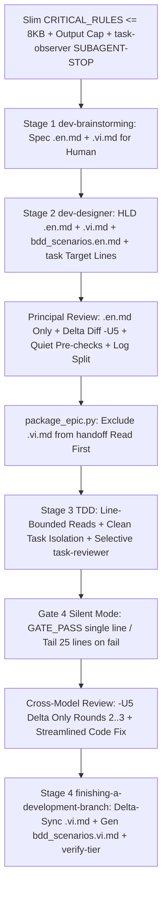

# Design Spec: Aggressive Token Optimization for Dev Lifecycle

## Table of Contents

- [1. Background and Measured Hotspots](#1-background-and-measured-hotspots)
- [2. Goals and Non-Goals](#2-goals-and-non-goals)
- [3. Architecture and Core Design](#3-architecture-and-core-design)
- [4. Detailed Component Changes](#4-detailed-component-changes)
  - [4.1 Diff-Only Review and Transcript Isolation](#41-diff-only-review-and-transcript-isolation)
  - [4.2 Silent Gate 4 and Truncated Test Output](#42-silent-gate-4-and-truncated-test-output)
  - [4.3 Surgical Reads and Target Line Ranges](#43-surgical-reads-and-target-line-ranges)
  - [4.4 Context Isolation and Selective Task Reviewer](#44-context-isolation-and-selective-task-reviewer)
  - [4.5 Zero-Fluff Output Cap, Rules, and Skills Slimming](#45-zero-fluff-output-cap-rules-and-skills-slimming)
  - [4.6 Option A Bilingual Workflow](#46-option-a-bilingual-workflow)
  - [4.7 Config-Driven Programmer Persona and Gemini 4 Hydrogen](#47-config-driven-programmer-persona-and-gemini-4-hydrogen)
- [5. Verification Strategy and Kit Invariants](#5-verification-strategy-and-kit-invariants)
- [6. Shared Contract Warnings](#6-shared-contract-warnings)

## 1. Background and Measured Hotspots

An end-to-end audit across `ai-agent-tools` workflows, rules, hooks, and runner scripts identified five structural drivers of quadratic context bloat and quota exhaustion across `dev-lifecycle` (Manual and Autonomous modes):

1. **Always-On Baseline Overhead**: `rules/CRITICAL_RULES.md` (`32,773` bytes / `239` lines) is injected into every conversation, subagent, and headless CLI invocation (partially truncated at `8,848` bytes by IDE rules loading). `skills/task-observer/SKILL.md` (`31,480` bytes / `526` lines) lacks a `<SUBAGENT-STOP>` guard, forcing worker subagents and review CLIs to ingest it before their first tool call. `scripts/resume_context.py` emits `26,759` bytes (`310` lines) across all workspace repos by default.
2. **Quadratic Review Context Bloat (`O(R^2)`)**: In `skills/dev-implementation/resources/scripts/run_external_review.py`, Round >= 2 passes both full `base...sha` `diff_section` and `delta_round_context()`, duplicates `.en.md` and `.vi.md` artefacts, injects full pre-check logs via untruncated `fact()` even on exit `0`, uses default 3-line diff context (`-U10` in `review-package`), and appends unfiltered CLI `stderr` transcripts under `Raw output:` inside `principal_review.md` (measured up to `1,885,237` bytes / `23,450` lines in `autonomous_lifecycle_runner`).
3. **Verbose Quality Gates and Uncapped Tracebacks**: `skills/quality_check/resources/scripts/verify_polyglot_registry.py` dumps full indented JSON even on `PASS`; `.agents/quality/python-quality.json` invokes `pytest` without `-q --tb=short --maxfail=3`; `run_task_checks.py` caps at `40` tail lines; `lifecycle_runner.py` and `scripts/verify.sh` forward full `stdout`/`stderr` on failure without 25-line truncation.
4. **Coarse-Grained File Reads and Redundant Subagent Loops**: `dev-designer/SKILL.md` (`66,425` bytes) does not require `target_files` line ranges or symbols in task breakdowns; `_execute_single_task()` in `lifecycle_runner.py` dispatches sequential `agy` processes instead of bounded `manage_worker_pool.py` / line-bounded instructions; `cross-model-review` fix loops execute 3 separate LLM calls (`_draft_fix_plan` -> `evaluate_programmer_fix_plan` -> `_apply_code_fixes`) even for unambiguous `Valid` code fixes; interactive `subagent-driven-development` runs `task-reviewer` on every trivial task even when end-of-epic `cross-model-review` follows.
5. **Unconstrained Verbosity and Upfront Bilingual Churn**: No stage enforces an output token cap, while Spec, HLD, and Gherkin BDD documents require full synchronized `.en.md` / `.vi.md` pairs throughout Stage 1, Stage 2, and Principal Review iterations.

## 2. Goals and Non-Goals

Goals:

- Enforce the 5 Strict Token-Throttling Rules mechanically across scripts, prompts, schemas, rules, and skills without weakening TDD (`RED -> GREEN`), BDD traceability, architecture gates, or Circuit Breakers.
- Implement both Phase 1 (mechanical runner/script optimizations) and Phase 2 (rules, task schema, skill slimming, deduplication).
- Adopt Option A Bilingual Workflow: keep Spec and HLD `.vi.md` for human review at Gates 1 and 2, exclude all `.vi.md` files from LLM review/coder pipelines, defer `bdd_scenarios.vi.md` generation and HLD/Spec `.vi.md` delta-sync until `/finishing-a-development-branch`, and never delete/re-translate files twice.
- Enable selective per-task `task-reviewer` in Stage 3 strictly for high-risk or complex tasks while relying on deterministic `run_task_checks.py` + end-of-epic `/cross-model-review` for mechanical tasks.

Non-Goals:

- Skipping or auto-approving human gates (Gate 1 Spec, Gate 2 Task Breakdown, Gate 5 Finish & Merge Decision).
- Disabling full regression suites, Playwright E2E checks, or `@quality_check` execution at the Final Convergence Gate or Stage 4 `verify-tier`.
- Auto-pushing commits or branches without explicit developer instruction.

## 3. Architecture and Core Design

## 4. Detailed Component Changes

### 4.1 Diff-Only Review and Transcript Isolation

- **Unified `-U5` Diffs and Truncation Guard**: Update `build_diff_section()` in `skills/dev-implementation/resources/scripts/run_external_review.py` and `skills/subagent-driven-development/scripts/review-package` to generate `git diff -U5`. When a diff exceeds `MAX_DIFF_LINES` (`1500`) or `MAX_DIFF_BYTES` (`60000`), emit `git diff --stat` and unified hunk headers (`@@ ... @@`) alongside changed filenames rather than leaving an empty diff block.
- **No Duplicate `base...sha` in Round >= 2**: In `run_external_review.py` (`run()`), when `round_num >= 2` and `delta_round_context()` is active, omit the redundant full `base...sha` `diff_section`. Pass only `prev_sha..sha` delta diff (`-U5`), Prior Fixed Locations Registry, compact open findings summary (<= 200 chars per cell), and referenced Acceptance Criteria / task sections.
- **English SSOT Only for Reviews**: Update `principal_artefact_lines()` and `collect_facts()` in `run_external_review.py` to exclude all `*.vi.md` paths from external reviewer context.
- **Quiet Pre-Check Facts**: Replace verbatim `fact()` output in `collect_facts()` with `PASS: <label>` (1 line) when `returncode == 0`, and failing command + last 25 lines of combined output when non-zero.
- **Transcript Isolation (`Raw output:`)**: In `render_round()`, route full external CLI `stderr` transcripts (and raw verbose payloads above summary bounds) to git-ignored `build/reviews/<epic>_round<n>.raw.log`, keeping `principal_review.md` and `review_results.md` limited to structured Verdict, Pass summary, and Findings tables plus a single log path pointer.
- **Prompt Rules**: Inject `DIFF-ONLY REVIEW` constraints into `principal-review-prompt.md` and `external-review-prompt.md` forbidding full file reads unless resolving an explicit missing symbol or caller chain.

### 4.2 Silent Gate 4 and Truncated Test Output

- **Quiet Runner Defaults**: Enforce `pytest -q --tb=short --maxfail=3` in `.agents/quality/python-quality.json`, `setup_quality_check` Python templates, and `dev-designer/SKILL.md` Verification examples.
- **Compact Output in Polyglot & Task Runners**:
  - Add `--compact` (default for lifecycle callers, retaining raw logs on disk under `build/quality/<provider>/<cap>.log`) to `skills/quality_check/resources/scripts/verify_polyglot_registry.py` and update `quality_check/SKILL.md`: print `GATE_PASS: <provider_or_cap>` (1 line) on success, and failing capability summary + last 25 lines of traceback from its `.log` file on failure.
  - Set `TAIL_LINES = 25` in `skills/dev-implementation/resources/scripts/run_task_checks.py`.
  - Add helper `_tail_lines(text, limit=25)` in `skills/dev-lifecycle/resources/scripts/lifecycle_runner.py` for `run_gate4()` and `run_intermediate_check()` so failing commands return only summary + last 25 lines, while passing checks emit `GATE_PASS: <check_name>`.
  - Add `--quiet` (1 line per passed section) and 25-line failure tailing to `scripts/verify.sh` while keeping `--full` diagnostics intact when needed.

### 4.3 Surgical Reads and Target Line Ranges

- **Task Schema Enhancement**: Update `skills/dev-designer/SKILL.md` task template (`## Files` / `## Impact Analysis & Blast Radius`) so every existing modified file larger than 200 lines requires an explicit `target_files` entry with symbol name and line window (`path :: Symbol (L<start>-L<end>)`).
- **Contract Warning/Check**: Update `check_task_contract.py --design` to verify modified tracked files >200 lines carry target symbol/line anchors when defined in `Allowed files`.
- **Stage 3 Read Discipline**: Update `dev-implementation/SKILL.md`, `skills/dev-lifecycle/references/handoff-template.md`, `implementer-prompt.md`, and `lifecycle_runner.py` (`_execute_single_task()`) to mandate range-bounded reads (`read_file` with `StartLine`/`EndLine` or `sed -n 'X,Yp'`) and symbol searches instead of full-file reads.

### 4.4 Context Isolation and Selective Task Reviewer

- **Strict Task Isolation & Concise Handoff**:
  - In interactive `subagent-driven-development`, preserve isolated per-task execution using `task-brief` and file-based reports so Task `N+1` starts fresh without Task `1..N` tool history.
  - In `lifecycle_runner.py` (`step_implementation()` and `_execute_single_task()`), pass file paths (`task_file`, `handoff.md`) rather than inlining full file contents into stdin prompts, and dispatch independent topological waves concurrently using `manage_worker_pool.py`.
- **Selective Per-Task `task-reviewer` Trigger**:
  - Define high-risk criteria in `dev-designer/SKILL.md`, `dev-implementation/SKILL.md`, and `subagent-driven-development/SKILL.md`: invoke `task-reviewer` (with `-U5` `review-package`) when a task has `review_tier: "full"` in frontmatter, `labels` matching `{"security", "architecture", "concurrency", "contract"}`, or non-test `Allowed files` spanning more than 2 modules.
  - Standard mechanical tasks rely on deterministic `run_task_checks.py` TDD verification (`RED`, `GREEN`, `TIER-B`, `TIER-C`) and end-of-epic `/cross-model-review`.
- **Streamlined Autonomous Fix Loop & Dynamic Final Report**:
  - In `lifecycle_runner.py` (`step_cross_model_review()`), when findings are verified `Valid` code fixes with no `shared-contracts/` impact and no `CRITICAL_CONFLICT`, allow Role 2.3 to apply direct fixes + scoped tests without extra `_draft_fix_plan` -> `evaluate_programmer_fix_plan` round-trips (retaining Role 2.2 plan evaluation only for contract/design ambiguity).
  - Update `render_final_executive_report()` in `lifecycle_runner.py` to parse real highest-risk findings and SHAs from `review_results.md` / `principal_review.md` instead of returning hardcoded sample rows.

### 4.5 Zero-Fluff Output Cap, Rules, and Skills Slimming

- **Output Token Cap Directive**: Add a shared 5-rule Zero-Fluff output constraint across `rules/CRITICAL_RULES.md`, `dev-lifecycle/SKILL.md`, `dev-implementation/SKILL.md`, `quality_check/SKILL.md`, `finishing-a-development-branch/SKILL.md`, and all `lifecycle_runner.py` prompts: no greetings/preamble, no prompt restating, no echoing unchanged code, no narrative explaining passing checks; emit only `[STATE]` transitions, tool calls, and max 3 root-cause bullets on failures.
- **Rules & Subagent Guard Slimming**:
  - Condense `rules/CRITICAL_RULES.md` from `32,773` bytes to `<= 8,192` bytes (preventing IDE `<truncated>` slicing) by turning verbose explanations into normative `MUST`/`NEVER` rules and moving extended workflow checklists into `skills/dev-lifecycle/references/`. Preserve Rule 1–9 semantic contracts and satisfy `scripts/verify.sh` source-fidelity checks.
  - Add `<SUBAGENT-STOP>` guard at the top of `skills/task-observer/SKILL.md` so subagents and headless review CLIs bypass loading `31.4 KB` of observer instructions.
- **Scoped `resume_context.py`**: Add `--compact` (defaulting to epic-scoped output when `--epic <slug>` is passed) in `scripts/resume_context.py` so Role 2.2 / Role 2.3 receives active epic state, current repo git status, open relevant RFC headers, and matching epic tasks (~2–3 KB) instead of multi-repo dumps (`26.7 KB`).
- **Skills Progressive Disclosure & Reference Deduplication**:
  - Condense `skills/dev-designer/SKILL.md` (`66.4 KB` -> `<= 22 KB`) and `skills/quality_check/SKILL.md` by extracting verbose platform examples and boilerplate templates into linked `references/` files.
  - Consolidate duplicate prompt/rule/triage files shared between `skills/dev-implementation/references/`, `skills/principal-review/references/`, and `skills/cross-model-review/references/` into canonical single sources while keeping all cross-links valid under `scripts/verify.sh`.

### 4.6 Option A Bilingual Workflow

- **Stage 1 & Stage 2 (Human Review)**: `dev-brainstorming` generates Spec `.en.md` + `.vi.md`; `dev-designer` generates HLD `<epic>.en.md` + `<epic>.vi.md` and **English-only** `bdd_scenarios.en.md` (deferring `bdd_scenarios.vi.md` until Stage 4).
- **In-Flight Tolerance (`check_epic_readiness.py` & `check_bdd_traceability.py`)**: Keep Spec and HLD `.vi.md` on disk untouched for human reading; configure `check_epic_readiness.py` (in-flight default, with `--strict-bilingual` for Gate 5 / Finish) and `check_bdd_traceability.py` so Principal Review revisions to `.en.md` and deferred `bdd_scenarios.vi.md` do not block readiness (`R1`/`R3`/`R7`) mid-lifecycle, while removing `.vi.md` from `handoff.md` (`Read First`) and `run_external_review.py`.
- **Stage 4 Pre-Finish Sync (`/finishing-a-development-branch`)**: Update Pre-Finish Hook (before archival commit in Options 1 and 2) to delta-sync `.en.md` edits into Spec/HLD `.vi.md`, generate `bdd_scenarios.vi.md` once, and validate the complete pair set with `check_document.py --require-toc --require-bilingual` and `check_epic_readiness.py --strict-bilingual`.

### 4.7 Config-Driven Programmer Persona and Gemini 4 Hydrogen

- **Configuration Source of Truth (`.devtool/review_config.json`)**: Add `"assistant"` and `"programmer"` entries to `DEFAULT_REVIEW_CONFIG["providers"]` in `run_external_review.py` and standardize `.devtool/review_config.json["providers"]["programmer"]` with default `model: "gemini-4-hydrogen-xhigh"` and `thinking_level: "xhigh"` (replacing hardcoded `Gemini Flash 3.8` defaults).
- **Precedence & CLI Effort Mapping (`lifecycle_runner.py`)**: Add `resolve_programmer_model()` and `resolve_programmer_effort()` on `RunnerConfig` using strict precedence `CLI (--programmer-model / --programmer-effort) -> Runner --config JSON -> .devtool/review_config.json["providers"]["programmer"] -> env (AGY_PROGRAMMER_MODEL / AGY_PROGRAMMER_EFFORT) -> fallback ("gemini-4-hydrogen-xhigh", "xhigh")`; change `argparse` `--programmer-model` / `--programmer-effort` defaults to `None` so parser defaults do not shadow file configuration. Normalize effort aliases `"extra"`, `"extra-high"`, `"extra_high"`, and `"xhigh"` cleanly to the `agy` CLI `--effort xhigh` flag (`low|medium|high|xhigh|max`).
- **Dynamic Prompts & Rule/Skill Alignment**: Update `resume_context.py` (`emit_handoff_prompt`), `rules/CRITICAL_RULES.md`, `skills/dev-lifecycle/SKILL.md`, `skills/dev-lifecycle/references/autonomous-mode.md`, `skills/dev-implementation/SKILL.md`, and `skills/principal-review/SKILL.md` to read/reference `.devtool/review_config.json` (`providers.programmer`, default `gemini-4-hydrogen-xhigh`, effort `xhigh`) instead of hardcoding `Gemini Flash 3.8` (leaving quota bucket labels in `agy_quota.py` and the quota dashboard UI unchanged).

## 5. Verification Strategy and Kit Invariants

- Preserve all repository release checks via `bash scripts/verify.sh --full` (`42+` test suites, JSON manifest consistency, YAML frontmatter checks, relative link resolution, ToC anchor verification, Section 7 methodology source-fidelity checks, Section 8 unreferenced skill file checks, and `scripts/test_lifecycle_document_contract.py`).
- Add targeted unit and integration tests covering:
  - `test_run_external_review.py`: `-U5` diff context, Round 2 no-duplicate `base...sha`, quiet `collect_facts()` output, `.vi.md` exclusion, and `build/reviews/` raw stderr separation.
  - `test_lifecycle_runner.py`: silent Gate 4 pass / 25-line failure truncation, worker pool parallel dispatch wiring, streamlined code fix path, `render_final_executive_report()`, and `resolve_programmer_model()` / `resolve_programmer_effort()` precedence with `"extra"` -> `"xhigh"` normalization.
  - `test_check_epic_readiness.py` & `test_integrate_branch.py`: Option A deferred `bdd_scenarios.vi.md` during Principal Review vs `--strict-bilingual` enforcement at Stage 4 Finish, plus `check_task_contract.py` line-range validation.
  - `test_resume_context.py` & `test_aggregate_quality_results.py`: `--compact` scoped startup output, config-driven `emit_handoff_prompt` Programmer model output, and `--compact` Gate 4 `GATE_PASS:` output format.
- Measure before/after byte sizes of `CRITICAL_RULES.md`, `dev-designer/SKILL.md`, `resume_context.py --epic <slug> --compact`, and sample multi-round `principal_review.md` artefacts as quantitative regression assertions.

## 6. Shared Contract Warnings

No `shared-contracts/` directory exists in `ai-agent-tools` (this repository is the standalone agent workflow kit rather than a Hub/Satellite service pair). Internal kit contracts between scripts (`run_external_review.py`, `check_epic_readiness.py`, `verify_polyglot_registry.py`, `resume_context.py`, `lifecycle_runner.py`, and `integrate_branch.py`) and `.devtool/review_config.json` remain backward-compatible via optional flags and fallback defaults.
