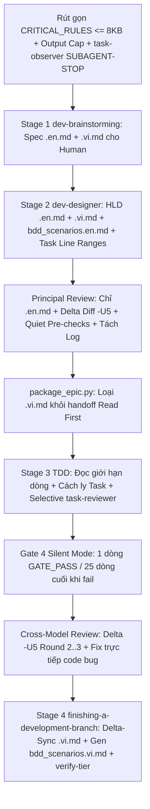

# Đặc tả Thiết kế: Tối ưu hóa Token toàn diện cho Dev Lifecycle

## Mục lục

- [1. Bối cảnh và các điểm tiêu tốn Token thực tế](#1-bối-cảnh-và-các-điểm-tiêu-tốn-token-thực-tế)
- [2. Mục tiêu và Phi mục tiêu](#2-mục-tiêu-và-phi-mục-tiêu)
- [3. Kiến trúc và Thiết kế cốt lõi](#3-kiến-trúc-và-thiết-kế-cốt-lõi)
- [4. Thay đổi chi tiết theo thành phần](#4-thay-đổi-chi-tiết-theo-thành-phần)
  - [4.1 Review chỉ theo Diff và Cách ly Transcript](#41-review-chỉ-theo-diff-và-cách-ly-transcript)
  - [4.2 Silent Gate 4 và Cắt gọn Output Kiểm thử](#42-silent-gate-4-và-cắt-gọn-output-kiểm-thử)
  - [4.3 Đọc File phẫu thuật và Giới hạn Dòng mục tiêu](#43-đọc-file-phẫu-thuật-và-giới-hạn-dòng-mục-tiêu)
  - [4.4 Cách ly Context Task và Selective Task Reviewer](#44-cách-ly-context-task-và-selective-task-reviewer)
  - [4.5 Giới hạn Output, Rút gọn Rules và Skills](#45-giới-hạn-output-rút-gọn-rules-và-skills)
  - [4.6 Luồng Song ngữ Option A](#46-luồng-song-ngữ-option-a)
  - [4.7 Cấu hình Programmer Persona qua File Config và Gemini 4 Hydrogen](#47-cấu-hình-programmer-persona-qua-file-config-và-gemini-4-hydrogen)
- [5. Chiến lược Kiểm thử và Bất biến của Kit](#5-chiến-lược-kiểm-thử-và-bất-biến-của-kit)
- [6. Cảnh báo Shared Contract](#6-cảnh-báo-shared-contract)

## 1. Bối cảnh và các điểm tiêu tốn Token thực tế

Kết quả rà soát toàn bộ workflow, rules, hooks và runner scripts trong `ai-agent-tools` đã chỉ ra 5 nguyên nhân gốc gây phình context theo hàm bậc hai và cạn quota across `dev-lifecycle` (cả Manual và Autonomous mode):

1. **Chi phí nền cố định (Always-On)**: `rules/CRITICAL_RULES.md` (`32,773` bytes / `239` dòng) bị nạp vào mọi hội thoại, mọi subagent và mọi lần gọi headless CLI (hiện bị IDE cắt `<truncated 8848 bytes>`). `skills/task-observer/SKILL.md` (`31,480` bytes / `526` dòng) thiếu thẻ `<SUBAGENT-STOP>`, ép subagent và review CLI đọc toàn bộ trước tool call đầu tiên. `scripts/resume_context.py` in `26,759` bytes (`310` dòng) qua toàn bộ các repo theo mặc định.
2. **Phình Context bậc hai trong Review (`O(R^2)`)**: Trong `skills/dev-implementation/resources/scripts/run_external_review.py`, từ Round >= 2 vẫn truyền đồng thời full diff `base...sha` (`diff_section`) lẫn `delta_round_context()`, lặp lại cả `.en.md` và `.vi.md`, đổ toàn bộ log tiền kiểm qua `fact()` dù lệnh pass (`exit 0`), dùng ngữ cảnh diff 3 dòng mặc định (`-U10` trong `review-package`), và lưu nguyên `stderr` transcript của CLI vào mục `Raw output:` trong `principal_review.md` (đo thực tế tới `1,885,237` bytes / `23,450` dòng ở `autonomous_lifecycle_runner`).
3. **Quality Gates quá dài dòng và không cắt traceback**: `skills/quality_check/resources/scripts/verify_polyglot_registry.py` in nguyên JSON lớn ngay cả khi `PASS`; `.agents/quality/python-quality.json` chạy `pytest` không có `-q --tb=short --maxfail=3`; `run_task_checks.py` giữ `40` dòng cuối; `lifecycle_runner.py` và `scripts/verify.sh` trả nguyên `stdout`/`stderr` khi fail không giới hạn 25 dòng.
4. **Đọc file thô và Vòng lặp Subagent dư thừa**: `dev-designer/SKILL.md` (`66,425` bytes) chưa yêu cầu `target_files` kèm dải dòng/symbol trong task breakdown; `_execute_single_task()` trong `lifecycle_runner.py` chạy `agy` tuần tự thay vì pool `manage_worker_pool.py` / chỉ dẫn đọc cắt lát; vòng fix `cross-model-review` gọi 3 process LLM liên tiếp (`_draft_fix_plan` -> `evaluate_programmer_fix_plan` -> `_apply_code_fixes`) cả với lỗi code thuần `Valid`; chế độ Interactive chạy `task-reviewer` cho mọi task nhỏ dù cuối epic vẫn chạy `cross-model-review`.
5. **Thiếu giới hạn Output và Dịch đi dịch lại `.vi.md`**: Chưa có quy tắc giới hạn output token ở các stage, đồng thời Spec, HLD và Gherkin BDD phải duy trì song ngữ `.en.md` / `.vi.md` liên tục suốt Stage 1, Stage 2 và mọi vòng Principal Review.

## 2. Mục tiêu và Phi mục tiêu

Mục tiêu:

- Thực thi cơ học 5 Quy tắc siết Token trên toàn bộ scripts, prompts, task schema, rules và skills mà không làm yếu TDD (`RED -> GREEN`), BDD traceability, architecture gates hay Circuit Breakers.
- Triển khai đồng thời cả Phase 1 (tối ưu runner/script cơ học) và Phase 2 (rút gọn rules, schema task, slimming skills, khử trùng lặp references).
- Áp dụng Luồng Song ngữ Option A: giữ Spec và HLD `.vi.md` cho con người review ở Gate 1 và Gate 2, loại bỏ hoàn toàn `.vi.md` khỏi các pipeline LLM review/coding, hoãn sinh `bdd_scenarios.vi.md` và delta-sync `.vi.md` tới bước `/finishing-a-development-branch`, không xóa và không dịch lại từ đầu.
- Kích hoạt `task-reviewer` theo chọn lọc trong Stage 3 chỉ cho các task phức tạp/rủi ro cao; task mechanical dựa vào `run_task_checks.py` + `/cross-model-review` cuối epic.

Phi mục tiêu:

- Bỏ qua hoặc tự phê duyệt thay con người ở các Gate 1 (Spec), Gate 2 (Task Breakdown), Gate 5 (Finish & Merge).
- Tắt full regression suite, Playwright E2E hoặc `@quality_check` tại Final Convergence Gate và Stage 4 `verify-tier`.
- Tự động push commit/nhánh lên remote khi chưa có xác nhận rõ ràng của người dùng.

## 3. Kiến trúc và Thiết kế cốt lõi

## 4. Thay đổi chi tiết theo thành phần

### 4.1 Review chỉ theo Diff và Cách ly Transcript

- **Chuẩn hóa `git diff -U5` và Fallback có kiểm soát**: Cập nhật `build_diff_section()` trong `skills/dev-implementation/resources/scripts/run_external_review.py` và `skills/subagent-driven-development/scripts/review-package` sang `git diff -U5`. Khi diff vượt ngưỡng `MAX_DIFF_LINES` (`1500`) hoặc `MAX_DIFF_BYTES` (`60000`), xuất `git diff --stat` cùng danh sách hunk header (`@@ ... @@`) thay vì để trống khiến model tự đọc full file.
- **Loại trùng `base...sha` ở Round >= 2**: Trong `run_external_review.py` (`run()`), khi `round_num >= 2` và `delta_round_context()` hoạt động, bỏ `diff_section` (`base...sha`) dư thừa. Chỉ truyền diff `prev_sha..sha` (`-U5`), Prior Fixed Locations Registry, bảng findings đang mở rút gọn (<= 200 ký tự mỗi ô) và Acceptance Criteria / phần task liên quan.
- **Chỉ dùng `.en.md` SSOT cho AI Review**: Cập nhật `principal_artefact_lines()` và `collect_facts()` trong `run_external_review.py` để loại toàn bộ file `*.vi.md` khỏi prompt external reviewer.
- **Quiet Pre-Check Facts**: Thay output nguyên văn của `fact()` trong `collect_facts()` bằng 1 dòng `PASS: <label>` khi `returncode == 0`, và chỉ giữ lệnh lỗi + 25 dòng cuối khi khác `0`.
- **Cách ly Transcript (`Raw output:`)**: Trong `render_round()`, ghi toàn bộ `stderr` transcript của external CLI ra file git-ignored `build/reviews/<epic>_<kind>_round<n>_<sha7>.raw.log` (tránh xung đột giữa `principal`, `code` và lượt chạy `--force`); file `principal_review.md` và `review_results.md` chỉ lưu Verdict, Pass summary, Bảng Findings và đường dẫn file log (triệt tiêu lỗi file `1.88 MB`).
- **Quy tắc Prompt**: Bổ sung ràng buộc `DIFF-ONLY REVIEW` vào `principal-review-prompt.md` và `external-review-prompt.md`, cấm đọc toàn bộ source/spec trừ khi truy vết một symbol/caller cụ thể còn thiếu.

### 4.2 Silent Gate 4 và Cắt gọn Output Kiểm thử

- **Cờ chạy test gọn mặc định**: Bắt buộc `pytest -q --tb=short --maxfail=3` trong `.agents/quality/python-quality.json`, template của `setup_quality_check` và bảng Verification mẫu trong `dev-designer/SKILL.md`.
- **Output rút gọn ở Polyglot & Task Runners**:
  - Thêm `--compact` (mặc định cho caller trong lifecycle, giữ nguyên full log tại `build/quality/<provider>/<cap>.log`) vào `skills/quality_check/resources/scripts/verify_polyglot_registry.py` và cập nhật `quality_check/SKILL.md`: in đúng 1 dòng `GATE_PASS: <provider_or_cap>` khi đạt, và in summary lỗi + 25 dòng cuối traceback từ `.log` khi thất bại.
  - Đổi `TAIL_LINES = 25` trong `skills/dev-implementation/resources/scripts/run_task_checks.py`.
  - Thêm helper `_tail_lines(text, limit=25)` trong `skills/dev-lifecycle/resources/scripts/lifecycle_runner.py` cho `run_gate4()` và `run_intermediate_check()` để chỉ trả về summary + 25 dòng cuối khi fail và `GATE_PASS: <check_name>` khi pass.
  - Thêm `--quiet` (1 dòng mỗi mục) và cắt đuôi 25 dòng khi lỗi vào `scripts/verify.sh` (giữ nguyên chế độ đầy đủ khi debug).

### 4.3 Đọc File phẫu thuật và Giới hạn Dòng mục tiêu

- **Nâng cấp Schema Task**: Cập nhật mẫu task trong `skills/dev-designer/SKILL.md` (`## Files` / `## Impact Analysis & Blast Radius`) bắt buộc mỗi file có sẵn >200 dòng cần sửa phải ghi rõ `target_files` kèm tên symbol và dải dòng (`path :: Symbol (L<start>-L<end>)`) bên cạnh `Allowed files`.
- **Kiểm tra Contract**: Cập nhật `check_task_contract.py --design` để kiểm tra file tracked >200 dòng trong `Allowed files` (không đánh dấu `(new)`) phải khai báo neo symbol/dải dòng mục tiêu.
- **Kỷ luật Đọc ở Stage 3**: Cập nhật `dev-implementation/SKILL.md`, `skills/dev-lifecycle/references/handoff-template.md`, `implementer-prompt.md` và `lifecycle_runner.py` (`_execute_single_task()`) để ép đọc giới hạn dòng (`read_file` với `StartLine`/`EndLine` hoặc `sed -n 'X,Yp'`) và tìm theo symbol trước khi sửa.

### 4.4 Cách ly Context Task và Selective Task Reviewer

- **Cách ly tuyệt đối theo Task & Handoff gọn**:
  - Ở `subagent-driven-development`, giữ cơ chế `task-brief` + report ra file giúp Task `N+1` khởi tạo sạch không mang lịch sử tool-call của Task `1..N`.
  - Ở `lifecycle_runner.py` (`step_implementation()` và `_execute_single_task()`), chỉ truyền đường dẫn `task_file`, `handoff.md` thay vì dán toàn văn nội dung, và điều phối các tầng topological độc lập qua `manage_worker_pool.py`.
- **Cơ chế kích hoạt Selective `task-reviewer`**:
  - Quy định điều kiện kích hoạt `task-reviewer` (dùng `review-package` với `-U5`) trong `dev-designer/SKILL.md`, `dev-implementation/SKILL.md` và `subagent-driven-development/SKILL.md` chỉ khi task có `review_tier: "full"` trong frontmatter, `labels` giao với `{"security", "architecture", "concurrency", "contract"}`, hoặc phần `Allowed files` non-test chạm >2 module.
  - Task mechanical chuẩn dựa vào `run_task_checks.py` TDD (`RED`, `GREEN`, `TIER-B`, `TIER-C`) và `/cross-model-review` cuối epic.
- **Tinh gọn Fix Loop tự động & Executive Report động**:
  - Trong `lifecycle_runner.py` (`step_cross_model_review()`), nếu các findings `Valid` chỉ là bug code không chạm `shared-contracts/` và không có `CRITICAL_CONFLICT`, cho Role 2.3 sửa trực tiếp + chạy scoped tests mà bỏ qua cặp gọi thừa `_draft_fix_plan` -> `evaluate_programmer_fix_plan` (giữ Role 2.2 đánh giá khi có xung đột contract/kiến trúc).
  - Sửa `render_final_executive_report()` trong `lifecycle_runner.py` để tổng hợp findings và commit SHA thật từ `review_results.md` / `principal_review.md` thay vì các dòng mẫu hardcode.

### 4.5 Giới hạn Output, Rút gọn Rules và Skills

- **Quy tắc Zero-Fluff Output Cap**: Bổ sung quy tắc giới hạn output vào `rules/CRITICAL_RULES.md`, `dev-lifecycle/SKILL.md`, `dev-implementation/SKILL.md`, `quality_check/SKILL.md`, `finishing-a-development-branch/SKILL.md` và worker prompts của `lifecycle_runner.py`, giới hạn riêng phần tường thuật tự do: cấm lời chào/mở bài, cấm lặp lại đề bài, cấm in lại code giữ nguyên và cấm giải thích test pass; giữ nguyên `[STATE]`, tool calls và tối đa 3 bullet nguyên nhân gốc khi lỗi, nhưng **bảo toàn đầy đủ** Verdict có cấu trúc máy đọc được, Bảng Findings đầy đủ, kết quả provider/JSON, worker status và thông điệp Human Gate.
- **Rút gọn Rules & Bảo vệ Subagent**:
  - Nén `rules/CRITICAL_RULES.md` từ `32,773` bytes xuống `<= 8,192` bytes (hết bị IDE cắt `<truncated>`) bằng cách giữ các mệnh đề `MUST`/`NEVER` súc tích và chuyển hướng dẫn chi tiết sang `skills/dev-lifecycle/references/`, bảo toàn ngữ nghĩa Rule 1–9 và các bài check trong `scripts/verify.sh`.
  - Thêm thẻ `<SUBAGENT-STOP>` ở đầu `skills/task-observer/SKILL.md` để subagents và external review CLIs bỏ qua việc nạp `31.4 KB` file này.
- **Lọc phạm vi `resume_context.py`**: Thêm `--compact` (mặc định kích hoạt khi có `--epic <slug>`) trong `scripts/resume_context.py` để Role 2.2 / Role 2.3 chỉ nạp state của epic đang làm, git status repo hiện tại, RFC mở liên quan và task thuộc epic (~2–3 KB thay vì `26.7 KB`).
- **Tối ưu Progressive Disclosure & Khử trùng lặp**:
  - Rút gọn `skills/dev-designer/SKILL.md` (`66.4 KB` -> `<= 22 KB`) và `skills/quality_check/SKILL.md` bằng cách đẩy ví dụ platform/template dài sang `references/`.
  - Hợp nhất các file trùng lặp giữa `skills/dev-implementation/references/`, `skills/principal-review/references/` và `skills/cross-model-review/references/` về một bản chuẩn, đảm bảo mọi liên kết tương đối qua `scripts/verify.sh`.

### 4.6 Luồng Song ngữ Option A

- **Stage 1 & Stage 2 (Human Review)**: `dev-brainstorming` tạo cặp Spec `.en.md` + `.vi.md`; `dev-designer` tạo cặp HLD `<epic>.en.md` + `<epic>.vi.md` và chỉ tạo `bdd_scenarios.en.md` (hoãn `bdd_scenarios.vi.md` đến Stage 4).
- **Dung sai trong lúc thực thi (`check_epic_readiness.py` & `check_bdd_traceability.py`)**: Giữ nguyên Spec và HLD `.vi.md` trên disk cho người dùng đọc (không xóa), thêm chế độ mặc định in-flight trên `check_epic_readiness.py` (kèm cờ `--strict-bilingual` cho Gate 5 / Finish) và `check_bdd_traceability.py` để các chỉnh sửa Principal Review trên `.en.md` hoặc việc chưa có `bdd_scenarios.vi.md` không làm fail `R1`/`R3`/`R7` giữa chừng; đồng thời bỏ `.vi.md` khỏi `handoff.md` (`Read First`) và `run_external_review.py`.
- **Đồng bộ tại Stage 4 Pre-Finish (`/finishing-a-development-branch`)**: Cập nhật Pre-Finish Hook (trước commit archive ở Option 1 và Option 2) để delta-sync thay đổi sang Spec/HLD `.vi.md`, cập nhật watermark `<!-- sync-en-sha256: <hex16> -->` tương ứng nguồn `.en.md`, sinh `bdd_scenarios.vi.md` một lần duy nhất, rồi nghiệm thu lại bằng `check_document.py --require-toc --require-bilingual`, `check_epic_readiness.py <epic> --strict-bilingual` và `check_bdd_traceability.py plan --scenarios .devtool/epic/<epic>/bdd_scenarios.en.md --tasks .devtool/epic/<epic>/task_*.md --strict-bilingual`.

### 4.7 Cấu hình Programmer Persona qua File Config và Gemini 4 Hydrogen

- **Nguồn chân lý cấu hình (`.devtool/review_config.json`)**: Bổ sung `"assistant"` và `"programmer"` vào `DEFAULT_REVIEW_CONFIG["providers"]` trong `run_external_review.py` và chuẩn hóa `.devtool/review_config.json["providers"]["programmer"]` với mặc định `model: "gemini-4-hydrogen-xhigh"` và `thinking_level: "xhigh"` (thay thế mặc định hardcode `Gemini Flash 3.8`).
- **Thứ tự ưu tiên & Ánh xạ Effort (`lifecycle_runner.py`)**: Thêm `resolve_programmer_model()` và `resolve_programmer_effort()` trên `RunnerConfig` theo thứ tự ưu tiên `CLI (--programmer-model / --programmer-effort) -> Runner --config JSON -> .devtool/review_config.json["providers"]["programmer"] -> env (AGY_PROGRAMMER_MODEL / AGY_PROGRAMMER_EFFORT) -> fallback ("gemini-4-hydrogen-xhigh", "xhigh")`; đổi default trên `argparse` cho `--programmer-model` / `--programmer-effort` thành `None` để không che khuất file config. Chuẩn hóa các alias `"extra"`, `"extra-high"`, `"extra_high"` và `"xhigh"` sang cờ `agy` CLI `--effort xhigh` (`low|medium|high|xhigh|max`).
- **Đồng bộ Handoff Prompt, Rules và Skills**: Cập nhật `resume_context.py` (`emit_handoff_prompt`), `rules/CRITICAL_RULES.md`, `skills/dev-lifecycle/SKILL.md`, `skills/dev-lifecycle/references/autonomous-mode.md`, `skills/dev-implementation/SKILL.md` và `skills/principal-review/SKILL.md` để đọc/tham chiếu `.devtool/review_config.json` (`providers.programmer`, mặc định `gemini-4-hydrogen-xhigh`, effort `xhigh`) thay vì hardcode `Gemini Flash 3.8` (giữ nguyên nhãn hiển thị quota bucket trên `agy_quota.py` và dashboard UI).

## 5. Chiến lược Kiểm thử và Bất biến của Kit

- Bảo toàn toàn bộ kiểm định phát hành bằng `bash scripts/verify.sh --full` (`42+` suite, JSON manifest, YAML frontmatter, relative links, ToC anchors, Section 7 methodology fidelity, Section 8 unreferenced supporting files, và `scripts/test_lifecycle_document_contract.py`).
- Bổ sung unit & integration tests cho:
  - `test_run_external_review.py`: ngữ cảnh diff `-U5`, không lặp `base...sha` ở Round 2, quiet `collect_facts()`, loại trừ `.vi.md` và tách `stderr` transcript ra `build/reviews/`.
  - `test_lifecycle_runner.py`: silent Gate 4 pass / cắt đuôi 25 dòng lỗi, worker pool parallel dispatch, fix loop tinh gọn cho code bug, `render_final_executive_report()` đọc findings thật, và thứ tự ưu tiên `resolve_programmer_model()` / `resolve_programmer_effort()` kèm ánh xạ `"extra"` -> `"xhigh"`.
  - `test_check_epic_readiness.py` và `test_integrate_branch.py`: Option A hoãn `bdd_scenarios.vi.md` ở Stage 2/Review vs `--strict-bilingual` ở Stage 4 Finish, và check dải dòng trong `check_task_contract.py`.
  - `test_resume_context.py` và `test_aggregate_quality_results.py`: output `--compact` theo epic, `emit_handoff_prompt` lấy Programmer model từ config và định dạng `GATE_PASS:`.
- Đo kiểm định lượng trước/sau cho dung lượng `CRITICAL_RULES.md`, `dev-designer/SKILL.md`, `resume_context.py --epic <slug> --compact` và kích thước artefact `principal_review.md`.

## 6. Cảnh báo Shared Contract

Repository `ai-agent-tools` không chứa thư mục `shared-contracts/` (đây là bộ workflow kit độc lập, không phải Hub/Satellite dịch vụ). Mọi hợp đồng CLI nội bộ giữa `run_external_review.py`, `check_epic_readiness.py`, `verify_polyglot_registry.py`, `resume_context.py`, `lifecycle_runner.py` và `integrate_branch.py` cùng schema `.devtool/review_config.json` được giữ tương thích ngược thông qua cờ mặc định và giá trị fallback tùy chọn.

