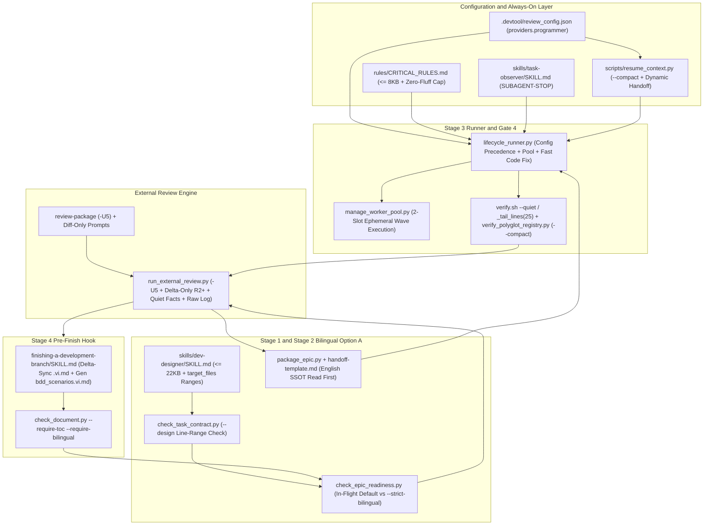

# Token Throttling Optimization High-Level Design

## Table of Contents

- [Meta Data](#meta-data)
- [Background](#background)
- [Goals and Non-Goals](#goals-and-non-goals)
- [Architecture and Technical Design](#architecture-and-technical-design)
- [Feature Maintenance Map](#feature-maintenance-map)
- [Module Contracts and CLI Interfaces](#module-contracts-and-cli-interfaces)
- [Impact Analysis](#impact-analysis)
- [Shared Contract Impact](#shared-contract-impact)
- [Integration Test Plan and Boundary Matrix](#integration-test-plan-and-boundary-matrix)
- [Verification Environment](#verification-environment)
- [Comprehensive BDD Scenario Coverage](#comprehensive-bdd-scenario-coverage)
- [Rollout Strategy and Mitigation](#rollout-strategy-and-mitigation)
- [Kanban Tasks Breakdown](#kanban-tasks-breakdown)
- [Spec Errata](#spec-errata)

## Meta Data

- **Epic name**: `token_throttling_optimization`
- **Status**: Draft
- **PIC**: `danhdue`
- **Target release**: Next plugin release
- **Platform**: Python tooling and agent workflow kit
- **Depends on epic**: none
- **Source Spec**: [Approved Token Throttling Optimization Design Spec](2026-11-13-token-throttling-optimization-design.en.md)

## Background

End-to-end telemetry across `dev-lifecycle` (Interactive and `--autonomous`) showed quadratic token growth and rapid 5-hour quota depletion driven by five compounding causes:

1. **Always-On Baseline Overhead**: `rules/CRITICAL_RULES.md` (`32,773` bytes / `239` lines) exceeds IDE truncation limits (`<truncated 8848 bytes>`), `skills/task-observer/SKILL.md` (`31,480` bytes) loads into worker subagents and headless CLIs without a guard, and `scripts/resume_context.py` dumps `26,759` bytes across all workspace repos.
2. **Quadratic External Review Bloat**: `run_external_review.py` re-sends full `base...sha` diffs alongside `delta_round_context()` on Rounds `2+`, includes redundant `*.vi.md` documents, embeds full command output via `fact()` even on `exit 0`, uses `-U10` in `review-package`, and writes unfiltered CLI `stderr` transcripts directly into `principal_review.md` (`1.88 MB` measured).
3. **Verbose Quality Gates and Uncapped Tracebacks**: `verify_polyglot_registry.py` dumps full JSON on `PASS`; `.agents/quality/python-quality.json` and `scaffold_quality_manifest.py` invoke `pytest` without `-q --tb=short --maxfail=3`; `run_task_checks.py` retains `40` lines; `lifecycle_runner.py` and `verify.sh` lack compact pass lines and 25-line failure tailing.
4. **Coarse Reads, Sequential Tasks, and Hardcoded Legacy Models**: Task specs omit symbol/line-range windows for files over `200` lines; `lifecycle_runner.py` dispatches sequential `agy` calls with inline file text and hardcoded `gemini-3.8-flash` instead of config-driven `gemini-4-hydrogen-xhigh` (`--effort xhigh`); `step_cross_model_review()` wastes 3 LLM turns on unambiguous code bugs; `task-reviewer` runs on trivial mechanical tasks.
5. **Upfront Bilingual Churn**: Maintaining synchronized Spec, HLD, and Gherkin `.vi.md` files throughout Principal Review doubles authoring and verification overhead before the English SSOT converges.

## Goals and Non-Goals

### Goals

- Enforce all 5 Strict Token-Throttling Rules across runner scripts, verification tools, prompt templates, rules, and skill manifests across both Phase 1 (mechanical scripts) and Phase 2 (slimming, deduplication, task schema).
- Adopt Option A Bilingual Workflow: retain Spec and HLD `.vi.md` for human gate reviews, exclude all `*.vi.md` files from AI review and coder handoffs, tolerate in-flight `.vi.md` drift and deferred `bdd_scenarios.vi.md` under default `check_epic_readiness.py`, and run a single Stage 4 Pre-Finish sync with `--strict-bilingual`.
- Trigger `task-reviewer` selectively only for high-risk or multi-module tasks (`review_tier: "full"`, `security|architecture|concurrency|contract` labels, or `> 2` non-test modules).
- Configure Role 2.3 (AI Programmer) via `.devtool/review_config.json["providers"]["programmer"]` and `RunnerConfig` precedence, upgrading the default to `gemini-4-hydrogen-xhigh` with effort normalized (`"extra"` / `"extra-high"` / `"xhigh"` -> `--effort xhigh`).
- Enforce measurable size caps (`CRITICAL_RULES.md <= 8192` bytes, `dev-designer/SKILL.md <= 22528` bytes, `resume_context.py --compact --epic <slug> <= 4096` bytes) while preserving all kit release checks (`scripts/verify.sh --full`).

### Non-Goals

- Skipping human approval gates (Gate 1 Spec, Gate 2 Task Breakdown, Gate 5 Finish and Merge).
- Disabling full test suites or `@quality_check` at the Final Convergence Gate or Stage 4 `verify-tier`.
- Auto-pushing commits or branches without explicit user approval.
- Altering backend quota bucket display labels (`Gemini 3.8 / Pro 5H`) in `scripts/agy_quota.py` or `quota_dashboard.html`.

## Architecture and Technical Design

### High-Level Architecture



### Multi-Round Review and Selective Worker Flow

```mermaid
sequenceDiagram
    autonumber
    actor Dev as Developer (Role 2.1)
    participant Des as dev-designer / Readiness
    participant Rev as run_external_review.py
    participant Run as lifecycle_runner.py
    participant Pool as 2-Slot Worker / Subagent

    Des->>Rev: HLD .en.md + bdd_scenarios.en.md + Tasks (.vi.md excluded)
    Rev->>Rev: Run check_epic_readiness.py (Option A in-flight) + Delta -U5
    Rev-->>Rev: Write verbose stderr to build/reviews/<epic>_<kind>_roundN_<sha7>.raw.log
    Dev->>Run: Approve Gate 2 -> AUTO MODE (Claude -> Codex -> Kiro -> Argon)
    Run->>Run: Resolve programmer model (gemini-4-hydrogen-xhigh, --effort xhigh)
    Run->>Pool: Dispatch disjoint task waves with path-only prompt + target ranges
    Pool-->>Run: Commit task + Selective task-reviewer (high-risk only)
    Run->>Run: bash scripts/verify.sh --quiet / _tail_lines(25) -> Gate 4 PASS or 25-line tail
    Run->>Rev: Cross-Model Review (Round 1 full -U5; Round 2..3 delta prev_sha..sha only)
    alt Clean code fix with no contract conflict
        Run->>Pool: Direct Programmer fix + scoped test + 25-line tail
    else Contract or architecture ambiguity
        Run->>Run: Evaluate fix_plan_roundN.md via Role 2.2
    end
    Run->>Dev: Converged + Gate 4 PASS -> Request Gate 5 Finish Decision
    Dev->>Des: Stage 4 Pre-Finish Hook (sync .vi.md + check_epic_readiness.py --strict-bilingual)
```

## Feature Maintenance Map

| Capability | Canonical Source Paths and Entry Points | Core Invariants and Config Knobs | Extension and Troubleshooting Guide |
|---|---|---|---|
| **Diff-Only External Review** | `skills/dev-implementation/resources/scripts/run_external_review.py`, `skills/subagent-driven-development/scripts/review-package` | Uses `git diff -U5`; Round `>= 2` skips full `base...sha` diff when `delta_round_context` is active; excludes `*.vi.md` across all diff/artefact paths; truncates large diffs to `--stat` + `@@` hunks | Inspect `build/reviews/<epic>_<kind>_round<n>_<sha7>.raw.log` for full CLI transcripts; check `MAX_DIFF_LINES` (`1500`) and `MAX_DIFF_BYTES` (`60000`) |
| **Silent Gate 4 and Runners** | `skills/quality_check/resources/scripts/verify_polyglot_registry.py`, `skills/dev-implementation/resources/scripts/run_task_checks.py`, `scripts/verify.sh` | `--compact` prints `GATE_PASS: <id>` on pass and summary + 25-line tail on failure; `TAIL_LINES = 25`; `pytest -q --tb=short --maxfail=3` in `.agents/quality/python-quality.json` | Inspect full provider logs in `build/quality/<provider>/<cap>.log`; run `bash scripts/verify.sh --full` for verbose diagnostics |
| **Option A Bilingual Guards** | `skills/dev-implementation/resources/scripts/check_epic_readiness.py`, `check_bdd_traceability.py`, `package_epic.py` | Default mode tolerates in-flight `.vi.md` drift and deferred `bdd_scenarios.vi.md`; `--strict-bilingual` verifies Spec/HLD content-sync provenance (`sync-en-sha256`) + ToC + `bdd_scenarios.vi.md` parity at Stage 4; `handoff.md` excludes `*.vi.md` | Pass `--strict-bilingual` at Stage 4 Finish after delta-sync; verify exact Pre-Finish hook in `finishing-a-development-branch/SKILL.md` |
| **Surgical Target Line Ranges** | `skills/dev-implementation/resources/scripts/check_task_contract.py`, `skills/dev-designer/SKILL.md` | Tracked files `> 200` lines in `Allowed files` require `path :: Symbol (L<start>-L<end>)` anchors under `--design` | Check `check_task_contract.py --design` messages if a modified >200-line file lacks a symbol/line window |
| **Config-Driven Programmer and Pool** | `skills/dev-lifecycle/resources/scripts/lifecycle_runner.py`, `manage_worker_pool.py`, `scripts/resume_context.py` | Precedence: `CLI -> Runner config -> .devtool/review_config.json (shared alias upgrade) -> env -> fallback ("gemini-4-hydrogen-xhigh", "xhigh")`; `"extra"` maps to `agy --effort xhigh`; slot subprocesses run inside `cwd=slot_path` | Update `.devtool/review_config.json["providers"]["programmer"]` without editing code; check `PipelineState` in `.devtool/state/<epic>.pipeline.json` |
| **Slim Rules and Scoped Memory** | `rules/CRITICAL_RULES.md`, `skills/task-observer/SKILL.md`, `skills/dev-designer/SKILL.md`, `skills/dev-lifecycle/references/` | `CRITICAL_RULES.md <= 8192` bytes (`## 10` Output Cap); `dev-designer/SKILL.md <= 22528` bytes; `task-observer/SKILL.md` places `<SUBAGENT-STOP>` post-frontmatter & excludes subagents in `description`; `resume_context.py --compact --epic <slug> <= 4096` bytes | Run `bash scripts/verify.sh` and `scripts/test_lifecycle_document_contract.py` after any wording or reference split |
| **Selective Task Reviewer** | `skills/dev-designer/SKILL.md`, `skills/dev-implementation/SKILL.md`, `skills/subagent-driven-development/SKILL.md` | Dispatch `task-reviewer` only for `review_tier: "full"`, high-risk labels (`security`, `architecture`, `concurrency`, `contract`), or `> 2` non-test modules | Add `review_tier: "full"` in task frontmatter when manual per-task code review is desired |

## Module Contracts and CLI Interfaces

These exact interfaces are frozen for implementation across tasks:

1. **External Review and Config Defaults (`run_external_review.py`)**:
   - `DEFAULT_REVIEW_CONFIG["providers"]` includes `"assistant"` (`"claude-opus-5-5-high"`, `"high"`) and `"programmer"` (`"gemini-4-hydrogen-xhigh"`, `"xhigh"`).
   - `upgrade_legacy_programmer_provider(pdata: dict[str, Any]) -> tuple[str, str]` (shared contract across `run_external_review.load_review_config`, `resume_context.emit_handoff_prompt`, and `lifecycle_runner.RunnerConfig`) upgrades legacy programmer IDs (`{"gemini-3.8-flash", "gemini-3.8-flash-high"}`) in memory to `("gemini-4-hydrogen-xhigh", "xhigh")`, while preserving any user-customized model ID. `load_review_config(root: Path)` leaves tracked `.devtool/review_config.json` untouched on disk (re-persisting only when `missing_default_provider and not _is_git_tracked(root, REVIEW_CONFIG_FILE)`), relying on read-time alias mapping everywhere on pre-existing configs.
   - `build_diff_section(root, base, sha, max_lines=MAX_DIFF_LINES, max_bytes=MAX_DIFF_BYTES)` and `diff_range(...)`: add explicit `git diff -U5` (upgraded from git default `-U3`, while `review-package` reduces `-U10` -> `-U5`, re-validated against `MAX_DIFF_LINES`/`MAX_DIFF_BYTES`); when truncated over budget, include `git diff --stat` and `@@ ... @@` hunk headers per changed file instead of leaving empty hunks.
   - `principal_artefact_lines(root, epic_dir)` and all diff builders (`EXCLUDES`, `principal` delta paths, `diff_range`, fallback/ad-hoc/local review inputs): exclude all `*.vi.md` paths.
   - `fact(label, code, out, err)`: returns `f"PASS: {label}\n"` on `code == 0`, or command + last 25 non-empty lines of combined output on failure/timeout.
   - `render_round(...)`: writes bulk CLI bodies and unfiltered `--- stderr ---` transcripts to `build/reviews/<epic>_<kind>_round<n>_<sha7>.raw.log` (eliminating `principal` vs `code` / `--force` collisions) and references that path inside markdown round tables, while retaining each pass's `### Pass <n>: <label>` header, `Verdict:` line, and first `--- error ---` line inside `Raw output:` so `round_passes(round_output(lines))`, `rounds_in`, `finding_rows`, and `triage()` keep working identically.
   - `run(args)`: for `round_num >= 2` with non-empty `delta_round_context()` (`not args.full`), omits full `base...sha` `diff_section` and injects a 1-line cumulative `git diff --stat` reference header.

2. **Compact Quality Gates and Verification (`verify_polyglot_registry.py`, `run_task_checks.py`, `verify.sh`)**:
   - `verify_polyglot_registry.py` accepts `--compact`: writes raw per-capability logs under `build/quality/<provider>/<cap>.log`, prints single-line `GATE_PASS: <provider_or_cap>` for passing checks/verdict, and on failure prints failing capability header + last 25 lines of its `.log`.
   - `run_task_checks.py` sets `TAIL_LINES = 25`.
   - `.agents/quality/python-quality.json` and `scaffold_quality_manifest.py` append `"-q", "--tb=short", "--maxfail=3"` to pytest commands.
   - `scripts/verify.sh` accepts `--quiet` (single-line status per section, 25-line failure tail) while keeping `--full` unchanged.

3. **Option A Bilingual Readiness, Surgical Checks, and Scoped Memory**:
   - `check_epic_readiness.py` and `check_bdd_traceability.py` accept `--strict-bilingual` (default `False` during active development/Principal Review). Default tolerates `.vi.md` drift and absent `bdd_scenarios.vi.md`. Under `--strict-bilingual`, `check_epic_readiness.py` enforces Spec/HLD content-sync provenance (`<!-- sync-en-sha256: <hex16> -->` matching the paired `.en.md` digest even under unchanged headings) alongside `bdd_scenarios.vi.md` existence/parity, cleanly separated from `check_bdd_traceability.py plan --scenarios <bdd> --tasks <task...> --strict-bilingual` (which verifies BDD scenario IDs and `.en.md`/`.vi.md` ID parity).
   - `package_epic.py` & `handoff-template.md` list only `.en.md` / English docs under `Read First`.
   - `check_task_contract.py --design` inspects non-new tracked source/script files `> 200` lines listed under `Allowed files` (both production scripts and existing Python test files) and requires explicit target symbol/line anchors (`:: <Symbol> (L<start>-L<end>)` or `(L<start>-L<end>)`) in `## Files` or `## Impact Analysis & Blast Radius`.
   - `scripts/resume_context.py` adds `--compact` (auto-scoped when `--epic <slug>` is passed) returning active epic snapshot, current repo git status, relevant open RFCs, and matching epic tasks (`<= 4096` bytes); `emit_handoff_prompt` reads `.devtool/review_config.json["providers"]["programmer"]` applying the shared legacy alias upgrade (`gemini-3.8-flash*` -> `gemini-4-hydrogen-xhigh`, `xhigh`) with fallback `gemini-4-hydrogen-xhigh` (`xhigh`).

4. **Lifecycle Runner and Config-Driven Programmer Persona (`lifecycle_runner.py`)**:
   - `RunnerConfig` replaces hardcoded `"gemini-3.8-flash"` defaults with `"gemini-4-hydrogen-xhigh"` / `"xhigh"` fallback, adds `normalize_agy_effort(raw: str) -> str` mapping `{"extra", "extra-high", "extra_high", "xhigh"}` -> `"xhigh"`, and adds `resolve_programmer_model(self, root: Path | None = None) -> str` and `resolve_programmer_effort(self, root: Path | None = None) -> str` (applying the same legacy alias upgrade map on values read from `.devtool/review_config.json` / Runner config / env) following:
     `CLI (--programmer-model / --programmer-effort) -> Runner --config JSON -> .devtool/review_config.json["providers"]["programmer"] -> env (AGY_PROGRAMMER_MODEL / AGY_PROGRAMMER_EFFORT) -> fallback ("gemini-4-hydrogen-xhigh", "xhigh")`.
   - `main()` sets `argparse` defaults `default=None` for `--programmer-model` and `--programmer-effort` so CLI flags override config only when explicitly supplied.
   - `run_gate4()` passes `--quiet` to `bash scripts/verify.sh` (`L1023-L1035`) and `_tail_lines(text: str, limit: int = 25) -> str` wraps all six `err = ...stderr.strip() or ...stdout.strip()` failure branches in `run_gate4()` plus `run_intermediate_check()`.
   - `step_implementation()` distinguishes `repo_root` (parent repository holding `.worktrees/<epic_dir>`) vs `epic_worktree_root` and `epic_dir` vs `epic_slug`, uses `manage_worker_pool.py` to run independent topological waves concurrently with slot-bound `ModelDispatcher` (`worktree_dir=slot_path`) and every post-dispatch subprocess in `_execute_single_task()` (`sync_task_status.py`, `git status`/`git add`/`git commit`) executing inside `cwd=slot_path` before serialized `merge_slot()` integration (recovered cleanly on conflict/failure); `_execute_single_task()` passes file paths + target read-range rules + explicit `"do not invoke d3nexus:task-observer"` + Zero-Fluff output cap (scoping prose omission strictly to discretionary narration so required verdicts, status tokens, findings tables, and gate outputs remain intact).
   - `step_cross_model_review()` requires an explicit source-grounded unambiguous-code-defect classification before bypassing Role 2.2; any unknown, debatable (`Debatable:`), architecture, or `shared-contracts/` ambiguity routes to Role 2.2 `_draft_fix_plan()` / `evaluate_programmer_fix_plan()` (or halts immediately on `CRITICAL_CONFLICT`). `_apply_code_fixes(round_num, findings=..., review_artifact=..., plan_text=...)` validates both dispatcher exit status and scoped-test pass before returning `True`, refusing to record `fixed` or advance rounds on failure.
   - `render_final_executive_report()` parses actual highest-risk findings and SHAs from `review_results.md` / `principal_review.md`.

## Impact Analysis

- Shift-Left `check_code_impact.py --files ... --base-ref main` reported:
  - **Upstream Git Conflicts**: `CLEAN` (`0` unmerged commits against `main`).
  - **Cross-Platform Bridges**: None.
  - **Coverage Safety Nets**: Paired test suites exist for `resume_context.py`, `run_external_review.py`, `lifecycle_runner.py`, `verify_polyglot_registry.py`, and `check_epic_readiness.py`; `rules/CRITICAL_RULES.md` is verified via `scripts/test_lifecycle_document_contract.py` and `scripts/verify.sh` §3/§5b/§7/§8.

## Shared Contract Impact

None — self-contained feature. Repository `ai-agent-tools` does not contain a `shared-contracts/` directory; internal CLI flags (`--compact`, `--strict-bilingual`, `--quiet`, `--programmer-effort`) maintain backward compatibility via optional/default values.

## Integration Test Plan and Boundary Matrix

```text
Integration test roots: tests
Protected paths: .agents/quality/**, .devtool/epic/token_throttling_optimization/bdd_scenarios.en.md, .devtool/epic/token_throttling_optimization/bdd_scenarios.vi.md
Integration results: python3 -m pytest -q --tb=short --maxfail=3 --junitxml=build/test-results/token-throttling-optimization.xml tests/test_tto_external_review.py tests/test_polyglot_gate4.py tests/test_tto_bilingual_and_surgical.py tests/test_lifecycle_runner.py tests/test_tto_docs_and_slimming.py tests/test_token_throttling_acceptance.py -> build/test-results/token-throttling-optimization.xml
```

| Boundary | Real Components | Isolation or Fixture | Required Assertions |
|---|---|---|---|
| **Diff-Only External Review** | `run_external_review.py`, `review-package` | Temp git repos with multi-round history and fake CLI binaries on `PATH` | `-U5` diff context, Round 2 omits full `base...sha`, `.vi.md` excluded, `PASS:` single-line facts, `build/reviews/*.raw.log` written |
| **Compact Gate 4 and Runners** | `verify_polyglot_registry.py`, `run_task_checks.py`, `scaffold_quality_manifest.py`, `verify.sh` | Temp registry manifests + mock command exits (`0` and `1`) | `--compact` emits `GATE_PASS:` on pass and summary + `<= 25` lines on fail; `TAIL_LINES == 25`; `-q --tb=short --maxfail=3` injected |
| **Option A Bilingual and Surgical Guards** | `check_epic_readiness.py`, `check_bdd_traceability.py`, `check_task_contract.py`, `package_epic.py`, `resume_context.py` | Synthetic temp epic dirs with `.en.md`/`.vi.md` diffs, missing `bdd_scenarios.vi.md`, and `> 200` line files | Default in-flight passes without `bdd_scenarios.vi.md`; `--strict-bilingual` fails until synced; missing line range rejected; `--compact <= 4096` bytes |
| **Config-Driven Runner and Worker Pool** | `lifecycle_runner.py`, `manage_worker_pool.py` | Mock `agy` dispatcher + temp git repo + worktree pool slots | Precedence resolves `gemini-4-hydrogen-xhigh` & normalizes `"extra"` -> `"xhigh"`; path-only prompt; parallel pool wave execution; dynamic executive report |
| **Slim Rules, Skills, and Release Contracts** | `CRITICAL_RULES.md`, `dev-designer/SKILL.md`, `task-observer/SKILL.md`, `finishing-a-development-branch/SKILL.md` | Live repository files validated against byte/word limits & `verify.sh` | `CRITICAL_RULES.md <= 8192` B, `dev-designer/SKILL.md <= 22528` B, `<SUBAGENT-STOP>` present, all contract tokens and §1–§10 checks pass |

## Verification Environment

- Tests execute in isolated temporary directories (`tempfile.TemporaryDirectory` / pytest `tmp_path`) against synthetic git repositories and fake CLI shims on `PATH`.
- Zero live external API credentials, network calls, or mutations to user Antigravity profiles occur during test execution.
- Live JUnit XML reports are written strictly to git-ignored `build/test-results/` and raw review/quality logs to `build/reviews/` and `build/quality/`.
- Local workspace `.devtool/review_config.json` (git-ignored runtime config) is never modified inside unit tests; tests write config fixtures only inside `tmp_path`.

## Comprehensive BDD Scenario Coverage

The canonical Gherkin scenarios live in [BDD scenarios](bdd_scenarios.en.md) with synchronized translation in [Vietnamese BDD scenarios](bdd_scenarios.vi.md).

| Dimension | Scenario IDs | Coverage Intent |
|---|---|---|
| **Happy Paths** | `TTO-HP-01` through `TTO-HP-08` | `-U5` delta review, `--compact` Gate 4, Option A in-flight readiness, config-driven `gemini-4-hydrogen-xhigh` (`xhigh`), slimmed rules/skills, `--compact` context, streamlined fix loop, E2E token optimization |
| **Edge Cases and Boundaries** | `TTO-EC-01` through `TTO-EC-06` | Truncated diff `--stat` + `@@` hunks, `TAIL_LINES=25` + quiet pytest flags, `> 200`-line file range check, effort alias normalization, selective `task-reviewer` criteria, full `verify.sh` §1–§17 pass |
| **State Transitions and Invariants** | `TTO-ST-01` through `TTO-ST-05` | `load_review_config` migration, `handoff.md` `.vi.md` exclusion, `--strict-bilingual` Gate 5 enforcement, Role 2.2 escalation on contract conflict, Stage 4 Pre-Finish sync hook |
| **Async and Concurrency** | `TTO-AR-01` through `TTO-AR-02` | Parallel topological wave dispatch via `manage_worker_pool.py`, round raw-log isolation and clean cross-task session boundaries |
| **Failure and Resilience** | `TTO-FR-01` through `TTO-FR-04` | Quiet `collect_facts` 25-line failure tail, compact Gate 4 failure 25-line tail, `_tail_lines` Gate 4 failure truncation, quantitative byte-size regression bounds |

## Rollout Strategy and Mitigation

1. **Wave 1 (Disjoint Foundations — Tasks 1, 2, 3)**: Land Diff-Only External Review (`run_external_review.py`, `review-package`), Compact Gate 4 & Runners (`verify_polyglot_registry.py`, `run_task_checks.py`, `verify.sh --quiet`), and Option A / Surgical Contract / Scoped Memory (`check_epic_readiness.py`, `check_task_contract.py`, `resume_context.py`).
2. **Wave 2 (Orchestration and Slimming — Tasks 4, 5)**: Land Config-Driven `lifecycle_runner.py` (`gemini-4-hydrogen-xhigh`, `--effort xhigh`, pool concurrency, fast code-fix path) alongside Rules, Skills, Reference Consolidation, and Stage 4 Pre-Finish Hook updates.
3. **Wave 3 (Integration and Regression Suite — Task 6)**: Add quantitative token-throttling E2E regression checks (`test_token_throttling_acceptance.py`), register new suites in `scripts/verify.sh`, and verify full release checks.

Mitigation: All new compact/quiet flags (`--compact`, `--quiet`) preserve verbose/full fallback paths (`--full` on `verify.sh` and `run_external_review.py`), and `--strict-bilingual` stays optional until Stage 4 so in-flight workflows never break backward compatibility.

## Kanban Tasks Breakdown

1. **Task 1: Diff-Only External Review and Transcript Isolation** (`task_01_diff_only_external_review_and_transcript_isolation.md`) — Covers: `TTO-HP-01, TTO-EC-01, TTO-ST-01, TTO-FR-01`
2. **Task 2: Silent Gate 4 and Truncated Test Runners** (`task_02_silent_gate4_and_truncated_test_runners.md`) — Covers: `TTO-HP-02, TTO-EC-02, TTO-FR-02`
3. **Task 3: Option A Bilingual Guards, Surgical Contracts, and Compact Memory** (`task_03_option_a_bilingual_and_surgical_contract_guards.md`) — Covers: `TTO-HP-03, TTO-HP-06, TTO-EC-03, TTO-ST-02, TTO-ST-03`
4. **Task 4: Config-Driven Programmer Persona, Pool Dispatch, and Runner Optimization** (`task_04_lifecycle_runner_programmer_config_and_pool_isolation.md`) — Covers: `TTO-HP-04, TTO-HP-07, TTO-EC-04, TTO-ST-04, TTO-AR-01, TTO-FR-03`
5. **Task 5: Rules and Skills Slimming, Deduplication, Selective Reviewer, and Pre-Finish Sync** (`task_05_slimming_rules_skills_dedup_and_selective_reviewer.md`) — Covers: `TTO-HP-05, TTO-EC-05, TTO-ST-05`
6. **Task 6: Token Throttling Acceptance and Quantitative Regression Suite** (`task_06_integration_and_regression_verification.md`) — Covers: `TTO-HP-08, TTO-EC-06, TTO-AR-02, TTO-FR-04`

## Spec Errata

None.
