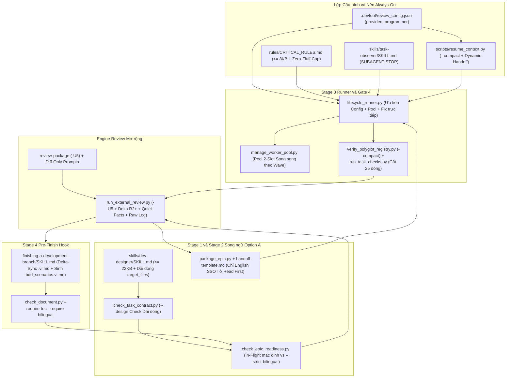

# Thiết kế Cấp cao: Tối ưu hóa Token toàn diện (HLD)

## Mục lục

- [Meta Data](#meta-data)
- [Bối cảnh](#bối-cảnh)
- [Mục tiêu và Phi mục tiêu](#mục-tiêu-và-phi-mục-tiêu)
- [Kiến trúc và Thiết kế Kỹ thuật](#kiến-trúc-và-thiết-kế-kỹ-thuật)
- [Bản đồ Bảo trì Tính năng](#bản-đồ-bảo-trì-tính-năng)
- [Hợp đồng Module và Giao diện CLI](#hợp-đồng-module-và-giao-diện-cli)
- [Phân tích Tác động](#phân-tích-tác-động)
- [Tác động Shared Contract](#tác-động-shared-contract)
- [Kế hoạch Kiểm thử Tích hợp và Ma trận Ranh giới](#kế-hoạch-kiểm-thử-tích-hợp-và-ma-trận-ranh-giới)
- [Môi trường Kiểm thử](#môi-trường-kiểm-thử)
- [Phạm vi Kịch bản BDD toàn diện](#phạm-vi-kịch-bản-bdd-toàn-diện)
- [Chiến lược Triển khai và Giảm thiểu Rủi ro](#chiến-lược-triển-khai-và-giảm-thiểu-rủi-ro)
- [Phân rã Kanban Tasks](#phân-rã-kanban-tasks)
- [Đính chính Đặc tả](#đính-chính-đặc-tả)

## Meta Data

- **Epic name**: `token_throttling_optimization`
- **Status**: Draft
- **PIC**: `danhdue`
- **Target release**: Next plugin release
- **Platform**: Python tooling and agent workflow kit
- **Depends on epic**: none
- **Source Spec**: [Đặc tả Thiết kế Tối ưu hóa Token được Phê duyệt](2026-11-13-token-throttling-optimization-design.vi.md)

## Bối cảnh

Đo kiểm thực tế trên `dev-lifecycle` (cả Interactive và `--autonomous`) cho thấy context phình theo hàm bậc hai và cạn quota 5 giờ nhanh chóng do 5 nguyên nhân kết hợp:

1. **Chi phí nền cố định**: `rules/CRITICAL_RULES.md` (`32,773` bytes / `239` dòng) vượt ngưỡng cắt của IDE (`<truncated 8848 bytes>`), `skills/task-observer/SKILL.md` (`31,480` bytes) nạp vào mọi subagent/CLI mà thiếu thẻ chặn, và `scripts/resume_context.py` đổ `26,759` bytes qua tất cả repo.
2. **Phình Context bậc hai khi External Review**: `run_external_review.py` truyền lặp full diff `base...sha` cùng `delta_round_context()` từ Round `2+`, kèm dư thừa các file `*.vi.md`, đổ toàn văn output `fact()` khi `exit 0`, dùng `-U10` trong `review-package`, và nhúng nguyên `stderr` CLI vào `principal_review.md` (tới `1.88 MB`).
3. **Quality Gates quá dài và không cắt traceback**: `verify_polyglot_registry.py` in nguyên JSON khi `PASS`; `.agents/quality/python-quality.json` và `scaffold_quality_manifest.py` thiếu `-q --tb=short --maxfail=3`; `run_task_checks.py` giữ `40` dòng; `lifecycle_runner.py` và `verify.sh` thiếu chế độ compact và cắt 25 dòng cuối khi lỗi.
4. **Đọc thô, Chạy tuần tự và Hardcode Model cũ**: Task thiếu neo symbol/dải dòng cho file >200 dòng; `lifecycle_runner.py` gọi `agy` tuần tự với prompt dán nội dung và hardcode `gemini-3.8-flash` thay vì đọc config `gemini-4-hydrogen-xhigh` (`--effort xhigh`); `step_cross_model_review()` gọi thừa 3 lượt LLM cho bug code thuần `Valid`; `task-reviewer` chạy cả cho task nhỏ.
5. **Dịch lại Song ngữ nhiều lần**: Phải duy trì Spec, HLD và Gherkin `.vi.md` song song suốt các vòng Principal Review trước khi bản tiếng Anh hội tụ.

## Mục tiêu và Phi mục tiêu

### Mục tiêu

- Áp dụng cơ học 5 Quy tắc siết Token trên toàn bộ runner scripts, công cụ verification, prompts, rules và skills ở cả Phase 1 (scripts cơ học) và Phase 2 (slimming, khử trùng lặp, task schema).
- Triển khai Luồng Song ngữ Option A: giữ Spec và HLD `.vi.md` để con người review tại Gate 1/2, loại bỏ mọi `*.vi.md` khỏi luồng AI review/coding, mặc định dung sai trôi `.vi.md` & hoãn `bdd_scenarios.vi.md` trong `check_epic_readiness.py`, và đồng bộ một lần ở Stage 4 Pre-Finish với `--strict-bilingual`.
- Kích hoạt `task-reviewer` chọn lọc chỉ cho task rủi ro cao hoặc chạm nhiều module (`review_tier: "full"`, labels `security|architecture|concurrency|contract`, hoặc `> 2` module non-test).
- Cấu hình Role 2.3 (AI Programmer) qua `.devtool/review_config.json["providers"]["programmer"]` và thứ tự ưu tiên trên `RunnerConfig`, nâng mặc định lên `gemini-4-hydrogen-xhigh` và ánh xạ effort (`"extra"` / `"extra-high"` / `"xhigh"` -> `--effort xhigh`).
- Áp đặt giới hạn kích thước đo được (`CRITICAL_RULES.md <= 8192` bytes, `dev-designer/SKILL.md <= 22528` bytes, `resume_context.py --compact --epic <slug> <= 4096` bytes) và giữ nguyên toàn bộ kiểm định phát hành (`scripts/verify.sh --full`).

### Phi mục tiêu

- Bỏ qua hoặc tự duyệt thay con người tại Gate 1 (Spec), Gate 2 (Task Breakdown), Gate 5 (Finish và Merge).
- Tắt full test suite hay `@quality_check` ở Final Convergence Gate và Stage 4 `verify-tier`.
- Tự động push commit hoặc branch khi chưa có lệnh xác nhận rõ ràng của người dùng.
- Thay đổi nhãn hiển thị quota bucket (`Gemini 3.8 / Pro 5H`) trong `scripts/agy_quota.py` và `quota_dashboard.html`.

## Kiến trúc và Thiết kế Kỹ thuật

### Kiến trúc Tổng quan



### Luồng Hội tụ Review và Điều phối Worker Chọn lọc

```mermaid
sequenceDiagram
    autonumber
    actor Dev as Developer (Role 2.1)
    participant Des as dev-designer / Readiness
    participant Rev as run_external_review.py
    participant Run as lifecycle_runner.py
    participant Pool as Worker Pool 2-Slot / Subagent

    Des->>Rev: HLD .en.md + bdd_scenarios.en.md + Tasks (loại bỏ .vi.md)
    Rev->>Rev: Chạy check_epic_readiness.py (Option A in-flight) + Delta -U5
    Rev-->>Rev: Tách transcript stderr sang build/reviews/<epic>_roundN.raw.log
    Dev->>Run: Chốt Gate 2 -> AUTO MODE (Claude -> Codex -> Kiro -> Argon)
    Run->>Run: Lấy model Programmer (gemini-4-hydrogen-xhigh, --effort xhigh)
    Run->>Pool: Điều phối wave task độc lập chỉ truyền path + dải dòng mục tiêu
    Pool-->>Run: Commit task + Selective task-reviewer (chỉ task rủi ro cao)
    Run->>Run: verify_polyglot_registry.py --compact -> GATE_PASS hoặc 25 dòng lỗi
    Run->>Rev: Cross-Model Review (Round 1 -U5; Round 2..3 chỉ delta prev_sha..sha)
    alt Lỗi code rõ ràng không chạm contract
        Run->>Pool: Programmer sửa trực tiếp + scoped test + đuôi 25 dòng
    else Nghi ngờ contract hoặc kiến trúc
        Run->>Run: Đánh giá fix_plan_roundN.md qua Role 2.2
    end
    Run->>Dev: Hội tụ + Gate 4 PASS -> Mời chọn Gate 5 Finish Decision
    Dev->>Des: Stage 4 Pre-Finish Hook (sync .vi.md + check_epic_readiness.py --strict-bilingual)
```

## Bản đồ Bảo trì Tính năng

| Tính năng | Đường dẫn Chuẩn và Entry Points | Bất biến Cốt lõi và Núm Cấu hình | Hướng dẫn Mở rộng và Gỡ lỗi |
|---|---|---|---|
| **Diff-Only External Review** | `skills/dev-implementation/resources/scripts/run_external_review.py`, `skills/subagent-driven-development/scripts/review-package` | Dùng `git diff -U5`; Round `>= 2` bỏ full diff `base...sha` khi có `delta_round_context`; loại `*.vi.md`; diff lớn vẫn xuất `--stat` + `@@` hunks | Xem full transcript CLI tại `build/reviews/<epic>_round<n>.raw.log`; kiểm tra `MAX_DIFF_LINES` (`1500`) và `MAX_DIFF_BYTES` (`60000`) |
| **Silent Gate 4 và Runners** | `skills/quality_check/resources/scripts/verify_polyglot_registry.py`, `skills/dev-implementation/resources/scripts/run_task_checks.py`, `scripts/verify.sh` | `--compact` in 1 dòng `GATE_PASS: <id>` khi pass và summary + 25 dòng cuối khi fail; `TAIL_LINES = 25`; `pytest -q --tb=short --maxfail=3` trong `python-quality.json` | Đọc full log tại `build/quality/<provider>/<cap>.log`; chạy `bash scripts/verify.sh --full` khi cần log đầy đủ |
| **Bộ bảo vệ Option A Song ngữ** | `skills/dev-implementation/resources/scripts/check_epic_readiness.py`, `check_bdd_traceability.py`, `package_epic.py` | Mặc định dung sai sai lệch `.vi.md` in-flight và hoãn `bdd_scenarios.vi.md`; `--strict-bilingual` kiểm chặt tại Stage 4; `handoff.md` bỏ `*.vi.md` | Truyền `--strict-bilingual` trước khi archive Finish; xem Pre-Finish Hook trong `finishing-a-development-branch/SKILL.md` |
| **Kiểm tra Dải dòng Phẫu thuật** | `skills/dev-implementation/resources/scripts/check_task_contract.py`, `skills/dev-designer/SKILL.md` | File tracked >200 dòng trong `Allowed files` (không gắn `(new)`) phải có neo `path :: Symbol (L<start>-L<end>)` dưới `--design` | Xem thông báo lỗi `check_task_contract.py --design` khi thêm file >200 dòng thiếu vùng đọc mục tiêu |
| **Programmer Config và Pool** | `skills/dev-lifecycle/resources/scripts/lifecycle_runner.py`, `manage_worker_pool.py`, `scripts/resume_context.py` | Thứ tự `CLI -> Runner config -> .devtool/review_config.json -> env -> fallback ("gemini-4-hydrogen-xhigh", "xhigh")`; `"extra"` ánh xạ thành `--effort xhigh` | Chỉnh `.devtool/review_config.json["providers"]["programmer"]` mà không sửa code; xem `PipelineState` tại `.devtool/state/<epic>.pipeline.json` |
| **Rút gọn Rules và Memory** | `rules/CRITICAL_RULES.md`, `skills/task-observer/SKILL.md`, `skills/dev-designer/SKILL.md`, `skills/dev-lifecycle/references/` | `CRITICAL_RULES.md <= 8192` bytes; `dev-designer/SKILL.md <= 22528` bytes; `task-observer/SKILL.md` có `<SUBAGENT-STOP>`; `resume_context.py --compact --epic <slug> <= 4096` bytes | Chạy `bash scripts/verify.sh` và `scripts/test_lifecycle_document_contract.py` sau khi sửa tài liệu/tách reference |
| **Selective Task Reviewer** | `skills/dev-designer/SKILL.md`, `skills/dev-implementation/SKILL.md`, `skills/subagent-driven-development/SKILL.md` | Chỉ kích hoạt `task-reviewer` khi `review_tier: "full"`, nhãn `security|architecture|concurrency|contract`, hoặc `> 2` module non-test | Gắn `review_tier: "full"` trong frontmatter task khi cần review riêng từng task |

## Hợp đồng Module và Giao diện CLI

Các giao diện và hợp đồng hành vi sau được cố định cho giai đoạn triển khai:

1. **External Review và Cấu hình Mặc định (`run_external_review.py`)**:
   - `DEFAULT_REVIEW_CONFIG["providers"]` bổ sung `"assistant"` (`"claude-opus-5-5-high"`, `"high"`) và `"programmer"` (`"gemini-4-hydrogen-xhigh"`, `"xhigh"`).
   - `load_review_config(root: Path) -> dict[str, Any]` bổ sung provider còn thiếu và nâng cấp các giá trị mặc định cũ của programmer (`"gemini-3.8-flash"`, `"gemini-3.8-flash-high"`) sang `"gemini-4-hydrogen-xhigh"` với `"thinking_level": "xhigh"`, nhưng giữ nguyên mọi model do người dùng tự đặt.
   - `build_diff_section(...)` và `diff_range(...)`: dùng `git diff -U5`; khi vượt ngưỡng dung lượng/số dòng, xuất `git diff --stat` kèm danh sách hunk headers (`@@ ... @@`) cho từng file sửa thay vì để rỗng.
   - `principal_artefact_lines(root, epic_dir)`: loại bỏ toàn bộ `*.vi.md`.
   - `fact(label, code, out, err)`: trả `f"PASS: {label}\n"` khi `code == 0`, hoặc lệnh và 25 dòng cuối output khi khác `0`/timeout.
   - `render_round(...)`: tách transcript đầy đủ ra `build/reviews/<epic>_round<n>.raw.log` và chèn một dòng trỏ file log trong markdown (giữ nguyên cột bảng tương thích `rounds_in` / `finding_rows` / `triage`).
   - `run(args)`: khi `round_num >= 2` và `delta_round_context()` hoạt động (`not args.full`), bỏ `diff_section` (`base...sha`) và chỉ giữ 1 dòng tham chiếu thống kê lũy kế.

2. **Compact Quality Gates và Runners (`verify_polyglot_registry.py`, `run_task_checks.py`, `verify.sh`)**:
   - `verify_polyglot_registry.py` nhận cờ `--compact`: lưu log chi tiết vào `build/quality/<provider>/<cap>.log`, in 1 dòng `GATE_PASS: <id>` khi pass, hoặc in tên capability lỗi + 25 dòng cuối từ `.log` khi fail.
   - `run_task_checks.py` đặt `TAIL_LINES = 25`.
   - `.agents/quality/python-quality.json` và `scaffold_quality_manifest.py` bổ sung `"-q", "--tb=short", "--maxfail=3"` cho pytest.
   - `scripts/verify.sh` thêm `--quiet` (1 dòng/mục, cắt đuôi 25 dòng khi lỗi) mà vẫn giữ nguyên `--full`.

3. **Kiểm tra Option A, Dải dòng Phẫu thuật và Memory gọn**:
   - `check_epic_readiness.py` và `check_bdd_traceability.py` thêm `--strict-bilingual` (mặc định `False` trong vòng lặp Stage 2/3, bỏ qua sai lệch `.vi.md` và `bdd_scenarios.vi.md`; `--strict-bilingual` ép đồng bộ đầy đủ ở Stage 4).
   - `package_epic.py` và `handoff-template.md` chỉ liệt kê `.en.md` / tài liệu tiếng Anh trong `Read First`.
   - `check_task_contract.py --design` kiểm tra file tracked >200 dòng (không gắn `(new)`) trong `Allowed files` phải có neo symbol/dải dòng (`:: <Symbol> (L<start>-L<end>)` hoặc `(L<start>-L<end>)`).
   - `scripts/resume_context.py` bổ sung `--compact` (mặc định kích hoạt khi truyền `--epic <slug>`), chỉ xuất state epic đang chạy, git status repo hiện tại, RFC liên quan và task thuộc epic (`<= 4096` bytes); `emit_handoff_prompt` đọc `.devtool/review_config.json["providers"]["programmer"]` với fallback `gemini-4-hydrogen-xhigh` (`xhigh`).

4. **Lifecycle Runner và Programmer Config (`lifecycle_runner.py`)**:
   - `RunnerConfig` đổi fallback sang `"gemini-4-hydrogen-xhigh"` / `"xhigh"`, thêm `normalize_agy_effort(raw: str) -> str` ánh xạ `{"extra", "extra-high", "extra_high", "xhigh"}` -> `"xhigh"`, và thêm `resolve_programmer_model()` cùng `resolve_programmer_effort()` theo thứ tự:
     `CLI (--programmer-model / --programmer-effort) -> Runner --config JSON -> .devtool/review_config.json["providers"]["programmer"] -> env (AGY_PROGRAMMER_MODEL / AGY_PROGRAMMER_EFFORT) -> fallback ("gemini-4-hydrogen-xhigh", "xhigh")`.
   - `main()` đặt default `None` cho `--programmer-model` và `--programmer-effort` trên `argparse` để không ghi đè file config.
   - `_tail_lines(text: str, limit: int = 25) -> str` cắt gọn output lỗi cho `run_gate4()` và `run_intermediate_check()`.
   - `step_implementation()` dùng `manage_worker_pool.py` chạy song song các wave độc lập; `_execute_single_task()` chỉ truyền path + kỷ luật đọc giới hạn dòng + Zero-Fluff output cap.
   - `step_cross_model_review()` cho phép sửa trực tiếp qua `_apply_code_fixes()` với lỗi code rõ ràng không chạm contract/kiến trúc, chỉ gọi `_draft_fix_plan()` + `evaluate_programmer_fix_plan()` khi có xung đột thiết kế.
   - `render_final_executive_report()` phân tích findings rủi ro cao và SHA thực từ `review_results.md` / `principal_review.md`.

## Phân tích Tác động

- Kết quả `check_code_impact.py --files ... --base-ref main`:
  - **Xung đột Git Upstream**: `CLEAN` (`0` commit chưa merge so với `main`).
  - **Cross-Platform Bridges**: Không có.
  - **Lưới an toàn Test**: Đã có bộ unit/integration tests cho `resume_context.py`, `run_external_review.py`, `lifecycle_runner.py`, `verify_polyglot_registry.py` và `check_epic_readiness.py`; `rules/CRITICAL_RULES.md` và skill docs được bảo vệ bởi `scripts/test_lifecycle_document_contract.py` cùng `scripts/verify.sh` §3/§5b/§7/§8.

## Tác động Shared Contract

None — self-contained feature. Kho mã `ai-agent-tools` không dùng thư mục `shared-contracts/`; mọi cờ CLI nội bộ mới (`--compact`, `--strict-bilingual`, `--quiet`, `--programmer-effort`) tương thích ngược hoàn toàn qua giá trị mặc định.

## Kế hoạch Kiểm thử Tích hợp và Ma trận Ranh giới

```text
Integration test roots: tests
Protected paths: .agents/quality/**, .devtool/epic/token_throttling_optimization/bdd_scenarios.en.md, .devtool/epic/token_throttling_optimization/bdd_scenarios.vi.md
Integration results: python3 -m pytest -q --tb=short --maxfail=3 --junitxml=build/test-results/token-throttling-optimization.xml tests/test_tto_external_review.py tests/test_polyglot_gate4.py tests/test_tto_bilingual_and_surgical.py tests/test_lifecycle_runner.py tests/test_tto_docs_and_slimming.py tests/test_token_throttling_acceptance.py -> build/test-results/token-throttling-optimization.xml
```

| Ranh giới | Thành phần Thực | Cách ly hoặc Fixture | Khẳng định Bắt buộc |
|---|---|---|---|
| **Diff-Only External Review** | `run_external_review.py`, `review-package` | Repo git tạm nhiều vòng review và binary CLI giả lập trên `PATH` | Diff `-U5`, Round 2 bỏ full `base...sha`, loại `.vi.md`, fact `PASS:` 1 dòng, ghi `build/reviews/*.raw.log` |
| **Compact Gate 4 và Runners** | `verify_polyglot_registry.py`, `run_task_checks.py`, `scaffold_quality_manifest.py`, `verify.sh` | Manifest tạm + mã thoát giả lập (`0` và `1`) | `--compact` in `GATE_PASS:` khi đạt và summary + `<= 25` dòng khi lỗi; `TAIL_LINES == 25`; cờ pytest chuẩn |
| **Option A và Kiểm tra Dải dòng** | `check_epic_readiness.py`, `check_bdd_traceability.py`, `check_task_contract.py`, `package_epic.py`, `resume_context.py` | Thư mục epic tạm với `.en.md`/`.vi.md` lệch, thiếu `bdd_scenarios.vi.md`, file >200 dòng | Mặc định in-flight pass khi thiếu `bdd_scenarios.vi.md`; `--strict-bilingual` fail khi chưa sync; check neo dòng; `--compact <= 4096` B |
| **Programmer Config và Pool** | `lifecycle_runner.py`, `manage_worker_pool.py` | `agy` giả lập + repo git tạm + pool worktree 2-slot | Phân giải `gemini-4-hydrogen-xhigh`, chuẩn hóa `"extra"` -> `"xhigh"`, prompt chỉ truyền path, wave song song, report động |
| **Rút gọn Docs và Contracts** | `CRITICAL_RULES.md`, `dev-designer/SKILL.md`, `task-observer/SKILL.md`, `finishing-a-development-branch/SKILL.md` | Các file thật trong repo qua `verify.sh` | `CRITICAL_RULES.md <= 8192` B, `dev-designer/SKILL.md <= 22528` B, `<SUBAGENT-STOP>`, pass đủ `verify.sh` §1–§10 |

## Môi trường Kiểm thử

- Mọi unit và integration tests chạy trong thư mục tạm cô lập (`tempfile.TemporaryDirectory` / pytest `tmp_path`) cùng repo git ảo và CLI giả trên `PATH`.
- Không dùng API key thật, không gọi mạng ngoài và không sửa hồ sơ Antigravity thật của người dùng.
- File JUnit XML chỉ ghi vào `build/test-results/` và log thô vào `build/reviews/`, `build/quality/` (đã git-ignore).
- `.devtool/review_config.json` cục bộ của workspace không bị ghi đè bởi test; test chỉ thao tác trên bản trong `tmp_path`.

## Phạm vi Kịch bản BDD toàn diện

Định nghĩa Gherkin chuẩn nằm tại [BDD scenarios](bdd_scenarios.en.md) cùng bản dịch đồng bộ tại [Kịch bản BDD tiếng Việt](bdd_scenarios.vi.md).

| Chiều kiểm thử | Mã kịch bản | Mục tiêu bao phủ |
|---|---|---|
| **Happy Paths** | `TTO-HP-01` đến `TTO-HP-08` | Review delta `-U5`, Gate 4 `--compact`, Option A in-flight, Programmer config `gemini-4-hydrogen-xhigh` (`xhigh`), slimming rules/skills, `--compact` memory, fast code-fix, kiểm thử E2E |
| **Edge Cases và Boundaries** | `TTO-EC-01` đến `TTO-EC-06` | Truncated diff kèm `--stat` + `@@` hunks, `TAIL_LINES=25` + pytest flags, check dải dòng file >200 dòng, chuẩn hóa effort alias, điều kiện `task-reviewer`, full `verify.sh` §1–§17 |
| **State Transitions và Invariants** | `TTO-ST-01` đến `TTO-ST-05` | Di trú `load_review_config`, loại `.vi.md` khỏi `handoff.md`, `--strict-bilingual` Gate 5, leo thang Role 2.2 khi đụng contract, Pre-Finish sync hook ở Stage 4 |
| **Async và Concurrency** | `TTO-AR-01` đến `TTO-AR-02` | Chạy song song theo wave trên `manage_worker_pool.py`, cách ly `.raw.log` theo round và sạch context giữa các task |
| **Failure và Resilience** | `TTO-FR-01` đến `TTO-FR-04` | Đuôi 25 dòng lỗi trong `collect_facts`, `--compact` Gate 4 fail 25 dòng, `_tail_lines` fail, ngưỡng byte-size chống phình hồi quy |

## Chiến lược Triển khai và Giảm thiểu Rủi ro

1. **Wave 1 (Nền tảng Độc lập — Task 1, 2, 3)**: Triển khai Diff-Only External Review (`run_external_review.py`, `review-package`), Compact Gate 4 & Runners (`verify_polyglot_registry.py`, `run_task_checks.py`, `verify.sh --quiet`), và Option A / Surgical Contract / Scoped Memory (`check_epic_readiness.py`, `check_task_contract.py`, `resume_context.py`).
2. **Wave 2 (Điều phối và Slimming — Task 4, 5)**: Triển khai Config-Driven `lifecycle_runner.py` (`gemini-4-hydrogen-xhigh`, `--effort xhigh`, wave song song, fast code-fix) song song với Rút gọn Rules/Skills, Khử trùng lặp Reference và Stage 4 Pre-Finish Hook.
3. **Wave 3 (Tích hợp và Đo kiểm — Task 6)**: Bổ sung regression suite định lượng (`test_token_throttling_acceptance.py`), đăng ký các suite mới vào `scripts/verify.sh`, chạy toàn bộ kiểm định phát hành.

Giảm thiểu rủi ro: Mọi cờ rút gọn (`--compact`, `--quiet`) đều giữ đường fallback đầy đủ (`--full`), và `--strict-bilingual` là opt-in ở Stage 4 nên hoàn toàn tương thích ngược với các workflow đang chạy.

## Phân rã Kanban Tasks

1. **Task 1: Review Mở rộng chỉ theo Diff và Cách ly Transcript** (`task_01_diff_only_external_review_and_transcript_isolation.md`) — Bao phủ: `TTO-HP-01, TTO-EC-01, TTO-ST-01, TTO-FR-01`
2. **Task 2: Gate 4 Im lặng và Cắt gọn Output Bộ chạy Kiểm thử** (`task_02_silent_gate4_and_truncated_test_runners.md`) — Bao phủ: `TTO-HP-02, TTO-EC-02, TTO-FR-02`
3. **Task 3: Bảo vệ Song ngữ Option A, Kiểm tra Phẫu thuật và Bộ nhớ Gọn** (`task_03_option_a_bilingual_and_surgical_contract_guards.md`) — Bao phủ: `TTO-HP-03, TTO-HP-06, TTO-EC-03, TTO-ST-02, TTO-ST-03`
4. **Task 4: Programmer Persona qua Config, Worker Pool và Tối ưu Runner** (`task_04_lifecycle_runner_programmer_config_and_pool_isolation.md`) — Bao phủ: `TTO-HP-04, TTO-HP-07, TTO-EC-04, TTO-ST-04, TTO-AR-01, TTO-FR-03`
5. **Task 5: Rút gọn Rules và Skills, Khử trùng lặp, Selective Reviewer và Sync Stage 4** (`task_05_slimming_rules_skills_dedup_and_selective_reviewer.md`) — Bao phủ: `TTO-HP-05, TTO-EC-05, TTO-ST-05`
6. **Task 6: Bộ Kiểm thử Chấp nhận và Hồi quy Định lượng Token Throttling** (`task_06_integration_and_regression_verification.md`) — Bao phủ: `TTO-HP-08, TTO-EC-06, TTO-AR-02, TTO-FR-04`

## Đính chính Đặc tả

Chưa có.
