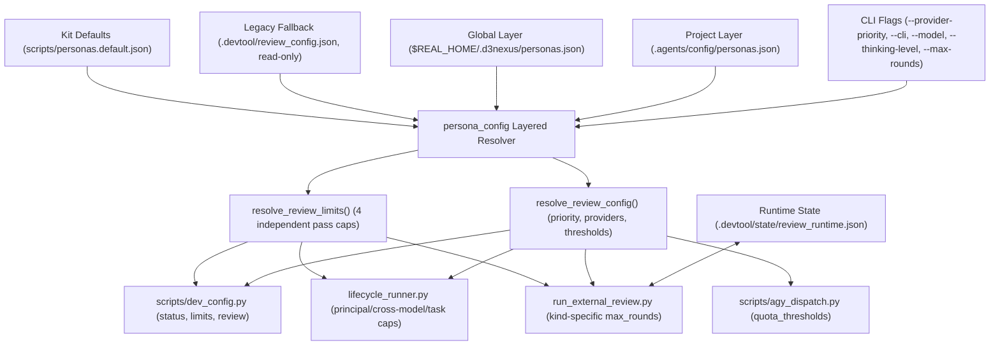

# Unified External Review Configuration and Pass Limits in dev-config

- **Date**: 2026-11-28
- **Status**: Approved
- **PIC**: tess
- **Epic Slug**: `unified_review_config`
- **Target Repository**: `ai-agent-tools` (`d3nexus` plugin)

## Table of Contents

- [1. Problem Statement and Goals](#1-problem-statement-and-goals)
- [2. Shared Contract Warnings](#2-shared-contract-warnings)
- [3. Architecture and Resolution Precedence](#3-architecture-and-resolution-precedence)
- [4. Schema Specification and Validation Rules](#4-schema-specification-and-validation-rules)
- [5. CLI Specification for dev-config](#5-cli-specification-for-dev-config)
- [6. Runtime Integration Across Consumers](#6-runtime-integration-across-consumers)
- [7. Runtime State Isolation and Legacy Migration](#7-runtime-state-isolation-and-legacy-migration)
- [8. Error Handling and Edge Cases](#8-error-handling-and-edge-cases)
- [9. Dependencies, Risks, and Non-Goals](#9-dependencies-risks-and-non-goals)
- [10. Verification and Testing Plan](#10-verification-and-testing-plan)

## 1. Problem Statement and Goals

External review settings for `/principal-review` and `/cross-model-review` currently live outside the layered `dev-config` system in a single per-repository file (`.devtool/review_config.json`), while persona bindings, model catalogue entries, and task-level pass caps (`max_task_review_passes`, `max_fix_passes`) live in the three-layer `personas.json` configuration (`kit` -> `global` -> `project`). This split creates four concrete problems:

1. **No Global Scope for Review Settings**: Changing reviewer `provider_priority`, provider models, or `quota_thresholds` requires editing `.devtool/review_config.json` independently in every repository (`D3Nexus`, `lyrics-sync`, `ai-agent-tools`, etc.).
2. **Coupled Round Cap**: `/principal-review` and `/cross-model-review` share a single `max_rounds` integer (`3`), preventing teams from capping design-review passes separately from code-review passes.
3. **Hardcoded Quota Thresholds in External Review**: `evaluate_provider_quota()` in `skills/dev-implementation/resources/scripts/run_external_review.py` reads the module-level `QUOTA_THRESHOLDS` constant instead of resolved configuration thresholds.
4. **Working-Tree Pollution**: `run_external_review.py` auto-seeds and rewrites `.devtool/review_config.json` with runtime state (`last_used_provider`) and provider defaults, causing unexpected dirty diffs and masking global intent.

### Goals

- Unify external review configuration (`provider_priority`, per-provider model/effort/host, `quota_thresholds`) and all four pass limits (`max_task_review_passes`, `max_fix_passes`, `max_principal_review_passes`, `max_cross_model_review_passes`) under `personas.json` (`schema_version: 1`) across `kit` -> `global` -> `project` layers plus CLI flags.
- Preserve all existing default values (`max_task_review_passes=2`, `max_fix_passes=1`, `max_principal_review_passes=3`, `max_cross_model_review_passes=3`, `provider_priority=["claude", "codex", "kiro", "agy"]`, existing quota thresholds).
- Keep `provider_priority` shared across `/principal-review` and `/cross-model-review`, while managing all four pass limits independently.
- Support both catalogue aliases and raw model IDs for review providers, and isolate runtime `last_used_provider` in `.devtool/state/review_runtime.json`.
- Maintain non-breaking read-only backward compatibility with existing `.devtool/review_config.json` files.

## 2. Shared Contract Warnings

`shared-contracts/` is absent in `ai-agent-tools`; this repository is the standalone agent kit plugin and defines no cross-repository wire contracts. No shared contract drift or warning decisions apply.

## 3. Architecture and Resolution Precedence

All configuration resolution flows through `scripts/persona_config.py` as the single source of truth, eliminating duplicated `.devtool/review_config.json` parsing across `dev_config.py`, `agy_dispatch.py`, `run_external_review.py`, and `lifecycle_runner.py`.



### Layer Precedence

For every individual key (`provider_priority`, each `review.providers.<cli>`, each `review.quota_thresholds.<k>`, and each `max_*_passes`), precedence from highest to lowest is:

1. **CLI flags**: explicit command-line overrides for a single invocation.
2. **Project layer**: `.agents/config/personas.json` (`--scope project`).
3. **Global layer**: `$REAL_HOME/.d3nexus/personas.json` (`--scope global`, default write scope).
4. **Legacy repository fallback**: `.devtool/review_config.json` (read-only; used **only** for a key absent from both Project and Global layers).
5. **Kit defaults**: `scripts/personas.default.json`.

> [!IMPORTANT]
> Ranking `global` above legacy `.devtool/review_config.json` is intentional. Most existing repositories contain an auto-seeded `.devtool/review_config.json` with default values; ranking legacy above `global` would cause global `/dev-config review` updates to be silently ignored in existing repositories. Repositories that genuinely need a repo-specific override use `--scope project` (`.agents/config/personas.json`).

## 4. Schema Specification and Validation Rules

All additions to `personas.json` are strictly additive under `schema_version: 1`. Existing `personas.json` files remain valid without migration.

### Kit Defaults (`scripts/personas.default.json`)

```json
{
  "max_task_review_passes": 2,
  "max_fix_passes": 1,
  "max_principal_review_passes": 3,
  "max_cross_model_review_passes": 3,
  "review": {
    "provider_priority": ["claude", "codex", "kiro", "agy"],
    "quota_thresholds": {
      "5h_min_fraction": 0.15,
      "7d_min_fraction": 0.02,
      "kiro_min_fraction": 0.03,
      "kiro_min_credits": 15.0,
      "agy_argon_min_fraction": 0.1
    },
    "providers": {
      "claude": {
        "model": "claude-opus",
        "effort": "high"
      },
      "codex": {
        "model": "codex-gpt",
        "effort": "high"
      },
      "kiro": {
        "model": "kiro-opus",
        "effort": "high"
      },
      "agy": {
        "model": "argon",
        "effort": "high"
      },
      "ollama": {
        "model": "gemma4:31b-it-qat",
        "effort": "high",
        "host": "http://localhost:11434"
      }
    }
  }
}
```

### Allowed Keys and Validation

`_ALLOWED_TOP_KEYS` in `scripts/persona_config.py` adds `max_principal_review_passes`, `max_cross_model_review_passes`, and `review`.

| Field | Allowed Type and Domain | Default |
|---|---|---|
| `max_task_review_passes` | `int >= 1` (`bool` rejected) | `2` |
| `max_fix_passes` | `int >= 0` (`bool` rejected) | `1` |
| `max_principal_review_passes` | `int >= 1` (`bool` rejected) | `3` |
| `max_cross_model_review_passes` | `int >= 1` (`bool` rejected) | `3` |
| `review.provider_priority` | Non-empty list of unique strings in `{"claude", "codex", "kiro", "agy"}` | `["claude", "codex", "kiro", "agy"]` |
| `review.quota_thresholds.*` | Known keys only (`5h_min_fraction`, `7d_min_fraction`, `kiro_min_fraction`, `agy_argon_min_fraction` in `[0.0, 1.0]`; `kiro_min_credits >= 0.0`) | Kit defaults above |
| `review.providers.<cli>` | `<cli>` in `{"claude", "codex", "kiro", "agy", "ollama"}`; keys in `{"model", "effort", "thinking_level", "host"}` (`host` allowed only for `ollama`, must begin with `http://` or `https://`) | Kit defaults above |

### Alias-or-Raw Model Resolution

When resolving `review.providers.<cli>`:

1. **Effort normalization**: Read `effort` first, falling back to legacy `thinking_level` when reading legacy or hand-edited files. Allowed efforts: `{"none", "light", "low", "medium", "high", "xhigh", "extra-high"}`. Writes via `dev-config` always emit `effort`.
2. **Catalogue alias match**: If `model` matches an alias in the merged `models` catalogue:
   - Verify `models[alias]["cli"] == cli`; mismatch raises `PersonaConfigError`.
   - If the alias defines `efforts == ["none"]`, resolved `model_id` is `models[alias]["id"]` and effective `effort` is `"none"`.
   - Otherwise, expand `{effort}` inside `models[alias]["id"]` using the provider's effective effort (rejecting efforts not in `models[alias]["efforts"]` when `{effort}` template substitution is required).
3. **Raw model ID fallback**: If `model` is not a catalogue alias, pass the trimmed non-empty string through verbatim as `model_id` (enabling arbitrary Ollama tags such as `gemma4:31b-it-qat` or direct provider model IDs such as `gemini-4-carbon-high` or `opus`).
4. **Catalogue removal guard**: `dev_config.py models remove <alias>` checks both persona bindings and merged `review.providers.*` references, refusing removal while any review provider references the alias.

## 5. CLI Specification for dev-config

All mutating commands accept `--scope global|project` (defaulting to `global`) and emit a masking warning whenever a `--scope global` write is overridden by `.agents/config/personas.json`.

### Updated `status` Subcommand

```bash
python3 scripts/dev_config.py status [--json]
```

- Human-readable output includes:
  - A unified pass-limits line showing all four limits and their resolved source layers (`kit`, `global`, `project`, or `legacy`).
  - Shared `External review priority` with source layer.
  - A compact 5-row external review providers table (`Provider`, `Model`, `Resolved ID`, `Effort`, `Host`, `Source`).
- `--json` output preserves `task_review_limits` (`max_task_review_passes`, `max_fix_passes`) for backward compatibility and adds:
  - `review_limits`: all four pass caps plus `sources` map.
  - `review`: `provider_priority`, `providers` (including `model`, `model_id`, `effort`, optional `host`, `source`), `quota_thresholds`, `last_used_provider`, and `sources` map.

### New `limits` Subcommand

```bash
python3 scripts/dev_config.py limits [--json]
python3 scripts/dev_config.py limits [--task-review N] [--fix N] [--principal-review N] [--cross-model-review N] [--scope global|project]
python3 scripts/dev_config.py limits reset [task|fix|principal|cross-model|all] [--scope global|project]
```

- With no flags (or only `--json`), displays all four limits and their source layers.
- With one or more limit flags, validates and updates only the specified keys in the target scope.
- `limits reset` removes the chosen key(s) from the target scope file so resolution falls back to lower layers.

### New `review` Subcommand

```bash
python3 scripts/dev_config.py review status [--json]
python3 scripts/dev_config.py review priority PROVIDER_LIST [--scope global|project]
python3 scripts/dev_config.py review set PROVIDER --model M [--effort E] [--host URL] [--scope global|project]
python3 scripts/dev_config.py review thresholds [--5h F] [--7d F] [--kiro-frac F] [--kiro-credits N] [--argon F] [--scope global|project]
python3 scripts/dev_config.py review reset [priority|providers|PROVIDER|thresholds|all] [--scope global|project]
```

- `review priority`: Accepts either a single comma-separated argument (`claude,codex,kiro,agy`) or multiple positional provider arguments (`claude codex kiro agy`).
- `review set`: Validates `PROVIDER` in `{"claude", "codex", "kiro", "agy", "ollama"}`. If `--model` matches a catalogue alias, validates CLI ownership and effort compatibility; if `--effort` is omitted, defaults to `"none"` for fixed-effort aliases or preserves the current/default effort (`"high"`). Rejects `--host` on non-`ollama` providers.
- `review thresholds`: Requires at least one threshold flag; validates finite floats in domain bounds.
- `review reset`: Removes targeted sub-keys under `review` in the target scope file and prunes empty parent dicts cleanly.

## 6. Runtime Integration Across Consumers

### `scripts/persona_config.py`

- Export constants: `DEFAULT_MAX_PRINCIPAL_REVIEW_PASSES = 3`, `DEFAULT_MAX_CROSS_MODEL_REVIEW_PASSES = 3`, `REVIEW_PRIORITY_PROVIDERS = ("claude", "codex", "kiro", "agy")`, `REVIEW_PROVIDERS = ("claude", "codex", "kiro", "agy", "ollama")`, `REVIEW_THINKING_LEVELS`.
- Export frozen dataclasses `ReviewLimits`, `ReviewProviderBinding`, and `ResolvedReviewConfig` with helper `max_rounds_for_kind(kind: str) -> int`.
- Export public functions:
  - `resolve_review_limits(project_root: Path, *, real_home: Path | str | None = None) -> ReviewLimits`
  - `resolve_review_config(project_root: Path, *, real_home: Path | str | None = None) -> ResolvedReviewConfig`
  - Keep `resolve_task_review_limits(project_root, *, real_home=None) -> tuple[int, int]` delegating to `resolve_review_limits()`.

### `skills/dev-implementation/resources/scripts/run_external_review.py`

- `load_review_config(root: Path)` loads the resolved config from `persona_config.resolve_review_config(root)` (loading `scripts/persona_config.py` by relative path so standalone invocations work regardless of `PYTHONPATH`) and reads `last_used_provider` from `.devtool/state/review_runtime.json` (falling back to `.devtool/review_config.json` read-only when the runtime file does not exist).
- `evaluate_provider_quota(cli, quota_data, *, thresholds=None)` and `select_provider_by_quota(..., thresholds=None)` accept resolved thresholds from `load_review_config(root)` instead of hardcoding `QUOTA_THRESHOLDS`.
- CLI `--max-rounds` defaults to `None`. When `None`, `cmd_run`, `cmd_check`, and `cmd_triage` resolve `max_rounds` via `resolve_effective_max_rounds(root, kind, cli_max_rounds)`:
  - `kind == "principal"` -> `max_principal_review_passes` (default `3`)
  - `kind in ("code", "epic")` -> `max_cross_model_review_passes` (default `3`)
- `resolve_review_settings()` uses the resolved `provider_priority`, resolved provider `model_id` / `effort`, and runtime `last_used_provider`.

### `scripts/dev_config.py`, `scripts/agy_dispatch.py`, and `lifecycle_runner.py`

- `dev_config.py` (`_load_quota_thresholds`) and `agy_dispatch.py` (`_load_quota_thresholds`) read `quota_thresholds` from `persona_config.resolve_review_config(project_root)` instead of parsing `.devtool/review_config.json` directly.
- `lifecycle_runner.py` (`RunnerConfig` and `LifecycleRunner`) resolves default `provider_priority`, `max_principal_review_passes`, and `max_cross_model_review_passes` from `persona_config` when explicit CLI/runner overrides are not set.

### Skills and Documentation Updates

- Update `skills/dev-config/SKILL.md` invocation mapping and examples with `limits` and `review`.
- Update `skills/principal-review/SKILL.md`, `skills/cross-model-review/SKILL.md`, `skills/dev-lifecycle/SKILL.md`, `rules/CRITICAL_RULES.md` (§5 Gate 2 priority reading), and `docs/dev-config-quick-guide.en.md` to reference `/dev-config review` and `/dev-config limits` as the SSOT while documenting `.devtool/review_config.json` fallback.

## 7. Runtime State Isolation and Legacy Migration

- Runtime state (`last_used_provider` and optional timestamp) is stored atomically in `.devtool/state/review_runtime.json` (which is already under the git-ignored `.devtool/state/` runtime directory).
- `run_external_review.py` no longer auto-seeds `.devtool/review_config.json` during `load_review_config()` and no longer rewrites `.devtool/review_config.json` in `update_sticky_review_config()`.
- `update_sticky_review_config(root, cli, model, thinking_level)` persists only `last_used_provider` into `.devtool/state/review_runtime.json` (never silently overriding configured provider models in `personas.json` or `.devtool/review_config.json`).
- `persona_config.detect_legacy_warnings(project_root)` preserves existing warnings for `providers.programmer` / `providers.assistant` and adds an informational warning when `.devtool/review_config.json` contains review keys (`provider_priority`, `max_rounds`, `quota_thresholds`, or reviewer entries under `providers`) recommending migration to `dev-config review` / `dev-config limits`.

## 8. Error Handling and Edge Cases

- **Invalid config in `personas.json`**: Raises `PersonaConfigError`; `dev_config.py` prints the exact field/file error to stderr and exits `1` without partial writes (writes use `_atomic_write_json` under `fcntl.flock`).
- **Corrupted legacy or runtime JSON**: Malformed `.devtool/review_config.json` or `.devtool/state/review_runtime.json` is ignored safely with fallback to kit defaults so review pipelines never crash on stale state.
- **Explicit `--max-rounds` on CLI**: Always overrides `max_principal_review_passes` / `max_cross_model_review_passes` for that single invocation; must be `>= 1`.
- **Legacy `max_rounds` fallback**: If neither `project` nor `global` sets `max_principal_review_passes` (or `max_cross_model_review_passes`), and legacy `.devtool/review_config.json` defines a valid positive integer `max_rounds`, that value serves as the fallback with source `"legacy"`.
- **Ollama provider without explicit model**: Preserves existing behavior where `run_external_review.py` allows `local_review` auto-discovery when `cli == "ollama"` and no model override is configured, while honoring any model/host explicitly set via `dev-config review set ollama --model ... --host ...`.
- **Standalone execution of `run_external_review.py` outside repo root**: Resolves `scripts/persona_config.py` via `Path(__file__).resolve().parents[4] / "scripts"` so it works whether invoked from `ai-agent-tools` or an installed plugin copy inside another repository.

## 9. Dependencies, Risks, and Non-Goals

### Dependencies

- Standard library Python only (`json`, `dataclasses`, `fcntl`, `tempfile`, `pathlib`); zero new external dependencies.
- Reuses existing `persona_config.py` atomic writer, layer loader, and `dev_config.py` CLI parser conventions.

### Risks and Mitigations

| Risk | Mitigation |
|---|---|
| Existing tests in `skills/dev-implementation/resources/scripts/test_run_external_review.py` expect `.devtool/review_config.json` auto-seeding or sticky overwrites | Update affected tests deliberately to verify read-only legacy fallback plus `.devtool/state/review_runtime.json` persistence, keeping all review-behavior assertions passing |
| Global `personas.json` on developer machines sets a model alias absent from an older project's `models` catalogue | Merged `models` catalogue always includes `kit -> global -> project`, so global aliases are visible in every project; unknown raw IDs pass through safely |
| Cross-repo satellite projects running installed plugin copies | `run_external_review.py` loads `persona_config.py` relative to its own plugin installation path, never assuming `scripts/persona_config.py` exists in the target satellite repo |

### Non-Goals

- Per-kind `provider_priority` overrides (confirmed out of scope: `provider_priority` is shared between `/principal-review` and `/cross-model-review`).
- Changing default pass limits or default provider priority values.
- Adding a web UI editor in `tasks_dashboard.html` for review settings (CLI and JSON layers only in this scope).

## 10. Verification and Testing Plan

1. **Unit Tests (`tests/test_unified_review_config.py`)**:
   - Validate 4 independent pass caps (`max_task_review_passes`, `max_fix_passes`, `max_principal_review_passes`, `max_cross_model_review_passes`) with kit defaults `2`, `1`, `3`, `3` and invalid-value rejection (`0`, negative, `bool`, strings).
   - Verify layer precedence `CLI > project > global > legacy (.devtool/review_config.json) > kit` for priority, providers, thresholds, and limits (explicitly proving global beats auto-seeded legacy `.devtool/review_config.json`).
   - Verify alias expansion (`claude-opus` -> `opus`, `argon` + `high` -> `gemini-4-argon-high`, CLI mismatch rejection) alongside raw ID passthrough (`gemma4:31b-it-qat`, `gemini-4-carbon-high`).
   - Verify `models remove` refuses deletion of an alias referenced by `review.providers.*`.
2. **CLI Tests (`tests/test_unified_review_config.py`)**:
   - Exercise `dev_config.py status [--json]`, `limits [--json | flags | reset]`, and `review status|priority|set|thresholds|reset` across `--scope global` and `--scope project`, including global-masked-by-project warnings and legacy warnings.
3. **External Review & Runner Integration Tests (`skills/dev-implementation/resources/scripts/test_run_external_review.py` and `tests/test_unified_review_config.py`)**:
   - Confirm `--kind principal` uses `max_principal_review_passes` and `--kind code` uses `max_cross_model_review_passes` independently when `--max-rounds` is omitted, while explicit `--max-rounds` wins.
   - Confirm `select_provider_by_quota()` and `dev_config.py quota-check` honor layered `review.quota_thresholds`.
   - Confirm `run_external_review.py` writes `last_used_provider` to `.devtool/state/review_runtime.json` and never mutates `.devtool/review_config.json`.
   - Confirm `lifecycle_runner.py` reads resolved `provider_priority` and separate principal/cross-model round caps.
4. **Full Kit Quality Gate**:
   - Run `python3 skills/quality_check/resources/scripts/verify_polyglot_registry.py .agents/quality/check_quality.json --profile epic --execute --compact` (covering `ruff format --check`, `ruff check`, `mypy`, `pytest`, and `bash scripts/verify.sh`).
