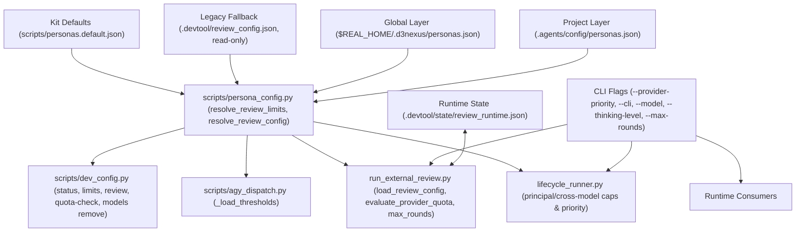
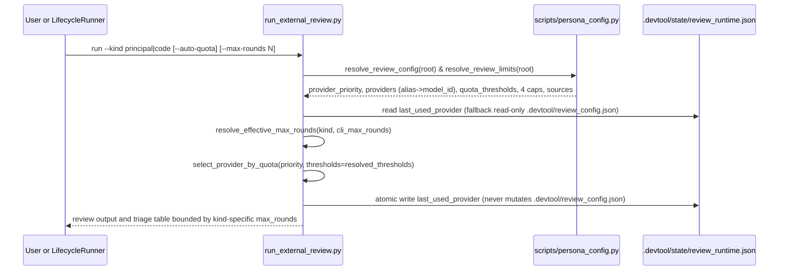

# Unified External Review Configuration and Pass Limits High-Level Design

## Table of Contents

- [Meta Data](#meta-data)
- [Background](#background)
- [Goals and Non-Goals](#goals-and-non-goals)
- [Architecture and Technical Design](#architecture-and-technical-design)
- [Feature Maintenance Map](#feature-maintenance-map)
- [Module Contracts and CLI Interfaces](#module-contracts-and-cli-interfaces)
- [Impact Analysis](#impact-analysis)
- [Shared Contract Impact](#shared-contract-impact)
- [Integration Test Plan and Boundary Matrix](#integration-test-plan-and-boundary-matrix)
- [Verification Environment](#verification-environment)
- [Comprehensive BDD Scenario Coverage](#comprehensive-bdd-scenario-coverage)
- [Rollout Strategy and Mitigation](#rollout-strategy-and-mitigation)
- [Kanban Tasks Breakdown](#kanban-tasks-breakdown)
- [Spec Errata](#spec-errata)

## Meta Data

- **Epic name**: `unified_review_config`
- **Status**: Done
- **PIC**: `tess`
- **Target release**: Next `d3nexus` plugin release
- **Platform**: Python 3 stdlib CLI tooling, layered JSON configuration, and Markdown skills (`ai-agent-tools`)
- **Depends on epic**: none
- **Source Spec**: [Unified External Review Configuration and Pass Limits in dev-config](2026-11-28-unified-review-config-design.md)

## Background

External review configuration for `/principal-review` and `/cross-model-review` is currently split out of `/dev-config` into a single per-repository file (`.devtool/review_config.json`), while persona bindings, model catalogue entries, and task-level pass caps (`max_task_review_passes`, `max_fix_passes`) live in the three-layer `personas.json` stack (`kit` -> `global` -> `project`). Codebase inspection identified four concrete defects caused by this split:

1. **No Global Scope for Review Settings**: `skills/dev-implementation/resources/scripts/run_external_review.py` (`L139-L174`) only reads `.devtool/review_config.json` in the active repo, forcing engineers to duplicate `provider_priority`, provider model/thinking settings, and `quota_thresholds` across every workspace.
2. **Coupled External Review Round Cap**: Both `run_external_review.py` (`L68`, `L1868`, `L2732`) and `skills/dev-lifecycle/resources/scripts/lifecycle_runner.py` (`L289`, `L2409`, `L2426`, `L2462`, `L2494`) use one shared `max_rounds` / `max_review_rounds` integer (`3`), preventing independent limits for Principal Review versus Cross-Model Review.
3. **Hardcoded Quota Thresholds in External Review**: `run_external_review.py::evaluate_provider_quota()` (`L202-L241`) evaluates provider quotas against the module-level `QUOTA_THRESHOLDS` dict rather than resolved config thresholds, while `scripts/dev_config.py` (`L119-L133`) and `scripts/agy_dispatch.py` (`L126-L142`) each re-implement `.devtool/review_config.json` JSON parsing independently.
4. **Working-Tree Pollution and Auto-Seeding**: `run_external_review.py::load_review_config()` (`L163-L164`) and `update_sticky_review_config()` (`L185-L199`) auto-create and rewrite `.devtool/review_config.json` with runtime state (`last_used_provider`) and defaults, dirtying repository trees and creating subtle precedence conflicts with global settings.

## Goals and Non-Goals

### Goals

- Extend `personas.default.json` and `scripts/persona_config.py` (`schema_version: 1`, strictly additive) with `max_principal_review_passes` (`3`), `max_cross_model_review_passes` (`3`), and a top-level `review` block (`provider_priority`, `providers`, `quota_thresholds`) alongside existing `max_task_review_passes` (`2`) and `max_fix_passes` (`1`).
- Enforce deterministic 5-tier precedence per key: `CLI flags > project (.agents/config/personas.json) > global ($REAL_HOME/.d3nexus/personas.json) > legacy (.devtool/review_config.json, read-only fallback) > kit defaults (scripts/personas.default.json)`.
- Resolve `review.providers.<cli>.model` via catalogue alias expansion (validating CLI ownership and `{effort}` substitution, plus protecting referenced aliases in `models remove`) with raw model ID passthrough for arbitrary IDs and Ollama tags.
- Add `dev_config.py limits` (independent control of all four pass limits) and `dev_config.py review` (`status`, `priority`, `set`, `thresholds`, `reset`) across `--scope global|project`, while enriching `dev_config.py status [--json]` without breaking `task_review_limits`.
- Wire `run_external_review.py`, `dev_config.py`, `agy_dispatch.py`, and `lifecycle_runner.py` to `persona_config` resolvers, pass resolved `quota_thresholds` into `evaluate_provider_quota()` / `select_provider_by_quota()`, isolate runtime `last_used_provider` in `.devtool/state/review_runtime.json`, and stop auto-seeding or rewriting `.devtool/review_config.json`.
- Update skill docs (`dev-config`, `principal-review`, `cross-model-review`, `dev-lifecycle`), `rules/CRITICAL_RULES.md`, `docs/dev-config-quick-guide.en.md`, and `scripts/verify.sh` while strictly honoring existing document word/byte caps.

### Non-Goals

- Separate `provider_priority` lists per review kind (`provider_priority` is intentionally shared across `/principal-review` and `/cross-model-review`).
- Changing any existing default pass limit or provider priority order.
- Adding a Tasks Dashboard web UI editor for review config (CLI and JSON layers only).
- Modifying any external consumer repository outside `ai-agent-tools`.

## Architecture and Technical Design

### Layered Review Configuration Component Architecture

### External Review Resolution and Runtime Isolation Sequence

## Feature Maintenance Map

| Capability | Canonical Entry Point | Paired Verification Suite |
| :--- | :--- | :--- |
| Layered schema, 4 pass caps, review resolvers, alias expansion, legacy fallback | `scripts/personas.default.json`, `scripts/persona_config.py` | `tests/test_urc_persona_review_config.py`, `tests/test_fpg_persona_config.py`, `tests/test_trc_persona_limits.py` |
| `dev-config limits`, `dev-config review`, updated `status`, `models remove` guard, quota thresholds | `scripts/dev_config.py`, `scripts/agy_dispatch.py` | `tests/test_urc_dev_config_cli.py`, `tests/test_fpg_agy_dispatch.py`, `tests/test_fpg_set_provider_model_profile.py` |
| External review resolution, kind-specific `max_rounds`, dynamic thresholds, runtime state file | `skills/dev-implementation/resources/scripts/run_external_review.py` | `tests/test_urc_external_review_integration.py`, `skills/dev-implementation/resources/scripts/test_run_external_review.py` |
| Autonomous runner per-kind caps & layered priority | `skills/dev-lifecycle/resources/scripts/lifecycle_runner.py` | `tests/test_urc_lifecycle_runner_review_config.py`, `tests/test_lifecycle_runner.py` |
| Skills, rules, quick guide, `verify.sh` suite registry, end-to-end acceptance | `skills/dev-config/SKILL.md`, `skills/principal-review/SKILL.md`, `skills/cross-model-review/SKILL.md`, `skills/dev-lifecycle/SKILL.md`, `rules/CRITICAL_RULES.md`, `docs/dev-config-quick-guide.en.md`, `scripts/verify.sh` | `tests/test_urc_end_to_end_acceptance.py`, `tests/test_tto_docs_and_slimming.py` |

## Module Contracts and CLI Interfaces

1. **`scripts/personas.default.json` & `scripts/persona_config.py`** (Python 3 stdlib only):
   - Exports constants `DEFAULT_MAX_PRINCIPAL_REVIEW_PASSES = 3`, `DEFAULT_MAX_CROSS_MODEL_REVIEW_PASSES = 3`, `REVIEW_PRIORITY_PROVIDERS = ("claude", "codex", "kiro", "agy")`, `REVIEW_PROVIDERS = ("claude", "codex", "kiro", "agy", "ollama")`, `REVIEW_THINKING_LEVELS = ("none", "light", "low", "medium", "high", "xhigh", "extra-high")`, `DEFAULT_REVIEW_QUOTA_THRESHOLDS`, and `DEFAULT_REVIEW_PROVIDERS`.
   - Extends `_ALLOWED_TOP_KEYS` with `"max_principal_review_passes"`, `"max_cross_model_review_passes"`, and `"review"`.
   - Exports frozen dataclasses:
     - `ReviewLimits(max_task_review_passes: int, max_fix_passes: int, max_principal_review_passes: int, max_cross_model_review_passes: int, sources: dict[str, str])`
     - `ReviewProviderBinding(provider: str, model: str, model_id: str, effort: str, host: str | None, source: str)`
     - `ResolvedReviewConfig(provider_priority: tuple[str, ...], providers: dict[str, ReviewProviderBinding], quota_thresholds: dict[str, float], limits: ReviewLimits, sources: dict[str, str])` with `max_rounds_for_kind(kind: str) -> int`.
   - Exports `resolve_review_limits(project_root: Path, *, real_home: Path | str | None = None) -> ReviewLimits` and `resolve_review_config(project_root: Path, *, real_home: Path | str | None = None) -> ResolvedReviewConfig`. Keeps `resolve_task_review_limits()` delegating to `resolve_review_limits()` with unchanged return signature `tuple[int, int]`.
   - Resolution order per key: `project` (`.agents/config/personas.json`) > `global` (`$REAL_HOME/.d3nexus/personas.json`) > `legacy` (`.devtool/review_config.json`, read-only when valid) > `kit` (`scripts/personas.default.json`). Malformed `.devtool/review_config.json` is silently ignored without raising.
   - `detect_legacy_warnings(project_root)` retains `providers.programmer` / `providers.assistant` warnings and adds a non-blocking warning when `.devtool/review_config.json` contains review keys (`provider_priority`, `max_rounds`, `quota_thresholds`, or reviewer provider entries).

2. **`scripts/dev_config.py` & `scripts/agy_dispatch.py`**:
   - Adds `cmd_limits` (`limits [--json]`, `limits [--task-review N] [--fix N] [--principal-review N] [--cross-model-review N] [--scope global|project]`, `limits reset [task|fix|principal|cross-model|all] [--scope global|project]`).
   - Adds `cmd_review` (`review status [--json]`, `review priority PROVIDER_LIST [--scope global|project]`, `review set PROVIDER --model M [--effort E] [--host URL] [--scope global|project]`, `review thresholds [--5h F] [--7d F] [--kiro-frac F] [--kiro-credits N] [--argon F] [--scope global|project]`, `review reset [priority|providers|PROVIDER|thresholds|all] [--scope global|project]`).
   - Updates `cmd_status` text and JSON (preserving `task_review_limits` while adding `review_limits` and `review`).
   - Extends `_find_alias_references` so `cmd_models_remove` refuses deleting aliases referenced by merged `review.providers.*`.
   - Routes `_load_quota_thresholds` in `dev_config.py` and `_load_thresholds` in `agy_dispatch.py` through `persona_config.resolve_review_config()`.

3. **`skills/dev-implementation/resources/scripts/run_external_review.py`**:
   - Adds `REVIEW_RUNTIME_FILE = ".devtool/state/review_runtime.json"` and atomic `load_review_runtime(root)` / `save_review_runtime(root, data)` helpers.
   - `load_review_config(root: Path)` loads `persona_config.py` via `Path(__file__).resolve().parents[4] / "scripts" / "persona_config.py"`, calls `resolve_review_config(root)`, overlays runtime `last_used_provider` from `.devtool/state/review_runtime.json` (read-only fallback from `.devtool/review_config.json`), and NEVER writes or auto-seeds `.devtool/review_config.json`.
   - `update_sticky_review_config(root, cli, model, thinking_level)` writes only `last_used_provider` + `updated_at` into `.devtool/state/review_runtime.json` (ignoring `model`/`thinking_level` so configured models are never mutated at runtime).
   - `evaluate_provider_quota(cli, quota_data, *, thresholds=None)` and `select_provider_by_quota(priority=None, fetcher=None, *, thresholds=None)` honor resolved `thresholds` (defaulting to `QUOTA_THRESHOLDS`).
   - `--max-rounds` CLI flag defaults to `None`; `resolve_effective_max_rounds(root, kind, cli_max_rounds)` returns `cli_max_rounds` when explicitly passed, else `max_principal_review_passes` for `kind == "principal"` and `max_cross_model_review_passes` for `kind in ("code", "epic")`.

4. **`skills/dev-lifecycle/resources/scripts/lifecycle_runner.py`**:
   - `RunnerConfig` adds `max_principal_review_rounds: int | None = None`, `max_cross_model_review_rounds: int | None = None`, and changes `max_review_rounds: int | None = None` so explicit CLI/config overrides still work while `None` delegates to `persona_config.resolve_review_limits(self.root)` (`max_principal_review_passes` for Principal Review, `max_cross_model_review_passes` for Cross-Model Review).
   - `LifecycleRunner` adds `_resolve_external_review_bounds(stage)` and `_resolve_review_provider_priority()` delegating to `persona_config` when `self.config.provider_priority` is `None`.

## Impact Analysis

Shift-left `check_code_impact.py --base-ref main` returned **CLEAN** (zero upstream merge conflicts against `main`) and identified downstream callers and test suites:

- **Downstream runtime callers**:
  - `scripts/resume_context.py` (`L2830`), `skills/dev-implementation/resources/scripts/manage_worker_pool.py` (`L437`, `L439`, `L940`), `skills/check-tasks/resources/scripts/check_tasks.py` (`L5300`) call `load_persona_config` / `resolve_task_review_limits` — all remain 100% compatible because new keys are additive and `resolve_task_review_limits` keeps its `tuple[int, int]` return signature.
- **Existing test & doc guards**:
  - `tests/test_fpg_persona_config.py`, `tests/test_trc_persona_limits.py`, `tests/test_agy_effortless_models.py`, `tests/test_fpg_set_provider_model_profile.py`, `tests/test_fpg_agy_dispatch.py`, `tests/test_tto_external_review.py`, `tests/test_lifecycle_runner.py` remain green regression targets.
  - `skills/dev-implementation/resources/scripts/test_run_external_review.py` (`L971-L1150`) tests legacy `.devtool/review_config.json` auto-seeding and sticky config persistence — Task 03 deliberately updates those specific assertions to verify read-only legacy fallback plus `.devtool/state/review_runtime.json` persistence.
  - `tests/test_tto_docs_and_slimming.py` enforces word caps on `rules/CRITICAL_RULES.md` (`<= 1000` words, currently `994`) and `skills/dev-lifecycle/SKILL.md` — Task 05 keeps `CRITICAL_RULES.md` at or below `1000` words by replacing `.devtool/review_config.json` in place without adding net words.

## Shared Contract Impact

None — self-contained feature inside `ai-agent-tools` (`shared-contracts/` does not exist in this repository).

## Integration Test Plan and Boundary Matrix

Integration test roots: tests
Protected paths: .agents/quality/**, .devtool/epic/unified_review_config/bdd_scenarios.md
Integration results: python3 -m pytest -q --tb=short --maxfail=3 --junitxml=build/test-results/unified-review-config.xml tests/test_urc_persona_review_config.py tests/test_urc_dev_config_cli.py tests/test_urc_external_review_integration.py tests/test_urc_lifecycle_runner_review_config.py tests/test_urc_end_to_end_acceptance.py -> build/test-results/unified-review-config.xml

| Boundary | Producer | Consumer | Verification Tier |
| :--- | :--- | :--- | :--- |
| 3-layer schema merge, 4 pass caps, alias/raw resolution, legacy fallback | `scripts/persona_config.py`, `scripts/personas.default.json` | `dev_config.py`, `agy_dispatch.py`, `run_external_review.py`, `lifecycle_runner.py` | Tier A Unit, Tier C Subcutaneous |
| `dev-config limits`, `dev-config review`, `status`, `models remove`, `quota-check` | `scripts/dev_config.py`, `scripts/agy_dispatch.py` | Role 1.0 CLI, Role 2.2 Orchestrator | Tier A Unit, Tier C CLI Subcutaneous |
| External review priority, kind-specific `max_rounds`, dynamic thresholds, `.devtool/state/review_runtime.json` | `run_external_review.py` | `/principal-review`, `/cross-model-review`, `lifecycle_runner.py` | Tier A Unit, Tier C CLI Subcutaneous |
| Autonomous runner per-kind caps & layered priority | `lifecycle_runner.py` | `/dev-lifecycle --autonomous` | Tier A Unit, Tier C Subcutaneous |
| Skill docs, `CRITICAL_RULES.md`, `verify.sh` registration, full cross-module flow | Docs, skills, `scripts/verify.sh` | `test_tto_docs_and_slimming.py`, `check_document.py`, Gate 4 | Tier A Contract, Tier C Acceptance |

## Verification Environment

- **Data Isolation**: Every unit and integration test executes inside `pytest` `tmp_path` directories with an explicit fake `real_home` (`tmp_path / "home"`) and temporary Git repositories so host `$REAL_HOME/.d3nexus/personas.json` and `.devtool/review_config.json` are never read or mutated.
- **Forbidden Live Stores**: Tests never touch host `~/.d3nexus/`, `~/.gemini/`, `~/.claude/`, `~/.codex/`, `~/antigravity_homes/`, or live external CLIs (`claude`, `codex`, `kiro`, `agy`, `ollama`).
- **Needs Variables**: None (`Needs: none`).

## Comprehensive BDD Scenario Coverage

All 22 scenarios (`URC-HP-01`..`URC-HP-06`, `URC-EC-01`..`URC-EC-05`, `URC-ST-01`..`URC-ST-04`, `URC-AR-01`..`URC-AR-03`, `URC-FR-01`..`URC-FR-04`) are defined across Happy Path (`HP`), Edge Cases (`EC`), State Transitions (`ST`), Architecture and Isolation (`AR`), and Fault Resilience (`FR`) in [bdd_scenarios.md](bdd_scenarios.md).

## Rollout Strategy and Mitigation

- **Wave Plan (3 Waves, disjoint `Allowed files` inside every wave)**:
  - **Wave 1**: `Task 01` (Core schema, resolvers, validation, and legacy fallback in `personas.default.json` & `persona_config.py`).
  - **Wave 2 (Parallel, after Wave 1)**: `Task 02` (`dev_config.py` CLI + `agy_dispatch.py`) + `Task 03` (`run_external_review.py` + `test_run_external_review.py`).
  - **Wave 3 (Sequential or Parallel where unblocked)**: `Task 04` (`lifecycle_runner.py`, after Wave 1 + Task 03) followed by `Task 05` (Skill docs, `CRITICAL_RULES.md`, `docs/dev-config-quick-guide.en.md`, `scripts/verify.sh`, and end-to-end acceptance suite, after Tasks 01-04).
- **Dirty File Isolation**: Stage 3 runs in an isolated worktree `.worktrees/unified_review_config` branched from `main` `HEAD`, leaving unrelated uncommitted changes on `main` untouched.
- **Rollback**: All schema additions are strictly additive under `schema_version: 1`, and `.devtool/review_config.json` remains intact on disk; reverting the epic branch restores prior behavior without data loss.

## Kanban Tasks Breakdown

1. **[Task 01: Core Layered Review Schema, Resolvers, and Legacy Fallback](task_01_persona_review_config_schema_and_resolver.md)** (`review_tier: "full"`) — Extend `scripts/personas.default.json` and `scripts/persona_config.py` with `max_principal_review_passes`, `max_cross_model_review_passes`, `review` block (`provider_priority`, `providers`, `quota_thresholds`), alias-or-raw model resolution, 5-tier precedence (`CLI > project > global > legacy > kit`), and legacy review warnings — Covers: `URC-HP-01`, `URC-EC-01`, `URC-EC-02`, `URC-AR-01`, `URC-FR-01`
2. **[Task 02: dev-config CLI (limits, review, Updated status, models remove Guard, and Quota Thresholds)](task_02_dev_config_cli_limits_review_and_thresholds.md)** (`review_tier: "full"`, Blocked by Task 01) — Add `dev_config.py limits` and `dev_config.py review` subcommands (`--scope global|project` + masking warnings), update `dev_config.py status [--json]`, guard `models remove` for review provider aliases, and route `dev_config.py` & `agy_dispatch.py` quota thresholds through `persona_config` — Covers: `URC-HP-02`, `URC-HP-03`, `URC-EC-03`, `URC-ST-01`, `URC-ST-02`, `URC-FR-02`
3. **[Task 03: Wire run_external_review.py to Layered Config, Per-Kind Caps, Dynamic Thresholds, and Runtime State Isolation](task_03_external_review_layered_config_and_runtime_state.md)** (`review_tier: "full"`, Blocked by Task 01) — Wire `run_external_review.py` to `persona_config.resolve_review_config()`, per-kind default `max_rounds` (`principal` vs `code`), resolved `quota_thresholds` in `evaluate_provider_quota()` / `select_provider_by_quota()`, and `.devtool/state/review_runtime.json` runtime isolation (no auto-seeding/rewriting `.devtool/review_config.json`) — Covers: `URC-HP-04`, `URC-EC-04`, `URC-ST-03`, `URC-AR-02`, `URC-FR-03`
4. **[Task 04: Wire lifecycle_runner.py to Layered External Review Caps and Shared provider_priority](task_04_lifecycle_runner_external_review_integration.md)** (`review_tier: "full"`, Blocked by Task 01 and Task 03) — Wire `lifecycle_runner.py` (`RunnerConfig` and `LifecycleRunner`) to resolve separate `max_principal_review_passes` / `max_cross_model_review_passes` and layered `provider_priority` from `persona_config` while preserving explicit CLI/config overrides — Covers: `URC-HP-05`, `URC-ST-04`, `URC-AR-03`
5. **[Task 05: Skill Docs, Quick Guide, verify.sh Suite Registration, and End-to-End Acceptance Suite](task_05_docs_skills_verify_registry_and_acceptance.md)** (`review_tier: "full"`, Blocked by Tasks 01, 02, 03, 04) — Update `dev-config`, `principal-review`, `cross-model-review`, `dev-lifecycle` `SKILL.md`, `rules/CRITICAL_RULES.md` (preserving `<= 1000` words), `docs/dev-config-quick-guide.en.md`, register all 5 URC test suites in `scripts/verify.sh`, and run end-to-end acceptance suite — Covers: `URC-HP-06`, `URC-EC-05`, `URC-FR-04`

## Spec Errata

- **[SE-01] Add `tests/test_tto_external_review.py` to Task 03 `Allowed files` & `V4 TIER-B` (Role 1.0 Approved)**: `tests/test_tto_external_review.py::test_tto_st_01_load_review_config_migrates_legacy_and_preserves_custom` (`L493-L506`) previously asserted disk auto-seeding of untracked `.devtool/review_config.json` (contradicting `URC-ST-03`), and `_load_external_review_module()` (`L37-L50`) unconditionally overwrote `sys.modules["run_external_review"]` at pytest collection time (breaking combined `V3` pytest runs with `test_run_external_review.py`). Added `tests/test_tto_external_review.py` to Task 03 `Allowed files` and `V4 TIER-B` so `test_tto_st_01` verifies in-memory upgrade/defaults without disk mutation and `_load_external_review_module()` reuses `sys.modules.get("run_external_review")`.
