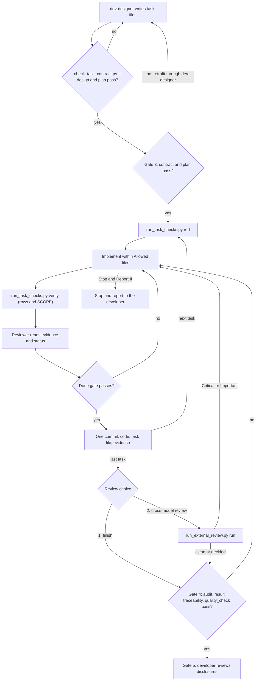

# Verifiable Task Handoff Design

- **Date**: 2026-10-16
- **Status**: Approved
- **Amended**: 2026-10-16, section 12 (cross-model review)
- **Scope**: `dev-designer`, `dev-implementation`, `dev-lifecycle` and its handoff template,
  `subagent-driven-development` prompts, `check_bdd_traceability.py`, `sync_task_status.py`, a new
  shared module `task_contract.py`, new scripts `check_task_contract.py`, `run_task_checks.py`,
  `audit_epic.py` and `run_external_review.py` with their tests, a review prompt template,
  `scripts/verify.sh`
- **Next step**: `dev-designer` (epic-scale)

## Table of Contents

- [1. Background](#1-background)
- [2. Goals and Non-Goals](#2-goals-and-non-goals)
- [3. Decisions](#3-decisions)
- [4. Overview](#4-overview)
- [5. Task File Contract](#5-task-file-contract)
- [6. HLD Declarations](#6-hld-declarations)
- [7. Design-Time Checks](#7-design-time-checks)
- [8. Recorder and Evidence](#8-recorder-and-evidence)
- [9. Done Gate](#9-done-gate)
- [10. Result-Based Traceability](#10-result-based-traceability)
- [11. Gate 4 Audit](#11-gate-4-audit)
- [12. Cross-Model Review](#12-cross-model-review)
- [13. Skill and Prompt Changes](#13-skill-and-prompt-changes)
- [14. Error Handling](#14-error-handling)
- [15. Rollout and Retrofit](#15-rollout-and-retrofit)
- [16. Testing](#16-testing)
- [17. Risks and Dependencies](#17-risks-and-dependencies)
- [18. Out of Scope](#18-out-of-scope)

## 1. Background

An epic designed by [dev-designer](../../../skills/dev-designer/SKILL.md) can be packaged and handed
to another model, often a cheaper one. Two handoffs show what that receiver does with today's task
files.

**Kit epic `lifecycle_followups`.** Task 2 listed each edit as the exact current text, which occurs
once on `main`, its replacement, and the expected output of the contract test. The receiver applied
17 of 17 edits faithfully. All three tasks still reached `done` with 0 of 11 checklist boxes ticked,
and one Definition of Done item — "before/after behaviour tests with fresh subagents" — named no
command and left no trace in the repository.

**`lyrics-sync` epic `lyrics_lexical_normalization`.** Tasks 34–42 used prose checklists and
directory-level file pointers.

- Task 42, the acceptance task (commit `73ab6e0`), changed one source file by +8/−3, yet ticked every
  box, including "Run the registered quality provider, controlled provider evaluation and live
  browser matrix". A later recheck found 11 failing tests and no provider result, browser artefact
  or audit.
- Task 40 (commit `959cc38`) edited the project's own coverage verifier,
  `scripts/verify_bdd_coverage.py`, adding special cases for this epic.
- Task 42's `Covers:` line claimed all 24 scenario identifiers, 21 of them already owned by earlier
  tasks, so its per-task traceability gate passed without a new test.
- No task said how tests are isolated from data. The tests wrote into the live catalog.
- The epic was merged and archived without a valid Gate 4 verdict.

The kit's tooling let all of this through:

- `check_bdd_traceability.py tests` lists files with `git ls-files` and searches them for identifier
  strings. It never runs a test, so an identifier in a comment counts as covered and a skipped test
  counts as passing.
- `sync_task_status.py task <id> done` writes the status without looking at any evidence.
- `plan` accepts an identifier on several tasks' `Covers:` lines.
- [implementer-prompt.md](../../../skills/subagent-driven-development/implementer-prompt.md) tells
  the implementer "your report is the test evidence", and
  [task-reviewer-prompt.md](../../../skills/subagent-driven-development/task-reviewer-prompt.md)
  tells the reviewer not to re-run the suite. The only record of a test run is prose the
  implementer wrote.

The task file that worked was the one whose every step had a machine-checkable expectation. The
ones that failed asked the receiver to judge its own completion.

## 2. Goals and Non-Goals

### Goals

- A task cannot reach `done` without evidence that a script recorded by running the task's declared
  commands.
- Every Definition of Done item is either backed by a recorded command or explicitly handed to the
  developer at Gate 5.
- What a designer writes into a task file — paths, commands, required variables — is checked
  against the repository before Gate 2 closes.
- A task cannot change what grades it without stopping, and every change to a grader is shown to the
  developer at Gate 5.
- Scenario traceability is proved by test results — run, not skipped, passed — instead of
  identifier strings.
- Before Gate 4, the developer can have the finished epic reviewed by an independent model, through
  the Claude CLI or the Codex CLI, and its Critical and Important findings block until resolved.

### Non-Goals

- Preventing deliberate forgery of evidence. The failure to stop is over-claiming.
- Having the designer write the tests (approach C in the dialogue).
- Changing `quality_check` or its providers.
- Proving mechanically that RED ran before the implementation existed.

## 3. Decisions

| Question | Decision |
|---|---|
| Overall approach | Task files become a machine-readable contract enforced by scripts (approach A), not a `quality_check` profile and not designer-written tests |
| Who runs verification, and what the gate trusts | A recorder runs the task's rows and writes evidence; the `done` gate validates that evidence against the current tree |
| Changes to graders | The executor stops and asks; task-level checks refuse unauthorised changes; Gate 4 shows every amendment to the developer |
| Result source for traceability | JUnit XML, plus an adapter for the Dart JSON reporter |
| Ownership of scenario identifiers | Each identifier is on exactly one task's `Covers:` line; each identifier still needs at least one test |
| `BLOCKED` rows | Block `done`; no waivers |
| Applicability | Every new epic, no strict mode; epics in flight are retrofitted when resumed |
| Cross-model review | Optional, offered every time all tasks are done and before Phase 4; the developer picks the Claude or Codex CLI each time; Critical and Important findings block unless fixed or dismissed by the developer |

## 4. Overview



All new scripts live in `skills/dev-implementation/resources/scripts/`, beside
`check_bdd_traceability.py`. `task_contract.py` is the one parser of task files and evidence;
`check_task_contract.py`, `run_task_checks.py`, `sync_task_status.py` and `audit_epic.py` import it,
the way the existing scripts share `slug_utils.py`.

## 5. Task File Contract

Task files stay English-only. The **Test & Verification Checklist** with checkboxes is removed, and
**Relevant Files & Context Pointers** is replaced. A task file gains five sections:

- Example, for one task:

  ```markdown
  ## Files

  Allowed files:
  - `src/lyrics_sync/lexical/taxonomy.py` (new)
  - `src/lyrics_sync/db/enums.py`
  - `tests/integration/test_lln_taxonomy_bdd.py` (new)

  Read-only context:
  - `src/lyrics_sync/lexical/service.py` — `canonical_type()` is today's entry point

  ## Verification

  | ID | Phase | Command | Expect | Needs |
  |----|-------|---------|--------|-------|
  | V1 | RED | `uv run pytest tests/unit/lexical/test_taxonomy.py` | exit 1; contains "ModuleNotFoundError" | — |
  | V2 | GREEN | `uv run pytest tests/unit/lexical/test_taxonomy.py` | exit 0; contains "passed" | — |
  | V3 | TIER-B | `uv run ruff check src tests` | exit 0 | — |
  | V4 | TIER-C | `uv run pytest tests/integration/test_lln_taxonomy_bdd.py --junitxml=build/test-results/task_34.xml` | exit 0; results build/test-results/task_34.xml | TEST_DATABASE_URL |

  ## Definition of Done

  - Aliases map to the eleven types; unknown types fail closed (V2, V4).
  - Badge copy reads naturally to a curator (Gate 5).

  ## Stop and Report If

  - A command, path, symbol or anchor named in this task does not match the repository.
  - A Verification row fails for a reason other than its Expect.
  - The work needs a change to a file outside Allowed files, or to a protected path.
  - The work needs a change to this task's Verification table, Definition of Done, Allowed files or
    Covers line.
  - A variable named in the Needs column is unset.
  - `canonical_type()` no longer exists in `service.py`.

  ## Decisions Already Made

  - `word` stays in Vocabulary; it is never a lexical sentence type.
  ```

### Files

- `Allowed files:` lists exact paths or globs (`*`, `?`, and `**` across directories) the task may
  create, change or delete. A path that does not exist yet carries `(new)`. Bare directories are not
  allowed.
- `Read-only context:` lists paths the task reads, each with a note. It restricts nothing.
- Changes under `.devtool/` — task status, mirrors, evidence — never need listing, except changes to
  a protected path (section 6).

### Verification

- **Columns** are exactly `ID | Phase | Command | Expect | Needs`. IDs are `V1`, `V2`, … and unique
  within the task.
- **Phase** is one of `RED` (run before implementation), `GREEN`, `TIER-B`, `TIER-C`.
- **Command** is one inline code span, run as `bash -o pipefail -c '<command>'` from the worktree
  root.
- **Expect** follows this grammar; every `contains` text must appear in combined stdout and stderr:

  ```text
  expect := exit-clause ( "; " clause )*
  exit-clause := "exit " DIGITS | "exit non-zero"
  clause := "contains \"" TEXT "\"" | "results " PATH
  ```

  `results` appears only on `TIER-C` rows, at most once per row.
- **Needs** is `—` or a comma-separated list of environment variable names. An unset variable makes
  the row `BLOCKED` without running it.
- A task with no new behaviour replaces its RED rows with the line `RED: n/a — <reason>` directly
  under the table.

### Definition of Done

Every bullet ends with a parenthesised reference: `(V2, V4)` naming existing rows, or `(Gate 5)`.
A `(Gate 5)` item is for the developer to check at Kanban review; it is listed in the Gate 4
report (section 11) and no script ever marks it met.

### Stop and Report If

The template carries the five default bullets shown above verbatim. The designer adds bullets
specific to the task.

### Decisions Already Made

The choices from the spec or HLD that the task must not revisit, copied inline so the receiver does
not have to find them. `None` when there are none.

The per-platform checklist blocks in `dev-designer` (its lines 320–355, where the Python block is
duplicated) become per-platform example rows in a new `skills/dev-designer/references/verification-rows.md`.

## 6. HLD Declarations

The Integration Test Plan of `<epic_dir>.en.md` and `.vi.md` gains two kinds of line beside the
existing `Integration test roots:` line:

```text
Protected paths: .agents/quality/**, .devtool/epic/<epic_dir>/bdd_scenarios.en.md, .devtool/epic/<epic_dir>/bdd_scenarios.vi.md
Integration results: uv run pytest tests/integration tests/e2e --junitxml=build/test-results/py.xml -> build/test-results/py.xml
Integration results: node --test --test-reporter=junit --test-reporter-destination=build/test-results/js.xml tests/js/ -> build/test-results/js.xml
```

- **Protected paths** lists explicit paths and globs; the three entries shown are the minimum. In
  addition, the **program** each Verification row runs is protected implicitly when it is a tracked
  file: after removing the wrappers `uv run`, `poetry run`, `npx`, `fvm` and `env NAME=value`, the
  program is the first token, or — when that token is `python`, `python3`, `bash`, `sh`, `zsh`,
  `node`, `deno`, `ruby` or `perl` — its first non-option argument. Path arguments such as test
  files are not programs.
- **Integration results** lines, one per platform and at least one, give the command Gate 4 runs and
  the report it produces, separated by ` -> `.

The HLD also gains a `## Verification Environment` section: how tests are isolated from real data,
which live resources are forbidden, and every variable a `Needs` column may name. When the project
has a live data store, the first task carries a sentinel row proving that tests cannot write to it.

## 7. Design-Time Checks

### check_task_contract.py

```bash
python3 "$SCRIPTS"/check_task_contract.py --design \
  --hld .devtool/epic/<epic_dir>/<epic_dir>.en.md \
  --tasks .devtool/epic/<epic_dir>/task_*.md
```

It reports problems as `task_34:V4: <problem>` and checks:

- **Structure.** The five sections of section 5 exist; the Verification table parses; IDs are unique;
  phases and Expect clauses are valid; there is a RED row or a `RED: n/a — <reason>` line with a
  non-empty reason; a task with a `Covers:` line has a `TIER-C` row with `results`; every Definition
  of Done bullet references existing rows or `(Gate 5)`.
- **Grounding.** An Allowed files path without `(new)` is tracked by git, and a glob matches at least
  one tracked file. A `(new)` path does not exist, and its parent directory exists or is itself
  `(new)` somewhere in the epic. Read-only context paths exist or are `(new)` in some task of the epic. Every repository path token in a
  Command exists or is `(new)` in some task of the epic. An executable not found on `PATH` is a
  warning, not a problem, because environments differ.
- **Declarations.** The HLD has a `Protected paths:` line, at least one `Integration results:` line
  and a non-empty `## Verification Environment` section; every `Needs` variable is named in that
  section; every `results` path and every Integration results report path is ignored by git
  (`git check-ignore`), so running a check never dirties the tree that Gate 4 binds to.
- It prints the implicit protected paths it derived.

`--design` adds the check that `(new)` paths do not exist yet. Without it — at Gate 3 and on resume —
grounding is skipped for tasks already `done`, and `(new)` paths are not checked, because earlier
tasks may have created them.

### plan

`check_bdd_traceability.py plan` fails when an identifier appears on the `Covers:` lines of more than
one task, naming both tasks. It already fails on an identifier that no task names. The
[dev-designer](../../../skills/dev-designer/SKILL.md) text changes from "assigned to at least one
task" to "exactly one task"; the final Tier C task still takes every identifier no earlier task
covers.

### Call sites

| Where | Commands |
|---|---|
| `dev-designer` Step 3, before committing | `check_task_contract.py --design`, `plan` |
| `dev-lifecycle` packaging preflight | `check_task_contract.py --design`, `plan` |
| `dev-implementation` Gate 3, fresh and on resume | `check_task_contract.py`, `plan`; failure means retrofit (section 15) |

## 8. Recorder and Evidence

### run_task_checks.py

```bash
python3 "$SCRIPTS"/run_task_checks.py red    .devtool/epic/<epic_dir>/task_<n>_<name>.md
python3 "$SCRIPTS"/run_task_checks.py verify .devtool/epic/<epic_dir>/task_<n>_<name>.md
python3 "$SCRIPTS"/run_task_checks.py status .devtool/epic/<epic_dir>/task_<n>_<name>.md
```

- `red` runs the RED rows, before any implementation is written.
- `verify` runs every `GREEN`, `TIER-B` and `TIER-C` row — all of them, not stopping at the first
  failure, so the record is complete — then adds a `SCOPE` row.
- `status` is read-only: it prints the evidence and the verdict the `done` gate would give.
- Each row ends `PASS` when it matches its Expect, `FAIL` when it does not or exceeds the timeout
  (1800 seconds by default, `--timeout` to change), and `BLOCKED` when a `Needs` variable is unset.
- Both `red` and `verify` run in the epic worktree and overwrite their own previous run.

### Scope

The `SCOPE` row compares the worktree with `HEAD`, which is the previous task's commit, so the
difference is this task's change:

- Every changed path outside `.devtool/` — modified, added, deleted, or untracked and not ignored —
  matches Allowed files.
- A protected path, explicit or implicit and including those under `.devtool/`, changes only when
  Allowed files names it exactly; a glob never authorises one.

### Evidence file

`.devtool/epic/<epic_dir>/evidence/<task_id>.json`, committed with the task's code and task file in
the task's one commit:

```json
{
  "schema": 1,
  "task": "task_34_lexical_taxonomy_and_quality_state",
  "runs": {
    "red": {"head": "<sha>", "tree": "<tree id>", "patch_id": "<id>",
            "started": "<iso>", "finished": "<iso>", "rows": []},
    "verify": {"head": "<sha>", "tree": "<tree id>", "patch_id": "<id>",
               "started": "<iso>", "finished": "<iso>", "rows": []}
  }
}
```

- `tree` fingerprints the working tree without `.devtool/`. The recorder builds it in a temporary
  index (`GIT_INDEX_FILE`), with `git read-tree HEAD`, `git add -A -- . ':!.devtool'` and
  `git write-tree`, so the real index is untouched and untracked files that are not ignored count.
- `patch_id` is `git patch-id --stable` of the same temporary index against `HEAD`. It survives a
  rebase, which `tree` does not (section 11).
- Each row records `id`, `phase`, `command` and `expect` as written in the table, `needs`, `exit`,
  `outcome`, start and finish times, the last 40 lines of output and the SHA-256 of the full output.
- A row with `results` adds a digest: totals of passed, failed and skipped cases, and the name and
  status of every case whose name matches an identifier in the epic's `bdd_scenarios.en.md`.

## 9. Done Gate

`sync_task_status.py task <id> done`, run in the epic worktree, refuses — writing nothing and exiting
1 with the failing conditions named — when:

1. the evidence file is missing; a `red` run is missing although the task has no `RED: n/a` line; or
   the `verify` run is missing;
2. a row of the **current** Verification table has no `PASS` result, or its recorded `command` or
   `expect` differs from the table;
3. any row is `BLOCKED`;
4. the `verify` run's `tree` differs from the current fingerprint — code changed after verification;
5. for a task with RED rows, the `red` run's `tree` equals the `verify` run's `tree`, or `red`
   finished after `verify` started;
6. result-based traceability fails for the identifiers on the task's `Covers:` line (section 10);
7. the `SCOPE` row is not `PASS`.

A task file without a `## Verification` section is refused with "retrofit required". The
`in-progress` and `review` transitions are unchanged. The gate does not depend on
`subagent-driven-development`: a task executed inline is gated the same way.

**Threat model.** The gate stops a model that claims more than it did. It does not stop one that
deliberately writes a matching JSON file: that needs a `git write-tree` over a temporary index,
which hallucination does not produce. Behind it, Gate 4 audits every `done` task (section 11) and
re-runs every integration test on the candidate SHA.

## 10. Result-Based Traceability

`check_bdd_traceability.py tests` gains `--results`, taking files, directories (every `*.xml` and
`*.json` inside) or globs, merged:

```bash
python3 "$SCRIPTS"/check_bdd_traceability.py tests \
  --scenarios .devtool/epic/<epic_dir>/bdd_scenarios.en.md \
  --roots tests/integration/ tests/e2e/ \
  --results build/test-results/
```

- **Format** is read from the first non-space character. `<` is JUnit XML: `testcase` elements under
  `testsuite`, nested suites included; a `failure` or `error` child means failed, `skipped` means
  skipped, otherwise passed. `{` is the Dart JSON reporter (newline-delimited events): `testStart`
  paired with `testDone` by test id; `result` other than `success` means failed, `skipped: true`
  means skipped, and `hidden: true` tests are ignored.
- **Matching.** A case belongs to an identifier when the identifier appears in its `name` or
  `classname` (JUnit) or its full `name` including groups (Dart), using the existing
  `reference_pattern`, so `PY-HP-01` matches `test_py_hp_01_…`.
- **Per identifier:**

  | In the results | Verdict |
  |---|---|
  | at least one passed case, none failed | pass |
  | any failed or errored case, even beside a passed one | fail: `<ID> failed in <case>` |
  | only skipped cases | fail: `<ID> skipped` |
  | no case | fail: `<ID> no test case in results` |

- The stale-reference check also runs over case names.
- Without `--results` the mode behaves as today, for existing callers. The `done` gate and Gate 4
  always use results.

**Freshness.** When the recorder runs a row with `results <path>`, it accepts the report only if its
modification time is later than the row's start; otherwise the row fails with
`results not produced by this run`. The digest it stores is what the `done` gate's condition 6
checks, through the same code as `--results`.

**Report formats** go into `references/verification-rows.md`:

| Platform | How to produce the report |
|---|---|
| Python | `pytest --junitxml=<path>` |
| Android | Gradle writes `build/test-results/<task>/`; pass the directory |
| Web | `node --test --test-reporter=junit`, `vitest --reporter=junit`, Playwright `--reporter=junit` |
| iOS | `swift test --xunit-output <path>`; newer toolchains add a `-swift-testing.xml` file, so pass the directory; converting `.xcresult` from `xcodebuild` is the project's job |
| Rust | `cargo nextest` with JUnit enabled in `.config/nextest.toml` |
| Flutter | `flutter test --file-reporter json:<path>` |

## 11. Gate 4 Audit

`audit_epic.py` runs first at Gate 4, on the candidate SHA with a clean tree, before the Integration
results commands, result-based traceability and `quality_check`:

```bash
python3 "$SCRIPTS"/audit_epic.py --epic-dir <epic_dir> --base <base_ref>
```

| Section | Content | Fails Gate 4 |
|---|---|---|
| Evidence | Every `done` task with a `## Verification` section has an evidence file in its task commit — the last commit in `<base>..HEAD` that changed it — in which every row of its Verification table is recorded as `PASS`. The commit's `git patch-id --stable` outside `.devtool/` is compared with the `verify` run's `patch_id`; a difference is shown as `patch changed after verify`, usually a rebase conflict resolution | Yes for missing evidence or a non-`PASS` row; no for a patch difference |
| Legacy tasks | `done` tasks whose task commit has no `## Verification` section, labelled `legacy — no evidence` | No |
| Protected paths | Every protected path changed in `<base>...HEAD`, with the commit. A change outside `.devtool/` that no task's Allowed files names exactly — for example in a "Fix integration with develop" commit — fails | Yes, for an unauthorised change outside `.devtool/` |
| Grader amendments | For each task, the diff of Verification, Definition of Done, Allowed files and `Covers:` against the commit that created the task's mirror in `.devtool/epic/<epic_dir>/`, with the amending commits' titles; scenario identifiers added to or removed from `bdd_scenarios.en.md` | No |
| Commits outside tasks | Commits on the epic branch that are no task's commit and touch files outside `.devtool/` | No |
| Gate 5 items | Every Definition of Done bullet marked `(Gate 5)` | No |

The report is printed and copied into the Phase 4.1 executive report. It is not committed, because a
commit would move the SHA that Gate 4 just judged.

## 12. Cross-Model Review

When every task of a code epic is `done`, and before Phase 4, dev-implementation asks — every time,
like the Handoff Choice:

> All N tasks of `<epic_slug>` are done. How do you want to proceed?
>
> 1. **Finish** — Gate 4, Gate 5, then `finishing-a-development-branch`.
> 2. **Cross-model review** — an independent model reviews the epic first, through the Claude CLI or
>    the Codex CLI. You pick which; the repository's content is sent to that provider.

The question lists which of `claude` and `codex` are on `PATH`. The developer picks the CLI, and
optionally a model, every time; the agent never picks one, because which still has credits is the
developer's knowledge. With neither on `PATH`, option 2 is unavailable and the question says why.

### run_external_review.py

```bash
python3 "$SCRIPTS"/run_external_review.py run --epic-dir <epic_dir> --base <base_ref> \
  --cli claude|codex [--model <name>] [--timeout <seconds>]
python3 "$SCRIPTS"/run_external_review.py check --epic-dir <epic_dir>
```

`run`:

1. Requires a clean tree, and records `HEAD` and `git status --porcelain`.
2. Runs `audit_epic.py` and `check_bdd_traceability.py tests --results` over the HLD's Integration
   results reports, for facts only; this is not Gate 4.
3. Builds the prompt from `skills/dev-implementation/references/external-review-prompt.md`: the
   candidate SHA, the base, the paths of the spec, HLD, BDD scenarios, task mirrors and evidence, the
   audit and results output, and the checklist below.
4. Runs the chosen CLI non-interactively and read-only, with the prompt on stdin:
   `claude -p --permission-mode plan [--model <name>]` or
   `codex exec --sandbox read-only [--model <name>] -`. The exact flags are confirmed against the
   installed CLIs during implementation.
5. Checks `HEAD` and `git status --porcelain` again. Any change discards the round.
6. Appends a round to `.devtool/epic/<epic_dir>/review_results.md`. The script writes the file from
   the CLI's output; the reviewer never writes.

The checklist the reviewer must cover:

- Each done task's evidence against its Verification table, and rows too weak for the Definition of
  Done item they back.
- Whether each identifier's test exercises its Gherkin scenario, or merely passes.
- Each audit disclosure — grader amendments, protected path changes, commits outside tasks — and
  whether it is justified.
- Whether the code respects the spec, the HLD and each task's Decisions Already Made.
- The `(Gate 5)` items, restated for the developer.

The required output is one line `Verdict: PASS` or `Verdict: CHANGES REQUIRED`, and one line per
finding: `[Critical|Important|Minor] <artefact>:<location> — <problem>`.

### review_results.md

One `## Round N` section per run, holding the date, SHA, base, CLI, model, status (`completed`,
`no verdict` or `discarded: tree modified`), verdict, a findings table with the columns
`# | Severity | Location | Problem | Decision`, and the raw output in a fenced block. Rounds are
appended and never rewritten; only the Decision column changes later.

### Flow After a Round

| Outcome | What happens |
|---|---|
| Completed, no Critical or Important finding | Commit `review_results.md` as `[<EPIC_NAME>] Record cross-model review round N`, then Phase 4 |
| Completed with Critical or Important findings | Fix them as separate `[<EPIC_NAME>] Fix <what>` commits; done tasks are not reopened, and the audit discloses the commits under Commits outside tasks. Each gets a Decision: `fixed in <sha>`, or `dismissed: <reason>` written only on the developer's explicit words. Then the developer chooses again: another round, or Finish |
| No CLI, a CLI error or timeout (for example, credits exhausted), no Verdict line, or a changed tree | `run` exits 2 and records the round with its status; the developer chooses again, and may pick the other CLI |

### check

At the start of Phase 4, when `review_results.md` exists, `check` exits 1 if the latest completed
round has a Critical or Important finding without a Decision. Gate 4 then runs in full as before, and
Phase 4.1 adds a summary of the rounds to the Gate 5 report.

## 13. Skill and Prompt Changes

- **[dev-designer](../../../skills/dev-designer/SKILL.md).** The task template takes section 5; the
  Integration Test Plan takes section 6's lines and `## Verification Environment`; "at least one
  task" becomes "exactly one task"; Step 3 runs `check_task_contract.py --design` beside `plan`;
  Red Flags add "a Definition of Done item with neither a row reference nor `(Gate 5)`". New
  `references/verification-rows.md`.
- **[dev-implementation](../../../skills/dev-implementation/SKILL.md).** Gate 3 runs the contract
  check. Phase 2 replaces its "Gate to Done" with `red` before implementation, `verify` after, the
  `done` gate, and the evidence file in the task commit. Phase 4 runs, in order, `audit_epic.py`, the
  Integration results commands, `tests --results`, then `quality_check`. Phase 4.1 adds the audit's
  disclosure sections to its report. After the last task it asks the Review Choice (section 12);
  Phase 4 starts with `run_external_review.py check` when `review_results.md` exists, and Phase 4.1
  summarises the review rounds.
- **[dev-lifecycle](../../../skills/dev-lifecycle/SKILL.md).** Gate 4's machine criteria add the audit
  and result-based traceability; the packaging preflight adds `check_task_contract.py --design`; Red
  Flags add ticking checkboxes or writing evidence by hand, and changing a Verification table,
  Allowed files or a protected path without stopping to ask. The sequence diagram gains the Review
  Choice before Gate 4; Red Flags add running the review without asking, picking the CLI for the
  developer, and writing a `dismissed` decision without the developer's words.
- **[handoff-template.md](../../../skills/dev-lifecycle/references/handoff-template.md).** Rules for
  the Receiving Agent adds: "Never edit a task's Verification table, Definition of Done, Allowed
  files or a protected path; stop and report."
- **[implementer-prompt.md](../../../skills/subagent-driven-development/implementer-prompt.md).**
  "Your report is the test evidence" becomes: run `run_task_checks.py red` before implementing and
  `verify` after; the evidence file is the test evidence; cite its path and never paste or summarise
  test output as evidence. A `Stop and Report If` condition is reported as `BLOCKED`, naming it.
- **[task-reviewer-prompt.md](../../../skills/subagent-driven-development/task-reviewer-prompt.md).**
  The Tests section reads the evidence file and runs `run_task_checks.py status`. A missing evidence
  file, a row not `PASS`, or a `tree` mismatch is Critical. The implementer's account of its tests is
  a claim.

## 14. Error Handling

| Script | Exit 0 | Exit 1 | Exit 2 |
|---|---|---|---|
| `check_task_contract.py` | contract holds | problems listed | usage: arguments, unreadable file, not a git repository |
| `run_task_checks.py red` / `verify` | every row `PASS` | a row `FAIL` or `BLOCKED`; evidence still written | usage, or a task file the contract parser rejects |
| `run_task_checks.py status` | the `done` gate would pass | it would refuse, with reasons | usage |
| `sync_task_status.py task <id> done` | status written | refused, with conditions | unchanged usage errors |
| `check_bdd_traceability.py tests --results` | every selected identifier passes | failures listed | usage, or a results file in neither format |
| `audit_epic.py` | no failing section | failing sections listed | usage, or `<base_ref>` unknown |
| `run_external_review.py run` | round completed, no Critical or Important finding | round completed with Critical or Important findings | no CLI, a CLI error or timeout, no Verdict line, a changed tree, or a dirty tree at start; the round is recorded when the CLI ran |
| `run_external_review.py check` | the latest completed round has no undecided blocking finding | undecided Critical or Important findings listed | usage |

Messages name the task and row (`task_34:V4`) or the identifier and case, so a receiver with no
context can act on them.

## 15. Rollout and Retrofit

- **Release.** 1.9.0, with a CHANGELOG entry stating that the `done` gate refuses tasks of epics in
  flight until they are retrofitted — the same precedent as BDD traceability in 1.8.0.
- **Retrofit.** Triggered at Gate 3, fresh or on resume, by a failing contract check, or at the
  `done` gate by "retrofit required". Retrofitting writes graders, so it is design work: it goes
  through dev-designer's Updating an Existing Epic for the tasks not yet `done`, and lands as its own
  commit, `[<EPIC_NAME>] Retrofit verification contract`, before work continues. A receiving agent
  never retrofits; it stops and tells the developer.
- **Legacy `done` tasks** are labelled by the audit and do not fail Gate 4, which still runs
  result-based traceability for every identifier.
- **Dogfood.** This epic's own task files use the new contract from Stage 2. The first tasks are not
  gated, because the scripts do not exist yet; every task after the recorder and gate merge is.
  Gate 4 in this repository still relies on `scripts/verify.sh`, since the repository has no quality
  registry.

## 16. Testing

- **Unit**, in the existing `unittest` and `tempfile` style, one `test_*.py` beside each new script:
  JUnit fixtures from pytest, Gradle, node and swift; a Dart NDJSON fixture; temporary git
  repositories for fingerprint, patch-id, scope and audit.
- **Integration**, in the style of `scripts/test_lifecycle_signals.py`: one full cycle on a temporary
  repository — contract, red, implement, verify, done, commit, audit — and the real failures
  reproduced:

  | Case | Source | Stopped by |
  |---|---|---|
  | `done` without evidence | `lyrics_lexical_normalization` task 42 | `done` gate |
  | Editing a verifier the task does not own | `lyrics_lexical_normalization` task 40 | `SCOPE` |
  | Acceptance task re-claiming owned identifiers | `lyrics_lexical_normalization` task 42 | `plan` |
  | Skipped test; identifier only in a comment; stale results file | — | `--results`, recorder |
  | Code edited after `verify` | — | `done` gate, condition 4 |
  | `status: done` written by hand | — | `audit_epic.py` |
  | Definition of Done item with no command | `lifecycle_followups` task 2 | `check_task_contract.py` |

- **Contract test.** `scripts/test_lifecycle_document_contract.py` gains the key phrases of the new
  skill text, each tagged with its scenario identifier.
- `scripts/verify.sh` runs every new test.
- **Cross-model review** is tested with fake `claude` and `codex` executables on a temporary `PATH`,
  which print a canned review, fail, hang or modify a file. No test calls a real CLI.
- **A real lower-tier model.** Package a small fixture epic and hand it to a lower-tier model. This
  is a `(Gate 5)` item, not CI, because its outcome does not repeat run to run.

## 17. Risks and Dependencies

- **Designer effort rises.** Every task needs rows with exact expectations. Mitigation: the example
  rows in `references/verification-rows.md`.
- **`contains` is brittle** across tool versions, so the executor will stop and ask more often. The
  designer picks stable fragments; every resulting amendment shows at Gate 5.
- **Tests run twice**, at `verify` and at Gate 4. Accepted.
- **Forgery is not prevented.** Accepted in the threat model.
- **RED ordering is weak.** Different fingerprints do not prove the implementation was absent; only
  replaying tests on the base commit (approach C) would.
- **Report formats vary** (`xcodebuild`, Swift Testing's separate file, Gradle's per-task
  directories). The reference documents them; converting `.xcresult` is the project's job.
- **Rebases change patches** when conflicts are resolved; the audit discloses this instead of
  failing.
- **Depends on** git with `patch-id --stable` and `check-ignore`, Python 3 standard library only, and
  `bash` for running rows.
- **Reviews vary run to run.** A model review is a second opinion, not a verdict; Gate 4 still decides.
- **Content leaves the machine.** Option 2 sends the repository's content to the chosen provider; the
  Review Choice says so, and choosing it is the developer's consent.
- **CLI flags drift** between versions. Both invocations live in one place in the script, and are
  confirmed against the installed CLIs during implementation.

## 18. Out of Scope

- Designer-written acceptance tests (approach C).
- Signing or HMAC of evidence files.
- Changes to `quality_check` providers.
- `dev-implementation` rarely dispatching subagents.
- Gate 4 reporting `BLOCKED` in this repository for want of a quality registry.
- `develop` hardcoded in `dev-implementation` while this repository uses `main`.
- Choosing the review CLI automatically, or reviewing with two models in one round.
