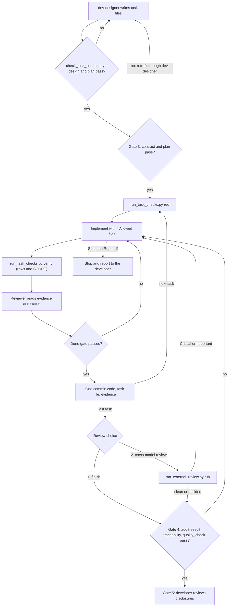

# Thiết kế handoff task kiểm chứng được

- **Ngày**: 2026-10-16
- **Trạng thái**: Đã duyệt
- **Sửa đổi**: 2026-10-16, mục 12 (review chéo bằng model khác)
- **Phạm vi**: `dev-designer`, `dev-implementation`, `dev-lifecycle` cùng handoff template, các
  prompt của `subagent-driven-development`, `check_bdd_traceability.py`, `sync_task_status.py`, module
  dùng chung mới `task_contract.py`, các script mới `check_task_contract.py`, `run_task_checks.py`,
  `audit_epic.py` và `run_external_review.py` cùng test của chúng, một template prompt review,
  `scripts/verify.sh`
- **Bước tiếp theo**: `dev-designer` (cỡ epic)

## Mục lục

- [1. Bối cảnh](#1-bối-cảnh)
- [2. Mục tiêu và ngoài mục tiêu](#2-mục-tiêu-và-ngoài-mục-tiêu)
- [3. Quyết định](#3-quyết-định)
- [4. Tổng quan](#4-tổng-quan)
- [5. Hợp đồng task file](#5-hợp-đồng-task-file)
- [6. Khai báo trong HLD](#6-khai-báo-trong-hld)
- [7. Kiểm tra lúc thiết kế](#7-kiểm-tra-lúc-thiết-kế)
- [8. Recorder và evidence](#8-recorder-và-evidence)
- [9. Gate done](#9-gate-done)
- [10. Truy vết dựa trên kết quả test](#10-truy-vết-dựa-trên-kết-quả-test)
- [11. Audit ở Gate 4](#11-audit-ở-gate-4)
- [12. Review chéo bằng model khác](#12-review-chéo-bằng-model-khác)
- [13. Thay đổi skill và prompt](#13-thay-đổi-skill-và-prompt)
- [14. Xử lý lỗi](#14-xử-lý-lỗi)
- [15. Phát hành và retrofit](#15-phát-hành-và-retrofit)
- [16. Kiểm thử](#16-kiểm-thử)
- [17. Rủi ro và phụ thuộc](#17-rủi-ro-và-phụ-thuộc)
- [18. Ngoài phạm vi](#18-ngoài-phạm-vi)

## 1. Bối cảnh

Một epic do [dev-designer](../../../skills/dev-designer/SKILL.md) thiết kế có thể được đóng gói và
giao cho một model khác, thường là model rẻ hơn. Hai lần handoff cho thấy model nhận làm gì với task
file hiện nay.

**Epic `lifecycle_followups` của kit.** Task 2 liệt kê từng chỗ sửa bằng đoạn text hiện tại (xuất
hiện đúng một lần trên `main`), đoạn text thay thế, và output mong đợi của contract test. Model nhận
áp đúng 17/17 chỗ sửa. Dù vậy, cả ba task đều thành `done` với 0/11 ô checklist được tick, và một mục
Definition of Done — "before/after behaviour tests with fresh subagents" — không nêu lệnh nào và
không để lại dấu vết nào trong repo.

**Epic `lyrics_lexical_normalization` của `lyrics-sync`.** Task 34–42 dùng checklist dạng prose và
trỏ tới file ở mức thư mục.

- Task 42, task nghiệm thu (commit `73ab6e0`), chỉ sửa một file nguồn +8/−3 nhưng tick mọi ô, kể cả
  "Run the registered quality provider, controlled provider evaluation and live browser matrix".
  Lần kiểm lại sau đó thấy 11 test fail, và không có kết quả provider, browser artefact hay audit nào.
- Task 40 (commit `959cc38`) sửa chính verifier coverage của project,
  `scripts/verify_bdd_coverage.py`, thêm các trường hợp đặc biệt cho epic này.
- Dòng `Covers:` của task 42 nhận cả 24 scenario identifier, 21 trong số đó đã thuộc các task trước,
  nên gate traceability của task pass mà không cần test mới.
- Không task nào nói test được cách ly khỏi dữ liệu thế nào. Test đã ghi vào catalog thật.
- Epic được merge và archive mà không có verdict Gate 4 hợp lệ.

Công cụ của kit đã để lọt tất cả những điều đó:

- `check_bdd_traceability.py tests` liệt kê file bằng `git ls-files` rồi tìm chuỗi identifier trong
  đó. Nó không chạy test nào, nên identifier trong comment cũng được tính là covered và test bị skip
  vẫn được tính là pass.
- `sync_task_status.py task <id> done` ghi status mà không xem evidence nào.
- `plan` chấp nhận một identifier nằm trên dòng `Covers:` của nhiều task.
- [implementer-prompt.md](../../../skills/subagent-driven-development/implementer-prompt.md) bảo
  implementer "your report is the test evidence", và
  [task-reviewer-prompt.md](../../../skills/subagent-driven-development/task-reviewer-prompt.md) bảo
  reviewer không chạy lại suite. Bản ghi duy nhất về một lần chạy test là đoạn prose do chính
  implementer viết.

Task file làm được việc là task file mà mọi bước đều có kỳ vọng máy kiểm được. Những task file thất
bại là những task file bắt model nhận tự chấm việc hoàn thành của chính nó.

## 2. Mục tiêu và ngoài mục tiêu

### Mục tiêu

- Một task không thể thành `done` nếu không có evidence do script ghi lại khi chạy các lệnh mà task
  khai báo.
- Mọi mục Definition of Done hoặc được một lệnh đã ghi lại chống lưng, hoặc được giao rõ cho
  developer ở Gate 5.
- Những gì designer viết vào task file — path, lệnh, biến bắt buộc — được kiểm với repo trước khi
  Gate 2 khép lại.
- Một task không thể sửa thứ dùng để chấm nó mà không dừng lại, và mọi thay đổi grader đều được hiển
  thị cho developer ở Gate 5.
- Traceability của scenario được chứng minh bằng kết quả test — đã chạy, không bị skip, đã pass —
  thay vì chuỗi identifier.
- Trước Gate 4, developer có thể cho một model độc lập review epic đã xong, qua Claude CLI hoặc
  Codex CLI, và các finding Critical, Important của nó chặn cho tới khi được giải quyết.

### Ngoài mục tiêu

- Ngăn giả mạo evidence có chủ đích. Lỗi cần chặn là khai quá.
- Để designer viết test (hướng C trong buổi trao đổi).
- Thay đổi `quality_check` hay các provider của nó.
- Chứng minh bằng máy rằng RED chạy trước khi có implementation.

## 3. Quyết định

| Câu hỏi | Quyết định |
|---|---|
| Hướng tổng thể | Task file trở thành hợp đồng máy đọc được, có script thực thi (hướng A); không dùng profile `quality_check`, không để designer viết test |
| Ai chạy verify, gate tin vào cái gì | Recorder chạy các dòng của task và ghi evidence; gate `done` kiểm evidence đó với cây hiện tại |
| Thay đổi grader | Executor dừng lại và hỏi; check ở mức task từ chối thay đổi không được phép; Gate 4 hiển thị mọi sửa đổi cho developer |
| Nguồn kết quả cho traceability | JUnit XML, cộng adapter cho Dart JSON reporter |
| Quyền sở hữu scenario identifier | Mỗi identifier nằm trên dòng `Covers:` của đúng một task; mỗi identifier vẫn cần ít nhất một test |
| Dòng `BLOCKED` | Chặn `done`; không có waiver |
| Phạm vi áp dụng | Mọi epic mới, không có strict mode; epic đang chạy được retrofit khi resume |
| Review chéo bằng model khác | Tùy chọn, được hỏi mỗi lần mọi task đã xong và trước Phase 4; developer chọn Claude CLI hoặc Codex CLI ở mỗi lần; finding Critical và Important chặn trừ khi được sửa hoặc developer bác bỏ |

## 4. Tổng quan



Mọi script mới nằm trong `skills/dev-implementation/resources/scripts/`, cạnh
`check_bdd_traceability.py`. `task_contract.py` là bộ parse duy nhất cho task file và evidence;
`check_task_contract.py`, `run_task_checks.py`, `sync_task_status.py` và `audit_epic.py` cùng import
nó, giống cách các script hiện có dùng chung `slug_utils.py`.

## 5. Hợp đồng task file

Task file vẫn chỉ viết tiếng Anh. Mục **Test & Verification Checklist** có checkbox bị bỏ, và mục
**Relevant Files & Context Pointers** được thay thế. Task file có thêm năm mục:

- Ví dụ, cho một task:

  ```markdown
  ## Files

  Allowed files:
  - `src/lyrics_sync/lexical/taxonomy.py` (new)
  - `src/lyrics_sync/db/enums.py`
  - `tests/integration/test_lln_taxonomy_bdd.py` (new)

  Read-only context:
  - `src/lyrics_sync/lexical/service.py` — `canonical_type()` is today's entry point

  ## Verification

  | ID | Phase | Command | Expect | Needs |
  |----|-------|---------|--------|-------|
  | V1 | RED | `uv run pytest tests/unit/lexical/test_taxonomy.py` | exit 1; contains "ModuleNotFoundError" | — |
  | V2 | GREEN | `uv run pytest tests/unit/lexical/test_taxonomy.py` | exit 0; contains "passed" | — |
  | V3 | TIER-B | `uv run ruff check src tests` | exit 0 | — |
  | V4 | TIER-C | `uv run pytest tests/integration/test_lln_taxonomy_bdd.py --junitxml=build/test-results/task_34.xml` | exit 0; results build/test-results/task_34.xml | TEST_DATABASE_URL |

  ## Definition of Done

  - Aliases map to the eleven types; unknown types fail closed (V2, V4).
  - Badge copy reads naturally to a curator (Gate 5).

  ## Stop and Report If

  - A command, path, symbol or anchor named in this task does not match the repository.
  - A Verification row fails for a reason other than its Expect.
  - The work needs a change to a file outside Allowed files, or to a protected path.
  - The work needs a change to this task's Verification table, Definition of Done, Allowed files or
    Covers line.
  - A variable named in the Needs column is unset.
  - `canonical_type()` no longer exists in `service.py`.

  ## Decisions Already Made

  - `word` stays in Vocabulary; it is never a lexical sentence type.
  ```

### Files

- `Allowed files:` liệt kê path chính xác hoặc glob (`*`, `?`, và `**` đi qua nhiều cấp thư mục) mà
  task được tạo, sửa hoặc xóa. Path chưa tồn tại mang dấu `(new)`. Không được dùng thư mục trần.
- `Read-only context:` liệt kê path mà task đọc, mỗi path kèm ghi chú. Mục này không giới hạn gì.
- Thay đổi dưới `.devtool/` — status task, mirror, evidence — không cần liệt kê, trừ thay đổi vào
  protected path (mục 6).

### Verification

- **Cột** đúng là `ID | Phase | Command | Expect | Needs`. ID là `V1`, `V2`, … và không trùng trong
  một task.
- **Phase** là một trong `RED` (chạy trước khi có implementation), `GREEN`, `TIER-B`, `TIER-C`.
- **Command** là một inline code span, chạy bằng `bash -o pipefail -c '<command>'` từ gốc worktree.
- **Expect** theo ngữ pháp sau; mọi đoạn text trong `contains` phải xuất hiện trong stdout và stderr
  gộp lại:

  ```text
  expect := exit-clause ( "; " clause )*
  exit-clause := "exit " DIGITS | "exit non-zero"
  clause := "contains \"" TEXT "\"" | "results " PATH
  ```

  `results` chỉ có trên dòng `TIER-C`, tối đa một lần mỗi dòng.
- **Needs** là `—` hoặc danh sách tên biến môi trường cách nhau bằng dấu phẩy. Biến chưa được đặt làm
  dòng đó thành `BLOCKED` mà không chạy.
- Task không có hành vi mới thay các dòng RED bằng dòng `RED: n/a — <reason>` ngay dưới bảng.

### Definition of Done

Mỗi bullet kết thúc bằng một tham chiếu trong ngoặc: `(V2, V4)` nêu các dòng có thật, hoặc
`(Gate 5)`. Mục `(Gate 5)` là việc developer kiểm ở buổi review Kanban; nó được liệt kê trong báo cáo
Gate 4 (mục 11) và không script nào đánh dấu nó là đã đạt.

### Stop and Report If

Template mang nguyên văn năm bullet mặc định như ví dụ trên. Designer thêm bullet riêng cho từng task.

### Decisions Already Made

Các lựa chọn trong spec hoặc HLD mà task không được quyết lại, chép thẳng vào để model nhận không phải
đi tìm. Ghi `None` khi không có.

Các khối checklist theo platform trong `dev-designer` (dòng 320–355, nơi khối Python bị lặp) trở
thành các dòng mẫu theo platform trong file mới `skills/dev-designer/references/verification-rows.md`.

## 6. Khai báo trong HLD

Integration Test Plan của `<epic_dir>.en.md` và `.vi.md` có thêm hai loại dòng, cạnh dòng
`Integration test roots:` đã có:

```text
Protected paths: .agents/quality/**, .devtool/epic/<epic_dir>/bdd_scenarios.en.md, .devtool/epic/<epic_dir>/bdd_scenarios.vi.md
Integration results: uv run pytest tests/integration tests/e2e --junitxml=build/test-results/py.xml -> build/test-results/py.xml
Integration results: node --test --test-reporter=junit --test-reporter-destination=build/test-results/js.xml tests/js/ -> build/test-results/js.xml
```

- **Protected paths** liệt kê path và glob cụ thể; ba mục trong ví dụ là tối thiểu. Ngoài ra,
  **chương trình** mà mỗi dòng Verification chạy được bảo vệ ngầm định khi nó là file được git track:
  sau khi bỏ các wrapper `uv run`, `poetry run`, `npx`, `fvm` và `env NAME=value`, chương trình là
  token đầu tiên, hoặc — khi token đó là `python`, `python3`, `bash`, `sh`, `zsh`, `node`, `deno`,
  `ruby` hay `perl` — là đối số đầu tiên không phải option. Đối số là path, ví dụ file test, không
  phải chương trình.
- Các dòng **Integration results**, mỗi platform một dòng và ít nhất một dòng, nêu lệnh mà Gate 4 chạy
  và báo cáo nó sinh ra, cách nhau bằng ` -> `.

HLD cũng có thêm mục `## Verification Environment`: test được cách ly khỏi dữ liệu thật thế nào, tài
nguyên live nào bị cấm, và mọi biến mà cột `Needs` có thể nêu. Khi project có kho dữ liệu live, task
đầu tiên có một dòng sentinel chứng minh test không thể ghi vào đó.

## 7. Kiểm tra lúc thiết kế

### check_task_contract.py

```bash
python3 "$SCRIPTS"/check_task_contract.py --design \
  --hld .devtool/epic/<epic_dir>/<epic_dir>.en.md \
  --tasks .devtool/epic/<epic_dir>/task_*.md
```

Script báo lỗi dạng `task_34:V4: <problem>` và kiểm:

- **Cấu trúc.** Năm mục của mục 5 đều có; bảng Verification parse được; ID không trùng; phase và
  mệnh đề Expect hợp lệ; có dòng RED hoặc dòng `RED: n/a — <reason>` với lý do không rỗng; task có
  dòng `Covers:` thì có dòng `TIER-C` mang `results`; mọi bullet Definition of Done tham chiếu dòng
  có thật hoặc `(Gate 5)`.
- **Grounding.** Path trong Allowed files không có `(new)` phải được git track, và glob phải khớp ít
  nhất một file được track. Path `(new)` phải chưa tồn tại, và thư mục cha của nó tồn tại hoặc chính
  nó là `(new)` ở đâu đó trong epic. Path trong Read-only context phải tồn tại hoặc là `(new)` trong một task nào đó của epic. Mọi token là path repo
  trong Command phải tồn tại hoặc là `(new)` trong một task nào đó của epic. Executable không tìm thấy
  trên `PATH` chỉ là cảnh báo, không phải lỗi, vì môi trường mỗi máy khác nhau.
- **Khai báo.** HLD có dòng `Protected paths:`, ít nhất một dòng `Integration results:` và mục
  `## Verification Environment` không rỗng; mọi biến trong `Needs` được nêu trong mục đó; mọi path
  `results` và mọi path báo cáo của Integration results đều bị git ignore (`git check-ignore`), để
  việc chạy check không làm bẩn cây mà Gate 4 gắn vào.
- Script in ra các protected path ngầm định mà nó suy ra.

`--design` bật thêm check "path `(new)` chưa tồn tại". Không có cờ này — ở Gate 3 và khi resume —
grounding bị bỏ qua cho task đã `done`, và path `(new)` không bị kiểm, vì các task trước có thể đã tạo
ra chúng.

### plan

`check_bdd_traceability.py plan` fail khi một identifier nằm trên dòng `Covers:` của hơn một task, và
nêu tên cả hai task. Nó vốn đã fail khi có identifier không task nào nêu. Text của
[dev-designer](../../../skills/dev-designer/SKILL.md) đổi từ "assigned to at least one task" thành
"exactly one task"; task Tier C cuối cùng vẫn nhận mọi identifier mà chưa task nào trước đó cover.

### Điểm gọi

| Ở đâu | Lệnh |
|---|---|
| `dev-designer` Step 3, trước khi commit | `check_task_contract.py --design`, `plan` |
| Preflight đóng gói của `dev-lifecycle` | `check_task_contract.py --design`, `plan` |
| Gate 3 của `dev-implementation`, lúc bắt đầu và khi resume | `check_task_contract.py`, `plan`; fail nghĩa là phải retrofit (mục 15) |

## 8. Recorder và evidence

### run_task_checks.py

```bash
python3 "$SCRIPTS"/run_task_checks.py red    .devtool/epic/<epic_dir>/task_<n>_<name>.md
python3 "$SCRIPTS"/run_task_checks.py verify .devtool/epic/<epic_dir>/task_<n>_<name>.md
python3 "$SCRIPTS"/run_task_checks.py status .devtool/epic/<epic_dir>/task_<n>_<name>.md
```

- `red` chạy các dòng RED, trước khi viết bất kỳ implementation nào.
- `verify` chạy mọi dòng `GREEN`, `TIER-B` và `TIER-C` — tất cả, không dừng ở dòng fail đầu tiên, để
  bản ghi đầy đủ — rồi thêm một dòng `SCOPE`.
- `status` chỉ đọc: in evidence và verdict mà gate `done` sẽ đưa ra.
- Mỗi dòng kết thúc ở `PASS` khi khớp Expect, `FAIL` khi không khớp hoặc vượt timeout (mặc định 1800
  giây, đổi bằng `--timeout`), và `BLOCKED` khi một biến trong `Needs` chưa được đặt.
- Cả `red` và `verify` chạy trong worktree của epic và ghi đè lần chạy trước của chính nó.

### Phạm vi thay đổi

Dòng `SCOPE` so worktree với `HEAD`, tức commit của task trước, nên phần khác biệt chính là thay đổi
của task này:

- Mọi path thay đổi ngoài `.devtool/` — bị sửa, thêm, xóa, hoặc chưa track mà không bị ignore — phải
  khớp Allowed files.
- Protected path, khai rõ hay ngầm định, kể cả những path dưới `.devtool/`, chỉ được đổi khi Allowed
  files nêu đích danh nó; glob không bao giờ cho phép.

### File evidence

`.devtool/epic/<epic_dir>/evidence/<task_id>.json`, commit cùng code và task file trong commit duy
nhất của task:

```json
{
  "schema": 1,
  "task": "task_34_lexical_taxonomy_and_quality_state",
  "runs": {
    "red": {"head": "<sha>", "tree": "<tree id>", "patch_id": "<id>",
            "started": "<iso>", "finished": "<iso>", "rows": []},
    "verify": {"head": "<sha>", "tree": "<tree id>", "patch_id": "<id>",
               "started": "<iso>", "finished": "<iso>", "rows": []}
  }
}
```

- `tree` là fingerprint của cây làm việc trừ `.devtool/`. Recorder dựng nó trong một index tạm
  (`GIT_INDEX_FILE`) bằng `git read-tree HEAD`, `git add -A -- . ':!.devtool'` và `git write-tree`,
  nên index thật không bị động tới, và file chưa track mà không bị ignore vẫn được tính.
- `patch_id` là `git patch-id --stable` của cùng index tạm so với `HEAD`. Nó giữ nguyên qua rebase,
  còn `tree` thì không (mục 11).
- Mỗi dòng ghi `id`, `phase`, `command` và `expect` nguyên văn như trong bảng, `needs`, `exit`,
  `outcome`, thời điểm bắt đầu và kết thúc, 40 dòng output cuối và SHA-256 của toàn bộ output.
- Dòng có `results` thêm một digest: tổng số case passed, failed và skipped, cùng tên và trạng thái
  của mọi case có tên khớp một identifier trong `bdd_scenarios.en.md` của epic.

## 9. Gate done

`sync_task_status.py task <id> done`, chạy trong worktree của epic, từ chối — không ghi gì và trả
exit 1, nêu các điều kiện không đạt — khi:

1. thiếu file evidence; thiếu lần chạy `red` trong khi task không có dòng `RED: n/a`; hoặc thiếu lần
   chạy `verify`;
2. một dòng của bảng Verification **hiện tại** không có kết quả `PASS`, hoặc `command` hay `expect`
   đã ghi khác với bảng;
3. có dòng `BLOCKED`;
4. `tree` của lần chạy `verify` khác fingerprint hiện tại — code bị sửa sau khi verify;
5. với task có dòng RED, `tree` của lần chạy `red` bằng `tree` của lần chạy `verify`, hoặc `red`
   kết thúc sau khi `verify` bắt đầu;
6. traceability dựa trên kết quả không đạt cho các identifier trên dòng `Covers:` của task (mục 10);
7. dòng `SCOPE` không phải `PASS`.

Task file không có mục `## Verification` bị từ chối với thông báo "retrofit required". Các chuyển
trạng thái `in-progress` và `review` giữ nguyên. Gate không phụ thuộc vào
`subagent-driven-development`: task làm inline cũng bị gate y như vậy.

**Threat model.** Gate chặn model khai nhiều hơn những gì nó đã làm. Nó không chặn model cố ý viết một
file JSON khớp: việc đó cần `git write-tree` trên một index tạm, thứ mà hallucination không tạo ra.
Phía sau, Gate 4 audit mọi task `done` (mục 11) và chạy lại mọi integration test trên SHA ứng viên.

## 10. Truy vết dựa trên kết quả test

`check_bdd_traceability.py tests` có thêm `--results`, nhận file, thư mục (mọi `*.xml` và `*.json`
bên trong) hoặc glob, rồi gộp lại:

```bash
python3 "$SCRIPTS"/check_bdd_traceability.py tests \
  --scenarios .devtool/epic/<epic_dir>/bdd_scenarios.en.md \
  --roots tests/integration/ tests/e2e/ \
  --results build/test-results/
```

- **Định dạng** được đọc từ ký tự đầu tiên không phải khoảng trắng. `<` là JUnit XML: các phần tử
  `testcase` dưới `testsuite`, kể cả suite lồng nhau; có con `failure` hoặc `error` là failed,
  `skipped` là skipped, còn lại là passed. `{` là Dart JSON reporter (sự kiện mỗi dòng một JSON):
  `testStart` ghép với `testDone` theo test id; `result` khác `success` là failed, `skipped: true` là
  skipped, và test có `hidden: true` bị bỏ qua.
- **Khớp.** Một case thuộc về một identifier khi identifier xuất hiện trong `name` hoặc `classname`
  (JUnit) hay trong `name` đầy đủ kể cả group (Dart), dùng `reference_pattern` có sẵn, nên `PY-HP-01`
  khớp `test_py_hp_01_…`.
- **Với mỗi identifier:**

  | Trong báo cáo | Kết luận |
  |---|---|
  | ít nhất một case passed, không case nào failed | pass |
  | có case failed hoặc error, kể cả khi có case passed bên cạnh | fail: `<ID> failed in <case>` |
  | chỉ có case skipped | fail: `<ID> skipped` |
  | không có case nào | fail: `<ID> no test case in results` |

- Check tham chiếu stale cũng chạy trên tên case.
- Không có `--results` thì chế độ này hoạt động như hiện nay, cho các nơi đang gọi. Gate `done` và
  Gate 4 luôn dùng kết quả.

**Độ mới.** Khi recorder chạy một dòng có `results <path>`, nó chỉ chấp nhận báo cáo có thời điểm sửa
đổi sau lúc dòng đó bắt đầu; nếu không, dòng đó fail với `results not produced by this run`. Digest
nó lưu là thứ mà điều kiện 6 của gate `done` kiểm, qua cùng đoạn code với `--results`.

**Định dạng báo cáo** được ghi vào `references/verification-rows.md`:

| Platform | Cách sinh báo cáo |
|---|---|
| Python | `pytest --junitxml=<path>` |
| Android | Gradle ghi vào `build/test-results/<task>/`; truyền thư mục |
| Web | `node --test --test-reporter=junit`, `vitest --reporter=junit`, Playwright `--reporter=junit` |
| iOS | `swift test --xunit-output <path>`; toolchain mới sinh thêm file `-swift-testing.xml`, nên truyền thư mục; chuyển `.xcresult` của `xcodebuild` là việc của project |
| Rust | `cargo nextest` với JUnit bật trong `.config/nextest.toml` |
| Flutter | `flutter test --file-reporter json:<path>` |

## 11. Audit ở Gate 4

`audit_epic.py` chạy đầu tiên ở Gate 4, trên SHA ứng viên với cây sạch, trước các lệnh Integration
results, traceability dựa trên kết quả và `quality_check`:

```bash
python3 "$SCRIPTS"/audit_epic.py --epic-dir <epic_dir> --base <base_ref>
```

| Mục | Nội dung | Làm fail Gate 4 |
|---|---|---|
| Evidence | Mọi task `done` có mục `## Verification` đều có file evidence trong commit của task — commit cuối cùng trong `<base>..HEAD` đã đổi file đó — trong đó mọi dòng của bảng Verification đều được ghi là `PASS`. `git patch-id --stable` của commit, ngoài `.devtool/`, được so với `patch_id` của lần chạy `verify`; khác nhau thì hiển thị `patch changed after verify`, thường do giải conflict khi rebase | Có với thiếu evidence hoặc dòng không `PASS`; không với patch khác nhau |
| Task legacy | Task `done` mà commit của nó không có mục `## Verification`, gắn nhãn `legacy — no evidence` | Không |
| Protected path | Mọi protected path bị đổi trong `<base>...HEAD`, kèm commit. Thay đổi ngoài `.devtool/` mà không Allowed files của task nào nêu đích danh — ví dụ trong commit "Fix integration with develop" — làm fail | Có, với thay đổi không được phép ngoài `.devtool/` |
| Sửa grader | Với mỗi task, diff của Verification, Definition of Done, Allowed files và `Covers:` so với commit đã tạo bản mirror của task trong `.devtool/epic/<epic_dir>/`, kèm tiêu đề các commit đã sửa; các scenario identifier được thêm vào hoặc xóa khỏi `bdd_scenarios.en.md` | Không |
| Commit ngoài task | Commit trên nhánh epic không phải commit của task nào mà đụng tới file ngoài `.devtool/` | Không |
| Mục Gate 5 | Mọi bullet Definition of Done đánh dấu `(Gate 5)` | Không |

Báo cáo được in ra và chép vào executive report của Phase 4.1. Nó không được commit, vì commit sẽ làm
đổi SHA mà Gate 4 vừa chấm.

## 12. Review chéo bằng model khác

Khi mọi task của một epic code đã `done`, và trước Phase 4, dev-implementation hỏi — mỗi lần, giống
Handoff Choice:

> All N tasks of `<epic_slug>` are done. How do you want to proceed?
>
> 1. **Finish** — Gate 4, Gate 5, then `finishing-a-development-branch`.
> 2. **Cross-model review** — an independent model reviews the epic first, through the Claude CLI or
>    the Codex CLI. You pick which; the repository's content is sent to that provider.

Câu hỏi liệt kê `claude` và `codex` cái nào đang có trên `PATH`. Developer chọn CLI, và có thể chọn
model, ở mỗi lần; agent không bao giờ tự chọn, vì bên nào còn credit là điều chỉ developer biết. Khi
không có cái nào trên `PATH`, option 2 không dùng được và câu hỏi nói rõ lý do.

### run_external_review.py

```bash
python3 "$SCRIPTS"/run_external_review.py run --epic-dir <epic_dir> --base <base_ref> \
  --cli claude|codex [--model <name>] [--timeout <seconds>]
python3 "$SCRIPTS"/run_external_review.py check --epic-dir <epic_dir>
```

`run`:

1. Đòi cây sạch, rồi ghi lại `HEAD` và `git status --porcelain`.
2. Chạy `audit_epic.py` và `check_bdd_traceability.py tests --results` trên các báo cáo Integration
   results của HLD, chỉ để lấy dữ kiện; đây không phải Gate 4.
3. Dựng prompt từ `skills/dev-implementation/references/external-review-prompt.md`: SHA ứng viên,
   base, path của spec, HLD, kịch bản BDD, các task mirror và evidence, output của audit và results,
   cùng checklist bên dưới.
4. Chạy CLI đã chọn ở chế độ không tương tác và chỉ đọc, prompt đưa qua stdin:
   `claude -p --permission-mode plan [--model <name>]` hoặc
   `codex exec --sandbox read-only [--model <name>] -`. Flag chính xác được kiểm với CLI đã cài lúc
   implement.
5. Kiểm lại `HEAD` và `git status --porcelain`. Có bất kỳ thay đổi nào thì round bị loại.
6. Ghi thêm một round vào `.devtool/epic/<epic_dir>/review_results.md`. Script ghi file từ output
   của CLI; reviewer không bao giờ ghi.

Checklist mà reviewer phải phủ:

- Evidence của từng task done so với bảng Verification của nó, và các dòng quá yếu so với mục
  Definition of Done mà chúng chống lưng.
- Test của mỗi định danh có thật sự kiểm scenario Gherkin của nó, hay chỉ pass cho có.
- Từng mục hiển thị của audit — sửa grader, thay đổi protected path, commit ngoài task — và nó có lý
  do hợp lệ không.
- Code có tôn trọng spec, HLD và Decisions Already Made của từng task không.
- Các mục `(Gate 5)`, nêu lại cho developer.

Output bắt buộc là một dòng `Verdict: PASS` hoặc `Verdict: CHANGES REQUIRED`, và mỗi finding một
dòng: `[Critical|Important|Minor] <artefact>:<location> — <problem>`.

### review_results.md

Mỗi lần chạy một mục `## Round N`, gồm ngày, SHA, base, CLI, model, trạng thái (`completed`,
`no verdict` hoặc `discarded: tree modified`), verdict, bảng finding với các cột
`# | Severity | Location | Problem | Decision`, và output thô trong một khối fence. Các round chỉ được
nối thêm, không bao giờ viết lại; về sau chỉ cột Decision thay đổi.

### Luồng sau mỗi round

| Kết quả | Điều xảy ra |
|---|---|
| Hoàn tất, không có finding Critical hay Important | Commit `review_results.md` với tiêu đề `[<EPIC_NAME>] Record cross-model review round N`, rồi vào Phase 4 |
| Hoàn tất với finding Critical hoặc Important | Quay về Phase 2 để sửa. Mỗi finding nhận một Decision: `fixed in <sha>`, hoặc `dismissed: <reason>` chỉ được ghi khi developer nói rõ. Sau đó developer chọn lại: thêm một round, hoặc Finish |
| Không có CLI, CLI lỗi hoặc hết thời gian (ví dụ hết credit), thiếu dòng Verdict, hoặc cây bị đổi | `run` trả exit 2 và ghi round kèm trạng thái của nó; developer chọn lại, và có thể chọn CLI kia |

### check

Đầu Phase 4, khi có `review_results.md`, `check` trả exit 1 nếu round hoàn tất mới nhất còn finding
Critical hoặc Important chưa có Decision. Sau đó Gate 4 chạy đầy đủ như cũ, và Phase 4.1 đưa tóm tắt
các round vào báo cáo Gate 5.

## 13. Thay đổi skill và prompt

- **[dev-designer](../../../skills/dev-designer/SKILL.md).** Template task nhận mục 5; Integration
  Test Plan nhận các dòng của mục 6 và `## Verification Environment`; "at least one task" thành
  "exactly one task"; Step 3 chạy `check_task_contract.py --design` cạnh `plan`; Red Flags thêm "một
  mục Definition of Done không có tham chiếu dòng lẫn `(Gate 5)`". Thêm file
  `references/verification-rows.md`.
- **[dev-implementation](../../../skills/dev-implementation/SKILL.md).** Gate 3 chạy contract check.
  Phase 2 thay "Gate to Done" bằng `red` trước implementation, `verify` sau đó, gate `done`, và file
  evidence trong commit của task. Phase 4 chạy theo thứ tự `audit_epic.py`, các lệnh Integration
  results, `tests --results`, rồi `quality_check`. Phase 4.1 thêm các mục hiển thị của audit vào báo
  cáo. Sau task cuối, nó hỏi Lựa chọn review (mục 12); Phase 4 bắt đầu bằng
  `run_external_review.py check` khi có `review_results.md`, và Phase 4.1 tóm tắt các round review.
- **[dev-lifecycle](../../../skills/dev-lifecycle/SKILL.md).** Tiêu chí máy của Gate 4 thêm audit và
  traceability dựa trên kết quả; preflight đóng gói thêm `check_task_contract.py --design`; Red Flags
  thêm việc tick checkbox hay tự viết evidence bằng tay, và việc sửa bảng Verification, Allowed files
  hay protected path mà không dừng lại hỏi. Sơ đồ sequence có thêm Lựa chọn review trước Gate 4;
  Red Flags thêm việc chạy review mà không hỏi, chọn CLI thay developer, và ghi Decision `dismissed`
  khi developer chưa nói rõ.
- **[handoff-template.md](../../../skills/dev-lifecycle/references/handoff-template.md).** Rules for
  the Receiving Agent thêm: "Never edit a task's Verification table, Definition of Done, Allowed
  files or a protected path; stop and report."
- **[implementer-prompt.md](../../../skills/subagent-driven-development/implementer-prompt.md).**
  "Your report is the test evidence" đổi thành: chạy `run_task_checks.py red` trước khi viết code và
  `verify` sau đó; file evidence là test evidence; dẫn path của nó và không bao giờ dán hay tóm tắt
  output test làm evidence. Điều kiện trong `Stop and Report If` được báo bằng `BLOCKED`, kèm tên điều
  kiện.
- **[task-reviewer-prompt.md](../../../skills/subagent-driven-development/task-reviewer-prompt.md).**
  Mục Tests đọc file evidence và chạy `run_task_checks.py status`. Thiếu file evidence, có dòng không
  `PASS`, hoặc `tree` lệch là lỗi Critical. Lời kể của implementer về test chỉ là claim.

## 14. Xử lý lỗi

| Script | Exit 0 | Exit 1 | Exit 2 |
|---|---|---|---|
| `check_task_contract.py` | hợp đồng đạt | liệt kê lỗi | sai cách gọi: đối số, file không đọc được, không phải repo git |
| `run_task_checks.py red` / `verify` | mọi dòng `PASS` | có dòng `FAIL` hoặc `BLOCKED`; evidence vẫn được ghi | sai cách gọi, hoặc task file bị bộ parse hợp đồng từ chối |
| `run_task_checks.py status` | gate `done` sẽ pass | gate sẽ từ chối, kèm lý do | sai cách gọi |
| `sync_task_status.py task <id> done` | đã ghi status | bị từ chối, kèm điều kiện | lỗi cách gọi như hiện nay |
| `check_bdd_traceability.py tests --results` | mọi identifier được chọn đều pass | liệt kê các fail | sai cách gọi, hoặc file kết quả không thuộc định dạng nào |
| `audit_epic.py` | không mục nào fail | liệt kê các mục fail | sai cách gọi, hoặc `<base_ref>` không tồn tại |
| `run_external_review.py run` | round hoàn tất, không có finding Critical hay Important | round hoàn tất có finding Critical hoặc Important | không có CLI, CLI lỗi hoặc hết thời gian, thiếu dòng Verdict, cây bị đổi, hoặc cây bẩn lúc bắt đầu; round được ghi khi CLI đã chạy |
| `run_external_review.py check` | round hoàn tất mới nhất không còn finding chặn chưa có Decision | liệt kê các finding Critical hoặc Important chưa có Decision | sai cách gọi |

Thông báo nêu task và dòng (`task_34:V4`), hoặc identifier và case, để một model nhận không có bối
cảnh vẫn hành động được.

## 15. Phát hành và retrofit

- **Phát hành.** 1.9.0, kèm một mục CHANGELOG ghi rằng gate `done` từ chối task của các epic đang
  chạy cho tới khi chúng được retrofit — cùng tiền lệ với BDD traceability ở 1.8.0.
- **Retrofit.** Được kích hoạt ở Gate 3, lúc bắt đầu hay khi resume, bởi contract check fail, hoặc ở
  gate `done` bởi "retrofit required". Retrofit là viết grader, nên đó là việc thiết kế: nó đi qua
  Updating an Existing Epic của dev-designer cho các task chưa `done`, và nằm trong commit riêng
  `[<EPIC_NAME>] Retrofit verification contract` trước khi tiếp tục. Model nhận không bao giờ tự
  retrofit; nó dừng lại và báo developer.
- **Task `done` dạng legacy** được audit gắn nhãn và không làm fail Gate 4, vốn vẫn chạy traceability
  dựa trên kết quả cho mọi identifier.
- **Dogfood.** Task file của chính epic này dùng hợp đồng mới từ Stage 2. Các task đầu không có gate vì
  script chưa tồn tại; mọi task sau khi recorder và gate được merge đều có gate. Gate 4 trong repo này
  vẫn dựa vào `scripts/verify.sh`, vì repo không có quality registry.

## 16. Kiểm thử

- **Unit**, theo style `unittest` và `tempfile` đang dùng, mỗi script mới có một `test_*.py` bên cạnh:
  fixture JUnit lấy từ pytest, Gradle, node và swift; một fixture Dart NDJSON; repo git tạm cho
  fingerprint, patch-id, scope và audit.
- **Integration**, theo kiểu `scripts/test_lifecycle_signals.py`: một vòng đầy đủ trên repo tạm —
  contract, red, implement, verify, done, commit, audit — và dựng lại các lỗi thật:

  | Ca | Nguồn | Bị chặn bởi |
  |---|---|---|
  | `done` không có evidence | task 42 của `lyrics_lexical_normalization` | gate `done` |
  | Sửa verifier mà task không sở hữu | task 40 của `lyrics_lexical_normalization` | `SCOPE` |
  | Task nghiệm thu nhận lại identifier đã có chủ | task 42 của `lyrics_lexical_normalization` | `plan` |
  | Test bị skip; identifier chỉ nằm trong comment; file kết quả cũ | — | `--results`, recorder |
  | Code bị sửa sau `verify` | — | gate `done`, điều kiện 4 |
  | `status: done` sửa bằng tay | — | `audit_epic.py` |
  | Mục Definition of Done không có lệnh | task 2 của `lifecycle_followups` | `check_task_contract.py` |

- **Contract test.** `scripts/test_lifecycle_document_contract.py` thêm các cụm từ khóa của text skill
  mới, mỗi cụm gắn scenario identifier của nó.
- `scripts/verify.sh` chạy mọi test mới.
- **Review chéo** được test bằng các executable giả `claude` và `codex` trên một `PATH` tạm, in ra
  review dựng sẵn, báo lỗi, treo, hoặc sửa một file. Không test nào gọi CLI thật.
- **Model cấp thấp thật.** Đóng gói một epic fixture nhỏ và giao cho một model cấp thấp. Đây là mục
  `(Gate 5)`, không phải CI, vì kết quả không lặp lại giữa các lần chạy.

## 17. Rủi ro và phụ thuộc

- **Designer tốn công hơn.** Mỗi task cần các dòng với kỳ vọng chính xác. Giảm nhẹ: các dòng mẫu trong
  `references/verification-rows.md`.
- **`contains` giòn** qua các version công cụ, nên executor sẽ dừng lại hỏi thường hơn. Designer chọn
  đoạn text ổn định; mọi sửa đổi phát sinh đều hiện ra ở Gate 5.
- **Test chạy hai lần**, ở `verify` và ở Gate 4. Chấp nhận.
- **Không chặn được giả mạo.** Đã chấp nhận trong threat model.
- **Check thứ tự RED còn yếu.** Fingerprint khác nhau không chứng minh lúc đó chưa có implementation;
  chỉ replay test trên commit base (hướng C) mới chứng minh được.
- **Định dạng báo cáo khác nhau** (`xcodebuild`, file riêng của Swift Testing, thư mục theo task của
  Gradle). Reference ghi lại; chuyển `.xcresult` là việc của project.
- **Rebase làm đổi patch** khi giải conflict; audit hiển thị điều này thay vì làm fail.
- **Phụ thuộc** git có `patch-id --stable` và `check-ignore`, chỉ thư viện chuẩn của Python 3, và
  `bash` để chạy các dòng.
- **Review thay đổi giữa các lần chạy.** Review của model là ý kiến thứ hai, không phải verdict; Gate 4
  vẫn quyết định.
- **Nội dung rời khỏi máy.** Option 2 gửi nội dung repo tới provider được chọn; Lựa chọn review nói
  rõ điều này, và việc chọn nó là sự đồng ý của developer.
- **Flag của CLI thay đổi** giữa các version. Cả hai lệnh gọi nằm ở một chỗ trong script, và được kiểm
  với CLI đã cài lúc implement.

## 18. Ngoài phạm vi

- Test nghiệm thu do designer viết (hướng C).
- Ký hoặc HMAC file evidence.
- Thay đổi provider của `quality_check`.
- `dev-implementation` hiếm khi dispatch subagent.
- Gate 4 báo `BLOCKED` trong repo này vì thiếu quality registry.
- `develop` bị hardcode trong `dev-implementation` trong khi repo này dùng `main`.
- Tự động chọn CLI review, hoặc review bằng hai model trong một round.
