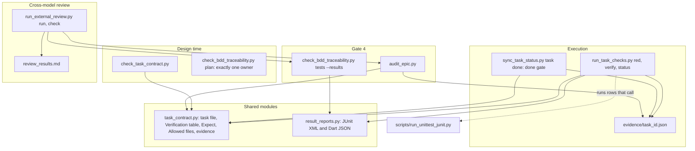
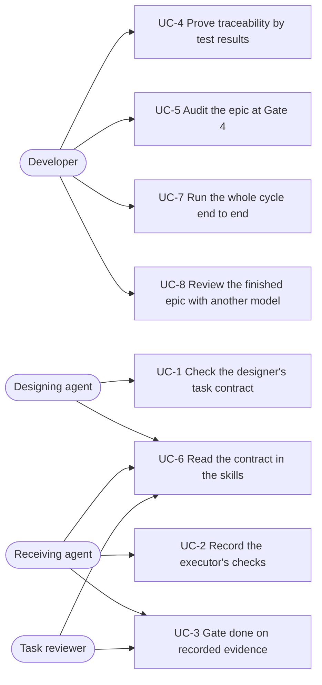
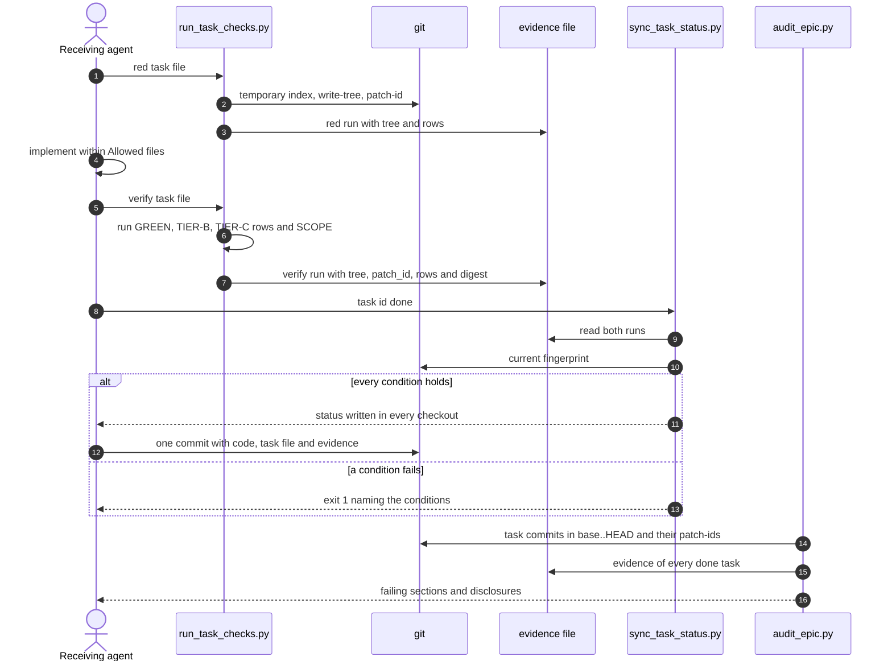

# Epic: Verifiable Task Handoff

## Table of Contents

- [1. Meta Data](#1-meta-data)
- [2. Background](#2-background)
- [3. Goals and Non-Goals](#3-goals-and-non-goals)
- [4. Architecture and Technical Design](#4-architecture-and-technical-design)
- [5. Integration Test Plan](#5-integration-test-plan)
- [6. Verification Environment](#6-verification-environment)
- [7. BDD Scenarios](#7-bdd-scenarios)
- [8. Rollout Strategy and Mitigation](#8-rollout-strategy-and-mitigation)
- [9. Kanban Tasks Breakdown](#9-kanban-tasks-breakdown)

## 1. Meta Data

- **Epic**: verifiable_task_handoff (directory `verifiable_task_handoff`)
- **Status**: Planned
- **Target Release**: d3nexus 1.9.0
- **Platform**: Python — the kit repository: standard-library scripts tested with `unittest`, plus
  Markdown skills. `detect_project_type.sh` reports `unknown` for this repository.
- **Source Spec**: [2026-10-16-verifiable-task-handoff-design.en.md](2026-10-16-verifiable-task-handoff-design.en.md)

## 2. Background

A task file handed to a cheaper model is trusted to report its own completion. In the kit's
`lifecycle_followups` epic every task reached `done` with no checkbox ticked; in `lyrics-sync`'s
`lyrics_lexical_normalization` the acceptance task ticked every box after changing one file, another
task edited the project's own coverage verifier, and the tests wrote into the live catalog. The kit's
gates let it through: traceability searches for identifier strings without running a test, the
`done` transition reads no evidence, and the SDD prompts make the implementer's prose the test record.
The source spec states each failure and the approved fix; this epic formalizes it.

## 3. Goals and Non-Goals

**Goals:**

- Make `done` reachable only through evidence a script recorded by running the task's declared rows.
- Check the designer's paths, commands and declarations against the repository before Gate 2 closes.
- Refuse unauthorised changes to graders inside a task, and disclose every grader change at Gate 5.
- Prove scenario coverage by JUnit or Dart test results: run, not skipped, passed.
- Offer the developer an independent model's review of the finished epic, through the Claude or Codex
  CLI they pick, before Gate 4.

**Non-Goals:**

- Preventing deliberate forgery of evidence.
- Designer-written acceptance tests.
- Changes to `quality_check` or its providers.
- Proving mechanically that RED ran before the implementation existed.

## 4. Architecture and Technical Design

### 4.1 High-Level Architecture

### 4.2 Use Cases

### 4.3 Sequence: one task from red to audit

### 4.4 Check 1 — Impact Analysis

`check_code_impact.py --base-ref main` over `check_bdd_traceability.py`, `sync_task_status.py`, the
four skill files, the two SDD prompts, `scripts/verify.sh` and the contract test reported no unmerged
upstream commits and no native bridges. For the symbols `check_tests`, `check_plan` and `sync_task`
the only code caller is `test_sync_task_status.py`, which calls `sync_task()` directly; the gate sits
in the CLI path, so those tests keep passing. Its "no test file found" lines are the analyzer's known
false positives: both scripts have tests beside them.

A text search for the two scripts found one caller the spec did not name:
[doc-implementation](../../../skills/doc-implementation/SKILL.md) runs
`sync_task_status.py task <task_id> done` for every section of a document. Section 4.5 keeps the
document lifecycle out of the gate.

### 4.5 Additions to the Source Spec

The spec's decisions stand. Formalizing it filled five gaps:

1. **The gate applies to code epics only.** It runs when the task's epic overview has a line starting
   with `Integration test roots:`, which dev-designer requires and doc-designer never writes.
   Document-epic tasks reach `done` exactly as today.
2. **A standard-library JUnit runner.** The kit has no `pytest`, so `scripts/run_unittest_junit.py`
   runs `unittest` files and writes JUnit XML. This epic's own `TIER-C` rows and Integration results
   use it.
3. **Skill-text scenarios are `unittest` methods.** Comment tags in
   `scripts/test_lifecycle_document_contract.py` would not count under result-based traceability, so
   the VTH skill-text scenarios live in `scripts/test_verifiable_handoff_text.py`, one test method per
   identifier.
4. **The first task bootstraps the recorder.** Task 1 builds `run_task_checks.py`, which cannot
   record its own RED run, so it carries `RED: n/a — bootstrap` and records its `verify` run with the
   recorder it built. Every later task records both runs.
5. **The results digest lands with the parsers.** Task 1's recorder checks a report's freshness and
   records its path; Task 2 adds the digest. Task 1 is never gated by `done`, so it does not need one.

## 5. Integration Test Plan

Integration test roots: skills/dev-implementation/resources/scripts/, scripts/

Protected paths: .agents/quality/**, .devtool/epic/verifiable_task_handoff/bdd_scenarios.en.md, .devtool/epic/verifiable_task_handoff/bdd_scenarios.vi.md, scripts/verify.sh, scripts/test_lifecycle_document_contract.py

Integration results: python3 scripts/run_unittest_junit.py --junitxml build/test-results/vth.xml skills/dev-implementation/resources/scripts/test_run_task_checks.py skills/dev-implementation/resources/scripts/test_result_reports.py skills/dev-implementation/resources/scripts/test_check_bdd_traceability.py skills/dev-implementation/resources/scripts/test_check_task_contract.py skills/dev-implementation/resources/scripts/test_sync_task_status.py skills/dev-implementation/resources/scripts/test_audit_epic.py skills/dev-implementation/resources/scripts/test_run_external_review.py scripts/test_verifiable_handoff_text.py scripts/test_verifiable_handoff.py -> build/test-results/vth.xml

| Scenarios | Automated test | File |
|-----------|----------------|------|
| VTH-HP-02, VTH-EC-05, VTH-ST-02, VTH-FR-01, VTH-FR-05 | `test_vth_*` methods driving `run_task_checks.py main()` in throwaway git repositories | `skills/dev-implementation/resources/scripts/test_run_task_checks.py` (new) |
| VTH-HP-04, VTH-EC-06, VTH-FR-02 | `test_vth_*` methods driving `check_bdd_traceability.py main()` with JUnit and Dart fixtures | `skills/dev-implementation/resources/scripts/test_check_bdd_traceability.py` |
| VTH-HP-01, VTH-EC-01, VTH-EC-02, VTH-EC-03, VTH-EC-04, VTH-FR-04 | `test_vth_*` methods driving `check_task_contract.py main()` in throwaway git repositories | `skills/dev-implementation/resources/scripts/test_check_task_contract.py` (new) |
| VTH-ST-01 | `test_vth_st_01_*` driving `check_bdd_traceability.py plan` | `skills/dev-implementation/resources/scripts/test_check_bdd_traceability.py` |
| VTH-HP-03, VTH-ST-03, VTH-ST-04, VTH-ST-05, VTH-ST-06, VTH-ST-07, VTH-AR-02 | `test_vth_*` methods running the `sync_task_status.py` CLI against a main checkout and an epic worktree | `skills/dev-implementation/resources/scripts/test_sync_task_status.py` |
| VTH-HP-05, VTH-HP-10, VTH-ST-08, VTH-ST-09, VTH-AR-01, VTH-FR-03 | `test_vth_*` methods driving `audit_epic.py main()` on epic branches built in throwaway repositories | `skills/dev-implementation/resources/scripts/test_audit_epic.py` (new) |
| VTH-HP-12, VTH-EC-07, VTH-ST-10, VTH-ST-11, VTH-FR-06, VTH-FR-07, VTH-FR-08 | `test_vth_*` methods driving `run_external_review.py main()` with fake `claude` and `codex` executables on a temporary `PATH` | `skills/dev-implementation/resources/scripts/test_run_external_review.py` (new) |
| VTH-HP-06, VTH-HP-07, VTH-HP-08, VTH-HP-09, VTH-HP-13 | One `test_vth_*` method per identifier asserting the required phrases | `scripts/test_verifiable_handoff_text.py` (new) |
| VTH-HP-11 | `test_vth_hp_11_*` running every script as a subprocess, in lifecycle order | `scripts/test_verifiable_handoff.py` (new) |

Boundaries: real git, real filesystem, real subprocesses; no network and no live data. Unit tests of
the parsers sit in the same files as ordinary, unidentified test methods.

## 6. Verification Environment

- **Isolation.** Every test builds its repositories, worktrees and files under `tempfile`
  directories and deletes them afterwards. No test reads or writes this repository's working tree,
  except `scripts/test_verifiable_handoff_text.py`, which only reads skill files.
- **Forbidden.** Network access, the user's global git configuration beyond identity, and any path
  outside the temporary directory or this repository.
- **Variables.** None; every Verification row's `Needs` column is `—`.
- **Review CLIs.** No test calls a real `claude` or `codex`; fake executables on a temporary `PATH`
  stand in for them.
- **Tools.** Python 3 standard library, `bash`, and git with `patch-id --stable` and `check-ignore`.
- **Reports.** `build/` is added to `.gitignore` by Task 1, so result files never dirty the tree.

## 7. BDD Scenarios

The full Gherkin suite lives in [bdd_scenarios.en.md](bdd_scenarios.en.md). Index:

| Use case | Scenarios |
|----------|-----------|
| UC-1 The designer's task contract is checked | VTH-HP-01, VTH-EC-01, VTH-EC-02, VTH-EC-03, VTH-EC-04, VTH-ST-01, VTH-FR-04 |
| UC-2 The executor's checks are recorded | VTH-HP-02, VTH-EC-05, VTH-ST-02, VTH-FR-01, VTH-FR-05 |
| UC-3 The done gate trusts only recorded evidence | VTH-HP-03, VTH-ST-03, VTH-ST-04, VTH-ST-05, VTH-ST-06, VTH-ST-07, VTH-AR-02 |
| UC-4 Traceability reads test results | VTH-HP-04, VTH-EC-06, VTH-FR-02 |
| UC-5 Gate 4 audits the epic | VTH-HP-05, VTH-HP-10, VTH-ST-08, VTH-ST-09, VTH-AR-01, VTH-FR-03 |
| UC-6 Skill text states the contract | VTH-HP-06, VTH-HP-07, VTH-HP-08, VTH-HP-09, VTH-HP-13 |
| UC-7 The whole cycle runs end to end | VTH-HP-11 |
| UC-8 A second model reviews the finished epic | VTH-HP-12, VTH-EC-07, VTH-ST-10, VTH-ST-11, VTH-FR-06, VTH-FR-07, VTH-FR-08 |

## 8. Rollout Strategy and Mitigation

The change ships as d3nexus 1.9.0, released after the epic merges, with a CHANGELOG entry stating
that the `done` gate refuses tasks of code epics in flight until they are retrofitted through
dev-designer's Updating an Existing Epic. `scripts/verify.sh` must pass with every new test wired in.

The riskiest change is the `done` gate: a project mid-epic will see its next `done` refused. The
refusal names "retrofit required", and document epics are untouched (section 4.5). Rollback is a
revert of the epic's merge commit; evidence files already committed are inert without the gate.

Gate 4 in this repository still relies on `scripts/verify.sh`, since the repository has no quality
registry. The last task also runs this epic's own audit and result-based traceability.

## 9. Kanban Tasks Breakdown

1. [Task 1: Verification table parser and evidence recorder](task_1_verification_table_parser_and_evidence_recorder.md)
2. [Task 2: Test result reports and result-based traceability](task_2_test_result_reports_and_result_based_traceability.md)
3. [Task 3: Design-time task contract check](task_3_design_time_task_contract_check.md)
4. [Task 4: Done gate and evidence status](task_4_done_gate_and_evidence_status.md)
5. [Task 5: Gate 4 epic audit](task_5_gate_4_epic_audit.md)
6. [Task 6: Cross-model review runner](task_6_cross_model_review_runner.md)
7. [Task 7: Skill, prompt and reference text](task_7_skill_prompt_and_reference_text.md)
8. [Task 8: End-to-end lifecycle acceptance](task_8_end_to_end_lifecycle_acceptance.md)
