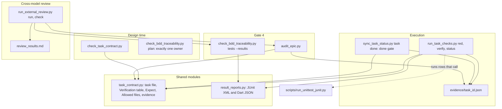
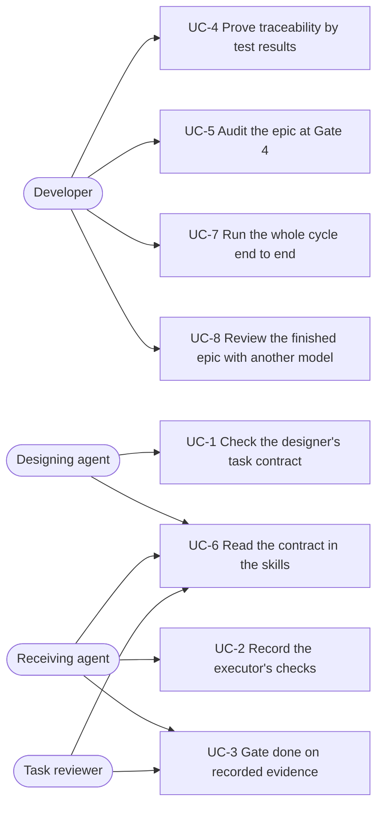
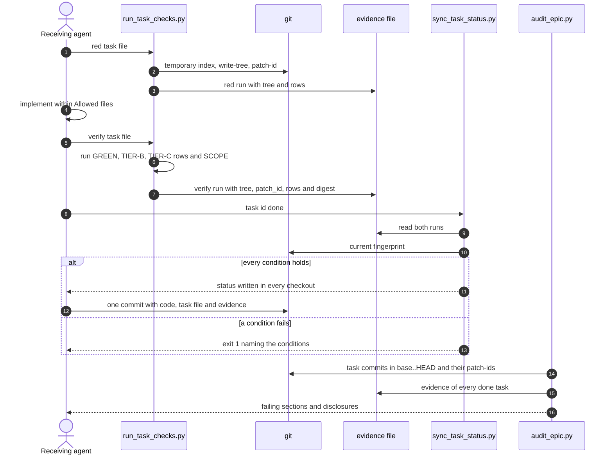

# Epic: Handoff task kiểm chứng được

## Mục lục

- [1. Meta Data](#1-meta-data)
- [2. Bối cảnh](#2-bối-cảnh)
- [3. Mục tiêu và ngoài mục tiêu](#3-mục-tiêu-và-ngoài-mục-tiêu)
- [4. Kiến trúc và thiết kế kỹ thuật](#4-kiến-trúc-và-thiết-kế-kỹ-thuật)
- [5. Kế hoạch integration test](#5-kế-hoạch-integration-test)
- [6. Môi trường kiểm chứng](#6-môi-trường-kiểm-chứng)
- [7. Kịch bản BDD](#7-kịch-bản-bdd)
- [8. Chiến lược triển khai và giảm thiểu rủi ro](#8-chiến-lược-triển-khai-và-giảm-thiểu-rủi-ro)
- [9. Phân rã task Kanban](#9-phân-rã-task-kanban)

## 1. Meta Data

- **Epic**: verifiable_task_handoff (thư mục `verifiable_task_handoff`)
- **Trạng thái**: Planned
- **Bản phát hành mục tiêu**: d3nexus 1.9.0
- **Platform**: Python — chính repo của kit: script chỉ dùng thư viện chuẩn, test bằng `unittest`,
  cùng các skill Markdown. `detect_project_type.sh` báo `unknown` cho repo này.
- **Spec gốc**: [2026-10-16-verifiable-task-handoff-design.vi.md](2026-10-16-verifiable-task-handoff-design.vi.md)

## 2. Bối cảnh

Một task file giao cho model rẻ hơn đang được tin để tự báo cáo việc hoàn thành của chính nó. Ở epic
`lifecycle_followups` của kit, mọi task đều thành `done` mà không ô checkbox nào được tick; ở
`lyrics_lexical_normalization` của `lyrics-sync`, task nghiệm thu tick mọi ô sau khi chỉ sửa một
file, một task khác sửa chính verifier coverage của project, và test đã ghi vào catalog thật. Các gate
của kit để lọt hết: traceability tìm chuỗi định danh mà không chạy test nào, chuyển sang `done` không
đọc evidence nào, và các prompt SDD biến lời kể của implementer thành bản ghi test. Spec gốc nêu từng
lỗi và cách sửa đã được duyệt; epic này hình thức hóa nó.

## 3. Mục tiêu và ngoài mục tiêu

**Mục tiêu:**

- Chỉ cho đạt `done` qua evidence mà script đã ghi khi chạy các dòng task khai báo.
- Kiểm path, lệnh và khai báo của designer với repo trước khi Gate 2 khép lại.
- Từ chối thay đổi grader không được phép bên trong task, và hiển thị mọi thay đổi grader ở Gate 5.
- Chứng minh scenario được cover bằng kết quả test JUnit hoặc Dart: đã chạy, không skip, đã pass.
- Cho developer một lần review epic đã xong bởi một model độc lập, qua Claude CLI hoặc Codex CLI mà họ
  chọn, trước Gate 4.

**Ngoài mục tiêu:**

- Ngăn giả mạo evidence có chủ đích.
- Test nghiệm thu do designer viết.
- Thay đổi `quality_check` hay các provider của nó.
- Chứng minh bằng máy rằng RED chạy trước khi có implementation.

## 4. Kiến trúc và thiết kế kỹ thuật

### 4.1 Kiến trúc tổng thể

### 4.2 Use case

### 4.3 Sequence: một task từ red tới audit

### 4.4 Check 1 — Impact analysis

`check_code_impact.py --base-ref main` chạy trên `check_bdd_traceability.py`, `sync_task_status.py`,
bốn file skill, hai prompt SDD, `scripts/verify.sh` và contract test, báo không có commit upstream chưa
merge và không có native bridge. Với các symbol `check_tests`, `check_plan` và `sync_task`, nơi gọi
duy nhất trong code là `test_sync_task_status.py`, vốn gọi thẳng `sync_task()`; gate nằm ở đường CLI
nên các test đó vẫn pass. Các dòng "no test file found" là false positive đã biết của bộ phân tích:
cả hai script đều có test nằm cạnh.

Tìm kiếm text cho hai script phát hiện một nơi gọi mà spec chưa nêu:
[doc-implementation](../../../skills/doc-implementation/SKILL.md) chạy
`sync_task_status.py task <task_id> done` cho mọi section của một tài liệu. Mục 4.5 giữ lifecycle tài
liệu đứng ngoài gate.

### 4.5 Bổ sung cho spec gốc

Các quyết định của spec giữ nguyên. Khi hình thức hóa, có năm chỗ trống được lấp:

1. **Gate chỉ áp dụng cho epic code.** Nó chạy khi overview của epic chứa task có một dòng bắt đầu
   bằng `Integration test roots:`, thứ mà dev-designer bắt buộc còn doc-designer không bao giờ viết.
   Task của epic tài liệu thành `done` y như hiện nay.
2. **Một JUnit runner dùng thư viện chuẩn.** Kit không có `pytest`, nên `scripts/run_unittest_junit.py`
   chạy các file `unittest` và ghi JUnit XML. Các dòng `TIER-C` và Integration results của chính epic
   này dùng nó.
3. **Scenario về văn bản skill là các method `unittest`.** Tag trong comment ở
   `scripts/test_lifecycle_document_contract.py` sẽ không được tính dưới traceability dựa trên kết
   quả, nên các scenario văn bản skill của VTH nằm trong `scripts/test_verifiable_handoff_text.py`,
   mỗi định danh một test method.
4. **Task đầu tiên bootstrap recorder.** Task 1 xây `run_task_checks.py`, thứ không thể ghi lần chạy
   RED của chính nó, nên task mang `RED: n/a — bootstrap` và ghi lần chạy `verify` bằng chính recorder
   nó vừa xây. Mọi task sau đều ghi cả hai lần chạy.
5. **Digest kết quả đến cùng bộ parse.** Recorder của Task 1 kiểm độ mới của báo cáo và ghi path của
   nó; Task 2 thêm digest. Task 1 không bao giờ bị gate `done`, nên không cần digest.

## 5. Kế hoạch integration test

Integration test roots: skills/dev-implementation/resources/scripts/, scripts/

Protected paths: .agents/quality/**, .devtool/epic/verifiable_task_handoff/bdd_scenarios.en.md, .devtool/epic/verifiable_task_handoff/bdd_scenarios.vi.md, scripts/verify.sh, scripts/test_lifecycle_document_contract.py

Integration results: python3 scripts/run_unittest_junit.py --junitxml build/test-results/vth.xml skills/dev-implementation/resources/scripts/test_run_task_checks.py skills/dev-implementation/resources/scripts/test_result_reports.py skills/dev-implementation/resources/scripts/test_check_bdd_traceability.py skills/dev-implementation/resources/scripts/test_check_task_contract.py skills/dev-implementation/resources/scripts/test_sync_task_status.py skills/dev-implementation/resources/scripts/test_audit_epic.py skills/dev-implementation/resources/scripts/test_run_external_review.py scripts/test_verifiable_handoff_text.py scripts/test_verifiable_handoff.py -> build/test-results/vth.xml

| Scenario | Test tự động | File |
|----------|--------------|------|
| VTH-HP-02, VTH-EC-05, VTH-ST-02, VTH-FR-01, VTH-FR-05 | Các method `test_vth_*` gọi `run_task_checks.py main()` trong repo git dùng một lần | `skills/dev-implementation/resources/scripts/test_run_task_checks.py` (mới) |
| VTH-HP-04, VTH-EC-06, VTH-FR-02 | Các method `test_vth_*` gọi `check_bdd_traceability.py main()` với fixture JUnit và Dart | `skills/dev-implementation/resources/scripts/test_check_bdd_traceability.py` |
| VTH-HP-01, VTH-EC-01, VTH-EC-02, VTH-EC-03, VTH-EC-04, VTH-FR-04 | Các method `test_vth_*` gọi `check_task_contract.py main()` trong repo git dùng một lần | `skills/dev-implementation/resources/scripts/test_check_task_contract.py` (mới) |
| VTH-ST-01 | `test_vth_st_01_*` gọi `check_bdd_traceability.py plan` | `skills/dev-implementation/resources/scripts/test_check_bdd_traceability.py` |
| VTH-HP-03, VTH-ST-03, VTH-ST-04, VTH-ST-05, VTH-ST-06, VTH-ST-07, VTH-AR-02 | Các method `test_vth_*` chạy CLI `sync_task_status.py` trên một checkout chính và một worktree của epic | `skills/dev-implementation/resources/scripts/test_sync_task_status.py` |
| VTH-HP-05, VTH-HP-10, VTH-ST-08, VTH-ST-09, VTH-AR-01, VTH-FR-03 | Các method `test_vth_*` gọi `audit_epic.py main()` trên các nhánh epic dựng trong repo dùng một lần | `skills/dev-implementation/resources/scripts/test_audit_epic.py` (mới) |
| VTH-HP-12, VTH-EC-07, VTH-ST-10, VTH-ST-11, VTH-FR-06, VTH-FR-07, VTH-FR-08 | Các method `test_vth_*` gọi `run_external_review.py main()` với executable giả `claude` và `codex` trên một `PATH` tạm | `skills/dev-implementation/resources/scripts/test_run_external_review.py` (mới) |
| VTH-HP-06, VTH-HP-07, VTH-HP-08, VTH-HP-09, VTH-HP-13 | Mỗi định danh một method `test_vth_*` khẳng định các cụm từ bắt buộc | `scripts/test_verifiable_handoff_text.py` (mới) |
| VTH-HP-11 | `test_vth_hp_11_*` chạy mọi script như subprocess, theo thứ tự vòng đời | `scripts/test_verifiable_handoff.py` (mới) |

Biên: git thật, filesystem thật, subprocess thật; không mạng và không dữ liệu live. Unit test của các
bộ parse nằm trong cùng các file, dưới dạng test method thường không mang định danh.

## 6. Môi trường kiểm chứng

- **Cách ly.** Mọi test dựng repo, worktree và file của nó dưới các thư mục `tempfile` rồi xóa sau đó.
  Không test nào đọc hay ghi cây làm việc của repo này, trừ `scripts/test_verifiable_handoff_text.py`,
  vốn chỉ đọc file skill.
- **Bị cấm.** Truy cập mạng, cấu hình git toàn cục của người dùng ngoài phần định danh, và mọi path
  nằm ngoài thư mục tạm hoặc repo này.
- **Biến.** Không có; cột `Needs` của mọi dòng Verification đều là `—`.
- **CLI review.** Không test nào gọi `claude` hay `codex` thật; các executable giả trên một `PATH` tạm
  đứng thay cho chúng.
- **Công cụ.** Thư viện chuẩn Python 3, `bash`, và git có `patch-id --stable` và `check-ignore`.
- **Báo cáo.** Task 1 thêm `build/` vào `.gitignore`, nên file kết quả không bao giờ làm bẩn cây.

## 7. Kịch bản BDD

Bộ Gherkin đầy đủ nằm ở [bdd_scenarios.vi.md](bdd_scenarios.vi.md). Chỉ mục:

| Use case | Scenario |
|----------|----------|
| UC-1 Hợp đồng task của designer được kiểm | VTH-HP-01, VTH-EC-01, VTH-EC-02, VTH-EC-03, VTH-EC-04, VTH-ST-01, VTH-FR-04 |
| UC-2 Các check của executor được ghi lại | VTH-HP-02, VTH-EC-05, VTH-ST-02, VTH-FR-01, VTH-FR-05 |
| UC-3 Gate done chỉ tin evidence đã được ghi | VTH-HP-03, VTH-ST-03, VTH-ST-04, VTH-ST-05, VTH-ST-06, VTH-ST-07, VTH-AR-02 |
| UC-4 Truy vết đọc kết quả test | VTH-HP-04, VTH-EC-06, VTH-FR-02 |
| UC-5 Gate 4 audit epic | VTH-HP-05, VTH-HP-10, VTH-ST-08, VTH-ST-09, VTH-AR-01, VTH-FR-03 |
| UC-6 Văn bản skill nêu rõ hợp đồng | VTH-HP-06, VTH-HP-07, VTH-HP-08, VTH-HP-09, VTH-HP-13 |
| UC-7 Cả vòng đời chạy trọn từ đầu đến cuối | VTH-HP-11 |
| UC-8 Một model thứ hai review epic đã xong | VTH-HP-12, VTH-EC-07, VTH-ST-10, VTH-ST-11, VTH-FR-06, VTH-FR-07, VTH-FR-08 |

## 8. Chiến lược triển khai và giảm thiểu rủi ro

Thay đổi được phát hành ở d3nexus 1.9.0, sau khi epic được merge, kèm một mục CHANGELOG ghi rằng gate
`done` từ chối task của các epic code đang chạy cho tới khi chúng được retrofit qua Updating an
Existing Epic của dev-designer. `scripts/verify.sh` phải pass với mọi test mới đã được nối vào.

Thay đổi rủi ro nhất là gate `done`: một project đang giữa epic sẽ thấy lần `done` tiếp theo bị từ
chối. Lời từ chối nêu "retrofit required", và epic tài liệu không bị ảnh hưởng (mục 4.5). Rollback là
revert commit merge của epic; các file evidence đã commit không có tác dụng gì khi không còn gate.

Gate 4 trong repo này vẫn dựa vào `scripts/verify.sh`, vì repo không có quality registry. Task cuối
cùng cũng chạy audit và traceability dựa trên kết quả cho chính epic này.

## 9. Phân rã task Kanban

1. [Task 1: Verification table parser and evidence recorder](task_1_verification_table_parser_and_evidence_recorder.md)
2. [Task 2: Test result reports and result-based traceability](task_2_test_result_reports_and_result_based_traceability.md)
3. [Task 3: Design-time task contract check](task_3_design_time_task_contract_check.md)
4. [Task 4: Done gate and evidence status](task_4_done_gate_and_evidence_status.md)
5. [Task 5: Gate 4 epic audit](task_5_gate_4_epic_audit.md)
6. [Task 6: Cross-model review runner](task_6_cross_model_review_runner.md)
7. [Task 7: Skill, prompt and reference text](task_7_skill_prompt_and_reference_text.md)
8. [Task 8: End-to-end lifecycle acceptance](task_8_end_to_end_lifecycle_acceptance.md)
