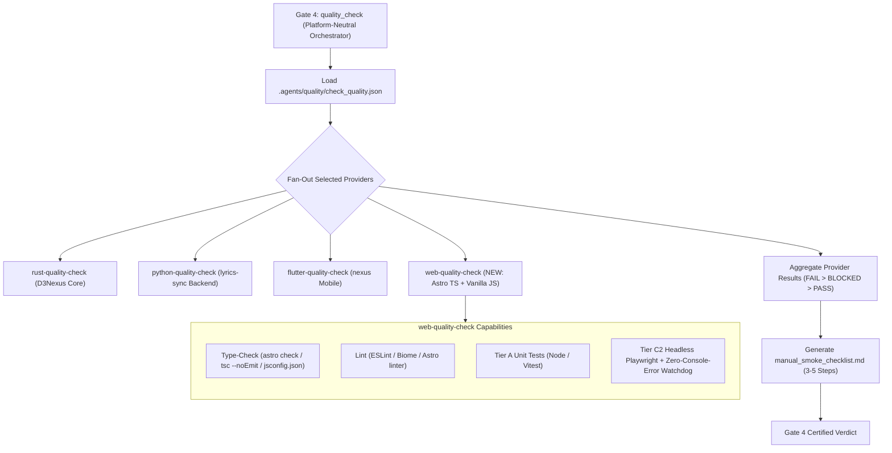
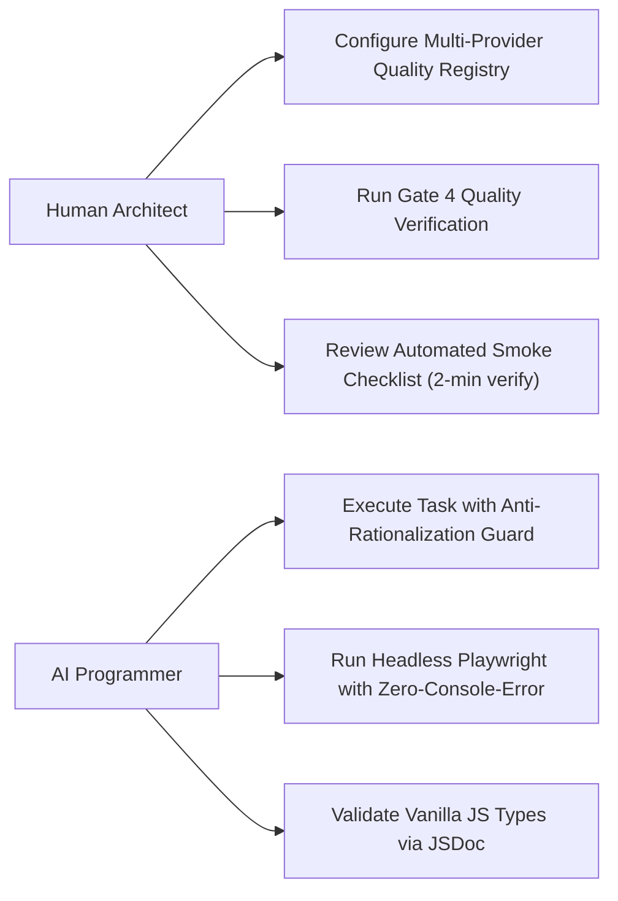
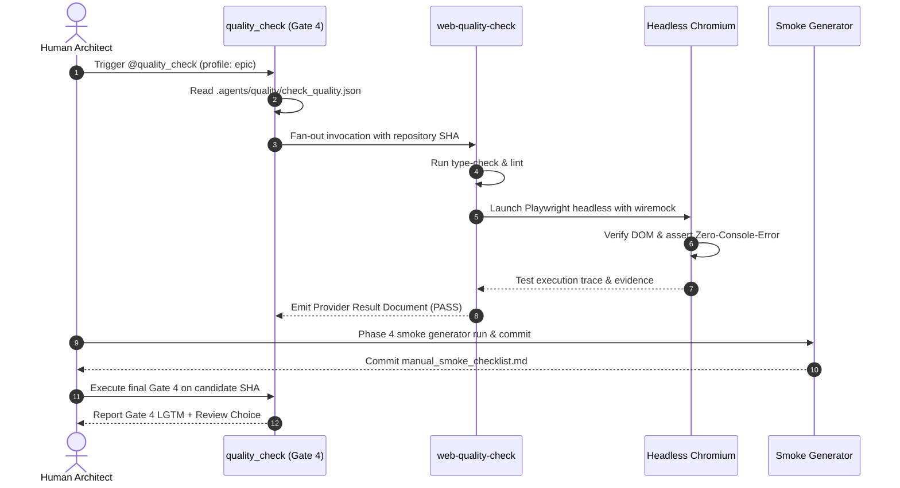

# Epic: Web Quality Check Provider and Integration Quality Gate

## Table of Contents

- [Meta Data](#meta-data)
- [Background](#background)
- [Goals and Non-Goals](#goals-and-non-goals)
- [Architecture and Technical Design](#architecture-and-technical-design)
  - [High-Level Architecture](#high-level-architecture)
  - [Use Cases](#use-cases)
  - [Sequence Diagram](#sequence-diagram)
  - [Integration Test Plan and Boundary Matrix](#integration-test-plan-and-boundary-matrix)
  - [Comprehensive BDD Test Scenarios](#comprehensive-bdd-test-scenarios)
- [Verification Environment](#verification-environment)
- [Shared Contract Impact](#shared-contract-impact)
- [Rollout Strategy and Mitigation](#rollout-strategy-and-mitigation)
- [Kanban Tasks Breakdown](#kanban-tasks-breakdown)

## Meta Data

- **Epic Name**: `web_quality_check_and_integration_gate`
- **Epic Slug**: `web-quality-check-and-integration-gate`
- **Status**: Packaged
- **Target Release**: v1.2.0
- **Platform**: Polyglot / Quality Architecture
- **Source Spec**: [2026-11-04-web-quality-check-and-integration-gate-design.en.md](./2026-11-04-web-quality-check-and-integration-gate-design.en.md)

## Background

In our multi-repository ecosystem (`D3Nexus`, `lyrics-sync`, `nexus`), developers experience a significant gap between design specifications and actual runtime behavior. This gap forces human engineers to conduct extensive manual testing on devices and browsers for every release:
- Unit tests pass with 100% green mocks, but fail at runtime due to real DI registration errors, serialization bugs, and DOM event wiring defects.
- Gate 4 (`quality_check`) lacks a web provider, leaving `D3Nexus` (`apps/learning-web`) and `lyrics-sync` (17 Vanilla JS preview files) completely unverified.
- AI coding agents frequently rationalize shortcuts by avoiding headless browser tests and ignoring browser console errors.

## Goals and Non-Goals

### Goals
- Deliver the `web-quality-check` provider implementing Provider Result Contract v1 for Astro TypeScript and Vanilla JavaScript projects.
- Enable multi-provider polyglot quality orchestration at Gate 4 across `D3Nexus` and `lyrics-sync`.
- Enforce the 3-Tier Testing Standard (Tier A Unit, Tier C1 Subcutaneous Mobile/Backend, Tier C2 Headless Browser Web).
- Embed Anti-Rationalization Tables and Doubt-Driven Verification from `addyosmani/agent-skills` into skill workflows.
- Automatically generate a concise 3-5 step `manual_smoke_checklist.md` upon epic completion to reduce manual verification time from 30 minutes to 2 minutes.

### Non-Goals
- Migrating Vanilla JS files in `lyrics-sync` to TypeScript (type checking is done in-place via JSDoc and `jsconfig.json`).
- Rewriting existing fast unit tests.
- Forcing full mobile emulators into local PR/Epic quality check gates.

## Architecture and Technical Design

### High-Level Architecture



### Use Cases



### Sequence Diagram



### Integration Test Plan and Boundary Matrix

```text
Integration test roots: tests/, skills/web-quality-check/tests/
Protected paths: .agents/quality/**, .devtool/epic/web_quality_check_and_integration_gate/bdd_scenarios.en.md, .devtool/epic/web_quality_check_and_integration_gate/bdd_scenarios.vi.md
Integration results: python3 -m pytest tests/ --junitxml=build/test-results/pytest.xml -> build/test-results/pytest.xml
```

| Boundary Seam | Testing Strategy | Verification Target |
| :--- | :--- | :--- |
| Provider Contract | Mock `quality_check` invocation payload | Verify status aggregation and schema conformance |
| Astro Web / TypeScript | Headless Playwright + Zero-Console-And-Layout-Defect Watchdog fixture | Verify DOM elements, Custom Elements, zero console errors, 404 static asset network trap, computed CSS styling (`assertVisualIntegrity`), and state leak / text duplication prevention |
| Vanilla JS Preview | `tsc --project jsconfig.json` + Playwright | Verify type safety without `.ts` migration, and page crash prevention |
| Task Workflow Engine | BDD traceability & Anti-Rationalization audit | Verify tasks rejecting fake Tier C mocks, validating computed CSS against Visual Companion, and requiring real integration runs |

## Verification Environment

- Execution environment: Local macOS / Linux CLI with Node.js v20+, Python 3.11+, and Playwright Chromium browser installed.
- No live network dependencies: All external network calls in tests are intercepted at the socket boundary.
- File system isolation: Test runs operate in temporary isolated directories without mutating working git trees.

### Comprehensive BDD Test Scenarios

The suite covers all 5 dimensions under the `[WQG-]` prefix:
1. **Happy Paths (`WQG-HP-xx`)**: Successful provider execution, Playwright headless pass, clean Vanilla JS type check, and smoke checklist generation.
2. **Edge Cases (`WQG-EC-xx`)**: Missing capabilities, partial web configs, empty test suites, third-party console warnings, and mutually exclusive DOM state leaks or duplicate text rendering (`WQG-EC-03`).
3. **State Transitions (`WQG-ST-xx`)**: Dynamic transition from `BLOCKED` to `PASS` upon fixing configuration, and task status synchronization.
4. **Async & Concurrency (`WQG-AR-xx`)**: Concurrent provider fan-out in Gate 4, non-blocking Playwright webServer startup.
5. **Failures & Resilience (`WQG-FR-xx`)**: Console error detection triggering immediate failure, uncaught exception traps, broken contract detection, and 404 stylesheet / unstyled computed geometry failure (`WQG-FR-03`).

## Shared Contract Impact

None — self-contained quality provider and workflow enhancement.

## Rollout Strategy and Mitigation

- **Phase 1**: Author `web-quality-check` skill and validate its contract with unit and integration tests.
- **Phase 2**: Add Playwright Zero-Console-And-Layout-Defect watchdog and Vanilla JS `jsconfig.json` checker.
- **Phase 3**: Update `dev-designer`, `dev-implementation`, and `test-driven-development` with Anti-Rationalization Tables and Subcutaneous Testing guidelines.
- **Phase 4**: Configure polyglot registries in `D3Nexus` and `lyrics-sync`, verifying Gate 4 multi-provider execution.

## Kanban Tasks Breakdown

- [Task 01: Web Quality Check Skill and Provider Contract](./task_01_web_quality_check_skill_and_contract.md)
- [Task 02: Playwright Zero-Console-Error Watchdog and Fixtures](./task_02_playwright_zero_error_watchdog.md)
- [Task 03: Vanilla JS JSDoc Type-Checking Configuration](./task_03_jsconfig_and_vanilla_js_type_checker.md)
- [Task 04: Polyglot Gate 4 Registry and Multi-Provider Fan-Out](./task_04_polyglot_gate4_registry_and_fanout.md)
- [Task 05: Anti-Rationalization and Doubt-Driven Workflow Rules](./task_05_anti_rationalization_and_doubt_driven_workflow.md)
- [Task 06: Automated Manual Smoke Checklist Generator](./task_06_automated_manual_smoke_checklist_generator.md)

