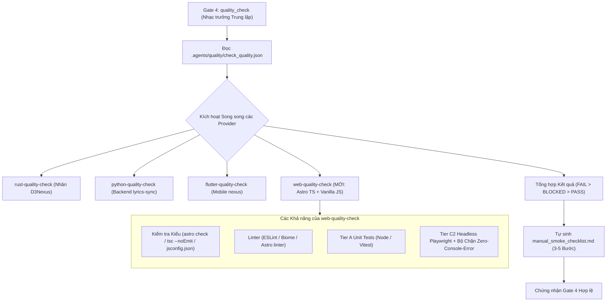
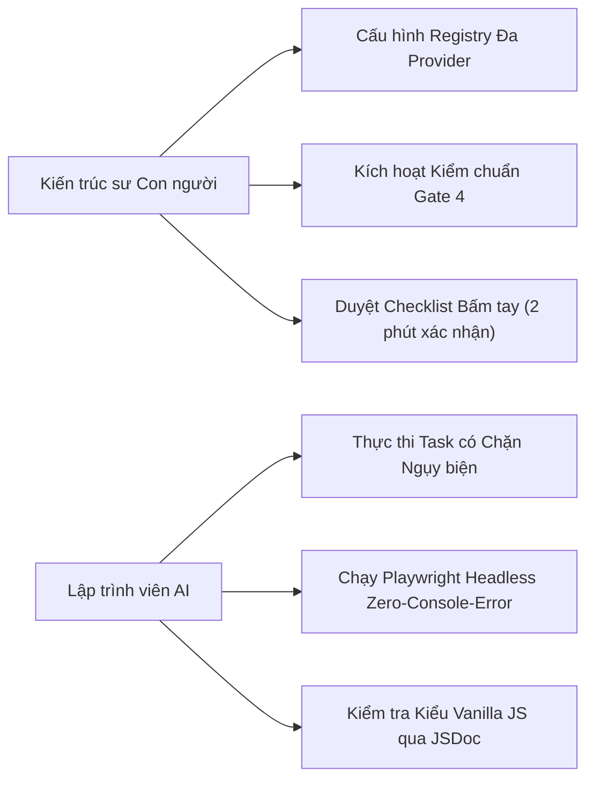
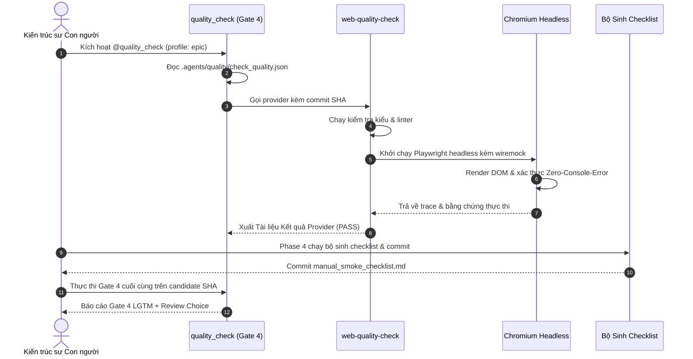

# Epic: Web Quality Check Provider và Integration Quality Gate

## Mục lục

- [Mục lục](#mục-lục)
- [Meta Data](#meta-data)
- [Bối cảnh](#bối-cảnh)
- [Mục tiêu và Giới hạn](#mục-tiêu-và-giới-hạn)
- [Kiến trúc và Thiết kế Kỹ thuật](#kiến-trúc-và-thiết-kế-kỹ-thuật)
  - [Kiến trúc Tổng thể](#kiến-trúc-tổng-thể)
  - [Use Cases](#use-cases)
  - [Sequence Diagram](#sequence-diagram)
  - [Kế hoạch Kiểm thử Tích hợp và Ma trận Ranh giới](#kế-hoạch-kiểm-thử-tích-hợp-và-ma-trận-ranh-giới)
  - [Các Kịch bản BDD Toàn diện](#các-kịch-bản-bdd-toàn-diện)
- [Môi trường Kiểm chứng](#môi-trường-kiểm-chứng)
- [Tác động Hợp đồng Dùng chung](#tác-động-hợp-đồng-dùng-chung)
- [Chiến lược Triển khai và Giảm thiểu Rủi ro](#chiến-lược-triển-khai-và-giảm-thiểu-rủi-ro)
- [Phân rã Tác vụ Kanban](#phân-rã-tác-vụ-kanban)

## Meta Data

- **Tên Epic**: `web_quality_check_and_integration_gate`
- **Slug Epic**: `web-quality-check-and-integration-gate`
- **Trạng thái**: Packaged
- **Phiên bản Mục tiêu**: v1.2.0
- **Nền tảng**: Polyglot / Quality Architecture
- **Tài liệu Đặc tả Gốc**: [2026-11-04-web-quality-check-and-integration-gate-design.vi.md](./2026-11-04-web-quality-check-and-integration-gate-design.vi.md)

## Bối cảnh

Trong hệ sinh thái đa repo (`D3Nexus`, `lyrics-sync`, `nexus`), các kỹ sư đối mặt với khoảng cách lớn giữa thiết kế kiến trúc và hành vi thực tế khi chạy. Khoảng cách này buộc lập trình viên phải kiểm thử thủ công (bấm tay) rất nhiều trên thiết bị và trình duyệt trước mỗi đợt release:
- Unit test pass 100% xanh bằng mock, nhưng gãy khi chạy thật do lỗi đăng ký DI, lỗi giải mã JSON, và lỗi gắn sự kiện DOM.
- Gate 4 (`quality_check`) thiếu provider cho Web, bỏ quên hoàn toàn `D3Nexus` (`apps/learning-web`) và `lyrics-sync` (17 file Vanilla JS).
- AI coding agent thường xuyên tự tìm đường tắt, né tránh chạy trình duyệt headless và bỏ qua lỗi console.

## Mục tiêu và Giới hạn

### Mục tiêu
- Xây dựng provider `web-quality-check` tuân thủ Hợp đồng Kết quả Provider v1 cho các dự án Astro TypeScript và Vanilla JavaScript.
- Kích hoạt điều phối chất lượng đa nền tảng (polyglot) tại Gate 4 trên cả `D3Nexus` và `lyrics-sync`.
- Thực thi Chuẩn Kiểm thử 3 Lớp (Tier A Unit, Tier C1 Dưới da Mobile/Backend, Tier C2 Trình duyệt Headless Web).
- Đưa Bảng Chống Ngụy biện và Cơ chế Phản biện Nghi vấn từ `addyosmani/agent-skills` vào quy trình kỹ năng.
- Tự động sinh tài liệu 3–5 bước `manual_smoke_checklist.md` sau khi hoàn thành epic để rút ngắn thời gian bấm tay từ 30 phút xuống còn 2 phút.

### Giới hạn
- Không chuyển đổi 17 file Vanilla JS trong `lyrics-sync` sang TypeScript (kiểm tra kiểu dữ liệu tại chỗ qua JSDoc và `jsconfig.json`).
- Không viết lại các unit test nhanh hiện có.
- Không ép buộc bật emulator thiết bị cho các cổng duyệt cục bộ PR/Epic.

## Kiến trúc và Thiết kế Kỹ thuật

### Kiến trúc Tổng thể



### Use Cases



### Sequence Diagram



### Kế hoạch Kiểm thử Tích hợp và Ma trận Ranh giới

```text
Integration test roots: tests/, skills/web-quality-check/tests/
Protected paths: .agents/quality/**, .devtool/epic/web_quality_check_and_integration_gate/bdd_scenarios.en.md, .devtool/epic/web_quality_check_and_integration_gate/bdd_scenarios.vi.md
Integration results: python3 -m pytest tests/ --junitxml=build/test-results/pytest.xml -> build/test-results/pytest.xml
```

| Mối ghép Ranh giới | Chiến lược Kiểm thử | Mục tiêu Kiểm chứng |
| :--- | :--- | :--- |
| Hợp đồng Provider | Payload giả lập gọi `quality_check` | Xác thực tổng hợp trạng thái và tuân thủ schema |
| Astro Web / TypeScript | Playwright Headless + Fixture wiremock | Xác thực phần tử DOM, Custom Elements, và zero console error |
| Vanilla JS Preview | `tsc --project jsconfig.json` + Playwright | Xác thực an toàn kiểu dữ liệu không cần đuôi `.ts`, ngăn ngừa crash |
| Luồng Workflow Tác vụ | Rà soát BDD traceability & Anti-Rationalization | Xác thực tác vụ từ chối mock ảo Tier C và yêu cầu chạy test tích hợp thật |

## Môi trường Kiểm chứng

- Môi trường thực thi: CLI cục bộ macOS / Linux có cài sẵn Node.js v20+, Python 3.11+, và trình duyệt Chromium Playwright.
- Không phụ thuộc mạng ngoài: Mọi lệnh gọi mạng bên ngoài trong test đều bị chặn tại socket.
- Cách ly hệ thống tệp: Các lượt chạy test diễn ra trong thư mục tạm độc lập, không làm biến đổi git working tree.

### Các Kịch bản BDD Toàn diện

Bộ test bao phủ đủ 5 chiều với tiền tố `[WQG-]`:
1. **Happy Paths (`WQG-HP-xx`)**: Thực thi provider thành công, Playwright headless pass, type check Vanilla JS sạch, và tự sinh checklist bấm tay.
2. **Edge Cases (`WQG-EC-xx`)**: Thiếu capability, cấu hình web bị khuyết, bộ test rỗng, và cảnh báo console bên thứ ba.
3. **Chuyển đổi Trạng thái (`WQG-ST-xx`)**: Chuyển trạng thái linh hoạt từ `BLOCKED` sang `PASS` khi sửa cấu hình, và đồng bộ trạng thái task.
4. **Bất đồng bộ & Đồng thời (`WQG-AR-xx`)**: Kích hoạt đa provider đồng thời trong Gate 4, khởi động webServer Playwright không gây nghẽn.
5. **Thất bại & Khả năng Phục hồi (`WQG-FR-xx`)**: Bắt lỗi console error gây fail ngay lập tức, bẫy ngoại lệ chưa xử lý, và phát hiện hợp đồng bị gãy.

## Tác động Hợp đồng Dùng chung

Không có — đây là bộ kỹ năng provider chất lượng và cải tiến quy trình độc lập.

## Chiến lược Triển khai và Giảm thiểu Rủi ro

- **Giai đoạn 1**: Xây dựng skill `web-quality-check` và kiểm chứng hợp đồng bằng unit và integration test.
- **Giai đoạn 2**: Bổ sung bộ giám sát Zero-Console-Error cho Playwright và bộ kiểm tra `jsconfig.json` cho Vanilla JS.
- **Giai đoạn 3**: Cập nhật `dev-designer`, `dev-implementation` và `test-driven-development` với Bảng Chống Ngụy biện và hướng dẫn Kiểm thử Dưới da.
- **Giai đoạn 4**: Cấu hình registry đa provider tại `D3Nexus` và `lyrics-sync`, kiểm chứng Gate 4 chạy đa nền tảng.

## Phân rã Tác vụ Kanban

- [Task 01: Web Quality Check Skill và Hợp đồng Provider](./task_01_web_quality_check_skill_and_contract.md)
- [Task 02: Bộ Giám sát Playwright Zero-Console-Error và Fixtures](./task_02_playwright_zero_error_watchdog.md)
- [Task 03: Cấu hình Kiểm tra Kiểu Vanilla JS qua JSDoc](./task_03_jsconfig_and_vanilla_js_type_checker.md)
- [Task 04: Registry Gate 4 Đa Nền tảng và Kích hoạt Song song](./task_04_polyglot_gate4_registry_and_fanout.md)
- [Task 05: Quy tắc Quy trình Chống Ngụy biện và Phản biện Nghi vấn](./task_05_anti_rationalization_and_doubt_driven_workflow.md)
- [Task 06: Bộ Tự động Sinh Kịch bản Smoke Test Bấm tay](./task_06_automated_manual_smoke_checklist_generator.md)
