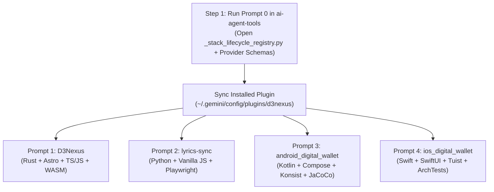

# Open Polyglot Lifecycle and Cross-Repository Quality Check Handoff Blueprint

- **Date**: 2026-11-27 (v2 Appendix updated 2026-11-28)
- **Author**: Role 2.1 / 2.3 (`nexus` baseline reference & `ai-agent-tools` upstream kit)
- **Diátaxis mode**: reference
- **Audience**: Human Architects (Role 1.0) and AI Architects / Orchestrators / Programmers (Roles 2.1–2.3) maintaining `d3nexus` and polyglot product repositories
- **Acceptance**: A maintainer can inspect the 5 Open-Closed lifecycle contracts, verify stack-scoped `TIER-B` / `Tier C1` / `Tier C2` / coverage invariants, or execute any repository synchronization prompt without cross-stack coupling.
- **Target Repositories**:
  1. `ai-agent-tools` (`~/AllProjects/ai-agent-tools` -> `~/.gemini/config/plugins/d3nexus`)
  2. `D3Nexus` (`~/AllProjects/D3Nexus` — Rust, Astro 5, TypeScript/JS, Rust WASM, Python)
  3. `lyrics-sync` (`~/AllProjects/lyrics-sync` — Python, FastAPI Stateless Worker, Vanilla JS, Playwright)
  4. `android_digital_wallet` (`~/AllProjects/digital_wallet/android_digital_wallet` — Kotlin, Jetpack Compose, Gradle, Spotless, Detekt, BCV, Konsist, JaCoCo)
  5. `ios_digital_wallet` (`~/AllProjects/digital_wallet/ios_digital_wallet` — Swift, SwiftUI, Tuist, SwiftPM, SwiftFormat, SwiftLint, ArchTests, `llvm-cov`)

## Table of Contents

- [1 Open Architecture Overview and Rollout Sequence](#1-open-architecture-overview-and-rollout-sequence)
- [2 Declarative Stack Lifecycle Registry Contract](#2-declarative-stack-lifecycle-registry-contract)
- [3 Prompt 0 Kit Upgrade in ai-agent-tools](#3-prompt-0-kit-upgrade-in-ai-agent-tools)
- [4 Prompt 1 Hub Synchronization in D3Nexus](#4-prompt-1-hub-synchronization-in-d3nexus)
- [5 Prompt 2 Worker Synchronization in lyrics-sync](#5-prompt-2-worker-synchronization-in-lyrics-sync)
- [6 Prompt 3 Android Synchronization in android_digital_wallet](#6-prompt-3-android-synchronization-in-android_digital_wallet)
- [7 Prompt 4 iOS Synchronization in ios_digital_wallet](#7-prompt-4-ios-synchronization-in-ios_digital_wallet)
- [8 Post-Rollout v2 Architecture Evolution (shift_left_quality_resolver)](#8-post-rollout-v2-architecture-evolution-shift_left_quality_resolver)

## 1 Open Architecture Overview and Rollout Sequence

Following the full `/quality_check` and `/dev-lifecycle` baseline remediation completed in `nexus` (commit `49a6ee7a` on `develop`), this blueprint standardizes both the **agent kit (`ai-agent-tools`)** and **all four sibling repositories** without introducing cross-platform coupling, token bloat, or per-task latency regressions.



### Design Invariants Preserved Across All Repositories

1. **Zero Cross-Project Breakage**: Every static contract check, pool cache mount, and `triage-fix` risk pattern is keyed strictly by `.agents/quality/<stack>-quality.json` presence AND file suffix (`path.suffix`). Untouched languages in single-stack or polyglot repositories incur zero checks and zero false positives.
2. **Zero LLM Token Overhead**: All contract validators, hunk-level diff-coverage gates ([check_diff_coverage.py](../../skills/quality_check/resources/scripts/check_diff_coverage.py) in `ai-agent-tools`, ported from `scripts/check_lcov_threshold.py` in `nexus`), security scanners, and PR diff/impact ratchets run as deterministic local CLI processes emitting compact one-line `PASS` summaries.
3. **Sub-15-Second Per-Task Speed**: `Task 1..N-1` execute scoped unit/regression tests, scoped `TIER-B` checks on `Allowed files`, and fast `Tier C1` headless subcutaneous integration suites (`< 5s`); full workspace test + dual-floor coverage + `--all-files` ratchets run once at Gate 4 (`--profile epic`).

## 2 Declarative Stack Lifecycle Registry Contract

Instead of adding `if is_python_task ... elif is_flutter_task ...` branches across `ai-agent-tools`, [_stack_lifecycle_registry.py](../../skills/dev-implementation/resources/scripts/_stack_lifecycle_registry.py) and [resolve_task_quality_plan.py](../../skills/dev-implementation/resources/scripts/resolve_task_quality_plan.py) define five open contracts:

| Contract | Responsibility | Manifest Override Hook |
| :--- | :--- | :--- |
| **`TierBContractAdapter`** | Validates that a task's `TIER-B` rows format, lint, and type-check all matching `Allowed files` (including `(new)` untracked files) and run boundary checks when `domain/` or build manifests change. | Optional `"task_tier_b"` object inside `.agents/quality/<stack>-quality.json` |
| **`PoolWorkspaceStrategy`** | Composes `symlink` mounts (`target`, `node_modules`, `.astro`, `.venv`, `.gradle`, `.build`, `Pods`) with `apfs_cow_tree` (`cp -c -R` on macOS, copy fallback on Linux) for Melos `.dart_tool/` trees and gitignored `secureFiles/` / `local.properties` / `.xcconfig`. | Optional `"pool_mounts"` array inside `.agents/quality/check_quality.json` |
| **`TriageSurfaceRegistry`** | Evaluates `manage_worker_pool.py triage-fix` diffs using suffix-scoped `SurfaceRuleSet` entries (`.py`, `.rs`, `.ts/.tsx/.js/.mjs/.astro`, `.dart`, `.kt/.kts`, `.swift`) to block `tier2-short-circuit` on native bridge, wire schema, persistence, concurrency, or test-skip edits. | Optional `"triage_surfaces"` array inside `.agents/quality/<stack>-quality.json` |
| **`TierCTaxonomy`** | Separates mandatory fast host/VM subcutaneous integration (`Tier C1`, `< 5s`) from opt-in simulator/emulator/browser runtime suites (`Tier C2`, gated by `Needs:` or Gate 4). | `Integration test roots:` and `Needs:` in Epic HLD |
| **`QualityPlanResolver`** | Resolves planned file lists (`d3nexus resolve-quality --files ...`) into 5–10 stack-filtered lines covering canonical/forbidden test globs, paired source rules, V8 LCOV unit + Playwright `# tier: C2` requirements, `coverage_floors.json` ratchets, `?v=` cache-bust templates, and scoped `TIER-B` commands. | Optional `"test_routing"` object inside `.agents/quality/<stack>-quality.json` & `.agents/quality/coverage_floors.json` |

### Reference Hunk Diff Coverage Engine

[check_diff_coverage.py](../../skills/quality_check/resources/scripts/check_diff_coverage.py) (standardized from `~/AllProjects/nexus/scripts/check_lcov_threshold.py`) implements the canonical Python 3 stdlib hunk-level diff-coverage and monotonic floor verifier (`--diff-base`, `--diff-files`, `--min-diff-coverage`, `--package-floors`, `--source-ext`), supporting LCOV (`flutter test --coverage`, `cargo llvm-cov --lcov`, Vitest/Node V8 LCOV, `llvm-cov export -format=lcov`), Cobertura XML (`pytest --cov`), and JaCoCo XML (`./gradlew jacocoTestReport`).

## 3 Prompt 0 Kit Upgrade in ai-agent-tools

Open `~/AllProjects/ai-agent-tools` in its own IDE workspace window and paste the prompt below:

```markdown
Use `/dev-lifecycle` (or `/dev-brainstorming` -> `/writing-plans` if scoped as a single cohesive toolkit upgrade; note any active worktrees such as `observer_hardening_2026_11` during `resume_context.py` startup) in `~/AllProjects/ai-agent-tools` to upgrade `d3nexus` (`/dev-lifecycle`, `/dev-designer`, `/dev-implementation`, `/setup_quality_check`, and the `*-quality-check` skills) to an **Open-Closed Polyglot Lifecycle & Quality Architecture**.

### Context & Reference Implementation
We just completed a full `/quality_check` + `/dev-lifecycle` hardening and baseline remediation in `~/AllProjects/nexus` (commit `49a6ee7a`), including a reference language-agnostic hunk-level LCOV diff-coverage engine at `~/AllProjects/nexus/scripts/check_lcov_threshold.py`. Read `~/AllProjects/nexus/docs/development/polyglot-quality-lifecycle-handoff.md` and `~/AllProjects/nexus/scripts/check_lcov_threshold.py` as read-only reference inputs.

### Architectural Requirements (Strict Open-Closed Design, Zero Cross-Stack Coupling)

1. **Create Declarative Stack Lifecycle Registry (`skills/dev-implementation/resources/scripts/_stack_lifecycle_registry.py`)**:
   - Replace hardcoded Python-only checks with an open, extension-and-manifest-keyed registry supporting **6 built-in stack families** out of the box (`python`, `flutter`, `rust`, `web`, `android`, `ios`) AND user-extensible overrides via `.agents/quality/<stack>-quality.json` and `.agents/quality/check_quality.json` (Python 3 stdlib only):
     - **`TierBContractAdapter` (consumed by `check_task_contract.py`)**:
       - Dispatch strictly over the file extensions present in a task's `Allowed files` intersected with activemanifests in `.agents/quality/<stack>-quality.json` (preserving legacy `check_python_tier_b` fallback when no manifest exists).
       - Support polyglot tasks touching multiple languages in one task (e.g., `.rs` + `.ts` in `D3Nexus`, `.py` + `.js` in `lyrics-sync`, `.dart` + `.rs`/`.kt`/`.swift` in `nexus`), while guaranteeing 0% invocation on untouched stacks.
       - Built-in adapter contracts (overridable via optional `"task_tier_b"` in `<stack>-quality.json`):
         * `flutter` (`*.dart`): Require `dart format` covering all `.dart` `Allowed files` (including `(new)` files before `git add`), `dart/flutter analyze`, plus boundary/hygiene checks when `domain/` or `pubspec.yaml` is touched.
         * `rust` (`*.rs`): Require `cargo fmt --check` and `cargo clippy` (`-D warnings`), plus architecture boundary check (`xtask`) when `Cargo.toml` or `domain` crates change.
         * `web` (`*.ts`, `*.tsx`, `*.js`, `*.mjs`, `*.astro`): Require configured linter/guard and type-checker (`tsc --noEmit` / `astro check` / `check_vanilla_js.py`).
         * `python` (`*.py`): Preserve full `Allowed files` `ruff check`, `ruff format --check`, and `mypy`/`pyright`/`ty` coverage plus `lint-imports` on cross-module changes.
         * `android` (`*.kt`, `*.kts`): Require `spotlessCheck` and `detekt` (plus `:konsist-test:test` / `apiCheck` when domain or public ABI files change).
         * `ios` (`*.swift`): Require `swiftformat --lint` and `swiftlint lint --strict` (plus `ArchTests` / `check_module_boundaries.sh` when domain or `Project.swift`/`Package.swift` files change).
     - **`PoolWorkspaceStrategy` (consumed by `manage_worker_pool.py` `link_shared_caches`)**:
       - Keep `symlink` for heavy binary/package caches (`target`, `node_modules`, `.astro`, `.venv`, `.gradle`, `.build`, `Pods`) so Rust, Android, iOS, Web, and Python pool init stays O(1).
       - Use `apfs_cow_tree` (`cp -c -R` on Darwin, `shutil.copytree` fallback on Linux) — NEVER a file-symlink that breaks `.gitignore` `.dart_tool/` directory rules — for Melos/Flutter `.dart_tool/` directories across root, `packages/*`, `features/*`, and `bricks/*/hooks/.dart_tool`, plus gitignored `secureFiles/`, `local.properties`, and `.xcconfig` when present in main worktree.
       - Honor optional `"pool_mounts"` entries (`{"path": "...", "mode": "symlink|cow_copy"}`) in `.agents/quality/check_quality.json`.
     - **`TriageSurfaceRegistry` (consumed by `manage_worker_pool.py` `triage-fix`)**:
       - Scope every `SurfaceRuleSet` (`signature`, `api_wire`, `persistence`, `concurrency`, `test_weakening`) strictly by `Path(changed_file).suffix` so Kotlin/Swift/Rust/TS/Dart/Python patterns never cross-fire:
         * `.dart`: `MethodChannel|EventChannel|@HostApi|@FlutterApi|ffi\.`, `@RestApi|@GET|@POST|fromJson`, `DriftDatabase|outbox_entries`, `Isolate\.|Completer<`, and `skip:\s*(?:true|['"])`.
         * `.rs`: `pub\s+(?:async\s+)?(?:fn|struct|enum|trait)`, `unsafe\b|extern\s+"C"`, `sqlx::query|SELECT|INSERT\s+INTO`, `tokio::spawn|Mutex|RwLock`, and `#\[ignore\b`.
         * `.ts/.tsx/.js/.mjs/.astro`: `export\s+(?:async\s+)?(?:function|class|interface|type)`, `fetch\(|WebSocket|EventSource`, `indexedDB|localStorage`, `Worker\(|SharedArrayBuffer`, and `\.(?:skip|fixme)\(`.
         * `.kt/.kts`: `(?:suspend\s+)?fun\s+|interface\s+`, `@(?:GET|POST|PUT|DELETE|Entity|Dao)\b|MethodChannel`, `RoomDatabase|SQLiteDatabase`, `Mutex|CoroutineScope|Dispatchers\.`, and `@(?:Ignore|Disabled)\b`.
         * `.swift`: `public\s+(?:func|struct|class|protocol|enum|actor)`, `Codable|URLSession|FlutterMethodChannel`, `@Model|NSManagedObject|sqlite3`, `\bactor\s+|Task\.detached|NSLock`, and `XCTSkip|@Test\([^)]*\.disabled`.
         * `.py`: Preserve existing Python FastAPI/SQLAlchemy/asyncio/pytest rules.

2. **Standardize `Tier C1` vs `Tier C2` & Portable Diff-Coverage Across Docs and Providers**:
   - Update `skills/dev-designer/SKILL.md`, `skills/dev-designer/references/verification-rows.md`, `skills/dev-implementation/SKILL.md`, and `skills/dev-implementation/references/worker-execution-rules.md` to:
     - Replace hardcoded `uv run pytest` fixer/tier prose with concise platform-mapped commands across all 6 stacks.
     - Explicitly distinguish `Tier C1` (mandatory fast host/VM subcutaneous integration `< 5s`, e.g., `test/integration/*_integration_test.dart` for Flutter, `cargo nextest` integration tests for Rust, Vitest/Node wire tests for Web, `tests/integration/` for Python, JVM/Robolectric `*FlowTest` for Android, `swift test --filter *FlowTests` for iOS) from `Tier C2` (`Needs:`-gated device/simulator/Playwright E2E).
   - Port the stdlib hunk-level diff-coverage verifier (`--diff-base`, `--diff-files`, `--min-diff-coverage`, `--source-ext`) into a shared kit script (supporting LCOV, Cobertura XML, and JaCoCo XML) and update `setup_quality_check` provider schemas/templates (`flutter`, `rust`, `web`, `python`, `android`, `ios`) so every stack supports the 4 profiles (`pr`, `epic`, `scheduled`, `release`), `anti_stub`, `security`, `security_deps`, `pr_diff_audit`, `workspace_audit` (`--all-files`), `pr_impact`, `workspace_impact` (`--all-files`), `standards_catalog.json`, and dual-floor coverage.

3. **Verification & Sync Reminder**:
   - Add comprehensive unit tests covering `_stack_lifecycle_registry.py`, `check_task_contract.py` polyglot dispatch, `manage_worker_pool.py` `apfs_cow_tree` + suffix-scoped `triage-fix`, and the multi-format diff-coverage CLI.
   - Run `@quality_check` in `ai-agent-tools` until `PASS` with 0 findings. Do NOT run `git push` without explicit confirmation, and provide the exact command to sync `~/AllProjects/ai-agent-tools` with `~/.gemini/config/plugins/d3nexus` once merged.
```

## 4 Prompt 1 Hub Synchronization in D3Nexus

Open `~/AllProjects/D3Nexus` and paste the prompt below:

```markdown
Use `/dev-lifecycle` combined with `/quality_check` on the `develop` branch of `D3Nexus` (Polyglot Hub: Rust Cargo Workspace + `xtask` + Astro 5 + TypeScript / Vanilla Custom Elements Screen MVI + Rust WASM + Python).

### Context & Objective
In the `nexus` Flutter repository, we standardized `/quality_check` and per-task `/dev-lifecycle` verification (Zero-Mutation SHA-bound execution, 4 profiles `pr / epic / scheduled / release`, Clean Architecture `0`-entry whitelist, `anti_stub`, Ghost-Secret + untracked working-tree `security` mapped to `.agents/quality/standards_catalog.json`, delta-scoped `pr_diff_audit` + full-workspace `--all-files` `workspace_audit` ratchet, 4-layer cross-boundary `pr_impact` / `workspace_impact` with mandatory test pairing, dual-floor coverage `>= 75%` workspace / `>= 60%` per-package, hunk-level `--diff-base` diff coverage, and a concise `quality-check-strategy.md` developer guide).

Bring `D3Nexus` to full parity across **Rust + Astro 5 + TypeScript/JS + Rust WASM + Python**, guaranteeing for every task: (1) exhaustive use-case and branch coverage, (2) defect prevention, (3) strict cross-stack blast-radius containment, and (4) fast `< 15s` per-task feedback.

### Scope & Requirements

#### Phase A — Audit Current Manifests & Design the Upgrade (`/dev-brainstorming` -> `/dev-designer`)
Inspect `.agents/quality/{check_quality,rust-quality,web-quality,python-quality}.json`, `xtask/src/*`, `crates/*`, `features/*`, `apps/{server,align-worker,bindings-wasm,bindings-flutter,learning-web}`, and `packages/contracts`, then design upgrades closing these 6 concrete gaps:

1. **4-Profile Matrix Parity (`pr`, `epic`, `scheduled`, `release`) & Unwired Checks**:
   - Wire `xtask/src/headers.rs` license header verification into `rust-quality.json`, and add dedicated `tsc --noEmit` + `astro check` across `apps/learning-web` and `packages/contracts` alongside `astro build` in `web-quality.json`.
   - Ensure `pr` runs fast and 100% offline; `epic` runs full dual-floor coverage, Playwright Zero-Console-And-Layout-Defect Watchdog (`test_e2e`), `ui_review`, and contract checks; `scheduled` and `release` enable online supply-chain advisory audits (`cargo audit`, `cargo deny`, `npm audit --audit-level=high`, `pip-audit`).

2. **Anti-Stub Gate (`anti_stub`) & Zero-Whitelist Clean Architecture**:
   - **Rust**: Block `todo!()`, `unimplemented!()`, and `_stub` / `stub_` identifiers across non-test crate targets (`crates/*`, `features/*`, `apps/*`); verify `xtask check-boundaries` enforces 100% pure `*-domain` crates (zero `sqlx`, `axum`, `reqwest`, or wire DTO leakage) with `0` legacy whitelist exceptions.
   - **Astro / TypeScript / JS (`apps/learning-web`, `packages/contracts`)**: Block `throw new Error("Not implemented")`, placeholder stubs, and inverted imports across UI components, Screen MVI stores, and `@d3nexus/contracts`.

3. **Diff-Scoped & Full-Workspace Code Health Ratchet (`pr_diff_audit` & `workspace_audit --all-files`)**:
   - **Rust**: Ban unguarded `.unwrap()` / `panic!()` in production crates, `println!` / `eprintln!` / `dbg!` bypassing `d3n-telemetry` (`tracing`), silent `let _ = ...` discarding `Result` on DB/IO calls, and string-interpolated raw SQL.
   - **Astro / TS / Vanilla Custom Elements**: Ban unjustified `any` / `@ts-ignore`, Custom Element lifecycle leaks (`addEventListener`, `setInterval`, `EventSource`, `AbortController` registered in `connectedCallback` without cleanup in `disconnectedCallback`), raw `console.log`/`console.debug`, unescaped `innerHTML` assignments (XSS), hardcoded hex colors bypassing Design System CSS tokens, and state mutations outside Screen MVI reducers.

4. **4-Layer Cross-Stack Impact & Mandatory Test Pairing (`pr_impact` & `workspace_impact --all-files`)**:
   - **Layer 1 (Upstream Divergence)**: Block edits on files diverged on `develop`.
   - **Layer 2 (Rust <-> WASM <-> TypeScript <-> OpenAPI Lockstep)**: Verify co-changes whenever `apps/bindings-wasm`, `apps/bindings-flutter`, or `apps/server` OpenAPI schemas change so `packages/contracts` and `apps/learning-web` never drift.
   - **Layer 3 (Mandatory Test Pairing)**: Require paired unit or subcutaneous integration tests (`Tier C1`) for every Rust domain service/usecase/handler/repository and every `learning-web` Screen MVI store/service/custom element.
   - **Layer 4 (Hub `shared-contracts/` Governance)**: Enforce Hub SSOT validation via `.agents/contract_map.json` and `sync_contracts.py` (check & warn only during Gate 1 — never mutate in-flight `shared-contracts/` RFCs without explicit human approval).

5. **Working-Tree + Commit-History Security Gate (`security`) & Standards Catalog (`.agents/quality/standards_catalog.json`)**:
   - Scan tracked files, untracked working-tree files (`git ls-files --others --exclude-standard`), and `{base_ref}..HEAD` commit history for ghost secrets, `.env`/`.db` leaks, weak crypto, and path traversal, redacting secret values in output.
   - Map every rule ID (`SEC-*`, `ARCH-*`, `UI-*`, `HLT-*`, `IMPACT-*`) in `.agents/quality/standards_catalog.json` to **ISO/IEC 25010:2023**, **ISO/IEC 27001 & 27002:2022**, **OWASP Web Top 10 / ASVS v4.0**, and **CWE**.

6. **Normalized Dual-Floor Coverage (Rust + Web) & Hunk-Level Scoped Diff Coverage**:
   - **Rust (`xtask coverage`)**: Enforce workspace floor `>= 75%` and per-crate floors (`>= 85%` domain, `>= 80%` presentation, `>= 60–75%` infrastructure crates) plus hunk-level `--diff-base develop` (`>= 80%`) for fast per-task checks.
   - **Web (`apps/learning-web` & `packages/contracts`)**: Add unit test LCOV coverage (`--experimental-test-coverage` / V8 LCOV) to `web-quality.json` enforcing `>= 75%` total, `>= 60%` per module, and `--diff-base develop` hunk diff coverage.

#### Phase B — Strategy Documentation & Full Baseline Remediation
1. Author a concise English SSOT guide at `docs/development/quality-check-strategy.md` explaining the strategy, methodology, profile matrix, per-task `Tier C1` vs `Tier C2` workflow, and ISO/OWASP rationale (create a `.vi.md` mirror only if explicitly requested).
2. Run the upgraded `/quality_check` (including `--all-files` and dual-floor coverage) against `develop` to inventory all existing baseline findings.
3. Execute a remediation epic via `/dev-lifecycle` to resolve 100% of baseline findings and enable `--all-files` ratchets in `epic`, `scheduled`, and `release` profiles so `@quality_check --profile epic` finishes with **`PASS` (`0 blockers, 0 warnings, 0 findings`)**.

### Mandatory Constraints
Follow `CRITICAL_RULES.md` strictly: run `resume_context.py` first, stop for human approval at Gate 1 (`dev-brainstorming`) and Gate 2 (`dev-designer`), never write loose `implementation_plan.md` files, and never execute `git push` without explicit permission.
```

## 5 Prompt 2 Worker Synchronization in lyrics-sync

Open `~/AllProjects/lyrics-sync` and paste the prompt below:

```markdown
Use `/dev-lifecycle` combined with `/quality_check` on the `develop` branch of satellite repository `lyrics-sync` (Python 3 + `uv` + FastAPI / Stateless Align & Enrichment Worker + Vanilla JS Preview/Align/TTS Studio + Playwright).

### Context & Objective
Mirror the hardened `/quality_check` and per-task `/dev-lifecycle` architecture from `nexus` into `lyrics-sync` across **Python Core (`src/lyrics_sync`)** and **Vanilla JS Studio (`src/lyrics_sync/preview`, `tests/js`, `tests/preview`, `tests/e2e`)**, ensuring every task achieves: (1) high branch/scenario coverage, (2) zero silent bugs or stubs, (3) strict blast-radius & contract isolation, and (4) fast `< 15s` task verification.

### Scope & Requirements

#### Phase A — Audit Current Manifests & Design the Upgrade (`/dev-brainstorming` -> `/dev-designer`)
Inspect `.agents/quality/{check_quality,python-quality,web-quality}.json`, `scripts/*`, `src/lyrics_sync/**`, and `tests/**`, addressing these 6 concrete gaps:

1. **4-Profile Matrix Completion & Orphaned Test Wiring**:
   - In `.agents/quality/python-quality.json`: Extend `mypy --strict` to cover test suites/helpers alongside `src`, and wire `scripts/check_core_ast_invariants.py` into `pr` and `epic` profiles.
   - In `.agents/quality/web-quality.json`: Deduplicate `type_check` vs `lint` (currently running the exact same `check_vanilla_js.py` invocation), wire `tests/js/` into `test_unit`, and expand `test_e2e` beyond the two hardcoded browser files under the Playwright Zero-Console-And-Layout-Defect Watchdog.

2. **Working-Tree + History Security Gate (`security` / `security_deps`), Stateless Worker Guard & `standards_catalog.json`**:
   - Build `scripts/check_security.py` scanning tracked files, untracked working-tree files (`git ls-files --others --exclude-standard`), and `{base_ref}..HEAD` git history to block leaked `cookies*.txt`, `*.db` SQLite artifacts, worker bearer tokens, API keys, `subprocess(..., shell=True)`, path traversal, string-interpolated SQL, and unescaped `innerHTML` XSS in `src/lyrics_sync/preview/`, while hardening `.gitignore`.
   - Enforce `CRITICAL_RULES.md` §7.5 (**Stateless Compute Isolation**): mechanically block any direct Control Plane `DATABASE_URL` / PostgreSQL connection from worker modules (all Hub state transitions must use HTTP REST/SSE with worker tokens).
   - Add `pip-audit` / `bandit` under `security_deps` for `scheduled` and `release` profiles, and create `.agents/quality/standards_catalog.json` mapping rules to **ISO/IEC 25010:2023**, **ISO/IEC 27001 & 27002:2022**, **OWASP Web & LLM Top 10 / ASVS**, and **CWE**.

3. **Diff-Scoped & Full-Workspace Code Health Ratchet (`pr_diff_audit` & `workspace_audit --all-files`)**:
   - **Python (`src/lyrics_sync/**`)**: Block silent `except Exception: pass`, raw `print()` in `src/` (require structured logging), blocking synchronous calls (`time.sleep`, `requests.*`, heavy blocking `subprocess.run`) directly inside `async def` FastAPI/SSE coroutines without executor offloading, mutable default arguments, and any `import-linter` boundary exceptions (`0`-whitelist ratchet).
   - **Vanilla JS & HTML (`src/lyrics_sync/preview/**`)**: Combine with `audit_ui_state_and_styles.py` to block unclosed `EventSource` SSE streams on `COMPLETED`/`FAILED` terminal states, leaked `setInterval`/`AbortController` instances, stray `console.log`, hardcoded hex colors outside CSS tokens, and modified `.js`/`.css` assets missing `?v=...` cache-bust updates.

4. **4-Layer Impact, Test Relocation & Mandatory Test Pairing (`pr_impact` & `workspace_impact --all-files`)**:
   - **Layer 1 (Upstream Divergence)**: Block edits on files diverged on `develop`.
   - **Layer 2 (FastAPI/SSE <-> Vanilla JS & `lyrics-sync/v1` Schema Lockstep)**: Enforce co-change compatibility across Python routes, `src/lyrics_sync/preview/` JS consumers, `lyrics_sync.model --check-schema`, the 10-field `all_collocations` contract, dual-alias `startMs`/`start_ms` parsing, and `crates/d3n-asset` `parity_vectors.json` slug/HMAC parity.
   - **Layer 3 (Test Pairing & Sandbox Test Relocation)**: Require paired unit/integration tests for every router, pipeline step, enricher, and service under `src/lyrics_sync/`, and relocate the 10 stray `scripts/test_*.py` files plus root `tests/test_*.py` files into canonical tiers (`tests/unit/`, `tests/integration/` for `Tier C1`, `tests/e2e/` for `Tier C2`, `tests/acceptance/`, `tests/js/`).
   - **Layer 4 (Satellite `shared-contracts/` Read-Only Symlink Isolation)**: Verify via `.agents/contract_map.json` and `sync_contracts.py` that `shared-contracts/` remains strictly read-only in git; surface any active contract drift at Gate 1 so `ack` can be deferred cleanly if upstream Hub RFCs are still in flight.

5. **Dual-Floor Coverage (Python Sub-Packages + JS) & Hunk-Level Scoped Diff Coverage**:
   - Upgrade Python coverage verification beyond aggregate `--cov=src` (`>= 80%`) to enforce a **per-subpackage minimum floor (`>= 65%` across every `src/lyrics_sync/<subpkg>`)** plus hunk-level `--diff-base develop` (`>= 85%`) for fast task-level checks.
   - Add client JS coverage measurement (`tests/js/` / V8 LCOV) with explicit workspace and per-module floors.

#### Phase B — Strategy Documentation & Full Baseline Remediation
1. Author `docs/development/quality-check-strategy.md` (English SSOT) documenting the architecture, profile matrix, `Tier C1`/`Tier C2` testing strategy, and standards mapping.
2. Run `/quality_check` (with `--all-files` and dual-floor coverage) on `develop` to capture the full baseline debt inventory.
3. Execute a `/dev-lifecycle` epic to remediate all baseline findings (relocate `scripts/test_*.py`, raise sub-package Python & JS coverage above floors, fix static health violations, secure `.gitignore` for `cookies*.txt`/`*.db`) and ratchet `--all-files` into `epic`, `scheduled`, and `release` profiles until `@quality_check --profile epic` achieves **`PASS` (`0 blockers, 0 warnings, 0 findings`)**.

### Mandatory Constraints
Follow `CRITICAL_RULES.md` strictly: run `resume_context.py` first, pause at Gate 1 (`dev-brainstorming`) and Gate 2 (`dev-designer`), never create loose `implementation_plan.md` files, never stage through the `shared-contracts/` symlink, and never run `git push` without explicit permission.
```

## 6 Prompt 3 Android Synchronization in android_digital_wallet

Open `~/AllProjects/digital_wallet/android_digital_wallet` and paste the prompt below:

```markdown
Use `/dev-lifecycle` combined with `/quality_check` on the `develop` (or default base) branch of `~/AllProjects/digital_wallet/android_digital_wallet` (Android Native Multi-Module Fintech Super-App: Kotlin, Jetpack Compose, Clean Architecture + MVI, Gradle Kotlin DSL, Spotless, Detekt, Binary Compatibility Validator `apiCheck`, Konsist, JaCoCo).

### Context & Objective
Bring `android_digital_wallet`'s `/quality_check` and per-task `/dev-lifecycle` pipeline to full parity with our hardened `nexus` mobile governance standard, ensuring every task guarantees: (1) complete MVI & use-case branch coverage, (2) zero null-safety or fintech precision defects, (3) strict multi-module & JNI/bridge blast-radius containment, and (4) fast `< 15s` scoped task execution.

### Scope & Requirements

#### Phase A — Audit Current Manifests & Design the Upgrade (`/dev-brainstorming` -> `/dev-designer`)
Inspect `.agents/quality/{check_quality,android-quality}.json`, `buildSrc/`, `konsist-test/`, `scripts/konsist_boundary_whitelist.txt` (currently 21 lines), `app/`, `shell/`, `features/*`, `packages/*`, `libraries/*`, and `plugin/`, closing these 6 concrete gaps:

1. **Complete 4-Profile Matrix (`pr`, `epic`, `scheduled`, `release`) & Safe Read-Only Execution**:
   - Currently `.agents/quality/android-quality.json` only defines `pr` and `epic`, and runs `"cleanup": ["pkill", "-9", "java"]` inside `epic` (which forcefully kills unrelated JVM processes on the host machine!). Replace `pkill -9 java` with non-destructive Gradle daemon management (or remove process-killing side effects from read-only quality checks), and define complete `pr`, `epic`, `scheduled`, and `release` capability profiles (adding license header verification, `bcv` `apiCheck` + `architecture` `:konsist-test:test` in `pr`/`epic`, and OWASP dependency vulnerability scanning in `scheduled`/`release`).

2. **Anti-Stub Gate (`anti_stub`) & Zero-Whitelist Konsist Architecture Ratchet**:
   - Build `scripts/check_anti_stub.py` scanning production Kotlin sources (`src/main/kotlin` / `src/main/java`) to block `TODO(...)`, `NotImplementedError`, and `_stub` / `stub_` placeholders.
   - Remediate all legacy boundary violations listed in `scripts/konsist_boundary_whitelist.txt` (21 lines) so `:konsist-test:test` passes with **0 whitelisted exceptions** (strict `Presentation -> Domain <- Data`, pure Kotlin `domain` modules with zero Android/Retrofit/Room DTO leakage, and zero cross-feature imports).

3. **Fintech & OWASP Mobile Security Gate (`security` / `security_deps`) + `standards_catalog.json`**:
   - Build `scripts/check_security.py` scanning tracked files, untracked working-tree files, `AndroidManifest.xml`, Gradle configs, and `{base_ref}..HEAD` commit history (catching ghost secrets, `.jks`/`.keystore`/`google-services.json`/`local.properties` leaks, cleartext traffic, unguarded `android:exported="true"` components, WebView `setAllowUniversalAccessFromFileURLs(true)`, raw SQL string interpolation, `SharedPreferences` storing tokens/PINs/keys instead of Android Keystore / `EncryptedSharedPreferences`, weak `MD5`/`SHA-1`/`AES/ECB` ciphers, raw `ClipboardManager` secret copies without `ClipDescription.EXTRA_IS_SENSITIVE` + auto-clear, `isMinifyEnabled = true` / `isShrinkResources = true` in release, and **banning `Double`/`Float` on monetary/wallet fields in favor of `BigDecimal`**).
   - Create `.agents/quality/standards_catalog.json` mapping every rule ID to **ISO/IEC 25010:2023**, **ISO/IEC 27001 & 27002:2022**, **OWASP Mobile Top 10 (2014, 2016, 2024 Final & Upcoming)**, **OWASP MASVS v2.1**, and **CWE**.

4. **Compose & MVI Code Health Gate (`pr_diff_audit` & `workspace_audit --all-files` Ratchet)**:
   - Build `scripts/check_pr_diff_review.py` supporting `--base-ref {base_ref}` (`pr` profile) and `--all-files` (`epic`/`scheduled`/`release` profiles) to block:
     - Kotlin non-null assertion `!!` in production sources.
     - Raw `Log.d/i/w/e`, `println`, or `printStackTrace()` outside the centralized logger.
     - Direct `*ViewModel(...)` instantiation inside `@Composable` functions, mutable collection exposure (`MutableList`/`var` fields) on MVI `UiState` data classes, and side effects stored in `UiState` instead of one-off `Channel`/`SharedFlow` effects.
     - Hardcoded `Color(0xFF...)` / raw `sp`/`dp` literals bypassing Material3 / Design System theme tokens.
     - GlobalScope or uncancelled CoroutineScope leaks and missing `Dispatchers` injection in ViewModels/UseCases.

5. **4-Layer Impact & Mandatory Test Pairing (`pr_impact` & `workspace_impact --all-files`)**:
   - Build `scripts/check_android_impact.py` (`--base-ref` and `--all-files`) verifying: (1) upstream git divergence, (2) JNI / CMake / `MethodChannel` / Navigation route / BCV `.api` co-changes, and (3) mandatory paired unit tests (`src/test/`) for every `*ViewModel`, `*UseCase`, `*RepositoryImpl`, and `*DataSourceImpl`.
   - Standardize `Tier C1` (fast JVM + Robolectric/in-memory Room subcutaneous flow tests `< 5s` via `./gradlew :<module>:testDebugUnitTest`) vs `Tier C2` (`connectedDebugAndroidTest` gated by `Needs: ANDROID_DEVICE`).

6. **Normalized JaCoCo Dual-Floor Coverage & Hunk-Level Scoped Diff Coverage**:
   - Build `scripts/check_jacoco_threshold.py` parsing module and aggregate JaCoCo XML reports (excluding Dagger/Hilt/Compose/BuildConfig/Moshi generated classes) to enforce **both** workspace coverage (`>= 75–85%`) **and** per-module floor (`>= 60%` across every measurable Gradle module under `features/*`, `packages/*`, `libraries/*`, `app`, `shell`), plus `--diff-base develop --min-diff-coverage 0.80` hunk-level diff coverage for fast per-task checks.

#### Phase B — Strategy Documentation & Full Baseline Remediation
1. Author `docs/development/quality-check-strategy.md` (English SSOT) explaining the strategy, 4-profile matrix, per-task `Tier C1`/`Tier C2` workflow, and ISO/OWASP fintech rationale.
2. Run the upgraded `/quality_check` (`--all-files` + per-module JaCoCo floors) on the current baseline to list all existing findings.
3. Execute a `/dev-lifecycle` epic to remediate 100% of baseline findings (clear all 21 `konsist_boundary_whitelist.txt` entries, raise under-covered Gradle modules above `60%`, add missing test pairings, eliminate `!!` / raw `Color(0x...)` / `Log.*` violations) and ratchet `--all-files` into `epic`, `scheduled`, and `release` so `@quality_check --profile epic` passes with **`0 blockers, 0 warnings, 0 findings`**.

### Mandatory Constraints
Follow `CRITICAL_RULES.md` strictly: run `resume_context.py` first, stop for human approval at Gate 1 (`dev-brainstorming`) and Gate 2 (`dev-designer`), never create loose `implementation_plan.md` files, and never run `git push` without explicit permission.
```

## 7 Prompt 4 iOS Synchronization in ios_digital_wallet

Open `~/AllProjects/digital_wallet/ios_digital_wallet` and paste the prompt below:

```markdown
Use `/dev-lifecycle` combined with `/quality_check` on the `develop` (or default base) branch of `~/AllProjects/digital_wallet/ios_digital_wallet` (iOS Native Multi-Package Fintech Super-App: Swift, SwiftUI, Clean Architecture + MVI, Tuist, SwiftPM, SwiftFormat, SwiftLint, `ArchTests`, `llvm-cov`).

### Context & Objective
Bring `ios_digital_wallet`'s `/quality_check` and per-task `/dev-lifecycle` pipeline to full parity with our hardened `nexus` mobile governance standard, ensuring every task guarantees: (1) complete MVI & use-case branch coverage, (2) zero force-unwrap crashes or fintech precision defects, (3) strict SwiftPM/Tuist module & C-ABI bridge blast-radius containment, and (4) fast `< 15s` host-executed task verification without unnecessary Simulator boots.

### Scope & Requirements

#### Phase A — Audit Current Manifests & Design the Upgrade (`/dev-brainstorming` -> `/dev-designer`)
Inspect `.agents/quality/{check_quality,ios-quality}.json`, `quality/{.swiftformat,.swiftlint.yml}`, `ArchTests/`, `scripts/module_boundary_whitelist.txt` (currently 7 lines), `scripts/check_coverage_thresholds.sh`, `App/`, `Features/*`, `Packages/*`, `Plugin/`, and `Tuist/`, closing these 6 concrete gaps:

1. **Complete 4-Profile Matrix (`pr`, `epic`, `scheduled`, `release`)**:
   - Currently `.agents/quality/ios-quality.json` only defines `pr` and `epic`. Expand it to the full 4-profile contract (`pr`, `epic`, `scheduled`, `release`), wiring `ArchTests` + `boundaries` + license header checks + fast `pr_diff_audit` / `pr_impact` / `security` into `pr`, full `workspace_audit --all-files` / `workspace_impact --all-files` / dual-floor `coverage` into `epic`, and SwiftPM dependency advisory checks (`security_deps`) + `check_release_isolation.sh` into `scheduled` and `release`.

2. **Anti-Stub Gate (`anti_stub`) & Zero-Whitelist Module/ArchTests Ratchet**:
   - Build `scripts/check_anti_stub.py` scanning production Swift sources (`Sources/**`) to block `fatalError("Not implemented")`, `TODO` stub bodies, and `_stub` / `stub_` placeholders.
   - Remediate all 7 legacy entries in `scripts/module_boundary_whitelist.txt` and ensure `swift test --package-path ArchTests` (K1–K10 Clean Architecture AST rules) passes with **0 whitelisted exceptions** (pure `Domain` targets with zero UIKit/SwiftUI/URLSession/DTO leakage and zero cross-feature imports).

3. **Fintech & OWASP Mobile Security Gate (`security` / `security_deps`) + `standards_catalog.json`**:
   - Build `scripts/check_security.py` scanning tracked files, untracked working-tree files, `Info.plist` / `.xcconfig` / `Project.swift`, and `{base_ref}..HEAD` git commit history (blocking ghost secrets, `.p12`/`.mobileprovision`/`.pem`/`GoogleService-Info.plist` leaks, `NSAllowsArbitraryLoads = true` ATS bypasses in release, `UserDefaults` storing tokens/PINs/seeds/keys instead of Keychain with `kSecAttrAccessibleWhenUnlockedThisDeviceOnly`, `UIPasteboard.general` secret copies without `localOnly` + `expirationDate`, weak `CC_MD5`/`CC_SHA1`/`kCCOptionECBMode` crypto, string-interpolated SQLite queries, and **banning `Double`/`Float` on monetary/wallet fields in favor of `Decimal`**).
   - Create `.agents/quality/standards_catalog.json` mapping every rule ID to **ISO/IEC 25010:2023**, **ISO/IEC 27001 & 27002:2022**, **OWASP Mobile Top 10 (2014, 2016, 2024 Final & Upcoming)**, **OWASP MASVS v2.1**, and **CWE**.

4. **SwiftUI & MVI Code Health Gate (`pr_diff_audit` & `workspace_audit --all-files` Ratchet)**:
   - Build `scripts/check_pr_diff_review.py` supporting `--base-ref {base_ref}` and `--all-files` to block:
     - Force-unwraps (`!`), `try!`, `as!`, and `unowned` in production Swift sources.
     - Raw `print(...)` and `NSLog(...)` outside the structured logger.
     - Direct ViewModel/Store initialization inside SwiftUI `var body: some View`, uncancelled `Task { ... }` blocks not tied to `.task` view lifecycle or stored `Task` cancellation in `deinit`, and `[self]` strong retain cycles in escaping closures.
     - Hardcoded `Color(hex:)` / `Color(red:green:blue:)` / `UIColor(...)` literals outside `AppUIKit` design tokens and hardcoded UI strings bypassing localized resources.

5. **4-Layer Impact & Mandatory Test Pairing (`pr_impact` & `workspace_impact --all-files`)**:
   - Build `scripts/check_ios_impact.py` (`--base-ref` and `--all-files`) verifying: (1) upstream git divergence, (2) C-ABI / Rust FFI header / `FlutterMethodChannel` / `Project.swift` & `Package.swift` target co-changes, and (3) mandatory paired unit tests (`Tests/`) for every `*ViewModel`, `*Store`, `*UseCase`, `*RepositoryImpl`, and `*ServiceImpl`.
   - Standardize `Tier C1` (fast macOS host `swift test --package-path <pkg> --filter *FlowTests` subcutaneous tests `< 4s` with real DI + in-memory persistence, zero Simulator boot) vs `Tier C2` (`./scripts/acceptance_check.sh` Simulator `xcodebuild test`, gated by `Needs: IOS_SIMULATOR`).

6. **Normalized `llvm-cov` Dual-Floor Coverage & Hunk-Level Scoped Diff Coverage**:
   - Upgrade `scripts/check_coverage_thresholds.sh` / `scripts/check_llvm_cov_threshold.py` (`xcrun llvm-cov export -format=lcov`) to exclude generated mocks/resources and enforce **both** workspace coverage (`>= 75–85%`) **and** per-package floor (`>= 60%` across every SwiftPM/Tuist module under `Features/*` and `Packages/*`), plus `--diff-base develop --min-diff-coverage 0.80` hunk-level diff coverage for fast per-task checks.

#### Phase B — Strategy Documentation & Full Baseline Remediation
1. Author `docs/development/quality-check-strategy.md` (English SSOT) explaining the strategy, 4-profile matrix, `Tier C1` host vs `Tier C2` Simulator testing workflow, and ISO/OWASP fintech rationale.
2. Run the upgraded `/quality_check` (`--all-files` + per-package coverage floors) on the current baseline to inventory all existing findings.
3. Execute a `/dev-lifecycle` epic to remediate 100% of baseline findings (clear all 7 `module_boundary_whitelist.txt` entries, raise under-covered Swift packages above `60%`, add missing test pairings, eliminate `!`/`try!`/`as!`, raw `print`, and raw color violations) and ratchet `--all-files` into `epic`, `scheduled`, and `release` so `@quality_check --profile epic` passes with **`0 blockers, 0 warnings, 0 findings`**.

### Mandatory Constraints
Follow `CRITICAL_RULES.md` strictly: run `resume_context.py` first, stop for human approval at Gate 1 (`dev-brainstorming`) and Gate 2 (`dev-designer`), never create loose `implementation_plan.md` files, and never run `git push` without explicit permission.
```

## 8 Post-Rollout v2 Architecture Evolution (shift_left_quality_resolver)

Following the 5-repository rollout across `D3Nexus`, `lyrics-sync`, `nexus`, `android_digital_wallet`, and `ios_digital_wallet` (detailed in [shift_left_upgrade_and_ecosystem_coverage_report.md](./shift_left_upgrade_and_ecosystem_coverage_report.md)), the `ai-agent-tools` (`d3nexus`) kit promoted five post-rollout improvements directly into the shared upstream plugin:

1. **Fifth Open-Closed Contract — `QualityPlanResolver` ([resolve_task_quality_plan.py](../../skills/dev-implementation/resources/scripts/resolve_task_quality_plan.py) & `d3nexus resolve-quality`)**:
   - Joins `TierBContractAdapter`, `PoolWorkspaceStrategy`, `TriageSurfaceRegistry`, and `TierCTaxonomy` as the fifth mechanical Open-Closed lifecycle contract (`0` LLM tokens, Python 3 stdlib only, `< 0.10s` in-process).
   - Reads `.agents/quality/{check_quality,*-quality,coverage_floors}.json` plus optional additive `test_routing` (`canonical_test_globs`, `forbidden_test_globs`, `paired_source_globs`, `lcov_unit_test_globs`, `cache_bust_extensions`) and emits **5–10 compact stack-filtered lines** for `--files <planned_files>` (canonical/forbidden test roots, dual Web V8 LCOV `node:test` + Playwright `# tier: C2` rules, matched adapter/module floors, referencing `?v=` templates, and `$D3NEXUS_KIT/skills`-interpolated `<allowed_files>`-scoped `TIER-B` commands).
2. **Fail-Closed Shift-Left Enforcement ([check_task_contract.py](../../skills/dev-implementation/resources/scripts/check_task_contract.py) `--design` & `--check-plan <plan.md>`)**:
   - Enforces the same five invariants fail-closed at Epic Gate 2 (`--design`) and for standalone `/writing-plans` Markdown plans (`--check-plan`): (a) no unexpanded `{skills_dir}`/`{base_ref}` or bare `npx`; (b) no full-repo Python `ruff`/`mypy` runs on intermediate tasks (`Task 1..N-1`); (c) mandatory JS V8 LCOV unit tests when touching `.js`/`.mjs` in LCOV `diff_coverage` repos; (d) canonical/forbidden test directory & `paired_source_globs` checks; and (e) atomic `?v=` referencing template inclusion in `Allowed files` / `Modify:`.
   - Fixes multi-target `_cap_tool_prefix()` / `matches_cap()` (`mypy --strict src tests`, `ruff check --extend-select ... .`), `{skills_dir}` normalization, `.py`/`.sh` script-basename + required-flag matching, and `uv --directory` / `mise exec --` / `npm --prefix` unwrapping.
3. **Six-Stack Schema Parity, Receipt Hygiene, `--package-floors` Ratchets, and Scaffolder Deduplication**:
   - Syncs all 6 `*-quality.schema.json` files (`test_routing`, `coverage.package_floors`, Flutter `architecture`, Rust/Web/Python `cache_enable` & `cache_purge`).
   - [verify_polyglot_registry.py](../../skills/quality_check/resources/scripts/verify_polyglot_registry.py) unlinks stale `build/quality/gate4_receipt.json` on non-passing `epic`/`release` runs ([integrate_branch.py](../../skills/finishing-a-development-branch/resources/scripts/integrate_branch.py) `verify-tier` warns on uncommitted tracked edits).
   - [check_diff_coverage.py](../../skills/quality_check/resources/scripts/check_diff_coverage.py) supports `--package-floors <coverage_floors.json>` (`enforced_coverage_pct`) for monotonic per-adapter and per-module ratchets.
   - [scaffold_quality_manifest.py](../../skills/setup_quality_check/resources/scripts/scaffold_quality_manifest.py) and [web-quality.template.json](../../skills/setup_quality_check/resources/templates/web-quality.template.json) emit deduplicated 4-profile manifests (`pr_*` in `pr` only; `workspace_*` in `epic`, `scheduled`, `release`), offline `rust` `security`, `npx --no-install`, and `mypy --strict src tests`.
